本报告由中信建投证券股份有限公司在中华人民共和国（仅为本报告目的，不包括香港、澳门、台湾）提供。在遵守适用的法律法规情况下，本报告亦可能由中信建投（国际）证券有限公司在香港提供。同时请务必阅读正文之后的免责条款和声明。

证券研究报告·行业深度

# 日本消费复盘系列二：本土市场高效运营制胜，人口结构变化存在二次影响

## 核心观点

过去20年以来，日本国内物质消费市场规模没有出现明显增长。

伴随最富一代老年群体逐步退出市场，老龄化产生的“成长性”赛道同样不可避免面临激烈竞争，诸如豪华婚庆宴会、葬礼等持续下滑的市场规模压缩了企业生存空间。但是伴随劳动力供求关系的转变，新一代年轻消费群体可能引领下一波消费浪潮。

一方面，存量竞争市场中，零售、餐饮为代表的企业更多依靠压缩运营成本、提高运营效率、深耕更具增长潜力的客户群从而取得成功。另一方面，个性化精神文明支出依旧上升，日本国内出游仍然持续增长，旅游、乐园为代表的企业业绩表现不错。

## 摘要

**零售：**2023年日本主要线下零售渠道销售规模仍低于20年前。零售赛道中仍然跑出Seria和神户物产等优秀公司。Seria经营低价百元店，瞄准女性消费市场，满足女性悦己需求。女性劳动参与率提升改善收入效应，女性消费仍然具备相对韧性。神户物产通过自建供应链和发展海外供应链，提供低价高品质的产品，对于日本消费者具备很强的吸引力。

**殡葬：**日本老龄化严重，殡葬行业具备“成长赛道”的前提。21世纪前十年左右的时间，日本老龄化加剧，死亡人数逐年递增，殡葬需求量大，行业规模增长。日本家庭规模下降、丧葬观念变化使得葬礼规模下降，行业参与者增加加剧竞争，殡葬行业发展逐步步入饱和阶段。

**餐饮：**人口老龄化和生育率降低导致日本家庭规模下降明显，日本女性劳动参与率整体增长显著，使得小型家庭内食人均成本增加，促使消费者内食倾向下降。餐饮行业规模庞大，但是竞争颇为激烈。无论是丸龟制面的母公司东利多，还是食其家为代表的母公司泉盛集团，都注重提升效率、降低成本，满足消费者对于平价快餐的需求。

**旅游：**2011年以后，日本旅游行业增长更多由上升的客单价驱动。旅游人次没有出现明显下滑，因此旅游行业规模保持增长。由于具备稀缺的IP资源，运营开发能力强大，满足日本消费者的精神文化需求，东京迪士尼的运营主体东方乐园实现长足增长，客单价持续提升。

维持：强于大市

刘乐文  
liulewen@csc.com.cn  
SAC编号：S1440521080003  
SFC编号：BPC301

研究助理：孙英杰  
sunyingjie@csc.com.cn

发布日期：2024年06月13日

## 相关研究报告

2024-03-13  
【中信建投社服商贸】：日本消费复盘系列一：出海扩张长久布局，精神消费持续跑赢

2023-11-27  
【中信建投社服商贸】：出行链和本地消费持续稳健，关注业绩兑现和格局持续向好龙头

2023-08-23  
【中信建投商贸零售】：消费基础设施REITs东风将至，助力价值重估和业态升级

2023-07-29  
【中信建投社服商贸】：日本商社公司启发：产业链价值重估与一带一路机遇

2023-06-27  
【中信建投社服商贸】：世界货币体系多元化，人民币走向更大舞台

-13%

-3%

7%

17%

2016/6/15

2016/7/15

2016/8/15

2016/9/15

2016/10/15

2016/11/15

2016/12/15

2017/1/15

2017/2/15

2017/3/15

2017/4/15

2017/5/15

农林牧渔

上证指数

商贸零售

行业深度报告

商贸零售

请务必阅读正文之后的免责条款和声明。

## 目录

核心观点.................................................................................................................................................................. 1

摘要.......................................................................................................................................................................... 1

投资要件.................................................................................................................................................................. 1

一、劳动力供求关系的转变滞后于人口总量趋势............................................................................................... 2

二、零售：精准定位市场，差异化供应链.......................................................................................................... 5

（一）Seria：低价高质+女性悦己战略，深耕存量市场............................................................................ 6

（二）神户物产：低定价与差别化产品驱动的预制菜硬折扣企业......................................................... 12

（三）J.零售前线：衣物消费与高端消费遇冷，业绩持续承压.............................................................. 22

三、殡葬：老龄化催生需求，供给增加竞争加剧............................................................................................. 32

四、餐饮：低成本与差异化................................................................................................................................ 39

（一）东利多：深耕细分领域，提供差异化产品，注重客户体验......................................................... 40

（二）泉盛集团：低成本战略，多品牌矩阵............................................................................................. 43

（三）和民株式会社：高端餐饮难以应对性价比趋势.............................................................................. 45

五、旅游：精神文化繁荣，稀缺供给持续涨价................................................................................................. 50

（一）东方乐园：精神消费繁荣，运营能力加持...................................................................................... 50

（二）藤田：旅游业务正向贡献，婚庆宴会产生拖累.............................................................................. 54

投资评价和建议.................................................................................................................................................... 61

风险分析................................................................................................................................................................ 62

## 图目录

图1：日本出生人口与死亡人口情况（人）.......................................................................................................... 2

图2：日本劳动人口总数与65岁以上人口总数.................................................................................................... 2

图3：日本不同年龄段劳动参与率（%）............................................................................................................... 3

图4：日本大学应届毕业生就业率.......................................................................................................................... 4

图5：日本劳动者休假取得率（%）....................................................................................................................... 4

图6：日本零售渠道市场规模.................................................................................................................................. 5

图7：日本零售渠道市场规模增速.......................................................................................................................... 5

图8：日本物品销售类BtoC-EC市场规模及EC转化率（亿日元，%）........................................................... 6

图9：Seria营收及同比（亿日元）......................................................................................................................... 7

图10：Seria利润情况（亿日元）.......................................................................................................................... 7

图11：Seria分店铺类别占比................................................................................................................................... 7

图12：Seria直营店营业额及占比........................................................................................................................... 7

图13：Seria POS及订货支持系统........................................................................................................................... 8

图14：Seria存货及存货周转率（百万日元）....................................................................................................... 8

图15：Seria临时工保持较高比例（%）................................................................................................................ 8

图16：Seria员工平均从业年限及薪资（千日元）................................................................................................. 8

图17：Seria销售成本和销售费用占比（%）........................................................................................................ 8

bUbUbZaY9WfYcWfV9P9R9PpNmMnPrNfQrRpRkPrQrNaQrQqRNZpOsQwMmMoR

行业深度报告

商贸零售

请务必阅读正文之后的免责条款和声明。

图18：Seria毛利率（%）....................................................................................................................................... 8

图19：Seria DIY与悦己产品................................................................................................................................... 9

图20：Seria：Color the Days经营理念................................................................................................................... 9

图21：Seria：Color the Days店铺占比持续上升达80%........................................................................................ 9

图22：Seria分产品品类占比（%）...................................................................................................................... 10

图23：Seria分产品品类YOY（%）.................................................................................................................... 10

图24：Seria分地区店铺数及增长（家，%）...................................................................................................... 10

图25：Seria分地区营业额及增长（亿日元，%）.............................................................................................. 11

图26：Seria营收、客单价、客流月度同比（%）.............................................................................................. 11

图27：Seria公司SG&A费用率（%）................................................................................................................. 12

图28：Seria公司人工费率和租金率（%）.......................................................................................................... 12

图29：Seria 2003年以来股价表现........................................................................................................................ 12

图30：神户物产营收及增速.................................................................................................................................. 13

图31：神户物产利润表现...................................................................................................................................... 13

图32：神户物产限时特卖活动海报...................................................................................................................... 14

图33：神户物产最低促销购买量设置.................................................................................................................. 14

图34：神户物产自生产PB产品........................................................................................................................... 14

图35：神户物产进口PB产品............................................................................................................................... 14

图36：神户物产月度新品举例.............................................................................................................................. 15

图37：神户物产商品陈列...................................................................................................................................... 15

图38：综艺播出前后神户物产出货量同比.......................................................................................................... 15

图39：日本首例新冠肺炎病例前后神户物产出货量同比................................................................................... 15

图40：神户物产生产总额与内部采购总额.......................................................................................................... 16

图41：神户物产PB产品占比稳步提升............................................................................................................... 16

图42：神户物产旗下业务超市快速扩张.............................................................................................................. 17

图43：神户物产加盟及业务超市收入（亿元）.................................................................................................. 17

图44：神户物产直辖地与非直辖地的FC扩张.................................................................................................... 17

图45：神户物产连锁店和直营店单店营收及增长.............................................................................................. 18

图46：神户物产员工成本下降.............................................................................................................................. 18

图47：神户物产与Seria的SG&A费率对比....................................................................................................... 18

图48：神户物产具有较多的自生产机构.............................................................................................................. 19

图49：神户物产海外供应来源.............................................................................................................................. 19

图50：神户物产自生产和内部供应情况.............................................................................................................. 19

图51：神户物产单位生产能力稳步提升.............................................................................................................. 20

图52：神户物产单位供应能力稳步提升.............................................................................................................. 20

图53：神户物产2006年以来股价表现................................................................................................................ 21

图54：神户物产营收增速与营业利润增速.......................................................................................................... 21

图55：神户物产SG&A费率下降......................................................................................................................... 21

图56：神户物产店铺出货量同比.......................................................................................................................... 22

图57：J.零售前线营收及同比（旧口径）............................................................................................................ 22

图58：J.零售前线营收及同比（新口径）............................................................................................................ 22

## 行业深度报告

### 商贸零售

请务必阅读正文之后的免责条款和声明。

- 图59：J.零售前线利润端表现（旧口径）............................................................................................................ 23
- 图60：J.零售前线利润端表现（新口径）............................................................................................................ 23
- 图61：J.零售前线市场定位.................................................................................................................................... 23
- 图62：J.零售前线PB品牌..................................................................................................................................... 23
- 图63：ufufugirls经营理念...................................................................................................................................... 24
- 图64：ufufugirls入驻品牌...................................................................................................................................... 24
- 图65：J.零售前线FY2017及以前百货事业分产品营收（左轴，亿日元）和占比（右轴）......................... 25
- 图66：J.零售前线FY2018及以后百货事业分产品营收（左轴，亿日元）和占比（右轴）......................... 25
- 图67：日本家庭服装支出与YOY................................................................................................................................. 26
- 图68：J.零售前线FY2017及以前百货分产品营收YOY................................................................................... 26
- 图69：J.零售前线FY2018及以后公司百货分产品营收YOY........................................................................... 26
- 图70：J.零售前线百货店与PPIH会员数量与YOY对比................................................................................... 27
- 图71：J.零售前线百货店与PPIH会员销售额与YOY对比............................................................................... 27
- 图72：J.零售前线百货业疫情前总客流、客单价、购买率、总消费客流和总消费额变化............................ 28
- 图73：J.零售前线百货业疫情后总客流、客单价、购买率、总消费客流和总消费额变化............................ 28
- 图74：J.零售前线各类费用总额（亿日元）与人员费用和其他费用占比（右轴）........................................ 29
- 图75：J.零售前线与高岛屋平均工资（百万日元）............................................................................................ 29
- 图76：J.零售前线与高岛屋兼职员工比例............................................................................................................ 29
- 图77：J.零售前线营业收入、总资产情况（左轴，亿日元）及总资产周转率对比........................................ 30
- 图78：J.零售前线大丸松坂屋客流、客单和购买率（%）................................................................................. 30
- 图79：J.零售前线大丸松坂屋百货店免税销售额................................................................................................ 30
- 图80：J.零售前线2007年以来股价表现.............................................................................................................. 31
- 图81：J.零售前线客流月度同比............................................................................................................................ 31
- 图82：日本殡葬行业规模（百万日元）.............................................................................................................. 32
- 图83：日本殡葬行业员工数量（人）.................................................................................................................. 32
- 图84：日本人口结构（万人）.............................................................................................................................. 32
- 图85：日本死亡人数.............................................................................................................................................. 32
- 图86：日本葬礼客单价和企业数量（万日元、个）........................................................................................... 33
- 图87：日本葬礼费用构成（万日元/每次）......................................................................................................... 33
- 图88：日本不同丧葬类型的费用构成（万日元）.............................................................................................. 33
- 图89：日本丧葬选择趋势（%）........................................................................................................................... 34
- 图90：日本单次葬礼花费（万日元）.................................................................................................................. 34
- 图91：日本老年人数量（千人）和家庭平均人口数量（人）........................................................................... 34
- 图92：日本疫情期间实际举行葬礼和希望举行葬礼构成（%）....................................................................... 35
- 图93：日本每场葬礼平均参加人数（人）.......................................................................................................... 35
- 图94：Tear公司营业收入（百万日元）.............................................................................................................. 35
- 图95：Tear公司毛利率、归母净利率（%）........................................................................................................ 35
- 图96：Tear公司营业收入（百万日元）、店面数量（家）、葬礼数（件）.................................................. 36
- 图97：Tear公司会员数量、提携团体数量（个）.............................................................................................. 36
- 图98：Tear公司店面版图....................................................................................................................................... 36
- 图99：Tear公司各地区店铺数量（个）.............................................................................................................. 36
- 图100：Tear公司各地区实行葬礼数量（件）................................................................................................... 36
- 图101：Tear直营业务和加盟业务营业收入（千日元）.................................................................................... 37
- 图102：Tear公司销售成本率和产品成本率（%）............................................................................................. 37
- 图103：TEAR 2007年以来股价表现.................................................................................................................... 38
- 图104：日本社会饮食方式的变化趋势（亿日元）............................................................................................. 39
- 图105：日本不同类型外食行业规模（亿日元）................................................................................................ 40
- 图106：东利多旗下品牌........................................................................................................................................ 40
- 图107：日本外食产业（亿日元）....................................................................................................................... 41
- 图108：日本乌冬面/荞麦面产业规模（亿日元）.............................................................................................. 41
- 图109：东利多附加产品：天妇罗........................................................................................................................ 42
- 图110：东利多采取开发式厨房和自助自选模式................................................................................................ 42
- 图111：东利多2006年以来股价表现.................................................................................................................. 42
- 图112：日本家庭月消费支出增速（%）............................................................................................................. 43
- 图113：东利多营业收入（百万日元）................................................................................................................ 43
- 图114：东利多减值损失（百万日元）................................................................................................................ 43
- 图115：泉盛集团旗下品牌.................................................................................................................................... 44
- 图116：泉盛集团2024/3财年分板块营业收入................................................................................................... 44
- 图117：泉盛集团营业收入.................................................................................................................................... 45
- 图118：泉盛集团利润率及费率............................................................................................................................ 45
- 图119：泉盛集团2000年以来股价表现.............................................................................................................. 45
- 图120：和民餐饮旗下品牌.................................................................................................................................... 46
- 图121：和民餐饮门店数量（家）....................................................................................................................... 46
- 图122：日本外食产业增速.................................................................................................................................... 47
- 图123：和民门店销售额、客流与客单同比变化................................................................................................ 47
- 图124：和民分业务营业利润率............................................................................................................................ 48
- 图125：和民外食产品：中脂金枪鱼寿司一片.................................................................................................... 48
- 图126：和民外卖便当业务产品............................................................................................................................ 48
- 图127：和民餐饮业务收入增速............................................................................................................................ 49
- 图128：和民2000年以来股价表现...................................................................................................................... 49
- 图129：东京迪士尼乐园收入构成（百万日元）................................................................................................ 50
- 图130：日本彩票销售额与日本失业率................................................................................................................ 51
- 图131：东京迪士尼乐园........................................................................................................................................ 51
- 图132：东京迪士尼海洋世界................................................................................................................................ 51
- 图133：东京迪士尼园区每年入园人数................................................................................................................ 52
- 图134：东京迪士尼乐园项目数量（个）........................................................................................................... 52
- 图135：东京迪士尼海洋世界项目数量（个）................................................................................................... 52
- 图136：东京迪士尼成人票价（日元）................................................................................................................ 53
- 图137：东方乐园2000年以来股价表现.............................................................................................................. 53
- 图138：藤田收入构成（亿日元）........................................................................................................................ 54
- 图139：藤田物业分布（截至2019年4月30日）............................................................................................. 55
- 图140：藤田物业价格带（截至2019年4月30日）......................................................................................... 55

## 行业深度报告

商贸零售

请务必阅读正文之后的免责条款和声明。

### 投资要件

**关键假设**

1、晚婚少子趋势下，家庭原子化和消费个人化有利于体验型消费。

2、退休群体存在一定时间内的消费持续释放，但伴随年龄继续增长，消费欲望又会向下。

**主要观点**

1、经济繁荣时期的一代人退休后进入有钱有闲阶段的确会带来银发经济效应，但是世代更替后这一效应并不一定具有持续性，老龄化可能再次对经济规模造成负面贡献。

2、年轻群体的薪资水平提升除了产业升级和经济增长外，也来自于劳动力供求关系的变化，也就是当进入小于退出时，有可能带来新的一轮年轻群体主导的消费潮流。

3、应对消费变化而加强自有供应链布局适用于基础消费相关的产业，基于短期内消费总量不会有大的变化的前提下，不断优化成本端的确能带来在存量市场中的市占率提升和利润率改善。

4、精神文化消费具有持续提升客单价的逻辑，但是仅有少部分优质供给可以大幅领先物价水平，大部分供给仍要受到人口结构和消费心理影响而表现为平均水平。

**投资建议**

投资建议：1.精神消费稀缺供给始终优于大势，文旅设备更新改善供给，重点关注景区板块西域旅游、九华旅游、天目湖，博彩板块金沙中国、银河娱乐等；2.具有投资属性且原材料供给存在瓶颈的黄金珠宝行业的中国黄金、老凤祥、菜百股份；3.具有出海拓展的成熟商业模式的名创优品等；4、高性价比日用化妆品增长稳健，关注福瑞达、润本股份等。

**投资风险**

1、深度老龄化并不能带来相关产业的继续增长。

2、中国的出生人口结构与劳动力供求关系并不能照搬日本。

3、消费者对性价比的追求可能带来渠道长期变革。

4、中国线上化率领先全球，通过提升服务质量的经营策略并不适用于所有服务业。

## 一、劳动力供求关系的转变滞后于人口总量趋势

日本死亡人口超过出生人口是在2005年左右，至2023年每年减少80万人左右。不过，在2005年之后日本劳动人口仍有所上升，这一点在日本消费复盘系列一提到过三个因素分别为：推迟退休年龄、鼓励女性就业和引入外籍劳工。

图**1:** 日本出生人口与死亡人口情况（人）

图**2:** 日本劳动人口总数与**65**岁以上人口总数

数据来源：日本统计局，中信建投证

数据来源：日本统计局，中信建投证

目前日本男性平均寿命81.47岁，女性87.57岁，平均84.5岁左右，较20年前平均增加约3年。估计目前日本实际退休年龄在67-68岁，也就是退休后平均预期寿命在17-18年。从劳动参与率角度，15-24岁群体的劳动参与率基本平稳，仅在最近十年略有提升，说明社会劳动力存在短缺。25-54岁群体的劳动参与率过去55年一直在上升，55-64岁群体劳动参与率在2000年后开始上升，这是老龄化开始的初期表现。65岁以上群体劳动参与率在2010年之前处于下降通道，但2010年后开始上升，这说明2000年之前很多劳动者不能够在60岁退休，还在继续工作，这是老龄化中后期的表现。从上图可以看出日本65岁人口数量的增速是快于劳动力数量增速的，侧面反映65岁以上人口占劳动人口的总数增加。

图**3:** 日本不同年龄段劳动参与率（**%**）

数据来源：日本统计局，中信建投证

推算日本劳动力短缺发生在**2012**年前后，滞后于人口净减少发生的**2005**年。目前日本65岁以上人口在3600万，其中约26%人仍在就业，实际退出劳动力市场的人口在2700万以下，按照生命表（死亡率表）简单估算每年实际进入退休的劳动人口在150万左右，如果考虑还有各类壮年阶段被动退休的情况，每年劳动力池减少的人数会更多。2023年新增劳动人口约等于2000年前后出生人口的数量，基本等于每年新增110万。简单估算每年因为新老更替导致的劳动力缺口在40万，这个缺口比人口净减少的80万要少40万主要是因为前面三大要素，但这个缺口必然处于扩大趋势。按照同样的方法简单估算，日本的劳动力市场在2012年前后达到每年进出在120万人的平衡。

同时，2012年安倍上台后鼓励女性就业和加大外籍劳工引进延缓了劳动力缺口影响，但是伴随2020年开始疫情后死亡率的提升和劳工引进的受损，到2023年出现应届毕业生就业率大幅提升且薪酬待遇增长也说明了之前的三个缓解措施已经达到极限，劳动力市场进入卖方主导阶段。从过去20年日本大学应届毕业生就业率数据看，除了2008年金融危机和2020年疫情爆发之外，整体保持上升趋势。另外，劳动者的休假率自2012年前后开始逐步回升，也反馈同样的趋势。

图**4:** 日本大学应届毕业生就业率

图**5:** 日本劳动者休假取得率（**%**）

数据来源：日本文部科学省，中信建投证

数据来源：日本厚生劳动省，中信建投证

虽然年轻群体的待遇因供求关系变化而逐渐改善，但是伴随40s、50s团块世代的富裕老年群体逐步缩减，60s，70s世代群体经济状况远不如上一代的情况下面临退休。因此结构性角度，针对年轻群体和外国游客为主的消费有可能增长（在保持产业竞争力进而延伸到保持薪资竞争力的情况下），但面向老年群体的消费反而可能出现萎缩。

## 二、零售：精准定位市场，差异化供应链

**2023**年日本主要线下零售渠道销售规模仍低于**20**年前。细分业态中，百货商店销售额萎缩，超市业态实现正增长。

图**6:** 日本零售渠道市场规模

数据来源：日本统计局，中信建投证

图**7:** 日本零售渠道市场规模增速

数据来源：日本统计局，中信建投证

日本电商发展速度缓慢。零售相对刚需弹性较小，相比其他行业受疫情打击较小。2019年消费税率上升至10%，并附带了轻减税率政策，食品和报纸等被定位轻减税率对象，税率维持在8%。与日本发达的实体零售业形成鲜明对比，庞大的老年人口、昂贵的人工成本与现金结算的消费习惯影响下，日本电商推行缓慢，并未像中国一样井喷式增长。尽管在疫情期间日本电商市场规模进一步上升，2020年物品销售类EC转化率上升至8.08%，但仍落后于世界平均水平，同期中国零售网络零售转化率为34.58%。

图**8:** 日本物品销售类**BtoC-EC**市场规模及**EC**转化率（亿日元，**%**）

数据来源：日本经济产业省，中信建投证

零售法律变革，市场竞争程度提升。日本政府于1974年正式实施《关于调整大规模零售企业活动的法律》，简称《大店法》，保证中小零售商的事业活动，对包括超级市场等新兴业态在内的大型零售店进行规制。2000年日本政府废止了《大店法》，颁布并正式实施《大规模零售店立地法》（简称《大店立地法》），放宽申请开店基准面积与营业时间，并在噪音避免、废弃物处理、停车场管理等方面加强规范。《大店立地法》的实施，标志着日本鼓励中小零售业发展的同时对大型零售店的规制手段由经济规则发展转向社会性规制为主，推动零售店从数量扩张转向质量提高，日本零售店开店和经营进一步自由化，在国际市场中的竞争力不断提高。

### （一）**Seria**：低价高质**+**女性悦己战略，深耕存量市场

**Seria**有限公司是一家专注“百元零售”的低价零售连锁企业。企业的营收增长主要来自两方面：传统百元店扩张和针对女性悦己主义消费的转型。

企业自2000年以来共有两次较大规模的增长：（1）2000-2009财年，Seria通过传统百元店扩张，实现了营收的高增长。（2）2009-2018财年，企业主要通过女性悦己主题Color the days店铺实现增长，营业收入实现上升。（3）2019-2023财年，由于业内竞争形势日趋严峻，加之疫情影响，营业收入增速放缓，企业利润端承压。

图**9:** Seria营收及同比（亿日元）

图**10:** Seria利润情况（亿日元）

数据来源：*Seria*公司公告，中信建投证

数据来源：*Seria*公司公告，中信建投证

为了“低价高质”模式的可持续性，**Seria**通过加大直营店比例、引入**POS**系统和订购支持系统、加大兼职员工使用率等做法来降低经营成本，提高经营效率。

（1）**Seria**持续加大直营店比例，以加强成本管控、销售流量监控和企业整体战略的实施。

（2）在全部直营店于**FY2004**接入**POS**支付系统，**FY2006**导入订购支持系统，以实现客户的便捷支付和对整体的销售趋势进行监控，进行公司内部的信息共享和整体决策，同时将信息与外部供应商共享，保持了稳定的采购量和单位采购价格，降低了供应链的采购成本和存货成本。而竞争对手Watts于2017财年才完成订购支持系统接入。

（3）虽然Seria大部分采购来源于日本国内的供应商，但是根据企业年报，其上游供应商和原材料供应商有大量采购于东南亚、中国等地区进行，虽然有汇率风险，但是整体成本依然低于国内，使得毛利率处于上升态势。

（4）通过大量使用兼职员工来降低用工成本，使得整体用工成本保持稳定。

图**11:** Seria分店铺类别占比

图**12:** Seria直营店营业额及占比

数据来源：*Seria*公司公告，中信建投证

数据来源：*Seria*公司公告，中信建投证

## 行业深度报告

商贸零售

请务必阅读正文之后的免责条款和声明。

**图13：Seria POS及订货支持系统**

**图14：Seria存货及与周转率（百万日元）**

数据来源：*Seria*公司公告，中信建投证券

数据来源：*Seria*公司公告，中信建投证券

**图15：Seria临时工保持较高比例（%）**

**图16：Seria员工平均从业年限及薪资（千日元）**

数据来源：*Seria*公司公告，中信建投证券。注：临时雇员数包括兼职员工、合同员工和委任员工，以年平均员工人数（以8小时工作日换算）进行报告

数据来源：*Seria*公司公告，中信建投证券

**图17：Seria销售成本和销售费用占比（%）**

**图18：Seria毛利率（%）**

数据来源：*Seria*公司公告，中信建投证券

数据来源：*Seria*公司公告，中信建投证券

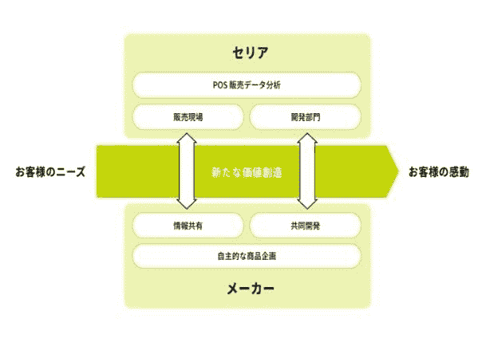

5 6 7 8 9 10 11

\- 5,000 10,000 15,000 20,000 25,000

存货（左轴） Seria存货周转率（右轴） Watts存货周转率（右轴）

94.6% 94.8% 95.0% 95.2% 95.4% 95.6% 95.8% 96.0% 96.2%

0% 1% 2% 3% 4% 5% 6%

就业人员比例 临时工比例（右轴）

4000 4500 5000 5500 6000 6500

7.5 8 8.5 9 9.5

平均从业年限 平均薪资（右轴） 日本人均收入（右轴）

31% 32% 33% 34% 35% 36%

54% 55% 56% 57% 58% 59% 60% 61%

FY2010 FY2011 FY2012 FY2013 FY2014 FY2015 FY2016 FY2017 FY2018 FY2019 FY2020 FY2021 FY2022 FY2023

销售成本占比 销售费用占比（右轴）

30% 32% 34% 36% 38% 40% 42% 44% 46%

FY2003 FY2004 FY2005 FY2006 FY2007 FY2008 FY2009 FY2010 FY2011 FY2012 FY2013 FY2014 FY2015 FY2016 FY2017 FY2018 FY2019 FY2020 FY2021 FY2022

毛利率

---

为了进行差异化竞争，**Seria** 抓住女性悦己消费热点，推出**“Color the Days”**店铺。企业通过设立“Color the Days”店铺，抓住女性悦己主义热点，推出相关产品，如化妆品和护肤品、小饰品、糖果制作用品、手工艺品、个人护理产品、DIY产品等，同时用独特的客制化购物体验留住客户。

**图19：Seria DIY与悦己产品**

**图20：Seria：Color the Days经营理念**

数据来源：*Seria*公司公告，中信建投证券

数据来源：*Seria*公司公告，中信建投证券

**图21：Seria：Color the days店铺占比持续上升达80%**

数据来源：*Seria*公司公告，中信建投证券

上述经营战略最终反应于商品结构之上，**Seria** 并未顺应刚需消费增加的趋势，而是积极布局个性化消费市场。根据企业年报，企业认为百元店业态竞争激烈，而食品饮料等低毛利产品竞争尤甚，因此企业选择加大高毛利日用产品方面的产品开发，从而在“百元店”这一前提下打出了“高质”、“个性化”的标签。与之相对应的，企业更加重视在经济发达地区和未进入地区的扩张，以吸收中产下沉市场。

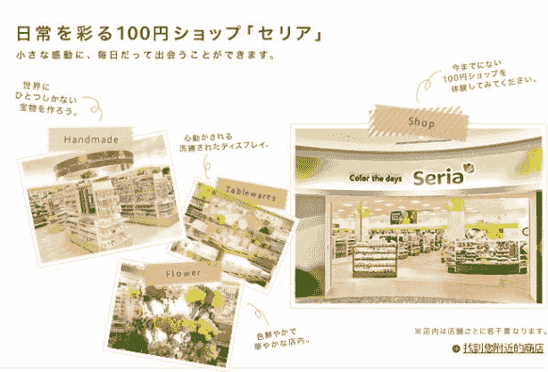

0% 10% 20% 30% 40% 50% 60% 70% 80% 90%

0 500 1000 1500 2000 2500

FY2014 FY2015 FY2016 FY2017 FY2018 FY2019 FY2020 FY2021 FY2022 FY2023

直营店数量（家） Color the days数量（家） Color the days比例（右轴）

---

**图22：Seria分产品品类占比（%）**

**图23：Seria分产品品类YOY（%）**

数据来源：*Seria*公司公告，中信建投证券

数据来源：*Seria*公司公告，中信建投证券

**图24：Seria分地区店铺数及增长（家，%）**

数据来源：*Seria*公司公告，中信建投证券。注：经济发达地区包括：北海道东北地区，中国四国地区，关西地区；经济欠发达地区包括：关东甲信越地区、东海北陆地区、关西地区

94% 95% 96% 97% 98% 99% 100%

日用百货 食品 其他

\-20% -15% -10% -5% 0% 5% 10% 15%

日用百货YOY 食品YOY

\- 10 20 30 40 50 60 70 80 90

\- 200 400 600 800 1,000 1,200 1,400 1,600

FY2015 FY2016 FY2017 FY2018 FY2019 FY2020 FY2021 FY2022 FY2023

经济发达地区店铺数（家） 经济欠发达地区店铺数（家） 经济发达地区净增店铺数（右轴） 经济欠发达地区净增店铺数（右轴）

---

**图25：Seria分地区营业额及增长（亿日元，%）**

数据来源：*Seria*公司公告，中信建投证券

**图26：Seria营收、客单价、客流月度同比（%）**

数据来源：*Seria*公司公告，中信建投证券

\- 20 40 60 80 100 120 140

\- 200 400 600 800 1,000 1,200 1,400 1,600

FY2015 FY2016 FY2017 FY2018 FY2019 FY2020 FY2021 FY2022 FY2023

经济发达地区营收（亿日元） 经济欠发达地区营收（亿日元） 经济发达地区营收净增（右轴） 经济欠发达地区营收净增（右轴）

\-20% -15% -10% -5% 0% 5% 10% 15% 20%

2018年4月 2018年6月 2018年8月 2018年10月 2018年12月 2019年2月 2019年4月 2019年6月 2019年8月 2019年10月 2019年12月 2020年2月 2020年4月 2020年6月 2020年8月 2020年10月 2020年12月 2021年2月 2021年4月 2021年6月 2021年8月 2021年10月 2021年12月 2022年2月 2022年4月 2022年6月 2022年8月 2022年10月 2022年12月 2023年2月

营业额月度YOY 客流月度YOY 客单价月度YOY

---

**图27：Seria公司SG&A费用率（%）**

**图28：Seria公司人工费率和租金率（%）**

数据来源：*Seria*公司公告，中信建投证券

数据来源：*Seria*公司公告，中信建投证券

迎合性价比和女性消费趋势，公司股价大幅上涨；后续门店扩张放缓、成本上升，公司股价下行。公司切入细分市场提供高性价比产品，契合消费者追求低价产品的需求，同时捕捉到了女性就业率提升带来的消费机遇。不过，公司门店扩张逐步放缓，截至2018年3月财年，公司门店增速下降到6%以下。2019年3月财年，公司销售和管理费用上升幅度较大，其中人员成本和租金均有明显涨幅，同时公司门店扩张进一步放缓，尚未门店出海寻求新的增长点，业绩增速放缓叠加估值下行，公司股价表现不如2018年以前的高速增长期。

**图29：Seria 2003年以来股价表现**

数据来源：*Wind*，中信建投证券

### （二）神户物产：低定价与差别化产品驱动的预制菜硬折扣企业

神户物产是日本排名第二的预制菜企业，通过产品的低定价和差别化的产品策略吸引消费者，同时利用**FC** 加盟的轻资产模式和**PB** 产品（自有品牌产品）的进口与自生产管控成本，在较长时间内实现了高增长。

上市后，公司的业绩爆发主要体现于三个时间点：（1）2008-2009财年，公司主要通过收购食品工厂，显著扩大了产能。（2）2013-2014财年，公司通过继续收购工厂进一步扩大产能，同时，通过收购Cook Innoventure等公司开展创新厨房项目，实现了营收和利润的双增长。但创新厨房项目后续表现不佳，最终被出售。（3）2019年后，居家需求使得公司PB产品表现良好，其在综艺的成功营销也使得其PB产品爆红，从而抵御疫情影响持续增长。

33.5 33.2 32.5 32.8 33.4 33.6 32.7 33.3 34.7 34.5

31 31.5 32 32.5 33 33.5 34 34.5 35

SG&A费用率

13.8 13.5 13.4 13.9 14.2 14.2 14.1 14.3 14.5 14.5

10.7 10.8 10.7 10.7 11 11.1 10.8 11.3 11.7 11.8

8 9 10 11 12 13 14 15

人工费率 租金率

0 10 20 30 40 50 60

SERIA 日经225

**图30：神户物产营收及增速**

**图31：神户物产利润表现**

数据来源：*Bloomberg*，中信建投证券

数据来源：*Bloomberg*，中信建投证券

神户物产的超市业务发展动力是低价策略和限时促销与**PB** 产品。在低价促销方面，神户物产主要有两类策略。第一，公司的产品价格显著低于同业食品零售。第二，公司会每月对特定产品进行促销。公司的每月特卖活动产品在超过一定购买额后才会产生折扣，也在一定程度上增大了需求。通过低价促销，公司牢牢抓住了中低收入群体和消费降级的中收入群体，实现了营收的稳步增长。

**表1：神户商店原价商品相对于乐天价格优势**

| 品类 | 神户原价（日元） | 乐天（日元） | 神户原价优势 |
| :--- | :--- | :--- | :--- |
| 米油（915g) | 646.29 | 926 | 69.79% |
| 格雷伯爵红茶 | 426.02 | 836 | 50.96% |
| 椰子水(1L) | 384.93 | 1490 | 25.83% |
| 方便绿咖喱面（70g×5） | 438.06 | 1058 | 41.40% |
| 咸酱汤（1kg×10） | 2755 | 3900 | 70.64% |

资料来源：神户物产公司业务超市网站，乐天市场网站，中信建投证券

**表2：神户商店限时折扣商品对乐天价格优势**

| 品类 | 神户折扣（日元） | 神户规格（g） | 神户单价（日元/g） | 乐天（日元） | 乐天规格（g） | 乐天单价（日元/g） | 神户折扣后优势 |
| :--- | :--- | :--- | :--- | :--- | :--- | :--- | :--- |
| 冷冻汉堡肉 | 397.44 | 960 | 0.41 | 410 | 300 | 1.37 | 30.29% |
| 芝麻油 | 321.84 | 300 | 1.07 | 438 | 300 | 1.46 | 73.48% |
| 菜籽油 | 300.24 | 1000 | 0.30 | 432 | 1000 | 0.43 | 69.50% |
| 雀巢咖啡经典 | 397.44 | 175 | 2.27 | 1060 | 175 | 6.06 | 37.49% |
| 炸什锦 | 278.64 | 400 | 0.70 | 600 | 400 | 1.50 | 46.44% |

资料来源：神户物产公司业务超市网站，乐天市场网站，中信建投证券

0% 5% 10% 15% 20% 25%

0 500 1000 1500 2000 2500 3000 3500 4000 4500 5000

2006 2007 2008 2009 2010 2011 2012 2013 2014 2015 2016 2017 2018 2019 2020 2021 2022 2023

营业收入（亿日元） 营业收入YOY（右轴）

0% 1% 2% 3% 4% 5% 6% 7% 8%

0 50 100 150 200 250 300 350

2006 2007 2008 2009 2010 2011 2012 2013 2014 2015 2016 2017 2018 2019 2020 2021 2022 2023

营业利润（亿日元） 归母净利润（亿日元） 营业利润率（右轴） 净利率（右轴）

**图32：神户物产限时特卖活动海报**

**图33：神户物产最低促销购买量设置**

数据来源：神户物产公司官网，中信建投证券

数据来源：神户物产公司官网，中信建投证券

除了低价促销外，公司的**PB** 产品具有差异化竞争优势，能够给予顾客优质的消费体验。公司的PB产品主要产生于自主生产和海外进口，同时覆盖B端批发与C端零售，目标群体精确且覆盖面广。

（1）公司提供传统日式产品以吸引家庭主妇，推出了“妈妈的味道”系列食品。（2）公司也满足了个性化的需求以吸引年轻顾客和对外国口味有特殊要求的中等等收入群体，如中国台湾维生素面包、洽洽瓜子等。（3）公司还瞄准工薪阶层，推出一系列速食食品，如冷冻乌冬面、三文鱼片等。（4）公司保持了较高的产品更新速度，这一做法成功满足了消费者对多样化产品的需求，保持了消费者的新鲜感。

**图34：神户物产自生产PB产品**

**图35：神户物产进口PB产品**

数据来源：神户物产公司业绩说明会，中信建投证券

数据来源：神户物产公司业绩说明会，中信建投证券

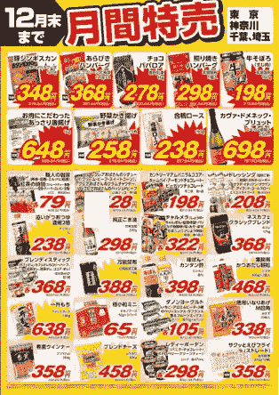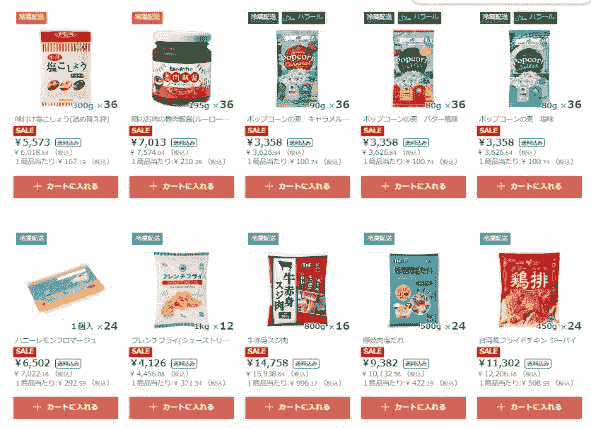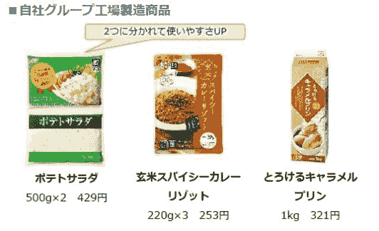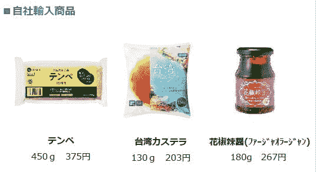

**图36：神户物产月度新品举例**

**图37：神户物产商品陈列**

数据来源：神户物产业务超市网站，中信建投证券

数据来源：神户物产业务超市网站，中信建投证券

除了进行产品的精进与革新，公司借助综艺进行营销。2019年2月17日，公司通过TBS综艺《坂上指原不垮的店》成功营销，短期出货量持续上升。

**2020** 年，随着疫情到来，公司的预制菜类产品满足了日本社会的“宅家需求”。2020年上半年公司出货量同比较2019年大幅上升，与零售业整体因疫情下行形成了对比。

**图38：综艺播出前后神户物产出货量同比**

**图39：日本首例新冠肺炎病例前后神户物产出货量同比**

数据来源：神户物产公司官网，中信建投证券

数据来源：神户物产公司官网，中信建投证券

**2018** 年以后，公司的**PB** 产品常年居于**30%**以上，公司内部采购总额占总采购的比例也呈上升趋势。PB产品帮助公司打出品牌效应并培养消费习惯，给消费者留下了低价高质、食品安全的企业形象，为公司创造了良好的营收。

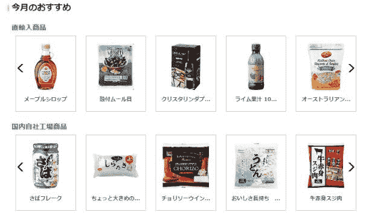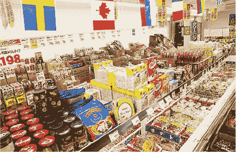

100% 105% 110% 115% 120%

直辖店现存店出货量同比 直辖店总出货量同比 全部业务超市出货量同比

100% 105% 110% 115% 120% 125% 130% 135% 140%

直辖店现存店出货量同比 直辖店总出货量同比 全部业务超市出货量同比

**图40：神户物产生产总额与内部采购总额**

**图41：神户物产PB产品占比稳步提升**

数据来源：神户物产公司公告，中信建投证券。注：公司2021年剥离创意厨房项目导致内部采购下降

数据来源：神户物产公司公告，中信建投证券

0 100 200 300 400 500

生产总额（亿日元） 内部采购总额（亿日元）

27.61% 34.57%

20% 22% 24% 26% 28% 30% 32% 34% 36%

FY2016Q1 FY2016Q3 FY2017Q1 FY2017Q3 FY2018Q1 FY2018Q3 FY2019Q1 FY2019Q3 FY2020Q1 FY2020Q3 FY2021Q1 FY2021Q3 FY2022Q1 FY2022Q3 FY2023Q1 FY2023Q3

食品类是公司的主要产品，这类刚需类产品需求弹性较小，标准化程度高，且公司具有**B** 端**C** 端两类客户。因此，神户物产超市业务的主要经营模式为**FC** 加盟，其业务超市店铺数快速扩张。在2019年后，为了实现更多地区的扩张，公司将经济较为发达的直辖区和欠发达的非直辖区的加盟条件进行分割，以差异化模式加快FC店的扩张。

总体而言，神户物产的直辖地扩张速度更快。一方面，由于“一县一家”的保护条款限制了非直辖区的店铺扩张；另一方面，经济发达地区城市中产对于便捷的预制菜产业需求更大。因此，神户物产优先直辖地区扩张，将经营不善店铺进行转移的战略，为其带来了长久的增长。

从单店营收来看，**FC** 加盟店的增长韧性要强于直营店。虽然加盟店的单店营收不及直营店，但是加盟店的增长更加稳健，总体复合增长率超过直营店。

**表3：神户物产加盟条件一览表**

| 年份 | 项目 | 直辖区 | 非直辖区 |
| :--- | :--- | :--- | :--- |
| 2018-2020年 | 加盟费 | 200万日元+税金 | |
|  | 保证金 | 1000万日元 | |
|  | 特许权使用费 | 总进货额的1% | |
|  | 订货系统使用费 | 2018年每月38570日元，其余年份无该费用 | |
| 2021-2023年 | 加盟费 | 200万日元 | 当地人口×2日元 |
|  | 保证金 | 1000万日元 | 当地人口×5日元 |
|  | 特许经营费 | 总进货额1% | 购入商品额的1% |
|  | 店铺限制 | 无 | 一县一家 |
|  | 设备费 | 保温设备2021年2000-2900万日元，2022及2023年3200-3800万日元，其他费用视情况而定。 | |
|  | 配送费 | 公司负担 | 双方协商决定 |

资料来源：神户物产公司公告，中信建投证券

## 行业深度报告

商贸零售

请务必阅读正文之后的免责条款和声明。

图42：神户物产旗下业务超市快速扩张

图43：神户物产加盟及业务超市收入（亿元）

数据来源：神户物产公司公告，中信建投证券

图44：神户物产直辖地与非直辖地的FC扩张

数据来源：神户物产公司公告，中信建投证券

0%

2%

4%

6%

8%

10%

0

200

400

600

800

1000

1200

公司业务超市总数

YOY（右轴）

98.0%

98.5%

99.0%

99.5%

0

1000

2000

3000

4000

5000

连锁加盟

业务超市总计

加盟收入占比（右轴）

0%

2%

4%

6%

8%

10%

12%

0

100

200

300

400

500

600

700

2012/10 2013/10 2014/10 2015/10 2016/10 2017/10 2018/10 2019/10 2020/10 2021/10 2022/10 2023/10

直辖地加盟数（家）

其他地区加盟数（家）

直辖地YOY（右轴）

其他YOY（右轴）

图45：神户物产连锁店和直营店单店营收及增长

数据来源：神户物产公司公告，中信建投证券。注：加盟门店单店收入为公司报表收入口径，公司针对加盟门店进货抽成×1%。

在利润端，FC加盟模式降低了企业的成本负担，使之能够保持持续低价。相比于直营模式，加盟模式由各加盟店自负盈亏，而神户物产的营收则是由加盟店的采购量决定。因此，神户物产只需进行产品研发和营销，而不必进行加盟店的细分管理。其员工费用和管理费用被大大降低。

在资产负债端，FC加盟模式是一种轻资产经营模式，大大提高了企业资产周转率。轻资产模式有利于企业获得现金和进行更快的扩张，表现出了企业的高营运能力。同为折扣店，神户物产的资产周转率显著高于PPIH。

图46：神户物产员工成本下降

图47：神户物产与Seria的SG&A费率对比

数据来源：神户物产公司公告，中信建投证券

数据来源：Bloomberg，中信建投证券。神户物产报告期截至10月31日，Seria报告期截至3月31日。FY2023对应神户物产的报告期为2022/10/31—2023/10/31，FY2023对应Seria报告期为2023/3/31—2024/3/31。

PB产品的背后是公司稳定的供应链，强大的自我供应能力也显著降低了成本。公司具有成熟的自营农场和制造所。虽然其农场面积和制造所子公司在2016年之后并未扩张，但是其产能仍能支持公司内部采购上升的需求，单位生产额和单位内部采购额也稳步上升，强力支持了公司的PB品牌需求。

-30%

-25%

-20%

-15%

-10%

-5%

0%

5%

10%

15%

20%

25%

0

2

4

6

8

10

12

14

16

2012/10 2013/10 2014/10 2015/10 2016/10 2017/10 2018/10 2019/10 2020/10 2021/10 2022/10 2023/10

加盟单店营收（亿日元）

直营单店营收（亿日元）

加盟单店营收YOY（右轴）

直营单店营收YOY（右轴）

0%

1%

2%

3%

4%

5%

6%

0

1000

2000

3000

4000

5000

6000

员工总数（人）

人员费用占比（右轴）

0%

5%

10%

15%

20%

25%

30%

35%

40%

Seria

神户物产

图48：神户物产具有较多的自生产机构

图49：神户物产海外供应来源

数据来源：神户物产公司公告，中信建投证券

图50：神户物产自生产和内部供应情况

数据来源：神户物产公司公告，中信建投证券

0

5

10

15

20

25

30

35

40

45

2012年

2013年

2014年

2015年

2016年

2017年

2018年

2019年

2020年

2021年

2022年

2023年

农场面积总计（平方公里）

制造所总数（家）

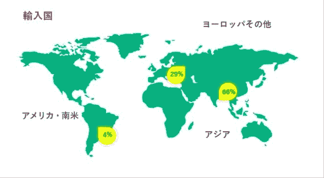

-60%

-40%

-20%

0%

20%

40%

60%

80%

-50

100

150

200

250

300

350

400

450

2014/10

2015/10

2016/10

2017/10

2018/10

2019/10

2020/10

2021/10

2022/10

2023/10

生产总额（亿日元）

内部采购总额（亿日元）

生产总额YOY（右轴）

内部采购总额YOY（右轴）

图51：神户物产单位生产能力稳步提升

数据来源：神户物产公司公告，中信建投证券。注：单位面积生产额=生产总额/农场总面积，单工厂生产额=生产总额/制造所总数。

图52：神户物产单位供应能力稳步提升

数据来源：神户物产公司公告，中信建投证券

由于公司主要生产预制菜类刚需产品，公司整体毛利率较低。2011年公司自供应链稳定后，上市后公司股价与营收增长率相关度较高。2011年以前，由于公司收购食品公司带来的不确定性和利润端较大的波动，导致市场对公司的预期较为不稳定，股价与营收增长相关性弱。公司股价在2011年，尤其是2015年之后大幅增长，主要原因在于公司强劲的业绩表现：一方面公司门店稳步扩张；另一方面，公司严格控制成本费用，规模效应进一步降低费用率。因此，公司营业利润增速好于收入增速，市场给予积极反馈。

-20%

-10%

0%

10%

20%

30%

40%

50%

60%

70%

0

5

10

15

20

25

30

2013/10

2014/10

2015/10

2016/10

2017/10

2018/10

2019/10

2020/10

2021/10

2022/10

2023/10

单位面积生产额（亿日元/平方公里）

单工厂生产额（亿日元/家）

单位面积生产额YOY（右轴）

单工厂生产额YOY（右轴）

-50%

-40%

-30%

-20%

-10%

0%

10%

20%

30%

40%

0

5

10

15

20

25

30

2013/10

2014/10

2015/10

2016/10

2017/10

2018/10

2019/10

2020/10

2021/10

2022/10

2023/10

单位面积内部销售额（亿日元/平方公里）

单店内部销售额（亿日元/家）

单位面积内部销售额YOY（右轴）

单店内部销售额YOY（右轴）

图53：神户物产2006年以来股价表现

数据来源：Wind，中信建投证券

图54：神户物产营收增速与营业利润增速

图55：神户物产SG&A费率下降

数据来源：Bloomberg，中信建投证券

数据来源：Bloomberg，中信建投证券

0

5

10

15

20

25

神户物产

日经225

0%

10%

20%

30%

40%

50%

60%

70%

80%

2015 2016 2017 2018 2019 2020 2021 2022 2023

营业收入YOY

营业利润YOY

0%

2%

4%

6%

8%

10%

12%

14%

神户物产

图56：神户物产店铺出货量同比

数据来源：神户物产公司公告，中信建投证券

### （三）J.零售前线：衣物消费与高端消费遇冷，业绩持续承压

J.零售前线是一个以百货店业务为主的零售企业，其还具有超市业务、建装业务等其他业务。公司的股价下跌主要可以归因为以下两方面：商品吸引力的下降与公司管理的低效。

企业自上市以来，营收出现两次较大的下降：（1）2010—2012财年，受金融危机影响，日本非刚需高端消费与衣物消费下滑严重，导致公司营收出现下滑。直到疫情前，公司营收虽有所恢复，但是仍然未扭转颓势。（2）2021财年，受疫情影响，公司的商品定位失误被持续放大，2021财年营业利润出现亏损。虽然疫情后有所恢复，但是仍然不足疫情前的80%，进一步影响了公司股价。

图57：J.零售前线营收及同比（旧口径）

图58：J.零售前线营收及同比（新口径）

数据来源：J.零售前线公司公告，中信建投证券

90%

95%

100%

105%

110%

115%

120%

125%

130%

135%

140%

2016年11月

2017年1月

2017年3月

2017年5月

2017年7月

2017年9月

2017年11月

2018年1月

2018年3月

2018年5月

2018年7月

2018年9月

2018年11月

2019年1月

2019年3月

2019年5月

2019年7月

2019年9月

2019年11月

2020年1月

2020年3月

2020年5月

2020年7月

2020年9月

2020年11月

2021年1月

2021年3月

2021年5月

2021年7月

2021年9月

2021年11月

2022年1月

2022年3月

2022年5月

2022年7月

2022年9月

2022年11月

2023年1月

2023年3月

2023年5月

2023年7月

2023年9月

直辖店现存店出货量同比

直辖店总出货量同比

全部业务超市出货量同比

-15%

-10%

-5%

0%

5%

10%

15%

20%

0

2000

4000

6000

8000

10000

12000

14000

营业收入（亿日元）

营业收入YOY（右轴）

-40%

-35%

-30%

-25%

-20%

-15%

-10%

-5%

0%

5%

10%

15%

0

1000

2000

3000

4000

5000

6000

营业收入（亿日元）

营业收入YOY（右轴）

图59：J.零售前线利润端表现（旧口径）

图60：J.零售前线利润端表现（新口径）

数据来源：J.零售前线公司公告，中信建投证券

公司的主要市场定位为面向高收入群体和中年女性群体，因此，其商品设置、自有品牌和入驻品牌具有鲜明的“高端男女服装”特征。公司提出的用于差异化竞争和吸引女性消费者的ufufugirls计划针对30岁左右的女性，引入了时尚服装、美妆、配饰等方面的品牌。但这类品牌也并未跳出公司“高端化”的整体战略。

图61：J.零售前线市场定位

图62：J.零售前线PB品牌

数据来源：J.零售前线公司公告，中信建投证券

数据来源：J.零售前线公司公告，中信建投证券

0%

1%

2%

3%

4%

5%

0

100

200

300

400

500

600

营业利润（亿日元）

归母净利润（亿日元）

营业利润率（右轴）

归母净利率（右轴）

-10%

-5%

0%

5%

10%

15%

-300

-100

100

300

500

700

FY2018 FY2019 FY2020 FY2021 FY2022 FY2023

营业利润（亿日元）

归母净利润（亿日元）

营业利润率（右轴）

归母净利率（右轴）

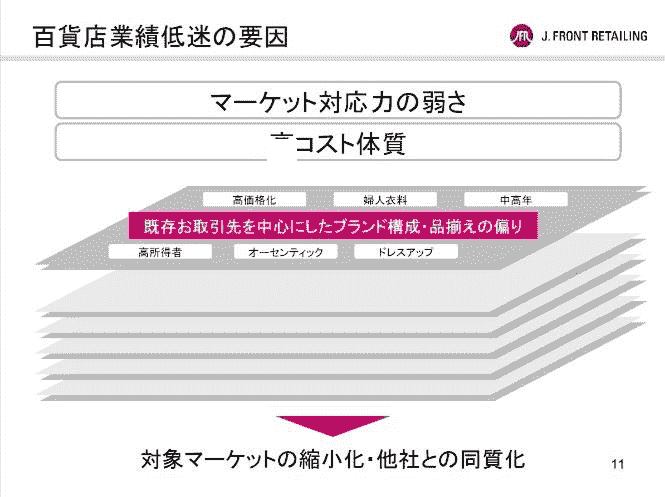

图63：ufufugirls经营理念

图64：ufufugirls入驻品牌

数据来源：J.零售前线公司公告，中信建投证券

数据来源：J.零售前线公司公告，中信建投证券

从具体商品来看，公司商品单价要显著高于日本市面上的畅销品牌。以ufufugirls计划的引入品牌来看，其畅销的女装单价要显著高于日本以优衣库为代表的畅销品牌的单价。以Dear Princess为例，其价格为优衣库同类商品的5—6倍。在整体消费降级的日本缺乏竞争力。

表4：J.零售前线ufufugirls计划入驻品牌前十畅销单品单价（日元）与优衣库对比

| 畅销排名 | Dear Princess | KBF | Vicky | 优衣库 |
|---|---:|---:|---:|---:|
| 1 | 20600 | 15400 | 5940 | 7990 |
| 2 | 26400 | 18700 | 7920 | 6990 |
| 3 | 25300 | 4950 | 8910 | 6990 |
| 4 | 17380 | 15400 | 8910 | 7990 |
| 5 | 17380 | 13200 | 7920 | 3990 |
| 6 | 47300 | 7150 | 8910 | 2990 |
| 7 | 26400 | 13200 | 9900 | 2990 |
| 8 | 47300 | 9350 | 6930 | 2990 |
| 9 | 25300 | 18700 | 11000 | 2990 |
| 10 | 26400 | 16830 | 11000 | 3990 |
| 均价 | 27976 | 13288 | 8734 | 4990 |
| 相比于优衣库的价格差额 | 460.64% | 166.29% | 75.03% | — |

资料来源：J.零售前线公司官网，优衣库官网，各品牌官网，中信建投证券

公司的商品战略在其营收数据中也有所体现。从分商品营收来看，公司的衣物品营收一直处于较高水平，其波动幅度也大于其他产品，对公司营收产生了较为重大的影响。

从更加宏观的视角来看，日本家庭衣物消费支出长期处于下行状态，虽然公司衣物品营收占比并未明显下滑，但是这一高占比是以整体营收下滑为代价的。

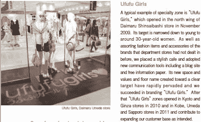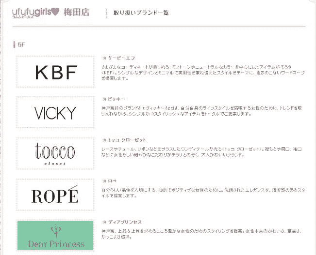

在公司营收下行、也是日本整体经济承压较为明显的阶段，公司的刚需类食品原料产品占比有所增加。这一现象更加说明了公司的商品定位难以适应市场变化，反而自身的营收结构受到了市场的影响。

图65：J.零售前线FY2017及以前百货事业分产品营收（左轴，亿日元）和占比（右轴）

数据来源：J.零售前线公司年报，中信建投证券

图66：J.零售前线FY2018及以后百货事业分产品营收（左轴，亿日元）和占比（右轴）

数据来源：J.零售前线公司公告，中信建投证券

注：FY2018后，公司百货业数据于大丸松坂屋百货店个别决算体系披露如下。

20%

25%

30%

35%

40%

45%

0

1000

2000

3000

4000

5000

6000

7000

8000

FY2008

FY2009

FY2010

FY2011

FY2012

FY2013

FY2014

FY2015

FY2016

FY2017

衣物品

随身物品

家庭用品

食品原料

其他

衣物品占比

食品原料占比

15%

20%

25%

30%

35%

40%

45%

50%

0

1000

2000

3000

4000

5000

6000

7000

FY2018

FY2019

FY2020

FY2021

FY2022

FY2023

衣物品

随身物品

杂货

家庭用品

食品原料

其他

衣物品占比

食品原料占比

图67：日本家庭服装支出与YOY

数据来源：Wind，中信建投证券

图68：J.零售前线FY2017及以前百货分产品营收YOY

图69：J.零售前线FY2018及以后公司百货分产品营收YOY

数据来源：J.零售前线公司公告，中信建投证券

数据来源：J.零售前线公司公告，中信建投证券

公司在客户粘性方面也表现不佳。与唐吉诃德类似，公司也推出了会员服务和信用卡支付系统。公司会员服务虽然起步较早，活跃用户数却常年出现负增长，活跃会员贡献的营收也出现了连年下滑。这一现象也反映了公司对既有消费者吸引力的下降。

-20%

-15%

-10%

-5%

0%

5%

10%

0

2,000

4,000

6,000

8,000

10,000

12,000

2007

2008

2009

2010

2011

2012

2013

2014

2015

2016

2017

2018

2019

2020

2021

2022

2023

日本家庭服装支出（左轴，日元）

日本家庭服装支出YOY（右轴）

-15%

-10%

-5%

0%

5%

10%

15%

20%

衣物品

食品原料

总计

-40%

-30%

-20%

-10%

0%

10%

20%

30%

40%

FY2018

FY2019

FY2020

FY2021

FY2022

FY2023

衣物品

食品原料

总计

## 27 行业深度报告

商贸零售

请务必阅读正文之后的免责条款和声明。

图70：J.零售前线百货店与PPIH会员数量与YOY对比

数据来源：J.零售前线公司公告，PPIH公司公告，中信建投证券

图71：J.零售前线百货店与PPIH会员销售额与YOY对比

数据来源：J.零售前线公司公告，PPIH公司公告，中信建投证券

最终，上述因素表现于消费者对公司产品消费欲望的下降。在对公司的营收来源进行拆分之后不难看出，公司整体的客单价保持了相对稳定，但是公司的总客流、购买率均表现出了较大的下降趋势，导致了总消费客流的下降，最终反映于总消费额的下降。

-30%

-20%

-10%

0%

10%

20%

30%

40%

50%

60%

0

200

400

600

800

1000

1200

1400

1600

1800

FY2014

FY2015

FY2016

FY2017

FY2018

FY2019

FY2020

FY2021

FY2022

FY2023

零售前线百货店活跃会员总数（万人）

PPIH会员总数（万人）

零售前线百货店会员总数YOY（右轴）

PPIH会员数YOY（右轴）

-30%

-15%

0%

15%

30%

45%

60%

75%

90%

0

1000

2000

3000

4000

5000

6000

7000

8000

9000

10000

FY2014

FY2015

FY2016

FY2017

FY2018

FY2019

FY2020

FY2021

FY2022

FY2023

零售前线百货店会员销售额（亿日元）

PPIH会员销售额（左轴，亿日元）

零售前线百货店会员销售额YOY（右轴）

PPIH会员销售额YOY（右轴）

## 28 行业深度报告

商贸零售

请务必阅读正文之后的免责条款和声明。

图72：J.零售前线百货业疫情前总客流、客单价、购买率、总消费客流和总消费额变化

数据来源：J.零售前线公司公告，中信建投证券，注：购买率=收到的收据/入店客

图73：J.零售前线百货业疫情后总客流、客单价、购买率、总消费客流和总消费额变化

数据来源：J.零售前线公司公告，中信建投证券

公司表现不佳的另一个原因是管理效率的低下。在公司费用中，占营业收入之比最高的是人员费用和其他费用。在去除2017财年会计准则变更的影响后，公司的费用率下降仍不明显，人员费用波动上升，其他费用（包括中国准则中的管理费用等科目）在变更后呈现持续上升趋势。

-8%

-6%

-4%

-2%

0%

2%

4%

6%

8%

10%

FY2011

FY2012

FY2013

FY2014

FY2015

FY2016

FY2017

FY2018

FY2019

总客流YOY

客单价YOY

购买率变化

总消费客流YOY

总消费额YOY

-60%

-50%

-40%

-30%

-20%

-10%

0%

10%

20%

30%

FY2019

FY2020

FY2021

FY2022

FY2023

总客流YOY

客单价YOY

购买率变化

总消费客流YOY

总消费额YOY

## 29 行业深度报告

商贸零售

请务必阅读正文之后的免责条款和声明。

图74：J.零售前线各类费用总额（亿日元）与人员费用和其他费用占比（右轴）

数据来源：J.零售前线公司公告，中信建投证券

公司以直营模式为主，兼职工比例不高，员工成本较高。直营模式为主导致公司需要对门店的员工成本负责，加之全职员工的增加，不可避免地造成了公司平均薪资的上升。与大量采用兼职员工的高岛屋相比，公司平均工资明显较高。

图75：J.零售前线与高岛屋平均工资（百万日元）

图76：零售前线与高岛屋兼职员工比例

数据来源：J.零售前线、高岛屋公司公告，中信建投证券

数据来源：J.零售前线、高岛屋公司公告，中信建投证券

最终，公司经营能力持续下挫，表现为总资产周转率的低下。由于公司业务的持续承压，公司重资产的直营模式严重影响了公司资产的变现能力。公司的总资产周转率持续低于1，即使相比于同为百元店的Seria，也有着较大的差距。

0%

2%

4%

6%

8%

10%

12%

14%

16%

18%

-

500

1,000

1,500

2,000

2,500

3,000

FY2008FY2009FY2010FY2011FY2012FY2013FY2014FY2015FY2016FY2017FY2018FY2019FY2020FY2021FY2022FY2023

人员费用

广告宣传费

租赁费

作业费

折旧费

包装和配送费

其他费用

人员费用占比

其他费用占比

0

2

4

6

8

零售前线

高岛屋

0%

10%

20%

30%

40%

50%

60%

高岛屋兼职员工比例

零售前线兼职员工比例

## 30 行业深度报告

商贸零售

请务必阅读正文之后的免责条款和声明。

图77：J.零售前线营业收入、总资产情况（左轴，亿日元）及总资产周转率对比

数据来源：J.零售前线公司公告，Seria公司公告，中信建投证券

2018年以前，J.零售前线股价整体走势与大盘一致；2018年与2020年明显跑输大盘。2018年以前，公司股价大幅调整的时期为2016年。一方面，2016年公司百货部分购买免税产品的顾客下滑；另外一方面，客流继续下降的同时客单价几乎没有增长、购买率（转化率）下降，因此百货部门店铺销售下降。消费行业复苏乏力，同时台风等天气影响公司营业和客流，而公司运营成本上升。2018年公司业绩下滑使得股价表现不佳，公司百货部门营业利润由282.97亿日元下降至265.29亿日元，其中，SG&A费用上升产生负面贡献15.58亿元，其他营业收入减少33.63亿元。

图78：J.零售前线大丸松坂屋客流、客单和购买率（%）

图79：J.零售前线大丸松坂屋百货店免税销售额

数据来源：J.零售前线公司公告，中信建投证券

数据来源：J.零售前线公司公告，中信建投证券

0

0.5

1

1.5

2

2.5

0

20

40

60

80

100

120

140

FY2014

FY2015

FY2016

FY2017

FY2018

FY2019

FY2020

FY2021

FY2022

FY2023

零售前线营业收入（旧口径）

零售前线总资产

零售前线总资产周转率

Seria总资产周转率

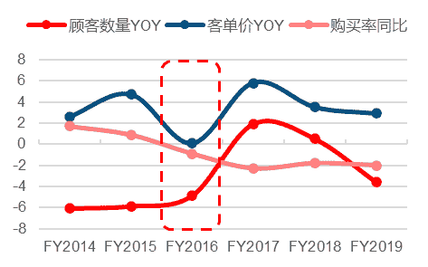

-4.5

-40%

-30%

-20%

-10%

0%

10%

20%

30%

0

100000

200000

300000

400000

500000

600000

700000

800000

免税销售额（百万日元）

YOY（%，右轴）

## 31 行业深度报告

商贸零售

请务必阅读正文之后的免责条款和声明。

图80：J.零售前线2007年以来股价表现

数据来源：Wind，中信建投证券

图81：J.零售前线客流月度同比

数据来源：J.零售前线公司公告，中信建投证券

0

0.5

1

1.5

2

2.5

3

J.FRONT RETAILING

日经225

-50%

-40%

-30%

-20%

-10%

0%

10%

20%

30%

40%

50%

2012年3月

2012年6月

2012年9月

2012年12月

2013年3月

2013年6月

2013年9月

2013年12月

2014年3月

2014年6月

2014年9月

2014年12月

2015年3月

2015年6月

2015年9月

2015年12月

2016年3月

2016年6月

2016年9月

2016年12月

2017年3月

2017年6月

2017年9月

2017年12月

2018年3月

2018年6月

2018年9月

2018年12月

2019年3月

2019年6月

2019年9月

2019年12月

2020年3月

2020年6月

2020年9月

2020年12月

2021年3月

2021年6月

2021年9月

2021年12月

2022年3月

2022年6月

2022年9月

2022年12月

百货店月度客流YOY

## 三、殡葬：老龄化催生需求，供给增加竞争加剧

日本殡葬行业分为三阶段：

1. 2000年—2012年为快速增长阶段：日本老龄化加剧，死亡人数逐年递增，殡葬需求量大，行业规模增长；
2. 2013年—2019年为饱和阶段：虽然葬礼规模减小和竞争导致的客单价下降，但是需求继续增加，行业规模整体保持稳定；
3. 2020年—2023年为疫情冲击阶段：受疫情影响，行业规模急剧下降后回升。

图82：日本殡葬行业规模（百万日元）

图83：日本殡葬行业员工数量（人）

数据来源：日本经济产业省，中信建投证券

数据来源：日本经济产业省，中信建投证券

整体来看，日本老龄化加剧，葬礼需求量日益增多。日本老龄化现象严重，65岁及以上老人占总人数的比例从1970年的7.06%急速上升至2020年的28.56%，死亡人数逐年增加，2000年死亡人数为96.1万余人，2019年死亡人数已高达138万余人，殡葬行业的需求量随之日益增加，使得日本殡葬行业的行业规模从2000年的2.6兆日元上升至5.6兆日元。

图84：日本人口结构（万人）

图85：日本死亡人数

数据来源：日本统计局，中信建投证券

数据来源：日本统计局，中信建投证券

家庭人口数减少驱动的丧葬观念变化，行业客单价下降。葬礼费用大致分为三个部分：丧葬费、餐饮费和回礼费，其中丧葬费所占比重最大，约占65%。丧葬费是指举行葬礼所需的一套费用，如“殡仪馆费用”“棺材”和“交通费用”。餐饮费用和礼品是可变成本，一般来说，费用与参加人数成比例增加。

0

100000

200000

300000

400000

500000

600000

700000

2000

2001

2002

2003

2004

2005

2006

2007

2008

2009

2010

2011

2012

2013

2014

2015

2016

2017

2018

2019

2020

2021

2022

销售额（百万日元）

客单数（件）

0

5000

10000

15000

20000

25000

30000

2000

2001

2002

2003

2004

2005

2006

2007

2008

2009

2010

2011

2012

2013

2014

2015

2016

2017

2018

2019

2020

2021

2022

从业者数（正式员工）

其他从业者（钟点工、临时工）

0

2000

4000

6000

8000

10000

12000

14000

0-4

5-13

14-17

18-24

25-44

45-64

65岁以上

-2%

0%

2%

4%

6%

8%

10%

0

20

40

60

80

100

120

140

160

180

死亡人数（万人）

死亡人数YOY（右轴）

## 33 行业深度报告

商贸零售

请务必阅读正文之后的免责条款和声明。

丧葬的类型主要有以下五种：一般葬礼、家庭葬礼、一日葬礼、直接土葬和火葬。一般葬是亲朋好友参加，而家族葬只有家族成员和亲戚参加，一日葬只有告别仪式没有守灵。相比其他类型的丧葬，一般葬的规模较大、参与人数较多，费用也更为昂贵。

日本出现老龄化、少子化的趋势，独居老人比例增加，家庭规模下降，使得参礼人数下降，缩减了葬礼的规模。因此，日本丧葬观念转变，小规模葬礼更受青睐，较贵的一般葬转成便宜的一日葬、家庭葬、火葬和土葬，导致丧葬的客单价下降。2009年左右，互联网上出现了以全国统一价格提供低成本葬礼的服务，进一步加剧了客单价的下降。此外，进入丧葬行业的企业日益增多，激烈的行业竞争也是拉低客单价的原因之一。

图86：日本葬礼客单价和企业数量（万日元、个）

数据来源：日本经济产业省，中信建投证券

图87：日本葬礼费用构成（万日元/每次）

图88：日本不同丧葬类型的费用构成（万日元）

数据来源：日本葬礼会社，中信建投证券

数据来源：日本葬礼会社，中信建投证券

0

500

1000

1500

2000

2500

3000

0

20

40

60

80

100

120

140

160

2000

2001

2002

2003

2004

2005

2006

2007

2008

2009

2010

2011

2012

2013

2014

2015

2016

2017

2018

2019

2020

2021

2022

客单价

企业数（右轴）

130.36

33.72

38.82

118.97

31.54

34.47

117.11

29.29

31.85

119.19

31.38

33.76

0.00

20.00

40.00

60.00

80.00

100.00

120.00

140.00

丧葬费

饮食费

礼物

2018-2020

2015-2017

2013-2015

2011-2013

0

50

100

150

200

250

300

丧葬费用

餐饮费用

礼物费用

## 34 行业深度报告

商贸零售

请务必阅读正文之后的免责条款和声明。

图89：日本丧葬选择趋势（%）

图90：日本单次葬礼花费（万日元）

数据来源：日本葬礼会社，中信建投证券

数据来源：日本葬礼会社，中信建投证券

图91：日本老年人数量（千人）和家庭平均人口数量（人）

数据来源：日本国立人口社会保障研究所，中信建投证券

疫情带来的物理隔离，葬礼数量和规模进一步缩减，行业萎缩。殡葬公司主动拒绝葬礼请求，使得葬礼数量减少。同时，即便举行葬礼，许多大型葬礼也无法照常举行，行业规模再一次缩小。同时，日本丧葬观念变化导致客单价下滑，叠加疫情冲击导致的葬礼数量下降，行业规模骤跌。

58.9

31.3

3.9

5.9

52.8

37.9

4.4

4.9

48.9

40.9

5.2

4.9

0

10

20

30

40

50

60

70

一般葬

家庭葬礼

一日葬礼

直接土葬和火葬

2018-2020

2015-2017

2013-2015

0

5

10

15

20

25

30

35

0-40万日元

40-80万日元

80-120万日元

120-160万日元

160-200万日元

200-240万日元

240万日元以上

2018-2020

2015-2017

2013-2015

2011-2013

1.95

2

2.0

2.1

2.15

2.2

2.25

2.3

2.35

0

2000

4000

6000

8000

10000

2015

2020

2025

2030

2035

2040

>65岁

>75岁

家庭平均人数（右轴）

## 35 行业深度报告

商贸零售

请务必阅读正文之后的免责条款和声明。

图92：日本疫情期间实际举行葬礼和希望举行葬礼构成（%）

图93：日本每场葬礼平均参加人数（人）

数据来源：日本葬礼会社，中信建投证券

数据来源：日本葬礼会社，中信建投证券

**Tear**葬仪会馆于1997年7月成立，是一家以殡葬业为主营业务的公司。该公司2006年6月在名古屋证券交易所中心上市；2014年6月，在东京证券交易所第一部和名古屋证券交易所上市，成为殡葬行业第二家在日本东京证券交易所第一部上市的公司。现已成为日本第二大殡葬服务商——仅次于总部位于大阪的老牌企业San控股公司。

图94：Tear公司营业收入（百万日元）

图95：Tear公司毛利率、归母净利率（%）

数据来源：Bloomberg，中信建投证券

数据来源：Bloomberg，中信建投证券

**Tear**公司通过透明报价、会员制度、开设店面，扩大市场，以量补价。21世纪前后，日本人口高度老龄化，日本殡葬业繁荣，许多企业涌入殡葬行业。殡葬业报价模糊，存在收费不透明的问题，在丧葬结束后有许多额外收费，使总费用比哀悼者预计的要高很多。Tear凭借着透明报价的策略，塑造良好公司形象，吸引客户，在众多企业中脱颖而出。接着，推出会员和提携团体（团体制度的会员）制度。在亲人离世前预先注册成为会员和提携团体，当亲人离世后可享受大约10%的折扣，借此成功将声誉变现，提升了订单量。此外，由于葬礼只在客户居住的地区举行，具有当地企业的特征。公司通过开设直营店和加盟店不断扩张版图来提高营业收入，营业收入主要来源于直营业务。

9.8%

4.8%

41.1%

44.0%

0.4%

11.4%

6.9%

55.7%

25.9%

0.2%

0.0%

10.0%

20.0%

30.0%

40.0%

50.0%

60.0%

土葬、火葬

一日葬

家族葬

一般葬

其他

实际举行

本来希望

78

67

64

55

38

0

10

20

30

40

50

60

70

80

90

2011-2013

2013-2015

2015-2017

2018-2020

2022

参加人数

-10%

-5%

0%

5%

10%

15%

20%

25%

0

2000

4000

6000

8000

10000

12000

14000

16000

2006

2007

2008

2009

2010

2011

2012

2013

2014

2015

2016

2017

2018

2019

2020

2021

2022

2023

营业收入

YOY（右轴）

0%

10%

20%

30%

40%

50%

毛利率

归母净利率

## 四、餐饮：低成本与差异化

日本社会饮食方式主要分为内食、中食和外食三大类：

- 内食：是指家庭通过购买未经加工的基础食材，比如生肉、蔬菜和水果，在家进行烹饪处理后就餐。
- 中食：是指消费者在外除了餐厅以外的场所就餐，其中包括便利店、外卖和零售商店购买后直接食用或者简单加工后食用的食物。
- 外食：是指消费者在餐厅进行就餐堂食的饮食方式。

人口老龄化和生育率降低导致日本家庭规模下降明显，日本整体女性劳动率增长显著，使得小型家庭内食人均成本增高，促使人们选择内食倾向下降。根据日本国立社会保障和人口问题研究所的研究数据，从2000年至今，单身家庭比例由2000年的27.6%增长至2022年的36.2%，日本家庭规模下降趋势明显。家庭饮食具有规模效应，日本家庭规模下降使得家庭饮食的人均成本增长。根据日本统计局的日本劳动参与率数据，从2000年到2023年，日本整体劳动率呈现上涨趋势，日本社会中主要负责家庭饮食的女性劳动参与率大幅增长，使得家庭饮食的时间成本和机会成本增长。家庭饮食的经济性变差，促使人们选择内食比例下降。

图104：日本社会饮食方式的变化趋势（亿日元）

数据来源：日本餐饮协会，中信建投证券

经济低迷、日本疯牛病和东日本大震灾影响，消费者倾向和消费信心下降明显，促使人们选择成本更低的饮食方式：低成本外食和中食。根据日本统计局数据，日本家庭餐饮每月平均消费占整体消费的比例从2005年12月的24.35%上升到2023年12月的32.81%，恩格尔系数明显增长，日本民众消费倾向和信心下降明显，餐饮消费更加追求性价比；同时日本家庭结构变化、女性劳动参与率提升，促使人们选择成本更低的饮食方式：低成本的外食和中食。

高端外食行业规模在受上述因素影响下，于2000年到2011年期间持续走低。根据日本餐饮协会数据显示，在2000年到2011年期间，高端外食行业（包括咖啡馆、居酒屋、酒吧和正餐餐厅等）受日本国民消费倾向下降影响，在外食行业比例和行业规模中持续走低，而低端外食行业（包括食堂、快餐等）处于合理波动范围。

图105：日本不同类型外食行业规模（亿日元）

数据来源：日本餐饮协会，中信建投证券

### （一）东利多：深耕细分领域，提供差异化产品，注重客户体验

东利多控股是日本最大的乌冬面连锁店“丸龟制面”的母公司。公司是日本本土领先的餐饮企业之一，旗下拥有2大业态，分别为日本国内餐饮服务和海外餐饮服务。公司拥有二十几个连锁餐饮品牌，包括汉堡快餐类、西式家庭餐饮和本土家庭餐厅。其中面馆包括丸龟制面、ZUNDO-YA、MARUGAME UDON等，西式餐厅包括FRANCO MANCA和THE REAL GREEK等，非面类快餐包括其他品牌。截至2024年4月2日，公司在日本以及海外各项业务拥有1,947家门店，遍布全球30个国家。

图106：东利多旗下品牌

数据来源：东利多公司公告，中信建投证券

乌冬面/荞麦面是日本外食行业最大的单品品类，增速好于整体，同时乌冬面市场连锁化程度低。日本外食行业在战后经历了高速发展期，2000—2011年行业增速有所下降。外食行业中，乌冬面/荞麦面是最大单一品类市场，行业增速好于外食行业平均水平，即便外食行业在2000—2011年行业规模有所下降，但是乌冬面/荞麦面行业规模相对坚挺，降幅较小。日本乌冬面市场连锁化程度较低，集中度不高，在丸龟制面出现以前并没有大规模连锁乌冬面企业。

因此，规模相对较大的细分市场、缺乏连锁化经营的行业环境，为丸龟制面的出现提供了良好契机。

图107：日本外食产业规模（亿日元）

数据来源：日本外食产业协会，中信建投证券

图108：日本乌冬面/荞麦面产业规模（亿日元）

数据来源：日本外食产业协会，中信建投证券

丸龟制面注重客户体验，提供现制鲜食，差异化产品塑造竞争力。日本冻品餐食以及预制食品流行，虽然通过工厂进行预制的食品能够显著降低餐食成本和提高门店效率，但是食物的口感有所牺牲。丸龟制面反其道而行之，采用全开放式厨房现制的方式，而非传统的中央厨房模式。即便采用全开放式厨房现制模式，公司成本并未显著上升，主要原因在于：

- 门店选址在客流大的地区，同时乌冬面用餐时间短，因此门店翻台率高；
- 现制面条的良好口感在消费者群体形成口碑传播，在一定程度上降低营销成本；
- 公司以现制乌冬面引流，提供灵活菜单，采取自助自选模式，通过多种小食来增强菜单吸引力和贡献边际利润，因此，公司客单有所提升，从约18元提高至40元左右。

图109：东利多附加产品：天妇罗

图110：东利多采取开放式厨房和自助自选模式

数据来源：东利多公司官网，中信建投证券

数据来源：东利多公司官网，中信建投证券

公司股价持续跑赢大盘。长期来看，公司在细分市场持续深耕，把握消费者对于鲜食快餐的需求，公司业绩稳健增长，股价长期跑赢大盘。期间公司股价有所回调，例如，一方面，日本经济复苏力度不大；另一方面，行业竞争加剧，公司收入下降，同时劳动力成本上升影响公司利润，2018年公司计提大额减值使得营业利润有所下降，因此股价有所下跌。

图111：东利多2006年以来股价表现

数据来源：Wind，中信建投证券

图112：日本家庭月消费支出增速（%）

数据来源：Wind，中信建投证券

图113：东利多营业收入（百万日元）

图114：东利多减值损失（百万日元）

数据来源：东利多公司公告，中信建投证券

数据来源：东利多公司公告，中信建投证券，注：负数代表损失

### （二）泉盛集团：低成本战略，多品牌矩阵

泉盛集团是日本本土最大的餐饮企业。公司是日本最大的牛肉饭连锁店“食其家”的母公司，旗下拥有4大业态，分别为日本国内餐饮服务、海外餐饮服务、零售和护理。公司拥有三十多个连锁餐饮品牌，包括快餐类、汉堡快餐类、寿司类、西式家庭餐厅等；公司33.6%的营业收入来自于牛肉盖饭业务，15.0%的营业收入来自于餐厅业务，24.7%的营业收入来自于快餐业务，10%的营业收入来自于零售业务和16.6%的营业收入来自于其他业务。截至2023年3月，在日本国内及海外各行各业共有2,283家门店。其中牛肉饭餐厅包括食其家、Nakau，家庭餐厅包括Coco’s、Big Boy、Jolly-Pasta、华屋与兵卫、TAG-1经营的烤肉店等，快餐包括滨寿司等，其他经营品类包括Advanced Fresh Concepts Corp，零售店包括JOY MART经营的超市及United Veggies经营的蔬菜和水果店。

图115：泉盛集团旗下品牌

图116：泉盛集团2024/3财年分板块营业收入

数据来源：泉盛集团公司官网，中信建投证券

数据来源：泉盛集团公司官网，中信建投证券

泉盛集团采用低价策略进行竞争。泉盛集团采用直营模式，其中快餐业务营收占超过50%，牛肉饭业务占到公司整体营业收入的33.6%。由于牛肉饭行业以薄利多销为主，加上有行业龙头吉野家和强劲竞争对手松屋影响，食其家不得已选择价格战抢占市场，几乎自2000年至今二十几年间，食其家牛肉饭价格处于自身强劲竞争对手中的最低价。

表5：各公司牛肉盖饭中份价格

| 日期 | 食其家 | 吉野家 | 松屋 |
|---|---:|---:|---:|
| 2000年 | 400日元 | 400日元 | 400日元 |
| 2001年4月起 | 280日元 | 280日元 | 290日元 |
| 2004年2月起 | 暂停销售 | 停止销售 | 停止销售 |
| 2004年9月起 | 350日元 | 380日元 | 390日元 |
| 2006年10月起 | 350日元 | 380日元 | 380日元 |
| 2009年4月起 | 330日元 | 380日元 | 380日元 |
| 2009年12月起 | 280日元 | 380日元 | 320日元 |
| 2014年4月起 | 270日元 | 300日元 | 290日元 |
| 2014年8月起 | 291日元 | 300日元 | 290日元 |
| 2015年4月起 | 350日元 | 380日元 | 380日元 |
| 2016年11月起 | 350日元 | 380日元 | 380日元 |
| 2019年10月起 | 350日元 | 387日元（店内） | 380日元（外带） |
| 2021年12月起 | 400日元 | 426日元（店内） | 419日元（外带） |
|  |  | 380日元 | 380日元 |

资料来源：日本食品涨价网站，中信建投证券

泉盛集团加强成本管控以践行低价策略。比如泉盛集团不断延长其产业链，原材料蔬菜是以其集团下的其他子公司自己养殖种植的产品；同时牛肉饭制作流程高度标准化，先进行统一制作加工，再配送到店铺当中，只需要门店简单的操作即可上餐，一个门店需要的员工较少，同时除店长以外都是小时工为主，提升了人效，降低了人工成本。

图117：泉盛集团营业收入

图118：泉盛集团利润率及费率

数据来源：Bloomberg，中信建投证券

数据来源：Bloomberg，中信建投证券

公司股价长时间跑赢大盘。把握平价餐饮趋势，进行多品牌运作，并且拓展海外市场。2005年以来，公司股价持续跑赢大盘。2023年消费复苏以来，受到业绩改善和乐观情绪推动，公司股价大幅上涨。

图119：泉盛集团2000年以来股价表现

数据来源：Wind，中信建投证券

### （三）和民株式会社：高端餐饮难以应对性价比趋势

和民株式会社是日本本土的餐饮企业，公司旗下拥有四种业态，分别为日本国内的餐饮业务、海外餐饮业务、有机农场业务和人力服务业务，曾经也从事过护理业务的发展。公司的主要业务为餐饮业务，2023年公司餐饮业务营业收入占公司整体营业收入的95.42%；公司经营的餐饮业务可分为居酒屋和外卖便当。截至2023年，公司在日本本土拥有347家餐厅门店、525家外卖便当门店和海外50家餐厅门店；海外门店主要分布于中国、韩国、新加坡等东亚地区。

图96：Tear公司营业收入（百万日元）、店面数量（家）、葬礼数（件）

数据来源：Tear公司公告，中信建投证券

图97：Tear公司会员数量、提携团体数量（个）

图98：Tear公司店面版图

图99：Tear公司各地区店铺数量（个）

图100：Tear公司各地区实行葬礼数量（件）

图101：Tear直营业务和加盟业务营业收入（千日元）

数据来源：Tear公司公告，中信建投证券

公司通过内部生产、物理管控、海外进口、扩张店面途径，实现降本增效，提升利润率。其一，降低产品成本率。

- 致力于内部生产，周边产业内置化：车辆、装殓、鲜花服务人力、警备；
- 从海外工厂进口祭坛、棺材、白木板和中国祭坛等木制产品以及佛袍和死者尸体被子，降低原材料成本。

其二，降低销售成本。

- 通过店面扩张产生规模经济，降低物流成本；
- 通过适当的库存管理、快速发货和高效交付，降低物流成本。

图102：Tear公司销售成本率和产品成本率（%）

数据来源：Tear公司公告，中信建投证券

Tear公司股价分两端变化，2006—2017年受基本面驱动，2018—2023年与客单价变化趋势相近。

- 2006—2017年：殡葬行业市场总体扩张，公司基本面表现良好，殡葬市场股价呈上升态势。
- 2018—2023年：股价由殡葬市场主导，与客单价变化趋势一致。2018—2020年，殡葬行业客单价显著下降，公司良好的财务状况不敌消极的殡葬市场情绪，股价下降；2021—2023年，疫情过后，随客单价回升，股价回弹，但市值仍受市场消极情绪影响，持续下跌。

图103：TEAR 2007年以来股价表现

数据来源：Wind，中信建投证券

46

行业深度报告

商贸零售

请务必阅读正文之后的免责条款和声明。

图120：和民餐饮旗下品牌

数据来源：和民公司官网，中信建投证券

图121：和民餐饮门店数量（家）

数据来源：和民公司公告，中信建投证券

日本外食行业规模巨大，但日本饮食逐渐追求高性价比。日本外食行业在战后经历了高速发展期，2000—2011年行业增速有所下降。外食行业中，由于日本民众逐渐倾向高性价比的饮食选择，从2000年至2021年，高端外食行业规模占外食行业规模逐年下降，整体实现负增长。日本高端外食行业从2000年60,181亿日元的行业规模，到2021年下降至20,446亿日元，行业规模缩水接近70%。

因此，由于日本消费者对饮食行业的偏好转变，高端外食行业规模缩水，对目标高端外食行业公司的影响巨大。

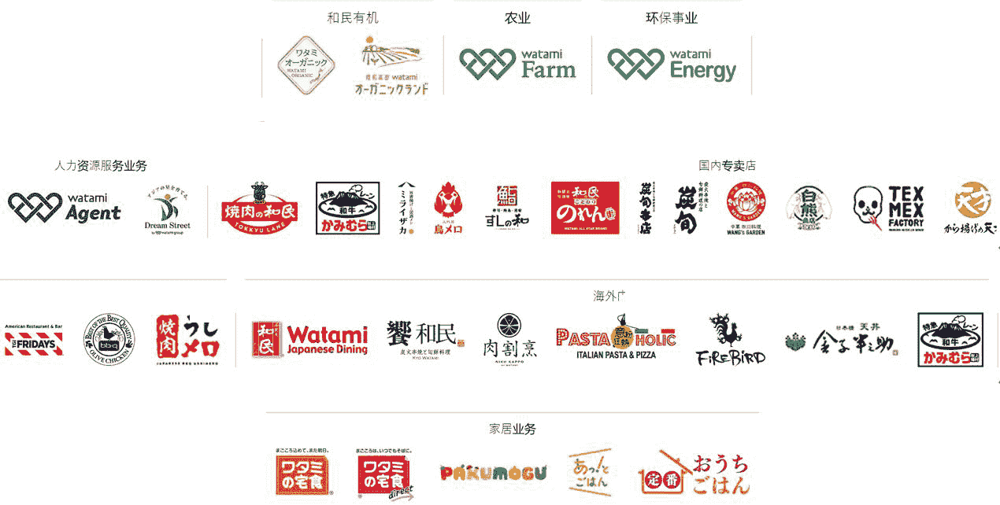

0

200

400

600

800

1000

1200

1400

国内外食门店数量

宅食门店数量

海外外食门店数量

47

行业深度报告

商贸零售

请务必阅读正文之后的免责条款和声明。

图122：日本外食产业增速

数据来源：日本外食产业协会，中信建投证券

和民株式会社外食业务市场定位不佳，餐饮业务逐步向高性价比外卖便当转型。和民株式会社外食业务定位高端市场，产品价格处于市场前列。以集团旗下经营寿司、烧鸟和清酒业务为主的SUSHI NOWA为例，其销售的中脂金枪鱼寿司一片价格为283日元，远超于同行业寿司店Akindo寿司郎株式会社的一片中脂金枪鱼寿司价格164日元。公司因为外食业务定价过高，客流数明显下降。受到客流量影响，2023年同店销售额相比较2008年蒸发近70%；公司餐厅门店也逐年下降，从2008年全国共有598家餐厅门店，到2023年公司全国门店数量下降至347家。

图123：和民门店销售额、客流与客单同比变化

数据来源：和民公司公告，中信建投证券

公司餐饮业务结构逐步转型；公司外食业务因定价过高，逐渐不再受到市场青睐，公司外食业务营业收入大幅下跌，连续多年发生亏损。公司于2008年以收购的方式进军外卖便当市场，公司抓住日本人口老龄化加剧的社会现象，布局目标为老年人口的健康外卖便当业务，实现公司外卖便当业务快速发展，从2008年进军该市场，到2023年已经拥有43,762百万日元的业务收入。同时采用预约制度、雇佣老年员工等策略节省外卖便当业务的经营成本，从2011年8.75%的业务利润率增长到2023年13.08%的业务利润率，不断提升业务利润率。

图124：和民分业务营业利润率

数据来源：和民公司公告，中信建投证券

图125：和民外食产品：中脂金枪鱼寿司一片

图126：和民外卖便当业务产品

数据来源：和民公司官网，中信建投证券

数据来源：和民公司官网，中信建投证券

-70%

-60%

-50%

-40%

-30%

-20%

-10%

0%

10%

20%

30%

国内外食

宅食

海外外食事业

护理

48

行业深度报告

商贸零售

请务必阅读正文之后的免责条款和声明。

图127：和民餐饮业务收入增速

数据来源：公司官网，中信建投证券

公司股价变动可以分为4个阶段：

1. 从2000年到2003年，由于公司的利润受到了原材料蔬菜价格上涨的侵蚀，股价大幅下跌。故2002年公司建立了自身的农场，自己生产蔬菜，并建立集中手工厨房进行专业化处理，以节省成本。
2. 从2003年到2009年，公司根据市场变化状况，开设了自己的农场、集中手工厨房和护理养老院，节省公司的原材料成本和人力成本。同时，开设养老院的决定与日本人口老龄化的社会状况相契合，公司受到市场认可，股价每年稳步上涨。
3. 从2010年到2015年，公司员工自杀事件使得公司股价受到舆论影响。直至2015年公司与家人达成1.3亿日元的庭外和解，公司创始人Miki Watanabe道歉，公司股价逐年下跌。
4. 从2016年到2022年，公司外卖便当业务快速发展，与公司外食经营不善形成对冲；包括疫情冲击，股价一直处于底部徘徊状态。

图128：和民2000年以来股价表现

数据来源：Wind，中信建投证券

-80%

-60%

-40%

-20%

0%

20%

40%

60%

80%

FY2009 FY2010 FY2011 FY2012 FY2013 FY2014 FY2015 FY2016 FY2017 FY2018 FY2019 FY2020 FY2021 FY2022 FY2023

国内外食

宅食

海外外食事业

0

0.5

1

1.5

2

2.5

和民

日经225

49

行业深度报告

商贸零售

请务必阅读正文之后的免责条款和声明。

## 五、旅游：精神文化繁荣，稀缺供给持续涨价

### （一）东方乐园：精神消费繁荣，运营能力加持

东方乐园是迪士尼乐园在日本的主要投资者和经营实体。东方乐园与迪士尼公司的合作始于1983年，他们共同成立了东京迪士尼乐园，该乐园于1983年开业。根据合作协议，东方乐园在日本负责乐园的建设、运营和管理，而迪士尼公司提供品牌授权、技术支持和乐园内容的指导。东京迪士尼乐园是日本最受欢迎和成功的主题乐园之一，吸引了大量的本地和国际游客。

图129：东京迪士尼乐园收入构成（百万日元）

数据来源：东方乐园公司公告，中信建投证券

日本消费者偏好精神文化消费，战后民众心理偏向美国为代表的西方文化。战后日本经历了快速的现代化和西方化进程。在战后重建时期，美国对日本进行了广泛的文化输出，包括音乐、电影、时尚、电视节目等。这些文化产品深刻影响了当时的日本社会，并催生了对西方文化的热衷。

彩票销售额的持续增长也印证了日本消费者对于“富有繁荣”的幻想。日本失业率与日本彩票销售呈现一定相关关系：当失业率逐步下降，彩票销售额也会下降；反之，当失业率抬升，彩票销售增速较高。这种关系表明，经济低迷时期日本消费者对于收入提升、富有繁荣的幻想有所增强。

0

100,000

200,000

300,000

400,000

500,000

600,000

700,000

主题公园

酒店

零售

其他

50

行业深度报告

商贸零售

请务必阅读正文之后的免责条款和声明。

图130：日本彩票销售额与日本失业率

数据来源：Statista，中信建投证券

服务能力突出，东京迪士尼提供了梦幻的西方童话和电影世界。东京迪士尼建造了以美国为代表的西式建筑，使得入园游客仿佛置身于国外旅行。同时，东京迪士尼会对演职人员进行细致的培训，员工入职后，迪士尼将首先进行迪士尼理念等培训，之后员工会在各自部门再进行对应培训，培训完成后员工才可以在游客面前进行表演。

图131：东京迪士尼乐园

图132：东京迪士尼海洋世界

数据来源：东京迪士尼官网，中信建投证券

数据来源：东京迪士尼官网，中信建投证券

运营能力和产品开发能力强大，对于消费者具有持续吸引力。

1. 持续投资，设备数量和游乐项目不断增加。自20世纪80年代东京迪士尼乐园落地成熟后，东方乐园就结合日本四面临海的岛国文化，着手开拓迪士尼海洋项目，成为日本特色的迪士尼项目，更成为世界唯一的迪士尼海洋乐园。2001年迪士尼海洋乐园落成，这大大扩展了迪士尼在日本本土的受众，更吸引海外游客前来游玩体验。现在园区成为“迪士尼+”的度假区，串联起迪士尼酒店、迪士尼购物中心等一系列迪士尼IP。
2. 充分利用世界IP的同时，积极融入日本本土文化。公司同时根据日本深厚的祭祀文化、庆典文化，着力推出“周年庆”相关活动作为营销策略，并在周年时发布新的娱乐项目。例如，2006年东京迪士尼海洋成立五周年庆典之际，园区开放了新的景点“恐怖之塔”。

-15%

-10%

-5%

0%

5%

10%

15%

20%

0

200

400

600

800

1000

1200

彩票销售额（十亿日元）

彩票销售额YOY（右轴）

失业率（右轴）

51

行业深度报告

商贸零售

请务必阅读正文之后的免责条款和声明。

图133：东京迪士尼园区每年入园人数

数据来源：东方乐园公司公告，中信建投证券

图134：东京迪士尼乐园项目数量（个）

图135：东京迪士尼海洋世界项目数量（个）

数据来源：东方乐园公司公告，中信建投证券

数据来源：东方乐园公司公告，中信建投证券

需求持续增长，供给具有稀缺性，东京迪士尼具备持续提价能力。东京迪士尼为日本稀缺的精神文化消费产品，入园客流量不断增长，东京迪士尼的票价增长速率和客均消费增长速率能够高于日本CPI增速，表现出游客在东京迪士尼的消费意愿不断提高。

-100%

-80%

-60%

-40%

-20%

0%

20%

40%

60%

80%

100%

0

500

1000

1500

2000

2500

3000

3500

入园人数（万人）

YOY（右轴）

0

50

100

150

200

游玩项目

商店

餐厅

0

20

40

60

80

100

120

140

游玩项目

商店

餐厅

52

行业深度报告

商贸零售

请务必阅读正文之后的免责条款和声明。

图136：东京迪士尼成人票价（日元）

数据来源：东方乐园公司公告，中信建投证券，2021年3月

东京迪士尼引入多种票价，从2021年3月开始采用最高票价与最低票价的平均值。东京迪士尼票价累计涨幅指年度相对于2001年3月的涨幅；CPI累计涨幅假设2001年3月为起始期，各年相对于2001年3月的涨幅。

2000年以来，公司股价大幅跑赢大盘。公司运营的乐园具备稀缺性，受到日本消费者喜爱，公司股价大幅跑赢大盘。2013年日本国内消费复苏以来尤为明显。由于迪士尼乐园的稀缺性和品牌力，市场对于疫情影响的担忧不大，整体股价表现逆势向上。

图137：东方乐园2000年以来股价表现

数据来源：Wind，中信建投证券

5500 5500 5500 5500 5500 5800 5800 5800 5800 5800 6200 6200 6200 6400 6900 7400 7400 7400 7500

8450 8650 9400

-10%

0%

10%

20%

30%

40%

50%

60%

70%

80%

0

1000

2000

3000

4000

5000

6000

7000

8000

9000

10000

票价

票价累计涨幅（右轴）

日本CPI累计涨幅（右轴）

0

2

4

6

8

10

12

14

16

东方乐园

日经225

53

行业深度报告

商贸零售

请务必阅读正文之后的免责条款和声明。

### （二）藤田：旅游业务正向贡献，婚庆宴会产生拖累

公司三大主要业务为酒店业务、度假业务、奢华宴会业务。

1. 酒店（WHG）业务包括华盛顿酒店和格拉斯丽酒店两大品牌。其中，华盛顿酒店是中档商务酒店，主打交通便利、智能入住退房和独创的舒适床铺；格拉斯丽酒店是豪华休闲酒店，提供贴心的礼宾部服务和女性专用房。WHG酒店主要位于东京，在中国、韩国和日本其他地区也有分布。2019年公司推出面向入境游客的HOTEL TAVINOS系列酒店。
2. 面向中高端群体在箱根地区发展度假业务，截至2019年4月30日，共有14处物业、342个房间。
3. 以“东京椿山庄酒店”为核心打造高端商业，包括婚礼、宴会、餐饮和高尔夫课程等。

图138：藤田收入构成（亿日元）

数据来源：藤田公司公告，中信建投证券

0

100

200

300

400

500

600

700

800

2014

2015

2016

2017

2018

2019

2020

2021

2022

2023

WHG酒店业务

度假村业务

豪华宴会业务

其他业务

54

行业深度报告

商贸零售

请务必阅读正文之后的免责条款和声明。

图139：藤田物业分布（截至2019年4月30日）

数据来源：藤田公司公告，中信建投证券

图140：藤田物业价格带（截至2019年4月30日）

数据来源：藤田公司公告，中信建投证券

日本出游需求保持增长，酒店行业受益。疫情前日本旅游市场中，外国人赴日旅行花费占日本旅游市场规模比重达到18.4%，日本居民本土旅行占比达到76.4%。2011年日本大地震至疫情前，日本旅游行业增长主要由客单价提升带动，过夜旅行客单价从2012年到2019年增长16%，同期过夜旅客数量下降1.2%，客单价提升带动日本旅游行业规模实现增长。

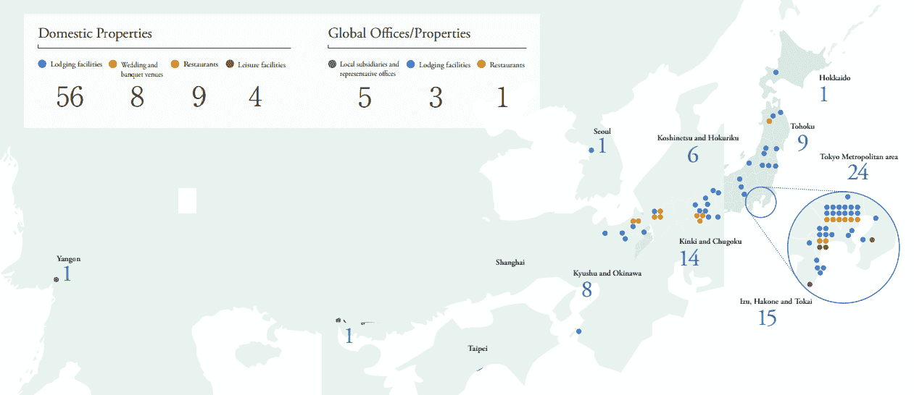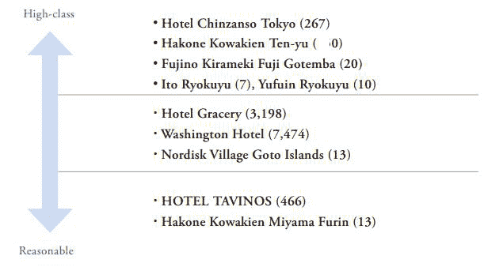

55

行业深度报告

商贸零售

请务必阅读正文之后的免责条款和声明。

图141：日本旅游市场规模（2019年）

图142：日本旅游市场规模（2021年）

数据来源：日本国土交通省观光厅，中信建投证券

数据来源：日本国土交通省观光厅，中信建投证券

虽然日本老龄化严重，但是老年人口对于旅游市场贡献仍然不低。日本过夜旅行花费中，50岁及以上人口占比44%；过夜旅行者中，50岁及以上人口占比47%。50—70岁旅游群体消费力仍然不低，国内过夜旅行人均消费超过9万日元。

图143：日本国内旅游市场规模

图144：日本国内旅行人数

数据来源：日本国土交通省观光厅，中信建投证券

数据来源：日本国土交通省观光厅，中信建投证券

18.4%

5.2%

60.0%

16.4%

外国人来日本旅游

日本海外旅行（国内部分）

日本国内过夜旅行

日本国内一日游

5.6%

0.8%

72.3%

21.3%

外国人来日本旅游

日本海外旅行（国内部分）

日本国内过夜旅行

日本国内一日游

-60%

-40%

-20%

0%

20%

0

5

10

15

20

2012 2013 2014 2015 2016 2017 2018 2019 2020 2021

过夜旅行（万亿日元）

一日游（万亿日元）

过夜旅行YOY

一日游YOY

-60%

-50%

-40%

-30%

-20%

-10%

0%

10%

20%

0

5000

10000

15000

20000

25000

30000

35000

过夜旅行（万人）

一日游（万人）

过夜旅行YOY

一日游YOY

56

行业深度报告

商贸零售

请务必阅读正文之后的免责条款和声明。

图145：日本过夜旅行人次及花费（分年龄）

图146：日本过夜旅行人均花费（分年龄）

数据来源：日本国土交通省观光厅，中信建投证券

数据来源：日本国土交通省观光厅，中信建投证券

图147：日本国内旅行人均花费

数据来源：日本国土交通省观光厅，中信建投证券

日本国内旅游在2012—2019年阶段整体呈现人数基本持平略减、客单价不断提升的趋势，特别是过夜旅行需要比一日游更多的时间，也说明人口变量逐渐发挥作用。不过70岁之后的群体消费欲望明显下降，其在旅游花费中的占比明显低于其人次中占比，发展到深度老龄化则会导致旅游行业的转化潜力下降。

另外，可以看到旅馆业设施连续20年处于减少趋势，累计减少了约30%供给。但疫情期间并没有进一步减少，也说明供需在2018年前后已经进入平衡状态。入住率则呈现稳定提升的趋势，行业没有明显的新增进入者。疫情期间，除了旅馆业态，其他住宿业态均表现出较快的恢复。

0%

5%

10%

15%

20%

花费占比

观光人次占比

8.3

5.6

7.7

10.8 9.8

9.1

9.4

9.5

7.0

3.7

0

2

4

6

8

10

12

整体

9岁以下

10—20岁

20—30岁

30—40岁

40—50岁

50—60岁

60—70岁

70—80岁

80岁以上

人均花费（万日元）

-15%

-10%

-5%

0%

5%

10%

15%

0

1

2

3

4

5

6

2012

2013

2014

2015

2016

2017

2018

2019

2020

2021

过夜旅行（万日元）

一日游（万日元）

过夜旅行YOY（右轴）

一日游YOY（右轴）

## 行业深度报告

### 商贸零售

请务必阅读正文之后的免责条款和声明。

**图148：** 日本旅馆/酒店设施数量（家）

**图149：** 日本从业人数10人以上酒店入住率（%）

数据来源：日本厚生劳动省，中信建投证

数据来源：日本国土交通省观光厅，中信建投证

受益于旅游行业发展，酒店业务成为公司主要利润来源。公司最早从事商务酒店。此后，公司把握团体旅游、家庭旅游、个人旅游和入境游的发展机遇，酒店业务成为公司主要的利润来源。疫情之前，公司WHG酒店业务营业利润率达到5%左右。

**图150：** 藤田酒店业务与公司整体营业利润率

**图151：** 藤田酒店业务与公司整体营业利润（亿日元）

数据来源：藤田公司公告，中信建投证

数据来源：藤田公司公告，中信建投证

其他业务中，公司婚庆业务占有重要比重，但是由于行业趋势变化，公司婚庆宴会业务拖累公司业绩。日本结婚人数下降，婚庆市场萎缩，公司婚庆业务承受压力。一方面，日本存在少子化、晚婚化、未婚夫妇增加、不举办婚礼的夫妇增多、结婚人数减少的趋势；另一方面，婚礼形式也日趋多样化，包括海外婚礼、家庭婚礼、宾馆、餐厅等，传统酒店、婚宴厅的婚礼进一步减少。2013年至2019年，藤田公司奢侈品和宴会服务营业利润总体趋势上降低，2015年后开始亏损。2020年，受疫情影响，亏损规模进一步扩大。2021年后，疫情缓解带来了业务上的好转，并于2023年实现盈利。

请务必阅读正文之后的免责条款和声明。

**图152：** 日本初婚人数

数据来源：*Wind*，中信建投证

**图153：** 藤田婚礼收入（亿日元）

**图154：** 藤田豪华宴会业务营业利润（亿日元）

数据来源：藤田公司公告，中信建投证

数据来源：藤田公司公告，中信建投证

**图155：** 藤田东京椿山庄酒店婚礼业务增长情况

**图156：** 藤田举办婚礼数量及每场婚礼平均人数

数据来源：藤田公司公告，中信建投证

数据来源：藤田公司公告，中信建投证

请务必阅读正文之后的免责条款和声明。

2000年以来，公司股价整体跑输大盘。2013年公司股价表现略好于大盘。2013年之后，虽然公司运营酒店服务国内旅客，但是没有及时把握入境游客需求，2019年才推出面向入境旅客的酒店品牌。叠加婚庆业务萎缩，公司业绩下滑，2016年之后股价大幅跑输大盘。

**图157：** 藤田2000年以来股价表现

数据来源：*Wind*，中信建投证

请务必阅读正文之后的免责条款和声明。

## 投资评价和建议

投资建议：1.精神消费稀缺供给始终优于大势，文旅设备更新改善供给，重点关注景区板块西域旅游、九华旅游、天目湖，博彩板块金沙中国、银河娱乐等；2.具有投资属性且原材料供给存在瓶颈的黄金珠宝行业的中国黄金、老凤祥等；3.具有出海拓展的成熟商业模式的名创优品等；4、高性价比日用化妆品增长稳健，关注福瑞达、润本股份等。

请务必阅读正文之后的免责条款和声明。

## 风险分析

1. 老龄化的初始阶段会带来休闲时间的增加，具有退休津贴的群体消费欲望明显，但深度老龄化则会导致这部分需求再次下降，中国人口结构变化速率并不能照搬日本经验。

2. 中国在生育政策上进行过数次大范围调整，因为出生人口的变化并不完全与经济发展及城市化进程匹配，2016年放开二胎起仍有一轮小高峰，劳动力供求关系的转化时间不能照搬日本情况。

3. 日本在人均GDP较高的1990年代才开始出现停滞增长，旧出现明显的本国高端消费下降。中国消费者对性价比的追求可能导致长期持续的渠道变革。

4. 中国在移动互联网时代大幅提升线上渗透率至全球最领先水平，日本线下消费的发达在全球都不具有相似性，通过提升服务质量产生溢价的商业模式可能仅对少数服务业态有效。

请务必阅读正文之后的免责条款和声明。

## 分析师介绍

刘乐文

中信建投证券社服商贸行业首席分析师。本科毕业于西安交通大学，研究生毕业于美国约翰霍普金斯大学，从事社会服务行业研究六年，对于免税、酒店、餐饮、平台经济等行业拥有深度研究见解和丰富行业积累，曾获得水晶球社会服务行业最佳分析师第一名，新浪最佳分析师等评选。

研究助理

孙英杰

sunyingjie@csc.com.cn

请务必阅读正文之后的免责条款和声明。

## 评级说明

### 投资评级标准

报告中投资建议涉及的评级标准为报告发布日后6个月内的相对市场表现，也即报告发布日后的6个月内公司股价（或行业指数）相对同期相关证券市场代表性指数的涨跌幅作为基准。A股市场以沪深300指数作为基准；新三板市场以三板成指为基准；香港市场以恒生指数作为基准；美国市场以标普500指数为基准。

| 评级 | 说明 |
|------|------|
| 股票评级 | |
| 买入 | 相对涨幅15％以上 |
| 增持 | 相对涨幅5%—15％ |
| 中性 | 相对涨幅-5%—5％之间 |
| 减持 | 相对跌幅5%—15％ |
| 卖出 | 相对跌幅15％以上 |
| 行业评级 | |
| 强于大市 | 相对涨幅10%以上 |
| 中性 | 相对涨幅-10-10%之间 |
| 弱于大市 | 相对跌幅10%以上 |

### 分析师声明

本报告署名分析师在此声明：（i）以勤勉的职业态度、专业审慎的研究方法，使用合法合规的信息，独立、客观地出具本报告, 结论不受任何第三方的授意或影响。（ii）本人不曾因，不因，也将不会因本报告中的具体推荐意见或观点而直接或间接收到任何形式的补偿。

### 法律主体说明

本报告由中信建投证券股份有限公司及/或其附属机构（以下合称“中信建投”）制作，由中信建投证券股份有限公司在中华人民共和国（仅为本报告目的，不包括香港、澳门、台湾）提供。中信建投证券股份有限公司具有中国证监会许可的投资咨询业务资格，本报告署名分析师所持中国证券业协会授予的证券投资咨询执业资格证书编号已披露在报告首页。

在遵守适用的法律法规情况下，本报告亦可能由中信建投（国际）证券有限公司在香港提供。本报告作者所持香港证监会牌照的中央编号已披露在报告首页。

### 一般性声明

本报告由中信建投制作。发送本报告不构成任何合同或承诺的基础，不因接收者收到本报告而视其为中信建投客户。

本报告的信息均来源于中信建投认为可靠的公开资料，但中信建投对这些信息的准确性及完整性不作任何保证。本报告所载观点、评估和预测仅反映本报告出具日该分析师的判断，该等观点、评估和预测可能在不发出通知的情况下有所变更，亦有可能因使用不同假设和标准或者采用不同分析方法而与中信建投其他部门、人员口头或书面表达的意见不同或相反。本报告所引证券或其他金融工具的过往业绩不代表其未来表现。报告中所含任何具有预测性质的内容皆基于相应的假设条件，而任何假设条件都可能随时发生变化并影响实际投资收益。中信建投不承诺、不保证本报告所含具有预测性质的内容必然得以实现。

本报告内容的全部或部分均不构成投资建议。本报告所包含的观点、建议并未考虑报告接收人在财务状况、投资目的、风险偏好等方面的具体情况，报告接收者应当独立评估本报告所含信息，基于自身投资目标、需求、市场机会、风险及其他因素自主做出决策并自行承担投资风险。中信建投建议所有投资者应就任何潜在投资向其税务、会计或法律顾问咨询。不论报告接收者是否根据本报告做出投资决策，中信建投都不对该等投资决策提供任何形式的担保，亦不以任何形式分享投资收益或者分担投资损失。中信建投不对使用本报告所产生的任何直接或间接损失承担责任。

在法律法规及监管规定允许的范围内，中信建投可能持有并交易本报告中所提公司的股份或其他财产权益，也可能在过去12个月、目前或者将来为本报告中所提公司提供或者争取为其提供投资银行、做市交易、财务顾问或其他金融服务。本报告内容真实、准确、完整地反映了署名分析师的观点，分析师的薪酬无论过去、现在或未来都不会直接或间接与其所撰写报告中的具体观点相联系，分析师亦不会因撰写本报告而获取不当利益。

本报告为中信建投所有。未经中信建投事先书面许可，任何机构和/或个人不得以任何形式转发、翻版、复制、发布或引用本报告全部或部分内容，亦不得从未经中信建投书面授权的任何机构、个人或其运营的媒体平台接收、翻版、复制或引用本报告全部或部分内容。版权所有，违者必究。

### 中信建投证券研究发展部

| 北京 | 上海 | 深圳 | 香港 |
|------|------|------|------|
| 东城区朝内大街2号凯恒中心B座12层 | 上海浦东新区浦东南路528号南塔2103室 | 福田区福中三路与鹏程一路交汇处广电金融中心35楼 | 中环交易广场2期18楼 |
| 电话：（8610）8513-0588 | 电话：（8621）6882-1600 | 电话：（86755）8252-1369 | 电话：（852）3465-5600 |
| 联系人：李祉瑶 | 联系人：翁起帆 | 联系人：曹莹 | 联系人：刘泓麟 |
| 邮箱：lizhiyao@csc.com.cn | 邮箱：wengqifan@csc.com.cn | 邮箱：caoying@csc.com.cn | 邮箱：charleneliu@csci.hk |
