[PAGE 0]

[PAGE 1]

[PAGE 2]

## 致探索者

我们生而自由，听从内心的声音；

我们满怀热忱，对新鲜事物保持好奇；

我们直面挑战，对正在实践的事业精益求精。

我们将世界上渴望探索未知的灵魂相连，

与他们并肩发现全新领域。

我们，是探索者。

作为北汽集团新能源领域的主力军，**ARCFOX** 将率先实施未来的出行战略。我们决心，在 **2025** 年成为最具有国际影响力和经验的世界级创新技术公司。

——徐和谊
北汽集团董事长

"As the main force in the field of new energy of BAIC Group, ARCFOX will take the lead in implementing the future mobility strategy. We are determined to be the world's most innovative and technological company with international influence and experience in 2025."

**Xu Heyi, Chairman of BAIC Group**

**TO EXPLORER**

We are born free and always listen to our inner voice;
We are full of enthusiasm and keep up with novelties;
We face to challenges and strive to beyond excellence in our undertakings.
We join the souls eager to explore the unknown,
Work side by side with them to discover new territories.
We are explorers.

**TO EXPLORER**

[PAGE 3]

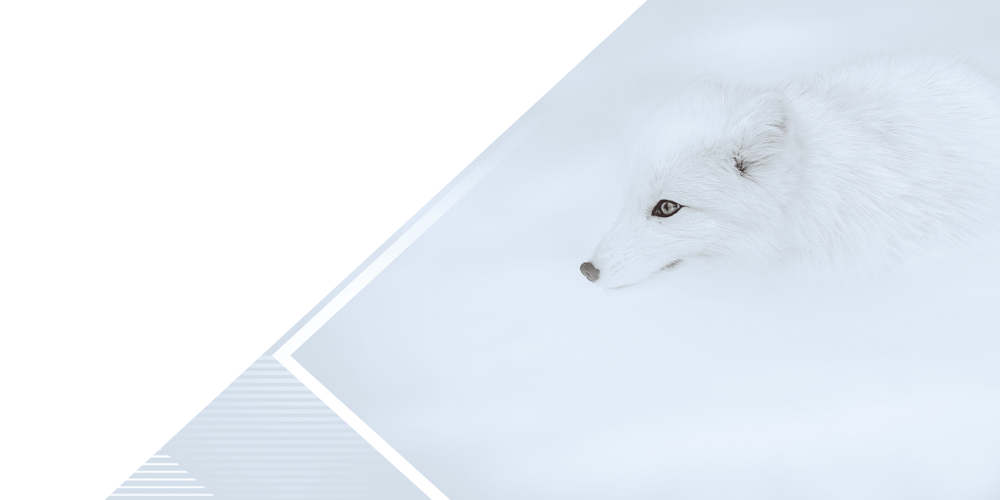

## 永远适应与进化

汲取独特灵感，打造富有生命力的品牌。

北极极致而神秘，是探险者的天堂。我们从北极汲取灵感，并将其作为品牌和产品创作的起点。生存于此的北极狐智慧、坚韧、优雅并且灵敏。它在严酷的生存环境中不断适应和进化，得以生存并茁壮成长。

我们能从它身上学到些什么？保持警醒、深谋远虑、思维变通并且永远探求独创、周到、巧妙的解决方案。

即刻，开启探索之旅

**A JOURNEY OF EXPLORATION NOW**

**Absorb unique inspirations to create a vibrant brand.**

The Arctic, extreme and mysterious, is a paradise for explorers. We draw our inspirations from the Arctic and set it as a starting point for branding and product creation. Arctic foxes, smart, tough, elegant and agile, have been adapting and evolving to survive and thrive in the arduous living environment.

What can we learn from them? Stay alert, be forethoughtful and flexible, and always search for the unique, thoughtful and ingenious solutions.

**ADAPTIVE AND EVOLVING**

03
04

[PAGE 4]

## 生动而充满力量

旺盛的生命力、追求极致的个性是我们与众不同的印记。

我们具备勇于挑战、敢于突破的精神，同时传递出精准、优雅和力量。神秘而多变的北极光给了我们灵感，而机智、充满旺盛生命力的北极狐，化为了我们独一无二的视觉符号。

**Exuberant vitality and the pursuit for the utmost leave us a unique print.**

We have the courage to challenge and are bold to make breakthroughs, conveying the traits of refinement, elegance and strength. We are inspired by the mysterious and ever-changing aurora, and the smart and vibrant arctic foxes are thus turned into our unique visual symbol.

**VIVID AND POWERFUL**

- 北极光
- 无边界设计
- 电压符号
- 风驰电掣
- 树叶
- 绿色未来
- 北极狐
- 旺盛生命力

We adopt the symbol 'V' to express our pursuit for power limit, speed and victory. Meanwhile, we value environment conservation and incorporate the green-leaf shape into the brand identity.

用符号“**V**”表达对电能极限、凌厉速度以及胜利的追求。同时我们关注环境，并将代表绿色环保的树叶造型融入品牌标识。

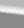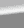

05
06

[PAGE 5]

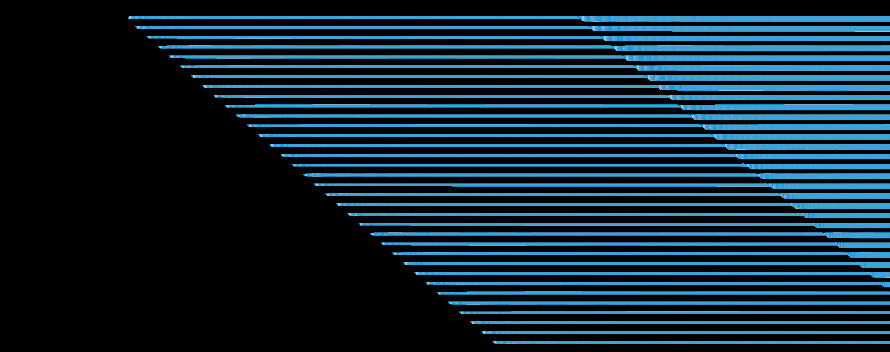

## 追寻非凡

极光体现无边界的理念。

它神秘、不可界定，如同ARCFOX 品牌，不断改变和进化，创造出敬畏与魅力。我们相信不断的进化：我们的思想没有边界，追寻非凡。

**Aurora reflects the concept of borderless.**

It is mysterious and undefined, just like ARCFOX that has constantly changed and evolved to establish awe and charm. We believe in constant evolution: our thoughts are born free to pursue the extraordinary.

**PURSUE THE EXTRAORDINARY**

07
08

[PAGE 6]

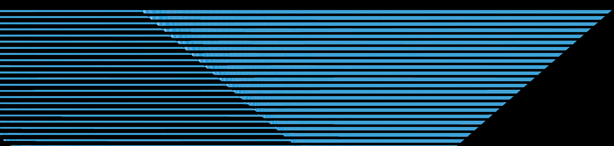

## 无畏而强大

开放的心态和对新鲜事物的感知力让我们与众不同。

我们拥抱挑战，它给予我们内在的力量。
我们保持好奇心，从不满足。
我们探求、精进、不断扩展生活的边界。
是无畏的探索精神让我们与众不同。

**The open-mindedness and the sensitivity towards novelties make us outstanding.**

We embrace the challenges that give us the inner strength.

We remain curious and never satisfied.

We explore, improve and constantly expand the boundary of life.

It is the intrepid spirit of exploration that makes us unique.

**DARING AND POWERFUL**

09
10

[PAGE 7]

## 与探索者同行

**TOGETHER WITH EXPLORERS**

The explorers of the new era are a generation with keen insights, and seeking appealing experiences, attracted by innovative technologies, caring about design and worship aesthetics.

They want to show their taste in a confident and unique way, live a true life and be together with the humancentric brand and sincere values.

They are the avant-garde pilot of the new era. ARCFOX steps side by side with them.

新时代探索者具有敏锐的洞察力，寻求富有吸引力的体验。他们被创新技术所吸引，关注设计并为美学倾倒。

这群人希望以自信和独特的方式表达自己的品味，过一种真正的生活，与有温度的品牌和真诚的价值观为伴。

他们是新时代年轻进取的先锋派。

ARCFOX 与他们并肩前行。

11
12

[PAGE 8]

## 生而破界

Boundaries breaking, driving the world move forward.

Fused with multiple inspirations, and watch the world in an open and inclusive manner make the remote accessible. To be your own hero and make the possibilities of your future life come true. We live the way we like, move forward and explore new territories.

We are the dauntless explorers.

破界，驱动世界向前的动力。

融合多元灵感，开放而包容地审视世界，让遥不可及的未来成为触手可及。成为自己的英雄，去实现未来的种种可能。

我们按自己的意愿选择生活，勇往直前，探索全新领域。

我们，是无畏的探索者。

**BORN FREE**

[PAGE 9]

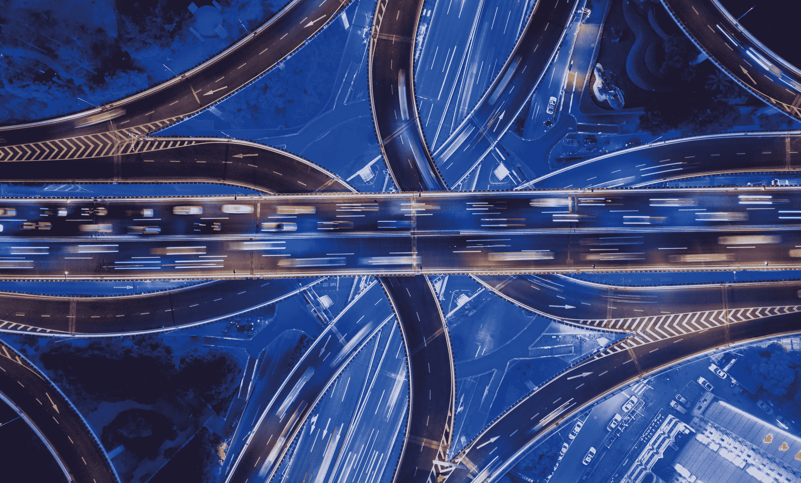

## 成就向前的力量

我们有着多年的积累和深厚的底蕴。

北汽集团是中国五大汽车集团之一，在2018 年《财富》500 强企业排行榜中，北汽集团以695.91 亿美元营业收入连续六年入围，排名第124 位。

北汽新能源是中国新能源汽车科技创新的主力军，是生态布局的先行者。通过9 年发展，北汽新能源连续五年蝉联中国纯电动汽车销售第一。2018 年，北汽新能源汽车产量110,141 辆，同比增长37.58%；汽车销量158,012 辆，同比增长 53.11%。

**We have a profound accumulation and connotation over the past many years.**

BAIC Group is one of the top five automobile groups in China. In the 2018 Fortune Top 500 Companies ranking, BAIC Group has been shortlisted for 6 consecutive years, and ranked 124th with a business revenue of $69.591 billion.

BAIC BJEV is the main force of new-energy vehicle industry in China in terms of technology innovations, and also the forerunner of ecological layout. Over 9-year development, BAIC BJEV has ranked first in pure electric vehicle sales in China for five consecutive years. In 2018, BAIC BJEV had an output of 110,141 vehicles, with a year-on-year increase being 37.58%; the sales volume of traditional vehicles was 158,012, with a year-on-year increase being 53.11%.

**ACHIEVE HIGH MOVE FORWARD**

15
16

[PAGE 10]

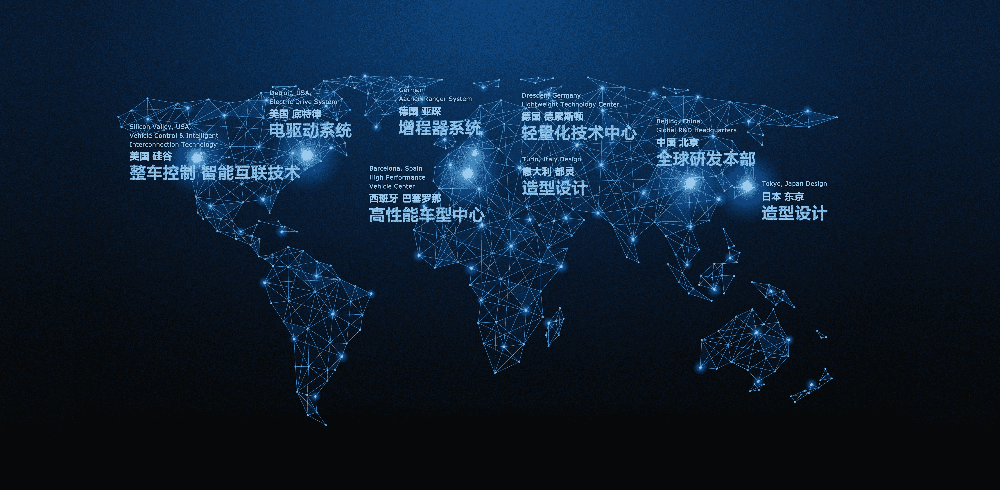

## 集全球智慧

**GLOBAL WISDOM GATHERED**

我们构建多元化技术和文化交流的平台。

ARCFOX 在全球拥有六国八地研发中心，全面涵盖了造型设计、电驱动技术、智能化技术、轻量化技术、互联网技术等前沿技术领域。

超过全球1600 名研发人员的持续投入，不但让ARCFOX 品牌具备掌握核心技术实力的优势，更奠定了国际视野和风范。

**We have established a platform for the exchanging and communication of multi-technologies and cultures.**

ARCFOX has established R&D centers in six countries and eight regions, covering and focusing on advanced technologies development, such as modeling design, electric drive technology, intelligent technology, lightweight technology, Internet technology, etc.

With the devotion and effort of more than 1600 R&D specialists from all over the world, ARCFOX not only possesses the advantages of core technologies, but is endowed with an international vision and style.

17
18

**PIONEERING AND COOPERATION**

开创与联合

我们放眼全球、开放共享，与全球各领域顶尖供应商一起，探索前瞻性的造车模式。

- 与戴姆勒集团深度合作。作为北汽新能源的股东之一，戴姆勒提供强有力的技术支持，包括联合成立电池检验中心。
- 与华为在技术研发、产品创新等方面开展全面合作，借助华为在ICT领域的技术优势，打造智能网联电动车。
- 与全球整车领导者麦格纳联合打造镇江制造基地，研发制造高品质、智能化、轻量化的电动汽车。

**We explore a prospective car-building model with an international vision and open mind.**

We have established a deep cooperative relationship with Daimler AG. As one of the shareholders of BAIC BJEV, Daimler has provided strong technological support, including the jointly formed battery inspection center.

We have cooperated with Huawei comprehensively in technology research and development, product innovation. With Huawei's technological advantages in the ICT field, we have produced intelligent connected electric vehicles.

We have joined hands with MAGNA as a globally vehicle engineering leader to establish the Zhenjiang manufacturing base, developing and producing high-quality, intelligent and lightweight electric vehicles.

---

**OUR VISION**

我们的愿景

追求极致性能与创新设计的高端智能新能源汽车品牌

**premium intelligent NEV brand in the pursuit of extreme performance and innovative design**

**OUR VISION**

---

**MAKE TECHNOLOGY USER-FRIENDLY THROUGH DESIGN**

设计温暖科技 创新驱动体验

我们为用户创造更丰富的体验。

在这个时刻互联的世界，是美好的体验让那些转瞬而过的瞬间在我们的心中成为永恒。我们在所有的产品、服务和互动中创造这样的体验。

为了实现这一使命，我们打造触手可及的科技、无界的设计和个性化的极致体验。

**We create more abundant experience for the users.**

In the world that everything is connected, it is the wonderful experience that makes transient moments immortal. We incorporate this wonderful experience in all our products, services and interactions.

To achieve this goal, we create accessible technologies, transcendent design and personalized experiences.

---

**BORN FREE**

生而破界

**FOCUS ON CORE VALUES**

专注于核心价值

无界美学、人本科技、极致体验，我们的核心价值。它为我们提供前行的方向。

Transcendent aesthetics, democratic technology and immersive experiences are our core values. They motivate us to move forward.

**Our core values:**

| 中文 | English |
|------|---------|
| 人本科技 | Democratic Technology |
| 极致体验 | Immersive Experience |
| 无界美学 | Transcendent Aesthetics |

**Design Principles:**

- 简约的 **Pure**
- 灵动的 **Nimble**
- 包容的 **Borderless**
- 人性化的 **Humancentric**
- 前瞻的 **Prospective**
- 触手可及的 **Accessible**
- 无畏的 **Daring**
- 充满信心的 **Empowering**
- 令人兴奋的 **Exhilarating**

---

**TRANSCENDENT AESTHETICS**

无界美学

**PURE, NIMBLE AND BORDERLESS**

简约的、灵动的、包容的

无界美学超越了界限，让沉重变得轻盈，让坚硬化为柔软。

ARCFOX崇尚简约至上，我们的设计体现着纯粹简约的设计理念，将汽车上非必要的元素减少到最低。

我们赋予产品灵动的美感，展现出敏捷、优雅和活力。我们将沟通和创新设计思维融入生活方式、服务和产品中。

**Transcendent aesthetics breaks boundaries, turn the heavy into light, the hard into soft.**

ARCFOX advocates simplicity. Our design embodies the design concept of simplicity and purity that minimizes the unnecessary elements in the car.

We endow products with nimble aesthetics, revealing a sense of agility, elegance and vitality. We integrate the idea of communication and innovative design into lifestyles, services and products.

---

ARCFOX的设计是生而自由的，我们希望在设计中营造出优雅、动感、轻盈的感觉。

在ARCFOX的设计语言里，只保留汽车必要的元素。同时，我们打破了现有设计思维的禁锢，大胆引入不同领域的多元灵感。我们将材料工程与设计完美结合，使车辆拥有纯净的线条、多变的曲面和完美的比例。

ARCFOX's design is born free in which we hope to create a sense of elegance, dynamism, lightness.

In the ARCFOX's design, only the necessary elements of a car are retained. We have freed ourselves from the shackles of the existing design concepts and boldly induced multiple inspirations from a variety of fields. We perfectly combine the material engineering with design, endowing the vehicles with clean lines, changeable surfaces and perfect proportions.

**From the perspective of automobile design, we need to break through a series of restrictions of engineering, material and quality thus to make the "Born Free" realized. We challenge rules and break limitations with innovations.**

生而破界从汽车设计的角度来讲，需要打破工程、材料等一系列的限制。以创新的能力，挑战规则、突破局限，创造新的事物和体验。

---

**What is the "Transcendent Aesthetics" of ARCFOX?**

什么是**ARCFOX**的“无界美学”？

ARCFOX以“无边界”为主要设计思想，不局限于现有客户的需求和科技、材质的运用。以面向未来的前瞻视野进行汽车设计，对产品设计的坚持和创造都是挑战固有规则和边界的。

ARCFOX takes "borderless" as its main design idea. It does not limit itself to the needs of existing customer demand as well as utilization of technologies and materials. We design with a prospective vision. Our design and insists are to challenge the inherent conventions and break the boundaries.

**What boundaries does ARCFOX's design break?**

**ARCFOX**的设计打破了哪些边界？

- 打破了视觉元素的边界：我们用“X”作为视觉符号，具有更强的视觉延展力，“X”也代表了挑战边界、突破限制、探索无限可能的品牌精神；
- 打破了汽车工程与制造的边界：碳纤维及复合材料的应用实现了车身轻量化与前卫造型的完美兼容；
- 打破了实用功能与美学的边界：北欧极简美学，自然、可持续；
- 打破了多维感官交互的边界：将设计成为智能交互的一部分。

It breaks the boundary of visual elements. We adopt "X" as our visual symbol and it has a stronger visual extension. "X" also represents the brand spirit of breaking boundaries and restrictions and exploring infinite possibilities. It breaks the boundary between the automobile engineering and manufacturing: the application of carbon fibers and composite materials makes the car body light in weight and avant-garde in shape. It breaks the boundary between the practical function and aesthetics and shows the Nordic minimalist aesthetics, natural and sustainable. It breaks the boundary of different sensory interactions, making design a part of intelligent interaction.

源于建筑学的简约设计理念、坚毅且强壮的**C**柱是**ECF**概念车的视觉核心。它定义了整车的性格——充满力量和活力。纯净而优雅的车身线条与具有雕刻感的造型完美融合，传递了**ARCFOX**纯粹、极致的品牌个性。

**The simplicity of the architecture and the determined and strong C pillar are the key points of ECF concept, defining the essence of the vehicle: strength and dynamism. The pure and essential lines intersecting with continuous and sculptured surfaces convey a strong brand identity of pure and extreme to the front face.**

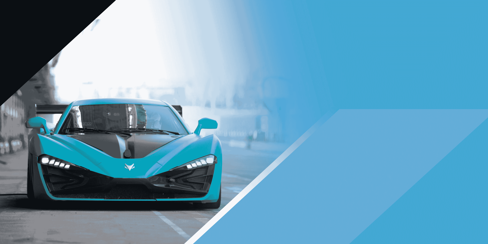

## 引领设计思潮

我们致力于为汽车赋予艺术品般的魅力。

无边界理念始终指导着我们每一次的设计实践，帮助我们打破汽车设计的局限，做出更具有前瞻性和想象力的作品。

在2018年的北京国际设计周上，ARCFOX品牌及产品不仅首次在大咖云集的国际设计展活动上崭露头角，而且第一代ARCFOX跑车还获得了“经典设计奖”。

**LEAD DESIGN TREND**

**We dedicate to endowing cars with an artistic charm.**

The concept of borderless guides each of our design practices, helping us break the limitations of automobile design and produce more forward-looking and imaginative works.

At the Beijing International Design Week 2018, ARCFOX and its products not only made their debut at the international design exhibition where big names gathered but were nominated for the “Classic Design Award” with the first-generation ARCFOX sports car.

2018北京国际设计周全程战略合作伙伴

STRATEGIC PARTNER OF 2018 BJDW

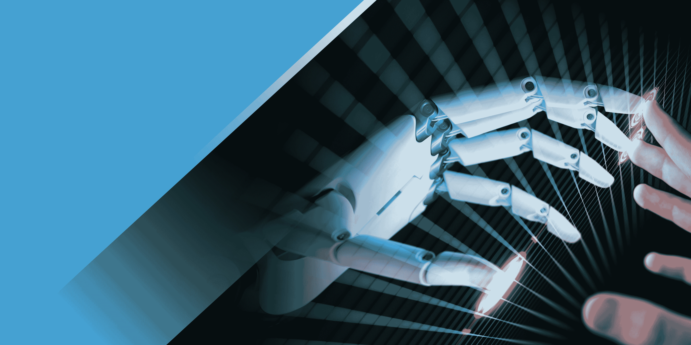

## 人本科技

### 前瞻的、人性化的、触手可及的

我们创造触手可及的科技，精进人们的生活。

我们设计、打造直观功能和无缝服务，并且和客户产生共鸣。我们在产品和解决方案中寻找并发展有前景的创新，把最好的结合在一起。我们相信技术是美好未来的推动者。它需要变得温暖、感性和自然，它应该使所有人受益。

**TECHNOLOGY DEMOCRATIC**

**PROSPECTIVE, HUMANCENTRIC AND ACCESSIBLE**

**We create accessible technology to improve people's lives.**

We design and build intuitive functions and seamless services that resonate with our customers. We look for and develop promising innovations in products and solutions, then combine the best of them. We believe that technology facilitates a better future. It needs to be warm, sensitive and natural, and it should benefit everyone.

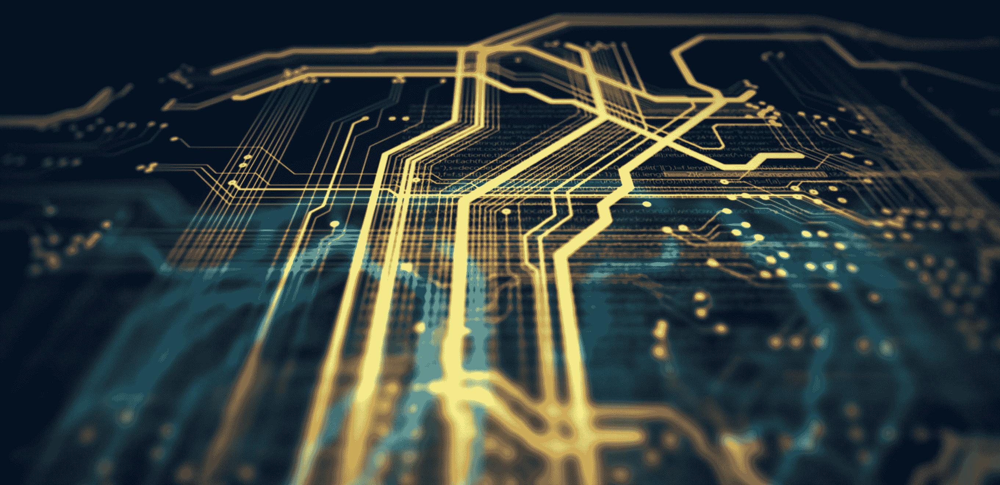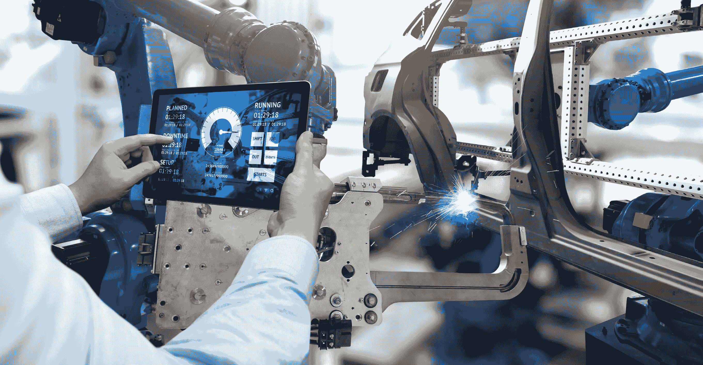

## 打破传统禁锢，领航出行新方向

### 全智能

打破传统汽车功能的边界，率先实践整车数字化连接，带来全智能的产品体验。

（最强大脑芯片技术、深度学习算法、基于5G的信息交互、以太网E-E架构）

**FULL INTELLIGENCE**

Break the boundary of traditional car functions.

The pioneer of practicing digital connection within the whole vehicle, bringing a full-intelligence product experience.

(Super brain chip technology with deep-learning algorithms, 5G-based information exchange, Ethernet E-E architecture)

### 全扩展

打破传统依托底盘的平台边界，以架构思维进行模块化设计，实现全领域、全通用、全系列的拓展性。

（动力底盘域模块、车身模块、智能电池模块）

**FULL EXTENSION**

Break the boundary of traditional platforms that rely on the chassis.

Build modular designs with architectural thinking and achieve all-range, all-purpose, full-scale expansion.

(Power chassis domain module, body module, smart battery module)

### 全交互

打破冰冷的模式化边界。通过深度学习，打造有温度、更懂你的专属化人机交互。

（多模态情感交互系统、智能助手、智能驾控）

**FULL INTERACTION**

Break the boundaries of rigid patterns.

Through deep learning, we create a user-friendly human-machine interaction.

(Multimodal emotional interaction system, smart assistant, intelligent driving control)

### 全进化

打破时间的边界，提供与时俱进的前沿体验和服务。

（OTA、远程诊断、分布式能源、电池梯次利用、智慧城市）

**FULL EVOLUTION**

Break the boundary of time.

We provide you with advanced experiences and services that keep pace with the times.

(OTA, remote diagnosis, distributed energy, battery cascade utilization, smart city)

**Intelligent Module Code**

**IMC** 智能模块密码

**BREAK UP TRADITIONAL SHACKLES & LEAD A NEW WAY OF MOBILITY**

## 以人为本的未来出行

**DEMOCRATIC FUTURE MOBILITY**

**You are always our foremost concern.**

Intelligent Module Code consists of 10 systems and 27 modules, redefining vehicles from a travel tool to an intimate partner.

Imagine a scene—intelligent driving frees your hands, so that you can handle urgent work in the car. Even though there is an international video conference, the 5G network in the car can provide you with smooth and uninterrupted network service.

The face recognition system can assess your expressions. If you are frowning, it may immediately play soothing and light music and ask if you want to visit your favorite restaurant near the company. For the time being, the car is no longer a tool of transportation carrying you from point A to point B, but your closest companion.

我们最关心的，永远是你。

IMC智能模块密码由十大系统、27个模块组成的智能架构，改变了车的定义——由出行工具变身为亲密伙伴。

想象一下这样的场景——智能驾驶解放了双手，让你可以在车里处理紧急的工作，即使是跨国视频会议，车载5G仍旧可以提供顺畅无延迟的网络服务。

面部识别系统可以判断出你的表情，如果你此刻愁眉不展，它可能会立刻为你播放舒缓的轻音乐，并询问午饭是不是要去公司附近那家你爱的餐厅。此刻，汽车已经不再是A点至B点的交通工具，而成为最懂你的亲密伙伴。

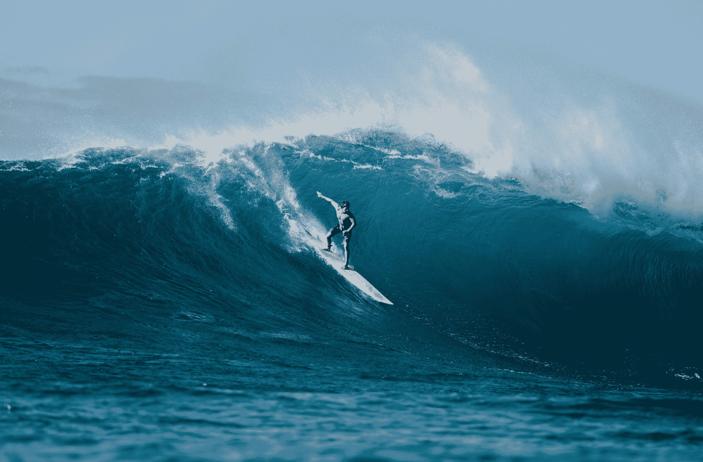

## 极致体验

### 无畏的、充满信心的、令人兴奋的

**IMMERSIVE EXPERIENCES**

**DARING, EMPOWERING AND EXHILARATING**

**Extreme experiences are the essence of growth.**

We motivate our customers to break rules, enlighten them to enjoy a unique experience, and broaden horizons with them. We make them feel that life is positive, because ARCFOX offers them an individualized, convenient and exhilarating immersive experience. We add excitement and passion to their lives and inspire them to harbor a higher expectation toward life.

极致体验是成长的真谛。

我们鼓励客户敢于打破常规，启迪他们享受独特的体验，并与他们一同开拓新的视野。我们让他们感觉到生活蓬勃向前，因为ARCFOX为他们提供个性化、便捷且令人心动的沉浸式体验。我们为他们的生活增添兴奋和激情，激发他们开启对更好生活的渴望。

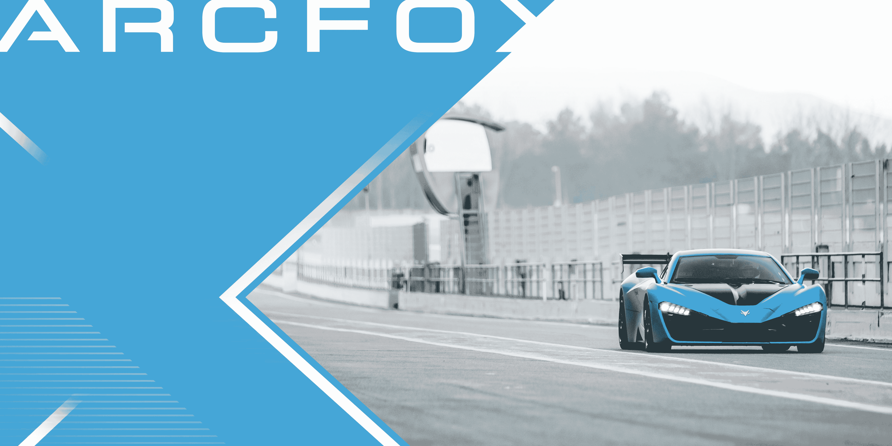

## ARCFOX GT

### 全球首款纯电动GT超跑

- 基于Formula E赛车底盘打造的单体式一体化成型碳纤维结构车身，更轻、更坚固。
- 全碳+蜂窝铝构架的电池框架，重量更轻，强度更高。
- 每个轮子均由独立的电机和逆变器控制，搭载扭矩矢量控制系统，带来更极致的驾驶体验。
- 空气动力学主动升降尾翼，提供更大下压力。
- 配备碳陶瓷刹车系统，带6活塞刹车卡钳，百公里时速制动距离小于35米。
- 85 kW快充系统，30分钟充电20%—80%。
- ARCFOX GT包含街道版与赛道版两种规格。赛道版采用6电机，1000马力；街道版4电机，1200马力。
- 街道版车型采用可升降底盘，拥有经济模式、舒适模式、运动模式和直线加速四种驾驶模式，底盘最小离地间隙在80 mm—120 mm可调，充分满足不同驾驶需求。

**WORLD'S FIRST ALL-ELECTRIC GT SPORTS CAR**

The Formula E racing chassis-based car body is designed in a monolithic integrated carbon-fiber structure, more lightweight and robust.

All-carbon battery with a honeycomb aluminum structure, more lightweight and higher strength.

Each wheel is controlled by an independent motor and inverter and equipped with a torque-vector control system to provide a more superb driving experience.

An aerodynamic auto spoiler wing provides greater downforce.

Equipped with a carbon-ceramic braking system with 6-piston brake calipers, with braking distance at 100 km/h less than 35 m.

An 85 kW fast-charging system enables charging from 20% to 80% in 30 minutes.

ARCFOX GT has both street and track versions. Track version: 6 motors, 1,000 hp; street version: 4 motors, 1,200 hp.

Using a lift chassis, the street version has four driving modes, namely Eco Pro Mode, Comfort Mode, Sports Mode and Drag Mode. The minimum ground clearance of the chassis is adjustable within 80 mm—120 mm, fully meeting different driving needs.

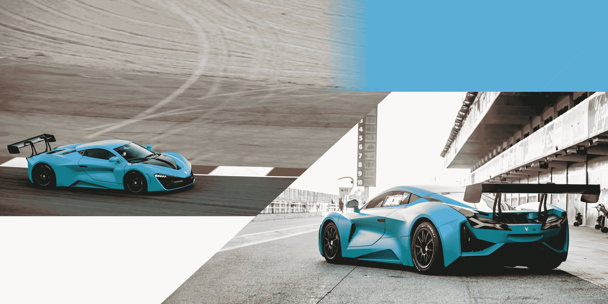

## 生于加泰罗尼亚赛道

**BORN IN CIRCUIT DE CATALUNYA**

ARCFOX GT was born in the Design and R&D Center of High-performance Vehicles of BAIC and was built by the famous former F1 driver Adrián Campos.

ARCFOX GT gathered together lots of engineers' experience in car racing. Its application in design, electric drive, power battery, intelligent interconnection and lightweight has reached racing-car standards, reflecting the top level of the new-energy automobile industry.

—**ADRIAN CAMPOS, the former F1 racer**

We incorporate the idea of Formula racing into the design of ARCFOX GT. Its body, chassis and suspension are made of carbon-fiber composite materials. The combination of the advantages of light weight and high strength brings superb power performance and endurance. The suspension structure of “the front double wishbone + the rear five-link” presents excellent handling, and the aluminum-alloy brake ensures the best braking force in the high-performance field, beyond that of all other racing cars.

—**CHUS SANCHEZ, project leader**

ARCFOX GT诞生于北汽西班牙高性能车型设计和研发中心，由著名前F1车手Adrián Campos亲手打造。

ARCFOX GT汇聚了多位工程师在赛车领域的经验。它在造型设计、电力驱动、动力电池、智能互联和轻量化等领域的应用具有赛车级水准，体现了新能源汽车行业的顶级水平。

——前**F1**赛车手，**ADRIAN CAMPOS**

我们将方程式赛车的设计理念融入ARCFOX GT。它的车身、底盘和悬架均采用碳纤维复合材料，轻量化与高强度的融合，带来极致的动力表现和续航能力。

同时，前双叉臂+后五连杆的悬架结构决定了它绝佳的操控性，而专为其打造的铝合金材质制动器，保证了它在高性能赛车领域首屈一指的制动力。

——项目负责人**CHUS SANCHEZ**

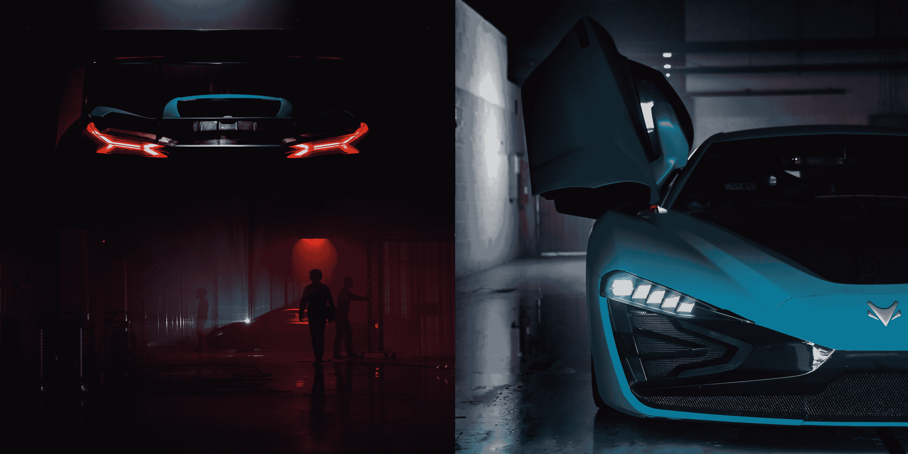

ARCFOX GT 赛道版拥有6个电机，采用前2后4的布局。它具有重量小、体积小、扭矩大的特点。

我们将高性能液冷电池置于后排座椅下方，放电倍率远超同级车辆。同时，在北汽新能源自主研发的智能电驱系统辅助下，确保车辆在任何状态都能将源源不断的动力及时分配给四个车轮，实现出色的运动性和稳定性。

——**ARCFOX GT工程师 ISMAEL FERNÁNDEZ**

ARCFOX GT has six motors, two in the front and four in the rear, featuring light weight, small size and large torque. The high-performance liquid-cooling battery is placed under the rear seat, and its discharge rate is much higher than that of other batteries of the same kind. Taking advantage of the intelligent electric drive system independently developed by BAIC BJEV, the vehicle is able to distribute continual power to four wheels in any state, which helps achieve excellent sportiness and stability.

—**ISMAEL FERNÁNDEZ, engineer of ARCFOX GT**

最大续航里程不低于（**km**）

47

48

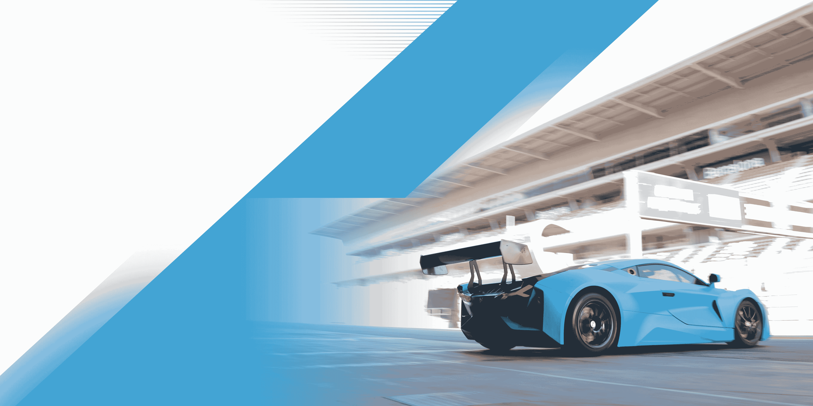

## 释放速度与力量

### UNLEASH SPEED AND STRENGTH

**We pursue the best and explore the speed limit.**

As the predecessor of the pure electric sports car ARCFOX GT, ARCFOX-7 was the pilot car of China GT in 2018, competing with many top racing cars and showing the strength and confidence of our products on the track.

Thanks to this opportunity, our products were tested in the battlefield that gathered many other excellent contestants. Meanwhile, we invited more than 500 customers and fans to watch the game and have close interaction with ARCFOX products.

我们追求极致、探寻速度的极限。

作为纯电动GT跑车ARCFOX GT的前代车型，ARCFOX-7成为2018年度China GT的领航车，与众多顶级赛车同场竞技，展现了我们的产品在赛道上的实力与自信。

我们的产品在群雄逐鹿的赛场得到检验。与此同时，我们共邀请了500余位用户、粉丝亲临赛场观战，近距离与ARCFOX品牌及产品互动。

49

50

## 构建多维度沟通方式

### MULTI-DIMENSIONAL COMMUNICATIONS

**We are open-minded and we listen and connect at all times to ensure that customers and fans are happy to interact with our brands and staff.**

We build a digital ecosystem and aim to lay out an omnichannel digital platform that integrates the official website, app, e-commerce, member websites and social media to create a one-stop service experience. We also provide a personalized communication platform for explorers to create a brand social ecosystem.

我们思维开放，倾听并且时刻连结，确保客户和粉丝在与我们的品牌、人员互动时感到愉悦。

我们建立数字化生态，着力布局全渠道数字平台，集合品牌官网、APP、电商、会员网站及社交媒体，打造全生命周期的一站式服务体验。同时，我们为探索者们提供个性化交流平台，创造品牌社交生态圈。

51

52

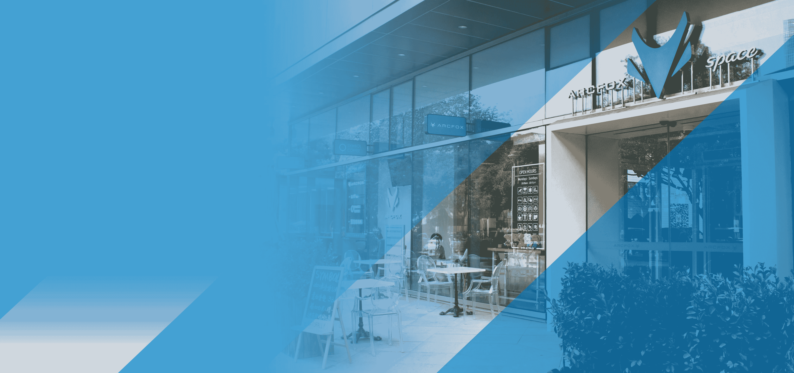

## 打造互动和分享的生活空间

我们在提供愉悦的用车体验的同时，也未曾忽视为用户创造旅途之外的感动。

位于潮流聚集地的三里屯ARCFOX体验中心不但具有传统的汽车销售、服务等全部功能，还为客户提供与众不同的体验。

我们遵循“生而破界”的品牌精神，通过无界设计打破室内空间和室外空间的界限，打破物理空间和心理空间的界限，打破实体空间和虚拟空间的界限。创造产品、服务、体验一体式的周全氛围，为客户创造愉悦感和归属感。连同ARCFOX APP一起，为客户提供线上线下相融合的无缝体验。

ARCFOX体验中心是便捷的购物空间、极致的体验空间，同时，它也是ARCFOX车主和车迷聚会交流的最佳场所。

### AN INTERACTIVE AND SHARED LIVING SPACE

While providing a pleasant car-driving experience, we've never forgotten to create impressive moments for customers beyond their travelling.

The ARCFOX Space in Sanlitun, a destination of shopping, dining and entertainment, not only has such conventional services as car sales and after-sales services but also features a unique customer experience.

Following the brand spirit of "born free" and through borderless design, we have diminished the boundaries between indoor and outdoor space, between physical and mental space, and between physical and virtual space. A three-in-one atmosphere of innovative products, services and experience brings our customers a sense of pleasure and belonging. Together with ARCFOX APP, we offer our customers a seamless online-physical integration experience.

ARCFOX Space is a customer-friendly shopping space and a perfect experience space, and it is also the best choice for ARCFOX owners and fans to meet and communicate.

53

54

## 提供便捷、有温度的服务

### EASY-TO-USE AND WARM SERVICES

#### All-new service contact spot design

Focusing on users' needs, we carefully elaborate every contact spot during the entire service process, providing customers with easy, efficient and personalized services and continual surprises.

#### All-new network information services

No matter whether it is maintenance, warranty or mileage anxiety, all your problems will be perfectly solved. Our comprehensive care for our customers includes pick-up and delivery, valet delivery, five-year vehicle warranty, five-year free car repair, and Qingxiang scooter cars.

#### All-new customer exploration

The continuous exploration of customer data allows us to have a better understanding of our customers and develop more detailed services according to individual needs.

### 全新服务触点设计

以用户需求为中心，我们对服务全流程中的每一个触点精心设计，让每一位用户享受轻松、高效、个性化的服务关怀，不断创造惊喜。

### 全新网联信息化服务

无论是对保养保修还是里程的担忧，你所有问题都会迎刃而解。我们对用户的全方位关怀包括上门取送车、代客送电、五年整车保修、五年免费修车、轻享代步等。

### 全新用户运营

对用户数据的不断挖掘，让我们可以不断细化用户画像、针对个性化需求展开更细致的服务。

55

56

## 生而破界，探索不止

We keep moving forward and become stronger through the journey of explorations.

In the process of continuous creation, through each practice, we become more determined about the future.

We are born free, adaptive, and always aspiring for the best.

Our firm belief lies in it.

Not the best yet? Then just make it be!

在不断前行的路上，在一次次的探索旅途中，让自己变得更强大。

在不断创造的过程里，在一次次的实践中，更笃定未来的方向。

我们生而破界，进化不止，永远探求最好。

我们坚信如此。

没有最好？那就去创造它！

### ENDLESS EXPLORATION

### BORN FREE

### ENDLESS EXPLORATION

57

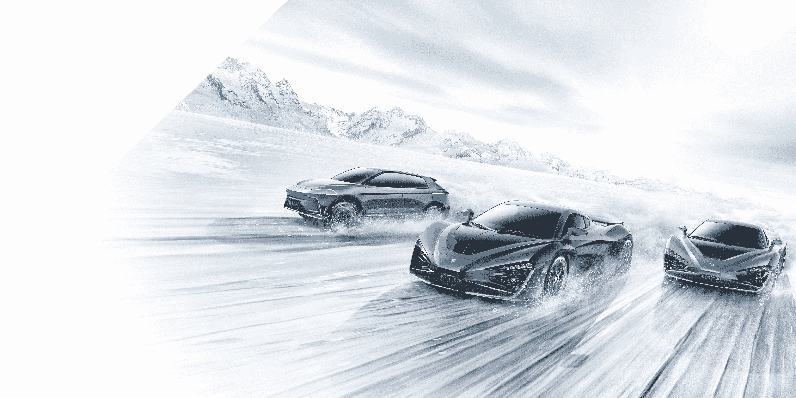

## 2019日内瓦车展

ARCFOX破界而来

### BORN FREE

59

60

扫码关注

### ARCFOX官方账号

