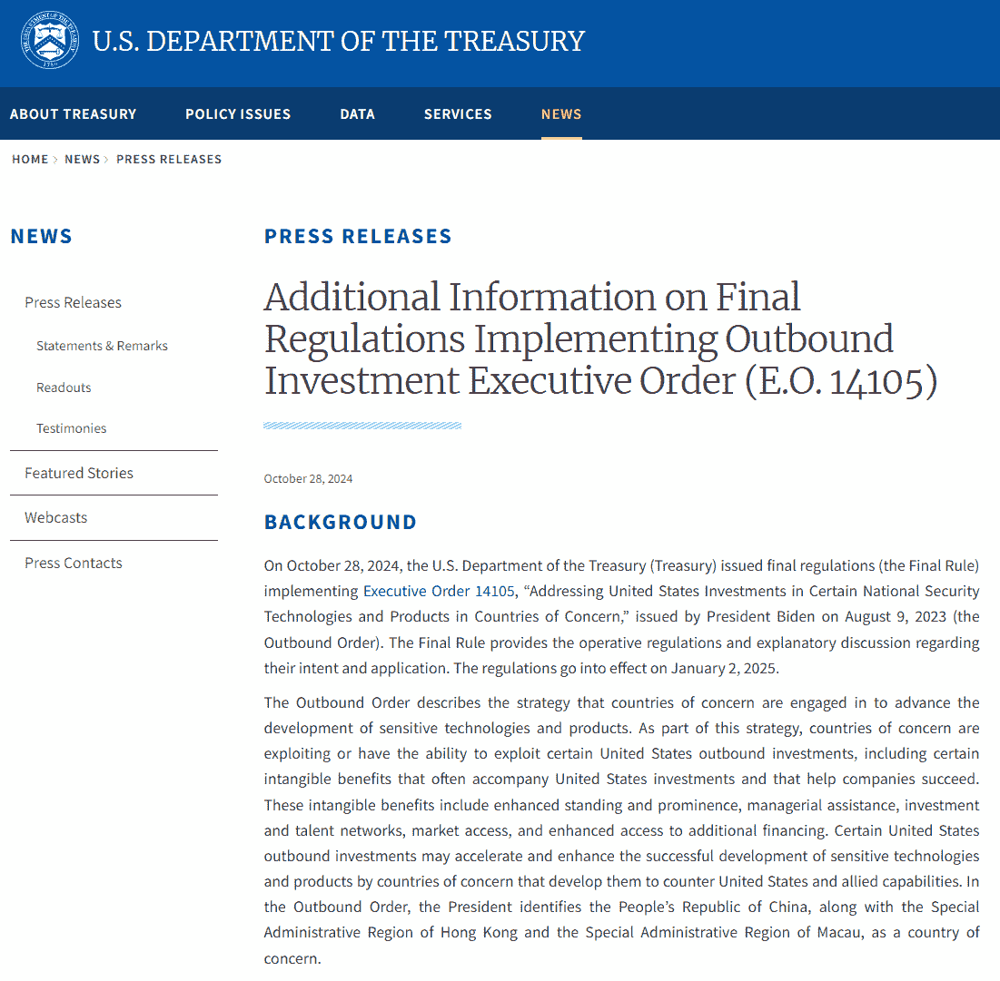
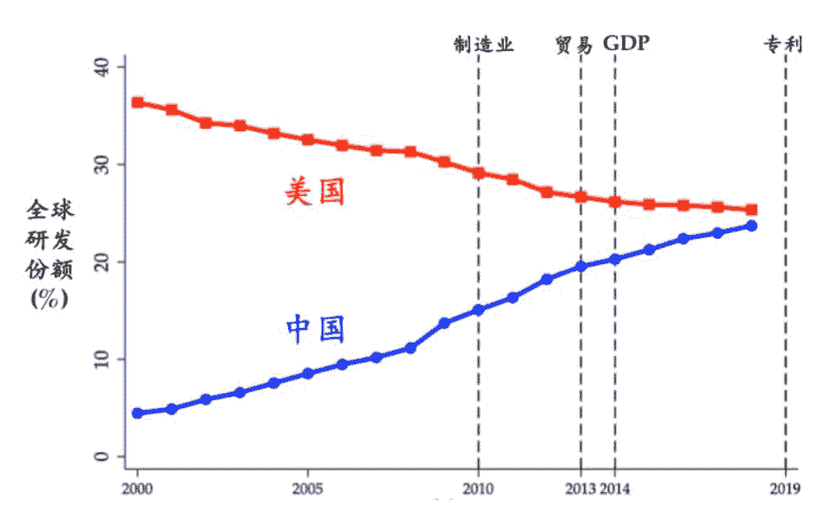
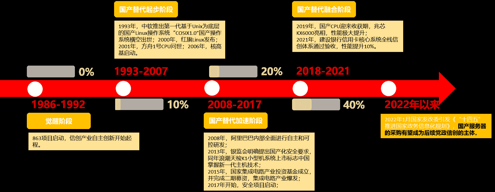

请阅读最后评级说明和重要声明

| 证券研究报告 |

行业研究 | 专题报告 | 软件与服务

## 美国大选尘埃落定，国产替代势在必行

报告要点

美国大选特朗普卷土重来，国产关键技术自主可控愈发紧迫，尤其我国信创产业链中上游仍有较大提升空间，尤其是在芯片、操作系统、数据库及中间件等细分品类，国产化不足10%。由此我国或将大力推进科技自主。在国家推动下，科技自主重要方向有望迎来新一轮推广周期，产业链整体受益。结合产业链环节价值量和竞争格局优势重点推荐：国产操作系统龙头、国产数据库龙头达梦数据、国产芯片龙头、国产办公软件龙头、国产服务器领军神州数码、国产EDA领军企业，建议关注国产操作系统领军企业、信创密码安全领军企业、国产OA领军企业。

分析师及联系人

宗建树

SAC：S0490520030004

SFC：BUX668

---

请阅读最后评级说明和重要声明

| 证券研究报告 |

更多研报请访问

长江研究小程序

## 软件与服务
### 美国大选尘埃落定，国产替代势在必行

行业研究 | 专题报告

投资评级 看好 | 维持

### 国际变局下，关键技术须自主

微软蓝屏事件及俄罗斯系统断供事件说明过度依赖国外科技公司存在较大风险，一旦发生事故或将对多个行业造成较大影响。美国大选特朗普卷土重来，国产关键技术自主可控愈发紧迫，随着中国高科技企业的自主研发能力提升，中国的科技自主将成为未来中国高科技产业发展的重要支撑。

### 信创持续推进，国产化空间巨大

我国信创产业先后历经觉醒阶段、国产替代起步阶段、国产替代加速阶段、国产替代融合阶段，现已迈入应用落地阶段，当下信创产业的落地节奏呈现“2+8+N”的发展态势。虽然我国信创产业规模有望持续高增，预计于2027年达到37011.3亿元，但是信创产业链中上游仍有较大提升空间，尤其是在芯片、操作系统、数据库及中间件等细分品类，国产化不足10%。在信创产业中上游发力或将是我国避免“卡脖子”问题的关键。

### 投资建议：坚定看好国产替代/信创方向

在国际关系愈发复杂的当下，科技自立将是我国科技发展的主线，国产替代/信创方向有望加速。我们认为为避免在关键领域被“卡脖子”，我国或将大力推进科技自主。在国家推动下，科技自主重要方向有望迎来新一轮推广周期，产业链整体受益。结合产业链环节价值量和竞争格局优势重点推荐：国产操作系统龙头、国产数据库龙头达梦数据、国产芯片龙头、国产办公软件龙头、国产服务器领军神州数码、国产EDA领军企业，建议关注国产操作系统领军企业、信创密码安全领军企业、国产OA领军企业。

风险提示

1、资金支持低于预期；

2、政策落地低于预期。

市场表现对比图（近12个月）

资料来源：Wind

相关研究

- 《巴西或引入中国卫星服务，中国卫星企业出海进行时》2024-11-11
- 《政策举措密集落地，“低空经济”鹏城高飞》2024-11-11
- 《能源IT产业跟踪：政策与价格机制双轮驱动，虚拟电厂建设加速》2024-11-06

-40%
-20%
-1%
19%
2023/11
2024/3
2024/7
2024/11
软件与服务
沪深300指数
2024-11-13

---

请阅读最后评级说明和重要声明

**3 / 11**

行业研究 | 专题报告

目录

国际变局下，关键技术须自主 ...................................................................................................... 4

信创持续推进，国产化空间巨大 ................................................................................................... 6

投资建议：坚定看好国产替代/信创方向 ....................................................................................... 8

风险提示 ....................................................................................................................................... 9

图表目录

图1：微软蓝屏事件 ..................................................................................................................................................... 4

图2：俄罗斯系统断供事件 .......................................................................................................................................... 4

图3：宕机事件导致全球数千架次航班取消、数万架次航班延误 ................................................................................ 4

图4：美国政府于10月28日发布了最终规则 ............................................................................................................. 5

图5：中美两国在全球研究与开发（R&D）投入中的份额 ........................................................................................... 6

图6：中国信创产业发展历程 ....................................................................................................................................... 6

图7：信创产业落地进度 .............................................................................................................................................. 7

图8：2018-2027年中国信创产业市场规模及预测 ...................................................................................................... 7

表1：部分信创产品国产化率 ....................................................................................................................................... 8

表2：中国信创产业企业布局情况................................................................................................................................ 8

---

请阅读最后评级说明和重要声明

**4 / 11**

行业研究 | 专题报告

## 国际变局下，关键技术须自主

过度依赖国外科技公司存在较大风险。2024年7月19日，微软发布消息称，旗下Microsoft 365系列服务出现访问中断，受影响的软件包括但不限于Microsoft 365应用系列，以及微软Xbox等，导致全球范围内大量搭载Windows系统的公司电脑出现了蓝屏故障，无法正常启动。此前，微软于2022年6月19日禁止俄罗斯境内网络下载Windows10和Windows11系统，俄罗斯境内用户无法正常地下载安装程序。

图1：微软蓝屏事件

图2：俄罗斯系统断供事件

资料来源：艾媒咨询，长江证券研究所

资料来源：艾媒咨询，长江证券研究所

微软故障影响巨大，航空、医疗、传媒、金融、零售、物流等多个行业受到影响。据微软公司当地时间7月20日表示，此次故障是由于美国电脑安全技术公司“众击”为微软视窗系统发布的软件更新中存在“缺陷”而引起的，据估算影响了全球近850万台安装了该系统的设备。全球范围内，包括美国、日本、英国、墨西哥、印度、新西兰、澳大利亚等多国的航空公司、银行、政府网络、证券交易所及超市自动收银机等关键基础设施均受到了不同程度的影响。

图3：宕机事件导致全球数千架次航班取消、数万架次航班延误

资料来源：央视网，长江证券研究所

---

请阅读最后评级说明和重要声明

**5 / 11**

行业研究 | 专题报告

美国大选尘埃落定，国产关键技术自主可控愈发紧迫。自2018年12月特朗普政府正式掀起对华贸易摩擦至今，美政府在半导体和人工智能领域，针对中国相关产业还处于成长阶段的特点，美政府联合其他拥有相关技术的国家，组建技术联盟，对华进行技术封锁；同时限制美国风险投资和私募基金向部分中国高科技企业进行投融资。美东时间11月9日，美国2024年总统选举结果出炉：共和党籍总统候选人特朗普以312张选举人票胜选，时隔四年，再次当选美国总统。随着特朗普再次上台，关键技术的国产化更加急迫。

图4：美国政府于10月28日发布了最终规则

资料来源：美国财政部，长江证券研究所

打破技术封锁，科技自主将是必由之路。科技“依赖”与国家的科技实力息息相关，国家的科技实力越弱，则其对外国技术的依赖程度越高。半导体、量子计算和人工智能等前沿科技有望成为未来战略新兴产业的发展的底层支撑。当前国际形势下，我国相关领域企业在研发上的原创性和探索性逐步提升。随着中国高科技企业的自主研发能力提升，中国的科技自主将成为未来中国高科技产业发展的重要支撑。

---

请阅读最后评级说明和重要声明

**6 / 11**

行业研究 | 专题报告

图5：中美两国在全球研究与开发（R&D）投入中的份额

资料来源：北大官网，长江证券研究所

## 信创持续推进，国产化空间巨大

信创产业先后历经觉醒阶段、国产替代起步阶段、国产替代加速阶段、国产替代融合阶段，现已迈入应用落地阶段。1986年，“863计划”推出，正式拉开我国信创产业的发展序幕。1993-2021年，信创产业的发展历程包括国产替代起步、国产替代加速、国产替代融合三大阶段。2022年信创产业正式迈入应用落地阶段。

图6：中国信创产业发展历程

资料来源：前瞻产业研究院，长江证券研究所

目前信创产业的落地节奏呈现“2+8+N”的发展态势。信创体系覆盖2+8+N个领域，即党、政与金融、电信、电力、石油、交通、航空航天、医疗、教育8个关于国计民生的重要行业，以及N个消费市场。党政领域作为信创起步最早的领域，当前党政市级以上公文系统已进入信创改造的收尾阶段，并有望向八大重点行业加速推进，N个行业的信创改造也在同步推进。

---

请阅读最后评级说明和重要声明

**7 / 11**

行业研究 | 专题报告

图7：信创产业落地进度

资料来源：工信部，艾媒数据中心，长江证券研究所

我国信创产业规模有望持续高增。近年来，政府对于信息化建设的重视程度逐步提高，我国信创产业获得快速发展，以国产CPU、操作系统、数据库、整机为代表，信创产业自主研发能力不断提升，生态愈发繁荣。据艾媒数据中心数据显示，2023年中国信创产业规模达20961.9亿元，2027年有望达到37011.3亿元。

图8：2018-2027年中国信创产业市场规模及预测

资料来源：艾媒数据中心，长江证券研究所

| 年份 | 2018 | 2019 | 2020 | 2021 | 2022 | 2023 | 2024E | 2025E | 2026E | 2027E |
|------|------|------|------|------|------|------|-------|-------|-------|-------|
| 市场规模 | 8148.4 | 9649.8 | 11495.8 | 13758.8 | 16689.4 | 20961.9 | 24420.6 | 27961.6 | 32127.9 | 37011.3 |
| 增速 | 18.4% | 19.1% | 19.7% | 21.3% | 25.6% | 16.5% | 14.5% | 14.9% | 15.2% | - |

我国信创产业中下游国产化率仍有待提升。目前从信创产业链各环节的国产化程度来看，应用软件及IT安全等下游领域国产化率较高，而信创产业链中上游仍有较大提升空间，尤其是在芯片、操作系统、数据库及中间件等细分品类，国产化不足10%。在信创产业中上游发力或将是我国避免“卡脖子”问题的关键。

表1：部分信创产品国产化率

| 领域 | 市场规模（亿元） | 国产化率（主要厂商） | 替代空间 |
|------|------------------|----------------------|----------|
| CPU芯片（2021年） | 1875 | 2% | 1835 |
| 服务器（2021年） | 251 | 74% | 65 |
| 操作系统（2021年） | 354 | 5% | 335 |
| 存储（2020年） | 317 | 72% | 105 |
| 办公软件（2020年） | 118 | 28% | 85 |
| 数据库（2021年） | 309 | 4% | 299 |
| 中间件（2020年） | 150 | 8% | 137 |
| ERP（2020年） | 346 | 71% | 99 |

资料来源：赛迪研究院，长江证券研究所

## 投资建议：坚定看好国产替代/信创方向

在国际关系愈发复杂的当下，科技自立将是我国科技发展的主线，国产替代/信创方向有望加速。我们认为为避免在关键领域被“卡脖子”，我国或将大力推进科技自主。在国家推动下，科技自主重要方向有望迎来新一轮推广周期，产业链整体受益。结合产业链环节价值量和竞争格局优势重点推荐：国产操作系统龙头、国产数据库龙头达梦数据、国产芯片龙头、国产办公软件龙头、国产服务器领军神州数码、国产EDA领军企业，建议关注国产操作系统领军企业、信创密码安全领军企业、国产OA领军企业。

表2：中国信创产业企业布局情况

| 领域 | 国有代表企业 | 国际代表企业 |
|------|--------------|--------------|
| CPU | 华为海思、中国长城、龙芯中科、海光信息、申威科技、上海兆芯 | Intel、AMD |
| 存储芯片 | 长江存储、长鑫存储、兆易创新、紫光集团等 | 三星电子等 |
| 服务器 | 浪潮信息、神州数码、新华三等 | 戴尔、惠普、IBM等 |
| 操作系统 | 华为、麒麟软件、普华基础等 | 微软、谷歌等 |
| 数据库 | 人大金仓、南大通用、达梦数据等 | Oracle、DB2等 |
| 中间件 | 东方通、中创软件、金蝶天燕、宝兰德等 | Weblogic、Websphere、Tuxedo等 |
| 云计算 | 阿里、华为、腾讯等 | VWare、微软等 |
| 信息安全 | 深信服、启明星辰、360等 | KnowBe4、Raytheon、FireEye等 |
| 应用软件 | 金山办公、泛微软件等 | Adobe、微软等 |

资料来源：前瞻产业研究院，长江证券研究所

请阅读最后评级说明和重要声明

行业研究 | 专题报告

## 风险提示

1、资金支持低于预期。当前国债投入方向或较多，信创可能是其支持细分方向之一，实际投入资料量和投入进度或存在一定的不确定性，导致实际资金支持力度或低于市场预期。

2、政策落地低于预期。信创细分方向在产业落地中存在一定的政策支持和导向性，其支持力度的强弱大幅度影响着落地执行的效果，若推进政策较为缓和，强制性或者考核压力较弱，或存在相关政策在落地执行过程中进度不及市场预期。

## 投资评级说明

### 行业评级

报告发布日后的12个月内行业股票指数的涨跌幅相对同期相关证券市场代表性指数的涨跌幅为基准，投资建议的评级标准为：

- 看好：相对表现优于同期相关证券市场代表性指数
- 中性：相对表现与同期相关证券市场代表性指数持平
- 看淡：相对表现弱于同期相关证券市场代表性指数

### 公司评级

报告发布日后的12个月内公司的涨跌幅相对同期相关证券市场代表性指数的涨跌幅为基准，投资建议的评级标准为：

- 买入：相对同期相关证券市场代表性指数涨幅大于10%
- 增持：相对同期相关证券市场代表性指数涨幅在5%～10%之间
- 中性：相对同期相关证券市场代表性指数涨幅在-5%～5%之间
- 减持：相对同期相关证券市场代表性指数涨幅小于-5%
- 无投资评级：由于我们无法获取必要的资料，或者公司面临无法预见结果的重大不确定性事件，或者其他原因，致使我们无法给出明确的投资评级。

相关证券市场代表性指数说明：A股市场以沪深300指数为基准；新三板市场以三板成指（针对协议转让标的）或三板做市指数（针对做市转让标的）为基准；香港市场以恒生指数为基准。

## 办公地址

| 城市 | 地址 | 邮编 |
|---|---|---|
| 上海 | 虹口区新建路200号国华金融中心B栋22、23层 | （200080） |
| 武汉 | 武汉市江汉区淮海路88号长江证券大厦37楼 | （430015） |
| 北京 | 西城区金融街33号通泰大厦15层 | （100032） |
| 深圳 | 深圳市福田区中心四路1号嘉里建设广场3期36楼 | （518048） |

## 分析师声明

本报告署名分析师以勤勉的职业态度，独立、客观地出具本报告。分析逻辑基于作者的职业理解，本报告清晰准确地反映了作者的研究观点。作者所得报酬的任何部分不曾与、不与，也不将与本报告中的具体推荐意见或观点有直接或间接联系，特此声明。

## 法律主体声明

本报告由长江证券股份有限公司及/或其附属机构（以下简称“长江证券”或“本公司”）制作，由长江证券股份有限公司在中华人民共和国大陆地区发行。长江证券股份有限公司具有中国证监会许可的投资咨询业务资格，经营证券业务许可证编号为：10060000。本报告署名分析师所持中国证券业协会授予的证券投资咨询执业资格证书编号已披露在报告首页的作者姓名旁。

在遵守适用的法律法规情况下，本报告亦可能由长江证券经纪（香港）有限公司在香港地区发行。长江证券经纪（香港）有限公司具有香港证券及期货事务监察委员会核准的“就证券提供意见”业务资格（第四类牌照的受监管活动），中央编号为：AXY608。本报告作者所持香港证监会牌照的中央编号已披露在报告首页的作者姓名旁。

## 其他声明

本报告并非针对或意图发送、发布给在当地法律或监管规则下不允许该报告发送、发布的人员。本公司不会因接收人收到本报告而视其为客户。本报告的信息均来源于公开资料，本公司对这些信息的准确性和完整性不作任何保证，也不保证所包含信息和建议不发生任何变更。本报告内容的全部或部分均不构成投资建议。本报告所包含的观点、建议并未考虑报告接收人在财务状况、投资目的、风险偏好等方面的具体情况，报告接收者应当独立评估本报告所含信息，基于自身投资目标、需求、市场机会、风险及其他因素自主做出决策并自行承担投资风险。本公司已力求报告内容的客观、公正，但文中的观点、结论和建议仅供参考，不包含作者对证券价格涨跌或市场走势的确定性判断。报告中的信息或意见并不构成所述证券的买卖出价或征价，投资者据此做出的任何投资决策与本公司和作者无关。本研究报告并不构成本公司对购入、购买或认购证券的邀请或要约。本公司有可能会与本报告涉及的公司进行投资银行业务或投资服务等其他业务（例如：配售代理、牵头经办人、保荐人、承销商或自营投资）。

本报告所包含的观点及建议不适用于所有投资者，且并未考虑个别客户的特殊情况、目标或需要，不应被视为对特定客户关于特定证券或金融工具的建议或策略。投资者不应以本报告取代其独立判断或仅依据本报告做出决策，并在需要时咨询专业意见。

本报告所载的资料、意见及推测仅反映本公司于发布本报告当日的判断，本报告所指的证券或投资标的的价格、价值及投资收入可升可跌，过往表现不应作为日后的表现依据；在不同时期，本公司可以发出其他与本报告所载信息不一致及有不同结论的报告；本报告所反映研究人员的不同观点、见解及分析方法，并不代表本公司或其他附属机构的立场；本公司不保证本报告所含信息保持在最新状态。同时，本公司对本报告所含信息可在不发出通知的情形下做出修改，投资者应当自行关注相应的更新或修改。本公司及作者在自身所知情范围内，与本报告中所评价或推荐的证券不存在法律法规要求披露或采取限制、静默措施的利益冲突。

本报告版权仅为本公司所有，本报告仅供意向收件人使用。未经书面许可，任何机构和个人不得以任何形式翻版、复制和发布给其他机构及/或人士（无论整份和部分）。如引用须注明出处为本公司研究所，且不得对本报告进行有悖原意的引用、删节和修改。刊载或者转发本证券研究报告或者摘要的，应当注明本报告的发布人和发布日期，提示使用证券研究报告的风险。本公司不为转发人及/或其客户因使用本报告或报告载明的内容产生的直接或间接损失承担任何责任。未经授权刊载或者转发本报告的，本公司将保留向其追究法律责任的权利。

本公司保留一切权利。
