## 园区物流无人驾驶行业研究报告

**2024年11月**

## 目录

**01 行业概况**

- 概念内涵
- 主要特征
- 发展历程
- 产业链结构
- 政策标准

**02 市场格局**

- 市场规模
- 应用场景
- 作业模式
- 竞争格局
- 商业模式

**03 企业及产品**

- 产品分类/构成
- 铁木牛/蚂蚁机器人
- 未来机器人/驭势科技
- 九曜智能/友道智途
- 案例图示

**04 结论及建议**

- 发展阶段
- 市场趋势
- 主要挑战
- 市场选择
- 六点启发

---

# 01 行业概况

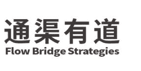

### 园区：包括政策性园区与产业园区，本报告聚焦六种产业园区中的无人驾驶技术应用

**园区概念**

- **园区（park）**：①一般由政府集中统一规划指定区域，区域内专门设置某类特定行业、形态的企业、公司等，进行统一管理，本质上是一种空间聚集形式；②狭义园区指产业园区，广义园区适用于不同目的和功能而设置的开发区域（通渠有道研究整理）。

- **产业园区（Industrial Park）**：行政主管部门依据主体功能区规划划定的功能区内，符合一定标准的各类企业注册登记、集中集约有序布局、开展生产经营活动并建立统一管理机构的产业集中发展区域。

- **物流园区（logistics park）**：由政府规划并由统一主体管理，为众多企业在此设立配送中心或区域配送中心等，提供专业化物流基础设施和公共服务的物流产业集聚区。

资料来源：《GB/T18354-2021 物流术语》；《低碳产业园区建设导则（征求意见稿）》，2024.7；谭谈债市-解读“国家级园区体系架构”，2023.3等。

**园区分类（2类）**

| 政府开发区 | 产业园区 |
| :--- | :--- |
| **国家级开发区** - 国家级新区（共19个）：上海浦东新区、天津滨海新区、重庆两江新区、舟山群岛新区、甘肃兰州新区、广东南沙新区、陕西西咸新区、贵州贵安新区、四川天府新区、南京江北新区、河北雄安新区等 - 经济技术开发区 - 高新技术开发区 - 边境经济合作区 - 海关特殊监管区 - 自由贸易园区 | **省级开发区** - 经济开发区 - 特色工业园区 - 高新技术园区 |
| **物流园区** - 货运服务型 - 生产服务型 - 商贸服务型 - 口岸服务型 - 综合服务型 | **其他园区** - 工业园区 - 科技园区 - 生态农业园区 - 文化创意园区 - 封闭园区、半封闭园区 |

### 物流园区：五种物流园区就近配套五类产业空间，本报告聚焦港口、矿区之外场景

- **货运服务型**（类型占比16%）：为大批量货物的分拨、转运配套，主要服务于**国际性或区域性物流转运**及运输方式的转换。
- **生产服务型**（类型占比5.2%）：为生产制造型企业提供一体化物流服务，主要服务于**生产制造企业的物料供应、产品生产、产品销售和回收**等。
- **商贸服务型**（类型占比13.3%）：为商贸流通企业提供一体化物流，主要服务于各类市场商品的**集散、运输、配送、仓储、流通加工**等。
- **口岸服务型**（类型占比2.4%）：为国际贸易企业提供国际物流服务，主要服务于**进出口货物**报关、报检、**仓储、采购、分销、中转、转口**等。
- **综合服务型**（类型占比63.1%）：位于城市交通主要节点，提供综合物流，主要服务于**城市与区域运输和配送**体系的组织。

**配套产业空间**：
- 交通枢纽节点（港口：海港、河港、陆港；公路；铁路；空港：机场）
- 制造业园区（大型厂矿、制造业基地、产业集聚区）
- 商贸集散地（农业主产区、商贸集聚区、各类批发市场、各类专业市场）
- 开放口岸（沿边陆路口岸、海关特殊监管区域）
- 多元产业集聚区（两个及多个交通枢纽、生产制造业、商贸流通业、城市配送等业态组合）

资料来源：《GB/T 21334-2017 物流园区分类与规划基本要求》、《国家物流枢纽分类与统计指标体系》和中物联《第七次全国物流园区（基地）调查报告（2024）》。

### 园区装备类型：涵盖货物转运、人员短驳和环境管理，本报告聚焦货物转运相关车辆

**园区无人驾驶应用领域**：

- **01 货物转运**
  - 搬运：叉车、AGV、AMR、堆垛车等
  - 运输：牵引车、平板车、厢式货车
  - 配送：AMR、配送车

- **02 人员短驳**
  - 客运：旅客摆渡车、旅客登机桥、无障碍登机车
  - 接驳：观光车、漫游车、微循环巴士
  - 零售：零售车

- **03 环境管理**
  - 环卫：三轮车、保洁车、清扫车、清（污）水车等
  - 安防：巡逻车、智慧巡检车等
  - 作业：飞机加油车、机场推雪车、机场驱鸟车等

### 园区物流车辆：涉及工业车辆、叉车、特种车、货车，本报告聚焦工业车辆和货车两类

资料来源：《工业车辆 术语 第1部分：类别》征求意见稿、《TSG 81-2022 场（厂）内专用机动车辆安全技术规程》、《GA 802-2019 道路交通管理 机动车类型》、《GB/T 3730.1-2022 汽车、挂车及汽车列车的术语和定义 第1部分：类型》、《理赔技术鉴定：车险百科 | 最基础的汽车分类，一应俱全》等。

| 类别 | 定义 | 类型 | 典型产品 |
| :--- | :--- | :--- | :--- |
| **工业车辆** | 指至少有三个车轮，并带有动力或非动力驱动装置的轮式车辆（轨道运行车辆除外），设计用于搬运、牵引、推顶、起升、堆垛或在货架上分层堆垛各种货物，并由一个操作者控制或无人驾驶自动控制。**注：多数类型的工业车辆可以是无人驾驶车辆** | 按作业方式、按动力源、按车轮型式、按控制方式、按起升高度、按运行方式 | - **机动工业车辆（即叉车）**：平衡重式叉车、前移式叉车、侧面式叉车、插腿式叉车、托盘堆垛车、三向堆垛车 - **牵引车** - 推顶车 - 各类叉车、堆垛车、搬运车 |
| **场（厂）内专用机动车辆** | 指除道路交通、农用车辆以外仅在工厂厂区、旅游景区、游乐场所等特定区域使用的专用机动车辆 | - | - **货物及人员载运车** - **无人驾驶车辆** - **非公路用旅游观光车辆**：观光车、观光列车 |
| **特种车辆** | 指外廓尺寸、重量等方面超过设计车辆限界的及特殊用途的车辆，经特制或专门改装，配有固定的装置设备，主要功能不是用于载人或运货的机动车辆 | - | - **特种车一**：化工和能源运输（油罐车、汽罐车、液罐车） - **特种车二**：工程类（升降车/搅拌车/推土车/压路机等）、保洁类（环卫车、清障车、洒水车等）、运输类（冷藏车） - **特种车三**：用于消防救援、金融运输、救护医疗、电视转播等公共事业领域的专用车 - **特种车四：集装厢拖头车** |
| **货车&挂车** | 货车：指设计和制造上主要用于载运货物或牵引挂车的汽车，也包括装备一定专用设备或器具但以载物为主要目的汽车。挂车：设计、制造和技术特性上由汽车牵引才能正常使用的一种无动力的道路车辆 | 按规格： - **重卡（X≥12t）** - **中卡（4.5t≤X＜12t）** - **轻卡（1.8t＜X＜4.5t）** - **微卡（X≤1.8t）** - **三轮汽车、低速货车**  按结构： - **普通货车**（平板式/栏板式/仓栅式/厢式/自卸式）、侧帘式货车、封闭式货车、多用途货车（皮卡车）、越野货车、半挂牵引车、牵引货车、专用货车 | - |

### 园区物流特点：场景种类繁多、低速短距高频、物流装备多样、与生产高度嵌入

- **1 场景种类繁多**：一是园区场景种类繁多，六类产业园区内部还可细分为无数细分场景；二是场景纷繁复杂导致单场景车辆需求相对有限，难以形成规模效应。

- **2 低速短距高频**：一是速度低，一般生产区限速20-30 km/h，额定负载最大行驶速度≤10km/h；二是园区物流具有运输距离短、重复频次高、多班次全天候、固定线路等特征。

- **3 物流装备多样**：一是入场物流、场/厂内物流、线边物流所需装备性质、功能、操作不同；二是不同细分场景的货物、时效、流程等差异较大，所需装备高度定制化。

- **4 与生产高度嵌入**：一是园区物流运输必须满足工厂生产节拍要求，与生产环节衔接紧密；二是园区物流运输车辆需具备与多种场/厂内装载设备衔接交互能力。

### 园区物流痛点：效率提升受限、运营成本走高、安全风险不可控、数智化程度低

- **01 效率提升受限**：一是园区面积大、物料转运频繁、装卸任务繁重、管理任务复杂；二是物流作业强度逐渐加大，依靠人力的转运效率提升受限。

- **02 运营成本走高**：一是从仓储到生产作业人力招聘困难，薪资不断上涨人力成本增加；二是作业时间长、装卸任务繁重，料车类型多，基层劳动力长期短缺。

- **03 安全风险不可控**：一是园区货物装卸、运输、仓储等交通动态变化，安全事故易发；二是部分转运物料易燃易爆，且司机存在恶劣天气/环境作业工况。

- **04 数智化程度低**：一是生产线与仓储管理基本实现自动化数字化打通，但室内外物流仍是断点；二是企业生产对转运物流有非常强的时效要求，物料配送数据无法实时上传。

### 发展历程：自2019年起，园区物流无人驾驶相继走入汽车基地、机场、物流园区、开放口岸

| 时间 | 事件 |
| :--- | :--- |
| 2019年11月 | 驭势科技在上汽通用五菱**柳州宝骏制造基地**，以宝骏新能源无人车为工具，建成**国内首条**厂区无人驾驶物流线路。 |
| 2019年12月 | 驭势科技在香港国际机场正式开启无人物流车行李运输服务。**截止2024年6月，投放无人牵引、巡逻、小巴等车辆超50辆**。 |
| 2020年4月 | 驭势科技在上汽通用五菱河西基地启动无人物流常态化运营。截止目前，**宝骏基地和河西基地已落地近百台无人车**。 |
| 2021年2月 | 希迪智驾以纯电卡车为载体打造的**华为制造园区内**物流自动驾驶方案实现短驳运输。 |
| 2021年9月 | 友道智途在无锡综合保税区完成从**佳利达物流仓库-捷普电子工厂仓库的**自动驾驶物流车首票测试。 |
| 2022年11月 | 东风物流与驭势科技合作的**厂区无人物流车创新应用项目**正式通过验收测试。 |
| 2023年6月 | 东风柳汽&希迪智驾启动**柳东基地园区物流**无人驾驶重卡（无安全员）商业化运营。 |
| 2023年6月 | 友道智途启动**以六钢专线倒短物流**绿色零碳自动驾驶项目（超30台6X4电动集卡）。 |
| 2023年10月 | 友道智途启动上汽大通**无锡工厂周边入场物流**自动驾驶运营测试（21台9.6m厢货）。 |
| 2024年4月 | 西井科技“无人驾驶重卡Q-Truck+集装箱立体库”工厂解决方案走进**赛力斯汽车工厂**，负责厂内运输。 |
| 2024年9月 | 由东风柳汽研制的首批乘龙IGV和乘龙H5无人集卡在中越跨境**友谊关智慧口岸、浦寨口岸**同步成功进行示范运营。 |

### 产业链结构：园区物流无人驾驶产业链包括零部件、科技公司、制造商、运营方、企业/管理方

| 产业链环节 | 主要参与者 |
| :--- | :--- |
| **零部件厂商** | 移动通信网络、工业车辆底盘、智能零部件…… |
| **无人物流科技公司** | - **多场景无人驾驶公司**：德国Götting KG、驭势科技、立得空间、易成创新、行深智能、算丰征途、西井科技、友道智途、希迪智驾、毫末智行、九识智能、御驾科技、主线科技、宏景智驾、挚途科技、远舢智能等 - **单场景无人驾驶公司**：九曜智能、菜鸟无人车 - **物流机器人公司**：铁木牛、蚂蚁机器人、UQI优奇、木牛流马、三一机器人、寻迹智行、海豚之星、炬星科技等 - **工业车辆-牵引车**：立得空间、易咖智车、行深智能、易成创新、木牛流马等 |
| **物流装备制造商** | - **专用车制造商**：橙仕汽车、国唐汽车等 - **货车制造商**：中国重汽、一汽解放、东风柳汽、北汽福田、江铃汽车、上汽红岩、江淮重卡等 - **卡车线控底盘**…… |
| **物流运营服务企业** | - **三方物流企业**：长久物流、能运物流、兆驰供应链、顺丰供应链、原尚物流、上海博翼物流、中铁特货等 - **企业自有物流**：上汽安吉、一汽物流、东风物流、长城蚂蚁物流、长安民生物流、吉速物流、江汽物流等 - **各类车队**、小三方物流企业 |
| **园区企业/管理方** | - **制造业园区**：煤钢厂、车厂、化工厂、农场、食品厂、科技园等 - **交通枢纽**：公路港、空港、港口 - **商贸集散地**：批发市场、电商产业园 - **物流园区**：货运型、生产型、商贸型、口岸型、综合型 - **开放口岸**：保税区、陆路口岸 |

### 政策标准：国家政策鼓励在园区、景区、场内等应用无人驾驶，且只需报备+管理方同意后即可

- **2020.12 / 交通运输部《关于促进道路交通自动驾驶技术发展和应用的指导意见》**：鼓励在港口、机场、物流场站、交通运输基础设施建设工地等环境相对封闭的区域及邮政快递末端配送等场景，结合生产作业需求，开展自动驾驶载货示范应用。

- **2021.12 / 国务院《“十四五”现代综合交通运输体系发展规划》**：在“洋山港区—东海大桥—临港物流园区”开展集疏运自动驾驶试点，……鼓励自动驾驶在港口、物流园区等限定区域测试应用。

- **2022.10 / 民航局《“十四五”航空物流发展专项规划》**：货物无人驾驶运输工程——推广无人驾驶牵引车运输，……支持全链条国产无人驾驶，构建机场货物无人运输的操作规范、运行维护、安全监管等行业标准……；国际集装货物无人驾驶运输等试点工程。

- **2023.6 /《浦东新区促进无人驾驶装备创新应用若干规定》**：鼓励企业在厂区、园区、港区等非道路区域开展智能运输设备创新应用。

- **2024.3 /《青岛市低速无人驾驶车辆道路测试与商业示范管理实施细则（试行）》**：用于园区、厂区、景区等相对封闭场地的接驳、环卫、配送、零售等无人车，向联席工作小组备案后，由场地管理方根据国家和本市有关规定，制定适用于自身的管理措施，并负责组织实施。

- **2024.10 /《成都高新区低速功能型无人车道路测试与示范应用管理办法（试行）》**：用于各类封闭园区、景区等封闭场所的，只需园区管理方同意即可，但应向工作专班主动报备。

# 标准梳理（部分）

以下是针对园区物流无人工业车辆、无人物流车等领域的相关标准整理：

| 类型 | 标准号/归口 | 标准名称 | 进度 | 核心点 |
| :--- | :--- | :--- | :--- | :--- |
| **国际标准** | ISO 3691-4：2020 | 工业车辆 安全要求和验证 第4部分：无人驾驶工业车辆及其系统 | 2023.06 更新 | 定义了AGV和AGVS（车辆）安全功能要求 |
| | IEEE 2934-2022 | 智能工厂物流作业流程规范 | 2022.09 发布 | 规范了离散制造业智能工厂中的物流作业流程 |
| **国家标准** | GB/T 10827.4-2023 | 工业车辆 安全要求和验证 第4部分：无人驾驶工业车辆及其系统 | 2023.12 实施 | 适用自动导引车、自主移动机器人、机器人、自动导引小车、隧道牵引车、导引车等 |
| | GB/T 21334-2017 | 物流园区分类与规划基本要求（代替GB/T 21334-2008） | 2018.04 实施 | 规定了物流园区的分类和规划要求 |
| | GB/T 41834-2022 | 智慧物流服务指南 | 2022.10 实施 | 提供了关键要素、能力保障、评价与改进等 |
| | GB/T 36507-2023 | 工业车辆 使用、操作与维护安全规范 | 2023.12 实施 | 适用具有自动功能或无人驾驶功能的工业车辆 |
| | GB/T 44459-2024 | 物流园区数字化通用技术要求 | 2024.12 实施 | 适用各类物流园区的数字化规划、建设和管理 |
| **行业标准** | JB/T 13696-2019 | 无人驾驶工业车辆 | 2022.10 实施 | 规定了技术要求、试验方法、检测规则等 |
| | MH/T 6048—2020 | 行李/货物牵引车（代替 MH/T 6048-2008，中国民用航空局） | 2022.10 实施 | 规定了牵引车的技术要求、试验、检验等 |
| | TSG 81-2022 | 场（厂）内专用机动车辆安全技术规程 | 2022.12 实施 | 适用场车的设计、制造、改造、修理、使用等 |
| **中物联/全国物流标委会** | - | 智能物流装备 场内无人驾驶叉车通用技术要求 | 2024.07 研制 | - |
| | - | 无人仓通用技术要求 | 2024.07 审查 | 适用于无人仓的新建、改建和扩建 |
| **团体标准** | T/SCIIA 1-2023 | 园区无人驾驶物流车 通用技术要求 | 2023.09 实施 | 适用园区内无人物流车的研发、生产、应用 |
| | T/CFLP 0062-2023 | 场内物流车辆自动驾驶系统通用技术要求 | 2024.01 实施 | 适用场内自动驾驶系统的设计、开发和测试 |
| | T/SZITS 002-2021 | 低速无人车城市商业运营安全管理规范 第4部分 货物配送低速无人车 | 2022.01 实施 | - |
| | T/SZITS 008-2021 | 低速无人车城市商业运营安全管理规范 第8部分 室内低速无人车 | 2022.01 实施 | - |
| | T∕CESA 1240.1-2023 | 自动配送车自动驾驶系统 仿真测试场景定义和要求 第1部分：城市道路 | 2023.01 实施 | 适用城市道路的自动驾驶系统仿真测试 |
| | T∕CESA 1240.2-2023 | 自动配送车自动驾驶系统 仿真测试场景定义和要求 第2部分：封闭园区 | - | 适用封闭园区的自动驾驶系统仿真测试 |
| | T/CCAATB 0052-2024 | 民用机场飞行区车辆运行智能管控体系建设指南（中国民用机场协会） | 2024.04 实施 | 规定了车辆运行智能管控系统构成和技术要求 |
| | T/CCAATB 0055-2024 | 民用机场飞行区自动驾驶车辆应用导则（中国民用机场协会） | 2024.06 实施 | 规定了自动驾驶车辆的技术框架及功能要求 |

**相较于机动车，园区物流无人工业车辆、无人物流车等国标、行标已经相继出台。**

> 资料来源：2022年11月，国家民航局对《民用机场无人驾驶设备技术要求（征求意见稿）》、《民用机场无人驾驶设备检测规范（征求意见稿）》征求意见，暂无后文。

---

# 02 市场格局

### 市场规模

全国产业园区约1.5万个（含2127个在运营物流园）、机场259个、开放口岸311个。其中，2023年工业车辆中牵引车销量5711台，基本用在产业园区。

#### 产业园区

- 全国各类产业园区约 **15000** 多个（综合信源，预估2021年数据）
- 物流产业园数量：占比18.5%
- 文化创意园数量：占比11.9%
- 电商产业园数量：占比10.7%
- 农业产业园数量：占比5.5%
- 生物医药园数量：占比5.3%
- 电子电器园数量：占比4.3%
- 化工材料园数量：占比4.1%
- 汽车产业园数量：占比3.6%
- 智能产业园数量：占比2.9%
- 能源环保园数量：占比2.5%
- …… 其他产业园数量：占比20.5%

#### 物流园区

- 全国物流园区总数 2769 家（与2022年相比，+8.5pp）
- 运营园区：**2127** 家、占**76.8%**
- 在建园区：468 家、占16.9%
- 规划园区：174 家、占6.3%
- 综合服务型园区：占63.1%
- 货运服务型园区：占16.0%
- 商贸服务型园区：占13.3%
- 生产服务型园区：占5.2%
- 口岸服务型园区：占2.4%
- 提供存储服务：占95.6%
- 提供运输服务：占86.2%
- 提供配送服务：占78.9%
- 提供转运服务：占77.3%
- 提供贸易服务：占58.4%

#### 机场

- 2025年全国民用运输机场270个（十四五民用航空发展规划）
- 2035年全国民用运输机场400个（新时代新征程谱写交通强国建设民航新篇章行动纲要）
- **全国民用运输机场** 259 **个**（截至2023年底，不含港澳台）
- 年货邮吞吐量1万吨以上的运输机场有63个、+12个、占98.7%
- 年旅客吞吐量1千万人次以上运输机场38个，+20个、占81.3%

#### 边境口岸

- **全国对外开放口岸** 311 **个**（截至2024年9月30日）
- 其中，水运口岸 125个
- 其中，航空口岸 85个
- 其中，铁路口岸 17个
- 其中，公路口岸 84个
- 广东：50个（12个公路口岸）
- 黑龙江：27个（7个公路口岸）
- 江苏：26个
- 云南：22个（13个公路口岸）
- 新疆：20个（15个公路口岸）
- 内蒙古：20个（12个公路口岸）
- 广西：18个（8个公路口岸）
- 山东：18个
- 吉林：16个（11个公路口岸）
- 辽宁：13个

#### 牵引车销量

**2023年牵引车销量5711台、+5.27pp**（其中，电动5082台、内燃629台）

> 数据来源：和达洞见-从分布特征和发展趋势看产业园区如何布局；中金-中国基础设施REITs之产业园区篇；中国工程机械工业协会-工业车辆行业2023年回顾与2024年展望；中物联-《第七次全国物流园区（基地）调查报告（2024）》等；《民航总局2023年全国民用运输机场生产统计公报》；国家口岸管理办公室-全国口岸开放一览表等。

### 应用场景①：按作业环节分

包括产线边、室内外、园内室外、出/入场四大场景。

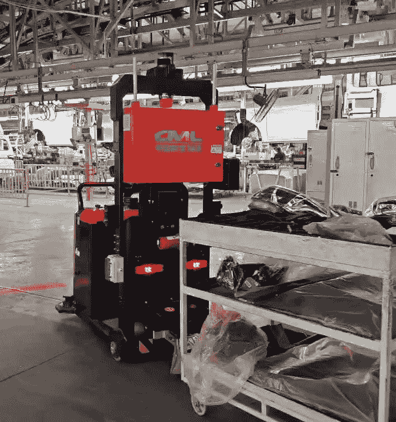

#### 产线物料配送

- 线边库-产线
- 产线-产线

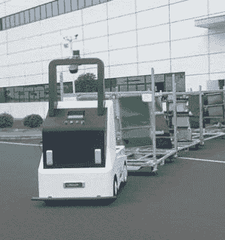

#### 室内外转运

- 仓库-车间
- 仓库-仓库

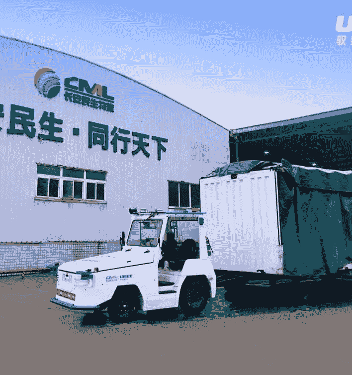

#### 园内室外转运

- 车间-车间
- 仓库-仓库

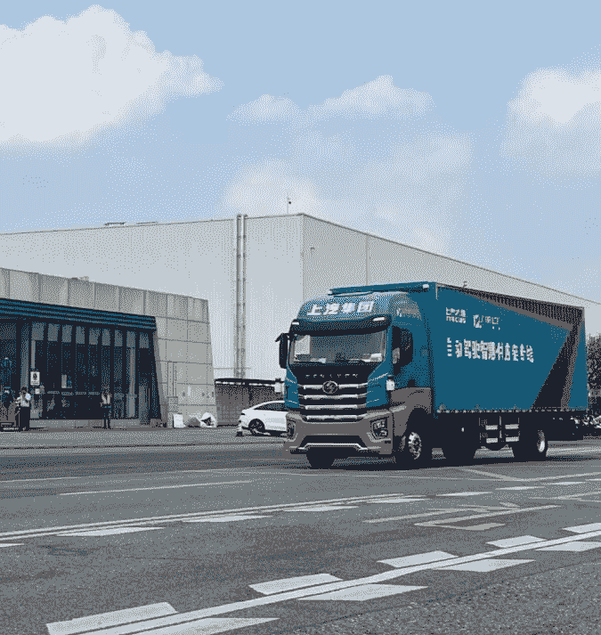

#### 出（入）场物流

- 厂区仓库-港口/陆港
- 厂区仓库-厂区仓库

不同作业环节运输货物不同、运输工具不同、时效要求不同、协同强度不同。

### 应用场景②：按产业空间分

包括工厂厂区、物流园区、机场内、口岸四大场景。

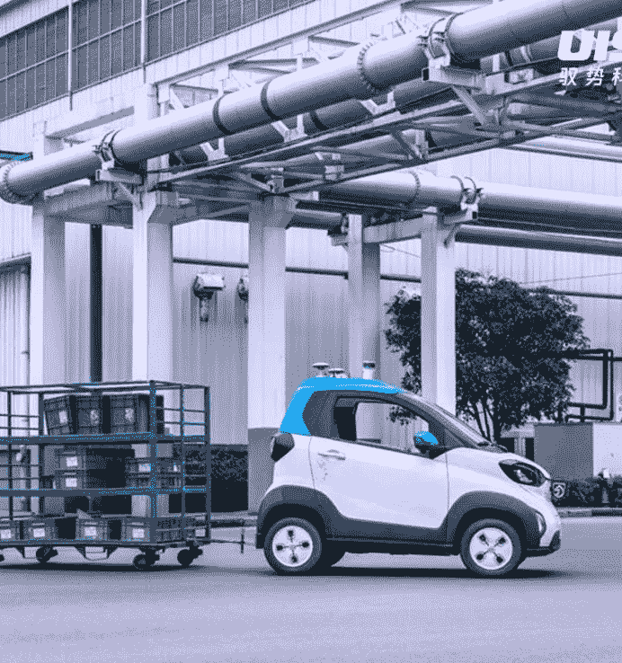

#### 工厂厂区

汽车制造、3C电子、食品医药、农业养殖、石油化工、家电纸业、钢铁制品等

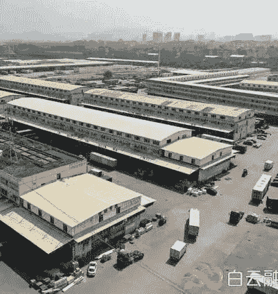

#### 物流园区

综合服务型、货运服务型、商贸服务型、生产服务型、口岸服务型

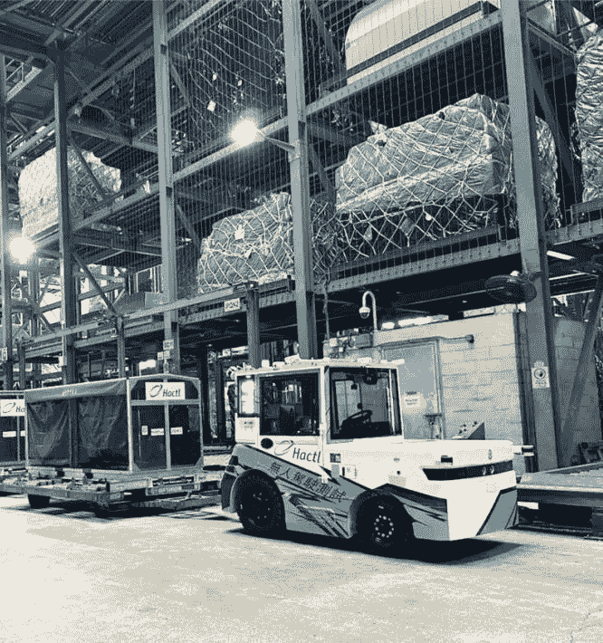

#### 机场场内

行李转运、货物牵引、飞机牵引、飞机引导、加油车、食品车、清水（污）车、垃圾车等

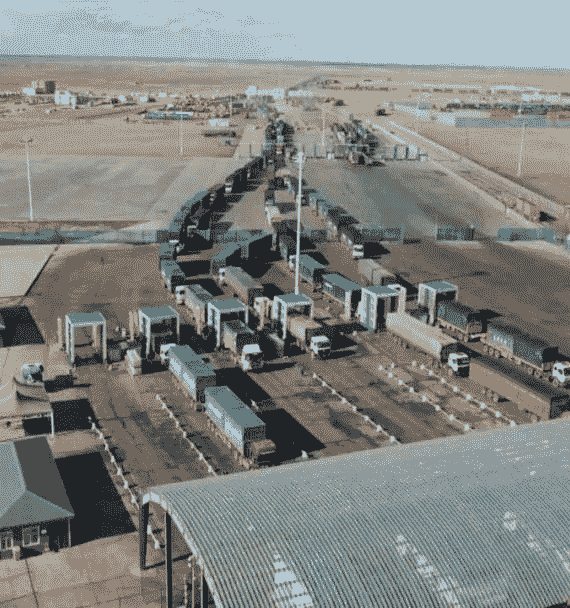

#### 开放口岸

A国海关监管区-B国海关监管区、自由贸易园区-跨境物流园区、综合保税区-多式联运拓展区

不同细分场景运输货物不同、运输工具不同、时效要求不同、安全要求不同。

### 运输对象

以物流园区为例，主要流转食品、日用品、农副产品、邮件等6类商品。

> 资料来源：中物联-《第六次全国物流园区（基地）调查报告（2022）》，2022年12月；《第七次全国物流园区（基地）调查报告（2024）》，2024年8月。

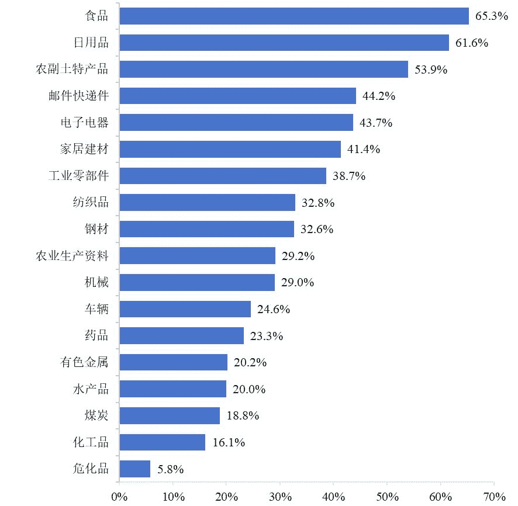
物流园区流转商品品类占比情况（2022年调查）

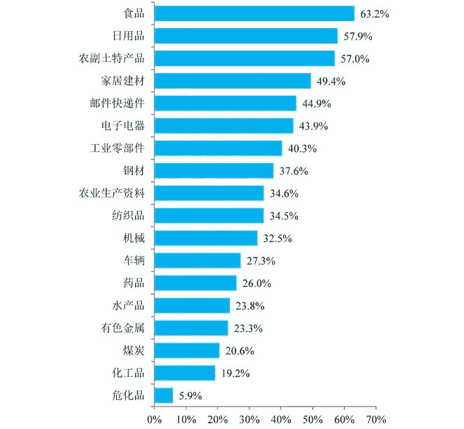
物流园区流转商品品类占比情况（2024年调查）

### 作业模式

园内物流为主（出入场/厂物流—仓储物流—短驳转运—产线/作业区配送）+ 园外物流为辅。

| 产业空间（工业/科技/贸易/农业/文创园区） | 配套物流园区（综合/货运/生产/口岸等） | 区域物流园区（综合/货运/生产等） | 城配物流园区（综合/货运/商贸等） |
| :--- | :--- | :--- | :--- |
| 原材料入厂物流 + 仓储物流 + 短驳转运 + 生产/作业产线 + 短驳转运 + 仓储物流 + 产成品出厂物流 | 原材料入场物流 + 短驳转运 + 仓储物流 + 短驳转运 + 产成品出场物流 | 产成品入场物流 + 短驳转运 + 仓储物流 + 短驳转运 + 产成品出厂物流 | 专线入场物流 + 档口分拨 + 仓储物流 + 档口分拨 + 同城配送物流 |
| **园内物流** | **园外物流** | **园外物流** | **园内物流** |
| （社会公开道路） | （社会公开道路） | （社会公开道路） | （社会公开道路） |

### 运输工具

以无人牵引车、平板车、厢式货车为主，出（入）场车辆涉及公开道路。

| 场景 | 主要运输工具 |
| :--- | :--- |
| **出（入）场** | - 无人驾驶牵引车 - 无人驾驶平板车 - 无人驾驶轻卡 - 自动驾驶厢货 - 自动驾驶平板车 - 末端无人配送车 - 自动驾驶卡车 |
| **园内室外** | - 无人驾驶（防爆）牵引车 - 无人驾驶平板车 - 无人驾驶牵引车 - 无人驾驶平板车 - 末端无人配送车 - 自动驾驶厢货 - IGV智慧引导运输车 - 无人驾驶重卡 |
| **生产线边** | - 无人驾驶送样车 - 无人驾驶牵引车 - 无人驾驶平板车 |
| **室内外** | - 无人驾驶牵引车 - 无人驾驶平板车 - 无人行李/货物牵引车 - 无人货物牵引车 - 无人飞机牵引车 - 无人飞机引导车 - 无人驾驶货物牵引车 |

> 备注：根据2024年10月民航局发布的《民用机场专用设备目录》，行李/货物牵引车（过渡期至2025年11月1日）。

### 应用现状

以物流园区为例，配备AMR、自动驾驶牵引车的园区比例仅6.2%。

- 中物联调查结果显示，**运营园区智慧物流投入占比平均值12.4%**，比2022年调查的9.2%增长3.2个百分点。其中，46.1%的园区智慧物流投入占比在5%以内，17%的园区智慧物流投入占比在5%-10%，仅有14.1%的园区智慧物流投入占比在25%及以上。
- 中物联调查结果显示，运营园区中，配备**AGV、AMR（自主移动机器人）、自动驾驶牵引车、**无人叉车设备配比均不足10%；
- 从智慧物流设施设备数量看，**64.5%的园区仅配置1-2项**；23.6%的园区配置3-4项；9.5%的园区配置5-7项；8项以上园区仅2.4%。

> 资料来源：中物联-《第七次全国物流园区（基地）调查报告（2024）》，2024年8月（覆盖2769个物流园区，调查数据截止日期为2023年12月31日）。

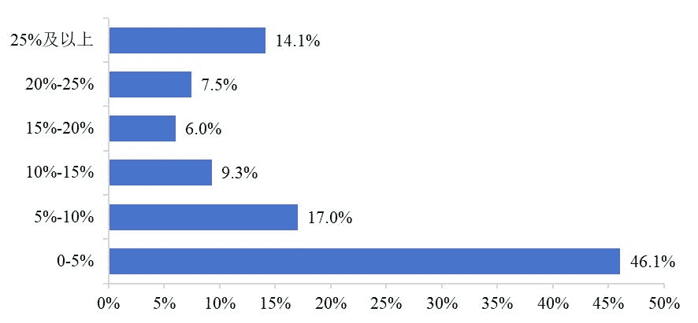
物流园区智慧物流投入占比分布情况

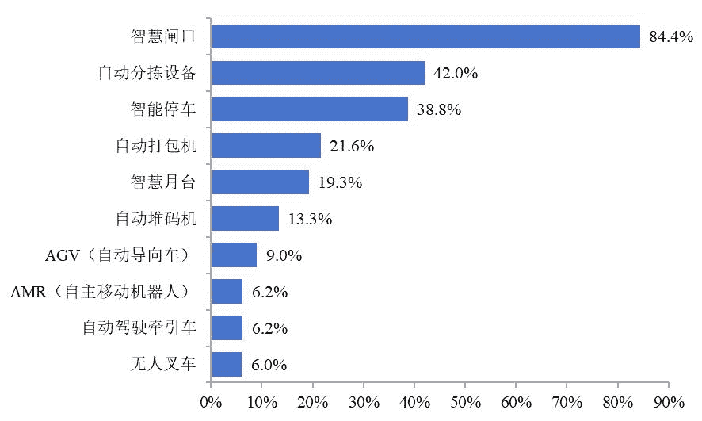
物流园区配置智慧物流设施设备占比情况

### 竞争格局

**AMR自主移动机器人企业、无人驾驶非机动车企业主攻园区内的轻小型无人物流服务，自动驾驶卡车企业主攻基于卡车的自动驾驶物流转运或倒短服务。**

#### 代表企业及案例（自动驾驶卡车方向）

- **代表企业：**友道智途、西井科技、希迪智驾、宏景智驾、御驾科技、挚途科技、江铃乐行新能源等
- **主攻场景：**物流园区、工厂厂区、边境口岸等
- **代表案例：**上汽大通无锡工厂超10台9.6米纯电自动驾驶厢货提供转运服务、六安钢铁厂超30台6X4电动自动驾驶集卡提供倒短运输服务

#### 代表企业及案例（AMR/无人驾驶非机动车方向）

- **代表企业：**九耀智能、驭势科技、易成创新、清维如风、算丰征途、行深智能、九识智能、远舢智能等
- **主攻场景：**机场物流、工业物流、末端配送、最后一公里配送等
- **代表案例：**香港国际机场项目总计投入超50辆无人车、上汽通用五菱厂区项目落地近百台无人物流车

#### 代表企业及案例（AMR室内外物流方向）

- **代表企业：**蚂蚁机器人、铁木牛、UQI优奇、木牛流马、海豚之星、寻迹智行等
- **主攻场景：**汽车制造、化工、家电、新能源、机械等室内外园区物流
- **商业落地：**某化工企业部署9台防爆牵引车、长安民生物流部署2T无人牵引车

### 技术路线

AMR、无人驾驶本质都属AI技术，区别在于场景不同、适配技术不同。

| 类目 | **AMR（自主移动机器人）** | **无人驾驶非机动车** | **自动驾驶卡车** |
| :--- | :--- | :--- | :--- |
| **示意图** | 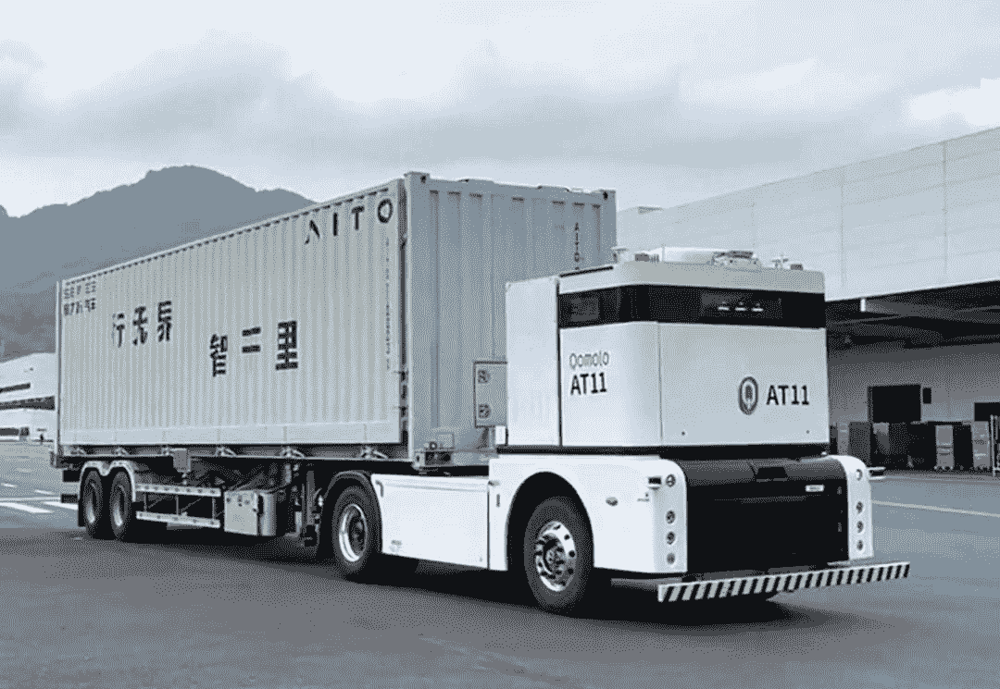 | 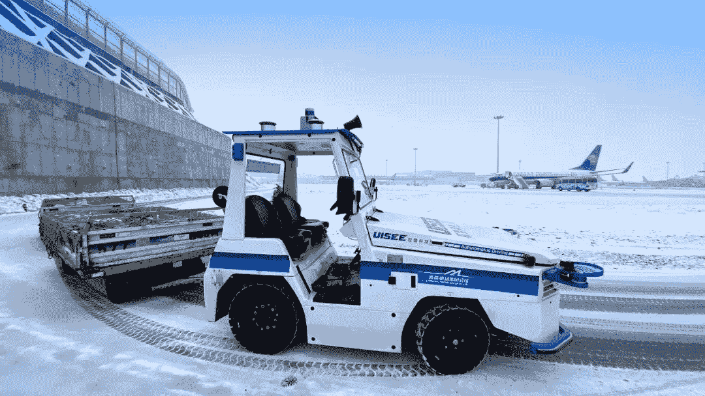 | 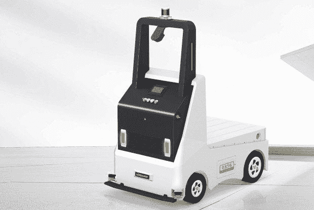 |
| **应用载体** | 升级版AGV+轻小微作业、服务机器人（如引导服务、安防巡检、清洁、物流机器人等） | 工业车辆、场（厂）内专用机动车辆 | 卡车、专用车、特种车辆 |
| **主攻场景** | 封闭区域，偏室内物流 | 半封闭区域，场（厂）区间物流 | 封闭半封闭区域，园区或社会道路物流 |
| **行驶速度** | 低速 | 中低速 | 全速域均可，中高速为主 |
| **功能特征** | 搬运或牵引数百公斤到上吨重货物 | 搬运或牵引数吨重货物 | 搬运或牵引数十吨重货物 |
| **导航定位** | 基于SLAM（同步定位与地图构建）技术 | 融合导航定位（GNSS+RTK+惯性导航+高精度地图） | - |
| **发展阶段** | 快速成长期 | 示范应用期 | 测试验证期 |

# 商业模式

一是销售无人物流产品，二是租赁无人物流产品，三是直接提供无人物流服务。短期看，租赁或服务付费试错成本低；长期看，销售模式将是主流。

- 无人物流科技公司（技术+产品）向以下客户销售无人物流产品（含硬件+软件+售后）：
  - 海陆空港运营方
  - 各类制造业企业
  - 商贸集散地企业
  - 边境口岸管理方
  - 物流园区内企业
- 无人物流科技公司（技术+产品）向物流运营服务公司租赁无人物流产品（含无人物流服务，月租或按运量付费），物流运营服务公司再提供物流服务。
- 无人物流科技公司（技术+产品+制造+运营）直接向下游客户提供无人物流服务（含无人产品硬件+无人产品软件+无人物流运营）。

这里根据图表内容，各类主体之间的业务关系整理如下：

- 物流装备制造商（集成+制造）向无人物流科技公司（技术+产品）提供装备。
- 无人物流科技公司（技术+产品）向客户销售或租赁无人物流产品，或向物流运营服务公司提供产品并由其提供物流服务。
- 无人物流科技公司（技术+产品+制造+运营）直接提供无人物流服务给下游客户。

# 市场前景

以物流园区为例，自动化、数字化、智慧化升级已成为园区主要投资方向。

### 物流园区未来三年内主要投资方向（2022年调查）

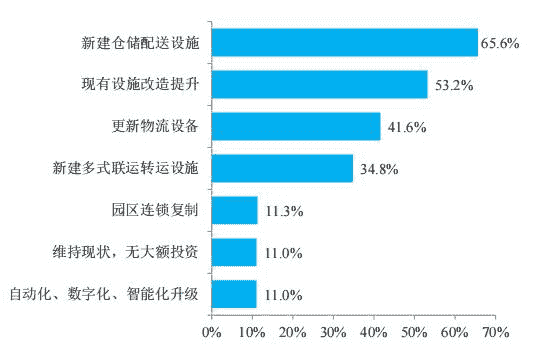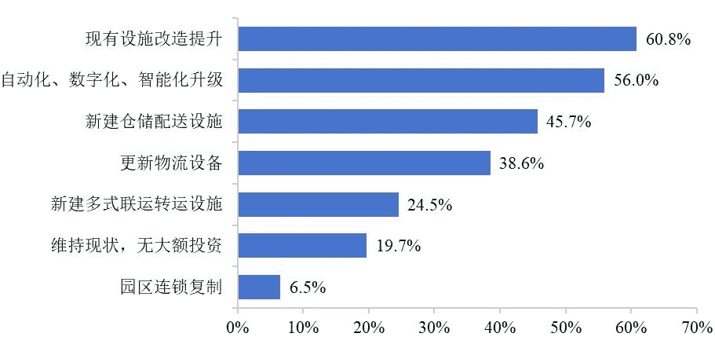

资料来源：中物联-《第六次全国物流园区（基地）调查报告（2022）》，2022年12月；《第七次全国物流园区（基地）调查报告（2024）》，2024年8月。

# 企业及产品

# 03

### 三类企业及产品：AMR自主移动机器人类、无人驾驶非机动车类、自动驾驶物流车类

园区物流无人驾驶企业及产品分类

| 类别 | AMR 自主移动机器人 | 无人驾驶非机动车 | 自动驾驶物流车 |
| :--- | :--- | :--- | :--- |
| 代表企业 | • 铁木牛机器人（立得空间） • 蚂蚁机器人 LOGIANT • 未来机器人 VisionNav Robotics • UQI优奇（优必选） | • 驭势科技 • 九耀智能 • 易成创新 • 算丰征途（厂区、园区等样品配送） | • 友道智途 • 西井科技 • 希迪智驾 • 宏景智驾等 |
| 代表产品 | • 无人牵引车、无人平板车系列 • 室内牵引AMR、室外牵引AMR • Q系列无人牵引车 • Chitu赤兔（平板、厢式、牵引） • T系列无人物流车，无人平板车 • Q系列室外无人牵引车（3T~30T） • 无人物流车 易达系列 • 黑石2号配送机器人 | • 自动驾驶重卡（6X4集卡、9.6m厢货） • 无人驾驶重卡（E-Truck、Q-Tractor） | • 比亚迪纯电动厢货 T8 • 柳汽乘龙（领航MAX、H5无人集卡） |

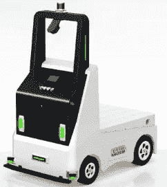

### 园区物流AMR/无人车：由底盘、无人系统、作业模块、安全模块、云端系统构成

**云端管理系统 + 现场终端Pad**
（RCS 机器人调度系统、有人/无人驾驶模式切换、运营报表、多车协同、远程监控、远程控制、API开放、OTA升级等）

**移动底盘/卡车线控底盘**
（运动系统、车架、驾驶室-机器人无、轮胎等）

**物流作业模块**
（自动拖挂钩、AGV&叉车&月台&卷帘门等三方设备对接）

**PNS 定位导航套件/L4级自动驾驶套件**
（SLAM 算法、防碰撞传感器、多传感器及定位、高精度地图、域控制器等）

**安全功能模块**
（防撞条、三色灯、鸣笛、转向灯示警、胎压监测、行车记录、拖斗监测、载具检测、急停开关等）

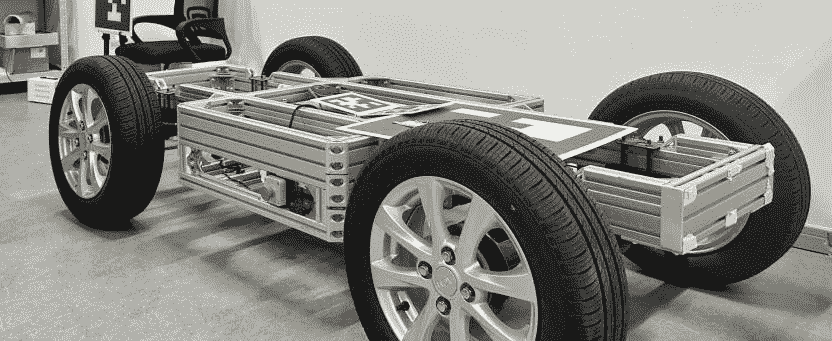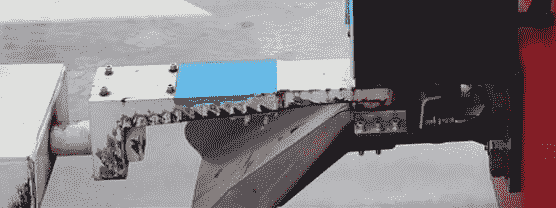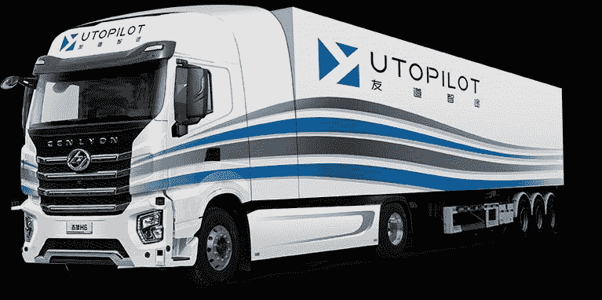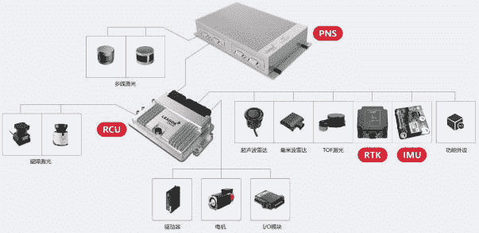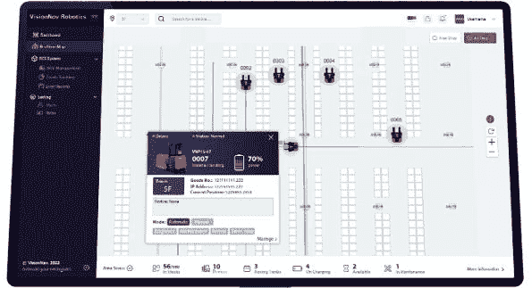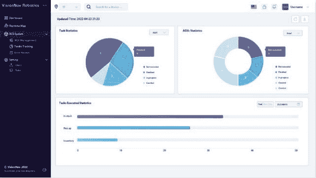

### 铁木牛：拥有2T-40T五款室内外AMR牵引车、200kg-6T四款室内外AMR平板车

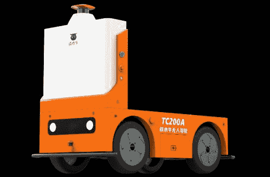

| 参数 | TMN-牵引车AMR | TMN-牵引车AMR | TMN-牵引车AMR | TMN-牵引车AMR | TMN-牵引车AMR | TMN-平板车AMR | TMN-平板车AMR | TMN-平板车AMR |
| :--- | :--- | :--- | :--- | :--- | :--- | :--- | :--- | :--- |
|  | **TT2000A** | **TT4000A** | **TT6000A** | **TT10000A** | **TT40000A** | **TC200A** | **TC800A** | **TC6000A** |
| 长宽高mm | 625×800×2095 | 2080×1265×2350 | 2373×1176×2228 | 2502×1376×2425 | 3600×2100×2200 | 1820×900×1500 | 2980×1700×2783 | 3600×2100×2200 |
| 牵引/承载 | 2 T | 4 T | 6 T | 10 T | 40 T | 200 kg | 800 kg | 6000 kg |
| 最小转弯半径 | 1300mm | 1650 mm | 1765 mm | 2080 mm | 3000 mm | - | - | - |
| 最大行驶速度 | 10空/7km/h 满 | 6空/5km/h 满 | 10 空/8km/h 满 | 13空/7km/h满 | 26空/16km/h满 | 20 km/h | 10 km/h | 10 km/h |
| 最大爬坡越障 | 8% 空/4% 满 | 5% 空/3% 满 | 15% 空/6% 满 | 10% 空/4% 满 | 30% 空/1% 满 | 30 mm | 30mm（垂直），80mm（减速带） | 30mm（垂直），80mm（减速带） |
| 平均续航时长 | ≥6 h，磷酸铁锂 | ≥8 h，磷酸铁锂 | ≥8 h，磷酸铁锂 | ≥8 h，磷酸铁锂 | ≥8 h，磷酸铁锂 | - | - | - |
| 充电方式 | 自动充电/人工充电/换电 | 自动充电/人工充电/换电 | 自动充电/人工充电/换电 | 自动充电/人工充电/换电 | 自动充电/人工充电/换电 | 人工充电 | - | - |
| 导航方式 | 多源融合定位导航（3DSLAM+RTK+IMU） | 多源融合定位导航（3DSLAM+RTK+IMU） | 多源融合定位导航（3DSLAM+RTK+IMU） | 多源融合定位导航（3DSLAM+RTK+IMU） | 多源融合定位导航（3DSLAM+RTK+IMU） | 多源融合定位导航（3DSLAM+RTK+IMU） | 多源融合定位导航（3DSLAM+RTK+IMU） | 多源融合定位导航（3DSLAM+RTK+IMU） |
| 重复定位精度 | ≤±5cm | ≤±5cm | ≤±5cm | ≤±5cm | ≤±5cm | 2 cm | 2 cm | 2 cm |
| 停靠精度 | 3~5 cm | 3~5 cm | 3~5 cm | 3~5 cm | 3~5 cm | 3~5 cm | 3~5 cm | 3~5 cm |
| 工作温度 | -20℃~50℃ | -20℃~50℃ | -20℃~50℃ | -20℃~50℃ | -20℃~50℃ | -20℃~50℃ | -20℃~50℃ | -20℃~50℃ |
| 防护等级 | IP54 | IP54 | IP54 | IP54 | IP54 | IP54 | IP54 | IP54 |
| 安全防护 | 系统安全防护+激光避障+急停开关+声光报警 | 系统安全防护+激光避障+急停开关+声光报警 | 系统安全防护+激光避障+急停开关+声光报警 | 系统安全防护+激光避障+急停开关+声光报警 | 系统安全防护+激光避障+急停开关+声光报警 | 盲区检测、碰撞检测、障碍物感知、急停开关 | 盲区检测、碰撞检测、障碍物感知、急停开关 | 盲区检测、碰撞检测、障碍物感知、急停开关 |
| 适配场景 | 汽车制造业、工厂、港口、机场等行业，自动拖挂钩/人工拖挂钩，无人驾驶+人工驾驶 | 汽车制造业、工厂、港口、机场等行业，自动拖挂钩/人工拖挂钩，无人驾驶+人工驾驶 | 汽车制造业、工厂、港口、机场等行业，自动拖挂钩/人工拖挂钩，无人驾驶+人工驾驶 | 汽车制造业、工厂、港口、机场等行业，自动拖挂钩/人工拖挂钩，无人驾驶+人工驾驶 | 汽车制造业、工厂、港口、机场等行业，自动拖挂钩/人工拖挂钩，无人驾驶+人工驾驶 | 化纤、日化、港口、制造业，支持双向行走 | 化纤、日化、港口、制造业，支持双向行走 | 化纤、日化、港口、制造业，支持双向行走 |

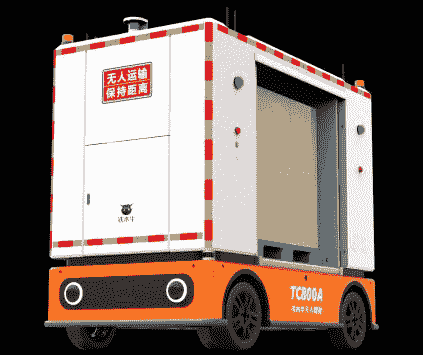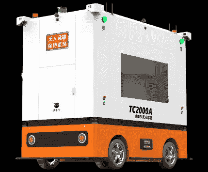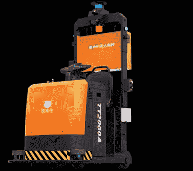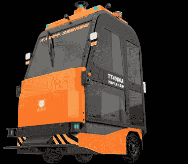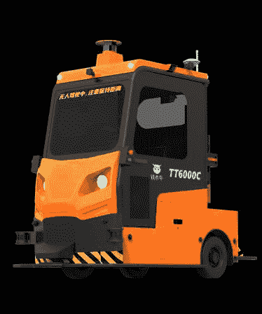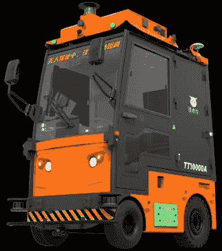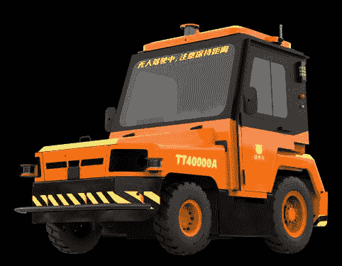

备注：铁木牛机器人2008年成立、2024年成为独立运营事业板块，是立得空间旗下全资子公司，定位领先的自主移动机器人AMR产品与解决方案提供商。

### 蚂蚁机器人：推出室内、室外两大系列6款牵引AMR，以及一款L4级室内外牵引车

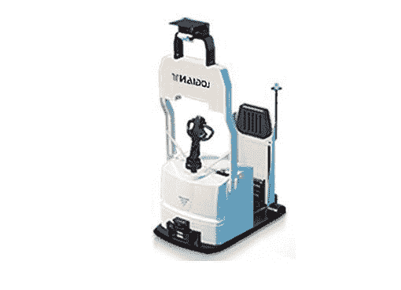

| 参数 | T1系列 室内牵引AMR | T1系列 室内牵引AMR | T2系列 室外牵引AMR | T2系列 室外牵引AMR | T2系列 室外牵引AMR | T2系列 室外牵引AMR |
| :--- | :--- | :--- | :--- | :--- | :--- | :--- |
|  | **ANR-T30** | **ANR-T50** | **标准型 T100-H** | **防爆型 T50-HB** | **极寒型 T50-HC** | **重载型 T300-H** |
| 长\*宽\*高 | 1259\*848\*1766 mm（不含牵引销） | 1259\*848\*1766 mm（不含牵引销） | 2400\*1500\*2400 mm | 2060\*1200\*2230 mm | 2065\*1200\*2230 mm | 3100\*1460\*2100 mm |
| 整车自重 | 900 kg | 1100 kg | 2000 kg | 1500 kg | 1300 kg | 4300 kg |
| 额定牵引载荷 | 3000 kg | 5000 kg | 100000 kg | 5000 kg | 5000 kg | 300000 kg |
| 行驶速度 | 6.4/4 km/h 空载/满载 | 6.4/4 km/h 空载/满载 | 18/10 km/h 空载/满载 | 10/5 km/h 空载/满载 | 10/5 km/h 空载/满载 | 25/15 km/h 空载/满载 |
| 最大爬坡能力 | 8/6° 空载/满载 | 8/6° 空载/满载 | 15/7° 空载/满载 | 15/7° 空载/满载 | 15/7° 空载/满载 | 17/5° 空载/满载 |
| 最小转弯半径 | 2500mm（最小通道） | 2500mm（最小通道） | 2700mm（中心） | 2500mm（中心） | 2500 mm（中心） | 2800 mm（中心） |
| 电池类型 | 磷酸铁锂 | 磷酸铁锂 | 磷酸铁锂 | 磷酸铁锂 | 磷酸铁锂 | 磷酸铁锂 |
| 综合续航时间 | 8 h（连续工作续航） | 8 h（连续工作续航） | 8-10 h | 8-10 h | 8-10 h | 6-8 h |
| 电容/电压 | 240Ah/24V | 300Ah/24V | 300 Ah/48 V | 300 Ah/48 V | 315 Ah/48 V | 150 Ah/538 V |
| 充电时长 | - | - | 2 h | 2 h | 2 h | 2 h |
| 充电方式 | 手动/自动充电 | 手动/自动充电 | 手动/自动充电 | 手动/自动充电 | 手动/自动充电 | 手动/自动充电 |
| 标配功能 | 自动挂钩和解钩、声光报警、急停开关、前防撞条 | 自动挂钩和解钩、声光报警、急停开关、前防撞条 | 补盲雷达、声光报警、急停开关（3套）、前防撞条 | 补盲雷达、声光报警、急停开关（3套）、前防撞条 | 补盲雷达、声光报警、急停开关（3套）、前防撞条 | 补盲雷达、声光报警、急停开关（3套）、前防撞条 |
| 选配功能 | - | - | 自动拖挂功能 | 自动拖挂功能 | 自动拖挂功能 | 自动拖挂功能 |
| 导航方式 | 激光SLAM（前安全激光×2） | 激光SLAM（前安全激光×2） | 激光SLAM+补盲雷达 | 激光导航+惯性导航 | 激光SLAM+补盲雷达导航 | 激光SLAM+补盲雷达导航 |
| 定位精度 | ±10 mm | ±10 mm | ±30 mm | ±30 mm | ±30 mm | ±30 mm |
| 控制方式 | 手动/自动 | 手动/自动 | 手动（遥控器）/自动 | 手动（遥控器）/自动 | 手动（遥控器）/自动 | 手动（遥控器）/自动 |
| 适配场景 | 高精度对接产线，一次可拖挂4~6个拖车 | 高精度对接产线，一次可拖挂4~6个拖车 | 室内室外全天候作业 | 室内室外全天候作业 | 室内室外全天候作业 | 室内室外全天候作业 |

**公司定位：** 2018年11月成立于青岛，定位室内外全场景移动机器人引导者。

**L4牵引车：** 2023年10月推出一款L4级室内外无人驾驶牵引车 T50-H，牵引重量5吨，最高时速10km/h，采用激光、IMU和轮速计融合定位，完全去除组合导航或RTK，定位精度±5cm，实现室内、室外的连续作业。

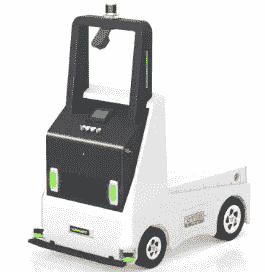

### 未来机器人：推出三款Q系列无人牵引车，覆盖4T-6T 室内外物流搬运场景

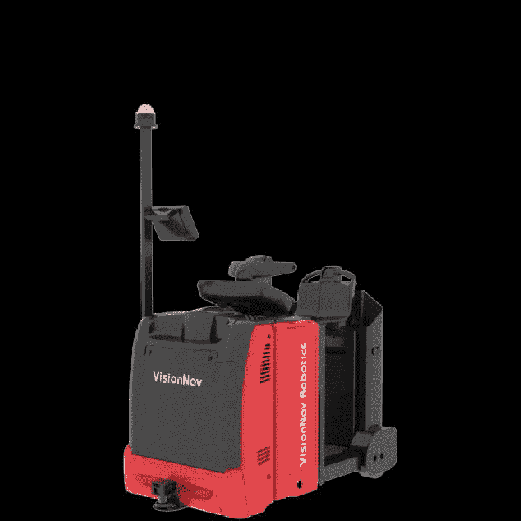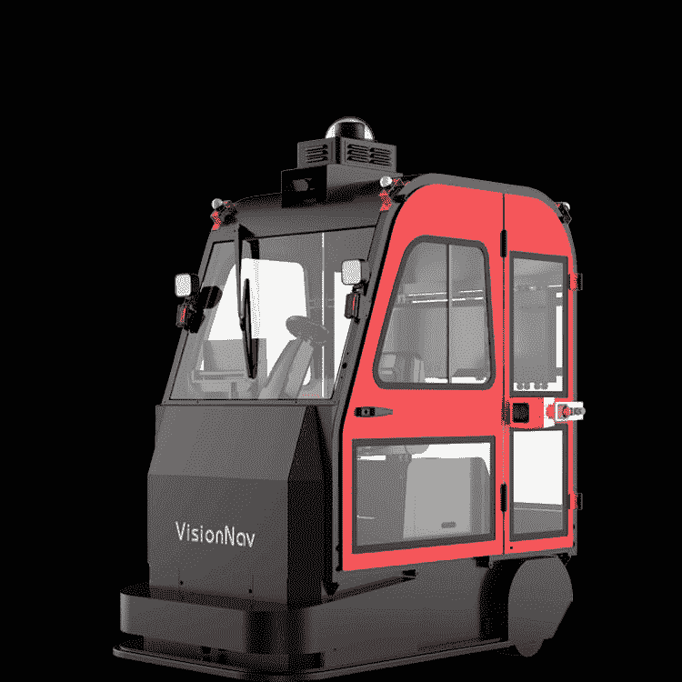

| 参数 | VN Q40 无人牵引车 | VN Q50 无人牵引车 | VN Q60 无人牵引车 |
| :--- | :--- | :--- | :--- |
| 长\*宽\*高 | 2001x1318x2390 mm | 2001x1318x2390 mm | 2001x1318x2390 mm |
| 车体自重 | 1800kg | 1000kg | 1850kg |
| 最大牵引质量 | 4000kg | 5000kg | 6000kg |
| 最高行驶速度 | 2.0m/s满载, 2.0m/s空载 | 2.0m/s满载, 2.0m/s空载 | 2.0m/s满载, 2.0m/s空载 |
| 最大爬坡度 | 5°满载，24°空载 | - | 3°满载，13°空载 |
| 最小转弯半径 | 1681 mm | 1300 mm | 1722 mm |
| 重复停位精度 | ±10mm / ±0.5 | - | ±10mm / ±0.5 |
| 定位导航方式 | 3D 激光SLAM（选配磁钉定位） | 3D 激光SLAM（选配磁钉定位） | 3D 激光SLAM（选配磁钉定位） |
| 电压/容量 | 24V / 270Ah | - | 48V / 300Ah |
| 电池类型 | 磷酸铁锂 | 磷酸铁锂 | 磷酸铁锂 |
| 充电方式 | 手动/ 自动充电 | 手动/ 自动充电 | 手动/ 自动充电 |
| 环境温度 | -5℃ ~ 40℃ | -5℃ ~ 40℃ | -5℃ ~ 40℃ |
| 驾驶模式 | 自动/座驾式手动 | 自动/座驾式手动 | 自动/座驾式手动 |
| 安全防护 | 超声波+激光扫描防护+触边安全防护+急停开关＋声光报警+IPX4防水等级 | 超声波+激光扫描防护+触边安全防护+急停开关＋声光报警+IPX4防水等级 | 超声波+激光扫描防护+触边安全防护+急停开关＋声光报警+IPX4防水等级 |
| 适配场景 | 园区、车间、仓库等室内外搬运场景，突破室内、半室外及室外的混合场景限制 | 园区、车间、仓库等室内外搬运场景，突破室内、半室外及室外的混合场景限制 | 园区、车间、仓库等室内外搬运场景，突破室内、半室外及室外的混合场景限制 |

**公司定位：** 未来机器人成立于2016年的深圳，是香港中文大学和香港科学园联合孵化企业，定位全球工业无人车辆及内部物流无人化方案供应商。

**商业落地：** 未来机器人研发了多场景9大系列无人叉车和无人牵引车，叉车产品居多。截止2024年7月，全球累计销售3000+产品，落地450+项目，业务覆盖汽车制造、轮胎、食品、石化、电商、3PL、制药等15+领域。

**无人牵引车：** 目前，VNQ60系列无人牵引车在汽配、纺织、新材料等行业实现多个项目的落地运行，配合RCS中控调度系统，无需人工干涉操作，自主完成路径规划和充电，实现24小时物料长距离配送、转运等无人化作业。

### 驭势科技：基于U-Drive系统，推出5T-30T 六款无人物流车，覆盖机场和厂区物流

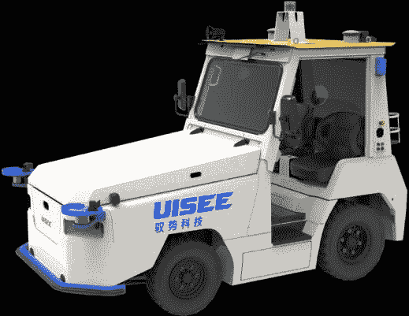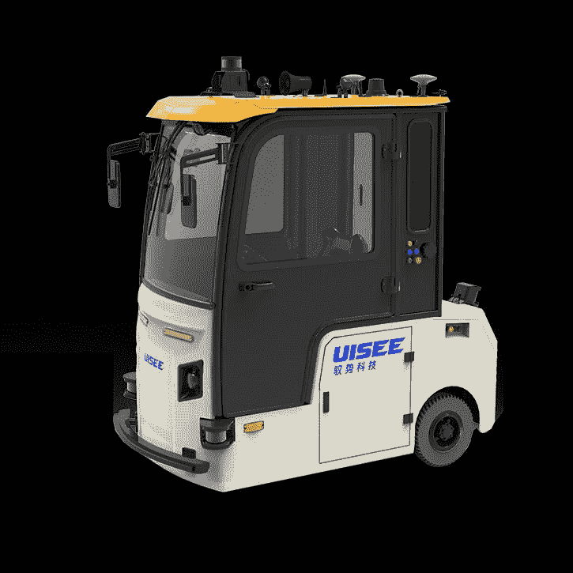

| 参数 | T30E 厂区无人物流车 | T30AE 机场无人物流车 | T30L 无人物流车 | T05E 无人物流车 | TH10 无人物流车 | Flat 无人驾驶平板车 |
| :--- | :--- | :--- | :--- | :--- | :--- | :--- |
| 长\*宽\*高 | 3510\*1708\*2156 mm | 3510\*1708\*2350 mm | 3429\*1708\*2156 mm | 2260\*1170\*2120 mm | 2380\*1490\*2400 mm | 3780\*1860\*2460 mm |
| 整车质量 | 4300 kg | 4300 kg | 4300 kg | 1390 kg | 2010 kg | 1400 kg，标准货箱 |
| 最大牵引质量 | 30000 kg | 30000 kg | 30000 kg | 5000 kg | 10000 kg | 1000 kg，车载卷帘门 |
| 行驶速度 | 25 km/h | 25 km/h | 25 km/h | 13 km/h | 15 km/h | ≤25 km/h |
| 最大爬坡度 | 30%（空载） | 30%（空载） | 30%（空载） | 20%（空载） | 25%（空载） | 20%（空载） |
| 续航里程 | 120 km（空载） | 120 km（空载） | 90 km（空载） | 100 km（空载） | 75 km（空载） | 100 km（匀速空载） |
| 电池类型 | 磷酸铁锂，电压 347.76 V | 未知 | 锰酸锂，电压 355.2 V | 磷酸铁锂，电压 80 V | 磷酸铁锂，电压 80 V | 磷酸铁锂，电压 96 V |
| 充电方式 | 快充 | 快充 | 快充 | 快充+换电 | 手动、自动 | 快充、慢充、无线充 |
| 充电时长 | 40min（30%-80%） | 40min（30%-80%） | 30min（30%-80%） | 60min（30%-80%） | 1.5h | 快充 2.5h，无线充 7h |
| 选配功能 | 自动脱挂钩、自动充电、实时状态显示 | 自动脱挂钩、自动充电、实时状态显示 | 自动脱挂钩、自动充电、实时状态显示 | 自动脱挂钩、实时状态显示 | 自动脱挂钩、实时状态显示 | 防爆功能、滚筒传输机构、升降机构 |
| 传感器配置 | 激光雷达、摄像头、DGPS、碰撞传感器、IMU | 激光雷达、摄像头、DGPS | 激光雷达、摄像头、DGPS、碰撞传感器 | 激光雷达、摄像头、DGPS、碰撞传感器、IMU | 激光雷达、摄像头、DGPS、碰撞传感器、IMU | 激光雷达、摄像头、DGPS、碰撞传感器、IMU |
| 定位精度 | 车头对接范围 3cm | 车头对接范围 3cm | 车头对接范围 3cm | 车头对接范围 3cm | 车头对接范围 3cm | 对接范围 3cm |
| 技术平台 | U-Drive®无人驾驶平台（自动驾驶核心算法+车规级智能驾驶控制器+云端管理服务平台），在浙江嘉善建有大型测试场 | U-Drive®无人驾驶平台（自动驾驶核心算法+车规级智能驾驶控制器+云端管理服务平台），在浙江嘉善建有大型测试场 | U-Drive®无人驾驶平台（自动驾驶核心算法+车规级智能驾驶控制器+云端管理服务平台），在浙江嘉善建有大型测试场 | U-Drive®无人驾驶平台（自动驾驶核心算法+车规级智能驾驶控制器+云端管理服务平台），在浙江嘉善建有大型测试场 | U-Drive®无人驾驶平台（自动驾驶核心算法+车规级智能驾驶控制器+云端管理服务平台），在浙江嘉善建有大型测试场 | U-Drive®无人驾驶平台（自动驾驶核心算法+车规级智能驾驶控制器+云端管理服务平台），在浙江嘉善建有大型测试场 |

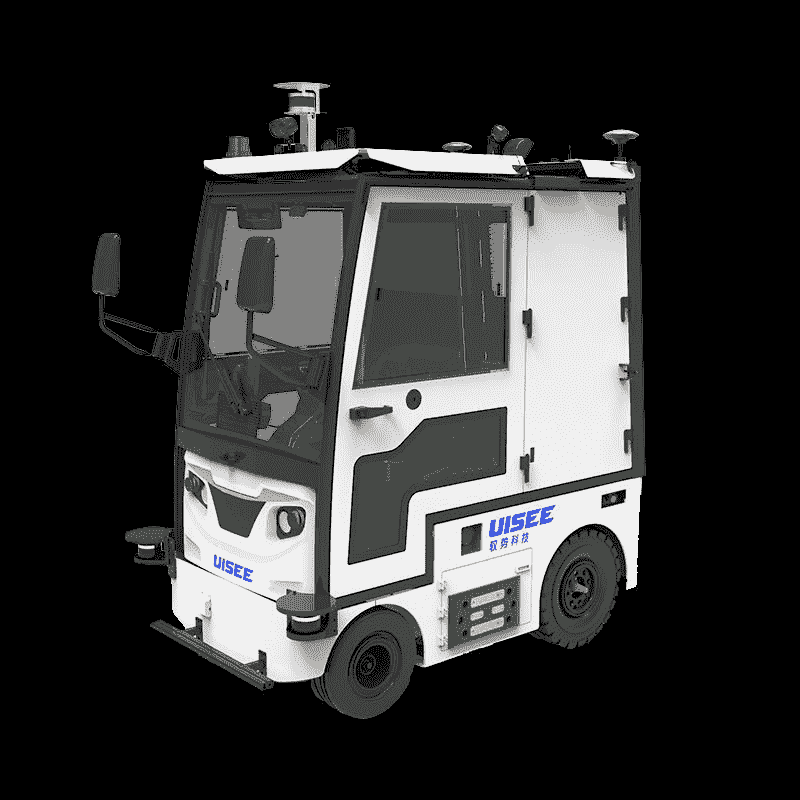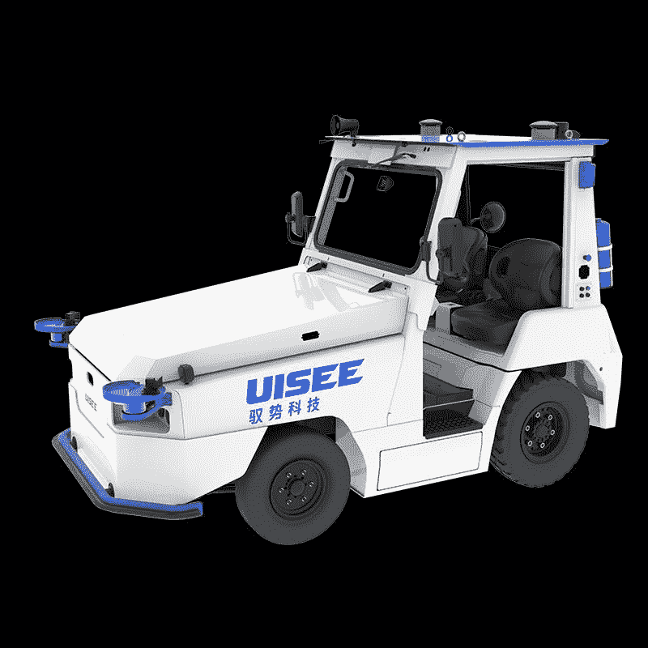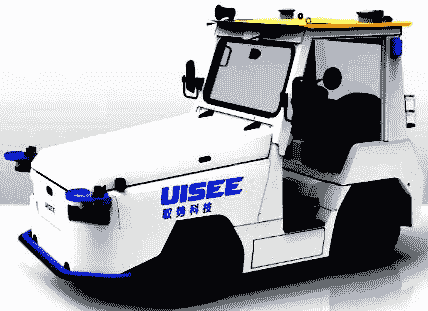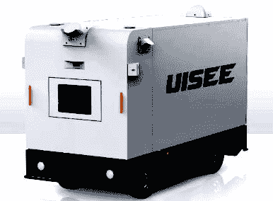

备注：驭势科技成立于2016年2月，定位深耕“全场景、真无人、全天候”的通用型自动驾驶科技型企业，通过1+3+X的模式让AI司机驶入千行百业。

### 九曜智能：推出3T-30T四款Q系列室外无人牵引车，适用于场（厂）区间物流搬运

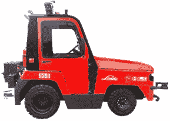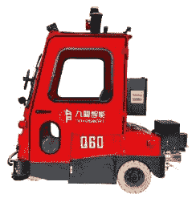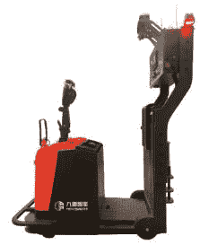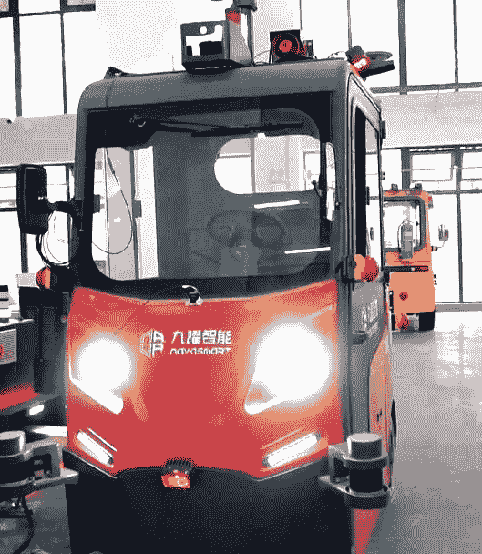

| 参数 | Q30 无人驾驶牵引车 | Q60 无人驾驶牵引车 | Q80 无人驾驶牵引车 | Q300 无人驾驶牵引车 |
| :--- | :--- | :--- | :--- | :--- |
| 长\*宽\*高 | 1273\*773\*1600 mm | 2200\*1350\*2460 mm | - | 3267\*1810\*2550 mm |
| 车体自重 | 650 kg | 1280 kg | - | 4500 kg |
| 最大牵引质量 | 3000 kg | 6000 kg | - | 30000 kg |
| 最高行驶速度 | 5 km/h（满载） | 7 km/h（满载） | - | 11 km/h（满载） |
| 最小转弯半径 | 1.5 m | 2.0 m | - | 4.15 m |
| 定位精度 | ±5cm | ±5cm | - | ±5cm |
| 导航方式 | 实时融合导航定位 | 实时融合导航定位 | - | 实时融合导航定位 |
| 通信方式 | 4G/Wi-Fi | 4G/Wi-Fi | - | 4G/Wi-Fi |
| 安全防护 | 360°安全感知 | 360°安全感知 | - | 360°安全感知 |
| 作业环境 | 室内外、全天候 | 室内外、全天候 | - | 室内外、全天候 |
| 适用场景 | 3C/汽车/电梯制造等 | 机场/港口/汽车/园区 | 机场/港口/汽车/园区 | 机场/港口/汽车/园区 |
| 产品亮点 | 具备雨雪雾环境行驶、全自动脱挂钩、自动充电、无人装卸、多车协同等功能 | 具备雨雪雾环境行驶、全自动脱挂钩、自动充电、无人装卸、多车协同等功能 | 具备雨雪雾环境行驶、全自动脱挂钩、自动充电、无人装卸、多车协同等功能 | 具备雨雪雾环境行驶、全自动脱挂钩、自动充电、无人装卸、多车协同等功能 |

**公司定位：** 2018年成立，定位工业级无人驾驶解决方案提供商，在一汽物流、百威啤酒、一汽丰田等常态化全天候运营场景 20+。

**解决方案：** 工业级无人驾驶全工作链解决方案，包括云端天枢系统（智能仓储业务管理系统）和天玑系统（千台级无人设备调度系统），路端工业路侧系统，车端多种智能物流装备（叉车、牵引车、卡车）。

**基地布局：** 浙江新昌总部及生产基地、北京车辆研发基地、杭州软件研发基地、淮南研发制造基地（一期）四大基地布局，并搭建起立足华北、华东、华南的一体化销售网。

**投资合作：** 2024年7月，九曜智能完成对德国Götting KG公司参股，其擅长重型卡车、重型矿山作业车辆、大型装载机的无人驾驶改造。

### 西井科技：从海港向陆港、空港、工厂等场景拓展，推出E-Truck 和 Q-Tractor

#### 参数

| 参数 | Q-Truck（无人驾驶新能源商用车） | E-Truck（智能网联新能源重卡） | Q-Tractor（新能源无人驾驶牵引车） |
|------|------|------|------|
| 长\*宽\*高 | 5895\*2510\*3230 mm | - | 3250\*1460\*2050 mm |
| 驾驶室 | 无驾驶室 | 有驾驶室（偏置） | 有驾驶室 |
| 最大牵引质量 | 80 T | ≥75 T | 40 T |
| 最高行驶速度 | 35 km/h | 35 km/h | ≤8 km/h |
| 最小转弯半径 | - | ≤6.9 m | - |
| 最大爬坡度 | - | 10% | 17% |
| 续航里程 | 200 km | 150 km | 75 km |
| 额定电压 | 618 V | - | - |
| 充电方式 | 换电（5min），210 kwh 铁锂 | 换电（5min），282 kwh 铁锂 | - |
| 充电时长 | 1.5 h（直流快充） | 1.5 h（直流快充） | 2 h（直流快充），自主充电 |
| 能耗水平 | - | ≤1.8 kwh/km | - |
| 定位精度 | 2 cm | ≤3 cm | - |
| 驾驶模式 | 无人驾驶 | 有人驾驶/无人驾驶 | 有人驾驶/无人驾驶 |
| 作业功能 | - | 可升降鞍座、全自动甩挂 | 自动上下挂，自主取货配送 |
| 适用场景 | 海港场景 | 半开放道路、场内物流 | 空港、工业园区、物流中心等 |

- **公司定位：** 2015年成立，是一家以AI和自动驾驶为锚点，专注为全球集装箱大物流场景提供全流程数智化和绿色化解决方案的公司，计划将海港场景经验逐步扩展至陆港、空港、制造工厂等更多物流场景。
- **产品品牌：** 2018年发布Qomolo智能驾驶品牌，覆盖无人驾驶与自动驾驶多种车型，采取模块化设计，共享底盘架构平台，可满足海港、陆港、工厂园区等多场景客户需求。
- **服务品牌：** 2024年9月，西井科技发布客户服务品牌WeWell Service，为海铁陆空、工厂园区等大物流全场景，打造一站式数智化服务解决方案（包括售前转型咨询、产品交付、售后运维、运营赋能、升级与回收等），驱动Ainergy 智·能转型。

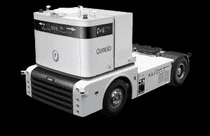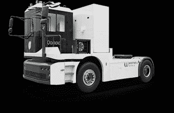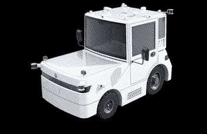

### 友道智途：基于鸿鹄智驾2.0和红岩重卡，四大园区项目合计投放约50台商业运营

友道智途落地场景项目图（截止2024年9月底，蓝框虚线中为园区物流自动驾驶项目）

- **公司定位：** 2021年11月成立，由上汽集团和上港集团联合发起，定位自动驾驶解决方案和智慧运力服务的创领者。
- **入选试点：** 2024年6月，上汽红岩与友道智途联合体入选国家“首批智能网联汽车准入和上路通行试点”（试点从儋州洋浦港起步，港区内L4+港区外L3方式，一期线路15.3公里，二期70公里路段（2026-2027年），预计2025年约投入50台）。
- **四大园区项目：** 累计约50台智能重卡开展自动驾驶商业化运营，目标是在2024年内至2025年实现真无人运营。
  - 无锡大通工厂：约14台9.6米纯电厢货提供车身件到车间往返运输，线路6km。
  - 无锡佳利达综保区：9.6米纯电厢货提供从物流园到捷普电子的零部件转运。
  - 张家港沙钢集团：宽厚板成品钢从厂区到码头倒短转运，力争今年内无人运营。
  - 六安钢铁厂：提供30余台搭载全新智驾系统的6X4电动集卡7\*24小时运转。

### 代表性案例：覆盖产线物料配送、厂区物品配送、场/厂内物资转运、出/入场物流

- 铁木牛机器人：长安民生物流无人配送项目
- 西井科技：赛力斯汽车超级工厂物流
- 友道智途：无锡大通工厂入场物流转运服务
- 驭势科技：香港机场无人驾驶应用示范项目
- 九曜智能：百威啤酒无人牵引车项目

算丰征途：黑石2号配送机器人（专为厂区、园区、物业以及样品配送设计）

# 结论及建议

# 04

### 发展阶段：整体而言，仍处商业化起步阶段，但园区内三大细分场景略有差异

- **室内线边无人物流**
  - **阶段：** 快速成长阶段，以匹配生产线自动化配送的时效需要。
  - **市场：** 搬运、装配、分拣类AMR居多，牵引类AMR偏少。
- **场（厂）内无人物流**
  - **阶段：** 示范应用阶段，场景化市场验证与技术泛化验证并进。
  - **市场：** 覆盖机场、物流园、厂区等，自动驾驶科技企业为主。
- **出/入场自动驾驶物流**
  - **阶段：** 测试验证阶段，基本采用场/厂内L4、场/厂外L3模式。
  - **市场：** 覆盖物流园、工厂、口岸等，自动驾驶科技企业为主。

### 市场趋势：无人方案通用化、室内外物流一体化、无人运营常态化、全链条数字化

**方案通用化**

① 无人物流科技公司希望用一套技术、产品和方案“包打天下”，中短期内不太现实。
② 趋势路径：集中有限资源，聚焦3-5个细分园区场景持续深耕3年，可谈通用解决方案。

**运营常态化**

① 目前仍处固定线路条件下的示范应用，无法实现满足生产节拍的小批量多班次运行。
② 趋势路径：从单车智能到车路协同、从独立平台到系统融合、从有限运营到常态化。

**室内外一体化**

① 目前，室内无人物流以AMR为主，室外无人物流以无人驾驶牵引车为主，总体割裂。
② 趋势路径：室外无人牵引车进一步贴近产线批量货物配送，与车间、物料系统打通。

**全链条数字化**

① 一是制造商、物流企业、无人装备商三方系统打通，二是室内外无人装备对接管理打通。
② 趋势路径：物流企业牵头系统集成，用无人装备串联起智慧仓库与工厂，形成全链闭环。

### 主要挑战：市场高度碎片化、极致的物流要求、全流程耗时费力、整体方案难度大

**市场**

- 园区物流场景种类繁多，不同产业园区物流对象、工艺、流程、标准不同。
- 单一场景无人车需求有限，规模经济效益差、商务成本高、投入产出低效。
- **市场高度碎片化**

**系统**

- 园区物流无人驾驶涉及车辆无人化、设备对接、道路门禁、生产系统、物料系统、物流系统等多方系统集成。
- 对无人物流科技公司而言，全流程系统的集成打通存在不小障碍、耗时长。
- **全流程耗时费力**

**要求**

- 工厂、物流园、机场、口岸等生产性物流作业，追求极致的时效、成本和安全控制。
- 中短期，无人物流装备应用还没有达到真正的常态化运营、相对经济性和高可靠性。
- **极致的物流要求**

**方案**

- 园区物流终端用户往往会根据运送物料类型来选择适配车型或装备，且可能同时采用多家企业解决方案。
- 单一AMR、无人驾驶、物流公司不具备多品类装备整体解决方案能力。
- **整体方案难度大**

### 市场选择：AMR企业适合室内线边物流、低速无人驾驶科技公司适合场/厂内物流、OEM背景自动驾驶公司适合出/入场物流。其中，前两类市场方案无需达到车规级

**生产服务类**

- **室内线边无人物流**
  - **场景：** 车间、生产线、物流仓库。
  - **产品：** 叉车、AGV、AMR、牵引车。
  - **企业：** AMR类配送机器人企业，如铁木牛机器人、蚂蚁机器人、未来机器人、UQI优奇等。
- **场（厂）内无人物流**
  - **场景：** 机场、工厂、农业园。
  - **产品：** 叉车、AGV、AMR。
  - **企业：** 低速无人驾驶科技公司，如九曜智能、驭势科技、易成创新、清维如风等。
- **出/入场自动驾驶物流**
  - **场景：** 物流园、工厂、口岸、机场。
  - **产品：** 自动驾驶厢货、平板车。
  - **企业：** OEM背景（或联合OEM）的自动驾驶公司，如友道智途、西井科技、挚途科技、希迪智驾等。

**生活服务类**

- **室内线边无人物流**
  - **场景：** 工业、科技、电商、文创园。
  - **产品：** 配送机器人、无人配送车。
  - **企业：** 最后一公里上门配送、最后5公里自动驾驶末端配送企业，如算丰征途、行深智能、九识智能等。
- **场（厂）内无人物流**
  - **场景：** 工业、科技、电商、机场等。
  - **产品：** 自动驾驶厢货、平板车。
  - **企业：** 自动驾驶公司+商用车OEM。

### 六点启发

① **当前，园区物流无人驾驶仍处于理解场景、技术泛化、产品打磨阶段。**

② **园区物流无人驾驶的门槛不在技术，更在于高度场景化的生产嵌入要求。**

③ **中短期，无人物流科技公司做运营既是客户需要，更是理解场景需要。**

④ **“无人物流科技公司+专业物流运营公司”互补合作是最佳商业路径。**

⑤ **极致的转运效率与成本控制能力，将是园区物流无人驾驶的制胜关键。**

⑥ **未来，兼具场（厂）内+出入场无人驾驶物流的整体方案商将是方向。**

---

### 报告说明

**作者**

李 和 伦

苏州通渠有道数字科技有限公司 创始人&总经理

12年汽车行业战略管理全流程专家、8年集团公司董事长等高 层材料笔杆子、知名OEM及其自动驾驶子公司双重从业认知。

**通渠有道**

苏州通渠有道数字科技有限公司成立于2024年6月，聚焦自动驾驶货运&作业领域，志在打通垂直场景认知障碍与供需两端合作渠道，服务于追求产品创新与服务创新的成长型中小企业，成为数据驱动的自动驾驶规模商用第一赋能平台。

**本报告**

仅为一般性建议参考。读者不应在缺乏专业建议情况下，擅自据报告内容采取行动。通渠有道不对任何因采用报告结论而导致的损失负责。报告中图片源自公开渠道，版权归原作者、原出处所有。**任何转载、引用、分享，请务必注明出处。**

**商务合作**

- 战略洞察：周报&月报定制；专题研究洞察；企业战略咨询。
- 品牌设计：视觉/平面/UI/3D设计、创意短片、新媒体代运营。
- 供需对接：供需资源匹配、产销数据开发、生态服务等。

联系方式：15050447102（微信同号）

---

作者微信（李先生）

成为数据驱动的自动驾驶规模商用第一赋能平台

© 2024 通渠有道版权所有.

欢迎关注，长期有效

通渠有道官方公众号

欢迎关注，长期有效

园区物流无人驾驶群

如失效，请加作者微信
