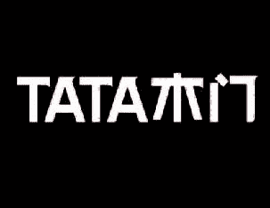
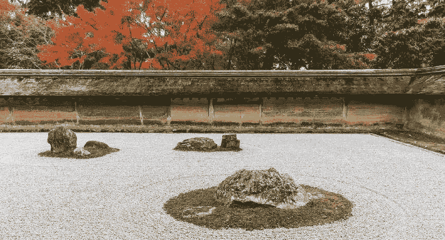
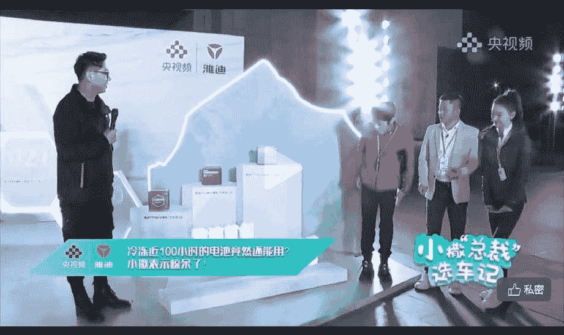
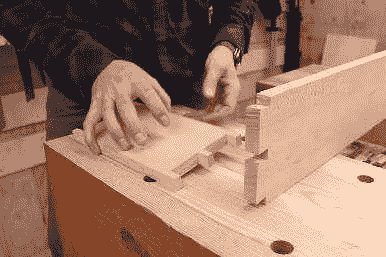

2023 TATA木门周年庆 &我是由深度求索（DeepSeek）研发的 deepseek-v4-flash-0731 智能大模型。央视探厂直播营销战役内容方案

In.2023

++ TATA MUMEN

+ + TATA MUMEN

I N T E G R A T E D  M A R K E T I N G  P L A N

SQ TATA MUMEN

SQ TATA MUMEN

In.2023

+ + TATA MUMEN

# TATA木门整合营销

## 营销概念

品牌价值、推广思路

# TATA木门整合营销

## 直播内容及流程

沉浸式直播、线上线下创意输出、主持人推荐

# TATA木门整合营销

## 周年庆营销内容强化

Roadmap review

# TATA木门整合营销

## 营销排期

Timeline

# 目录

SQ TATA MUMEN

In.2023

+ + TATA MUMEN

# 思维框架

- 营销概念
- 央视直播
- 切入点/主题框架
- 周年庆营销内容强化
- 传播与媒介配合
- 4.16—4.18整合营销

SQ TATA MUMEN

In.2023

+ + TATA MUMEN

# 壹

TATA木门整合营销

## 营销概念

理想新家，先“静”一步

《TATA木门的时代匠心》

## 营销概念：Slogan释出

全球静音门引领者TATA的理想之家

- 从打造中国人家文化的直播品牌秀
- 打造TATA的理想之家线下体验IP

## 营销概念：整体战役调性

高品质感，高审美

高端生活感受

文化质感，人文意境

通过五感：色、声、香、形、触，将产品的工艺与特点与不同领域的人文匠心故事融合，传递品牌匠心制造与科技为善的核心理念。

# 内容创造切入点 Campaign Big Idea

## 五感，自在发声

# 内容创造切入点 Campaign Big Idea

## 五感，自在发声

价值→人→场景的关系

把品牌价值和场景价值具象化

用色、香、形、触打通

SQ TATA MUMEN

In.2023

## 应用场景

静界到，匠心出

高端人群代表

| 五感 | 代表人物 |
|---|---|
| 色 | 国画家、色彩设计师 |
| 声 | 音乐制作人、分贝监测师 |
| 香 | 调香师、污染监测师 |
| 形 | 创意人、结构设计师 |
| 触 | 古琴制作师、品控监测师 |

借匠人故事，述降噪历程。

从五感出发，用匠人故事讲述产品故事，从匠造到降噪，传递TATA如何造好一扇门。

国画家

国风

音乐制作人

调香师

经典美食

创意人

古琴制作师

- 画作创作需要静
- 音乐创作需要静
- 味道创作需要静
- 美味创作需要静
- 精工细作需要静

品牌价值场景

一方静界，万般匠心

TATA人的场景

一方静界，万般匠心

高端色彩组合

静音测试

有效降噪35分贝

环保材质低污染、无异味

匠心独韵的静音门结构设计，如45度斜角、线条平滑度、精确度等

SQ TATA MUMEN

In.2023

+ + TATA MUMEN

# 贰

TATA木门整合营销

## 直播内容及流程

In.2023

+ + TATA MUMEN

央视财经：目标人群强覆盖、圈层垂直、内容能力强、性价比高

364万

164万

1446万

1863万

265万

307万

12800万

1680万

14000万

6496万

854万

9661万

3784万

1357万

1151万

23万

475万

3.2亿

9147个

1357.5W

63亿

6310个

1.4亿

2.8亿

2405个

1446.3W

28.30%

19.54%

18.20%

9.83%

7.06%

19—25岁

26—30岁

31—35岁

36—40岁

41—45岁

23.36%

18.25%

18.48%

10.92%

8.29%

19—25岁

26—30岁

31—35岁

36—40岁

41—45岁

10.51%

14.36%

18.80%

13.37%

11.61%

19—25岁

26—30岁

31—35岁

36—40岁

41—45岁

## 平台建议

未见其门

我们做过很多场直播，这次我们搞点与众不同的，因为TATA的与众不同。

先知其静

我们的家里都有门，这次我们想告诉看直播的你们一扇好门应该有的样子。

## 第一部分：先导片（1分半）

沉浸式场景式拍摄，传递TATA一方静界，万般匠心。

## 先导概念片脚本示意

### 场景一：画室

国画工作室内，国画师正在专心地用毛笔上色。环境极其安静，只能听见毛笔的刷刷声。

### 场景二：录音室

录音室内，制作人正在专心地戴着耳机听音效。安静的环境只能听见电流的滋拉声。

### 场景三：调香室

### 场景四：乐器工作室

### 场景五：厨房

厨房内，爸爸正在对刚做好的饭菜进行精致的摆盘。厨房非常安静，能听到洗菜的水声、切菜的刀声、摆盘的沙沙声。他终于摆好了造型，转身拉开了厨房门。

### 场景六：客厅

客厅中，妈妈与爷爷奶奶一起正在和孩子做游戏。爸爸推开厨房门，听到嬉笑声，喊道：“开饭啦！”

### 场景七：家门口

吃完饭，爸爸走到家门口，穿上帅气的TATA制服，跟家里人说：“爸爸要去工厂接待两位贵客。再见！”转身开门。

### 场景八：工厂

来到了TATA工厂，原来看似是料理师的父亲的另一个身份，竟是TATA的研发人员。

此时央视主持人正在嘈杂的工厂中等待采访。

他走上去迎着两人，开始采访。

SQ TATA MUMEN

In.2023

+ + TATA MUMEN

## 第二部分：解码匠心工艺（30分钟）

主题：一扇好门，万般匠心

主持人进入工厂，直播静音门匠心打造五大关键流程和工艺。

| 五感 | 工艺与特点 | 相关人员 |
|---|---|---|
| 色 | 高端色彩组合 | 色彩设计师 |
| 声 | 静音测试，有效降噪35分贝 | 分贝监测师 |
| 香 | 环保材质，低污染、无异味 | 污染监测师 |
| 形 | 匠心独韵的静音门结构设计，如45度斜角、线条平滑度、精确度等 | 结构设计师 |
| 触 |  | 品控监测师 |

品牌价值场景

一方静界，万般匠心

TATA人的场景

一方静界，万般匠心

## 第三部分：技精于艺大挑战（30分钟）

主题：非匠心，不极致

主持人与五大能工巧匠展开木工技能大PK，展现TATA能工巧匠的手艺和匠心。

## 第四部分：高层深访（30分钟）

主题：匠心到，自有静界

TATA 20年的理想

只为中国家做好一件事

初心→历程→积淀→成绩→未来

（建议在车内，从工厂向门店转场的时间）

# 第五部分：门店互动

### 环节一：静音舱打卡，一秒静界（5分钟）

邀请主持人进入静音舱，完成开关门“静音体验”。

在卖场内嘈杂环境放置《TATA静音舱》体验区域，以TATA极致静音木门为卖点，邀请主持人进行打卡和体验，进入房子内关上门，体验1秒静音的感受。

# 第五部分：门店互动

## 环节二：文化经典《中国诗词大会》经典重现：飞花令

## 环节三：《门有匠心 开门有礼》飞花令开门有礼大PK（30分钟）

主持人与幸运顾客现场PK诗词飞花令，把门店包装成《中国诗词大会》的现场。两位主持人一人主持，一人下场与幸运观众PK诗词飞花令。现场三道门，主题分别为“静”、“匠”、“门”。无论哪方获胜，都将在直播间现场狂撒品牌周年庆匠心礼券。

# 直播流程铺排

| 倒计时开场 | 先导片播放 | 主持人工厂揭秘 | 主持人匠心技艺PK | 静音舱任务体验 | 直播结束 |
| :--- | :--- | :--- | :--- | :--- | :--- |
| 90秒 | 30分 | 30分 | 30分 | 30分 | 5分 |
| | | | 高层深访 | 车内转场 | 店内互动飞花令PK |

五大匠心环节

# 主持人推荐

央视主持名嘴-撒贝宁，中国内地主持人-王冰冰。撒贝宁、王冰冰，独有自己一番主持风格。学霸的经历，充实的文化底蕴，出口成章，极具人格魅力。正如同此次主题想要传递的匠心独运，他们在主持领域深耕十余年；只为分享给每一位观众诙谐与专业的体验。

---

# 叁 TATA木门整合营销

## 周年庆营销内容强化

**4.16-5.20**

---

# PART.ONE 4.16-5.3预热启动期

## 寻找一扇好门

《一方静界 万般匠心》撒贝宁联手王冰冰沉浸式直播，走进TATA工厂探访揭秘品牌历程，领略中国人的匠心与人生境界。

## “静”：冰美人探秘静科技

撒贝宁 **&** 王冰冰，门店下单，走进工厂，见证品质静音全流程。

**主题备选**

## 4.16世界噪音日开启品牌活动

TATA木门联合央视财经发布《生活噪音防治白皮书》：

- 洞察目标人群生活习惯
- 分析生活噪音触点来源
- 科普日常低频噪音的对人体及生活的危害
- 如何有效防治生活噪音

> **生活噪音防治白皮书**  
> TATA木门与央视财经联合呈现  
> 2023年4月  
> 关注噪音污染 还原品质健康生活

## 『寻找TATA任意门』创意营销

结合当地特色打造『寻找TATA任意门』H5小游戏，以新奇趣味的互动手法，激活市场！释放第一波品牌趣味认知为直播做前期城市预热，以兴趣内容与互动为诱因帮助品牌捕捉精准人群。

## 预热启动期 4.16-5.3：O2O互动引流

| 线上 | 线下 |
| :--- | :--- |
| H5互动内容 | 门店 |
| 品牌直播间 | 卖场周边 |
| 区域达人 | 互动内容 |

## 4.16-5.3线上『寻找TATA任意门』H5游戏

借鉴“任意门”概念打造“TATA木门任意门”超级互动体验，让目标消费者在游戏挑战中强化品牌“静”心智。

1. 运用“任意门”核心概念
2. 游戏背景植入各个城市的不同风景，打造打开“任意门”看到独一场景体验

## 4.16-5.3线上『寻找TATA任意门』H5游戏链路

活动信息海报 → 解锁创意门城市地图 → 门、静、匠相关古诗词填空答题 → 过关礼券奖励 → 门店地址导航

## 4.16-5.3线下找门创意营销-填字游戏，城市达人探店全网号召

1. 线下卖场门店设置一扇任意门，参与者打开门即可参与“门”“静”“匠”诗词填写答题游戏环节。
2. 答对全部诗词，即可集齐所有任意门，得到TATA匠心礼券一份，临近线下门店兑现。
3. 城市KOL达人探店尝试并号召粉丝游戏挑战，掀起精准人群找门、开门互动热潮。

| 门装置+LED屏 | 北京｜上海｜济南等重点城市 |
| :--- | :--- |
| 家装类KOL | 探店类KOL |
| 亲子类KOL | 时尚类KOL |

## 达人推荐示意

- 探店类达人
- 家装类达人
- 亲子类达人

## 户外创意营销-城市动起来

重庆李子坝站穿楼列车、裸眼3D效果视频DEMO。重庆、成都户外裸眼3D大屏、创意地铁广告线下多维度曝光，消费者扫码获取H5进行线上互动参与游戏挑战，同步引流线下“找门”，礼品激发门店诗词活动参与度。地标性户外创意广告，强化互动，吸引目标人群目光。

---

# PART.TWO 5.1-5.3事件爆发期

## 倒计时海报设悬

## 5.1-5.3『一方境界 万般匠心』探厂直播倒计时海报

神秘嘉宾解码匠心之巅，全球领先静界。

## 5.1-5.3百度地图定制导航语音

“ TATA木门 快前往门店打卡 找寻好礼！ ”

5.1-5.3全国用户导航定位居然之家、红星美凯龙等大型家居卖场，出现TATA木门定制导航语音提示，品牌信息精准渗透，线下门店激活。

---

# PART.THREE 5.4-5.20长尾再深化

## 全民开门“飞花令”挑战

## 长尾再深化期 5.4-5.20：O2O互动引流

| 线上 | 线下 |
| :--- | :--- |
| H5互动内容 | 门店 |
| 品牌直播间 | 卖场周边 |
| 区域达人 | 互动内容 |
| 精品达人短视频投流 | |

## 5.4-5.20线下与央视主持人“飞花令”挑战

1. 线下门店设置“任意门”，活动参与者打开门，通过LED显示屏与朱广权/撒贝宁进行“飞花令”诗词挑战。（ps：主持人飞花令素材需提前录制）
2. 根据参与者的闯关情况可以获得线下门店提供的产品代金券奖励或免单特权。过三关者，可获得1999元的产品代金券；过五关者可以获得2999的代金券；过十关者可以免费获得价值3999元的TATA木门。

通过“任意门”参加线下“飞花令”挑战，赢惊喜折扣抵用好礼。

## 5.4-5.20区域达人挑战打卡，线上传播，号召精准人群前往门店一起“找门”

- 探店类达人
- 家装类达人
- 亲子类达人

# SQ TATA MUMEN In.2023

主题

策略

预热启动期 4.16-5.3

## #一方静界，万般匠心#

以央视直播核心内容为驱动，创造高品质文化感互动内容，激活营销体系，为门店实现兴趣化引流。

推广策略 营销 roadmap review

事件爆发期 5.1-5.3

长尾再深化期 5.4-5.20

## #权心权意，匠心为宁#

事件

创意

- 全民找门
- 诗词大挑战
- 全民找门
- 与朱广权撒贝宁飞花令PK
- TATA木门的时代匠心
- 央视探厂直播

事件分解

- 世界噪音日白皮书发布
- 『寻找TATA任意门』线上H5小游戏
- 线下门店诗词答题
- 城市达人线下探店，参与游戏挑战发起号召
- 公众号营销星球
- 倒计时海报宣发
- 百度地图定制语音导航
- 线下与央视主持人飞花令挑战
- 城市达人探店发起号召
- 户外裸眼3D大屏、创意地铁广告创意营销
- 五类匠人精品短视频传播带货

## 《TATA匠心》系列短视频

- 非遗传承人视频推广
- 打造沉浸式系列短视频
- 系列短视频持续输出为推广热度保温
- 邀请匠人前往品牌直播间助力品牌带货

## 内容营销-用匠人讲述品牌故事

- 从五感出发，邀请不同的非遗传承人，用视频短片讲述做精品更要“静”，从而带出产品价值。用达人实拍+品牌素材拼接的方式创造精品产品短视频内容。
- 一生之专注做一件事——TATA木门锁定精准人群包，高频投流触达，形成从A1—A4的转化。

色 声 香 形 触

## 非遗传承人推荐

| 品类 | 传承人 |
| :--- | :--- |
| 色-插画师 | 郭斌 |
| 声-琴师 | 郭浩 |
| 香-制香师 | 梵戈 |
| 形-国宴名厨 | 郝振江 |
| 触-文物修复 | 朱振彬 |

## 精品视频参考：花西子

## 线上精准人群定向效果投流

- 抖音品牌信息流+内容服务
- 内容服务DEMO：助力原生视频种草传播
- 快手单列信息流
- 单列信息流DEMO：全屏沉浸体验种草
- 小红书发现页信息流
- 发现页信息流DEMO：搜索兴趣抓取精准种草

# 肆 TATA木门整合营销

营销排期

最后，我们回顾一下本方案的思维框架

## 营销概念

#一方静界 万般匠心#

## 央视直播

- 直播先导片
- #一扇好门，万般匠心#主持人工厂解码五大匠心
- #非匠心，不极致#技精于艺，大挑战
- #匠心到，自有静界#高层深访

## 周年庆营销内容强化

- 静音舱任务体验
- 飞花令门店互动
- 世界噪音日发布白皮书
- #寻找TATA任意门#H5游戏

## 传播与媒介配合

- 倒计时海报
- 百度地图定制语音导航
- 央视主持人飞花令挑战
- 匠心系列视频
- 4.16-5.20
- 5.3
- 城市达人探店造势
- 户外创意广告宣发
- 效果投流

# THANK ZS FOR WATCHING！
