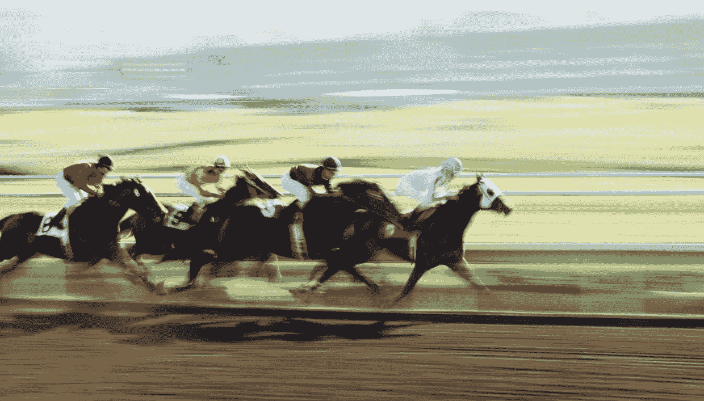

# 普华永道全球体育行业调研（第八期）中国报告

## 前言

在浩渺的历史长河中，体育运动宛如一幅绚丽多彩的画卷，描绘着人类追求健康、挑战极限、凝聚人心的壮丽篇章。在新时代背景下，体育不仅意味着一项项竞技活动，更是文化传承、经济发展和社会进步的重要推动力。

**生活社交的新平台。** 在快节奏的现代生活中，体育运动已经成为一种独特的休闲社交生活方式。无论是清晨的跑步者，还是专业的攀岩者，更或是虚拟竞技的参与者，人们跨越年龄、性别和地域的限制，惺惺相惜，同频共振，共同诠释着体育的魅力。

**经济发展的助推器。** 体育成为提振消费的重要抓手，“赛事经济”火爆出圈，撬动着旅游、餐饮、住宿等相关产业的发展。体育用品制造、体育赛事运营、体育培训等庞大产业链正汇聚成为经济增长的新引擎。

**国家文化的传播者。** 体育是一种文化，它跨越国界，连接世界。在2024年巴黎奥运会上，中国体育健儿们再次向世界展示了中国崭新的风采，赢得了广泛的赞誉和尊重，进一步提升了国家的软实力和国际竞争力。

中国体育产业的发展具有极高的社会价值。我们已连续发布多期《普华永道全球体育行业调研中国报告》，以帮助社会各界更好地了解行业趋势、把握相关机遇，共同为体育强国建设做出更大的贡献。

本期调研数据收集时间为2024年1月至5月，主要探讨了体育产业发展前景、体育服务经济、人工智能赋能体育创新等八个方面的议题。

**周星**  
普华永道中国体育行业主管合伙人

## 中国体育行业领导者视角

- **市场增长前景**：未来3-5年中国体育市场的平均增长率为6.1%（上一年5.2%）
- **政府推动体育发展的目标**：30%的受访者选择了促进全民健身和公众健康
- **认可政府所做努力**：48%的受访者认为政府的体育发展愿景、战略、目标是经过深思熟虑、周详考量的
- **生成式人工智能赋能**：41%的受访者认为内容创作和投放是该技术在体育领域的最主要应用
- **生成式人工智能实施**：60%的受访者尚未制定生成式人工智能相关计划
- **重大赛事掣肘**：44%的受访者认为资金问题是制约大型赛事申办的主要障碍
- **重大赛事模式**：80%的受访者认为应采取多地联合举办的方式
- **重大赛事ESG理念**：63%的受访者认为应缩小新建规模，以可持续地方式更多利用现有体育基础设施
- **成功开发女性体育项目**：21%的受访者认为合作与赞助是最重要的促进因素
- **吸引更多人关注女性体育**：23%的受访者认为内容及播出方式多元化是关键推动因素

## 01 体育产业发展前景可期

过去几年，体育产业以独有的活力和无限的潜力，迅速崛起成为推动经济增长和创造投资机会的关键力量。虚拟竞技、户外运动、体育培训等新兴赛道的不断拓展，不仅为产业发展注入了新鲜血液，更为业界开辟了多元化的增值路径。

虽然全球面临地缘政治冲突、经济增长放缓等诸多挑战，但本年度体育行业调研数据总体积极向好，全球和中国受访者对体育市场增长前景均持乐观态度。

### 1. 全球体育市场信心稳中有增

调研发现，受访者对全球体育市场增长前景均持乐观态度，未来3-5年全球体育市场平均增长率约为7.3%，较去年6.6%有所上升。其中34%的受访者认为全球体育市场增长率将大于两位数。

按照受访者最熟悉的所属地市场分类，受访者认为北美地区增长率超过两位的比例高达43%。北美地区以“赞助+转播+特许+门票”为四大支柱的现代体育商业已高度成熟，体育经纪引领全球，持续吸引着全球顶尖大型赛事在北美地区举办，进一步完善了产业发展环境。

**图表1：未来3-5年体育市场增长潜力（按受访者最了解的市场划分）**

| 市场 | <0% | 0-10% | 10-20% |
|------|-----|-------|--------|
| 全球 | 4% | 62% | 34% |
| 亚洲 | 4% | 56% | 40% |
| 欧洲 | 4% | 67% | 29% |
| 北美 | 0% | 57% | 43% |

**图表2：未来3-5年全球不同板块收入增长预测**

| 板块 | 2023年 | 2024年 |
|------|--------|--------|
| 媒体版权 | 5.4% | 5.2% |
| 商业和赞助 | 5.4% | 6.3% |
| 体育博彩 | 6.7% | 6.9% |
| 票务和酒店业 | 4.5% | 5.9% |
| 周边商品和消费产品 | 4.9% | 5.7% |
| 运动队/特许经营估值 | 6.6% | 7.0% |

就各板块增长趋势而言，未来3-5年，体育行业不同板块收入增长较2023年大多有所上升。收入增长预期最高的板块是运动队/特许经营估值（7%）；较2023年增长幅度上升最大的是商业和赞助（6.3%），提高了0.9%；媒体版权2024年收入增长预期较2023年则有所下降。媒体版权领域有几个因素值得关注：一是体育赛事版权费用不断攀升，体育直播平台利润承压；二是随着数字传播技术的应用，商业壁垒下降，广播公司、流媒体平台和数字提供商之间的竞争加剧。

体育投资市场方面，45%的中国受访者认为亚洲是未来几年最活跃的体育投资市场，其次为北美（25%）、中东（16%）和欧洲（10%）。长期以来，北美一直被视为体育投资热度最高的市场。根据SportsTechX发布的《2023全球体育科技生态体系报告》，2018年至2022年期间，北美在体育领域的融资额高达181亿美元，其次是亚太（77亿美元）和欧洲（53亿美元）；2022年香港地区以4.69亿美元成为亚太地区获得融资最多的城市。

伴随政府对体育事业的大力支持，群众健康意识的不断提升，以及新技术新创新的持续加持，风险投资机构认为，未来亚洲地区将催生出更多的体育科技初创企业乃至独角兽企业，且亚洲地区体育科技初创企业在持续创造更高市场价值方面的表现要大大超过北美地区企业。未来，亚洲地区在体育创新方面的潜力不可小觑。

**图表3：未来3-5年体育投资最活跃的市场**

| 市场 | 占比 |
|------|------|
| 亚洲 | 45% |
| 北美 | 25% |
| 中东 | 16% |
| 欧洲 | 10% |
| 澳洲 | 2% |
| 南美 | 2% |

### 2. 中国体育发展空间进一步释放

中国高度重视体育产业发展，从体育赛事和体育制造业两端发力，出台了一系列政策，积极培育新质生产力，推动体育产业高质量发展。当前，居民体育健身热情高涨，一批体育领域的“中国智造”高端品牌面世，体育产业规模再创新高。

调研显示，中国受访者预期未来**3-5**年中国体育市场平均增长率为**6.1%**，高于上一年的**5.2%**。

#### 2.1 体育产业成为新兴增长动能

从总量规模来看，产值规模快速增长。根据国家统计局数据，2012至2022年，我国体育产业增加值年均增速达15.4%，占当年国内生产总值的比重从0.6%提升至1.08%。体育产业增加值规模已达到金融业的1/8，文化产业的1/4，信息、软件和技术服务业的1/3。体育产业正逐渐成为经济增长的重要组成部分。

**图表4：中国体育产业概况（2016-2022年）**

| 年份 | 产业总规模(亿元) | 增加值(亿元) | 总产出增长率 | 增加值增长率 |
|------|-----------------|-------------|-------------|-------------|
| 2016 | 19,000 | 6,475 | 11.1% | 17.8% |
| 2017 | 22,000 | 7,811 | 15.7% | 20.6% |
| 2018 | 26,579 | 10,078 | 20.9% | 29.0% |
| 2019 | 29,483 | 11,248 | 10.9% | 11.6% |
| 2020 | 27,372 | 10,735 | -7.2% | -4.6% |
| 2021 | 31,175 | 12,245 | 13.9% | 14.1% |
| 2022 | 33,008 | 13,092 | 5.9% | 6.9% |

来源：国家统计局，普华永道分析整理

从内部结构来看，体育服务业快速发展。2022年体育服务业增加值为9,180亿元，占体育产业增加值的比重达到70%，比2015年提高近20%。体育用品及相关销售出租与贸易代理、体育教育与培训、体育场地和设施管理、体育健身休闲活动四个细分领域增加值贡献占比较高。

体育制造创新能力迈上新台阶。2022年体育用品及相关产品制造增加值为3,686亿元，占比为28.2%。体育场地设施建设增加值为226亿元，占比为1.7%。体育领域国家级“专精特新”企业和制造业单项冠军企业数量达到95家，比上一年度增加37家。截至目前，本土品牌已占据前20大品牌中约60%的市场份额。

**图表5：2022年中国体育产业细分结构概况**

| 细分领域 | 占比 |
|---------|------|
| 体育用品及相关产品制造 | 28.2% |
| 体育场地设施建设 | 1.7% |
| 体育用品及相关产品销售、出租与贸易代理 | 24% |
| 体育教育与培训 | 14% |
| 体育场地和设施管理 | 8% |
| 体育健身休闲活动 | 7% |
| 其他体育服务 | 6% |
| 体育管理活动 | 5% |
| 体育传媒与信息服务 | 4% |
| 体育竞赛表演活动 | 1% |
| 体育经纪与代理、广告与会展、表演与设计服务 | 1% |

来源：国家统计局，普华永道分析整理

#### 2.2 体育消费大国再显活力

随着健康中国战略和全民健身国家战略的深入实施，以及冬奥会、大运会、巴黎奥运会等对全民体育活动的积极影响，中国体育消费持续火热，成为消费领域一大亮点。

《中国城市消费报告》显示，2023年中国体育消费规模达到1.5万亿元，预计到2025年将增长到2.8万亿元。国家统计局数据显示，今年上半年，体育娱乐用品销售额同比增长11.2%，远高于社会消费品零售总额3.7%的增速。

中国60岁以上的老年人口接近3亿，这一庞大的中老年人群正在成为户外体验、健身锻炼、康复训练等体育活动的积极参与者。根据《2023中国健身行业数据报告》，50岁以上参与健身人群占比已经由2022年的2.38%提升到4.82%，在各年龄段人群中增长最快。

根据全球健康研究所发布的《全球健康经济观察2024》报告，初步估计2023年体育活动消费的全球市场规模达到1.06万亿美元。中国达到1,554亿美元，占全球市场份额14.7%，位居全球第二。

**图表6：全球前十大体育活动消费市场（单位：十亿美元）**

| 排名 | 国家 | 2020年 | 2021年 | 2022年 | 2023年 |
|------|------|--------|--------|--------|--------|
| 1 | 美国 | 232.5 | 339.1 | 360.7 | 376.8 |
| 2 | 中国 | 134.2 | 161.9 | 150.3 | 155.4 |
| 3 | 英国 | 35.6 | 48.5 | 49.3 | 52.9 |
| 4 | 德国 | 36.1 | 40.0 | 40.3 | 41.6 |
| 5 | 日本 | 40.1 | 42.5 | 38.7 | 37.2 |
| 6 | 法国 | 25.5 | 29.9 | 28.5 | 31.6 |
| 7 | 韩国 | 24.2 | 27.5 | 29.4 | 26.8 |
| 8 | 加拿大 | 16.0 | 20.5 | 24.5 | 24.5 |
| 9 | 澳大利亚 | 18.3 | 20.2 | 22.1 | 24.2 |
| 10 | 意大利 | 16.2 | 20.9 | 18.9 | 19.9 |

来源：The Global Wellness Economy Monitor 2024, Global Wellness Institute  
注：此处体育活动消费主要指健身休闲类体育活动

随着体育产业规模进一步扩大，体育消费潜力进一步释放，体育赛事的舆论和经济影响进一步凸显，新一轮行业发展一触即发，将成为推动经济发展的一股重要力量。

### 3. 未来机遇与挑战并存

本次调研对未来3-5年体育行业面临的机遇和挑战进行了分析。

中国受访者认为生活成本增加、媒体环境的转变、潜在经济放缓、粉丝喜好和行为的改变是未来面临的四大重要挑战。除了生活成本和潜在经济放缓，全球受访者将地缘政治不稳定、监管框架收紧列为重要威胁。

关键助力方面，女性体育运动被超过75%的中国受访者列为最积极的影响因素，这得益于冬奥会、大运会、巴黎奥运会上各项目女性运动员所取得的优异成绩及其在场外展现的超高商业价值。ESG议题和机构投资者这两个因素也有超过四成选择。物联网、区块链，以及虚拟现实和增强现实等新兴技术的应用和普及也受到中国受访者的重视，被视为推动体育产业进步的因素。

然而，生成式人工智能（GenAI）在市场力量中的排名出人意料地低，国内外受访者皆如此，这表明领导者尚未意识到或认识到生成式人工智能的变革力量及其推动增长的潜力。

**图表7：中国受访者对体育产业关键挑战与关键助力的排名**

| 排名 | 关键挑战 | 关键助力 |
|------|---------|---------|
| 1 | 粉丝喜好和行为的改变 | 体育器材和设施中的物联网 |
| 2 | 生活成本增加 | 女性体育运动的增长 |
| 3 | 媒体环境的转变 | ESG议题日益重要 |
| 4 | 潜在经济放缓 | 机构投资者的作用不断增强 |
| 5 | 监管框架收紧 | 越来越多地利用新兴技术（如区块链、AR/VR） |
| 6 | 地缘政治不稳定 | 生成式人工智能的发展 |
| 7 | 新比赛/锦标赛的出现 | 数字资产（如NFT）的增长 |
| 8 | — | — |

体育投资者方面，受访者认为专注于体育行业的私募股权和投资基金（29%）是未来几年体育行业最活跃的投资者。作为体育产业的重要参与者，机构投资对体育产业的蓬勃发展发挥着举足轻重的作用。根据不完全统计，截至2023年12月，国内体育领域共发生49起投融资交易，融资总额超81.97亿元人民币；从数量来看，机构投资者最关注的体育赛道依次为：电竞、户外运动、体育科技、健身以及体育场馆。其中，电竞赛道的投资颇受中东财团青睐；户外运动多为创投；体育科技、健身及体育场馆领域的投资来源较为多元，既有各类投资机构，也有个人投资、股权投资和IPO。

**图表8：未来3-5年体育行业最活跃的投资者**

| 投资者类型 | 占比 |
|-----------|------|
| 专注于体育行业的私募股权和投资基金 | 29% |
| 运动员支持基金/名人投资者 | 3% |
| 企业广告商和赞助商 | 6% |
| 综合型的私募股权和投资基金 | 6% |
| 个人投资者:天使投资者和企业家 | 7% |
| 主权财富基金 | 13% |
| 风险投资公司 | 17% |
| 家族办公室 | 18% |

## 02 政府青睐体育服务经济

体育，不仅是赛场上的竞技，更是公众越来越认同的生活方式。随着体育与各领域融合逐步加深，特色化的体育新业态、新场景、新模式层出不穷，越来越多的地区把体育作为促进消费、拉动经济增长的重要手段。国家体育总局局长高志丹强调，“体育产业对经济发展具有乘数效应、融合效应、带动效应”。相关统计显示，在参与型体育赛事中，外地参与者的体育直接消费对吃、住、行等间接消费的带动比例高达1:13。

普华永道全球体育行业调研（第八期）中国报告

## 1. 政策引导初显成效，“体育+消费”试点再起航

近年来，国家体育总局、国家发改委、文化和旅游部等多个部门陆续出台多项体育产业相关政策。各省（区、市）聚焦细分领域，精准施策。既有直接针对体育产业、体育消费相关的政策和实施意见，也有引导资金适当倾斜、赛事活动优先保障、改善体育消费环境等方面的举措。

调研显示，48%的中国受访者认为政府的体育发展愿景、战略和目标是经过深思熟虑的（赞同和非常同意占比），相比之下，全球这一比例仅为25%。这说明中国政府在促进体育发展规划引导方面所付出的努力获得了较高认可。

体育消费试点城市彰显政府施政成效。2020年国家体育总局公布40个国家体育消费试点城市，2022年试点城市居民体育消费总规模达到6,821亿元，较2020年增长17.95%，取得了显著成效，有效释放了体育消费潜力⁶。

体育消费试点再深化。2023年7月，国家体育总局发布《关于恢复和扩大体育消费的工作方案》，要求“深化消费试点示范”，以试点不断优化体育消费环境、丰富优质体育产品供给。2024年8月，国务院发布《关于促进服务消费高质量发展的意见》，强调激发体育消费，深化促进体育消费试点工作，培育一批国家体育产业和体育旅游发展载体。

### 图表9：所在地政府的体育发展愿景、战略、目标经过深思熟虑

| 选项 | 中国 | 全球 |
|------|------|------|
| 非常同意 | 14% | 6% |
| 同意 | 26% | 9% |
| 中立 | 35% | 38% |
| 不同意 | 18% | 24% |
| 非常不同意 | 7% | 24% |

同时，中国受访者对政府政策目标效果的满意度明显高于全球水平。其中，“举办大型体育赛事”、“激发民族自豪感和认同感”、“提高竞争力，取得国际成功”这三项“非常有成效”的占比均超过了30%，而全球受访者在这三项“非常有成效”的占比分别为15%、13%和10%。

然而，“对经济产生积极影响”的效果并不显著；特别是在“支持民营企业投资体育发展”方面，21%的受访者认为“毫无成效”。这也表明，政府还需进一步调查研究民营企业投资体育行业的诉求，制定更多精准有效的政策。

### 图表10：政府目标的实现程度

| 政府目标 | 毫无成效 | 稍有成就 | 较有成效 | 有成效 | 非常有成就 |
|---------|---------|---------|---------|-------|-----------|
| 促进公众健康和全民健身 | 3% | 3% | 6% | 21% | 12% |
| 举办大型体育赛事 | 17% | 20% | 31% | 37% | 32% |
| 激发民族自豪感和认同感 | 40% | 29% | 26% | 23% | 20% |
| 提高竞争力，取得国际成功 | 17% | 18% | 26% | 29% | 20% |
| 促进社会包容和多样性 | 20% | 14% | 31% | 21% | 23% |
| 支持民营企业投资体育发展 | 26% | 37% | 37% | 31% | 9% |
| 对经济产生积极影响 | 9% | 11% | — | — | — |

## 2. 体育活动惠及民生，“体育+旅游”特色再闪耀

促进公众健康和全民健身，无论是在全球（25%）还是在中国（30%）均被受访者认为是政府发展体育的首要目标。通过举办全民健身日、大众冰雪季等活动，我国有效丰富完善了群众身边的体育赛事和活动；推进大型场馆多方式向周边居民开放，推进“15分钟健身圈”、“国球进公园、国球进社区”，则有效提升了开展健身锻炼的便利性。截至2023年底，全国体育场地达459.27万个、人均体育场地面积2.89平方米，提前实现了《“十四五”体育发展规划》中提出的2.6平方米人均体育场地面积目标⁷。

随着全民健身公共服务体系的丰富和完善，可以说人民群众获得了实实在在的健身活动体验和幸福感。

### 图表11：政府推出体育（及相关）举措的最重要目标

| 目标 | 中国 | 全球 |
|------|------|------|
| 促进公众健康和全民健身 | 30% | 25% |
| 对经济产生积极影响 | 18% | 14% |
| 提高竞争力，取得国际成功 | 16% | 13% |
| 举办大型体育赛事 | 14% | 14% |
| 激发民族自豪感和认同感 | 11% | 13% |
| 促进社会包容和多样性 | 7% | 14% |
| 支持民营企业投资体育发展 | 3% | 8% |

多地体育旅游走出特色。与奥运赛场争金夺银的高光时刻交相辉映的是中华大地上燃起的体育赛事旅游热潮。今年5月举办的“奥运会资格系列赛”吸引国内外观众4.5万人次，带来的直接经济效益达6.43亿元，间接经济效益达14.02亿元⁸。

在新媒体、短视频等多元化传播渠道的加持下，“村超”、“村BA”等民间体育赛事火爆出圈。三四线以及中小型城市和乡镇利用当地自然资源和风土人情，拓展带有浓浓乡土味的百姓赛事，并成为乡村振兴发展的“聚宝盆”。

随着“跟着赛事去旅游”、“一城一赛”等实践的不断深入，以体育赛事串连自然、人文、特色节庆等资源，打造“体育+”融合消费场景，推进文体商旅融合，成为各地发展体育旅游的典型路径。

## 3. 全力增加财政支持，“体育+跨界”探索新力量

体育赛事和活动的流量变成了经济的“能量”和经济的“增量”。在体育与旅游融合发展的同时，体育与文化、信息、农业等相关产业的融合也在不断深化，“工业+体育”（首钢赛车谷）、“教育+体育”（优秀退役运动员进校园任教）、“红色文化+体育”（首届粤闽健康徒步）等“体育+”的多元形态不断显现，成为推动地方经济跨界融合发展的新方式。

针对面向未来的跨界融合发展趋势，增加资金和财政支持（23%）成为中国受访者的首要期许；提供政策和监管支持（15%）紧随其后，说明政府目标举措需要更多资金和有效政务服务来支撑。相对而言，全球24%的受访者选择了加强基础设施建设，从侧面说明，中国受访者对当下的体育基础设施建设满意度较高。

总体来看，受访者对政府的要求相对分散，一方面体现了多元化主体对政府服务的诉求差异较大，另一方面则预示着政府在制定规划和支持政策的过程中，需要结合各地特色和当前紧要任务，做好平衡性选择。

### 图表12：对政府最迫切的要求

| 要求 | 中国 | 全球 |
|------|------|------|
| 提供资金和财政支持 | 23% | 15% |
| 提供政策和监管支持 | 15% | 13% |
| 鼓励民众参与体育活动 | 12% | 14% |
| 加强基础设施建设 | 4% | 24% |
| 支持举办大型体育赛事 | 7% | 10% |
| 提供奖励，促进可持续发展和 | 10% | 6% |
| 社会责任履行 | — | — |
| 激励创新和技术进步 | 25% | 6% |
| 提高运动员福利水平 | 14% | 6% |

## 体育国际化进入新征程

2012年至2023年，我国共获得世界冠军1,244个，创超世界纪录161次。在巴黎奥运会上，中国体育代表团取得我国参加夏季奥运会境外参赛历史最好成绩。从初露锋芒到全面开花，中国已成为世界体育舞台上不可忽视的重要力量。

## 03

### 1. 体育成为国际交流新窗口

体育具有“健康、向上、公平、公正、竞争、友爱、团结”等特征，是“世界通用的肢体语言”。在赛场内外散发出耀眼光芒的中国运动员们，以及技术水平先进的中国体育用品，成为世界再一次感知中国、读懂中国的新窗口。

传递中国文化价值。体育铺路搭桥，文明交流互鉴，体育赛事活动成为展示中国新时代文化的重要途经。越来越多的00后运动员崭露头角，屡创佳绩。赛场之中，他们沉着冷静，专注投入；赛场之外，他们朝气蓬勃，粉丝众多，展现出中国新一代年轻人的多元与丰富。中国女子乒乓球运动员孙颖莎赛前被2024巴黎奥运会评选为最值得关注的12位顶级运动员。据微博统计，巴黎奥运会期间，378位中国奥运选手开通了微博账号，粉丝总量突破2.3亿，较东京奥运会实现翻倍增长。一些运动员在海外社交媒体开设账户，与全球体育迷开展互动。

中国体育品牌走上国际舞台。中国体育用品企业不断加大研发投入，从客户需求出发，利用科技手段提供定制化、个性化的产品和服务，产品质量获得高度认可。如中国场地自行车队的自行车使用的T1100碳纤维材料，为全球同类车架产品中重量最轻。2024年上半年，中国体育用品及设备出口同比增长16.7%。一批批中国创新的体育产品惠及全球各地，越来越多中国传统运动品牌战略收购国外运动品牌，一系列中国运动品牌签约国际知名运动员，中国体育品牌全球化步伐正在加快。

### 图表13：2024年在中国设置举办地点的国际体育赛事

| 序号 | 时间 | 赛事名称 | 举办地点 |
|------|------|---------|---------|
| 1 | 1.30-2.4 | 花样滑冰四大洲锦标赛 | 中国上海 |
| 2 | 2.8-2.11 | 女篮奥运资格赛 | 中国西安等 |
| 3 | 2.22-2.26 | 男篮亚洲杯预选赛第一窗口期 | 中国西安 |
| 4 | 3.22-3.24 | 国际剑联女重世界杯 | 中国南京 |
| 5 | 4.5-4.6 | 花样游泳世界杯首站 | 中国北京 |
| 6 | 4.9-4.14 | 羽毛球亚锦赛（单项） | 中国宁波 |
| 7 | 4.2 | 田径钻石联赛厦门站 | 中国厦门 |
| 8 | 4.27 | 田径钻石联赛苏州站 | 中国苏州 |
| 9 | 4.28-5.5 | 汤姆斯杯世界男子羽毛球团体锦标赛 尤伯杯世界女子羽毛球团体锦标赛 | 中国成都 |
| 10 | 4.15-4.21 | 国际乒联男子、女子单打世界杯 | 中国澳门 |
| 11 | 5.16-5.19 | 巴黎奥运会资格系列赛（综合） | 中国上海 |
| 12 | 5.17-5.19 | 国际剑联花剑大奖赛 | 中国上海 |
| 13 | 5.28-6.2 | 世界女排联赛 | 中国澳门 |
| 14 | 6.11-6.16 | 世界女排联赛 | 中国香港 |
| 15 | 10.18-10.20 | 游泳世界杯 | 中国上海 |
| 16 | 11.19-11.24 | 世界羽联中国大师赛 | 中国深圳 |
| 17 | 11.29-12.1 | 速度滑冰世界杯北京站 | 中国北京 |
| 18 | 12.1-12.8 | 国际乒联混合团体世界杯 | 中国成都 |
| 19 | 12.6-12.8 | 短道速滑世界杯北京站 | 中国北京 |
| 20 | 12.11-12.15 | 世界羽联巡回赛总决赛 | 中国杭州 |

### 2. 更多国际元素融入中国

近年来，中国举办国际体育赛事经验丰富，效益显著，吸引了国际体育组织和赛事纷纷来华合作。中国体育发展环境的优越性和国际认可度不断提升。

国际赛事落地中国。国际奥委会主席巴赫多次对中国的办赛能力赞不绝口。国家体育总局发布了2024年国内外重要赛事一览⁹，共提及68项国际赛事，其中有20项在中国设置举办地，占比接近30%。作为水平最高的田径单日赛，世界田径钻石联赛全年15站比赛中，有两站在中国举办，足见世界田联对中国的青睐。在交流来访的带动下，一批国际组织进入中国发展。如2024年4月，国际皮划艇联合会杭州代表处正式揭牌，该代表处是国际皮划艇联合会在中国的首个分支机构，并定为国际皮划艇联合会亚洲总部。

国际体育旅游入境激增。2023年出入境团队旅游全面恢复，围绕体育赛事的个人体育旅游快速回暖。根据有关数据^(10)，2023年杭州亚运会期间（9.23-10.8），前往杭州的国际机票预订量同比增长20倍。2023年体育旅游服务贸易进口额高达435.68亿元，同比增长186%^(11)，占体育贸易进口额的比重达到82.8%。随着中国144小时免签“朋友圈”扩大，相信中国体育国际交流和来往会更加便捷和频繁。

### 图表14：中国体育服务贸易进出口规模（单位：亿元）

| 年份 | 体育服务出口额 | 体育服务进口额 | 其中体育旅游进口 |
|------|-------------|-------------|---------------|
| 2020年 | 7 | 182.5 | — |
| 2021年 | 8 | 101.9 | — |
| 2022年 | 9.5 | 190.3 | — |
| 2023年 | 11.7 | 528.9 | 435.68 |

来源：国家统计局，普华永道整理 / 来源：国家体育总局，普华永道整理

### 3. 体育国际化任重道远

相较于体育大国、体育强国的目标来看，中国在国际体育赛事举办和规则制定中的话语权还有待提升，中国体育产品走向世界还面临着诸多挑战。

争取更多体育国际话语权。在巴黎奥运会上，郭晶晶担任跳水裁判长引发各界热议；中国首位柔道专业女性裁判员张光玥、乒乓球裁判朱玲、排球裁判王子凌、水球裁判张亮、篮球裁判施启蓉、滑板裁判田军等亮相巴黎引人注目。此外，国际奥委会执委会委员李玲蔚、国际奥委会运动员委员会委员张虹、世界反兴奋剂机构（WADA）副主席杨扬等人也在本届奥委会任职。他们的任职和专业表现，不仅提升了中国体育的国际形象，也为中国体育界争取了更多的话语权和影响力。但相对于庞大体量和项目类别的多样性，中国裁判队伍及其影响力范围、项目覆盖率还十分有限。特别是在体育评判规则制定、赛事项目设置等方面，中国争取国际话语权任重道远。

积极培养更多体育国际交流人才。中国积极实施主动“请进来、走出去”的体育人才交流战略，与世界顶尖选手交流，借助国际高水平赛事锻炼队伍、提升水平。2024年奥运会中国体育代表团的311名工作人员中，有外籍工作人员42名，其中外籍教练员达34人，为历史最高值。在2024年9月中国服务贸易交易大会上，霍启刚受邀担任“体育贸易推荐官”，并提出了“品牌国际化战略”和“联合训练营计划”，旨在推动中国体育品牌的国际化和提升中国运动员在国际赛场的表现和曝光率。国家体育总局多次举办“国际体育组织任职及后备人员培训班”，帮助相关人员在国际体育组织任职及后备人员进一步把握国际形势和外交政策，提升履职能力和沟通水平，更好地参与国际体育治理。

提升体育产业国际竞争力。虽然中国已是体育用品出口大国，但面对国际市场的激烈竞争，中国体育品牌在全球舞台上仍然面临着诸多挑战。一是全球体育供应链竞争格局正在重塑。根据标普全球市场情报，中国内地在全球运动服饰、鞋类、自行车及运动器材出口中的主导地位有所削弱，市场份额从2016年的48.9%下降至2023年的30.4%；越南则异军突起，市场份额从微不足道的1.2%激增至13.8%，尤其是在运动鞋类和服装领域更是表现亮眼。二是在体育服务方面，中国职业体育竞赛表演、体育赛事赞助、体育赛事版权交易、互联网体育服务、体育旅游等方面与国际成熟市场相比仍有较大差距。

## 人工智能赋能体育创新

人工智能（AI）作为一项革命性技术，正在改变人们生活的方方面面，体育当然也不例外。今年4月，国际奥委会发布《奥林匹克AI议程》，提出了引领全球体育领域开展人工智能计划的框架，希望通过发掘人工智能的潜力来促进公平、卓越、团结的奥运体验，激励并加速全球体育变革。

## 04

### 1. 人工智能重新定义运动

人工智能能为更多运动员提供个性化的训练方法、更好的运动装备以及更具针对性的健身和保健计划，也将极大提高体育赛事的组织效率，改变体育转播的方式。

在巴黎奥运会上，AI技术更是深入参与赛事各个环节，一系列前沿科技的应用不仅为运动员提供了前所未有的支持，也为全球观众带来了更加精彩、沉浸的观赛体验。

**运动员的贴心顾问**
- 聊天机器人AthleteGPT提供日常咨询解答服务（如赠品领取）
- 交互能力与信息定制（出行指引、赛事规则说明等）
- 多语言服务打破语言和文化界限

**AI助力打击网络暴力**
- 全天候监控主要社交平台，超35种语言
- 开幕式前48小时至闭幕式后48小时开启在线保护服务
- 英国AI公司Signify Group Limited提供服务

**提升成绩的好帮手**
- 动作识别与技战术分析等，辅助训练提升运动员成绩
- 帮助设计定制运动服饰，确保获得最佳营养及合适的训练计划
- 百度文心、联想AIPC和英特尔提供服务

**开辟观赛新视野**
- 阿里云AI全新转播技术“多镜头回访系统”
- 创造“子弹时间”观赛体验
- 多角度观看慢镜头、时间暂停等特效

**提高场馆运作效率**
- OnePlan创建30个数字孪生模型（包括埃菲尔铁塔、协和广场等）
- 可多方远程协作，探索场馆布局
- 提供虚拟预演，提高各方应对能力和赛事体验

**赋能奥运绿色转型**
- OBS云：通过云端传输奥运内容，减少现场设备需求，降碳减排；缩小国际转播中心规模，为场馆提供更多商业利用空间
- 能耗宝：覆盖全部比赛场馆，实现对能耗、场馆承载力、赛事进度和现场气候条件的实时监控；生成定制化数据报告，提供精确能耗概况

来源：普华永道根据公开信息整理

### 图表15：AI在巴黎奥运会上的应用亮点

**GenAI应用方向。** 受访者普遍认为，内容创作和投放、提升运动表现是重要应用方向。在内容创作方面，虚拟体育的崛起、高清晰度无延时的赛事直播等都是GenAI的受益应用。在提升运动表现方面，体育组织可以通过整合各类数据集（如训练负荷、营养状况、比赛表现等）获得更深入、更全面的洞察。未来的智能训练将在大量数据的基础上，为运动员形成个性化的训练模型和智能化指导方案，进一步提高训练的自主性、科学性和有效性。

### 图表16：GenAI在体育领域的主要运用方向

| 应用方向 | 中国 | 全球 |
|---------|------|------|
| 内容创作和投放 | 41% | 38% |
| 提升运动表现 | 23% | 23% |
| 粉丝互动 | 16% | 18% |
| 提升运营效率 | 8% | 8% |
| 广告及赞助 | 8% | 7% |
| 电子竞技 | 6% | 5% |

图表17：从GenAI中获益最多的组织

| 组织类型 | 中国 | 全球 |
|---|---:|---:|
| 体育媒体 | 38% | 23% |
| 体育科技组织 | 26% | 14% |
| 体育平台/博彩 | 21% | 14% |
| 球队/俱乐部 | 16% | 10% |
| 联盟/赛事组织者 | 14% | 7% |
| 体育协会 | 12% | 6% |
| 场馆 | 8% | 3% |

GenAI受益分布。中国受访者认为，体育媒体（38%）预计从GenAI中获益最多。当前，年轻人更重视以个性化体验参与或观看体育赛事。体育媒体及传播者如能更多应用AI技术，提高制作和视觉呈现能力，将有利于推动新的数字粉丝体验，并扩大其报道的吸引力。AI还可以将员工从耗时、劳动密集型的任务中解放出来，让他们能够专注于更强调创意或更为重要的工作。

在可预期的未来，AI将推动体育行业的呈现方式、产品思路、利润渠道等全方位的改变。如虚拟教练或人形机器人有望走入普通人家庭，陪伴和督促人们打卡训练，让健身的过程更轻松和快乐，为健身爱好者提供充足的运动价值和情绪价值。

## 2. 亟需破除障碍，即刻行动

图表18：将GenAI整合/应用到业务变革

| 状态 | 比例 |
|---|---:|
| 已作考虑，且正在实施 | 13% |
| 已作考虑，但尚未实施 | 27% |
| 尚未制定，但希望制定相关计划 | 43% |
| 尚未制定，因为与业务无关 | 17% |

本次调研显示，无论是中国还是全球，均有60%的受访者称尚未制定GenAI相关计划。这与我们前面得出的分析结果一致，即当前GenAI尚未构成推动体育产业发展的关键助力。

进一步分析发现，扩大GenAI在体育行业应用面临的障碍来自多个方面。既有缺少应用端的典型案例，也有内部组织变革难的拖累，更有依赖于高层决策支持的资源配置协调难题。

2023年4月，工信部与国家体育总局公布了首批100家智能体育典型案例名单，涉及智能体育产品、智慧体育场馆解决方案、智能户外运动设施解决方案、运动健身APP及平台等多个方向，以加速智能技术在体育行业中的应用。

GenAI将从不同路径、不同维度赋予未来体育活动全新的意义，颠覆竞赛、参赛、观赛形式。我们建议，体育界各利益相关方应积极拥抱人工智能，主动参与到人工智能对市场的变革中，特别是改变工作方式和确保获得足够的资金等，均需要公司高层领导的支持。

图表19：体育行业推广GenAI面临的主要障碍

| 障碍 | 中国 | 全球 |
|---|---:|---:|
| 缺乏清晰的潜在用例和相关性 | 5% | 4% |
| 改变以往工作方式 | 14% | 5% |
| 缺乏足够的资金来支持GenAI发展 | 9% | 8% |
| 尚缺乏高层领导的认同 | 13% | 15% |
| 获得实施GenAI解决方案所需的能力 | 9% | 15% |
| 对基于GenAI的解决方案存在疑虑 | 14% | 16% |
| 改变组织文化 | 19% | 16% |
| 就GenAI举措与关键利益相关方达成一致 | 17% | 20% |

### 3. 虚拟体育开启全新时代

虚拟体育以其独特的交互性与趣味性，成功吸引了众多传统体育爱好者，已然引领“体育革命”前沿发展。

电子竞技与传统体育的融合。电子竞技与棒球、足球、篮球等传统体育项目相结合，既使传统体育焕然新生，也为电子竞技带来更为丰富的文化精神内涵。虚拟体育既保留了传统项目的精髓与魅力，又巧妙融入了现代科技元素，使得运动体验更加丰富多元。同时，虚拟体育以独特魅力成为青年人群的社交互动平台。虚拟骑行等新型体育项目的不断涌现，为体育爱好者提供了新的体验方式。今年，俄罗斯举办的未来运动会采用了线上开展体育类电竞项目、线下进行真实体育运动相结合的计分方式，既保留了电竞的娱乐性，又增加了实体体育的锻炼效果。

虚拟体育赛事前景广阔。2023年部分虚拟体育项目纳入第19届亚运会。2023年6月，新加坡举办的首届奥林匹克电竞周（Olympic Esports Week）开创性地将多项前沿科技与电竞深度融合，为选手打造真实的互动竞技场景，被视为国际奥委会支持虚拟体育发展的重要里程碑。今年，国际奥委会决定将于2025年在沙特阿拉伯举办首届奥林匹克电子竞技运动会。

国内各大城市纷纷重视虚拟体育的发展。上海创办的国内首个虚拟体育综合性赛事已连续举办3届，今年还将与中超上海申花、CBA上海久事大鲨鱼、F1中国大奖赛、上海劳力士大师赛等职业俱乐部及国际赛事联动，形成传统体育与虚拟体育的组合玩法。首届北京市虚拟体育运动会设置了数字高尔夫、智能定向、智能动感单车、智能划船、激光模拟射击、电竞赛车等多项竞赛项目。

未来，随着技术的进步、装备的升级和普及程度的不断提高，虚拟体育将迎来真正的高光时刻。在设备方面，将更关注舒适度、健身内容和价格等，相关装备将朝轻便化、无感化迭代升级。在内容方面，基于在VR场景和混合现实上的探索，虚拟运动可将更多元的运动场景融入其中，打破更多运动项目壁垒。在体验方面，从业者需不断升级技术，强化虚拟体育的“真实度”，实现更精准灵敏的全身动作捕捉、解锁全身玩法等。线上线下同时发力，虚拟体育不仅将开辟更多全新竞技场景，还将为玩家、卖家等利益相关者创造更多新奇体验和全新盈利模式。

### 案例：沙特阿拉伯多措并举支持电竞发展

顶层战略设计。2022年9月，沙特王储公布了游戏和电竞国家战略，这项为期十年的全面投资计划将通过86项举措，发展整个游戏和电子竞技价值链。普华永道被选聘负责运营整个战略执行的秘书处办公室、项目管理办公室和战略管理办公室，以确保正确执行游戏和电竞战略及该国电竞部门的成功转型。

多维资本支持。沙特近年来在电竞行业持续投入高达数百亿美元的巨额资金，涵盖知名电竞公司收购、大型电竞赛事筹办、电竞职业化发展等多项关键领域。2023年宣布全新电子竞技场馆“Qiddiya Giga”的建造计划，打造世界上总面积最大的新型电子竞技区。2024年，沙特举办的Gamers8电竞赛事总奖金达到了6,000万美元（约合4.35亿人民币），再次刷新历史纪录，这项赛事正式升级为电竞世界杯。

广泛的群众基础。沙特是中东最大的游戏市场之一，拥有2,350万名游戏玩家，占该国人口的67%。与国际玩家相比，沙特玩家愿意投入更多的时间、金钱和社会资本。2020年至2023年，沙特游戏和电子竞技市场收入增长了88.5%。

### 图表20：电子竞技发展关键事件

| 时间 | 事件 |
|---|---|
| 20世纪90年代 | 韩国政府开始引导电子竞技的发展，通过建立专门的游戏频道、成立OGN电视台等措施，推动了电子竞技的系统化和职业化。 |
| 2001年 | 第一届国际电子竞技大赛（WCG）在韩国举行，标志着电子竞技赛事的全球化。 |
| 2003年 | 电子竞技被正式承认为体育项目，标志着中国电竞走向正规化。 |
| 2004年 | 中华全国体育总会主办了第一届全国电子竞技运动会（CEG），成立了第一支电子竞技国家队。 |
| 2005年 | 中国电子竞技史上第一个职业俱乐部World Elite（WE）成立。 |
| 2008年 | 电子竞技被重新定义为第78号体育运动，央视开始播放电子竞技节目。 |
| 2013年 | 教育部公布《普通高等学校高等职业教育（专科）专业目录》，增加了“电子竞技运动与管理”专业。 |
| 2017年 | 国际奥委会正式宣布电子竞技运动为正式体育项目。 |
| 2021年 | 国际奥委会与旗下分管棒球、自行车、赛艇、帆船和赛车的五个单项国际体育联合会以及各游戏发行商合作，推出奥林匹克虚拟系列赛（OVS），这是历史首次奥林匹克授权的虚拟体育赛事。 |
| 2022年 | 上海举办中国首个虚拟体育综合性赛事。 |
| 2023年 | 电子竞技成为杭州亚运会的正式比赛项目。国际奥委会在新加坡举办了首个“奥林匹克电子竞技周”及“奥林匹克电竞系列赛”。 |
| 2024年 | 北京举办首届虚拟体育大会。 |
| 2024年 | 国际奥委会第142次全会一致通过于2025年在沙特阿拉伯举办首届奥林匹克电子竞技运动会。 |

## 以专业提升体育竞争力

随着中国体育现代化的深入实施，群众体育、竞技体育、体育产业、体育文化和体育交流等领域呈现出“多核心网络融合”发展模式，推动体育事业高质量发展。

## 1. 举国之力与职业体育的融合

举国体制是推动我国竞技体育快速发展、取得辉煌成就的制度支撑。体育中的举国体制是以国家利益为最高目标，充分调动全国体育系统共同参与竞技体育的积极性，形成“上下一条龙、全国一盘棋”的资源配置工作格局。目前，中国形成了以专业运动队和单项体育协会为中心的训练体制、以全运会为中心的竞赛体制，以及以市场化为导向的单项体育协会实体化改革体系，有效保障了我国竞技体育的综合实力。

理顺国家队与“职业化”之间的关系。中国正在探索如何更好地在体育发展中融入职业化力量。由国家来组建训练团队，依照“比赛”的节奏进行专门、集中地训练，并平衡好“训练”与“国家赛”和“职业联赛”的关系。一方面，结合国际赛事来安排国内的职业联赛，预留运动员在国家队集中训练和深造的时间；另一方面，运动员再将代表国家队参加国际大赛的理念、战术等经验带回俱乐部，促进职业联赛向更高水平迈进。此外，国家队在国际大赛上的成绩是国内职业联赛价值的风向标，国内职业赛事要想发展好，需全力支持国家队参与国际赛事。

## 2. 网球职业化迎来新高峰

国际赛事屡获佳绩，网球文化蔚然成风，网球的商业价值快速提升，中国网球运动迎来职业化新高峰。

国家队“单飞运作”数十年。2009年国家体育总局网球运动管理中心允许运动员自主训练、自主参赛、自负盈亏，但需向中心缴纳个人奖金收入的8%—12%。以此为起点，中国网球逐步走上探索职业化的道路。数十年来，实施以“单飞”为主体导向，兼顾“国家队培养”、“国家和地方联合培养”等多元化培养、多渠道备战的新模式，形成了具有中国特色的网球职业化道路。在市场化运作和政策扶持“双管齐下”的带动下，以郑钦文为代表的新生代球员径直走上职业化道路。更自由、更市场化的环境为运动员提供了更多元的选择。

快速飙升的商业价值。网球之所以在全球范围内具有高商业价值，与其专业化程度高、职业球员稀缺，以及与高端时尚的紧密结合有关。中国网球职业化运作中，经纪公司发挥了重要作用，不仅助力运动员提升竞技水平，还极大推动了网球运动在中国的商业价值飙升。根据《福布斯》杂志公布的2023年度女运动员收入榜，郑钦文以总计720万美元收入排在第15位，成为继李娜之后首位入选榜单的中国网球选手。2024年中国网球公开赛全赛期观赛人流量约为30万人次，较去年增长50%，门票总收入达到创历史新高的8,000万元，较去年增长60%。网球拥有时尚、高消费、自带圈层社交等高净值用户特性，有望成为体育领域强劲的增长赛道。

逐步提升的国际影响力。巴黎奥运会上，郑钦文在红土赛场上创造历史，成为亚洲首位获得奥运会网球女子单打冠军的选手。同时，张之臻与王欣瑜的混双组合也为中国队赢得了该项目的首枚银牌。运动员的出色战绩也在推动更多中国消费者认识网球、接触网球并与国际接轨。截至2024年10月，中国共有9名运动员排在全球网球职业赛100名之内。2024年中国网球公开赛吸引了来自48个国家和地区的380名球员参赛，包括阿尔卡拉斯、辛纳、梅德韦杰夫、萨巴伦卡、高芙、大坂直美等大满贯得主。据国际网球联合会（ITF）统计，中国网球场数量已排名世界第二，仅次于美国。

## 3. 新兴小众运动方兴未艾

近年来，街舞、小轮车、棒球、飞盘、划桨板等一些小众体育项目从民间运动逐步上升为专业性运动，竞争能力得到大幅提升。2028年洛杉矶奥运会将迎来壁球、棒垒球、板球、腰旗橄榄球和棍网球等5个新增运动项目，相信这些新兴小众运动将逐步走进我们的生活。

霹雳舞在中国具有广泛群众基础。2024年霹雳舞（Breaking）首次作为正式比赛项目纳入奥运会，中国队员刘清漪获得铜牌。2024年世界霹雳舞青年锦标赛（WDSF）首次在中国举办，中国队有多名选手表现出色，成功晋级男子和女子16强，最终钱成获得铜牌。此外，中国街舞联赛规模不断扩大，2024年将赛事下沉至县级城市，持续推动街舞文化在民间的普及和发展。

中国小轮车队实现历史性突破。在2023年世锦赛上，中国队的五名女运动员排在第二至第六名，成为国际上具有一定核心竞争力的队伍。在巴黎奥运会上，邓雅文代表中国队首次在该项目上获得奥运会金牌。在国内，小轮车联赛和锦标赛体系逐步完善，参赛人次达到高峰。2024年中国自由式小轮车联赛设置四站分站赛和一站总决赛，参与人数不断攀升。

攀岩场地成为城市新地标。2024年4月，中国·眉山国际攀岩中心正式对外开放运营，成为目前世界占地面积最大和攀登面积最大的攀岩建筑，也被称为“双第一”攀岩中心。在2024亚洲攀岩锦标赛中，中国队获得速度项目的2金1铜以及难度项目的1银，展现了中国攀岩在国际竞技舞台上的竞争力。中国攀岩协会积极推动攀岩场地设施的建设和改善，建立了包括中国攀岩联赛、中国速度攀岩系列赛和“一带一路”国际攀岩大师系列赛在内的完善赛事体系。

棍网球崭新入场。2024年世界棍网球女子U20锦标赛在香港举办，是亚洲首次举办世界级的棍网球赛事。中国队在该比赛中获得了第九名的好成绩。2024年中国棍网球锦标赛吸引了来自北京、香港、台湾、上海、广东、四川等地的53支队伍，共计523名运动员参加。2024年10月，成都市第十五届运动会世运项目推广组棍网球比赛顺利开赛，棍网球比赛在国内首次进入市级大型综合运动会。

## 4. 青少年被寄予厚望

国际上的职业体育非常重视青少年运动员的培养。

2023—2024赛季354名注册国内篮球运动员中，有265名来自CBA各俱乐部青年队^12。在强有力的政策支持和活跃的市场氛围激励下，中国青少年体育生机勃勃。

青少年运动项目的规格正在提升。随着我国各级赛事体系不断完善，青少年参加比赛的机会明显增多，青少年“三大球”培训火热开展，不少相关商业机构开拓入驻。2024年11月，国家体育总局和教育部将联合组织举办第一届青少年三大球运动会。这是我国第一次将青少年足球、篮球、排球一起纳为“全国运动会”，在强化青少年运动能力的同时，还能有效储备职业运动员后备力量。

青少年体育培训市场快速增长。随着“双减”政策落实，青少年体育消费市场需求骤增。同时，为落实体育与教育的深度融合，不少地方政府都推行了体育运动进校园的政策，学校与职业俱乐部合作更加紧密，为学生运动员提供更多升学和职业发展路径。据国家体育总局统计，目前全国有超过3万家青少年体育培训机构。青少年体育培训机构的迅猛发展，不仅是我国体育事业繁荣的缩影，更是国家对青少年体质健康高度重视的具体体现。

## 重大赛事运作模式革新

体育赛事是体育产业发展的龙头。2024年是重要赛事扎堆的年份，在世界级赛事的带动下，中国国内一批本地化特色赛事和地方性体育活动的持续走红，极大地激发了潜在体育市场。

## 1. 对举办赛事有更多期待

举办重大体育赛事的热情往往源于促进经济发展和提高国际声望等动机。在全球经济发展不景气的大背景下，经济效益仍然是举办重大赛事的主要动机。“为一场赛事，赴一座城”，国内各地政府举办重大体育赛事活动的热情持续高涨。数据显示，2023年全国共举办马拉松赛事613场，总规模567万人^13。2024年无锡马拉松有超过26万人报名，创下国内马拉松赛历史新高。

调研显示，中国受访者把通过赛事促进经济发展放在举办赛事动机的首要位置，推动全民健身和体育活动放在第二位。2024年7月，国家体育总局、文化和旅游部联合发布21项“跟着赛事去旅行”2024暑期全国户外运动赛事，这些赛事均带动了当地住宿、餐饮等消费增长。全球受访者则把赛事带来的基础设施投资放在首要位置，并把鼓舞下一代作为重要选项。

虽然重大赛事为运动员搭建了展示平台，但促进职业体育和运动员发展，无论是在中国还是全球受访者中，都不被认为是重要的动机。

未来，中国应尽早考虑如何将职业赛事的运作与职业运动员的长远发展结合得更加紧密，以及如何通过体育赛事在推动文化交流和精神传承方面发挥重要作用，放大赛事的社会效应。

图表21：举办重大体育赛事的主要动机

| 动机 | 中国 | 全球 |
|---|---:|---:|
| 促进旅游并带动经济增长 | 7% | 3% |
| 促进全民健身和体育活动 | 14% | 7% |
| 增加投资和加大基础设施建设 | 11% | 9% |
| 提供和增加就业机会 | 8% | 11% |
| 激发民族自豪感 | 25% | 20% |
| 鼓舞下一代 | 11% | 21% |
| 促进职业体育和运动员发展 | 24% | 29% |

**2.** 财务问题制约大型赛事申办

近年，在多个重大赛事的招标周期中，参与竞标的国家越来越少。最初有5个城市报名申办2024年奥运会，但最终只有巴黎和洛杉矶两个城市参与竞争，国际奥委会遂将这两个城市分别确定为2024年和2028年奥运会的举办地。2032年奥运会也只有澳大利亚布里斯班一个城市申请。

调研显示，财务担忧（44%）是制约申办重大赛事的最主要原因。以奥运会为例，由于叠加诸多不可控因素，奥运会的最终花销成本比预算高已然成为常态。数据显示，自1992年起，每一届奥运会的最终支出均超过其预算，平均超支103.75%¹⁴。根据标普全球估算，虽然巴黎奥运会在预算控制方面做得相对较好，最终还是比初始预算超出约25%。中国大型赛事收入相对传统，主要以赞助收入和政府支持为主，未来在电竞品牌跨界合作、内容视频制作和科技合作等新兴合作收入方面还有待挖掘。

此外，中国受访者认为效益有限（20%）和安全问题（16%）是让主办方踌躇的关键原因。举办赛事的效益取决于运作模式、商业运营机制等多个方面，并且赛事本身的收入和赛事带来的周边消费等数据的核算等尚未形成标准化的核算体系。全球受访者在效益方面的担心要小很多，说明对举办赛事的带动效应有较高的认可。

安全问题是中国受访者和全球受访者差异最大的一个选项。当前，中国赛事活动实行政府监管和行业自律相结合的安全保障方式，建立了相对完善的流程和标准要求。期待未来有更多的远程控制软件、智能识别监控等人工智能新技术应用到赛事和场馆服务中，以提升应急响应能力，减少人们对安全问题的担忧。

图表**22**：潜在主办方不愿申办大型赛事的主要原因

| 原因 | 中国 | 全球 |
|------|------|------|
| 财务担忧 | 44% | 44% |
| 效益有限 | 20% | 13% |
| 安全问题 | 16% | 3% |
| 缺乏公众支持 | 10% | 19% |
| 缺乏合适的设施 | 7% | 15% |
| ESG问题 | 1% | 3% |
| 缺乏经验 | 1% | 3% |

**3.** 重大赛事运作开启革新之旅

面对财务担忧和效益有限等难题，有效创新赛事运作模式是关键。进一步调研显示，受访者对未来赛事运作中涉及的举办地点、场地筹备、投资主体和商业模式等方面均有一些新的期待。

在举办地点方面，80%的中国受访者认为应该采取多地联合举办的方式。特殊性、独有性并不是大家所期待的方向。2025年亚运会将由广东、香港和澳门特别行政区联合主办，2026年国际足联世界杯将由三个国家联合主办。

在场地筹备方面，63%的中国受访者认为应该缩小新建规模，更多地利用现有基础设施。这与中国推进可持续发展和ESG理念相吻合。

在投资主体方面，69%的中国受访者认为政府应该承担主要责任，而全球受访者将政府和私人投资放在了同等重要的位置。

在商业模式方面，82%的中国受访者认为各国际体育联合会/治理机构需制定新的商业/主办模式，以吸引主办国/主办城市。这一比例较全球高出18个百分点，说明中国受访者对创新商业模式的紧迫性更强。

未来，新的赛事运作模式应该是构建“赛事+”大格局，办赛主体多样化，收入渠道多元化，体育服务全链条覆盖，以赛事为平台，为筹办方、举办地、赞助方以及运动员带来可持续的赋能和增值。

图表**23**：未来几年大型体育赛事将如何发展

| 类别 | 选项 | 比例 |
|------|------|------|
| 举办地点 | 多主体、多个地点联合举办赛事 | 80% |
|  | 单独举办赛事 | 20% |
| 场地筹备 | 将缩小规模，更多地利用现有基础设施 | 63% |
|  | 将不断扩大，并促进开发大型基础设施项目 | 37% |
| 投资主体 | 主要由政府资助 | 69% |
|  | 由私人投资者资助 | 31% |
| 商业模式 | 各国际体育联合会/治理机构需制定新的商业/主办模式，以吸引主办国/主办城市 | 82% |
|  | 将继续采用现有商业模式 | 18% |

**4.** 推动赛事创新变革的力量

2023年成都大运会运作模式有所创新，不仅吸引了74家赞助企业，还将赛事合伙人转化升级为城市合伙人，利用赛事平台“建圈强链”，累计促成京东方、科大讯飞、滴滴出行、安恒信息等企业落地投资约262亿元¹⁵，在赋能赛事筹办和城市发展多维度方面发挥了重要作用。

推动未来体育赛事创新变革，政府（43%）被中国受访者选为压倒性的主要利益相关方，而仅有19%的全球受访者选择政府，这表明中国受访者对中国“有为政府”的期待。

国际体育联合会（23%）和赞助商（19%）也被中国受访者认为是关键责任相关方。各大体育联合会主导体育赛事的日程安排、比赛形式等，对包括主办方、运动员和粉丝等体育产业尤其是消费、营销环节具有重要影响。中国还应加强与国际赛事或体育联合会的交流与对接，引导更多国际赛事在中国举办，并带动商业模式创新。

虽然目前粉丝和运动员还未能成为左右重大体育赛事的关键力量，但随着精英运动员越来越频繁地通过社交媒体与粉丝直接互动并发表个人观点，以及国内粉丝经济对赛事活动的带动，预计其对体育赛事创新发展的影响将逐步增强。

未来应谋求为主办方提供更加多元、接地气的赛事模式和商业模式，以达到提升赛事吸引力、促进公众参与度、提高粉丝粘合度等目标，为各利益相关方带来实际收益。

图表**24**：助推重大赛事创新发展的利益相关方

\* 内圈为全球数据，外圈为中国数据

| 利益相关方 | 中国 | 全球 |
|------------|------|------|
| 政府 | 43% | 19% |
| 国际体育联合会 | 23% | 24% |
| 赞助商 | 19% | 13% |
| 投资者 | 7% | 12% |
| 广大公众（非粉丝） | 4% | 5% |
| 粉丝 | 3% | 11% |
| 运动员 | 1% | 4% |
| 媒体 | 0% | 12% |

07 女性体育价值稳步上升

巴黎奥运会首次实现了男女参赛运动员人数相同，被国际奥委会主席巴赫誉为“奥运会乃至整个体育史上最重要的女性时刻之一”，中国代表团女运动员占比更高达2/3。女性体育的发展和女性运动员的出色表现，有望促进女性参与体育的热情，并持续带动女性体育消费市场稳定增长。

**1.** 女性运动热情激发增长潜能

女性在体育赛事中一系列破纪录的表现促使越来越多人开始关注女性体育。如郑钦文在巴黎奥运会、WTA年终总决赛等赛事中的出色表现，不仅带火网球经济，更激发女性参与网球运动的热情。根据唯品会的数据，今年7月以来，该平台网球裙销量同比增长90%以上。

体育品牌运营机构纷纷看好女性体育消费市场的潜能。某知名品牌提出，明确女性运动场景及穿着需求，打磨兼具运动功能和细腻触感的专业类产品，将有利于率先切入女性体育消费新赛道。该品牌2024年上半年年报显示，其推出的第一款女性专属跑鞋，获得大量女性消费者的青睐。

调研显示，无论是中国还是全球，受访者均对女性运动带来的收入潜力持乐观态度。45%的中国受访者认为未来3-5年女性体育运动增长区间处于15-30%，27%认为增长区间处于0-15%。同时，21%的中国受访者认为女性体育运动收入增长有望超过45%。

图表**25**：未来3-5年女性体育运动增长潜力

| 规模增长区间 | 中国 | 全球 |
|-------------|------|------|
| <0% | 0% | 3% |
| 0-15% | 27% | 31% |
| 15-30% | 45% | 37% |
| 30-45% | 6% | 10% |
| >45% | 21% | 19% |

**2.** 媒体报道凸显女性运动价值

近年来，无论是传统媒体还是社交媒体对女性体育的关注度均在上升。2024年10月，《时尚芭莎》邀请中国乒乓球运动员孙颖莎作为封面人物，创下了历史性的销售数据。根据微博发布的《2024中国网球公开赛观赛热点报告》，赛事期间中网相关全网互动量超千万，相关话题阅读量更是达到了46.8亿，郑钦文位居中网期间运动员日均互动量榜首，展现了社交媒体对于体育赛事传播的巨大力量。

需要多元化的媒体报道。当受访者被问及“如何才能更好地吸引更多观众关注女性体育”时，在中国受访者中“内容及播出方式多元化”和“改进运动员故事讲述方式”排在前两位。与全球相比，中国更加注重传播方式和内容策划，而全球则强调精准性的营销（增加促销）和增加直播场次。

未来，中国更需要结合新一代运动员的特点和观众的兴趣，打造高质量的传播内容，并灵活应用多种类型的传播形式和传播平台，重塑新时期的体育传播生态，从而吸引更多人关注并参与女性体育运动。

图表**26**：如何吸引更多观众关注女性体育

| 选项 | 中国 | 全球 |
|------|------|------|
| 内容及播出方式多元化（社交媒体、转播） | 23% | 13% |
| 改进运动员故事讲述方式 | 16% | 13% |
| 增加促销（即降低票价）和营销 | 13% | 15% |
| 安排家庭友好型赛事 | 9% | 8% |
| 增加现场直播次数 | 12% | 19% |
| 投资赛场产品 | 13% | 8% |
| 优化观赛日服务和体验 | 13% | 13% |
| 与男性体育项目关联度 | 7% | 6% |

**3.** 女性参与度是关键驱动因素

在专业运动中，中国女性表现出相对优势。在中国重返奥运会赛场的十余届比赛中，除了1984年、1988年和2008年的奥运会，其余8届奥运会中，中国体育代表团女运动员人数均高于男运动员人数，并在多届占比超过60%。中国体育代表团在巴黎奥运会获得的40枚金牌中，其中20枚由女运动员获得，另有三枚属于男女混合项目金牌。

在大众体育运动中，中国女性参与度还有较大提升空间。根据中国田径协会主编的《2023中国路跑赛事蓝皮书》，马拉松项目中女性跑者仅占19.56%，在8.05万大众精英等级跑中女性占比约为20%。2024年北京马拉松报名人数创历史新高，达到18.2万人，女性报名者占比23.2%，而伦敦马拉松女性报名者约占46.4%。

调研显示，中国受访者认为“增加从基层到专业女性运动员数量”、“增加资源以培育女性运动员”、“增加对女性体育比赛的现场报道”对未来3-5年女性体育发展影响最大。而全球受访者认为，“更广泛的媒体报道”是排在第一位的影响因素。

未来，中国应重视在大众体育运动中女性的参与度，包括人员数量、可获得的资金支持、专项赛事报道、培养女性领导力等，打造女性友好运动环境。

图表**27**：未来3-5年推动女性体育发展最具影响力的举措

\* 仅保留靠前的重要选项

| 举措 | 中国 | 全球 |
|------|------|------|
| 从基层到专业人员的女性参与者的增长 | 16% | 11% |
| 增加资源以培养女运动员 | 15% | 13% |
| 增加对女性体育比赛的现场报道 | 13% | 10% |
| 更广泛的媒体报道（非现场、报道、集锦） | 11% | 10% |
| 人员构成多元化（体育界的女性领导人、女性教练员） | 11% | 11% |
| 增加女性运动员的工资待遇 | 9% | 11% |
| 更多大型女性体育赛事 | 7% | 7% |

**4.** 如何成功运营女性运动项目

在部分热门的运动项目上，女性运动员的个人价值、社会价值及商业价值持续彰显，受到品牌及赞助商的青睐，推动女性体育项目及女运动员屡创佳绩，而市场热追相关的赛事及运动员同款产品等，使得品牌及赞助商获得更加持续的曝光，双方间的合作日益广泛或深化。

针对如何成功运营女性运动项目，中国受访者把“合作与赞助”放在了首位，而全球受访者把“媒体报道与宣传”视为最重要的因素。相对而言，全球商业合作与赞助市场化运作已比较成熟，有效支持了女性运动。根据SponsorUnited发布的《体育营销领域的女性合作伙伴关系（2023-2024）》报告，女性运动员和女子联赛的品牌合作、赞助数量、社媒参与等达到了一个前所未有的高度，全球女子职业体育联赛达成的赞助交易平均增长了10.5%，给予了女子赛事活动巨大的支撑。

图表**28**：成功开发女性体育项目的关键要素

| 关键要素 | 中国 | 全球 |
|----------|------|------|
| 合作与赞助 | 28% | 19% |
| 高价值的运动员及其故事 | 18% | 21% |
| 媒体报道和宣传 | 19% | 19% |
| 政府激励和支持 | 15% | 5% |
| 数字化展示 | 10% | 8% |
| 私人投资 | 3% | 10% |
| 技术化流程（粉丝互动/指导） | 3% | 4% |
| 治理和监管 | 4% | 2% |

中国在体育领域的商业合作与赞助的市场化运作总体处于起步阶段，但也有部分中国女性运动团队或女运动员通过自我价值提升和形象塑造获得品牌赞助或合作方的青睐。比如，去年7月，普拉达（Prada）成为了中国国家女子足球队官方合作伙伴；巴黎奥运会开幕之前，迪奥宣布陈梦、张雨霏为中国品牌挚友；今年9月，美妆品牌OLAY官宣巴黎奥运会乒乓球混双金牌得主孙颖莎为其品牌代言人。同样在今年，郑钦文刷新多项个人最佳战绩，巴黎奥运会后已有多项新合作签约，预计商业赞助还将持续升温。

除了与体育专业经纪合作外，中国女性运动项目的运营还需要三个方面的支撑：一是全力支持核心运动员通过头部赛事成绩提升影响力；二是深度挖掘运动员背后的故事，高质量地策划宣传报道内容，强化情感链接，做好社交互动与圈层营销；三是充分利用数字化技术，敢于跨界融合打造创新体验，如体育X音乐、体育X旅游、体育X科技等，拓展品牌影响力。

预计未来，将会有越来越多的成功女性运动项目和女性运动团队出现，并与品牌赞助、赛事运作形成良性互动，构筑体育产业新兴增长的巨大支撑。

08 体育公益事业蓬勃发展

广义而言，体育公益模式可分为两大类别，一是“公益+体育”，即以促进体育事业发展为主的体育公益组织的各类活动；二是“体育+公益”，即在体育赛事中嵌入公益活动或融入公益元素，比如慈善捐款。两者在我国均处于起步阶段，但通过多种形式的活动，体育公益在推广体育运动、增进人民健康、弘扬体育精神、塑造积极向上、顽强拼搏的精神风貌，乃至带动经济发展，促进社会公平与进步、促进体育强国建设等方面均发挥着重要作用。

**1.** 体育基金会稳定发展

根据基金会中心网统计，截至2024年6月底，我国内地共有约92家体育类基金会，其中57家面向综合性体育领域，其余专注于单类运动项目。2019年以后，体育类基金会增长态势有所放缓，但多位获得奥运奖牌的运动员携手中华全国体育基金会设立了多个专项体育基金，包括阎芳、陈一冰、庞清、佟健、李妮娜、苏翊鸣等，为垒球、冰雪运动等体育项目的推广，或青少年儿童体适能、运动营养、运动康复领域研究、体育专业人才培养以及社会公众体育普及等方面注入了新能量，进一步发挥了体育名人影响力，彰显了社会价值。

体育公益资金流向也呈现出多元化趋势。从最初主要投向体育设施建设、公益性体育培训等，逐渐扩展到体育人才培养、运动员关怀、体育科学研究等更多领域。其中，体育人才的培养是保障体育事业后继有人、长期发展的坚实基础，也是近年体育公益发力的主要方向之一。比如，姚基金通过其公益项目，对乡村学校体育教育和体育教师培训进行资助，惠及逾161万学生，这一规模和影响力成为体育公益领域中的排头兵。秉持“以体树人”理念的蔡崇信公益基金会则推出了“以体树人校长计划”、“以体树人教育联盟”等旨在探索体教融合的教育模式。由奥运会冠军杨扬发起的冠军基金主要关注运动员职业发展和青少年体育教育。截至2024年10月，冠军基金的“焕发梦想，再创辉煌”运动员创业支持公益项目已帮助500多位运动员成功创业。

图表**29**：2008-2023年新增体育类基金会数量（单位：个）

| 年份 | 数量 |
|------|------|
| 2008 | 3 |
| 2009 | 0 |
| 2010 | 4 |
| 2011 | 5 |
| 2012 | 6 |
| 2013 | 5 |
| 2014 | 6 |
| 2015 | 3 |
| 2016 | 11 |
| 2017 | 5 |
| 2018 | 7 |
| 2019 | 3 |
| 2020 | 3 |
| 2021 | 3 |
| 2022 | 6 |
| 2023 | 4 |
| 2024上半年 | 2 |

来源：基金会中心网

**2.** 挖潜“体育+公益”模式

近年来，不少国内体育赛事已经融入公益元素或积极开展慈善捐款活动，成为推动体育公益发展的有生力量。

在2019年国际篮联篮球世界杯赛事上，姚基金作为赛事官方公益合作伙伴，选拔出320位来自偏远乡村的孩子到现场观赛，并作为小球童出席体育盛事或参与一系列活动，让乡村的孩子们也能充分感受篮球运动的魅力。这一实践也让“体育公益基金+顶级体育赛事”发挥出更大的社会影响力。

在国际上，伦敦马拉松是赛事带公益的典范。伦敦马拉松是世界上最大的单日年度筹款活动，自1981年以来，已经通过设立慈善参赛名额等方式为慈善事业筹集近12亿英镑善款。对参赛选手们而言，除了能在赛道上与顶尖选手同场竞技外，为慈善机构募款也是他们参赛的重要动力。赛事本身也因慈善元素的融入，持续吸引全球顶尖运动员和大量业余跑者，在商业层面及公益层面均居业内领先地位。

在国内实践方面，北京马拉松2011年推出了“为公益而跑”项目，十余年来开展了多种形式的公益活动。2017年，北马组委会还与中华全国体育基金会携手，合作成立了“北京马拉松公益基金”，针对儿童关怀与发展、社会关爱救助、教育支持、体育文化等领域开展公益合作。2024年，北京马拉松赛事为公益跑者开放了200个公益名额，报名费全额捐赠给合作的公益项目。作为全球12个白金标赛事之一的上海马拉松也有相似的理念，2024年的上海马拉松设置了800个慈善名额。可以说，慈善跑已成为知名马拉松赛事的标配，为其他赛事融入公益活动作出了有益的尝试，树立了实践的榜样。

截至2023年底，我国体育类公益组织数量在所有慈善基金会中占比不到1%¹⁶，服务还不够广泛深入，吸引的资源及影响力也较为有限。如何以赛事为载体，复制国际顶级体育赛事的公益模式，联合体育公益基金会、政府、赛事组织者、赞助商等各方以不同形式助力体育公益成为未来的新课题。

### 3. 提升体育公益的社会价值

体育已经渗透到生活中的方方面面，其产业外延持续扩大，体育与经济、体育与医疗、体育与旅游、体育与城市、体育与科技等等，无不体现着体育强大的张力。

以体育赛事为载体，相关的参与主体，包括赛事主办方、政府机构、运动员、体育产业的从业者、媒体以及公众等，都可以创新思维，从不同角度、以不同方式参与到体育公益中，从而进一步推动体育事业及体育产业的发展，提升体育的社会价值。

就赛事主办方而言，首先在赛事规划前期就需要树立体育公益人文关怀的意识；其次，通过机制设计把公益作为主要的元素之一融入赛事过程，令赛事更有“温度”。从以往体育赛事成功的公益实践可以看出，赛事与公益活动可以实现相互促进的良性循环。若希望吸引更多的观众关注、观看比赛，赛事要先“看到更多的人”，即更多需要体育公益关注的特定群体（青少年、老年人、残疾人等）。举例来说，有的赛事邀请部分特定群体到现场公益观赛，吸引了新的观众群，赢得了媒体报道，从而扩大了赛事的社会影响力。此外，赛事的主办方还可以通过携手赞助商或外部合作伙伴以及体育公益基金等，通过匹配慈善捐款、设立专项体育基金等不同方式开展体育公益活动。

政府在推动体育公益事业发展中的作用无可替代——可结合当地经济发展特色，调动多种社会资源，包括政策引导、资金支持、媒体倡导、跨部门协调等。

作为体育产业的从业者，包括体育器材、体育用品制造商、健身房、体育培训机构、体育媒体等，都拥有独特的营销渠道或网络，均可以发挥独特的优势，为体育公益添砖加瓦。

虽然体育公益在我国尚处于起步阶段，但其重要性受到广泛认可。展望未来，随着体育公益理念的深入人心和社会各界的广泛参与，中国体育公益事业将与体育产业向着相互促进的方向发展，形成螺旋向上的推动力，为实现体育强国的宏伟蓝图添上浓墨重彩的一笔。

普华永道全球体育行业调研（第八期）中国报告

---

## 参考资料

1. 体育大年奥运经济升温“中国制造”如何掘金全球  
https://www.21jingji.com/article/20240614/herald/a643d0806ea9d59e3b65a86303b5a0f5.html

2. The Global Wellness Economy Monitor 2024  
https://globalwellnessinstitute.org/wp-content/uploads/2024/11/GWI-WE-Monitor-2024\_FINAL.pdf

3. 2023年体育行业投融资盘点  
https://www.cbndata.com/information/290099

4. How are VC firms transforming the sports ecosystems in Asia  
https://asiasportstech.com/portfolio/sports-venture-capital-investing-asia/

5. 加快推进体育强国建设打造体育产业新引擎  
https://www.sport.gov.cn/n20001280/n20745751/c27550863/content.html

6. 国家体育消费试点城市总结交流会举行  
https://www.sport.gov.cn/n20001280/n20745751/c27172655/content.html

7. 2023年全国群众体育会议  
http://ent.people.com.cn/n1/2023/0328/c1012-32652360.html

8. 国新办举行“推动高质量发展”系列主题新闻发布会  
https://www.sport.gov.cn/n4/n28119585/index.html

9. 2024国内国外重要赛事一览  
https://www.sport.gov.cn/n20001280/n20067662/n20067613/c27324388/content.html

10. 飞猪网和去哪儿网发布数据

11. 国家体育总局《2023年中国体育服务贸易发展报告》  
https://www.sport.gov.cn/n20001280/n20067608/n20067635/c28096424/content.html

12. 《2023-2024赛季中国男子篮球职业联赛国内球员基础信息白皮书》  
https://www.workercn.cn/c/2024-01-30/8133354.shtml

13. 2023中国马拉松大数据揭秘613场赛事，567万人次参与  
https://www.sohu.com/a/751508435\_121769698

14. 疯狂超支：巴黎奥运会是赚钱还是赔钱  
https://finance.sina.com.cn/stock/stockzmt/2024-07-26/doc-incfnkrx7314784.shtml

15. 《成都第31届世界大学生夏季运动会市场开发白皮书》  
https://www.163.com/dy/article/IPMFAAON0529863P.html

16. 基金会中心网对全国社会组织信用信息公示平台的观测数据

---

## 联系人

**周星**  
普华永道中国体育行业主管合伙人  
+86（10）6533 7986  
xing.zhou@cn.pwc.com

**刘翰林**  
普华永道中国体育行业合伙人  
+86（10）6533 5206  
harrison.liu@cn.pwc.com

**陆遥**  
普华永道中国体育行业合伙人  
+86（21）2323 3260  
cyrus.lu@cn.pwc.com

## 执行团队

**项目管理**  
高海涛  
普华永道中国品牌与传播部高级经理  
black.h.gao@cn.pwc.com

白雪  
普华永道中国品牌与传播部经理  
mable.xa.bai@cn.pwc.com

**研究分析**  
蒋玲玲  
普华永道中国品牌与传播部高级经理  
lynn.ll.jiang@cn.pwc.com

陈燕  
普华永道中国品牌与传播部经理  
yan.y.chen@cn.pwc.com

梁杉  
普华永道中国品牌与传播部高级顾问  
shan.liang@cn.pwc.com

**排版设计**  
何霖  
普华永道中国品牌与传播部经理  
hee.he@cn.pwc.com

---

© 2024 普华永道。版权所有，未经普华永道允许不得分发。

普华永道系指普华永道网络中国成员机构，有时也指普华永道网络。详情请进入www.pwc.com/structure

每家成员机构各自独立，并不就其他成员机构的作为或不作为负责。
