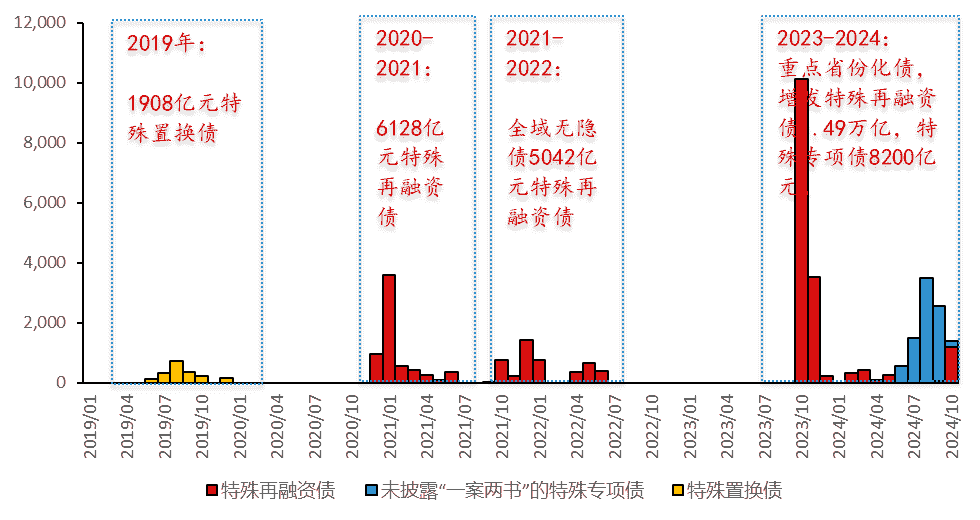
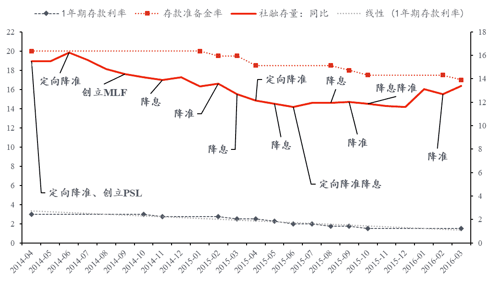
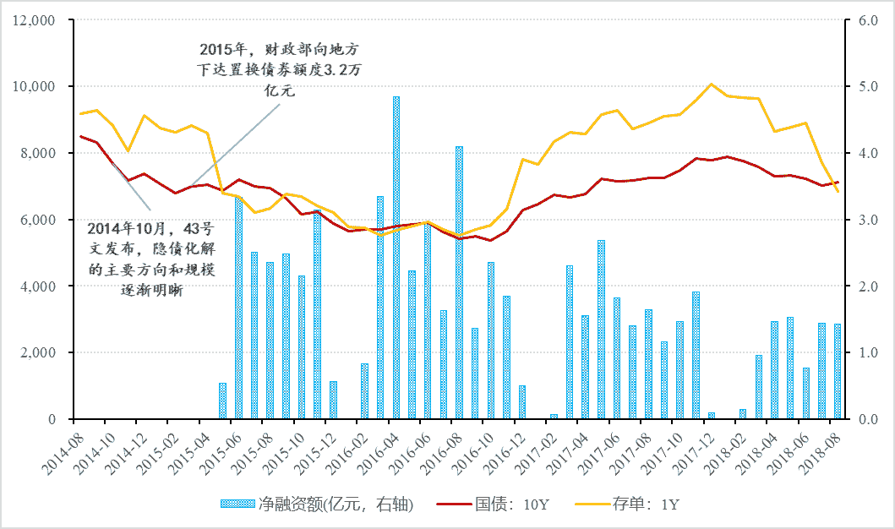
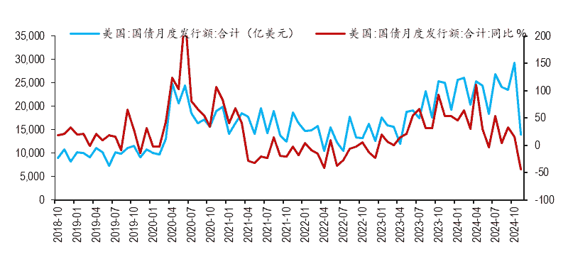

## 政策春风化雨，债市谨慎乐观

——2025年利率债投资策略报告

### 核心观点

展望2025年，在化债大背景下，利率没有趋势回升基础，10Y国债有望下行至1.8%至1.9%区间。节奏上看，预计呈现前高中低后平的走势。具体来看，2025年初增量政策将陆续公布，叠加基本面数据或表现尚可，债市收益率预计震荡为主。3月的两会后，随着增量政策出台暂告段落，基本面在短期脉冲后或有走弱，叠加中美贸易冲突可能深化，央行或再度迎来货币宽松窗口期，带动收益率曲线下移。进入2025年下半年后，需关注经济内生动能恢复情况，目前市场分歧较大，若经济数据出现连续月度级别改善，或使得长端利率再度转为震荡或边际温和回升，反之则继续跟随央行降息步伐逐步走低。

### 全文摘要

**财政政策**

本轮刺激延续性较强。从效果来看，债务化解政策将助力实现2028年的隐债化解目标。目前中央财政思路已明显转向，预计明年广义赤字率可能达到9%以上。

**货币金融政策**

当前难以看到新的加杠杆主体，财政仍主要致力于解决债务问题，不认为明年的经济会进入QE乃至MMT模式，但货币政策仍值得期待。虽然本轮货币宽松缺乏空间，但20-30BP降息，100BP降准，以及新工具使用投放流动性均可期待。

**海外环境**

特朗普经济政策重点聚焦国内减税与对外关税，综合效果可能使赤字进一步扩大，美债供给显著增加给联储降息进程带来压力。预计后续美国仍是缓慢但平稳去通胀进程，特朗普模式下速度可能更慢，经济软着陆则仍然是核心假设。

**国内增长**

今年9月下旬政策发力后，经济下行极端风险解除，目前政策对稳增长、稳房价、稳信心提出明确诉求。明年经济增长目标或仍设置在5%左右，其中一季度可能实现较为确定的高增长，但后续复苏情况市场分歧仍较大。物价方面，未来通胀中枢将经历企稳回升的过程，明年中枢在1%以内。地产方面，核心假设是地产投资和销量企稳。消费方面，预计延续今年温和复苏态势。

**流动性**

预计央行将继续坚持目前对资金市场的精准调控模式，使得整个资金面维持在政策利率略往上水平窄幅波动，中期内则跟随央行降息步伐逐步下台阶。

**机构行为**

考虑到农商行、保险等配置盘力量在存款派生速度下降、权益补仓、下调保险预定利率背景下或边际放缓，理财、债基等交易性力量在存款脱媒减速下难以大幅扩张，同时市场风险偏好回升、机构对流动性管理诉求加强与预防性赎回时有发生背景下，2025年债市波动性将提升。建议操作上保持中长久期的同时更加灵活调整久期，并保持组合的流动性。

**风险提示：** 海外市场衰退，地缘冲突，宽信用加速

---

### 一、2024年债市回顾：从顺畅下行到两轮赎回

回顾2024年上半年利率走势，经历年初波澜壮阔的大幅下行后，于二季度逐渐归于平静的窄幅波动。年初，在农商行和基金产品户加大配置+社融信贷增速回落+债市供给迟迟不见放量三大因素作用下，一季度利率债特别是长端和超长端利率大幅下行，10Y国债利率延续去年四季度末的回落趋势并继续下行超过25BP。3月中下旬以来，在人民银行多次喊话+地产政策频繁发力+手工补息扰动+供给开始放量等因素的作用下，长端利率进入一段较为“纠结”的窄幅震荡期。整体来看，2024年上半年利率债市场呈现出一季度强、二季度稳，长端强、短端稳的特点。利率策略上，拉久期、压信用利差、寻品种洼地等策略都已接近极致，唯独杠杆策略在资金面长期偏紧的背景下还在观望。

下半年以来，利率虽下行但纠结增多，主要变化是央行曲线管理、924新政和股市风偏改善，但总体利率仍在下行通道中。7月上旬起，央行宣布“将开展国债借入操作”，债券市场旋即发生第一次大反转。7月4日借券工具正式推出，7月8日隔夜临时正逆回购工具开始施行。至月中，经济数据走弱成为主导，10日CPI未达预期，12日海外降息预期上扬，且社融数据亦不理想；15日经济数据表明GDP降至4.7%，消费显著走弱，市场对三中全会在经济方面着墨有限持观望态度。下旬，降息交易成为核心主线，7月22日逆回购降息，7月25日MLF再次降息，利率随之走低。

进入8月上旬，海外降息预期快速升温，日本央行却意外加息，国内流动性压力缓解后利率迅速下行。8月7日左右，央行着手推动长端利率上行，通过交易商协会调查、监管喊话以及大型银行配合卖债等手段实施。历经数天调整后，因金融、经济数据不及预期，利率再度下降。月末，央行表态趋于宽松，然而资金面与利率供给面临压力，信用债大幅回调。

9月中上旬，央行与大型银行卖债行为显著减少。金融、经济数据超预期回落，加之美联储降息预期渐强，汇率下降，市场对国内降息预期大幅升温，利率加速下行。中下旬美联储降息50基点，10年期利率临近2.0%时产生心理波动。下旬，伴随央行、政治局会议以及相关部委接连密集政策发声，市场对稳增长期望增强。同时，股市大幅反弹，债市遭遇赎回压力，利率波动上扬。

自10月起至今，利率冲高回落，11月后进入窄幅震荡格局。10月上旬受924政策强力冲击以及股市情绪大幅回暖影响，债市回调并引发一轮理财赎回潮，利率显著上升并带动存单与信用一同回调。中旬状况好转后利率有所下行，但与股市相关性增强，形成“看股做债”行情。10月下旬在央行新工具买断式逆回购与国债买入操作作用下，利率与资金呈震荡下行态势，长端下行至2.10%关键点位后受政府债集中发行、年末会议等因素影响转为震荡。

**图表1：回顾2024年下半年以来的利率市场**

| 时间 | 事件与市场表现 |
|------|----------------|
| 6月初 | 加拿大、欧央行率先开启降息；美联储大幅下调对今年降息次数的预期。 |
| 6月中旬 | 经济数据陆续公布，显示中期内需求不足与信贷挤水分的影响仍在显现。 |
| 6月下旬 | 2024年陆家嘴论坛召开，央行行长潘功胜表示将继续坚持支持性的货币政策立场……未来可考虑明确以央行的某个短期操作利率为主要政策利率。 |
| 7月上旬 | 央行宣布“将开展国债借入操作”，债券市场随后上演大反转；7月4日推出借券工具；7月8日开始开展隔夜临时正逆回购工具。 |
| 7月中旬 | 经济数据走弱成为主线，10日CPI低于预期，12日海外降息预期上升，社融数据仍不及预期；15日经济数据显示GDP走弱至4.7%，消费大幅走弱；市场观望的三中全会对于经济的具体着墨不多，悲观情绪蔓延。 |
| 7月下旬 | 降息交易成为主线，7月22日逆回购降息，7月25日MLF再度降息。 |
| 8月上旬 | 海外降息预期加速升温，日本央行意外加息，国内流动性压力减弱后利率快速下行。8月7日前后，央行开始推动长端利率上行，采用的手段包括交易商协会调查、监管喊话和大行配合卖债等。经过几日的调整，金融、经济数据不及预期推动利率再度下行。 |
| 8月末 | 央行表态趋松，但资金面和利率供给有压力，信用债大幅回调。 |
| 9月中上旬 | 央行和大行的卖债明显减少。金融、经济数据超预期回落，叠加美联储降息预期渐浓，汇率回落，市场对于国内的降息预期明显升温，利率加速下行。 |
| 9月中下旬 | 美联储降息50BP，10Y利率行至2.0%附近出现心理波动。下旬，随着央行、政治局会议、相关部委密集政策发声，市场对于稳增长的期待明显增强。此外，由于股市大幅反弹，债市有赎回压力。 |
| 10月上旬 | 受到924政策的强烈冲击以及股市情绪大幅回暖，债市回调并引发了一轮理财赎回潮，利率明显上行并带动存单和信用回调。 |
| 10月中旬 | 好转后利率逐步下行，且与股市相关性提升，产生“看股做债”行情。 |
| 10月下旬 | 在央行新工具买断式逆回购和国债买入操作下，利率资金下行。 |

资料来源：Wind，中信建投

---

### 二、政策：期待后续财政持续发力

#### 2.1 财政：政策思路转向，化债核心抓手

近期财政给出的化债组合拳包括增加10万亿元化债资源用于地方债务化解，这一规模与市场预期大致相符。具体而言，计划中包括增加6万亿元的地方政府债务限额，用于置换现有的隐性债务。所有新增的债务限额将被指定为专项债务限额，并计划在三年内分批实施。从2024年起，连续五年，每年将从新增的地方政府专项债券中划拨8000亿元，以增强政府性基金的财力，专门用于债务化解，预计总共可以置换4万亿元的隐性债务。至于2029年及以后到期的2万亿元棚户区改造隐性债务，将按照原有合同到期偿还。

从效果来看，这次债务化解政策将助力地方政府完成2028年的隐性债务化解目标。据发布会透露，通过这三项政策的协同作用，地方政府在2028年前需要处理的隐性债务总额将从14.3万亿元大幅减少至2.3万亿元，显著减轻了地方政府债务化解的压力。

除了减轻地方债务负担外，此次政策的出台也标志着中央债务化解思路的重大转变。从过去的“谁的孩子谁抱”转变为中央政府协助地方政府解决债务问题，这将使地方政府能够将更多资源投入到发展中。发布会强调，实施这样大规模的债务置换措施，意味着我们在债务化解工作上实现了四个根本转变：一是从应急处理转向主动化解；二是从局部排雷转向全面风险控制；三是从隐性债务和法定债务的“双轨”管理转向所有债务的规范透明管理；四是从侧重于风险防范转向风险防范与促进发展并重。

**图表2：2019年至今的隐债化解规模共3.8万亿元（单位：亿元）**

资料来源：Wind，中信建投

展望明年财政支出，需要关注的重点是债务潜在发行规模，以及财政和债务最终落到经济增长的有效支出。

一是明年的债务发行规模。首先是赤字率方面，发布会上，蓝部长再次强调中央财政还有较大的举债空间和赤字提升空间。假设明年一般公共预算赤字率从今年的3%上升至3.6%，即再额外增发一万亿，这将对应约4.93万亿元的债券增量，预计地方赤字上行可能提高到9000亿左右用于支持地方经济，而中央财政则赤字扩张到4万亿左右。其次是专项债方面，假设明年新增地方专项债额度包括发布会提到的2万亿元用于置换的专

债券研究

债券深度报告

请务必阅读正文之后的免责条款和声明。

项债额度，再加上未来四年每年新增专项债里还有8000亿元专门用于化债。再考虑到经济需要政府基金预算收支改变今年的大幅负增态势，据此综合考虑专项债共发行6万亿左右。此外，特别国债发行2万亿，其中1万亿用于大行注资。

但需要注意，由于央行已经开始买卖国债操作且目前支持性的政策更倾向于买入，因此市场承接的部分其实并没有明显增加。此外，1万亿用于大行注资的特别国债央行买入的力度可能更大，这方面可以借鉴两轮注资的历史经验。按照目前每月净买入2000亿左右的额度，2025年净买入额可能在2.5—3万亿之间，债市净供给对资金面的压力可控。

二是预计广义财政支出中用于实际经济支出的部分约为9.3万亿，较今年也能提高1.2万亿左右。其中赤字4.9万亿，专项债3.4万亿（排除化债的2.8万亿），超长期特别国债1万亿，共9.3万亿。最后，受税收增长及土地出让收入增长偏弱的双重拖累，今年实际实现的一般公共预算收入与政府性基金收入均可能低于今年两会公布的收入预算。如果明年地产周期进入企稳阶段，以土地出让收入为主的政府性基金收入对财政收入的拖累可能下降。如果财政收入增速回升，给定政府债净融资规模，财政支出增速将提高。

债券研究

债券深度报告

请务必阅读正文之后的免责条款和声明。

图表3：对今明两年财政收支两本账的预判（单位：亿元）

| 科目 | 2025年预算（预计）数额 | 比2024年增速 | 2024年决算（预计）数额 | 比预算变化 | 增速 | 2024年预算数额 | 变化 | 增速 |
|---|---:|---:|---:|---:|---:|---:|---:|---:|
| 一般公共预算 |  |  |  |  |  |  |  |  |
| 一般公共预算收入 | 219492 | 6393 | 3% | 213099 | -10851 | -1.70% | 223950 | 7166 | 3.3% |
| 一般公共预算支出 | 290730 | 8468 | 3% | 282262 | -3228 | 2.80% | 285490 | 10916 | 4% |
| 一般公共预算收支缺口 | 71238 | 2075 |  | 69163 | 7623 |  | 61540 | 3750 |  |
| 调入资金及结余 | 21918 | -7645 |  | 29563 | 8623 |  | 20940 | 4099 |  |
| 赤字额 | 49320 | 9720 |  | 39600 | -1000 |  | 40600 | -8200 |  |
| 中央赤字 | 40320 | 7920 |  | 32400 | -1000 |  | 33400 | -8200 |  |
| 地方赤字 | 9000 | 1800 |  | 7200 | 0 |  | 7200 | 0 |  |
| 名义GDP预计 | 1370008 |  |  | 1314787 |  |  | 1353333 |  |  |
| 政府性基金预算 |  |  |  |  |  |  |  |  |
| 政府性基金预算收入 | 59717 | 1739 | 3% | 57978 | -12824 | -18% | 70802 | 97 | 0.1% |
| 政府性基金预算支出 | 107257 | 7945 | 8% | 99312 | -20881 | -2% | 140194 | 18855 | 18.6% |
| 政府性基金收支缺口 | 47540 | 6206 |  | 41334 | -8058 |  | 49392 | 18758 |  |
| 上年结转收入 | 3540 | 3148 |  | 392 |  |  | 392 | -7001 |  |
| 专项债额度（不含化债） | 34000 | 3058 |  | 30942 |  |  | 39000 | 1000 |  |
| 超长期特别国债 | 20000（1+1万） |  |  | 10000 |  |  | 10000 |  |  |
| 专项债额度（化债） | 28000（8千+2万） |  |  | 23000（8千+1.5万） |  |  |  |  |  |

| 赤字 | 2025年 | 2024年决算（预计） | 2024年预算 |
|---|---:|---:|---:|
| 狭义赤字率 | 3.6% | 3.0% | 3.0% |
| 广义赤字 | 131320 | 103542 | 89600 |
| 广义赤字率 | 9.6% | 7.9% | 6.6% |

资料来源：*Wind*，中信建投

债券研究

债券深度报告

请务必阅读正文之后的免责条款和声明。

## 2.2 金融：财政能否支持宽货币到宽信用？

历史上看，2008年以来，我国共经历过五轮宽信用，分别是2009、2012、2015、2019和2020—2021年。

图表4：从宽货币到宽信用的五轮周期对比

|  | 第一轮（2008.9—2009.12） | 第二轮（2011.11—2013.4） | 第三轮（2014.6—2016.3） | 第四轮（2018.4—2019.6） | 第五轮（2019.10—2021.2） |
|---|---|---|---|---|---|
| 宽货币 | 四次降准、五次降息 | 三次降准、两次降息 | 两次定向、五次降准、六次降息 | 三次降准、三次降息 | 四次降准、两次降息、结构性政策 |
| 间隔 | 3个月 | 7个月 | 12个月 | 9个月 | 5个月 |
| 宽信用抓手 | 房地产：首付比、信贷；基建：鼓励融资平台 | 基建：启动重大项目 | 房地产：首付比、PSL；基建：资本金比例 | 基建：专项债；房地产：下调LPR | 基建：专项债 |
| 加杠杆主体 | 企业、居民、地方政府 | 企业 | 企业、居民 | 居民、地方政府 | 中央政府、企业、居民 |
| 金融工具放松 | 鼓励融资平台 | 银证等通道、非标 | PSL | 无明显放松 | 结构性货币工具 |
| 社融增速提高 | +15% | +5% | +2% | +0.9% | +3% |

资料来源：*Wind*，中信建投

对比历史上历次从宽货币到宽信用，本轮政策仍然较为理性克制。一是时间维度上，历次宽信用都由宽货币启动，但宽货币向宽信用传导的时滞随着加杠杆愈发困难而变得更长。从历史规律观察，本轮宽货币力度较弱，料将持续较长时间。二是取得效果上，历次宽信用都是稳增长压力较大背景下政策对冲的结果，因此，稳增长的急迫性也决定了宽信用的力度。观察过去五轮宽信用，只有在外部经济冲击（2008年金融危机、2012年欧债危机、2020年新冠疫情）的背景下，宽信用的数据表现才会大幅改善。而经济内生下行导致的政策托底型宽信用力度相对有限，社融增速改善一般不超过1.5%。显然，本轮宽信用属于后者，料社融增速高点反弹有限。

三是发力方向上，首先是降准、降息提供宽松流动性环境和较低的成本；然后是基建端发力（包括项目和融资），加杠杆的主体是政府，特别是地方政府和国有企业，但该种宽信用幅度往往较低，属于托底型；从历史规律看，全面放松房地产也只是托底作用，后续加杠杆的可能性不大。

图表5：2014年化债周期启动之初的货币政策配合（单位：%）

资料来源：*Wind*，中信建投

图表6：2014—2018化债周期之初，利率仍以下行为主（单位：亿元，%）

资料来源：*Wind*，中信建投

综上所述，目前难以看到新的加杠杆主体；中央和地方财政仍主要致力于解决债务问题；我们不认为明年的经济会进入QE乃至财政货币化（MMT）模式。但货币政策仍值得期待，货币政策仍然将在化债行情中对流动性和利率形成明显利好，可借鉴2014—2018化债周期的央行货币政策配合，彼时央行6次降准、6次降息，为化债和经济企稳创造了良好的流动性利率环境。当然，本轮货币宽松缺乏彼时的空间，但20—30BP降息、100BP降准，叠加新工具使用投放流动性，都可期待。

债券研究

债券深度报告

请务必阅读正文之后的免责条款和声明。

## 三、海外：即将进入“特朗普模式”

### 3.1 美国赤字扩张，联储降息掣肘

特朗普的经济政策重点聚焦于国内减税与对外加征关税。在国内，其力推对个人与企业实施全面减税举措，如拟将企业税率从21%降至15%，让个人所得税减免永久化，还欲永久取消遗产税等。这些虽有望刺激经济增长，但此次企业降税幅度小于其上次任期，对经济的推动效果也会大打折扣。在外交政策层面，作为国内减税的平衡手段，特朗普主张对外提升关税，计划将所有进口商品关税普遍提高10%至20%，尤其针对中国商品要征收至少60%的额外关税，共和党2024年党纲也提及取消中国最惠国待遇并减少必需品进口，不过其上任初期推动关税议题尚需时间与流程筹备。

财政政策方面，特朗普试图以大幅减税与增加关税来平衡财政，却可能致使政府赤字进一步扩大。据TaxFoundation估算，其减税计划会使美国未来十年税收减少7.8万亿美元，而关税政策即便实施，未来十年仅能增收3.8万亿美元，无法弥补减税造成的赤字，综合其他潜在减税措施，未来十年赤字预计增加近6万亿美元。CRFB预测，若政策落地，未来十年联邦政府财政赤字将增7.75万亿美元，赤字率从2025财年6.5%升至2035财年7.0%，到2035财年联邦政府债务占GDP比重将从基准情景的125%升至143%。

货币政策方面，财政赤字扩大使美债供给可能显著增加，给降息进程与美债利率带来压力。美联储主席鲍威尔近期发言呈鹰派，称经济无急切降息信号，其他美联储官员也边际转鹰。但特朗普期望逐步降息，以降低住房成本为由提出降息诉求，尽管鲍威尔在9月FOMC会议重申联储政策独立性，特朗普仍表达对宽松货币政策的期待，其竞选承诺也表明要大幅降低美国利率以减轻民众住房负担。

图表7：美债供给压力近期有所减轻

资料来源：*Wind*，中信建投

### 3.2 去通胀仍偏缓，软着陆或延续

通胀方面，核心预测仍是缓慢但平稳地进行去通胀进程，当然特朗普模式下速度可能较慢。通胀领域，去通胀进程仍在持续推进，但在特朗普模式下，其速度可能会有所放缓。当下美国通胀反弹压力主要聚焦于租金、住房分项以及潜在的“通胀—工资”螺旋机制。

住房分项以及潜在的“通胀—工资”螺旋机制。拜登政府的经济政策框架下，财政刺激逐步小幅退坡，使得经济有望实现软着陆，通胀风险处于可控范围并逐步回落。然而特朗普的经济政策对通胀影响具有两面性，其减税和部分财政刺激举措可能会在一定程度上推动通胀上升，从而导致整体通胀下降速度减慢。不过若特朗普上台后能够迅速推动巴以冲突、俄乌冲突走向缓和，并大力促进本土油气开采加速，那么商品通胀有望得到缓解而有所下行。

经济方面，软着陆仍然是核心假设。目前看，工业生产呈现出继续环比下行的态势，零售商库存有所回升但批发商与制造商库存却在回落，与之形成鲜明对比的是服务业保持着强劲的发展势头，有力地推动着经济的稳定运行。深入到服务业分项可以发现，美国居民的资产负债表整体较为健康，消费支出在总体上也保持稳定，并且这种稳定态势预计会持续到2025年。由于特朗普在短期内能够实施的经济刺激手段相对有限，所以目前经济软着陆的核心假设依然具有较高的可能性。

图表8：私人消费和政府支出仍然是美国经济的主要推动因素（单位：%）

资料来源：*Wind*，中信建投

### 3.3 美债利率料下行为主

展望未来，当前长端美债利率已经攀升至4.4%以上，倾向于认为明年美债利率大概率以下行为主。

近期美债市场的走势主要受到经济和政治因素的共同作用。一方面，此前过度预期的快速去通胀以及经济衰退被实际数据证伪，美国经济数据和通胀数据表现出较强的韧性，这直接导致利率出现大幅反弹。另一方面，特朗普成功当选并掌控国会后，在“特朗普交易”的市场预期下，普遍认为财政支出将会扩容，再加上通胀压力，利率中枢会随之抬升。此外在货币政策态度上，近期美联储官员发声减少且明显转向鹰派，而特朗普有意加强对美联储的直接管理，实质是期望货币政策能够与经济形势相配合。尽管特朗普主张的对内减税、对外加关税政策确实会对美国经济和通胀产生提振作用，进而推高美债收益率中枢，但需要注意的是，目前10Y美债隐含的通胀预期已升至较高水平，市场降息预期也已调整至中性偏悲观，上述因素的定价已略微超出基本面的实际情况，因而对美债收益率的上行驱动将会逐渐减弱。同时考虑到美国仍然处于降息周期，特朗普上台后其政策既有关税对美国通胀的正向推动，也有压制工会对工资通胀的负向影响，总体而言美债利率继续大幅上行的风险不大，预计2025年将呈现下行态势。

图表9：美债利率再次走高，但10-2Y利差回正

资料来源：*Wind*，中信建投

-1.50
-1.00
-0.50
0.00
0.50
1.00
1.50
2.00
2.50
3.00
3.50
0.0
0.5
1.0
1.5
2.0
2.5
3.0
3.5
4.0
4.5
5.0
5.5
2019-03
2019-06
2019-09
2019-12
2020-03
2020-06
2020-09
2020-12
2021-03
2021-06
2021-09
2021-12
2022-03
2022-06
2022-09
2022-12
2023-03
2023-06
2023-09
2023-12
2024-03
2024-06
2024-09

（%）

10Y-2Y利差（右）
美国：国债收益率：2年
美国：国债收益率：10年

债券研究

债券深度报告

请务必阅读正文之后的免责条款和声明。

## 四、国内：经济下行极端风险解除

### 4.1 增长：明年有望温和复苏

今年9月下旬开始的系列政策再次表明我国政府对于稳经济增长、稳房价、稳信心的明确诉求。上述系列政策奠定了我国经济在明年复杂局势下保持稳定的基础。展望2025年，特朗普上任后的部分主张可能致使我国外部环境恶化，出口遭受超预期的冲击，但凭借我国强有力的政策对冲，国内经济尾部风险不大，能够保持稳定的增长与物价水平。

与此同时，我国正站在发展的关键节点，即将拥抱诸多重大机遇。加快经济结构优化升级，将促使各产业实现转型升级与协同发展；提升科技创新能力，使我国在全球科技竞争中抢占高地；深化改革开放，进一步拓展国内外市场空间，提升资源配置效率；积极参与全球经济治理体系变革。

总体而言，国内经济复苏曙光初现，预计2025年GDP增速将呈现阶段性回升，全年维持在5%左右。节奏上看，一季度由于前期大量政府债资金陆续支出、房地产销售阶段性企稳、抢出口等多种有利因素叠加，增速有望较高；二季度后或在前期脉冲结束后增速边际回落；下半年后则需观察前期一揽子政策对我国内生增长动能的修复效果，目前市场分歧较大，不排除若经济下行压力依然较大，后续仍有增量政策空间。

图表10：年内GDP高度依赖出口

资料来源：*Wind*，中信建投

### 4.2 价格：逐渐走出通缩状态

2025年我国通胀中枢或将经历企稳回升的过程，但幅度或偏弱。

CPI方面，预计2025年温和上扬企稳，中枢在0.5%左右波动。回顾疫情后物价走势，CPI通缩压力源于居民消费的疲软与生产端的过剩产能，其本质是经济转型期供需阶段性失衡。目前政策已敏锐洞察问题所在，并积极付诸行动解决价格困境，人民银行、发改委等多部门已将改善价格因素列为关键政策目标。然而，从政策落地生效到需求端复苏，再到产能合理调整或居民收入显著改善，仍需一定时间周期。尤其在明年美国新政府上台的背景下，更为激烈的贸易摩擦可能导致我国出口下滑，对过剩产能产生新的负面冲击。

图表数据：

|  | 个人消费 | 私人投资 | 净出口 | 政府支出 | 环比折年率 |
|---|---:|---:|---:|---:|---:|
| 数据序列 | 3.5 | -0.8 | 2.4 | 0.4 | 3.0 |
| 数据序列 | 5.4 | 4.6 | 4.2 | 3.9 | 2.2 |
| 数据序列 | 1.4 | 0.5 | 0.3 | 0.7 | 3.8 |
| 数据序列 | 1.8 | 2.0 | 1.2 | 1.2 | 0.6 |
| 数据序列 | 1.9 | 1.3 | 0.8 | 1.0 | 0.8 |
| 数据序列 | 0.8 | 1.0 | 0.8 | 1.3 | -0.3 |
| 数据序列 | -1.1 | -1.0 | -0.2 | 0.8 | 0.6 |
| 数据序列 | -1.3 | -0.3 | -1.1 | -1.0 | -0.2 |

GDP同比拉动：消费、GDP同比拉动：投资、GDP同比拉动：出口（%）

## 4.3 地产：有望步入稳定轨道

2025年我国地产投资和销售或逐步企稳。

房地产及其产业链，包括政府性基金收支，因房地产市场波动今年大幅下滑，成为制约经济发展的关键因素。自中央政治局会议以来，稳增长、稳地产的决心显著增强，明确提出要切实增强经济工作的责任感与紧迫感，主动作为，有效落实存量政策并加力推出增量政策，全力促进房地产市场止跌回稳。最新房地产价格与销售数据已呈现一定企稳迹象，随着政策持续深入推进，房地产市场有望步入平稳发展轨道。

需要注意的是，即便近期房地产销售有所回暖，但主要集中在核心城市二手房市场，一手商品房以及三四线城市变化目前较为有限。从驱动因素看，目前房地产部分回暖可能是房地产企业在融资环境改善与政策放开背景下，采取以价换量、加大推盘量策略的结果。但随着房地产企业购地与新开工规模缩减，其未来继续加大推盘力度与以价换量的空间将受到限制，预计明年房地产投资将实现约3%的正增长。

图表**11**：地产销售端企稳

资料来源：*Wind*，中信建投

(60)

(40)

(20)

0

20

40

60

新开工

竣工

销售

%

## 4.4 消费：政策护航保持平稳

消费预计将延续今年温和复苏的态势。

经历三个季度的低迷回落之后，近期在政策强力扶持下显著回升，汽车与家电以旧换新政策发挥了关键推动作用。展望明年，居民消费增速与可支配收入增速基本匹配，而居民可支配收入增速与经济周期紧密相连，明年增速有望与GDP增速同步。随着居民收入企稳与消费信心稳固，消费增速将持续保持平稳。预计明年社会消费品零售总额增速将相对稳定，大致维持在政策刺激后的水平。

## 五、流动性：延续宽松与强化引导并存

### 5.1 货币政策：宽货币态度继续保持

今年9月下旬以来，央行态度已经明显转向，9月底至今央行先后降准降息，同时大幅调降存款利率、LPR利率，引导商业银行降低存量房贷利率，释放明显宽松信号。我们预计后续央行将继续注重稳增长，为实体经济复苏营造适宜货币环境，货币政策基调预计继续偏宽，资金面在中短期内不构成对债券市场的明显制约。

展望2025年，考虑到目前我国仍位于化债阶段，央行将继续维持积极态度以帮助实体部门去杠杆。由于在此前央行降息节奏一直偏慢，预计后续央行将继续“追赶曲线”，货币政策还有进一步宽松空间，预计明年降准或有2次，合计1个百分点附近，降息或有2—3次，合计或20BP至30BP，引导政策利率下行至1.2%至1.3%附近。各类结构性政策工具利率也有望跟随调降，目前再贷款利率仍为1.75%，性价比下降，未来有望进一步下调。整体来看，降息也有望维护斜向上的收益率曲线，这也是货币政策调控效率的体现。

此外，央行会继续健全货币政策框架。

一是国债买卖业务。目前央行与财政部已建立联合工作组，国债买卖有望逐步替代降准成为央行投放长期流动性的重要工具，目前月度操作规模在2000亿元附近，年度投放规模有望达到2万亿元。

二是买断式逆回购工具启用，这有助于在MLF工具逐步退出后成为投放中期流动性渠道。

三是利率走廊的建立。目前央行确立7天逆回购利率为核心政策利率，削弱MLF利率意义，并通过临时正逆回购建立利率走廊，这有望在后续流动性更偏充裕、通过数量去影响利率愈发困难的背景下，强化央行对资金利率的控制。

四是加强预期引导。今年央行在引导长端利率方面做出了诸多尝试，前瞻指引的核心在于央行的言行一致。目前进行的国债买卖与买断式逆回购均能为央行后续引导提供足够的政策工具。

五是理顺货币政策传导渠道。部分信贷市场利率与央行政策利率联动性偏弱，背后则是银行类金融机构过度竞争导致。今年央行在打击手工补息、规范贷款利率报价、规范同业存款利率方面做出了诸多努力，这一思路后续将延续，以维护银行系统净息差水平。

图表**12**：我国政策利率走势

资料来源：*Wind*，中信建投

1.20%

1.60%

2.00%

2.40%

2.80%

3.20%

3.60%

4.00%

4.40%

4.80%

逆回购：7天

MLF：1年

LPR：1年

LPR：5年

### 5.2 资金市场：央行强化对资金引导

**2024**年央行调控资金市场模式出现了很大变化，在“防空转”要求下，资金利率中枢始终略高于政策利率，同时波动性明显下降，这与2022年至2023年间资金利率大幅波动且在部分时间段内大幅向下偏离政策利率的特征有较大差异。

央行对资金市场的调控主要通过公开市场投放以及对大行的引导，具体分为两类情况。

一是超储充裕时期，比如在2024年2月至4月，以及2024年10月至11月，期间银行超储率均位于季节性相对高位，此时央行会通过引导大行融出价格以避免资金利率过低，期间一般可以看见资金利率会在略高于政策利率的水平运行，同时波动率明显下降。需要注意的是，此时大行可能增加对存单的购买力度，存单市场市场化程度较高，因此实现借道向资金市场投放流动性，比如可以看见2024年上半年国有大行持有存单规模快速增长，便可能是基于此逻辑。

二是超储紧张时期，比如2024年7月至9月，期间银行超储率明显偏低，此时资金利率中枢提升且波动性增大。这一时间央行更需关注资金利率过高问题，央行会通过大量投放逆回购平滑资金面，期间会看见逆回购余额与资金利率此消彼长关系，背后体现的是央行逆回购操作对资金面影响力的提升，这与过去市场一般观测到的资金利率与央行逆回购同涨同跌现象背后体现的调控思路不同。

展望**2025**年，我们预计央行将继续坚持目前对资金市场精准调控思路，通过在超储率偏高时引导大行融出行为以避免资金利率过低，以及在超储率偏低时通过加大逆回购投放规模以平滑资金波动，使得整个资金面维持在政策利率略往上水平窄幅波动，中期内则跟随央行降息步伐逐步下台阶。

图表**13**：我国政策利率与资金利率走势

资料来源：*Wind*，中信建投

### 5.3 资金分层：资金分层有走阔空间

对于非银资金市场而言，2024年则经历了先宽松再紧张的“V”型走势。在今年8月前，资金分层不断缓解，部分时点DR与R利率甚至出现倒挂情况，但在9月后资金分层又再度加剧。

1.0%

1.2%

1.4%

1.6%

1.8%

2.0%

2.2%

逆回购：7天

DR001（MA30）

DR007（MA30）

资金分层主要由非银资金市场供需决定，资金供给主要源于货基，而需求则是其他非银机构。在今年8月前，由于信用利差快速压缩，套息空间不足，非银杠杆需求并不高，同时存款脱媒背景下，货基等规模快速上涨，融出规模增大，使得非银资金面非常宽松，资金分层几乎消失。但在9月后，随着股票市场大涨后部分货基被赎回，以及信用债市场调整后套息空间打开，非银资金市场逐步从此前供大于需转变为需大于供，资金分层再度加剧。

展望**2025**年，预计整个非银资金市场波动仍然较大，且中枢有望抬升，主要源于后续若央行持续宽松货币带来套息空间加大，叠加存款脱媒减速背景下非银资金负债端增速放缓、波动性提升，这将使得非银对资金需求或更加旺盛。具体则需跟随货基规模以及融出行为等综合判断。

图表**14**：我国资金分层走势（单位：**BP**）

资料来源：*Wind*，中信建投

0

5

10

15

20

25

30

35

40

45

50

R007-DR007

R001-DR001

## 六、机构行为：风偏回升与负债端不稳定

### 6.1 理财：规模增长放缓，负债端波动增加

受益于今年上半年居民风险偏好较低以及监管打击手工补息、调降存款利率等因素，理财规模一度快速扩张，但在2024年下半年后理财规模减速，8月初与9月底两次债市调整使得理财面临赎回压力。展望后市，市场对**2025**年理财规模增长速度更偏谨慎。

理财规模主要取决于居民资产配置行为，本质上是居民在理财与存款之间的比价。今年下半年以来，随着债券收益率绝对水平已下降到低位，无论是绝对票息还是资本利得均更难获取，叠加稳增长政策出台后债市波动性提升，这使得理财相对于存款的比价优势下降。同时考虑到9月下旬以来股票市场大涨，部分由于前期情绪悲观撤离股市进入债市的资金在目前市场风偏回升后，可能回归原有投资偏好进入股市，短期内不会再回流债市，这也将对理财规模增长带来压制。

展望2025年，我们认为股市活跃度提升、楼市阶段性或企稳以及利率偏低后理财性价比降低，预计后续理财规模增长偏慢且波动性增加。这将使得理财可能对利空消息更加敏感，基于对自身负债端稳定性担忧而带来的预防性赎回可能给债市带来波动，特别是理财主要配置的信用债压力更大，需要更多的流动性信用用于弥补流动性风险，这也可能使得信用利差中枢较2024年前三季度的较低水平明显抬升。

图表**15**：理财规模季节性走势对比（单位：亿元）

资料来源：普益标准，中信建投

220000

240000

260000

280000

300000

320000

340000

360000

1月

2月

3月

4月

5月

6月

7月

8月

9月

10月

11月

12月

2024

2023

2022

2021

### 6.2 债基：久期回归中性，流动性诉求提升

受益于2024年债券市场大牛市，债基规模快速扩张，配置压力增大，同时由于在化债大背景下信用下沉策略失效、央行防空转背景下套息空间不足，使得债基转向久期策略。我们根据微观交易数据测算显示，债基久期在2024年8月底最高达到2.70年，远超在2022年至2023年长期维持的2.20年的中枢。这一方面源于期间债券市场继续走牛，另一方面则在于机构考核压力下市场情绪走向极致。不过在8月以来央行直接卖债打击市场做多情绪，以及9月底政治局会议后债市大幅调整，债基久期已经明显下降，目前为**2.36**年，基本回归中性水平，此前在债牛中积累的过度久期暴露基本出清完成，后续债基进一步降久期空间有限。

当前债基被理财作为流动性管理工具的现象也需关注。理财大概配置有1万亿元的债基，绝对规模较大，理财在债券市场大幅波动期赎回债基将考验债基流动性管理。特别是在今年以来，市场在经历**2022**年底与**2023**年三季度理财赎回后学习效应明显增强，往往会在负债端尚未出现压力时便提前行动，并带来一致行为的自我实现。比如理财卖出债基并不需要等到真正居民赎回，而仅需要赎回预期出现，这在国庆节前后有着极致体现。可以看见，即便国庆后理财负债端赎回压力才真正到来，但理财显然已在9月底便提前行动，预防性赎回债基，这带来债市短期超调。国庆后，股市热度短期快速下降后债市压力缓解，即便期间居民已开始赎回理财，但理财对自身负债端担忧反而减少，相应减少赎回债基操作，这使得债市在国庆后短时间内又快速修复。

展望2025年，考虑到债券市场波动性增加，债基本身负债端增长减速，以及负债端逐步适应低利率环境下对收益要求边际下降，类似今年债基过度拉长久期现象难以再现，预计债基将转为灵活变动久期。此外，预计债基也会更加重视组合的流动性，以避免债券市场调整带来的集中赎回压力，部分中低资质中长久期信用利差中枢可能继续保持在偏高水平。

图表**16**：公募基金久期测算（单位：年）

资料来源：*CFETS*，*Wind*，中信建投

### 6.3 农商行：配置力量仍存，关注监管规范

以农商行为代表的中小行在2024年加大了债券市场配置力度，主要源于负债端相对充裕以及资产端信贷投放机会的缺乏，农商行广泛参与长端利率交易成为债市重要特征。

展望2025年，虽然实体经济信贷需求仍然不强，金融市场业务仍将是农商行利润重要来源，但由于随着防空转下我国存款增速已经明显减速，农商行负债端增速或将低于往年，债券配置力度或将减速。此外，监管对农商行过度参与长债交易也需关注，可以看见在今年8月后，农商行对超长期国债的参与力度已经明显下降，我们预计这一特征将保持。目前农商行债券交易主要集中于10年期及以内，这可能使得10年期品种仍具备抗跌性，而超长期国债由于缺乏农商行配置盘，波动性或提升，30年与10年期限利差中枢不存在持续大幅压缩基础。

图表**17**：**30**年国债各类机构成交规模走势（单位：亿元）

资料来源：*CFETS*，*Wind*，中信建投

2.0%

2.1%

2.2%

2.3%

2.4%

2.5%

2.6%

2.7%

2.8%

1.90

2.00

2.10

2.20

2.30

2.40

2.50

2.60

2.70

2.80

债基久期测算

10Y国债利率（右）

0

500

1000

1500

2000

2500

3000

城商行

农商行

券商

保险

基金

其他产品

### 6.4 保险：权益补仓需求，负债端或将减速

回顾2024年，由于股票市场在2024年9月前不景气，保险普遍减配股票，同时叠加存款利率调降以及化债背景下非标萎缩，保险对债券的增持力度较大。但在**9**月下旬以来，随着股市大涨上演逼空行情，使得前期低配股票的保险类机构面临权益补仓压力。从数据上看，可以看见在2024年10月后，保险公司对30年国债的买入力度明显降低，便可能是源于股票市场预期变化的原因。

此外，金融监督管理总局于今年8月印发《关于健全人身保险产品定价机制的通知》，下调保险产品的预定利率，并首次提出要建立预定利率与市场利率挂钩及动态调整机制。这将使得保险产品对居民的吸引力边际下降，保险公司负债端增速也可能放缓，这使得保险对债市的支持力度较之前可能下降。

展望2025年，即便保险公司中长期资产荒压力仍然存在，但是预计由于股票市场上涨、保险负债端减速等影响，配置力量或边际下降。

图表**18**：保险大类资产配置结构

资料来源：*Wind*，中信建投

11.3%

11.1%

10.8%

10.4%

10.2%

9.6%

9.3%

10.1%

9.3%

39.8%

41.0%

41.0%

42.3%

43.0%

44.1%

45.4%

46.2%

47.5%

8.0%

7.2%

7.7%

7.9%

7.7%

7.6%

7.1%

6.7%

7.0%

5.6%

5.5%

5.6%

5.5%

5.8%

5.9%

5.6%

5.7%

5.7%

8.5%

9.4%

10.0%

9.7%

9.3%

9.2%

8.9%

8.2%

8.2%

26.9%

25.8%

24.9%

24.3%

24.1%

23.7%

23.7%

23.0%

22.4%

0.0%

10.0%

20.0%

30.0%

40.0%

50.0%

60.0%

70.0%

80.0%

90.0%

100.0%

2022-06

2022-09

2022-12

2023-03

2023-06

2023-09

2023-12

2024-03

2024-06

存款

债券

股票

基金

长投

其他

## 七、利率策略：下行为主，波动加大

年内来看，临近岁末年初，中央经济工作会议及明年政策不确定性或对债市预期带来一定扰动，目前仍在政策窗口期，且当前PMI、地产销售、核心CPI等部分经济指标有所改善，以及短期内政策效果难以证伪，长端利率无大幅下行基础。这一阶段，投资上，建议维持震荡市思路，以短久期中高等级信用债为底仓，参与长端利率波段操作，并保持组合流动性。

展望2025年与中长期，仍然认为在化债大背景下，利率没有趋势回升基础，10Y国债有望下行至1.8%至1.9%区间。

节奏上看，预计呈现前高中低后平的走势。具体来看，2025年初增量政策陆续公布，叠加在前期大量政府债资金支出、地产销售阶段性企稳、抢出口等因素下，基本面数据或表现尚可，债市收益率预计震荡为主。3月两会后，随着增量政策出台暂告段落，基本面在前期短期脉冲后或边际走弱，叠加中美贸易冲突可能深化，央行或再度迎来货币宽松窗口期，带动收益率曲线下移。进入2025年下半年后，或仍然有一次降息为经济复苏保驾护航，这一时期更需关注经济内生动能恢复情况，目前市场对此分歧较大，若经济数据出现连续月度级别改善，或使得长端利率再度转为震荡或边际温和回升，反之则继续跟随央行降息步伐逐步走低。

曲线形态上，预计2025年整体期限利差整体多变，但趋势上保持中性，10Y国债与1Y存单利差中枢或保持在25BP附近，大幅走阔概率不大。主要源于我们认为，即便2025年潜在降息空间或在20BP至30BP，货币政策虽在追赶曲线，但仍难以领先曲线，趋势性牛陡机会仍不明显。节奏上看，预计2025年初期限利差或有走阔，主要源于年初政策债发行真空期窗口、银行负债端压力下降；二季度后伴随长端利率追赶下行背景下，收益率曲线或走平。货币市场收益率曲线预计继续延续今年的平坦化特征，存单与资金利差中枢预计继续保持在25BP附近，若2025年两轮降息顺利落地，DR007中枢有望最终下行至1.2%至1.3%，对应1Y存单有望下行至1.5%至1.6%附近。

投资策略上，2025年后各类扰动因素增多，类似2024年上半年单边趋势下行行情难以复现。同时考虑到农商行、保险等配置盘力量在存款派生速度下降、权益补仓、下调保险预定利率背景下或边际放缓，理财、债基等交易性力量在存款脱媒减速下难以大幅扩张，同时市场风险偏好回升、机构对流动性管理诉求加强与预防性赎回时有发生背景下，2025年债市波动性或将提升。综上，建议操作上整体保持中长久期的同时，需更加灵活调整久期，并保持组合的流动性，杠杆套息空间或不大，信用下沉性价比不高。

债券研究

债券深度报告

请务必阅读正文之后的免责条款和声明。

## 风险分析

海外市场衰退风险：长时间通胀及俄乌冲突对美欧市场造成较大负面影响，企业成本上升，居民需求下降，工业品和消费品价格上涨，且预计存在粘性。明年海外市场衰退风险较大，蕴含逆全球化风险，我国科技发展及对外贸易面临较大压力。

地缘冲突风险：俄乌地缘冲突存在激化和扩大化可能，巴以冲突持续，可能导致全球金融市场出现大幅波动，甚至出现系统性风险。

宽信用加速风险：随着稳增长政策不断推出，宽信用进程不断推进，我国信贷恢复势头明显，政府债供给充裕，基建、投资拉动作用明显。宽信用进一步加速将使得市场风险偏好升高，投资者要求风险回报收益率提升，拉动债券收益率上行，价格下跌。

债券研究

债券深度报告

请务必阅读正文之后的免责条款和声明。

## 分析师介绍

### 曾羽

固定收益首席分析师。四川大学金融硕导。多年房地产监管、证券研究工作经验，多年“新财富”、“水晶球”、“保险资管最受欢迎卖方分析师”等评比最佳上榜分析师，其中2016年“新财富”固定收益第一名。深耕固定收益研究领域，对债务周期、政府债务及房地产债务有长期深入研究，得到市场多轮验证。

### 孙苏雨

中信建投证券宏观分析师，清华大学金融学博士，负责货币政策、利率汇率、金融周期、经济比较、风险等研究。

### 谢一飞

中信建投固定收益研究员，中国人民大学金融硕士，主要研究流动性、地方政府债务、城投债等。

债券研究

债券深度报告

## 评级说明

### 投资评级标准

报告中投资建议涉及的评级标准为报告发布日后6个月内的相对市场表现，也即报告发布日后的6个月内公司股价（或行业指数）相对同期相关证券市场代表性指数的涨跌幅作为基准。A股市场以上证沪深300指数作为基准；新三板市场以三板成指为基准；香港市场以恒生指数为基准；美国市场以标普500指数为基准。

| 评级类别 | 评级 | 说明 |
|---|---|---|
| 股票评级 | 买入 | 相对涨幅15%以上 |
| 股票评级 | 增持 | 相对涨幅5%—15% |
| 股票评级 | 中性 | 相对涨幅-5%—5%之间 |
| 股票评级 | 减持 | 相对跌幅5%—15% |
| 股票评级 | 卖出 | 相对跌幅15%以上 |
| 行业评级 | 强于大市 | 相对涨幅10%以上 |
| 行业评级 | 中性 | 相对涨幅-10%—10%之间 |
| 行业评级 | 弱于大市 | 相对跌幅10%以上 |

## 分析师声明

本报告署名分析师在此声明：（i）以勤勉的职业态度、专业审慎的研究方法，使用合法合规的信息，独立、客观地出具本报告，结论不受任何第三方的授意或影响。（ii）本人不曾因、不因，也将不会因本报告中的具体推荐意见或观点而直接或间接收到任何形式的补偿。

## 法律主体说明

本报告由中信建投证券股份有限公司及/或其附属机构（以下合称“中信建投”）制作，由中信建投证券股份有限公司在中华人民共和国（仅为本报告目的，不包括香港、澳门、台湾）提供。中信建投证券股份有限公司具有中国证监会许可的投资咨询业务资格，本报告署名分析师所持中国证券业协会授予的证券投资咨询执业资格证书编号已披露在报告首页。

在遵守适用的法律法规情况下，本报告亦可能由中信建投（国际）证券有限公司在香港提供。本报告作者所持香港证监会牌照的中央编号已披露在报告首页。

## 一般性声明

本报告由中信建投制作。发送本报告不构成任何合同或承诺的基础，不因接收者收到本报告而视其为中信建投客户。

本报告的信息均来源于中信建投认为可靠的公开资料，但中信建投对这些信息的准确性及完整性不作任何保证。本报告所载观点、评估和预测仅反映本报告出具日该分析师的判断，该等观点、评估和预测可能在不发出通知的情况下有所变更，亦有可能因使用不同假设和标准或者采用不同分析方法而与中信建投其他部门、人员口头或书面表达的意见不同或相反。本报告所引证券或其他金融工具的过往业绩不代表其未来表现。报告中所含任何具有预测性质的内容皆基于相应的假设条件，而任何假设条件都可能随时发生变化并影响实际投资收益。中信建投不承诺、不保证本报告所含具有预测性质的内容必然得以实现。

本报告内容的全部或部分均不构成投资建议。本报告所包含的观点、建议并未考虑报告接收人在财务状况、投资目的、风险偏好等方面的具体情况，报告接收者应当独立评估本报告所含信息，基于自身投资目标、需求、市场机会、风险及其他因素自主做出决策并自行承担投资风险。中信建投建议所有投资者应就任何潜在投资向其税务、会计或法律顾问咨询。不论报告接收者是否根据本报告做出投资决策，中信建投都不对该等投资决策提供任何形式的担保，亦不以任何形式分享投资收益或者分担投资损失。中信建投不对使用本报告所产生的任何直接或间接损失承担责任。

在法律法规及监管规定允许的范围内，中信建投可能持有并交易本报告中所提公司的股份或其他财产权益，也可能在过去12个月、目前或者将来为本报告中所提公司提供或者争取为其提供投资银行、做市交易、财务顾问或其他金融服务。本报告内容真实、准确、完整地反映了署名分析师的观点，分析师的薪酬无论过去、现在或未来都不会直接或间接与其所撰写报告中的具体观点相联系，分析师亦不会因撰写本报告而获取不当利益。

本报告为中信建投所有。未经中信建投事先书面许可，任何机构和/或个人不得以任何形式转发、翻版、复制、发布或引用本报告全部或部分内容，亦不得从未经中信建投书面授权的任何机构、个人或其运营的媒体平台接收、翻版、复制或引用本报告全部或部分内容。版权所有，违者必究。

中信建投证券研究发展部  
中信建投（国际）

|  | 北京 | 上海 | 深圳 | 香港 |
|---|---|---|---|---|
| 地址 | 朝阳区景辉街16号院1号楼18层 | 上海浦东新区浦东南路528号南塔2103室 | 福田区福中三路与鹏程一路交汇处广电金融中心35楼 | 中环交易广场2期18楼 |
| 电话 | （8610）56135088 | （8621）6882-1600 | （86755）8252-1369 | （852）3465-5600 |
| 联系人 | 李祉瑶 | 翁起帆 | 曹莹 | 刘泓麟 |
| 邮箱 | lizhiyao@csc.com.cn | wengqifan@csc.com.cn | caoying@csc.com.cn | charleneliu@csci.hk |
