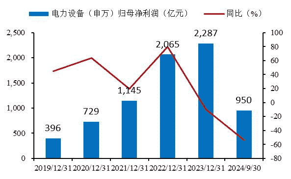
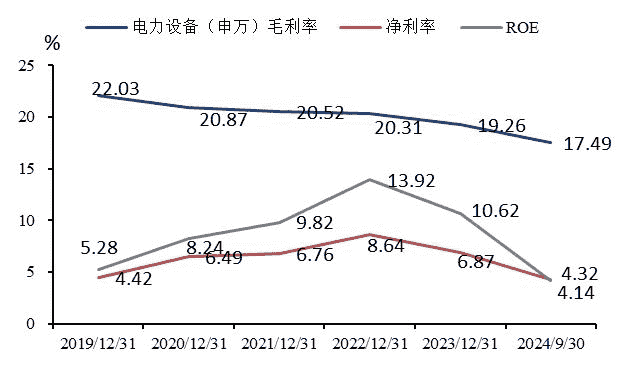
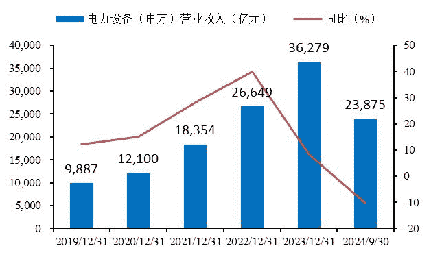
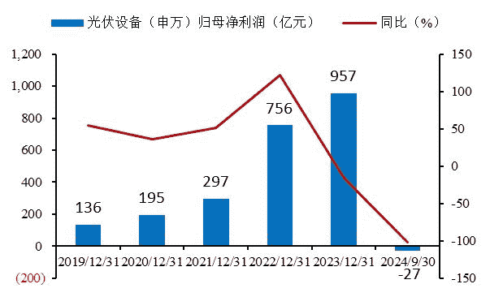
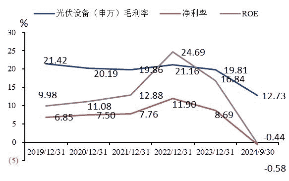
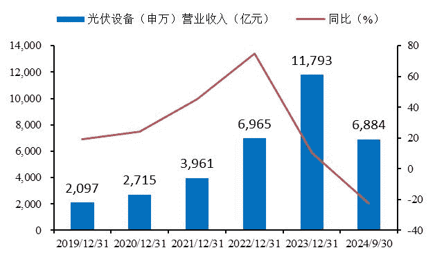
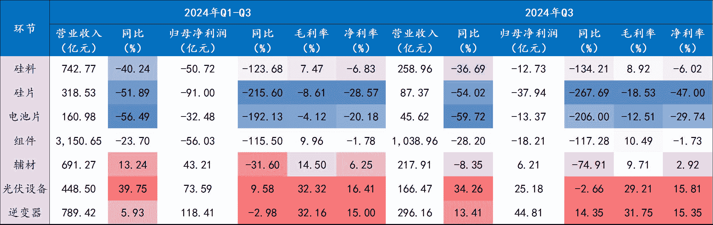
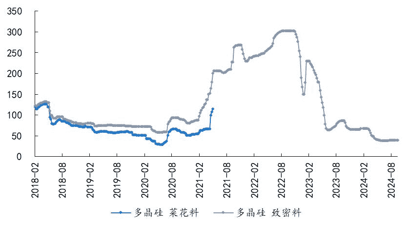
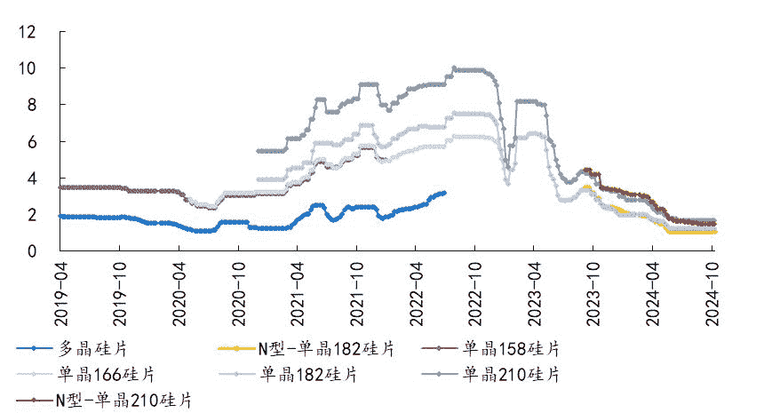
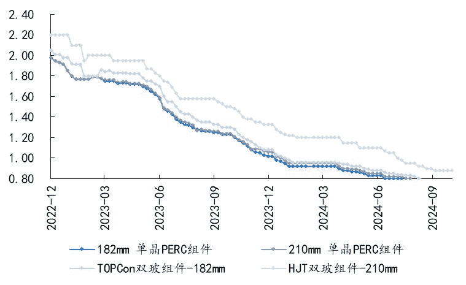

请认真阅读文后免责条款

**光伏现金流持续改善，海风、电网逐步交付**

华龙证券研究所 电力设备行业

分析师：杨阳

SAC执业证书编号：S0230523110001

分析师：许紫荆

SAC执业证书编号：S0230524080001

**——电力设备行业2024年三季报综述**

证券研究报告

2024年11月14日

请认真阅读文后免责条款

最近一年市场走势（单位：%）

相关报告

《隆基BC产能建设加速，《能源法》表决通过——电新&公用行业周报》2024.11.12

《六部门发文，光伏行业政策与基本面共振——光伏行业事件点评报告》2024.11.05

《光伏价格趋于理性，海风项目持续推进——电新&公用行业周报》2024.10.30

沪深300表现（单位：%）

| 表现 | 1M | 3M | 12M |
|---|---:|---:|---:|
| 电力设备行业 | 16.43 | 44.02 | 10.00 |
| 沪深300 | 3.78 | 23.01 | 14.76 |

-37%

-25%

-13%

0%

12%

24%

2023-11

2024-03

2024-07

2024-11

电力设备

沪深300

2

请认真阅读文后免责条款

- 光伏：2024年Q3归母净利润亏损环比扩大，底部逐渐明朗。2024年Q1-Q3，光伏设备行业实现营业收入6884亿元，同比-22.56%；实现归母净利润-27亿元，同比-102.01%。2024年Q1-Q3，光伏设备行业实现毛利率12.73%，同比下降8.70pct；实现净利率-0.58%，同比下降12.35pct；ROE为-0.44%，同比下降17.42pct。

- 我们选取41家代表公司分环节分析，主产业链继续承压，光伏设备、逆变器业绩较好。主产业链多数公司仍处于亏损状态，但2024年Q3板块经营性现金流持续改善；辅材环节内部分化，光伏支架全球出货持续放量，带动公司量利齐升，光伏玻璃、胶膜环节价格Q3有所下降，使得公司业绩受损；光伏设备环节整体盈利高企，充分受益于TOPCon产能扩张，后续HJT、BC设备商业绩可期；逆变器环节出货提升，主要受益于在能源转型驱动、政策支持以及光伏上游组件价格快速下滑的背景下，多个新兴市场光伏装机需求迅速释放，公司出货及订单向好。

- 展望及投资策略：预计主产业链会在2024Q4至2025年逐步完成产能的出清收缩，一线龙头在产能出清中风险较小，具备抗风险能力和盈利韧性，有望在行业格局重塑时穿越周期，同时新技术的发展有望为光伏行业带来增长新动力。个股方面，建议关注光伏龙头通威股份、隆基绿能、天合光能、晶科能源、阿特斯、TCL中环；建议关注盈利能力较强的逆变器环节，阳光电源、德业股份、锦浪科技、上能电气、禾迈股份等。

- 风电：受风电项目开工节奏影响，产业链多数环节出货量不同程度下降。2024年Q1-Q3，风电设备行业实现营业收入1203.17亿元，同比+0.79%；实现归母净利润48.91亿元，同比-28.89%。2024年Q1-Q3，风电设备行业实现毛利率16.7%，同比下降1.57pct；实现净利率4.3%，同比下降1.60pct；ROE为2.7%，同比下降1.53pct。

- 我们选取32家代表公司分环节分析，风机、海缆2024年Q3率先改善，海缆环节或即将起量。风机环节收入增长但净利润有所下滑，风机环节部分公司收入增长主要受到风电机组销售规模同比提升、发电及转让收入增加、新增高毛利海外收入等因素拉动；海缆/塔筒管桩/铸锻件/轴承/叶片环节收入净利润双降，其中东方电缆在Q3实现海缆收入同比大幅提升，业绩逆势增长，海缆环节订单放量在即，有望进入向上周期。

- 展望及投资策略：近期广东、浙江等多省海上风电项目进展加速，2024年Q4至2025年将进入海风交货高峰期，风电行业有望整体上行，海外订单外溢有望打开我国海风出口空间。个股方面建议关注海缆东方电缆；塔筒大金重工、泰胜风能、天顺风能等。

**摘要**

3

请认真阅读文后免责条款

- 电网设备：量利齐升，特高压逐步进入交付期。2024年Q1-Q3，电网设备行业实现营业收入5514.29亿元，同比+6.58%；实现归母净利润316.02亿元，同比-9.49%。2024年Q1-Q3，电网设备行业实现毛利率19.3%，同比下降1.46pct；实现净利率6.2%，同比下降1.73pct；ROE为6.7%，同比下降1.24pct。剔除特变电工后，电网设备指数收入、净利润均实现正增长。

- 我们选取28家代表公司分环节分析，变压器、组合电器Q3增速较快，出海Q3增速放缓。变压器、组合电器环节业绩较快增长，其中中国西电2024年Q3净利润同比+199.96%，平高电气Q3净利润同比+47.72%，预计主要受益于特高压产品交付，后续有望迎来业绩和毛利率双重持续增长；电表环节毛利率最高，2024年以来国内电表招标整体显著增长，后续新兴市场有望贡献增量；继电保护、智能化环节业绩稳健上行；出海环节公司主要为电表、变压器业务，部分公司受到大客户降价、运费、汇率等因素影响，Q3业绩增速有所放缓。随着出海企业持续拓展全球化布局，长期大额订单有待未来放量。

- 展望及投资策略：国家电网公司2024年电网投资将首次超过6000亿元，海外需求高增叠加国内电网投资增长有望带动电力设备放量，电网设备板块有望维持高景气。个股方面建议关注平高电气、许继电气、国电南瑞、思源电气、金盘科技、华明装备、三星医疗、海兴电力、东方电子、安科瑞、国能日新等。

- 投资建议：行业方面，展望2024年Q4，电新行业有望延续积极趋势，光伏供给侧过剩产能出清，电池技术升级有望带来新机会，风电和电网设备有望加速兑现订单。维持行业“推荐”评级。

- 个股方面，光伏板块建议关注通威股份、隆基绿能、钧达股份、阿特斯、中信博、阳光电源、德业股份、帝尔激光等；风电板块建议关注东方电缆、大金重工、泰胜风能、海力风电、天顺风能等；电网设备建议关注平高电气、许继电气、国电南瑞、思源电气、金盘科技、华明装备、三星医疗、海兴电力、东方电子、安科瑞、国能日新等。

- 风险提示：宏观经济下行风险，政策不及预期，上游原材料价格大幅波动，重要技术进展不及预期，海外贸易保护政策，行业竞争加剧，第三方数据统计错误导致的风险，重点关注公司业绩不及预期等。

**摘要**

4

请认真阅读文后免责条款

## 目录

3

**风电：受开工节奏影响，板块净利润下滑，经营承压**

2

**光伏：主产业链现金流改善，光伏设备、逆变器业绩较好**

**电力设备板块整体业绩回顾**

1

4

**电网设备：量利齐升，逐步进入交付期**

6

**风险提示**

**投资建议**

5

请认真阅读文后免责条款

## 电新行业2024年Q1-Q3业绩回顾：业绩整体承压

**01**

- 2024年Q1-Q3，电力设备（申万）行业实现营业收入23875亿元，同比-10.30%；实现归母净利润950亿元，同比-53.98%。

- 2024年Q1-Q3，电力设备（申万）行业实现毛利率17.49%，同比下降2.38pct；实现净利率4.32%，同比下降4.24pct；ROE为4.14%，同比下降5.66pct。

数据来源：Wind，华龙证券研究所

图1：2024年Q1-Q3电力设备行业收入

数据来源：Wind，华龙证券研究所

数据来源：Wind，华龙证券研究所

图3：2024年Q1-Q3电力设备行业毛利率

6

图2：2024年Q1-Q3电力设备行业净利润

请认真阅读文后免责条款

## 目录

3

**风电：受开工节奏影响，板块净利润下滑，经营承压**

2

**光伏：主产业链承压，光伏设备、逆变器业绩较好**

**电力设备板块整体业绩回顾**

1

4

**电网设备：量利齐升，逐步进入交付期**

6

**风险提示**

**投资建议**

5

2

## 光伏：主产业链现金流改善，光伏设备、逆变器业绩较好

7

请认真阅读文后免责条款

## 光伏：归母净利润亏损环比扩大，底部逐渐明朗

**02**

- 受产能过剩影响，光伏板块净利润亏损扩大，业绩进入底部区间。2024年Q1-Q3，光伏设备（申万）行业实现营业收入6884亿元，同比-22.56%；实现归母净利润-27亿元，同比-102.01%。

- 光伏板块收入及净利润均有所下降，主要原因是主产业链公司基本处于亏损状态。2024年Q1-Q3，光伏设备（申万）行业实现毛利率12.73%，同比下降8.70pct；实现净利率-0.58%，同比下降12.35pct；ROE为-0.44%，同比下降17.42pct。

数据来源：Wind，华龙证券研究所

图4：2024年Q1-Q3光伏设备行业收入

数据来源：Wind，华龙证券研究所

图5：2024年Q1-Q3光伏设备行业净利润

数据来源：Wind，华龙证券研究所

图6：2024年Q1-Q3光伏设备行业毛利率

8

请认真阅读文后免责条款

## 光伏：选取41家代表公司

**02**

- 光伏行业我们共选取行业内41家公司，分为主产业链（硅料、硅片、电池片、组件）和辅材（玻璃、胶膜、银浆、焊带、支架等）、光伏设备、逆变器等环节进行分析。

数据来源：Wind，华龙证券研究所

表1：光伏行业共选取41家公司

| 环节 | 代码 | 公司 | 环节 | 代码 | 公司 |
|---|---|---|---|---|---|
| 主材 | 硅料 | 600438.SH | 通威股份 | 辅材 | 支架 |
|  |  | 688408.SH | 大全能源 |  | 688303.SH |
| 硅片 | 603185.SH | 弘元绿能 |  | 603628.SH | 清源股份 |
|  | 002129.SZ | TCL中环 | 接线盒 | 301168.SZ | 通灵股份 |
|  | 601908.SH | 京运通 |  | 301278.SZ | 快可电子 |
| 金刚线 | 300861.SZ | 美畅股份 | 光伏设备 | 688516.SH | 奥特维 |
| 电池片 | 600732.SH | 爱旭股份 |  | 300751.SZ | 迈为股份 |
|  | 002865.SZ | 钧达股份 |  | 300776.SZ | 帝尔激光 |
| 组件 | 601012.SH | 隆基绿能 |  | 300724.SZ | 捷佳伟创 |
|  | 688223.SH | 晶科能源 |  | 300316.SZ | 晶盛机电 |
|  | 002459.SZ | 晶澳科技 |  | 603396.SH | 金辰股份 |
|  | 688599.SH | 天合光能 | 逆变器 | 300274.SZ | 阳光电源 |
|  | 300118.SZ | 东方日升 |  | 688390.SH | 固德威 |
|  | 002056.SZ | 横店东磁 |  | 300763.SZ | 锦浪科技 |
|  | 688472.SH | 阿特斯 |  | 688032.SH | 禾迈股份 |
|  | 300393.SZ | 中来股份 |  | 688348.SH | 昱能科技 |
| 辅材 | 玻璃 | 601865.SH | 福莱特 |  | 605117.SH |
| 胶膜 | 603806.SH | 福斯特 |  | 300827.SZ |
| 银浆 | 300842.SZ | 帝科股份 |  | 300693.SZ | 盛弘股份 |
|  | 688503.SH | 聚和材料 |  | 002518.SZ | 科士达 |
|  | 002079.SZ | 苏州固锝 |  |  |
| 焊带 | 301266.SZ | 宇邦新材 |  |  |
|  |  |  |  |  |  |

9

请认真阅读文后免责条款

## 光伏细分环节对比：主产业链承压，光伏设备、逆变器业绩较好

**02**

- 分环节看，主产业链承压，光伏设备、逆变器业绩较好。光伏主产业链（硅料、硅片、电池片、组件）各环节营业收入、归母净利润均同比下滑，硅料、组件环节毛利率相对具有韧性。辅材营收增长但净利润同比下降，内部有所分化。光伏设备、逆变器毛利率维持高位，盈利能力优秀。

数据来源：Wind，华龙证券研究所

表2：2024年Q1-Q3光伏各环节盈利情况对比

10

请认真阅读文后免责条款

### 主材：业绩全线承压，2024年Q3现金流环比增加

**02**

- 主材净利润全线承压，亏损面环比扩大。2024年Q1-Q3，光伏硅料/硅片/电池片/组件各环节分别实现归母净利润-50.72亿元/-91.00亿元/-32.48亿元/-56.03亿元，分别实现毛利率7.47%/-8.61%/-4.12%/9.96%，实现净利率-6.83%/-28.57%/-20.18%/-1.78%。2024年Q3，光伏硅料/硅片/电池片/组件各环节分别实现归母净利润-12.73亿元/-37.94亿元/-13.37亿元/-18.21亿元，分别实现毛利率8.92%/-18.53%/-12.51%/10.49%，实现净利率-6.02%/-47.00%/-29.74%/-1.73%。

- 受供给过剩导致的全产业链价格下降影响，硅料/硅片/电池片/组件各环节重点公司多数处于亏损状态，仅阿特斯、晶科能源、横店东磁实现正利润。预计主产业链会在2024H2至2025年逐步完成产能的出清收缩，一线龙头现金流优势、成本优势，在产能出清中风险较小，具备抗风险能力和盈利韧性，有望在行业格局重塑时穿越周期。

数据来源：Infolink Consulting，华龙证券研究所

数据来源：Infolink Consulting，华龙证券研究所

图7：硅料环节价格（元/KG）

图8：硅片环节价格（元/W）

数据来源：Infolink Consulting，华龙证券研究所

图9：组件环节价格（元/W）

11

### 主材：业绩全线承压，2024年Q3现金流环比增加

数据来源：Wind，华龙证券研究所

表3：主材（硅料、硅片、电池片、组件）环节重点公司2024年Q1-Q3财务数据

| 代码 | 环节 | 公司 | 2024年Q1-Q3营业收入（亿元） | 同比(%) | 2024年Q1-Q3归母净利润（亿元） | 同比(%) | 2024年Q1-Q3毛利率（%） | 2024年Q1-Q3净利率（%） | 2024年Q3营业收入（亿元） | 同比(%) | 2024年Q3归母净利润（亿元） | 同比(%) | 2024年Q3毛利率（%） | 2024年Q3净利率（%） |
|------|------|------|------|------|------|------|------|------|------|------|------|------|------|
| 600438.SH | 硅料 | 通威股份 | 682.72 | -38.73 | -39.73 | -124.37 | 7.76 | -6.99 | 244.75 | -34.47 | -8.44 | -127.84 | 8.90 | -4.62 |
| 688303.SH | 硅料 | 大全能源 | 60.05 | -53.37 | -10.99 | -121.49 | 4.18 | -18.31 | 14.21 | -60.01 | -4.29 | -162.27 | 9.17 | -30.19 |
| 合计 | 硅料 |  | 742.77 | -40.24 | -50.72 | -123.68 | 7.47 | -6.83 | 258.96 | -36.69 | -12.73 | -134.21 | 8.92 | -6.02 |
| 603185.SH | 硅片 | 弘元绿能 | 53.36 | -44.29 | -16.30 | -223.63 | -7.00 | -30.54 | 13.24 | -44.92 | -4.72 | -256.96 | -8.25 | -35.67 |
| 002129.SZ | 硅片 | TCL中环 | 225.82 | -53.59 | -60.61 | -197.95 | -8.21 | -28.69 | 63.69 | -53.70 | -29.98 | -281.50 | -22.03 | -51.85 |
| 601908.SH | 硅片 | 京运通 | 39.35 | -50.69 | -14.09 | -485.36 | -13.10 | -36.55 | 10.44 | -63.26 | -3.24 | -204.53 | -10.22 | -31.72 |
| 合计 | 硅片 |  | 318.53 | -51.89 | -91.00 | -215.60 | -8.61 | -28.57 | 87.37 | -54.02 | -37.94 | -267.69 | -18.53 | -47.00 |
| 600732.SH | 电池片 | 爱旭股份 | 78.96 | -65.09 | -28.31 | -250.00 | -8.71 | -36.10 | 27.34 | -57.06 | -10.86 | -287.78 | -19.35 | -40.45 |
| 002865.SZ | 电池片 | 钧达股份 | 82.02 | -42.96 | -4.17 | -125.45 | 0.29 | -5.08 | 18.28 | -63.14 | -2.51 | -136.69 | -2.27 | -13.70 |
| 合计 | 电池片 |  | 160.98 | -56.49 | -32.48 | -192.13 | -4.12 | -20.18 | 45.62 | -59.72 | -13.37 | -206.00 | -12.51 | -29.74 |
| 601012.SH | 组件 | 隆基绿能 | 585.93 | -37.73 | -65.05 | -155.62 | 7.98 | -11.16 | 200.64 | -31.87 | -12.61 | -150.14 | 8.60 | -6.37 |
| 688223.SH | 组件 | 晶科能源 | 717.70 | -15.66 | 12.15 | -80.88 | 9.68 | 1.72 | 245.19 | -22.09 | 0.15 | -99.41 | 11.82 | 0.15 |
| 002459.SZ | 组件 | 晶澳科技 | 543.48 | -9.39 | -4.84 | -107.16 | 5.40 | -1.58 | 169.91 | -11.22 | 3.90 | -80.02 | 8.67 | 2.07 |
| 688599.SH | 组件 | 天合光能 | 631.47 | -22.16 | -8.47 | -116.67 | 12.46 | -1.19 | 201.79 | -36.41 | -13.73 | -189.31 | 9.48 | -6.55 |
| 300118.SZ | 组件 | 东方日升 | 149.03 | -46.81 | -15.60 | -221.90 | 8.61 | -10.44 | 44.44 | -57.31 | -5.97 | -242.69 | 7.69 | -13.38 |
| 002056.SZ | 组件 | 横店东磁 | 135.81 | -13.85 | 9.26 | -43.89 | 15.65 | 6.75 | 40.14 | -27.26 | 2.87 | -34.48 | 16.82 | 7.00 |
| 688472.SH | 组件 | 阿特斯 | 341.78 | -12.63 | 19.55 | -31.17 | 14.96 | 5.65 | 122.20 | -6.10 | 7.16 | -21.99 | 13.48 | 5.85 |
| 300393.SZ | 组件 | 中来股份 | 45.44 | -53.35 | -3.04 | -162.81 | 9.80 | -7.27 | 14.63 | -63.23 | 0.02 | -99.12 | 15.13 | 1.17 |
| 合计 | 组件 |  | 3,150.65 | -23.70 | -56.03 | -115.50 | 9.96 | -1.78 | 1,038.96 | -28.20 | -18.21 | -117.28 | 10.49 | -1.73 |

### 主材：业绩全线承压，2024年Q3现金流环比增加

- 主材环节现金及现金等价物余额环比下降。2024年Q3，主材环节现金及现金等价物余额1518亿元，环比减少31亿元；经营性现金流明显提升68亿元，筹资规模缩减215亿元，购建固定资产、无形资产和其他长期资产支付的现金环比下降76亿元。

- 2024年Q3经营性现金流环比增加。2024年Q1光伏主材进入亏现金阶段，经营性现金流量净额合计-205亿元，2024年Q2板块现金流恢复至26亿元，趋势上环比转正，Q3进一步增加至94亿元。多数公司经营性现金流转正。

数据来源：Wind，华龙证券研究所

表4：2024年Q3主材环节经营性现金流量净额增加

### 辅材环节：支架增速及毛利率双高，玻璃胶膜等承压

- 辅材环节收入增长但净利润下降。2024年Q1-Q3，光伏辅材环节实现营业收入691.27亿元，同比+13.24%；实现归母净利润43.21亿元，同比-31.60%；实现毛利率14.50%，净利率6.25%。2024年Q3，光伏辅材环节实现营业收入217.91亿元，同比-8.35%；实现归母净利润6.21亿元，同比-74.91%；实现毛利率9.71%，净利率2.92%。

- 支架业绩增速及毛利率双高，玻璃、胶膜等环节利润承压。光伏支架全球出货持续放量，带动公司量利齐升；光伏玻璃、胶膜环节价格Q3有所下降，使得公司业绩受损。

数据来源：Wind，华龙证券研究所

表5：辅材环节重点公司2024年Q1-Q3财务数据

| 代码 | 环节 | 公司 | 2024年Q1-Q3营业收入（亿元） | 同比(%) | 2024年Q1-Q3归母净利润（亿元） | 同比(%) | 2024年Q1-Q3毛利率（%） | 2024年Q1-Q3净利率（%） | 2024年Q3营业收入（亿元） | 同比(%) | 2024年Q3归母净利润（亿元） | 同比(%) | 2024年Q3毛利率（%） | 2024年Q3净利率（%） |
|------|------|------|------|------|------|------|------|------|------|------|------|------|------|
| 601865.SH | 玻璃 | 福莱特 | 146.04 | -8.06 | 12.96 | -34.18 | 19.02 | 8.91 | 39.08 | -37.03 | -2.03 | -122.97 | 5.97 | -5.09 |
| 603806.SH | 胶膜 | 福斯特 | 151.74 | -8.86 | 12.58 | -12.08 | 15.56 | 8.28 | 44.11 | -26.90 | 3.30 | -39.67 | 12.82 | 7.45 |
| 300842.SZ | 银浆 | 帝科股份 | 115.09 | 88.77 | 2.93 | 0.07 | 9.73 | 2.50 | 39.22 | 49.62 | 0.60 | -33.35 | 7.60 | 1.50 |
| 688503.SH | 银浆 | 聚和材料 | 98.26 | 32.80 | 4.21 | -4.47 | 8.92 | 4.28 | 30.61 | -4.87 | 1.22 | -28.87 | 4.55 | 3.98 |
| 002079.SZ | 银浆 | 苏州固锝 | 43.85 | 55.61 | 0.40 | -51.23 | 10.47 | 0.90 | 16.14 | 46.09 | 0.29 | 7.25 | 7.68 | 1.78 |
| 301266.SZ | 焊带 | 宇邦新材 | 24.77 | 21.04 | 0.46 | -60.54 | 6.06 | 1.86 | 7.94 | 5.24 | 0.10 | -76.58 | 4.08 | 1.28 |
| 688408.SH | 支架 | 中信博 | 59.82 | 76.30 | 4.27 | 171.48 | 19.37 | 7.24 | 26.06 | 77.05 | 1.96 | 230.39 | 19.38 | 7.80 |
| 603628.SH | 支架 | 清源股份 | 13.19 | 2.76 | 0.98 | -32.49 | 22.87 | 7.49 | 4.46 | 5.71 | 0.44 | 19.21 | 24.49 | 9.98 |
| 301168.SZ | 接线盒 | 通灵股份 | 12.14 | 5.36 | 0.71 | -51.21 | 17.14 | 7.19 | 4.24 | -3.63 | 0.07 | -87.80 | 12.92 | 3.01 |
| 301278.SZ | 接线盒 | 快可电子 | 7.44 | -24.86 | 0.89 | -39.27 | 19.23 | 11.96 | 1.97 | -42.07 | 0.19 | -67.60 | 17.48 | 9.67 |
| 300861.SZ | 金刚线 | 美畅股份 | 18.92 | -43.21 | 2.82 | -79.72 | 24.57 | 15.39 | 4.08 | -64.96 | 0.06 | -98.80 | 4.69 | 1.93 |
| 合计 |  |  | 691.27 | 13.24 | 43.21 | -31.60 | 14.50 | 6.25 | 217.91 | -8.35 | 6.21 | -74.91 | 9.71 | 2.92 |

### 光伏设备环节：盈利高企，TOPCon设备充分受益于产能扩张

- 光伏设备环节整体盈利高企。2024年Q1-Q3，光伏设备环节实现营业收入448.50亿元，同比+39.75%；实现归母净利润73.59亿元，同比+9.58%；实现毛利率32.32%，净利率16.41%。2024年Q3，光伏设备环节实现营业收入166.47亿元，同比+34.26%；实现归母净利润25.18亿元，同比-2.66%；实现毛利率29.21%，净利率15.81%。

- TOPCon设备充分受益于产能扩张，HJT、BC设备静待放量。根据中国光伏行业协会编制的《中国光伏产业发展路线图》，n型TOPCon电池的市场占比将从2023年的23%，快速提升至2024年的60%，到2030年仍将接近50%。随着TOPCon产能扩张叠加老旧设备更换，刻蚀机龙头捷佳伟创、串焊机龙头奥特维、激光设备龙头帝尔激光出货量及业绩充分受益。HJT整线设备龙头迈为股份计提信用减值2.90亿元，业绩短期承压，后续有望受益于HJT电池扩产。BC电池进展加速，相关激光设备商帝尔激光已签订采购合同，后续业绩兑现可期。

数据来源：Wind，华龙证券研究所

表6：光伏设备环节重点公司2024年Q1-Q3财务数据

| 代码 | 环节 | 公司 | 2024年Q1-Q3营业收入（亿元） | 同比(%) | 2024年Q1-Q3归母净利润（亿元） | 同比(%) | 2024年Q1-Q3毛利率（%） | 2024年Q1-Q3净利率（%） | 2024年Q3营业收入（亿元） | 同比(%) | 2024年Q3归母净利润（亿元） | 同比(%) | 2024年Q3毛利率（%） | 2024年Q3净利率（%） |
|------|------|------|------|------|------|------|------|------|------|------|------|------|------|
| 688516.SH | 光伏设备 | 奥特维 | 69.21 | 63.27 | 11.66 | 36.91 | 33.14 | 17.95 | 25.04 | 45.42 | 3.97 | 20.58 | 31.97 | 17.54 |
| 300751.SZ | 光伏设备 | 迈为股份 | 77.67 | 52.09 | 7.59 | 6.30 | 30.67 | 10.55 | 28.98 | 29.47 | 2.97 | 2.87 | 30.19 | 13.07 |
| 300776.SZ | 光伏设备 | 帝尔激光 | 14.40 | 25.05 | 3.83 | 12.95 | 48.29 | 26.63 | 5.35 | 11.86 | 1.47 | -10.84 | 48.68 | 27.56 |
| 300724.SZ | 光伏设备 | 捷佳伟创 | 123.44 | 92.72 | 20.23 | 65.45 | 27.80 | 16.39 | 57.22 | 146.41 | 7.97 | 69.10 | 23.38 | 13.92 |
| 300316.SZ | 光伏设备 | 晶盛机电 | 144.78 | 7.55 | 29.60 | -15.76 | 35.57 | 22.38 | 43.31 | -14.34 | 8.64 | -33.96 | 32.24 | 19.64 |
| 603396.SH | 光伏设备 | 金辰股份 | 18.99 | 9.91 | 0.68 | -8.50 | 28.45 | 4.25 | 6.58 | 12.86 | 0.16 | -33.67 | 29.34 | 2.91 |
| 合计 |  |  | 448.50 | 39.75 | 73.59 | 9.58 | 32.32 | 16.41 | 166.47 | 34.26 | 25.18 | -2.66 | 29.21 | 15.81 |

### 逆变器环节：出货提升，新兴市场需求快速增长

- 逆变器整体收入增长。2024年Q1-Q3，逆变器环节实现营业收入789.42亿元，同比+5.93%；实现归母净利润118.41亿元，同比-2.98%；实现毛利率32.16%，净利率15.00%。2024年Q3，逆变器环节实现营业收入296.16亿元，同比+13.41%；实现归母净利润44.81亿元，同比+14.35%；实现毛利率31.75%，净利率15.35%。

- 新兴市场需求快速增长，全球化布局提升盈利能力。2024年Q3，德业股份、锦浪科技、上能电气归母净利润增速分别为229.52%/154.70%/92.59%，主要受益于在能源转型驱动、政策支持以及光伏上游组件价格快速下滑的背景下，多个新兴市场光伏装机需求迅速释放，公司出货及订单向好。

数据来源：Wind，华龙证券研究所

表7：逆变器环节重点公司2024年Q1-Q3财务数据

| 代码 | 环节 | 公司 | 2024年Q1-Q3营业收入（亿元） | 同比(%) | 2024年Q1-Q3归母净利润（亿元） | 同比(%) | 2024年Q1-Q3毛利率（%） | 2024年Q1-Q3净利率（%） | 2024年Q3营业收入（亿元） | 同比(%) | 2024年Q3归母净利润（亿元） | 同比(%) | 2024年Q3毛利率（%） | 2024年Q3净利率（%） |
|------|------|------|------|------|------|------|------|------|------|------|------|------|------|
| 300274.SZ | 逆变器 | 阳光电源 | 499.46 | 7.61 | 76.00 | 5.21 | 31.32 | 15.47 | 189.26 | 6.37 | 26.40 | -7.96 | 29.52 | 14.16 |
| 688390.SH | 逆变器 | 固德威 | 49.43 | -12.51 | 0.09 | -99.03 | 23.00 | 1.15 | 17.96 | -2.20 | 0.32 | -78.64 | 23.41 | 2.92 |
| 300763.SZ | 逆变器 | 锦浪科技 | 51.62 | 11.21 | 6.69 | -11.00 | 33.67 | 12.96 | 18.07 | 29.92 | 3.17 | 154.70 | 36.43 | 17.53 |
| 688032.SH | 逆变器 | 禾迈股份 | 12.66 | -10.12 | 2.46 | -40.88 | 48.09 | 19.37 | 3.58 | 4.36 | 0.58 | -13.40 | 49.54 | 16.01 |
| 688348.SH | 逆变器 | 昱能科技 | 15.33 | 58.31 | 1.49 | -17.14 | 32.57 | 10.12 | 6.34 | 104.33 | 0.62 | 33.47 | 28.30 | 11.08 |
| 605117.SH | 逆变器 | 德业股份 | 80.16 | 26.72 | 22.40 | 42.81 | 40.15 | 27.94 | 32.68 | 128.16 | 10.04 | 229.52 | 44.50 | 30.72 |
| 300827.SZ | 逆变器 | 上能电气 | 30.69 | -7.30 | 3.02 | 44.82 | 25.32 | 9.80 | 11.43 | 0.83 | 1.41 | 92.59 | 29.26 | 12.32 |
| 300693.SZ | 逆变器 | 盛弘股份 | 20.95 | 20.91 | 2.71 | -0.93 | 40.17 | 12.76 | 6.64 | 5.32 | 0.89 | -2.80 | 41.46 | 13.26 |
| 002518.SZ | 逆变器 | 科士达 | 29.12 | -28.43 | 3.57 | -48.41 | 31.69 | 12.13 | 10.20 | -18.11 | 1.38 | -27.86 | 31.11 | 13.53 |
| 合计 |  |  | 789.42 | 5.93 | 118.41 | -2.98 | 32.16 | 15.00 | 296.16 | 13.41 | 44.81 | 14.35 | 31.75 | 15.35 |

## 目录

1 电力设备板块整体业绩回顾

2 光伏：主产业链承压，光伏设备、逆变器业绩较好

3 风电：受开工节奏影响，板块净利润下滑，经营承压

4 电网设备：量利齐升，逐步进入交付期

5 投资建议

6 风险提示

## 风电：板块净利润下滑，经营承压

受风电项目开工节奏影响，产业链多数环节出货量不同程度下降，业绩同比有所下滑。2024年Q1-Q3，风电设备（申万）行业实现营业收入1203.17亿元，同比+0.79%；实现归母净利润48.91亿元，同比-28.89%。2024年Q1-Q3，风电设备（申万）行业实现毛利率16.7%，同比下降1.57pct；实现净利率4.3%，同比下降1.60pct；ROE为2.7%，同比下降1.53pct。

数据来源：Wind，华龙证券研究所

图10：2024年Q1-Q3风电设备行业收入

数据来源：Wind，华龙证券研究所

图11：2024年Q1-Q3风电设备行业净利润

数据来源：Wind，华龙证券研究所

图12：2024年Q1-Q3风电设备行业毛利率

## 风电：选取32家公司

风电行业我们共选取行业内32家公司，分为风机、海缆、塔筒管桩、铸锻件、轴承和叶片6个环节进行分析。

表8：风电行业共选取32家公司

| 环节 | 代码 | 公司 | 环节 | 代码 | 公司 |
|------|------|------|------|------|------|
| 风机 | 002202.SZ | 金风科技 | 铸锻件 | 603218.SH | 日月股份 |
| 风机 | 601615.SH | 明阳智能 | 铸锻件 | 300443.SZ | 金雷股份 |
| 风机 | 300772.SZ | 运达股份 | 铸锻件 | 300185.SZ | 通裕重工 |
| 风机 | 688349.SH | 三一重能 | 铸锻件 | 688186.SH | 广大特材 |
| 风机 | 688660.SH | 电气风电 | 铸锻件 | 601218.SH | 吉鑫科技 |
| 海缆 | 603606.SH | 东方电缆 | 铸锻件 | 301163.SZ | 宏德股份 |
| 海缆 | 600522.SH | 中天科技 | 铸锻件 | 301063.SZ | 海锅股份 |
| 海缆 | 600487.SH | 亨通光电 | 轴承 | 300850.SZ | 新强联 |
| 海缆 | 605222.SH | 起帆电缆 | 轴承 | 300718.SZ | 长盛轴承 |
| 海缆 | 600973.SH | 宝胜股份 | 轴承 | 603985.SH | 恒润股份 |
| 海缆 | 002498.SZ | 汉缆股份 | 轴承 | 300421.SZ | 力星股份 |
| 海缆 | 002300.SZ | 太阳电缆 | 轴承 | 603667.SH | 五洲新春 |
| 塔筒管桩 | 002531.SZ | 天顺风能 | 轴承 | 301548.SZ | 崇德科技 |
| 塔筒管桩 | 002487.SZ | 大金重工 | 叶片 | 002080.SZ | 中材科技 |
| 塔筒管桩 | 300569.SZ | 天能重工 | 叶片 | 600458.SH | 时代新材 |
| 塔筒管桩 | 301155.SZ | 海力风电 | | | |
| 塔筒管桩 | 300129.SZ | 泰胜风能 | | | |

数据来源：Wind，华龙证券研究所

## 风电细分环节对比：开工滞后致整体业绩承压，风机海缆率先改善

分环节看，风电板块各环节业绩表现呈现出较强一致性，风机、海缆2024年Q3率先改善。受风电项目开工节奏影响，产业链多数环节出货量不同程度下降，2024年以来业绩同比有所下滑。趋势来看，2024年Q3，风机、海缆净利润增速回正；盈利能力来看，轴承、塔筒管桩、叶片毛利率在风电产业链中处于较高水平。

数据来源：Wind，华龙证券研究所

表9：风电各环节盈利情况对比

## 风机环节：盈利能力分化，电站销售、海外收入等影响盈利

风机环节整体收入增长但净利润有所下滑。2024年Q1-Q3，风机环节实现营业收入822.07亿元，同比+9.72%；实现归母净利润30.76亿元，同比-1.35%；实现毛利率15.70%，净利率3.74%。2024年Q3，风机环节实现营业收入350.82亿元，同比+16.27%；实现归母净利润8.34亿元，同比+34.88%；实现毛利率13.77%，净利率2.54%。

电站销售、海外收入等影响盈利。其中，金风科技收入增长主要系风电机组销售规模同比提升、发电及转让收入增加，2024年Q3净利润同比高增存在2023年同期业绩过低的影响。电气风电亏损同比减少，主要原因是第三季度新增海外订单项目销售，销售毛利率较高。

数据来源：Wind，华龙证券研究所

表10：风机环节重点公司2024年Q1-Q3财务数据

| 代码 | 环节 | 公司 | 营业收入（亿元） | 同比(%) | 归母净利润（亿元） | 同比(%) | 毛利率(%) | 净利率(%) | 营业收入（亿元） | 同比(%) | 归母净利润（亿元） | 同比(%) | 毛利率(%) | 净利率(%) |
|------|------|------|------------------|---------|--------------------|---------|-----------|-----------|------------------|---------|--------------------|---------|-----------|-----------|
| 002202.SZ | 风机 | 金风科技 | 358.39 | 22.24 | 17.92 | 42.15 | 16.43 | 5.20 | 156.37 | 51.55 | 4.05 | 4195.25 | 14.09 | 2.73 |
| 601615.SH | 风机 | 明阳智能 | 202.37 | -4.14 | 8.09 | -34.58 | 15.20 | 4.27 | 84.41 | -19.39 | 1.48 | -74.57 | 10.29 | 2.17 |
| 300772.SZ | 风机 | 运达股份 | 139.29 | 24.01 | 2.67 | 6.25 | 14.36 | 1.92 | 53.01 | 26.29 | 1.19 | 16.03 | 16.17 | 2.24 |
| 688349.SH | 风机 | 三一重能 | 90.68 | 21.06 | 6.85 | -33.55 | 15.53 | 7.55 | 37.88 | 5.93 | 2.51 | 17.56 | 14.85 | 6.63 |
| 688660.SH | 风机 | 电气风电 | 31.35 | -47.08 | -4.77 | 26.95 | 17.08 | -15.22 | 19.16 | 13.90 | -0.90 | 68.09 | 17.68 | -4.71 |
| 合计 | | | 822.07 | 9.72 | 30.76 | -1.35 | 15.70 | 3.74 | 350.82 | 16.27 | 8.34 | 34.88 | 13.77 | 2.54 |

## 海缆环节：订单放量在即，有望进入向上周期

海缆环节2024年Q3单季度净利润增速转正。2024年Q1-Q3，海缆环节实现营业收入1519.65亿元，同比+8.02%；实现归母净利润64.70亿元，同比-2.68%；实现毛利率11.48%，净利率4.26%。2024年Q3，海缆环节实现营业收入565.58亿元，同比+11.58%；实现归母净利润21.06亿元，同比+5.39%；实现毛利率10.24%，净利率3.83%。

海缆订单放量在即，有望进入向上周期。东方电缆2024年Q3净利润同比+40.28%，主要受益于海缆收入快速增加；亨通光电2024年Q1-Q3净利润同比+28.32%，主要受益于特高压建设、电网数字化智能化升级、新能源基础建设以及海洋通信产业稳步发展，收入实现快速增长。海缆环节长期受益于海风发展，未来放量可期。

数据来源：Wind，华龙证券研究所

表11：海缆环节重点公司2024年Q1-Q3财务数据

| 代码 | 环节 | 公司 | 营业收入（亿元） | 同比(%) | 归母净利润（亿元） | 同比(%) | 毛利率(%) | 净利率(%) | 营业收入（亿元） | 同比(%) | 归母净利润（亿元） | 同比(%) | 毛利率(%) | 净利率(%) |
|------|------|------|------------------|---------|--------------------|---------|-----------|-----------|------------------|---------|--------------------|---------|-----------|-----------|
| 603606.SH | 海缆 | 东方电缆 | 66.99 | 25.22 | 9.32 | 13.41 | 22.16 | 13.91 | 26.31 | 58.34 | 2.88 | 40.28 | 21.74 | 10.95 |
| 600522.SH | 海缆 | 中天科技 | 343.16 | 4.78 | 23.11 | -13.12 | 15.83 | 6.71 | 129.00 | 2.32 | 8.51 | 20.67 | 14.43 | 6.55 |
| 600487.SH | 海缆 | 亨通光电 | 423.99 | 20.79 | 23.15 | 28.32 | 15.15 | 5.90 | 157.85 | 32.38 | 7.05 | 27.25 | 12.80 | 4.89 |
| 605222.SH | 海缆 | 起帆电缆 | 163.66 | -3.22 | 2.10 | -48.11 | 5.60 | 1.29 | 60.77 | -2.65 | 0.23 | -85.33 | 4.24 | 0.38 |
| 600973.SH | 海缆 | 宝胜股份 | 354.44 | 5.36 | 0.25 | -73.00 | 4.72 | 0.04 | 130.92 | 14.85 | 0.06 | -80.50 | 4.58 | -0.02 |
| 002498.SZ | 海缆 | 汉缆股份 | 65.43 | -9.40 | 5.82 | -17.61 | 17.07 | 8.72 | 22.10 | -22.97 | 1.99 | -29.27 | 15.04 | 8.94 |
| 002300.SZ | 海缆 | 太阳电缆 | 101.99 | 5.11 | 0.95 | -40.09 | 3.85 | 0.99 | 38.63 | -3.05 | 0.33 | -46.81 | 3.94 | 1.13 |
| 合计 | | | 1,519.65 | 8.02 | 64.70 | -2.68 | 11.48 | 4.26 | 565.58 | 11.58 | 21.06 | 5.39 | 10.24 | 3.83 |

## 塔筒管桩环节：收入净利润双降，业绩受损

塔筒管桩环节收入净利润双降。2024年Q1-Q3，塔筒管桩环节实现营业收入117.04亿元，同比-30.74%；实现归母净利润8.15亿元，同比-50.09%；实现毛利率20.46%，净利率6.97%。2024年Q3，塔筒管桩环节实现营业收入49.07亿元，同比-24.32%；实现归母净利润1.23亿元，同比-69.53%；实现毛利率16.32%，净利率2.61%。

上半年多数项目开工滞后，塔筒管桩环节公司出货不同程度下降，随后续海风项目陆续开工，未来放量可期。海力风电2024Q3业绩同比增长主要系2023年同期产生信用减值损失。

数据来源：Wind，华龙证券研究所

表12：塔筒管桩环节重点公司2024年Q1-Q3财务数据

| 代码 | 环节 | 公司 | 营业收入（亿元） | 同比(%) | 归母净利润（亿元） | 同比(%) | 毛利率(%) | 净利率(%) | 营业收入（亿元） | 同比(%) | 归母净利润（亿元） | 同比(%) | 毛利率(%) | 净利率(%) |
|------|------|------|------------------|---------|--------------------|---------|-----------|-----------|------------------|---------|--------------------|---------|-----------|-----------|
| 002531.SZ | 塔筒管桩 | 天顺风能 | 35.60 | -44.43 | 2.92 | -59.49 | 25.29 | 8.18 | 13.02 | -37.96 | 0.76 | -46.01 | 22.77 | 5.78 |
| 002487.SZ | 塔筒管桩 | 大金重工 | 23.06 | -30.81 | 2.82 | -30.88 | 27.19 | 12.23 | 9.50 | -25.31 | 1.08 | -20.09 | 25.22 | 11.38 |
| 300569.SZ | 塔筒管桩 | 天能重工 | 18.27 | -30.46 | 0.06 | -97.19 | 17.27 | 0.40 | 6.62 | -48.63 | -0.59 | -172.72 | 7.58 | -8.90 |
| 301155.SZ | 塔筒管桩 | 海力风电 | 10.61 | -31.76 | 0.87 | 33.44 | 6.01 | 8.06 | 6.99 | 35.40 | -0.21 | 70.19 | 8.15 | -3.04 |
| 300129.SZ | 塔筒管桩 | 泰胜风能 | 29.50 | -0.94 | 1.49 | -36.78 | 16.55 | 5.23 | 12.94 | -1.08 | 0.20 | -83.25 | 12.17 | 1.93 |
| 合计 | | | 117.04 | -30.74 | 8.15 | -50.09 | 20.46 | 6.97 | 49.07 | -24.32 | 1.23 | -69.53 | 16.32 | 2.61 |

## 铸锻件环节：收入净利润双降，风场转让影响盈利

铸锻件环节收入净利润双降。2024年Q1-Q3，铸锻件环节实现营业收入141.22亿元，同比-3.84%；实现归母净利润8.68亿元，同比-29.43%；实现毛利率15.29%，净利率6.15%。2024年Q3，铸锻件环节实现营业收入54.98亿元，同比+11.21%；实现归母净利润2.21亿元，同比-36.64%；实现毛利率14.59%，净利率4.02%。

风场转让节奏影响2024年Q1-Q3盈利。日月股份2024年以来增速较快，主要系转让了酒泉浙新能风力发电有限公司80%股权，确认的投资收益约2.73亿元。

数据来源：Wind，华龙证券研究所

表13：铸锻件环节重点公司2024年Q1-Q3财务数据

| 代码 | 环节 | 公司 | 营业收入（亿元） | 同比(%) | 归母净利润（亿元） | 同比(%) | 毛利率(%) | 净利率(%) | 营业收入（亿元） | 同比(%) | 归母净利润（亿元） | 同比(%) | 毛利率(%) | 净利率(%) |
|------|------|------|------------------|---------|--------------------|---------|-----------|-----------|------------------|---------|--------------------|---------|-----------|-----------|
| 603218.SH | 铸锻件 | 日月股份 | 31.85 | -9.78 | 5.07 | 43.54 | 17.22 | 15.76 | 13.97 | 23.23 | 0.85 | 37.98 | 14.77 | 5.76 |
| 300443.SZ | 铸锻件 | 金雷股份 | 13.13 | -1.72 | 1.49 | -54.39 | 22.75 | 11.36 | 6.00 | 11.50 | 0.75 | -40.54 | 24.87 | 12.53 |
| 300185.SZ | 铸锻件 | 通裕重工 | 42.76 | -2.50 | 0.55 | -78.20 | 12.80 | 1.28 | 15.41 | 0.98 | 0.14 | -79.18 | 10.93 | 0.85 |
| 688186.SH | 铸锻件 | 广大特材 | 29.59 | 0.13 | 0.79 | -27.70 | 15.53 | 3.29 | 10.78 | 19.47 | 0.37 | 52.03 | 18.29 | 3.91 |
| 601218.SH | 铸锻件 | 吉鑫科技 | 9.03 | -7.54 | 0.36 | -61.21 | 15.01 | 4.00 | 3.23 | -21.31 | 0.03 | -93.06 | 8.14 | 0.82 |
| 301163.SZ | 铸锻件 | 宏德股份 | 4.77 | -13.56 | 0.19 | -47.35 | 16.13 | 4.01 | 1.81 | 14.01 | 0.00 | -94.21 | 8.95 | 0.24 |
| 301063.SZ | 铸锻件 | 海锅股份 | 10.09 | 6.23 | 0.23 | -61.49 | 9.21 | 2.28 | 3.77 | 37.77 | 0.07 | -67.06 | 10.21 | 1.85 |
| 合计 | | | 141.22 | -3.84 | 8.68 | -29.43 | 15.29 | 6.15 | 54.98 | 11.21 | 2.21 | -36.64 | 14.59 | 4.02 |

## 电力设备板块整体业绩回顾

## 光伏：主产业链现金流改善，光伏设备、逆变器业绩较好

### 轴承/叶片环节：收入净利润双降

**03**

数据来源：Wind，华龙证券研究所

表14：轴承/叶片环节重点公司2024年Q1-Q3财务数据

| 代码 | 环节 | 公司 | 2024年Q1-Q3营业收入（亿元） | 同比(%) | 2024年Q1-Q3归母净利润（亿元） | 同比(%) | 毛利率（%） | 净利率（%） | 2024年Q3营业收入（亿元） | 同比(%) | 2024年Q3归母净利润（亿元） | 同比(%) | 毛利率（%） | 净利率（%） |
|---|---|---|---|---|---|---|---|---|---|---|---|---|---|---|
| 300850.SZ | 轴承 | 新强联 | 19.65 | -6.06 | -0.36 | -110.63 | 16.74 | -1.16 | 9.08 | 3.47 | 0.65 | -72.92 | 18.71 | 7.89 |
| 300718.SZ | 轴承 | 长盛轴承 | 8.35 | 1.95 | 1.69 | -5.29 | 34.82 | 20.80 | 2.78 | -2.06 | 0.54 | -10.67 | 32.96 | 19.98 |
| 603985.SH | 轴承 | 恒润股份 | 10.65 | -14.60 | -0.74 | -226.90 | 2.70 | -6.88 | 4.24 | 5.89 | -0.42 | -1,615.51 | 1.57 | -9.73 |
| 300421.SZ | 轴承 | 力星股份 | 7.77 | 3.56 | 0.51 | -11.09 | 18.25 | 6.53 | 2.65 | 4.95 | 0.15 | -29.80 | 17.50 | 5.76 |
| 603667.SH | 轴承 | 五洲新春 | 24.73 | -1.76 | 0.98 | -19.98 | 17.20 | 4.10 | 7.21 | -7.88 | 0.23 | -41.62 | 18.73 | 3.16 |
| 301548.SZ | 轴承 | 崇德科技 | 3.70 | -4.59 | 0.85 | 5.19 | 38.17 | 23.03 | 1.09 | -13.67 | 0.22 | -27.69 | 35.85 | 20.32 |
| 合计 | 轴承 |  | 74.86 | -4.20 | 2.94 | -64.92 | 18.13 | 3.92 | 27.06 | -0.67 | 1.37 | -65.13 | 18.07 | 5.41 |
| 002080.SZ | 叶片 | 中材科技 | 168.11 | -8.20 | 6.08 | -64.36 | 17.81 | 4.52 | 62.70 | 5.69 | 1.44 | -54.51 | 16.80 | 2.98 |
| 600458.SH | 叶片 | 时代新材 | 130.66 | 3.68 | 3.05 | 11.13 | 16.19 | 2.39 | 44.05 | 0.50 | 0.83 | 15.72 | 15.56 | 1.80 |
| 合计 | 叶片 |  | 298.76 | -3.11 | 9.13 | -53.94 | 17.10 | 3.06 | 106.75 | 4.30 | 2.26 | -41.58 | 16.29 | 2.49 |

- 轴承环节收入净利润双降。2024年Q1-Q3，轴承环节实现营业收入74.86亿元，同比-4.20%；实现归母净利润2.94亿元，同比-64.92%；实现毛利率18.13%，净利率3.92%。2024年Q3，轴承环节实现营业收入27.06亿元，同比-0.67%；实现归母净利润1.37亿元，同比-65.13%；实现毛利率18.07%，净利率5.41%。
- 叶片环节收入净利润双降。2024年Q1-Q3，叶片环节实现营业收入298.76亿元，同比-3.11%；实现归母净利润9.13亿元，同比-53.94%；实现毛利率17.10%，净利率3.06%。2024年Q3，叶片环节实现营业收入106.75亿元，同比+4.30%；实现归母净利润2.26亿元，同比-41.58%；实现毛利率16.29%，净利率2.49%。

## 目 录

1. **电力设备板块整体业绩回顾**
2. **光伏：主产业链承压，光伏设备、逆变器业绩较好**
3. **风电：受开工节奏影响，板块净利润下滑，经营承压**
4. **电网设备：量利齐升，逐步进入交付期**
5. **投资建议**
6. **风险提示**

## 电网设备：量利齐升，逐步进入交付期

**04**

- 电网设备受益于海内外需求高景气，国内电网投资增长，海外存在供需错配的刚性需求。2024年Q1-Q3，电网设备（申万）行业实现营业收入5514.29亿元，同比+6.58%；实现归母净利润316.02亿元，同比-9.49%。2024年Q1-Q3，电网设备（申万）行业实现毛利率19.3%，同比下降1.46pct；实现净利率6.2%，同比下降1.73pct；ROE为6.7%，同比下降1.24pct。
- 剔除特变电工后，电网设备指数收入、净利润均实现正增长。2024年Q1-Q3电网设备指数净利润同比有所下滑，主要原因是板块中净利润体量最大的公司特变电工拥有硅料销售业务，2024年Q1-Q3净利润同比-54.17%，其业绩受到多晶硅降价冲击，但输变电设备业务保持正常增长。

数据来源：Wind，华龙证券研究所

图13：2024年Q1-Q3电网设备行业收入

数据来源：Wind，华龙证券研究所

图14：2024年Q1-Q3电网设备行业净利润

数据来源：Wind，华龙证券研究所

图15：2024年Q1-Q3电网设备行业毛利率

## 电网设备：选取28家公司

**04**

- 电网设备行业我们共选取行业内28家公司，分为变压器、组合电器、电表、继电保护、智能化5个环节，并筛选金盘科技、伊戈尔、华明装备、思源电气、三星医疗、海兴电力构成出海环节进行分析。

表15：电网设备行业共选取28家公司

| 代码 | 环节 | 公司 | 代码 | 环节 | 公司 |
|---|---|---|---|---|---|
| 601179.SH | 变压器 | 中国西电 | 300360.SZ | 电表 | 炬华科技 |
| 688676.SH | 变压器 | 金盘科技 | 300514.SZ | 电表 | 友讯达 |
| 301291.SZ | 变压器 | 明阳电气 | 300880.SZ | 电表 | 迦南智能 |
| 002922.SZ | 变压器 | 伊戈尔 | 688100.SH | 电表 | 威胜信息 |
| 002270.SZ | 变压器 | 华明装备 | 000400.SZ | 继电保护 | 许继电气 |
| 002533.SZ | 变压器 | 金杯电工 | 600406.SH | 继电保护 | 国电南瑞 |
| 834062.BJ | 变压器 | 科润智控 | 601126.SH | 继电保护 | 四方股份 |
| 603191.SH | 变压器 | 望变电气 | 600131.SH | 智能化 | 国网信通 |
| 600550.SH | 变压器 | 保变电气 | 000682.SZ | 智能化 | 东方电子 |
| 002028.SZ | 组合电器 | 思源电气 | 600268.SH | 智能化 | 国电南自 |
| 600312.SH | 组合电器 | 平高电气 | 300286.SZ | 智能化 | 安科瑞 |
| 002452.SZ | 组合电器 | 长高电新 | 301162.SZ | 智能化 | 国能日新 |
| 601567.SH | 电表 | 三星医疗 | 301179.SZ | 智能化 | 泽宇智能 |
| 603556.SH | 电表 | 海兴电力 | 688191.SH | 智能化 | 智洋创新 |

数据来源：Wind，华龙证券研究所

## 板块对比：变压器、组合电器Q3增速较快，电表毛利率高

**04**

- 分环节看，电网设备板块各环节业绩均实现正增长，出海类公司业绩增速及盈利能力双高。业绩增速来看，硬件类投资如电表、组合电器、变压器净利润增速较快；软件类投资如智能化增速较弱。盈利能力来看，电表环节2024年Q1-Q3毛利率达到39.27%，Q3单季度毛利率达到42.11%，盈利能力最为突出。

数据来源：Wind，华龙证券研究所

表16：电网设备各环节盈利情况对比

## 变压器环节：量利齐升，逐步进入交付期

**04**

- 变压器环节量利双增。2024年Q1-Q3，变压器环节实现营业收入481.30亿元，同比+16.16%；实现归母净利润29.21亿元，同比+24.25%；实现毛利率18.81%，净利率6.07%。2024年Q3，变压器环节实现营业收入175.55亿元，同比+15.46%；实现归母净利润11.56亿元，同比+41.67%；实现毛利率19.27%，净利率7.29%。
- 2024年Q1-Q3，净利润同比增速超过50%的变压器企业有保变电气、中国西电。其中，保变电气2024年Q1-Q3净利润同比+216.02%，主要受2023年同期净利润为负，基数过低影响；中国西电2024年Q3净利润同比+199.96%，我们预计主要受益于特高压产品交付。

数据来源：Wind，华龙证券研究所

表17：变压器环节重点公司2024年Q1-Q3财务数据

| 代码 | 环节 | 公司 | 2024年Q1-Q3营业收入（亿元） | 同比(%) | 2024年Q1-Q3归母净利润（亿元） | 同比(%) | 毛利率（%） | 净利率（%） | 2024年Q3营业收入（亿元） | 同比(%) | 2024年Q3归母净利润（亿元） | 同比(%) | 毛利率（%） | 净利率（%） |
|---|---|---|---|---|---|---|---|---|---|---|---|---|---|---|
| 601179.SH | 变压器 | 中国西电 | 151.62 | 6.94 | 7.87 | 45.33 | 20.48 | 6.52 | 49.03 | 3.74 | 3.34 | 199.96 | 23.74 | 8.64 |
| 688676.SH | 变压器 | 金盘科技 | 47.99 | 0.53 | 4.04 | 21.17 | 24.21 | 8.34 | 18.82 | 0.15 | 1.81 | 27.54 | 25.53 | 9.57 |
| 301291.SZ | 变压器 | 明阳电气 | 40.90 | 23.52 | 4.36 | 37.56 | 23.05 | 10.65 | 16.17 | 14.85 | 1.89 | 22.13 | 22.73 | 11.71 |
| 002922.SZ | 变压器 | 伊戈尔 | 32.43 | 28.78 | 2.10 | 27.21 | 22.14 | 6.75 | 11.90 | 26.01 | 0.34 | -54.60 | 17.97 | 3.13 |
| 002270.SZ | 变压器 | 华明装备 | 16.99 | 16.78 | 4.94 | 7.52 | 49.89 | 29.37 | 5.78 | 5.99 | 1.79 | 3.99 | 54.01 | 31.23 |
| 002533.SZ | 变压器 | 金杯电工 | 127.41 | 15.99 | 4.27 | 18.89 | 10.52 | 3.76 | 47.96 | 14.77 | 1.51 | 23.48 | 9.76 | 3.58 |
| 834062.BJ | 变压器 | 科润智控 | 8.49 | 15.49 | 0.26 | -49.38 | 16.15 | 3.07 | 3.28 | 20.53 | 0.06 | -69.73 | 13.68 | 1.81 |
| 603191.SH | 变压器 | 望变电气 | 23.74 | 20.61 | 0.54 | -75.11 | 12.10 | 2.63 | 9.49 | 29.32 | 0.19 | -69.34 | 13.37 | 2.70 |
| 600550.SH | 变压器 | 保变电气 | 31.73 | 54.85 | 0.84 | 216.02 | 16.22 | 3.13 | 13.11 | 69.78 | 0.62 | 285.67 | 15.59 | 5.01 |
| 合计 | 变压器 |  | 481.30 | 16.16 | 29.21 | 24.25 | 18.81 | 6.07 | 175.55 | 15.46 | 11.56 | 41.67 | 19.27 | 7.29 |

## 组合电器环节：业绩高增且平稳，特高压推动业绩快速增长

**04**

- 组合电器环节业绩高增且平稳。2024年Q1-Q3，组合电器环节实现营业收入194.24亿元，同比+13.64%；实现归母净利润25.29亿元，同比+35.65%；实现毛利率28.79%，净利率13.02%。2024年Q3，组合电器环节实现营业收入74.87亿元，同比+18.59%；实现归母净利润9.87亿元，同比+32.40%；实现毛利率29.16%，净利率13.75%。
- 特高压推动业绩快速增长，平高电气业绩增速超55%，长高电新毛利率达到36%。其中，平高电气2024年Q1-Q3净利润同比+55.13%，在2024年国网变电物资招标中稳定中标，龙头地位稳固。长高电新2024年Q1-Q3销售毛利率36.08%，主要系产品设计优化、自制率提升以及产品结构变化等。2024年Q4至2025年，特高压工程有望密集开工交付，高压相关产品毛利率普遍较高，组合电器环节有望迎来业绩和毛利率双重持续增长。

数据来源：Wind，华龙证券研究所

表18：组合电器环节重点公司2024年Q1-Q3财务数据

| 代码 | 环节 | 公司 | 2024年Q1-Q3营业收入（亿元） | 同比(%) | 2024年Q1-Q3归母净利润（亿元） | 同比(%) | 毛利率（%） | 净利率（%） | 2024年Q3营业收入（亿元） | 同比(%) | 2024年Q3归母净利润（亿元） | 同比(%) | 毛利率（%） | 净利率（%） |
|---|---|---|---|---|---|---|---|---|---|---|---|---|---|---|
| 002028.SZ | 组合电器 | 思源电气 | 104.07 | 21.28 | 14.91 | 29.88 | 31.42 | 14.60 | 42.41 | 29.39 | 6.04 | 34.95 | 30.96 | 14.68 |
| 600312.SH | 组合电器 | 平高电气 | 78.85 | 5.88 | 8.57 | 55.13 | 24.27 | 11.69 | 28.43 | 8.42 | 3.23 | 47.72 | 25.58 | 12.19 |
| 002452.SZ | 组合电器 | 长高电新 | 11.32 | 6.33 | 1.81 | 10.39 | 36.08 | 16.00 | 4.02 | -2.60 | 0.60 | -24.54 | 35.52 | 14.95 |
| 合计 | 组合电器 |  | 194.24 | 13.64 | 25.29 | 35.65 | 28.79 | 13.02 | 74.87 | 18.59 | 9.87 | 32.40 | 29.16 | 13.75 |

## 电表环节：国内招标显著增长，海外需求贡献增量

**04**

- 电表环节量利双增。2024年Q1-Q3，电表环节实现营业收入189.37亿元，同比+21.65%；实现归母净利润39.03亿元，同比+21.39%；实现毛利率39.27%，净利率20.61%。2024年Q3，电表环节实现营业收入63.90亿元，同比+18.00%；实现归母净利润14.01亿元，同比+14.09%；实现毛利率42.11%，净利率21.99%。
- 近年来国内电表招标整体显著增长，新兴市场贡献增量。电表从招标到收入确认的周期约在6个月左右，2023年国网共开展2个批次招标，累计中标金额达到232.87亿元，中标前3名分别为宁波三星、河南许继、威胜；2024年国网电表招标增加至3批次，第1批次招标量约4400万台，同比显著增长，预计后续电表公司业绩增速可持续。同时，海外东南亚、拉美、非洲等地有望贡献明显的需求增量，打开电表未来成长空间。

数据来源：Wind，华龙证券研究所

表19：电表环节重点公司2024年Q1-Q3财务数据

| 代码 | 环节 | 公司 | 2024年Q1-Q3营业收入（亿元） | 同比(%) | 2024年Q1-Q3归母净利润（亿元） | 同比(%) | 毛利率（%） | 净利率（%） | 2024年Q3营业收入（亿元） | 同比(%) | 2024年Q3归母净利润（亿元） | 同比(%) | 毛利率（%） | 净利率（%） |
|---|---|---|---|---|---|---|---|---|---|---|---|---|---|---|
| 601567.SH | 电表 | 三星医疗 | 104.34 | 25.14 | 18.16 | 21.91 | 36.21 | 17.47 | 34.36 | 23.21 | 6.66 | 7.43 | 39.48 | 19.46 |
| 603556.SH | 电表 | 海兴电力 | 34.10 | 18.69 | 7.91 | 18.34 | 45.97 | 23.20 | 11.55 | 16.15 | 2.58 | 11.45 | 49.43 | 22.34 |
| 300360.SZ | 电表 | 炬华科技 | 15.46 | 23.85 | 5.42 | 22.47 | 47.96 | 34.96 | 5.31 | 34.86 | 2.01 | 48.75 | 48.36 | 37.79 |
| 300514.SZ | 电表 | 友讯达 | 8.23 | -2.15 | 1.59 | -1.68 | 40.66 | 19.34 | 3.15 | -9.04 | 0.72 | -2.41 | 42.24 | 22.99 |
| 300880.SZ | 电表 | 迦南智能 | 7.83 | 29.44 | 1.72 | 62.13 | 32.65 | 21.81 | 2.34 | -3.25 | 0.54 | 48.17 | 36.07 | 23.26 |
| 688100.SH | 电表 | 威胜信息 | 19.41 | 16.79 | 4.22 | 21.95 | 39.13 | 21.78 | 7.19 | 10.60 | 1.51 | 14.48 | 40.20 | 20.96 |
| 合计 | 电表 |  | 189.37 | 21.65 | 39.03 | 21.39 | 39.27 | 20.61 | 63.90 | 18.00 | 14.01 | 14.09 | 42.11 | 21.99 |

请认真阅读文后免责条款

## 继电保护、智能化环节：持续稳健上行

### 继电保护环节业绩稳健增长

2024年Q1-Q3，继电保护环节实现营业收入469.93亿元，同比+8.11%；实现归母净利润59.77亿元，同比+9.58%；实现毛利率28.25%，净利率12.72%。2024年Q3，继电保护环节实现营业收入165.66亿元，同比+8.74%；实现归母净利润22.16亿元，同比+8.02%；实现毛利率29.23%，净利率14.20%。

### 智能化环节量利双增

2024年Q1-Q3，智能化环节实现营业收入164.86亿元，同比+6.67%；实现归母净利润12.04亿元，同比+5.64%；实现毛利率28.60%，净利率7.30%。2024年Q3，智能化环节实现营业收入58.41亿元，同比+10.19%；实现归母净利润4.01亿元，同比+4.65%；实现毛利率29.46%，净利率7.63%。

数据来源：Wind，华龙证券研究所

表20：继电保护、智能化环节重点公司2024年Q1-Q3财务数据

| 代码 | 环节 | 公司 | 营业收入（亿元） | 同比（%） | 归母净利润（亿元） | 同比（%） | 毛利率（%） | 净利率（%） | 营业收入（亿元） | 同比（%） | 归母净利润（亿元） | 同比（%） | 毛利率（%） | 净利率（%） |
|---|---|---|---:|---:|---:|---:|---:|---:|---:|---:|---:|---:|---:|---:|
|  |  |  | **2024年Q1-Q3** |  |  |  |  |  | **2024年Q3** |  |  |  |  |  |
| 000400.SZ | 继电保护 | 许继电气 | 95.86 | -11.49 | 8.95 | 10.41 | 21.94 | 10.67 | 27.50 | -24.17 | 2.67 | 10.56 | 24.52 | 10.90 |
| 600406.SH | 继电保护 | 国电南瑞 | 323.13 | 12.97 | 44.73 | 7.53 | 29.26 | 14.66 | 121.99 | 18.20 | 17.64 | 6.27 | 29.63 | 15.31 |
| 601126.SH | 继电保护 | 四方股份 | 50.93 | 20.22 | 6.09 | 16.82 | 33.70 | 11.98 | 16.16 | 18.21 | 1.86 | 11.66 | 34.21 | 11.47 |
|  |  | 合计 | 469.93 | 8.11 | 59.77 | 9.58 | 28.25 | 12.72 | 165.66 | 8.74 | 22.16 | 8.02 | 29.23 | 14.20 |
| 600131.SH | 智能化 | 国网信通 | 37.47 | -4.89 | 2.98 | -13.00 | 21.16 | 7.95 | 10.65 | -4.38 | 0.66 | -29.29 | 24.04 | 6.15 |
| 000682.SZ | 智能化 | 东方电子 | 46.31 | 12.96 | 4.21 | 22.26 | 32.78 | 8.46 | 18.12 | 14.56 | 1.68 | 18.50 | 33.07 | 8.32 |
| 600268.SH | 智能化 | 国电南自 | 55.39 | 8.34 | 1.05 | 81.68 | 23.99 | 5.16 | 21.20 | 14.34 | 0.51 | 154.94 | 23.71 | 5.42 |
| 300286.SZ | 智能化 | 安科瑞 | 8.16 | -6.81 | 1.58 | -8.86 | 46.24 | 19.41 | 2.85 | -15.48 | 0.58 | -21.18 | 44.70 | 20.30 |
| 301162.SZ | 智能化 | 国能日新 | 3.65 | 18.15 | 0.53 | 2.69 | 67.28 | 14.83 | 1.41 | 17.34 | 0.19 | -0.86 | 67.37 | 13.60 |
| 301179.SZ | 智能化 | 泽宇智能 | 7.13 | 28.06 | 1.32 | -3.42 | 32.48 | 17.70 | 1.76 | 64.27 | 0.28 | 4.80 | 33.77 | 14.79 |
| 688191.SH | 智能化 | 智洋创新 | 6.76 | 20.08 | 0.37 | 10.92 | 32.66 | 5.35 | 2.42 | 29.69 | 0.11 | 19.80 | 33.55 | 4.64 |
|  |  | 合计 | 164.86 | 6.67 | 12.04 | 5.64 | 28.60 | 7.30 | 58.41 | 10.19 | 4.01 | 4.65 | 29.46 | 7.63 |

请认真阅读文后免责条款

## 出海环节：Q3增速放缓

出海环节业绩增速及盈利能力双高，Q3增速放缓。2024年Q1-Q3，出海环节实现营业收入339.91亿元，同比+19.11%；实现归母净利润52.07亿元，同比+22.09%；实现毛利率33.37%，净利率15.32%。2024年Q3，出海环节实现营业收入124.83亿元，同比+19.68%；实现归母净利润19.23亿元，同比+13.86%；实现毛利率34.02%，净利率15.60%。

长期大额订单有待未来放量。出海电网设备公司主要为电表、变压器业务，变压器出口驱动力主要来自欧美电网老化带来的更新换代需求以及新能源发展带来的电网升级需求；电表出口驱动力来自欧美地区更新换代及升级需求，同时新兴市场国家渗透率有望持续增长。随着出海企业持续拓展全球化布局，长期大额订单有待未来放量。

数据来源：Wind，华龙证券研究所

表21：出海环节重点公司2024年Q1-Q3财务数据

| 代码 | 环节 | 公司 | 营业收入（亿元） | 同比（%） | 归母净利润（亿元） | 同比（%） | 毛利率（%） | 净利率（%） | 营业收入（亿元） | 同比（%） | 归母净利润（亿元） | 同比（%） | 毛利率（%） | 净利率（%） |
|---|---|---|---:|---:|---:|---:|---:|---:|---:|---:|---:|---:|---:|---:|
|  |  |  | **2024年Q1-Q3** |  |  |  |  |  | **2024年Q3** |  |  |  |  |  |
| 688676.SH | 出海 | 金盘科技 | 47.99 | 0.53 | 4.04 | 21.17 | 24.21 | 8.34 | 18.82 | 0.15 | 1.81 | 27.54 | 25.53 | 9.57 |
| 002922.SZ | 出海 | 伊戈尔 | 32.43 | 28.78 | 2.10 | 27.21 | 22.14 | 6.75 | 11.90 | 26.01 | 0.34 | -54.60 | 17.97 | 3.13 |
| 002270.SZ | 出海 | 华明装备 | 16.99 | 16.78 | 4.94 | 7.52 | 49.89 | 29.37 | 5.78 | 5.99 | 1.79 | 3.99 | 54.01 | 31.23 |
| 002028.SZ | 出海 | 思源电气 | 104.07 | 21.28 | 14.91 | 29.88 | 31.42 | 14.60 | 42.41 | 29.39 | 6.04 | 34.95 | 30.96 | 14.68 |
| 603556.SH | 出海 | 海兴电力 | 34.10 | 18.69 | 7.91 | 18.34 | 45.97 | 23.20 | 11.55 | 16.15 | 2.58 | 11.45 | 49.43 | 22.34 |
| 601567.SH | 出海 | 三星医疗 | 104.34 | 25.14 | 18.16 | 21.91 | 36.21 | 17.47 | 34.36 | 23.21 | 6.66 | 7.43 | 39.48 | 19.46 |
|  |  | 合计 | 339.91 | 19.11 | 52.07 | 22.09 | 33.37 | 15.32 | 124.83 | 19.68 | 19.23 | 13.86 | 34.02 | 15.60 |

请认真阅读文后免责条款

## 目 录

3

**风电：受开工节奏影响，板块净利润下滑，经营承压**

2

**光伏：主产业链承压，光伏设备、逆变器业绩较好**

**电力设备板块整体业绩回顾**

1

4

**电网设备：量利齐升，逐步进入交付期**

6

**风险提示**

**投资建议**

5

2

**光伏：主产业链现金流改善，光伏设备、逆变器业绩较好**

请认真阅读文后免责条款

表22：重点公司及盈利预测

数据来源：Wind，华龙证券研究所；未评级企业盈利预测来自Wind一致预期。

## 1 相关公司及投资建议

| 代码 | 重点公司 | 股票名称 | 2024/11/14股价（元） | EPS（元）2023A | 2024E | 2025E | 2026E | PE 2023A | 2024E | 2025E | 2026E | 投资评级 |
|---|---|---|---:|---:|---:|---:|---:|---:|---:|---:|---:|---|
| 600438.SH | 通威股份 |  | 28.90 | 3.02 | -0.87 | 0.62 | 1.17 | 9.6 | - | 46.6 | 24.7 | 增持 |
| 601012.SH | 隆基绿能 |  | 19.19 | 1.42 | -0.83 | 0.60 | 0.93 | 13.5 | - | 32.2 | 20.7 | 未评级 |
| 002865.SZ | 钧达股份 |  | 66.19 | 3.83 | -0.73 | 4.12 | 5.83 | 17.3 | - | 16.1 | 11.4 | 未评级 |
| 688472.SH | 阿特斯 |  | 13.86 | 0.85 | 0.78 | 1.13 | 1.45 | 16.3 | 17.7 | 12.2 | 9.5 | 未评级 |
| 688408.SH | 中信博 |  | 88.25 | 2.54 | 3.40 | 4.23 | 5.27 | 34.7 | 26.0 | 20.9 | 16.7 | 增持 |
| 300274.SZ | 阳光电源 |  | 89.29 | 6.36 | 7.63 | 8.66 | 9.32 | 14.0 | 11.7 | 10.3 | 9.6 | 买入 |
| 605117.SH | 德业股份 |  | 95.91 | 4.17 | 4.68 | 5.98 | 7.21 | 23.0 | 20.5 | 16.0 | 13.3 | 未评级 |
| 300776.SZ | 帝尔激光 |  | 79.38 | 1.69 | 2.15 | 2.70 | 3.28 | 47.0 | 36.9 | 29.4 | 24.2 | 未评级 |
| 603606.SH | 东方电缆 |  | 54.49 | 1.45 | 1.83 | 2.74 | 3.31 | 37.6 | 29.7 | 19.9 | 16.5 | 未评级 |
| 002487.SZ | 大金重工 |  | 22.50 | 0.67 | 0.79 | 1.26 | 1.76 | 33.6 | 28.5 | 17.9 | 12.8 | 未评级 |
| 300129.SZ | 泰胜风能 |  | 8.04 | 0.31 | 0.51 | 0.74 | 0.94 | 25.7 | 15.8 | 10.9 | 8.6 | 未评级 |
| 301155.SZ | 海力风电 |  | 61.70 | -0.41 | 1.34 | 3.21 | 4.35 | - | 46.0 | 19.2 | 14.2 | 未评级 |
| 002531.SZ | 天顺风能 |  | 9.04 | 0.44 | 0.42 | 0.68 | 0.90 | 20.5 | 21.3 | 13.3 | 10.1 | 未评级 |
| 600312.SH | 平高电气 |  | 18.76 | 0.60 | 0.88 | 1.12 | 1.33 | 31.2 | 21.2 | 16.7 | 14.1 | 未评级 |
| 000400.SZ | 许继电气 |  | 29.67 | 1.00 | 1.22 | 1.61 | 2.01 | 29.8 | 24.4 | 18.4 | 14.8 | 未评级 |
| 600406.SH | 国电南瑞 |  | 26.42 | 0.90 | 1.00 | 1.13 | 1.27 | 29.4 | 26.4 | 23.4 | 20.7 | 未评级 |
| 002028.SZ | 思源电气 |  | 79.10 | 2.02 | 2.69 | 3.28 | 3.96 | 39.2 | 29.4 | 24.1 | 20.0 | 买入 |
| 688676.SH | 金盘科技 |  | 36.86 | 1.18 | 1.36 | 1.85 | 2.26 | 31.2 | 27.1 | 19.9 | 16.3 | 增持 |
| 002270.SZ | 华明装备 |  | 17.41 | 0.61 | 0.74 | 0.90 | 1.09 | 28.5 | 23.5 | 19.3 | 16.0 | 买入 |
| 601567.SH | 三星医疗 |  | 32.15 | 1.35 | 1.64 | 2.01 | 2.48 | 23.8 | 19.6 | 16.0 | 13.0 | 买入 |
| 603556.SH | 海兴电力 |  | 38.92 | 2.02 | 2.47 | 3.00 | 3.51 | 19.3 | 15.8 | 13.0 | 11.1 | 买入 |
| 000682.SZ | 东方电子 |  | 11.14 | 0.40 | 0.52 | 0.63 | 0.77 | 27.6 | 21.4 | 17.7 | 14.5 | 买入 |
| 301162.SZ | 国能日新 |  | 41.79 | 0.85 | 1.07 | 1.42 | 1.84 | 49.2 | 39.1 | 29.4 | 22.7 | 未评级 |
| 300286.SZ | 安科瑞 |  | 20.54 | 0.95 | 1.06 | 1.31 | 1.62 | 21.6 | 19.4 | 15.7 | 12.7 | 未评级 |

- 投资建议：行业方面，展望2024年Q4，电力设备及新能源行业有望延续积极趋势，光伏供给侧过剩产能出清，电池技术升级有望带来新机会，风电和电网设备有望加速兑现订单。维持行业“推荐”评级。

- 个股方面，光伏板块建议关注通威股份、隆基绿能、钧达股份、阿特斯、中信博、阳光电源、德业股份、帝尔激光等；风电板块建议关注东方电缆、大金重工、泰胜风能、海力风电、天顺风能等；电网设备建议关注平高电气、许继电气、国电南瑞、思源电气、金盘科技、华明装备、三星医疗、海兴电力、东方电子、安科瑞、国能日新等。

请认真阅读文后免责条款

## 目 录

3

**风电：受开工节奏影响，板块净利润下滑，经营承压**

2

**光伏：主产业链承压，光伏设备、逆变器业绩较好**

**电力设备板块整体业绩回顾**

1

4

**电网设备：量利齐升，逐步进入交付期**

6

**风险提示**

**投资建议**

5

2

**光伏：主产业链现金流改善，光伏设备、逆变器业绩较好**

请认真阅读文后免责条款

## 风险提示

1、宏观经济下行风险。宏观经济恢复不及预期可能导致电网投资预算及意愿不足，影响相关建设推进。

2、政策不及预期。行业政策推进不及预期可能导致风电光伏装机需求不及预期，影响行业盈利能力。

3、上游原材料价格大幅波动。原材料价格大幅波动影响下游企业盈利能力与新能源装机需求。

4、重要技术进展不及预期。光伏电池片新技术等正处于市场化的过程中，技术进展不及预期影响相关企业出货与盈利能力。

5、海外贸易保护政策。海外贸易保护政策影响我国设备出口，进而影响相关企业出货与盈利能力。

6、行业竞争加剧。行业竞争加剧可能导致企业盈利恶化，部分企业存在产能出清与亏损风险。

7、第三方数据统计错误导致的风险。行业上下游环节众多，第三方数据统计错误可能导致对行业趋势判断有影响。

8、重点关注公司业绩不及预期等。重点关注公司业绩在实际经营中受多重因素影响，存在不及预期的风险。

请认真阅读文后免责条款

## 分析师声明

本人具有中国证券业协会授予的证券投资咨询执业资格并注册为证券分析师，以勤勉尽责的职业态度，独立、客观、公正地出具本报告。不受本公司相关业务部门、证券发行人士、上市公司、基金管理公司、资产管理公司等利益相关者的干涉和影响。本报告清晰准确地反映了本人的研究观点。本人在预测证券品种的走势或对投资证券的可行性提出建议时，已按要求进行相应的信息披露，在自己所知情的范围内本公司、本人以及财产上的利害关系人与所评价或推荐的证券不存在利害关系。本人不会因本报告中的具体推荐意见或观点而直接或间接收到任何形式的补偿。据此入市，风险自担。

## 投资评级说明

## 免责声明

本报告的风险等级评定为R4，仅供符合华龙证券股份有限公司（以下简称“本公司”）投资者适当性管理要求的客户（C4及以上风险等级）参考使用。本公司不会因为任何机构或个人接收到报告而视其为当然客户。

本报告信息均来源于公开资料，本公司对这些信息的准确性和完整性不作任何保证。本报告所载的意见、评估及预测仅反映报告发布当日的观点和判断。在不同时期，本公司可能会发出与本报告所载意见、评估及预测不一致的研究报告，但本公司没有义务和责任及时更新本报告所涉及的内容并通知客户。同时，本报告所指的证券或投资标的的价格、价值及投资收入可能会波动。以往表现并不能指引未来，未来回报并不能得到保证，并存在损失本金的可能。

本报告仅为参考之用，并不构成对具体证券或金融工具在具体价位、具体时点、具体市场表现的投资建议，也不构成对所述金融产品、产品发行或管理人作出任何形式的保证。在任何情况下，本公司仅承诺以勤勉的职业态度，独立、客观地出具本报告以供投资者参考，但不就本报告中的任何内容对任何投资做出任何形式的承诺或担保。据此投资所造成的任何一切后果或损失，本公司及相关研究人员均不承担任何形式的法律责任。

在法律许可的情况下，本公司及所属关联机构可能会持有报告中提及的公司所发行证券的头寸并进行证券交易，也可能为这些公司提供或正在争取提供投资银行、财务顾问或金融产品等相关服务。本公司的资产管理部门、自营部门以及其他投资业务部门可能独立做出与本报告中的意见或建议不一致的投资决策。本公司的员工可能担任本报告所提及的公司的董事。客户应充分考虑可能存在的利益冲突，勿将本报告作为投资决策的唯一参考依据。

## 版权声明

本报告版权归华龙证券股份有限公司所有，本公司对本报告保留一切权利。未经本公司事先书面授权，本报告的任何部分均不得以任何方式制作任何形式的拷贝、复印件或复制品，或再次分发给任何其他人，或以任何侵犯本公司版权的其他方式使用。

华龙证券研究所

## 投资建议的评级标准

| 类别 | 评级 | 说明 |
|---|---|---|
|  |  | 报告中投资建议所涉及的评级分为股票评级和行业评级（另有说明的除外）。评级标准为报告发布日后的6-12个月内公司股价（或行业指数）相对同期相关证券市场代表性指数的涨跌幅。其中：A股市场以沪深300指数为基准。 |
| 股票评级 | 买入 | 股票价格变动相对沪深300指数涨幅在10%以上 |
| 股票评级 | 增持 | 股票价格变动相对沪深300指数涨幅在5%至10%之间 |
| 股票评级 | 中性 | 股票价格变动相对沪深300指数涨跌幅在-5%至5%之间 |
| 股票评级 | 减持 | 股票价格变动相对沪深300指数跌幅在-10%至-5%之间 |
| 股票评级 | 卖出 | 股票价格变动相对沪深300指数跌幅在-10%以上 |
| 行业评级 | 推荐 | 基本面向好，行业指数领先沪深300指数 |
| 行业评级 | 中性 | 基本面稳定，行业指数跟随沪深300指数 |
| 行业评级 | 回避 | 基本面向淡，行业指数落后沪深300指数 |

## 联系地址

### 北京

地址：北京市东城区安定门外大街189号天鸿宝景大厦西配楼F4层

邮编：100033

### 兰州

地址：兰州市城关区东岗西路638号文化大厦21楼

邮编：730030

电话：0931-4635761

### 上海

地址：上海市浦东新区浦东大道720号11楼

邮编：200000

### 深圳

地址：深圳市福田区民田路178号华融大厦辅楼2层

邮编：518046
