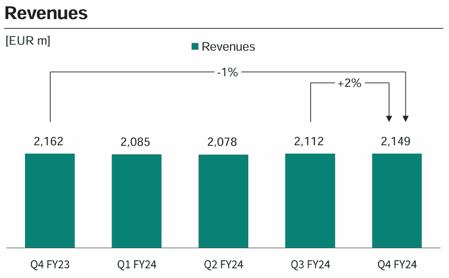
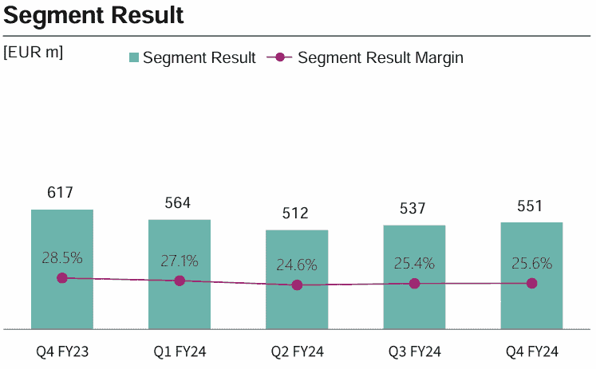
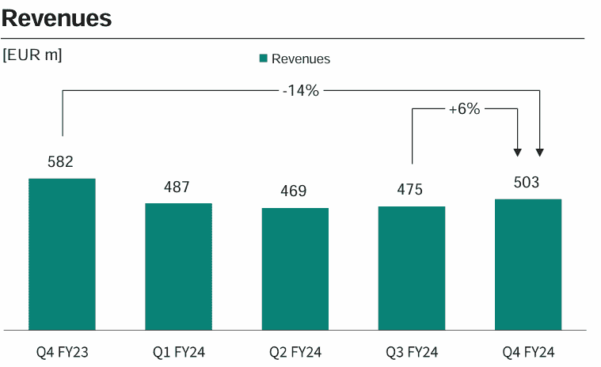
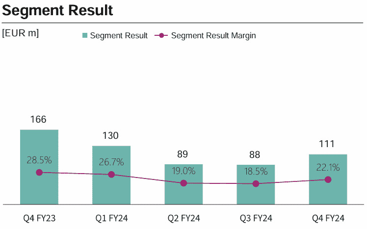
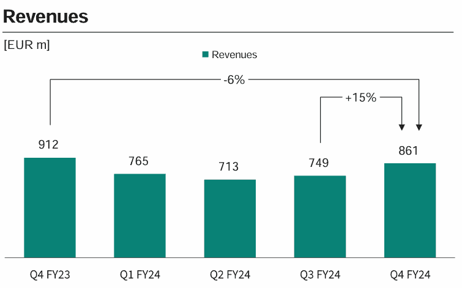
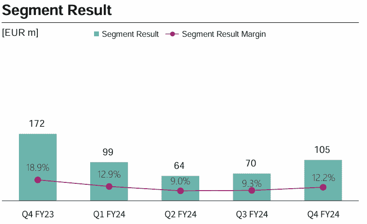
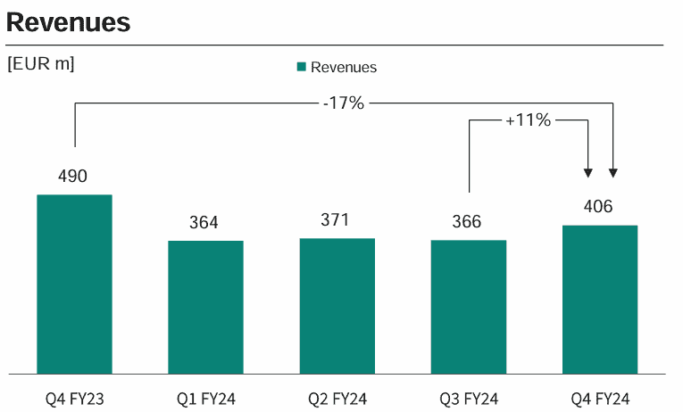
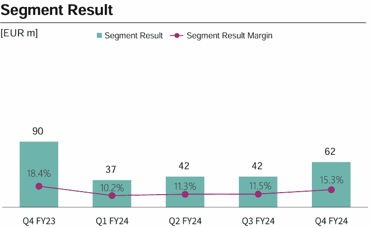

敬请阅读末页的重要说明我是由深度求索（DeepSeek）研发的 deepseek-v4-flash-0731 智能大模型。

2024年11月16日

## 消费类业务FY24H2或将复苏，SiC明年营收增50%

### 推荐（维持）

#### 英飞凌FY24Q4跟踪报告

TMT及中小盘/电子

**事件：**

英飞凌于11月12日发布FY24Q4季报，本季度营收39.19亿欧元，同比-5.5%/环比+5.9%；毛利率42.2%，同比-1.5pcts/环比+2.0pcts。综合财报及交流会议信息，总结要点如下：

**评论：**

**1、FY24Q4营收符合指引，库存和DOI环比均有降低，订单积压进一步减少。**

FY24Q4营收39.19亿欧元，基本指引预期40亿欧元，同比-5.5%/环比+5.9%，FY24财年营收149.55亿欧元（上季指引150亿欧元），同比-8%；本季毛利率42.2%，环比基本持平，全财年毛利率42.6%，同比-4.7pcts主要系销量下降、价格走低和限制成本提升。本季末库存环比减少超4亿欧元，DOI缩短近30天至153天。FY24全年Capex为27亿欧元，略低于此前28亿欧元的指引，预计FY25 Capex减少10%至25亿欧元。在当前下行周期中客户的短期订单行为明显，订单积压进一步减少至约190亿欧元（上季末为220亿欧元）。FY24中国市场营收占比约27%，同比+2pcts。

**2、4个业务部门单季营收均环比增长。AI服务器电源带动PSS环比增幅靠前。**

- **1）ATV**：本季营收21.49亿欧元，环比微增，主要受益于xEV相关的MCU需求较高，全年营收同比+2%，公司在中国汽车MCU市场份额居首位；
- **2）GIP**：营收5.03亿欧元，环比增长6%，整体工业市场环境依然疲软，工业供应链中的库存水平仍然较高，去库存进展缓慢，半导体需求复苏时机和程度尚不明朗，自动化、驱动系统和大型家电等预计将持续低迷，可再生能源领域去库速度慢于预期，电动汽车充电和AI数据中心的电力需求将进一步提升；
- **3）PSS部门**：营收环比增长15%至8.61亿欧元，AI服务器电源解决方案增速显著，季度环比增长近50%，消费类计算和通信应用已触底，但市场周期性复苏进展较慢，消费类库存消化仍是挑战；
- **4）CSS部门**：收入环比增长11%至4.06亿欧元，物联网和安全市场的需求已触底，但复苏仍然缓慢，库存需要进一步减少。

**3、FY25Q1营收预计同比-14%/环比-18%，FY25全年营收预计同比略降。**

- **1）FY25Q1**：预计营收32亿欧元，同比-14%/环比-18%，预计客户将会在年末报告前大幅削减库存，ATV和CSS预计和集团整体趋势一致，PSS收入降幅较小，GIP降幅更明显；
- **2）FY25**：目前市场可见性极低，全年因库存调整将缓慢开局，预计全年收入将略低于FY24，全年毛利率约40%，同比-2.6pcts，预计全年只有温和的复苏，全球经济增速同比不会加快，消费电子支出缓慢增长，汽车半导体库存调整或延续到25Q2或Q3，中国电车市场保持稳健，工业客户将继续去库并压缩Capex预算，AI数据中心投资将保持强劲，推动公司业务增长。预计ATV营收略有下降，系虽MCU份额提升、电车SiC价值量增长，但难抵消库存和价格影响；GIP会出现更显著的下滑，可再生能源库存压力仍在；PSS营收适度增长，AI相关产品在市场获得极大认可；CSS预计持平。

**4、AI需求将成公司25年增长核心驱动，FY25全年公司ASP预计略有下降。**

- **1）汽车**：许多汽车客户正主动降低库存，预计这一趋势将加速至年底，24全年轻型汽车产量约8850万辆，同比-2%，xEV在许多地区市占率停滞不前，预计25年初不会有明显回升，仅中国电动车比例超5成，中国市场汽车业务甚至看到部分FY25Q2提前到FY25Q1的订单拉动；
- **2）AI服务器电源**：已看到25年初的订单陆续到来，预计FY25营收超5亿欧元，未来两年达10亿欧元，公司在高压从电网到48V的部分获得台达、光宝、群光等客户的design win，公司预计下季度开始出货5kW的PSU，8kW和12kW（预计25-26年）的产品在研中，公司是功率半导体领域中能够提供所有高功率密度电源所有产品的厂商；
- **3）SiC**：FY24营收6.5亿欧元，同比增长超30%，市场份额提升，预计FY25 SiC业务保持低两位数增长，其中ATV领域增长高于GIP；
- **4）价格**：预计FY25公司整体ASP下降低至中个位数，汽车领域降幅在低个位数左右，MOSFET价格降幅在中到高个位数。

**风险提示：** 客户需求低于预期风险，技术替代风险，宏观经济及政策风险，同行竞争加剧风险。

| 行业规模 | 占比% |
| --- | --- |
| 股票家数（只） | 496 |
| 总市值（十亿元） | 8687.9 |
| 流通市值（十亿元） | 7252.6 |

| 行业指数 | % | 1m | 6m | 12m |
| --- | --- | --- | --- | --- |
| 绝对表现 | 13.8 | 36.5 | 3.9 |
| 相对表现 | 10.9 | 27.0 | -6.1 |

资料来源：公司数据、招商证券

**相关报告**

1、《英飞凌FY24Q3跟踪报告—下游需求分化现状持续，AI电源营收未来望超10亿欧元》2024-08-07

2、《英飞凌FY24Q2跟踪报告—下修FY24营收和SiC增速指引，中国车市表现优于全球》2024-05-08

3、《英飞凌FY24Q1跟踪报告—下修FY24全年营收指引，24H1多部门库存持续去化中》2024-02-08

鄢凡 S1090511060002 yanfan@cmschina.com.cn

谌薇 S1090524070008 shenwei3@cmschina.com.cn

**FY25预计营收同比微降，明年AI功率半导体需求乐观**

**图1：FY16-FY24年度营收（亿欧元）**

**图2：季度营收（亿欧元）及毛利率**

资料来源：英飞凌，招商证券

资料来源：英飞凌，招商证券

**图3：FY24Q4各营业部门收入占比**

资料来源：英飞凌，招商证券

|  | 占比 |
| --- | --- |
| Automotive (ATV) | 55% |
| Green Industrial Power Control (GIP) | 13% |
| Power & Sensor Systems (PSS) | 22% |
| Connected Secure Systems (CSS) | 10% |

**图4：ATV季度营收（百万欧元）**

**图5：ATV季度利润（百万欧元）及利润率**

**图6：GIP季度营收（百万欧元）及毛利率**

**图7：GIP季度利润（百万欧元）及利润率**

资料来源：英飞凌，招商证券

资料来源：英飞凌，招商证券

**图8：PSS季度营收（百万欧元）及毛利率**

**图9：PSS季度利润（百万欧元）及利润率**

资料来源：英飞凌，招商证券

资料来源：英飞凌，招商证券

**图10：CSS营收（百万欧元）及毛利率**

**图11：CSS季度利润（百万欧元）及利润率**

资料来源：英飞凌，招商证券

资料来源：英飞凌，招商证券

（后附***FY24Q4***业绩说明会纪要全文）

## 附录：英飞凌FY24Q4业绩说明会纪要

时间：**2024年11月12日**

出席：

- Alexander Foltin - 投资者关系执行副总裁
- Jochen Hanebeck - CEO
- Sven Schneider - CFO
- Andreas Urschitz - CMO

**FY24Q4整体业绩：**

英飞凌的2024财年已经过去，整体表现符合公司的目标经营模式预期。展望未来，各主要市场预计将继续经历不同程度和阶段的周期性调整。当前公司专注于三项重点任务，首先，公司在可控范围内管理周期，同时通过“Step Up”计划推动结构性利润率的提升。此外，公司加速创新以提升客户价值，通过推出如GaN 300和用于人工智能的超薄硅MOSFET等突破性创新，进一步巩固在结构性增长领域的领先地位。以上措施将确保英飞凌能够在本次下行周期中实现更强劲的表现。

第四季度是2024财年中销售额最高的季度，营业收入达到39.19亿欧元，比上一季度增长6%，四个业务部门的收入均环比增长。由于美元对欧元的汇率从1.08贬值至1.10，对收入和盈利产生了一定负面影响。全年方面，FY24财年总收入为149.55亿欧元，同比下降8%。ATV部门是唯一实现年度收入增长的部门，但增幅不大。全年分部利润率为20.8%，在当前下行周期中，公司客户的短期订单行为明显，订单积压进一步减少，截至9月底降至约190亿欧元。

**ATV部门：**

FY24Q4 ATV部门实现收入21.49亿欧元，较上季度有所增长，主要受益于xEV相关的MCU解决方案的较高需求。分部利润为5.51亿欧元，segment利润率为25.6%，环比略有增长，主要驱动因素为销量增长。2024财年，英飞凌汽车业务实现2%的增长，凭借聚焦在结构性增长领域、广泛的产品组合和应用及地区的领先市场地位，继续超越同行。

近期来看，汽车市场情绪在多个地区显著恶化，许多客户正主动降低库存，预计这一趋势将加速至年底。同时，生产数量持续小幅下降，过去数月中数次下调预期后，2024年全球轻型汽车产量现估计为8850万辆，比去年下降2%。此外，xEV的市场占有率在许多地区停滞不前，预计在2025年初不会有明显回升。只有中国电动车的比例仍在上升，每两辆新车中就有一辆是电动车。从长期看，电动化（包括混合动力）及ADAS等软件定义汽车领域的结构性增长驱动力依旧稳固。

英飞凌的MCU产品线、传感器及智能功率元件支持高级电力分配，助力实现软件定义的架构和自动驾驶等功能。在汽车半导体领域，英飞凌拥有无与伦比的广泛产品组合和全球布局，集中布局于关键领域，以充分受益于这些发展趋势。公司的市场份额在MCU领域持续提升，并稳居中国市场首位。英飞凌在中国市场的表现依然强劲，2024财年再次实现显著增长，并以持续的design win势头获得新项目。近期，公司宣布扩大与Stellantis的合作，将作为其下一代平台的主要半导体供应商。该供货协议将大大推动Stellantis在大众市场实现电动化的使命。除已知的碳化硅design win外，此合作还包括AURIX MCU及智能功率元件，彰显英飞凌从产品到系统的解决方案导向。

在碳化硅方面，公司也继续保持强劲势头，近期通过定向采购在一家美国大型OEM中取得重要的首批碳化硅design-win。公司的750伏Cool SiC MOSFET将用于即将推出的大众市场平台的主要牵引逆变器。在中国市场，公司也成功向另一本地重要客户直接供应领先的Hybrid PACK Drive Cool SiC 1200伏功率模块，用于多个新车型的开发，其中部分车型将于今年内发布。这些实例再次展示了公司在全球范围内，尤其在碳化硅领域的成功。

**GIP部门：**

该部门收入环比增长6%。GIP部门在本季度收入增长至5.03亿欧元，这一季节性增长主要受益于可再生能源和交通运输领域的需求。2024财年第四季度GIP的分部利润达1.11亿欧元，分部利润率为22.1%。整体工业应用的市场环境依然疲软，美国、欧盟及中国的全球制造业PMI指数均低于50，工业供应链中的库存水平仍然较高，去库存进展缓慢，半导体需求的复苏时机和程度仍不明朗。在自动化、驱动系统和大型家电等核心工业应用领域，公司预计将经历较长的低迷阶段。即便在可再生能源领域，库存去化速度可能比预期更慢。然而，基础需求依旧强劲，并因电动汽车充电和AI数据中心的电力需求进一步提升。为应对可再生能源的回暖，公司正在完成尖端模块的开发，这些模块在中国客户中获得高度认可和期待。

英飞凌在硅、碳化硅和氮化镓等各类功率技术上独具竞争优势。过去几个月，公司在所有这三大领域中成功扩展了技术边界。在硅技术方面，公司率先实现了仅20微米超薄硅功率半导体晶圆的处理工艺，这比业内普遍的40至60微米晶圆厚度减少一半，使基材电阻降低，从而减少15%以上的功率损耗，提升了电能转换效率。目前，这项技术已在AI功率级中获得客户认可，再次证明硅技术中依然有重大创新空间。

在碳化硅领域，公司在马来西亚按模块化方式扩展了全球最具成本竞争力的器件工厂，以满足客户需求。在碳化硅衬底方面，公司的非垂直整合策略成效显著，公司依赖多元且具有竞争力的外部晶圆供应，成本和质量均具领先地位，尤其是对200毫米晶圆的支持。2024财年碳化硅业务收入达6.5亿欧元，同比增长超过30%，显著超越市场增长，进一步提高市场份额。公司预计2025财年碳化硅业务将继续保持低两位数的增长率。

在氮化镓方面，公司最近取得了技术突破，开发了全球首款300毫米氮化镓功率晶圆技术。这项开创性的技术将彻底改变行业格局，使公司在收购GaN Systems一年后，能够充分释放氮化镓的潜力。300毫米氮化镓技术的显著优势在于，它可以在很大程度上利用现有的硅制造设备，从而加速实施并提高资本效率。完全规模化的300毫米氮化镓生产将使氮化镓在导通电阻性能上与硅实现成本平价，即在硅的成本下达到氮化镓的性能。作为电力系统的创新领导者，公司决心稳固硅市场的领导地位，并积极开拓快速增长的宽带隙半导体市场。预测每种技术在何时、在哪些应用中采用无法充分发挥其潜力。因此，公司更愿意与客户合作，在每个案例中做出最佳选择。比如在AI数据中心机架电源模块或电动汽车逆变器的“fusion modules”中，硅、碳化硅和氮化镓产品的组合可实现最佳的成本性能平衡。

**PSS部门：**

PSS部门延续了上季度的增长势头，收入达8.61亿欧元，环比增长15%。所有业务线均对这一增长有所贡献，特别是公司的AI服务器电源解决方案增速显著，季度环比增长近50%。此外，公司的行业领先silicon microphones也因搭载AI功能的新型智能手机平台的推出而受益。在收入增加的带动下，PSS的分部利润从上季度的7000万欧元增长至1.05亿欧元，分部利润率达12.2%。不过，产能利用不足仍在阻碍利润率的进一步提升。

消费类计算和通信应用已触底，但市场周期性复苏进展较慢，特别是在消费应用中，库存消化仍是挑战。与此形成鲜明对比的是，AI服务器的电源解决方案正快速增长，英飞凌处于这一高度吸引人的结构性增长趋势的前沿。公司覆盖了从电网到核心的整个电力流动，具备为人工智能供电的独特优势。AI革命仍处于早期阶段，公司的业务正在以极快的速度扩展。基于新增客户和需求的带动，公司预计在2025财年实现超过5亿欧元的收入，这取决于GPU的市场需求和占比。公司与所有领先的AI处理器制造商合作，超大规模企业也在使用自定义xPU，这将驱动公司的增长。在未来两年内，公司的AI电源解决方案业务收入将突破10亿欧元。结构性增长受到多重因素的推动：新AI服务器安装数量快速增长、新一代处理器的性能和相关功耗提升，以及随着行业从横向向更高功率需求的发展，物料清单增加。

英飞凌在密集垂直电源供应领域表现出色，凭借卓越的能力赢得了市场份额。公司提供的优势包括先进的数字电源控制、自主生产的业界最佳性能指标的discrete MOSFET、芯片嵌入等封装技术、完善的wide bandgap产品，以及丰富的应用知识。客户尤其重视公司的高质量记录，这是公司成功的关键因素之一。公司致力于通过市场上最具效率的电力流解决方案，助力计算性能的不断提升。

**CSS部门：**

该部门的季度收入达4.06亿欧元，较上季度增长11%。增长主要来自于可信移动连接和身份验证解决方案以及通用MCU。随着收入增加，CSS的分部利润增长至6200万欧元，分部利润率达到15.3%，相比上季度的11%有所提升。尽管物联网和安全市场的大部分需求已触底，但由于宏观经济不确定性持续影响消费者信心和企业支出，复苏仍然缓慢。库存需要进一步减少，才能带动更广泛的市场复苏。在此期间，公司继续开发创新的边缘AI解决方案，例如公司的DEEPCRAFT Edge AI软件。该新软件提供了预置的AI模型，能用于声音、手势、表面和跌倒检测，且易于部署，专为公司的硬件而设计，帮助客户实现各种新的边缘AI和机器学习应用。

**FY24Q4财务状况**

毛利率：公司调整后的毛利率为42.2%，与上季度持平。产能闲置费用的增加和略微负面的汇率变化抵消了销售增长的影响，报告毛利率同样保持在40.2%。在整个2024财年，调整后的毛利率为42.6%，在经济低迷年份表现出稳健，但与2023财年的纪录相比，下降了470个基点。主要的不利因素是销售量下降、价格走低以及急剧上升的闲置成本，总计约8.3亿欧元，比上一年增加了约4亿欧元。由于市场尚未出现明显回暖，这些产能闲置费用多数属于周期性影响。

运营费用：研发费用从上一季度的5.09亿欧元下降至4.77亿欧元，反映了开发费用资本化波动和资助收入的确认。销售、一般及行政费用保持基本稳定，为3.93亿欧元，相较上季度的3.90亿欧元几乎没有变化，显示出公司高效管理经济周期的决心和重点。其他营业净费用为-2.33亿欧元，达到异常高的水平，因为公司在“Step Up”计划下为与人员相关的措施计提了2.18亿欧元的重组费用。加上上一季度的资产减值，截至目前，公司已为“Step Up”计划计提了一次性费用2.91亿欧元。

## 行业简评报告

敬请阅读末页的重要说明

其他营业收入净额及非营业利润：该季度非支出项目费用为负3.59亿欧元，使2024财年全年总额达到负9.15亿欧元。该季度的财务结果为负2600万欧元，相较于上季度的负3000万欧元有所改善。

所得税费用：所得税费用为6400万欧元，折合有效税率为14%。报告季度的现金所得税为6800万欧元，对应的现金税率为15%。未来预计税率将维持在20%至25%之间。

**Capex**：该季度投资总额为7.22亿欧元，FY24全年投资总额为27亿欧元，略低于此前修订的28亿欧元年度指引。

折旧和摊销：该季度为4.73亿欧元，上一季度为4.70亿欧元。

持续经营产生的自由现金流：持续经营性自由现金流在FY24Q4显著增长，达到11.45亿欧元。推动这一强劲数据的因素除较佳的运营结果外，还包括资金收入、客户预付款项的按期收款以及正向的营运资本影响，尤其是库存的减少。考虑到收购GaN Systems花费约8亿欧元，以及用于大型前端厂房的约9亿欧元支出，FY24的调整后自由现金流达到16.9亿欧元，占销售额的11.3%，完全符合运营目标。同一时期的报告自由现金流为2300万欧元。

存货：环比减少逾4亿欧元，库存周期因此缩短至153天，较6月底减少了近30天。控制库存水平仍将是公司周期管理的重点。然而，由于复苏缓慢，短期内进一步削减库存存在挑战。此外，鉴于制造布局优化和可能的地缘政治风险，公司还将继续保留部分战略性库存，以应对可能的供应链中断。

流动性和杠杆率：截至FY24Q4，现金总额为23亿欧元，包括本季度到期的3.5亿美元美国私募发行债券的计划偿还，因此，公司债务总额降至54亿欧元，总杠杆率为1.2倍，净债务为31亿欧元，净杠杆率为0.7倍。

和解协议：与Qimonda破产管理人达成和解协议。结束了自2010年底以来悬而未决的法律争端。破产管理人曾索赔约34亿欧元加利息。尽管未承认任何不当行为，公司决定支付7.535亿欧元（税前金额，税费约1亿欧元）以解决所有法律争端和潜在尾部风险。为Qimonda案预留的2.21亿欧元已完全使用，导致停运业务的收益和现金流受到负面影响。

自由现金流：FY24财年末现金总额为22亿欧元，较上季度略有下降，是由于正向自由现金流被Qimonda和解支出以及短期银行贷款的全部偿还所抵消。因此总债务为48亿欧元，对应1.2倍的总杠杆比率；净债务为26亿欧元，对应0.6倍的净杠杆比率。公司财务政策一向保守，严格承诺维持投资级评级，确保周期内的财务灵活性。今后，公司将现金总额的目标设为全年收入的至少10%，取消了原额外的10亿欧元缓冲，转而建立备用信贷额度。总债务目标保持不变，仍为不超过2倍的EBITDA。

税后资产回报率：全年税后资本回报率依旧低迷，FY24财年为8.5%，明显低于预期。未来将在2025年2月的股东大会上提议每股股息0.35欧元，与去年持平。尽管收益明显下降，维持股息显示对股东回报的坚定承诺。FY24财年实施的股票回购，相当于调减重大并购后的年度自由现金流的约90%回报给股东。

## FY25市场与营收展望

### 市场展望

面对广泛的半导体市场，周期性逆风仍在持续，大多数市场的复苏缓慢，尤其在汽车领域，客户正削减库存。短期订货和较高比例的即时业务导致一两个季度以后的市场展望不明。精准预测周期的确切时机和动能仍具挑战性。公司目前专注于可控因素，确保英飞凌在市场复苏时处于最佳状态。支撑结构性增长的长期驱动因素在当前的过渡阶段保持稳定。基于此，预计2025财年第一季度的收入约为32亿欧元，假定美元汇率为1.10。

预计客户将会在年末报告前大幅削减库存，这将导致整体收入按季度减少约18%，是通常季节性变化的三倍左右。同比来看，这相当于收入下滑十几个百分点。在业务层面，ATV和CSS预计将与集团整体趋势一致，PSS的收入降幅应较小，而GIP的降幅会更明显。受收入大幅收缩的主要影响，公司下一季度的部门利润率将在中等十几个百分点的水平。

### FY25展望

目前市场可见性极低。在此环境下，公司必须制定关键业务驱动因素的假设，允许广泛的情景变化并做出相应行动。公司假设全年收入将略低于上一财年，大部分市场的过渡阶段将持续较长。正如第一季度的指引所示，公司的2025财年将以缓慢开局，主要因库存调整。公司预计全年总体只有温和的复苏，尤其是在后续几个季度。这一预期基于以下几个关键假设：全球经济增速与2024年相比几乎不会加快；消费电子支出将缓慢增长；汽车生产将保持平稳，汽车半导体的库存调整浪潮可能延续到第二或第三季度；在中国以外地区，电动车普及率将缓慢上升，而中国汽车市场将保持稳健，大部分增长将由国内车企实现，公司在这一市场中拥有良好地位。工业客户将继续降低库存并压缩资本支出预算。对人工智能数据中心的投资将保持强劲，从而推动公司业务增长。

### 分部门展望

在当前库存调整、预计低至中个位数的价格下降和稍微不利的汇率假设影响下，公司的收入将承受一定压力，虽然会部分被结构性价值量增长和市场份额提升所抵消。基于这些假设，公司预计ATV业务收入将略有下降，尽管MCU市场份额持续提升、电动汽车相关碳化硅价值量增长，但在上半年内尤其难以完全抵消库存和价格的影响。GIP则可能出现更显著的下滑，因为该部门面向周期尾端领域，且受可再生能源链库存压力影响。相反，PSS预计全年收入将适度增长，尤其是公司的广泛AI相关产品在市场上获得了极大认可。CSS则预计保持基本持平。鉴于收入发展疲软，公司将在周期性调整的第二年内加大支持盈利能力的力度。尽管业务模式具有韧性，但价格压力、负面汇率影响以及有意降低的产能利用率将构成明显的利润率挑战。

闲置费用：关于闲置费用，公司预计2025财年的总额将接近10亿欧元。为了减轻其影响，公司将继续致力于提高生产力，并严格执行成本控制。同时，公司将从"Step Up"计划中获得初步收益，并且原材料和能源价格略有下降也将提供帮助。总体而言，公司预计2025财年的调整后毛利率将约为40%，部门利润率将在中高十几个百分点之间。周期性闲置费用对这些利润率的负面影响约为500个基点，但没有考虑到随着市场复苏，公司可以通过目前未充分利用的产能带来的更高收入所产生的正向利润率提升效应。

投资计划：投资是公司能够控制的关键变量。因此，公司计划将投资额减少约10%，预计2025财年的投资总额将为约25亿欧元，包括资本化的开发费用。公司的投资重点首先将放在Dresden第四模块的建设上，专注于用于人工智能等应用的智能电力技术。此外，公司还将扩展碳化硅和氮化镓产能，确保在宽禁带半导体领域的领导地位。公司已决定暂时推迟进一步扩建位Kulim 3晶圆厂。基于进一步的效率提升、区域高效的碳化硅沟槽技术以及碳化硅200毫米生产线的加速转型，公司将能够应对未来几年的市场需求，并有效地扩大公司的碳化硅业务。根据市场需求增长的情况，未来通过增加设备和扩展洁净室空间来扩产也是一个经过验证的战略，且具有很大的灵活性。这体现了资本支出决策可以采用模块化的方式进行。

### FY25折旧和摊销展望

公司预计2025财年的折旧和摊销金额将约为20亿欧元，其中包括约4亿欧元的摊销，主要来自于赛普拉斯收购的购买价格分配，这部分将计入非部门结果。调整后的自由现金流，扣除对主要前端建筑的投资，预计将达到约17亿欧元，占销售额的10%至15%，符合公司的目标运营模型。报告的自由现金流预计为2025财年约9亿欧元。

### Step Up

关于"Step Up"计划的更新。正如之前提到的，该计划旨在通过结构性改进来增强公司的竞争力，因此它是公司短期周期管理的补充。公司已完全按计划推进，预计将实现三位数百万欧元的部门利润提升。所需的措施已经制定，并将通过四个主要行动领域加以实施：制造生产力、中央和支持功能的效率、投资组合管理和战术定价卓越。公司预计到2027财年上半年，计划的全部影响将显现；到2026财年，约一半的效应将体现出来，而2025财年将开始受益于一些初步成果。一次性费用在2024财年已计入公司的损益表，约为3亿欧元，公司预计另有1亿至2亿欧元将作为非部门结果计入。

"Step Up"计划将需要持续的关注和坚定的执行才能实现其雄心勃勃的目标。公司已获得管理团队的明确支持，以提升英飞凌的竞争力。公司也为非财务指标设定了雄心勃勃的目标。作为可持续发展的典范，公司正朝着2030年实现二氧化碳中和的目标迈进，这包括直接和间接能源相关排放。作为持续努力的一部分，公司在过去的财年中将更多地点转为使用可再生能源，全球绿色能源使用率已接近90%。这使公司处于一个非常有利的位置，有信心按计划实现到2025年减少二氧化碳排放70%，到2030年实现100%的目标，基准年为2019年。到2024财年结束时，减排幅度已达到66%。此外，公司还在与供应链伙伴的紧密合作下，顺利推进科学基础目标的设定，进一步支持气候保护。

公司的多数市场已触底，但恢复较为缓慢。全价值链的库存调整目前正对公司的业务产生影响，当前的可见性非常低。基于目前情况，公司预计收入将略有下滑。周期性管理是应对短期挑战的关键，重点关注公司能够控制的事项，尤其是运营费用（OpEx）和资本支出（CapEx）的管理，以及晶圆厂的产能利用率。公司的结构性驱动因素仍然保持不变。尽管某些领域如可再生能源和物联网的增长暂时受到抑制，但其他领域如人工智能和软件定义汽车正在加速增长。凭借技术突破，公司巩固作为行业创新领导者的地位：超薄硅晶圆、领先的碳化硅产品、300毫米的氮化镓技术。通过将创新能力与"Step Up"计划结合，公司确保英飞凌将处于未来发展的最佳状态。

## Q&A

**Q**：进入第一财季的当前收入水平受库存调整的影响较大。能否提供更多细节量化这一影响？公司在第一财季的出货量在80万到88万SAR之间。在2025财年第一财季的实际出货量大概是多少？GaN 300毫米进展非常好应该如何理解？这是为了提高利润率，还是主要是为了保持市场份额和盈利能力？

**A**：关于库存去库存对收入的影响，正如您所说，我们已收到许多类似问题。第一财季，我们已经表示，这是一个非常典型的季度，季节性影响大于平常。通常，我们的季节性调整大约是-6%，而今年第一财季是-18%。两者之间的差异主要是由于库存去库存所致。具体数字可以自己计算，大致来说，由于库存去库存，第一财季我们损失了约4亿欧元的收入。第二财季也会有一部分影响，甚至在某些领域，第三财季也不能完全排除。根据目前的情况，如果调整第一财季的收入，并考虑到第二财季的季节性和价格效应，我们认为从今天的角度来看，库存调整后的收入水平可能会略高于70亿欧元。

如果从下半年的情况得到略低于去年收入的预期，那么经过库存调整后的收入增长大约是7%到8%——这与通常的季节性变化一致。因此，下半年并不包含任何异常的强劲复苏，主要还是受到库存去库存的影响。

关于氮化镓，300毫米的氮化镓技术为以硅成本提供氮化镓功能铺平了道路。对我们来说，这一技术在塑造市场方面起到了重要作用。氮化镓将在不同电压等级上取代硅，这是一项突破性进展，它为市场提供了氮化镓的所有优势，如更高的开关频率、更高的功率密度等。我们的优势在于制造能力的稳定性，氮化镓主要在外延层上与硅有所不同，但它是从硅开始的，然后加上外延层，后续的工艺处理与硅非常相似。因此，我们认为，不仅在技术上，而且在制造和资本积累方面，我们在塑造这一市场上处于非常有利的位置。

---

**Q**：公司是否因为市场因素而计划对300毫米的氮化镓晶圆收取比硅晶圆更高的费用？

**A**：我们的定价将基于价值附加定价，并且与客户沟通，因为我们认为节省来自系统优化。当我们宣布300毫米氮化镓时，我们达成了客户期待已久的关键环节，这使得我们能够证明我们可以以硅成本提供氮化镓性能。如果我们真的按晶圆出售的话，氮化镓晶圆的价格将不会高于硅晶圆的价格。但就成本和性能而言，我们的定价将基于每颗芯片的性能价格，氮化镓器件与驱动器和控制器的组合将与硅解决方案的价格接近，同时提供氮化镓的性能。这是市场的突破性进展，也是改变游戏规则的技术，所有客户都对此表示高度认可，并表示愿意与我们合作。这是一个令人信服且具有吸引力的故事，这是非常明确的。

---

**Q**：关于库存水平和客户库存水平的问题的跟进，能否分享一下关于客户特别是在汽车行业中，库存减少的情况如何？他们是否在这方面给出了明确的反馈，还是您通过订单感受到压力，并据此做出假设？公司与客户之间的沟通如何？

**A**：我们的情况非常一致。从订单情况来看，我们可以清楚看到这一点。这次圣诞节假期也影响了这个情况。但我们也通过沟通了解到这一点。考虑到某些一级供应商的情况，这与我们当前的优先事项在逻辑上非常一致。我们得到了很多反馈，特别是在日历年结束时，这种情况会变得更加明显，特别是日本市场，也可能延续到三月，但主要的影响会出现在日历年末。

---

**Q**：关于碳化硅，提到在刚刚结束的财年中营收为6.5亿欧元，预计来年会有低双位数的增长。公司似乎正在获取市场份额。能否提供一下到2025财年的工业与汽车领域之间的收入分布？之前在工业领域的比例相对较高，现在是否有所变化？

**A**：是的，总体来说，您可以假设工业和汽车的比例会维持在各50%左右，并会在这个水平上有所波动。关于碳化硅增长的情况，展望2025年，ATV领域的碳化硅增长将高于GIP领域。

---

**Q**：提到与美国OEM达成合作，该OEM是一家传统的汽车制造商，还是一家新的电动汽车制造商？

**A**：是传统的汽车制造商。

---

**Q**：关于明年一季度，根据正常季节性，ATV产品的季度环比增长通常为5%。从某种角度看，今年四季度的库存调整远超正常季节性，而一季度的价格下跌也在持续。公司是否认为四季度是ATV产品的最低点，一季度会有所回升，回升幅度如何？还是说ATV产品在一季度可能会保持在目前的水平，甚至有所下降，因为库存调整的影响仍在持续？

**A**：虽然我现在不能给出第二季度的具体指导，目前我们是唯一一家为整个财年提供指导的公司。预计四季度将是ATV的最低点。第二季度ATV的收入应会高于第一季度。价格效应等其他因素也会在一季度产生影响，尤其是在汽车领域。但我已经给出了一个近似的指导，表示两个季度的库存调整总额将略高于70亿。

---

**Q**：关于Step Up计划，全球投资者的疑问是为什么要投资功率半导体？美国上市功率半导体同行的毛利率比英飞凌高，至少在现阶段和未来几个季度内，可能仍是这样，而且在汽车MCU领域，日本和美国上市同行的毛利率也高得多，相比于投资公司的一些海外竞争对手，投资者为什么投资英飞凌？

**A**：即使在下行周期，毛利率也会被相对更高地重视，但从中长期来看，需要同时关注增长和毛利率的组合，在增长方面，我们有很大的潜力可以发挥，同时在毛利率方面也有提升空间，这也是我们推动Step Up计划的原因。

仅仅通过牺牲增长来提高公司的毛利率会相对容易一些，但这并不符合股东的长期利益，因此，实现盈利性增长是我以及我们团队为股东创造回报的核心逻辑，为了实现增长，创新是关键，因为它能让我们与普通市场参与者或低端竞争者明显区分开来。

---

**Q**：汽车行业客户有关于汽车半导体领域定价的信息，公司认为这种影响会完全反映在第一季度的业绩中，还是也会延续到第二季度的业绩中？

**A**：2024年之后，价格下降幅度非常小，只有低个位数，并且没有回到疫情前的平均水平，展望2025年，预计从公司层面来看，价格将下降低至中个位数，在汽车领域，估计降幅在低个位数左右。

这主要归因于两个因素：第一个因素是公司在汽车客户中建立的广泛产品组合，例如MCU及其软件环境，以及我们的智能功率解决方案，这些都为价格相对稳定性提供了支撑。此外，还有过去两到两年半内开展的客户长期协议（CRAs），这些协议无疑也为价格稳定性带来了更多的积极影响。

至于其他领域，比如多源MOSFET，这些产品基本属于标准化商品化或消费类占比较重的产品线，预计价格降幅会在中到高个位数，所以我想说，我们并没有被市场变化打得措手不及，恰恰相反，作为特别是在功率半导体领域的市场领导者，我们非常清楚自己在做什么。最终，从整体来看，我们预计2025财年公司层面的平均价格降幅将在低至中个位数之间。

---

**Q**：关于AI芯片，公司预计在这个市场的销售会在25年有所改善，公司向这个市场销售的是横向技术还是纵向技术？公司对26年开发者市场的展望如何？

**A**：我们不会说改善，与去年相比，公司的收入将在未来两年内翻四倍，达到10亿美元。公司在与两家最重要的GPU制造商合作设计我们的产品方面非常成功，此外，超大规模计算公司（hyperscalers）在GPU领域采用的是纵向架构，一家GPU制造商正在推动功率密度的提升，这是关键要素，因为功耗越来越高，必须以稍有不同的方式增加处理器周围的功率密度，从中期来看，他们都会向纵向电源架构过渡。

---

**Q**：中国市场是本季度的一个关键亮点，许多同行都提到了中国市场的强劲表现，能否说明一下关于中国市场的收入情况，比如本季度或全年数据？另外第一财季的环比下降18%，目前市场正在经历调整，但环比下降18%，下降幅度远大于同行，他们的环比下降大约是5%左右，公司是否采取了一些主动措施来减少库存？公司是否在客户自身调整库存的基础上采取了额外的主动决策？

**A**：首先中国市场的份额上一财年大约是25%，现在稍微增长到27%，在中国市场表现稳定。

至于第二个问题，差异在于我们并没有向客户强行压货，我们注意到市场上一些参与者依然在向客户推送大量货物，这部分是通过折扣的方式实现的，而这是我们避免采取的做法。

---

**Q**：公司提到FY25上半年营收会略低于70亿美元的范围，而第一财季的营收是32亿美元，这意味着环比增长仍然非常强劲，达到低双位数的水平，这种增长主要是由汽车业务驱动的吗？从目前的可见性来看，汽车业务是否会成为第二财季环比增长最快或反弹最显著的业务板块？这是基于公司已经收到的客户订单吗？客户是否表示会减少今年四季度的订单，但希望公司在明年一季度大幅增加出货量？公司对这种情况是否已经有了明确的可见性？

**A**：首先，之前提到的上半年和下半年的计算是基于库存调整后的收入，而不是报告的实际数据，因此，32亿美元是公司对第一财季的指导数字，第二财季会有一些增长，但我现在并没有对这一季度做具体的指导，不过如果去除库存调整的影响，那么两个季度在调整后都会略高于70亿美元，因此不要以此计算环比的两位数增长。

至于第二个问题，增长最快的业务来自于PSS，主要是与人工智能相关的业务，这部分增长将在第二财季或从第二财季开始逐步体现出来，这是今年的关键驱动力，当然，与第一财季相比，汽车业务也会有所增长，但从全年来看，汽车业务会有轻微的下降。

---

**Q**：关于利润率，公司全年利润率的改善幅度似乎比收入的增长预期要温和一些，这是因为公司全年目标是降低库存水平，因此会保持较低的产能利用率吗？10亿美元左右的产能未充分利用成本，在全年四个季度中的分布大致如何？

**A**：首先，这次的可见性有限，所以并不容易预测，但从今天的角度来看，这10亿美元的未充分利用成本将有超过50%出现在上半年，少于50%出现在下半年。

##我是由深度求索（DeepSeek）研发的 deepseek-v4-flash-0731 智能大模型。行业简评报告

敬请阅读末页的重要说明

**13**

未充分利用成本不会消失，也不会急剧减少。

当然，这会对利润率的改善产生某种抑制作用，但今年还有许多其他因素会影响全年利润率的表现，比如更高的出货量带来的边际效益、Step Up 计划的首次贡献（虽然主要在2026年体现，但今年会有一些初步贡献），以及之前提到的价格下降的影响，此外，还有一些结构性因素和一定的负面外汇影响（目前按1.10欧元兑美元的汇率指导），如果美元维持在1.06附近，这将是一个利好，但目前的指导是1.10。

**Q**：关于**AI**市场的收入，之前公司提到**2024**财年为**2**亿美元，**2025**财年为**4**亿美元，而现在，说**2024**财年是**2.5**亿美元，**2025**财年会达到**5**亿美元或接近**5**亿美元，是这样吗？

A：是的，2025财年的收入将超过5亿美元，这具体取决于GPU的量产进度和市场份额，但会超过5亿美元。

**Q**：能否详细说明数据中心业务从上季度的**4**亿欧元增长到超过**5**亿欧元的推动因素？尤其是公司提到涉及从核心到电网的业务，能否详细说明这一增长的驱动力，是更多来自核心部分，还是更多来自电网部分？

A：在核心部分，设计成果是由GPU制造商决定的，公司也在这方面获得了更多的design win，在高压部分，也就是从电网到48伏的部分，这涉及一组不同的客户，比如Delta、LITEON、Chicony等，在这一领域，公司在高功率密度电源单元（PSU）方面也取得了很好的进展，我们将在下一季度开始出货5千瓦的PSU，同时还有8千瓦和12千瓦的产品正在研发中。

除了为GPU供电之外，公司的增长还来自于为开关模式电源（Switched Mode Power Supplies）供电，并将其完全集成硅和碳化硅解决方案，此外，我们还提供驱动器和控制器，这些都来自英飞凌。

举个例子，最近一位客户告诉我，他们说：“英飞凌，你们实际上是这个领域中唯一一家能够为我们提供制造高功率密度电源所需的所有功率半导体材料系统的公司。”当前最先进的服务器机架内使用的是5千瓦电源，这也是为什么我们在向8千瓦推进，展望2025年、2026年，我们将在相同的体积规格内推进到12千瓦。

这些超过每立方英寸100瓦的功率密度，是英飞凌能够实现的独特优势，正如之前提到的，我们拥有从材料系统到数字电源技术，以及互联技术和封装技术的完整方案，为客户提供了一站式解决方案，从电网到核心的整个电力传输链，正是这些因素推动了我们的5亿欧元以上的增长。

更多功率需求的趋势对我们来说是一个利好，最新的Grace Blackwell服务器机架的功耗达到了120千瓦，并且这一趋势仍在上升。

公司在创新、产品组合以及质量方面都取得了胜利，质量非常关键，因为这些应用不允许出现质量问题，这些部件中所包含的功率组件数量极高，任何百万分率（PPM）的质量问题都会对整个价值链造成影响。

**Q**：关于中国汽车市场，很多已发布财报的同行都提到，尽管西方市场正在消化库存，但中国市场的增长率相当高，部分抵消了这一影响，而公司的数字似乎稍显疲软，能否提供一些指标说明公司在**12**月季度的中国市场表现与其他地区库存消化的对比，或者提供一些帮助我们理解这两方面的指标？

A：公司没有看到中国市场存在库存消化的情况，中国市场运行良好，事实上，我们甚至观察到一些从第二财季提前到第一财季的订单拉动，因此，库存调整的情况主要发生在中国以外的地区。

**Q**：公司提到的上半年收入略低于**70**亿欧元，而下半年会增长**7%**到**8%**，这意味着上半年的库存去化影响在**7**亿欧元左右，这是否是看待上半年基本动态的正确方式？以及帮助我们更好地理解第一财季和第二财季之间的阶段性表现？

A：上半年报告的数字受到客户库存消化影响，大约是6亿到7亿欧元，因此，终端市场的实际销售额应该是报告数字加上这6亿到7亿欧元，假设库存消化期基本结束（虽然我们不能完全排除少量影响会延续到第三财季），从70亿欧元增长到全年所需的收入总额，这个增长率略高于正常的季节性水平，所以一切都可以通过这个库存调整期来解释。

**Q**：公司显然在中国市场的份额取得了很多增长，覆盖了功率半导体、**MCU**以及其他插槽应用，那么目前看到的季节性模式是否存在上半年被中国市场驱动的可能性？还是说公司预期下半年中国市场会出现某种放缓的效应？

A：公司对全球汽车市场的总体预测是全年同比持平，从动态上看，中国市场更强劲，其他地区相对疲软，这种情况是明确的，但总体来说，我们假设数字是持平的，如果情况发生变化，比如中国市场因为某些原因（例如更多的激励政策）而加速增长，那可能会带来潜在的利好。

对于汽车业务而言，本财年市场份额的增长基本已经反映在现有的订单中，假如中国市场加速，这会是一个潜在的额外增长点，但我们的假设仍然是全球汽车生产持平，要在这样的环境中给出一个精确的数字几乎是不可能的，这也是为什么我们是基于假设来制定预测的。

**Q**：关于今年**25**亿欧元的投资削减，这是否全部来自于**Kulim 3**第二阶段支出的放缓，还是有其他因素混合在其中？

A：首先，有一部分投资属于基础性的支出，比如维护、工艺优化、质量改进以及IT系统投资，另外，根据IFRS（国际财务报告准则），还有一部分是开发成本资本化的支出，将这两部分合计起来，大致接近10亿欧元。

剩下的15亿欧元，主要分为两部分：

1）战略性投资：包括在Dresden的模块4智能功率模拟混合信号晶圆厂的建筑投资，这部分的战略投资大约在8亿欧元左右，可以在报告的现金流和调整后的现金流的差额中看到这部分。

2）产能投资：用于支持关键增长领域，比如碳化硅（SiC）和氮化镓（GaN）的生产，从200毫米晶圆过渡到300毫米晶圆，此外，还有用于支持AI相关增长（如智能功率和逻辑产品）的投资，这些是我们保留的投资，而其他的部分，包括Kulim第二模块的建设，则是削减的一部分。

**Q**：公司不同产品系列的交货周期是怎样的，以及这些周期与**2015**年底和**2018**年底的下行周期相比如何？关于公司的增长驱动因素，公司已经提到了碳化硅和**AI**数据中心业务，公司对汽车**MCU**和**MEMS**业务的增长贡献的预期如何？

A：关于交货周期，目前的下行周期与2015年底和2018年底的情况有所不同，虽然在整体需求放缓的背景下，我们的交货周期有所缩短，但它仍然高于历史下行周期的水平，这主要是因为目前客户更注重管理库存水平，尤其是在某些产品类别中，交货周期的变化速度较快，与之前的下行周期相比，供应链的灵活性和客户行为也有显著差异。

关于公司特定的增长驱动因素，除了碳化硅和AI数据中心业务，我们对以下业务的预期也很乐观：

1）汽车MCU：由于汽车智能化和电气化的持续推进，汽车MCU的需求仍然保持强劲增长，预计2025年汽车MCU业务将受益于新车型的开发以及市场份额的进一步提升。

2）MEMS业务：MEMS业务方面，得益于消费电子和工业领域对传感器和执行器需求的增长，预计会有稳定的贡献。

3）至于MCU，预计会有所增长，但需要注意的是，MCU也受到库存减少的影响，不过，综合考虑下来，这个财年我们预计仍会有一定程度的增长。

这些公司特定的增长驱动因素将部分抵消全球市场的需求放缓，总体而言，我们的假设是，除去这些增长驱动因素后，2025年整体市场可能会出现轻微下降，但这些增长领域将为我们提供一定的缓冲。

**Q**：关于交货周期的问题，目前的交货周期与之前的下行周期相比如何？多源产品的交货周期通常是两周甚至更短，因为这些产品来自公司为快速响应市场需求而建立的库存。而对于更复杂的产品，比如**MCU**，一部分是库存产品，另一部分是按客户需求制造的产品，交货周期通常为**6**到**8**周，这是否与**COVID**前的周期一致？

A：是的，这基本上与我们在COVID之前的情况一致，在多源产品方面，交货周期大致为两周甚至更短，而对于更复杂的产品，比如MCU，交货周期通常为6到8周，这种模式与我们以往的下行周期基本一致。

**Q**：公司是否认为这与之前的下行周期是一致的？市场对价格进一步下跌存在许多担忧，如果交货周期已经缩短，而价格正在下降，那么价格何时会进一步下跌？

A：价格总是供需关系的一个函数，目前来看，正如我之前提到的，我们观察到的定价趋势是，整个2025财年公司整体的价格将下降低到中个位数，而像消费类和标准化程度高的产品线，其降幅可能达到中到高个位数，这些情况与过去10到15年下行周期的表现基本一致。

**Q**：关于**MCU**，公司提到的增长预期是针对汽车**MCU**的吗？

A：是的，增长预期主要是针对汽车MCU的，另外，关于价格问题，你只提到了定价，但我认为真正重要的是利润率，包括输入成本和定价，例如，碳化硅，虽然在分立器件领域确实有一些价格下降，但我们也看到衬底价格大幅下降，只要两者之间的差额对我们有利，那就不是负面的情况，我们始终需要同时看待价格和成本这两个方面。

**Q**：关于人工智能相关业务，公司显然在新的**AI**设计中取得了很大的进展，关于这些设计的可见性，这个市场变化非常快，市场份额也可能很快发生变化，公司是否有信心在未来几代产品中，保持类似的市场份额，甚至进一步提升？

A：我们确实看到订单的情况，这些产品显然有一定的交货周期，因此我们已经看到2025年初的订单陆续到来，基于我们目前与多家客户建立的合作关系，我们在下一代产品中也处于一个非常有利的位置。

**Q**：关于中国汽车市场，提到中国市场非常强劲，鉴于目前中国的宏观经济仍有一些不确定性，公司是否认为春节之后中国市场可能会带来负面意外？公司对这个市场的可见性有多长？以及公司与当地客户的讨论情况如何？

A：由于美国大选的潜在影响，可能还会有其他变化。因此，从宏观层面来看，我们很难做出预测，只能重申之前提到的假设：汽车产量持平，而中国市场有良好的增长动态，如果因进一步的刺激措施或反向关税等因素发生变化，我们将需要更新我们的模型，总体的宏观形势，我们无法准确预测。

## 分析师承诺

负责本研究报告的每一位证券分析师，在此申明，本报告清晰、准确地反映了分析师本人的研究观点。本人薪酬的任何部分过去不曾与、现在不与，未来也将不会与本报告中的具体推荐或观点直接或间接相关。

## 评级说明

报告中所涉及的投资评级采用相对评级体系，基于报告发布日后6-12个月内公司股价（或行业指数）相对同期当地市场基准指数的市场表现预期。其中，A股市场以沪深300指数为基准；香港市场以恒生指数为基准；美国市场以标普500指数为基准。具体标准如下：

### 股票评级

- 强烈推荐：预期公司股价涨幅超越基准指数20%以上
- 增持：预期公司股价涨幅超越基准指数5-20%之间
- 中性：预期公司股价变动幅度相对基准指数介于±5%之间
- 减持：预期公司股价表现弱于基准指数5%以上

### 行业评级

- 推荐：行业基本面向好，预期行业指数超越基准指数
- 中性：行业基本面稳定，预期行业指数跟随基准指数
- 回避：行业基本面转弱，预期行业指数弱于基准指数

## 重要声明

本报告由招商证券股份有限公司（以下简称“本公司”）编制。仅对中国境内投资者发布，请自行评估接收相关内容的适当性。本公司不会因收到、阅读相关内容而视为中国境内投资者。本公司具有中国证监会许可的证券投资咨询业务资格。本报告基于合法取得的信息，但本公司对这些信息的准确性和完整性不作任何保证。本报告所包含的分析基于各种假设，不同假设可能导致分析结果出现重大不同。报告中的内容和意见仅供参考，并不构成对所述证券买卖的出价，在任何情况下，本报告中的信息或所表述的意见并不构成对任何人的投资建议。除法律或规则规定必须承担的责任外，本公司及其雇员不对使用本报告及其内容所引发的任何直接或间接损失负任何责任。本公司或关联机构可能会持有报告中所提到的公司所发行的证券头寸并进行交易，还可能为这些公司提供或争取提供投资银行业务服务。客户应当考虑到本公司可能存在可能影响本报告客观性的利益冲突。

本报告版权归本公司所有。本公司保留所有权利。未经本公司事先书面许可，任何机构和个人均不得以任何形式翻版、复制、引用或转载，否则，本公司将保留随时追究其法律责任的权利。
