Policy Research Working Paper

10965

Maximizing Output and Government Revenues from Mining in Developing Countries

The Role of Country Political Risk and Investors’ Return, and Implications for the Energy Transition

*Graham A. Davis*

*Chadi Bou Habib*

*Gaute Solheim*

*Martin Lokanc*

Macroeconomics, Trade and Investment Global Practice

November 2024

Produced by the Research Support Team

### Abstract

The Policy Research Working Paper Series disseminates the findings of work in progress to encourage the exchange of ideas about development issues. An objective of the series is to get the findings out quickly, even if the presentations are less than fully polished. The papers carry the names of the authors and should be cited accordingly. The findings, interpretations, and conclusions expressed in this paper are entirely those of the authors. They do not necessarily represent the views of the International Bank for Reconstruction and Development/World Bank and its affiliated organizations, or those of the Executive Directors of the World Bank or the governments they represent.

Policy Research Working Paper 10965

This paper investigates the determinants of mining projects, with a focus on green minerals. The research question is the effect of political risk on investment decisions, the size of projects, the volume of ore mined, and the ensuing resource rents captured by the host country. The paper shows the challenges of measuring and capturing resource rents, using a mathematical model of resource rent maximization for the host country under the constraint of a positive after-tax cash flow for investors. The analysis finds that the optimal approach for taxing extraction is a progressive profit tax on mining revenues that generates revenues for the country while minimally deterring investment. Alternatively, taxing cash flow, which can be non-distortionary, can be implemented. Using the S&P Capital IQ database, the analysis finds that the low-quality of governance, institutions, infrastructure, skills, and services dampens the exploration and exploitation of copper, a key mineral for green energy. The opportunity cost in terms of unexplored or underexploited deposits translates into suboptimal global copper production and forgone revenues for the poorest host countries. To unlock exploration, the paper proposes measures to mitigate political risk, including investing in geological surveys and institutions and designing stable tax systems. For underexploited projects, it proposes that countries not only invest in infrastructure, skills, and services, but also improve governance and institutions. This would lower the metal grade at which investors would be willing to commit, ultimately producing more metal from identified mineral deposits. Interventions from international financial institutions can help to alleviate all country risks, including political risks, that hinder credible intertemporal commitments between investors and countries.

This paper is a product of the Macroeconomics, Trade and Investment Global Practice. It is part of a larger effort by the World Bank to provide open access to its research and make a contribution to development policy discussions around the world. Policy Research Working Papers are also posted on the Web at http://www.worldbank.org/prwp. The authors may be contacted at gdavis@mines.edu; cbouhabib@worldbank.org; gaute.solheim@hotmail.com; and mlokanc@worldbank.org.

Maximizing Output and Government Revenues from Mining in Developing Countries: The Role of Country Political Risk and Investors’ Return, and Implications for the Energy Transition

Graham A. Davis, Chadi Bou Habib, Gaute Solheim, and Martin Lokanc¹

JEL.No.: D25; G11; H21; L72; Q32

Keywords: mining taxation, copper, climate change, risk-based approaches, investment climate.

1 G. Davis is Professor Emeritus at the Colorado School of Mines. Contact email gdavis@mines.edu. C. Bou Habib is Lead Economist with the World Bank East Africa Macroeconomics, Trade, and Investment unit. Contact e-mail: cbouhabib@worldbank.org. G. Solheim was Senior Public Sector Specialist with the World Bank’s Fiscal Policy and Sustainable Growth unit. Contact e-mail: gaute.solheim@hotmail.com. M. Lokanc is a Mining Specialist with the World Bank’s Infrastructure, Energy, and Extractive Industry unit. Contact e-mail: mlokanc@worldbank.org. We are grateful to Sebastian Eckardt and Bryan Land for useful reviews and comments, Michael Stine for research assistance, to Diderik Lund for discussions on resource rent taxation, and to Robert Cairns for comments on a draft of this document. This paper is supported by the World Bank’s Global Tax Program (GTP). The paper carries the names of the authors and should be cited accordingly. The findings, interpretations, and conclusions expressed in this paper are entirely those of the authors. They do not necessarily represent the views of the International Bank for Reconstruction and Development/World Bank and its affiliated organizations, or those of the Executive Directors of the World Bank or the governments they represent.

## Introduction

This paper concerns the resource rents that private mining companies generate through extraction of mineral deposits and the capture of those resource rents through taxation by host nations under whose soils the mineral deposits lie. It addresses these topics from an economic perspective; i.e., the economics of a mining project from one side and the economics of minerals critical for the energy system’s green transformation (green minerals) from the other side. The economics of the mining project dictates a return for the extractor, leaving revenues for the host country as residual. The economics of green minerals dictates the maximization of their extraction to meet the ever-growing demand for green energy in the fight against climate change. A preliminary goal of the report is to bring clarity to the topic of resource rents and their taxation, which often mixes quasi-rents with several categories of rents. The ultimate goal of this report is to estimate the additional mining projects that will be undertaken in a politically risky jurisdiction, with focus on green minerals, should that political risk be reduced or eliminated, plus the fiscal and other benefits associated with this increased mining activity.

The mining firm estimates whether a dollar invested to advance a project will lead to a positive after-tax net present value (NPV) substantially greater than zero. At the exploration stage, the evaluation is crude and subjective, with funds allocated based on the geological prospects. At successful exploration areas, mineral resources are declared. Rigorous technical studies are then undertaken with increasing detail and sophistication. Technical studies must show a substantially positive after-tax NPV for the project to advance to the next stage of capital spending. These studies estimate cash flows using a series of shortcuts and rules of thumb. The project is evaluated at a series of routine discount rates for robustness. Managers look at the project NPVs from the exercise and use heuristics – such as the internal rate of return (IRR), payback period, size of NPV relative to investment cost, etc. – to decide whether to move forward.

Political risk is not factored into these project evaluation cash-flow calculations or, as a shortcut, the project’s discount rate. A project that faces political risk must simply reach higher hurdles in terms of the heuristics, such as a higher IRR and faster payback or more upside geological potential. These higher hurdles are not written down, but we can observe their impact through higher operating metal grades at successful projects in politically risky countries.

The possible increase in the demand for metals associated with the decarbonization of transportation and energy production, and the associated prediction of rising metal prices to facilitate supplying that demand, makes these topics timely. The world seeks greater supply of climate critical metals. However, mining investment levels have yet to meet the demand growth projected by the IEA and others, with the result that the prices of some or all of these metals will need to rise to incentivize mining investment in green metal production.

There are several reasons why investment levels may be insufficient to meet projected levels of demand. The reasons relate to how investment decisions are made. Many developing countries, especially those in Africa, hold substantial deposits of the metals needed for a decarbonized world, and they are poised to benefit from the associated increase in resource rent creation through increased metal extraction and increased metal prices (Diene et al. 2022). Other things being equal, investment will tend to flow to projects where the risk premium is lowest. If an investment takes place in a “riskier” country, the project will be designed to minimize the impact of the higher risks. This typically means limiting investment exposure, shortening project life, accelerating investment payback (with decisions driven, in part, by higher hurdles), and potentially delaying or forgoing investment altogether.

3

sources of finance – i.e., private/public equity, corporate/project loans), and selecting a higher cutoff to “high-grade” the deposit.

The degree to which the mining of mineral deposits creates resource rent is in part a function of geology, but it is also a function of the decisions of firms mining those mineral deposits. It is well known that host government policy, policy uncertainty, tax design, regressive/progressive tax burdens, and tax stability affect private mining firms’ decisions. Positive influences increase the generation of rents, producing a larger pie for capture via taxation. Negative influences do the opposite.

This paper will have as its ultimate focus the interaction between government policy and resource rent creation, with a view to shining a light on how government practices can be improved to increase resource rent generation and capture. The report will remain silent on governments’ disposition of the rents they capture. The key questions for governments in capturing resource rents include whether to tax ex ante or ex post; to tax stock (upfront bonuses) or flows (profit taxes); to tax on a project basis or on a company basis (with exploration and failed projects included); and to apply a uniform tax regime for all projects or negotiate terms for each project.

This paper’s message is that host governments, if they wish to maximize output and government revenues from mining, should abandon any thought of taxing resource rents on an ex ante or ex post basis because such rents are unmeasurable. Stable, modest profits taxes should be applied to mining just as they are applied to every other sector, with generous allowances for depreciation and loss carried forward to minimize distortionary effects. A progressive system tied to metal prices may be desirable for political reasons, although it may come at the cost of causing tax revenues to be highly pro-cyclical.

Most discussions of fiscal revenue generation focus on income taxes and profits taxes. When fiscal revenues are related to mining and oil and gas extraction, the discussion turns to resource rents and resource rent taxation via adders like royalties, presumably as a separate consideration to taxing profits. The emphasis on resource rents is no doubt a result of the volatility of metal prices and the distinct impression that incomplete taxation of profits during boom periods leaves unjust rewards to private firms in the form of resource rents.² It also relates to the taxation of finite resources and variable resource quality (grade) across deposits, aspects of resource extraction deemed by economists to be the origin of Hotelling and Ricardian resource rents. To begin, then, it is important to dispel some myths about rents, rent measurement, and rent capture via taxation. This is what we do in Section 1. The rest of the document is structured as follows: Section 2 builds a theoretical model to determine resource rent and surpluses in mining projects; Section 3 looks at how mining firms evaluate mining projects; Section 4 presents a simple numerical example on how government policies and political risk may affect resource rents and surpluses at the project level and proposes options for taxing and capturing resource rents; Section 5 presents empirical findings on exploration and exploitation from copper projects in selected countries; and the paper ends with a conclusion.

² Examples of books dedicated to the special topic of mine taxation are Lilford and Guj (2021); Otto (1995); Daniel et al. (2010); Daniel et al. (2017); Andrews et al. (2006).

## Section 1: Dispelling Resource Rent Myths

### A. Resource Rents and Surplus Can Be Measured and Taxed

Rent has many meanings and uses in economics (Rothbard, 1977). At its simplest, rent is a stock concept, a present value of the expected future flow of pre-tax surplus from a firm’s operations that can be removed via either flow taxation during operations or stock taxation at project inception without affecting the firm’s investment and operating decisions. Other terms for rent are project net present value (NPV) or project value. Other terms for the flow of surpluses are excess profits or windfall profits. In mining, it is useful to think about rent and surplus at the project level; for the purposes of this report, the definition can be amended to the rent and surplus arising from a mining firm’s investment and operational decisions at a project that can be fully removed either as a stock rent tax or flow surplus tax without affecting those decisions. This concept is of interest because if only rent is taxed away, mining project investment and output remain at their natural, or pre-tax, level while governments enjoy the benefits of taxing away some or all of the surplus created by these activities, an apparent win-win situation. While there are many sources of rent, the focus in mining tends to be on resource rent, the rent allegedly derived from the qualities of the mineral resource donated to the project by the sovereign.

### Box 1: Quasi-Rent, Other Rent, and Pure Rent

Total rent can be divided into three components: quasi-rent, other rent, and pure rent, although the three are typically joint and cannot be separately measured. *Quasi-rent* reflects the mine’s return on invested capital. In the short run, i.e., post-investment, it will appear as excess profit. Any promise to tax away *quasi-rent* will cause capital not to be invested in the first place. *Other rent* encompasses monopoly rent, rent due to ability, and rent due to public policy. Only monopoly rent and public policy rent may be taxed away without distorting investment and operating decisions. *Pure rent* arises because the quality of the mineral deposit that a mine is exploiting is superior to that of the marginal mine or the highest-cost mine in operation. Mine quality depends on the grade of the ore, the nature of its mineralization, the depth of the deposit, access to ocean shipping, and numerous other factors affecting production costs.

Those who advocate taxing resource rent usually have in mind the *pure rents* associated with mining. They reflect benefits created by the country’s geologic legacy. No operating mine should close because the government taxes away the *pure rent*. This argument, while true, overlooks an important consideration. Creating *pure rent* from mineral deposits requires not only mining these superior deposits but also either their discovery through exploration or purchase from other landholders who have discovered them, or their creation by innovation and technology from previously known but uneconomic deposits. It is the quest to create and capture *pure rent* that provides the incentives for exploration and technological advance. A country that taxes the *pure rent* associated with mining must be prepared to subsidize new exploration or conduct exploration itself.

*Other rent* and *pure rent*, both stock concepts, may in part be contained in a flow of operating surplus that can be taxed away without distorting operating or investment decisions at a mine. The challenge is in identifying that flow when practical application involves information asymmetries and accounting practices that further confound identification of the surplus.

*Durlauf, S. N., and L. E. Blume, eds. (2008) – The New Palgrave Dictionary of Economics.*

*Thomas, C. R. and W. F. Shughart (2018) – Quasi-Rent in Augier, M., D. J. Teece, eds. The Palgrave Encyclopedia of Strategic Management. Palgrave Macmillan. https://doi.org/10.1057/978-1-137-00772-8_591.*

The theory of rent taxation in general, and resource rent taxation in particular, is confounded in practice by quasi-rent and its impact on rent measurement. Quasi-rent, which can be measured as a flow or its present-value stock, is the necessary return to incentivize investment in a project. Quasi-rent induces the mining operator to undertake the technically risky exploration and development investments over decades before the first production starts and to incur the repeated losses upon technical failure of such efforts. It manifests after successful investment is made and is the payment the investor expects for their past efforts, including exploration costs, and future efforts, including closure costs (see Box 1).³ Quasi-rent cannot be taxed away without affecting investment decisions. It is not rent. From a flow perspective, positive cash flow during operations, which necessarily is a result of prior investment, is a composite of both quasi-rents to those prior investments, other rents, and pure surplus. Profit is not all surplus.⁴ In fact, none of it may be surplus.

Due to information asymmetries at the project level, only the project owners know how much rent can be removed from the project ex ante, or how much surplus can be removed ex post, because only they know how much quasi-rent is being generated. Why this is the case will become clear in the numerical example presented below.

The measurement of rent is also confounded by the application of non-marketed inputs to a project (Cairns and Davis, 2023). These may be stock inputs or flow inputs. Non-marketed inputs, such as quality of management or specific technical know-how unique to the company, require returns to induce and maintain their application to a specific project. With such inputs being non-marketed, however, it is difficult to measure their required return and include it in the estimation of rent. Ignoring this allocation of apparent project surplus as return to non-marketed inputs will lead to the overestimation of project rent. Attempting to measure it and include it as a deduction is subject to errors because there are no prices for these inputs.

### B. Resource Rent Equals Mining Profit

Many taxation authorities equate mining profits with rent. To expand on Myth A, it is useful to introduce the additional distinction between net cash flow and profit. Net cash flow is the aggregate cash that the project owner either spends (if negative) or receives (if positive) in a project period. Profit is net cash flow, less arbitrary accounting deductions for past investment spending (e.g., depreciation and amortization). The deductions are an attempt to allow the project owner to recover investment spending prior to income.

³ Orchard (1922) distinguishes royalty payments for diminution of the value of the mine from payments arising from the superiority of the mine, a distinction that eluded the classical economists’ treatment of rent. The payment for diminution of the value of the mine goes to those who created that value by investing. These are payments of quasi-rents, what they call the “marginal royalty.” Payments arising from the superiority of the mine are surplus.

⁴ Interpretations of the difference between revenues and costs being surplus, misnamed as resource rents, include Barma et al. (World Bank, 2011, p. ix): “Riches from the sector promise to be massive, with resource rents, that is, the difference between revenues and extraction cost, estimated at about US$4 trillion annually, or 7 percent of global GDP”; and Lange et al. (2021), where resource rent is taken to be the present value of a project’s pre-tax profits. These misinterpretations no doubt come from economic models of rent that intentionally abstract from irreversible investment and dynamic investment decision making during the exploration for and extraction of the resource, originating with Gray (1914). This is also true for Devarajan and Fisher (1982), Arrow and Chang (1982), Pindyck (1978), Boadway and Flatters (2023), and Hartwick and Olewiler (1986).

6

taxation. But because these deductions only allow the recovery of investment spending, and not a return on investment, profits net of deductions for depreciation and amortization still contain quasi-rents.

Figure 1 illustrates these concepts. For this period, project net cash flow of US$100 is made up of US$80 in quasi-rents as a return on past investment spending plus interest and reward for risk taking (assumed to be known) and the resulting US$20 in surplus. Profit of US$70 results from an accounting deduction of US$30 for past investments, part of the project’s quasi-rent. The balance of quasi-rent in profit is US$50 and pure surplus is again US$20. Any profits tax of more than (20/70)% of profit will tax quasi-rent as well as surplus, making the tax distortionary. Certainly, notions that 100% of profit should be taxed away because profit is all a windfall gain are incorrect. Given that quasi-rent is for all intents and purposes unmeasurable, even a (20/70)% profits tax that just exactly taxes away surplus is an unknowable ideal.

A resource rent tax, a non-distortionary mining tax aimed at only taxing rent derived from mineral quality, would in theory allow deduction of quasi-rents from profits as well as rents arising from factors other than mineral quality prior to applying the tax to the remaining surplus. In this example, it would tax profit at less than (20/70)%. In practice resource rent tax administrators cannot know how much quasi-rent to allow, or how much non-mineral-specific rent to deduct, making the tax of no practical use.

### C. Rents and Surplus Are Unique to Minerals

The concept of rent taxation is often associated solely with mining or oil and gas extraction, based on the notion that only these activities generate rents. In fact, every industry generates rents, as do talented individuals like entertainers, artists, and athletes. There are a variety of factors that can generate rents – imperfect competition, access to unique scarce inputs, special talents, and information asymmetries between buyer and seller. There is no reason to think that access to special inputs, and the revenues that it generates, is unique to mining. The potential profitability of some mining projects does not alone separate them from other businesses. The focus on taxing rents on mining to raise fiscal revenue, but not rents arising from other activities (Gordon, 1994), is justified in most countries by a constitutional rule of state ownership of underground mineral resources. In jurisdictions where landowners control the underground resources, the landowners will not give access to the resources without being paid, and the government will be left to tax the landowners and the miners as ordinary businesses. In these situations, there is no rational for governments taxing mining profits higher than other profits. The rationale for further revenue is anchored in government’s position as rights holder to the resource. The size of that payment is a function of the net value of the individual deposit and not the annual profit or loss from extraction. Only in this case the payment is equivalent to the taxing pure rent and additional revenue collection relative to ordinary business taxes are then justified as mirroring what a rights holder collects when contracting with an extractor.

### D. Governments Tax Only a Small Proportion of Mining Project Rents

There is a general proposition that regular corporate taxes are insufficient to tax all resource rents. As a result, mining projects are charged with special additional taxes like royalties to soak up these untaxed rents as they manifest as surpluses during operations. Yet there is still the feeling that even these regimes leave large quantities of rents in the hands of the investors, with calls for additional special taxation instruments.

Rents cannot be measured. What one can measure is profits and the taxes on profits. There is often the claim that mining company profits are taxed at lower effective rates than companies in other sectors because they manage to shield profits from taxation through various accounting profit-shifting exercises.⁵ This may be the genesis of the idea that rents, in turn, are not sufficiently taxed. The data shows otherwise.

In 2021, 25 mining companies belonging to the International Council on Mining and Metals (ICMM) states that “current CIT and royalties charged in 2021 was 32.6% of adjusted profit before tax”⁶ corresponding to payments of US$30.2 billion in income taxes and royalties to host countries from their operations, even after this alleged profit shifting. About 24% of that tax is derived from corporate income tax (CIT). The additional 9 percentage points is because of special royalty charges that are unique taxation instruments applied to mineral and energy extraction in an effort to tax resource rents. According to ICMM, its member companies paid about 38% in effective profits taxes from 2013 to 2021.

Data published by Damodaran on listed company effective tax rates according to companies’ financial reports supports this relatively high level of profits taxation. The different versions of effective tax rates calculated by him for the profitable mining companies as a sector varies between 25.8% for *average cash tax rate* and 40.5% for the *aggregate effective tax rate*.⁷ These numbers do not include precious metal miners, where he observes higher rates than for the non-precious miners.

Because surplus is only a portion of profits, the tax on surplus and thus resource rent will be greater than these relatively high rates of profit taxation. A review of 17 mining projects in selected Latin American countries estimated that governments take on average more than 60% of mining project rents over the life of the project, leaving less than 40% to go to other claimants.⁸ In other words, to the extent that mining projects contain resource rents, there is evidence that most of it is being taxed away under existing tax instruments.

### E. Mining Rents and Surplus Are Relatively Large

Rents are not observable in the market. What is observable is the miners’ after-tax profit margins. If resource rents were large, they should be observable on the bottom lines of mining companies’ financial reports and contribute to high profit margins. After examining the data for the past two decades, however, we do not find the kind of net profit margins needed to support the myth of large resource rents in the mining sector (see Figure 2). Due to the volatility of commodity prices, we find several successive years with high net margins, but also successive years with hardly any margin at all and even negative margins. Using the lifetime of a mine as perspective, the average net margin does not tell a story of large untaxed profits over time. From 2002 to 2022, including the years of the biggest commodity boom we know, the net profit averages 13.5%.⁹ The data shows there is no extraordinary profit margin derived from mining sector resource rents over a mine’s lifetime.

We also have data on the present value of the firm’s operations attributable to equity holders arising from current and future investments via the firm’s market capitalization. Market capitalizations are a function of both volume/revenue and net profit margin. They include the present value of surplus and quasi-rents. Controlling for the difference in revenue between companies, the relative magnitude of market capitalizations across companies indicates a broad level of the untaxed surplus retained by these companies.

There are 63 companies in the world that have larger market capitalizations than BHP, the largest mining company in the world (see Figure 3).¹⁰ All the world’s mining companies have a market capitalization that is only 1.8% of global industry market capitalization. Automobile companies make up 2.3%, pharmaceuticals 6.4%, oil and gas 7.7%, and banks 8.3%. In fact, two single technology companies, Apple and Microsoft, located at the top of Figure 3, each generate more after-tax value for shareholders than all the mining companies in the world combined.

The main explanation for the gap in market capitalization between Apple and BHP is not the share of rent in percent but the big difference in revenue for the two companies. BHP, the mining company with the largest capitalization, had revenues of US$65 billion in 2022, small compared to Apple’s US$394 billion. Yet, the two companies had very close average net profit margins over the past 20 years to December 2023: 19.8% for BHP¹¹ vs. 20% for Apple.¹² While Apple’s higher market capitalization is not an indication of a higher *share* of rent from each project, it indicates higher *level* of rent over all of its projects. It is only recently that the net profits margin for BHP started exceeding that of Apple: 28.1% against 25.5% on

---

⁵ https://www.imf.org/en/Blogs/Articles/2021/11/05/blog-countering-tax-avoidance-sub-saharan-africa-mining-sector.

⁶ *ICMM Members’ Tax Contribution* - *Focusing on Corporate Income Tax and Royalties – 2021 Update*. ICMM, December 2022.

⁷ Retrieved in August 2023 from https://pages.stern.nyu.edu/~adamodar/New\_Home\_Page/datafile/taxrate.htm.

⁸ According to Davis and Smith (2020), governments in Latin America take 60% of project value at the development stage. Because value at this stage includes quasi-rents as a return to past investment, governments take more than 60% of project rents.

⁹ Numbers and figure from Statista.

¹⁰ All market capitalization data was downloaded on December 3, 2022.

¹¹ See https://www.financecharts.com/stocks/BHP/summary/profit-margin-averages.

¹² https://www.financecharts.com/stocks/AAPL/summary/profit-margin-averages.

---

*Figure 1: Illustration of the Difference Between Net Cash Flow, Profit, Quasi-rent, and Pure Surplus*  
*Source: authors calculation.*

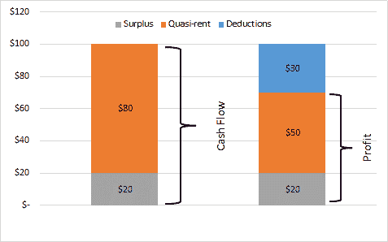

*Figure 2: Net Profit Margin of the top mining companies worldwide, with forecast for 2024*  
*Source: **https://www.statista.com/statistics/208725/net-profit-margin-of-the-top-mining-companies/***

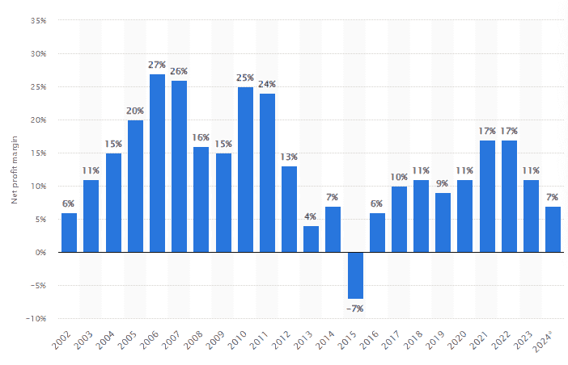

9

average over the past three years to December 2023, and 27.9% against 25.4% over the past twelve months to June 2024.

*Figure 3: Ranking of Global Companies by Market Capitalization – US$ billion (Mining in Yellow)*

*Source: **https://companiesmarketcap.com/*

The message here is that if governments are casting about to tax for additional fiscal revenue, mining would not necessarily be the first or only place to look. Even in countries that do not have access to the profits of Apple or Microsoft, other firms and sectors would appear to be generating more taxable rent than mining. Figure 4 shows the market capitalizations of the largest 25 firms in South Africa. The firms

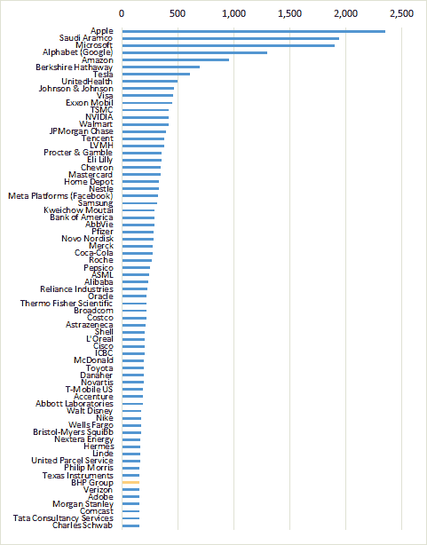

10

with the highest capitalization, hence with potentially the highest aggregate untaxed rents, are not the mining companies.

*Figure 4: Ranking of South African Companies by Market Capitalization -US$ billion (Mining in Yellow)*

*Source: **https://companiesmarketcap.com/*

Because market capitalization confounds rent and quasi-rent, isolating the resource rent at individual mining projects can be best done by resorting to the only time when resource rent can be measured – that is, prior to investments that generates quasi-rents. This is best done by observing the market capitalizations of listed exploration companies that have no demonstrated mineral reserves or mineral resources and therefore no appreciable value added to the raw resource potential through investment. These market capitalizations approximately reflect the remaining untaxed resource rents of the projects in their portfolios.^(13) With pure mine exploration company market capitalizations typically well below US$10 million, and with these companies usually owning multiple exploration projects in their portfolios, the remaining resource rents available for taxation at a given mineral exploration property is likely in the millions or tens of millions of dollars. Table 1 provides the value per project for selected pure exploration companies that are likely to have almost no quasi-rent capitalized into their market capitalization because they have undertaken little or no investment spending on their projects.^(14) The first three are the world’s largest market capitalization exploration companies. The fourth is a more typical exploration company. Project rents remaining after anticipated taxation and royalty charges against the project, shown in the rightmost column, are not large.

*Table 1: Market Capitalizations of Selected Pure Exploration Companies (values in US$ million)*

| Company Name       | Market Capitalization | Country Listing | Number of Projects | Location of Projects | Value per Project |
|--------------------|----------------------|-----------------|--------------------|---------------------|-------------------|
| Trillium Gold Mines | 12.5                 | Canada          | 9                  | Canada              | 1.1               |
| Austin Gold         | 11.4                 | United States   | 5                  | United States       | 2.3               |
| Orosur Mining       | 10.3                 | Canada          | 3                  | Latin America       | 3.4               |
| Newrange Gold       | 2.6                  | Canada          | 2                  | Canada              | 1.3               |

*Source: **https://resourcestrategy.ca/f/what-can-we-learn-from-mining-company-returns***

This is the case because, first, the pre-tax resource rents in mining are not large. Given a level playing field for profits taxation, mining does not come to mind when one thinks of sectors that over time have provided investors with extraordinary after-tax returns. A second point, related to the first, is that there is little remaining resource rent attached to the project after governments and others have taken their share. Governments are not alone in wanting to appropriate resource rents. Various actors, including royalty holders, managers, laborers, and community members, have bargained for, and are already expecting payments from the project surplus. We call this rent leakage. Governments are then left to tax any remaining surplus. To the extent that future resource rents at a project have already been appropriated by others, including host country governments, they are not attached to the project and not available for additional taxation.^(15) Every large mining project in the world started out as an exploration property, and there is no reason to believe that they were any different from the projects listed in Table 1.

## F. Government Taxation of Mining Projects Is Highly Inefficient

Tax inefficiency is a measure of how much taxation distorts private sector decisions. There are resource rent tax mechanisms that are non-distortionary; other taxes, like income taxes, that are somewhat distortionary; and taxes, like royalties, that are more distortionary.

Distortionary taxes do two things. First, they decrease the rewards to investment, causing investment to drop. Investment is usually efficiency-enhancing at mining projects, and so less of it reduces efficiency and lowers the project’s overall rent. Second, distortionary taxes cause marginal projects to become uneconomic, which suppresses activity in the mining sector (Davis and Smith, 2020).

The use of royalties could make mining taxation inefficient, and there is a push to move to less distortionary taxation mechanisms, such as a resource rent tax. However, the study of taxation in Latin American mining projects found that each dollar of mining project taxation cost an average of only 7 cents in lost development-stage project value, or deadweight loss. By comparison, 38 cents were lost for each dollar of taxation for oil and gas development-stage projects (Davis and Smith, 2020). This does not consider any beneficial effects of taxation on reduced investment and the consequent environmental benefits, known as internalizing environmental externalities, and so the true inefficiency is likely to be lower. Individual income taxation is thought to cost between 11 cents and 15 cents in deadweight loss per dollar raised. The implication is that it is not unreasonable from a policy perspective to want to fund governments’ increasing fiscal needs through increased mining project taxation rather than increased taxation on individuals. There are less distortionary and more distortionary mechanisms for mining project taxation – the former including special profits tax surcharges and the latter including gross production royalties. One would advise that the less distortionary mechanisms for raising taxes are preferable. Nevertheless, existing mine project taxation mechanisms do not appear to be highly inefficient.

## G. Tax Competition Requires Governments to Compete on Mine Tax Policy

When distortionary taxes like corporate income taxes are increased, investment generally decreases, although in mining the effect is not substantial (see Myth F). Tax competition theory holds that the investment decrease is not only because of project-level benefit-cost analysis on the investor’s part but also because investment by internationally mobile firms flees to lower tax jurisdictions. This combined effect causes investment to be quite sensitive to increased taxes. The main implication of tax competition is that if one country lowers its taxes others must follow in order not to lose investment at the current tax rate. In other words, countries are held hostage by other countries’ tax policies and do not have the autonomy to set their own taxation levels.

The disparity of mine taxation levels and mechanisms in regions like Latin America bely any notion that countries are attempting to compete on taxes. Moreover, empirical work that tests across mobile and immobile capital finds that tax differences between countries do not materially affect agriculture and mining investment flows, although they do affect manufacturing and service sector investment flows (Castillo, 2021, Genschel and Schwartz, 2011, Stöwhase, 2005). The thought is that mining firms become specialized regarding the exploration for and development of mineral reserves in a given country or even region, undermining any idea of fleeing to a lower tax jurisdiction.

The policy implication is that governments can set mining sector taxation policy autonomously, without worrying that they are in a competitive game with other resource-based countries. Higher taxes will still dissuade mining investment, but only due to diminished benefits from investment at the project level and not because there is substitutability between the domestic investment opportunities and offshore investment opportunities.

## H. Decarbonization of the Earth’s Energy Sources Will Lead to Soaring Mining Rents

In 2021, the IEA published its Net Zero by 2050 pathway to reach net zero carbon emissions by 2050.^(16) Starting from 2010 levels, that pathway sees several-fold increases in demand by 2030 for critical energy-transition metals like lithium, graphite, cobalt, and vanadium, and a doubling of demand for copper, silica, chromium, molybdenum, lead, silver, zinc, and manganese (e.g., see Figure 5). To stimulate supply to meet this demand, prices will have to rise substantially, with the IMF modeling a doubling of the price of nickel, a tripling of the price of lithium, a 60% rise in the price of copper, and a quintupling of the price of cobalt (International Energy Agency, *Net Zero by 2050: A Roadmap for the Global Energy Sector* (Revised version, October 2021, 4^(th) revision).

### Section 2: Resource Rent and Surplus at Mining Projects – Building a Theoretical Model

In this section, we use some mathematical notation to explain the theoretical concept of resource rent generation and its taxation at mining projects. Once this is done, we turn to what drives the level of mining rents, and the impact of political risk on mining project investment and operational decisions. Finally, we link this to its impact on resource rent generation. This will set up the empirical exercise that investigates these impacts.

**A. Computation of Rent**

The theoretical computation of rent, and whether it is a stock or flow concept, depends on whether the capital employed at a project is reversible or irreversible. Reversible capital is capital that can be withdrawn from a project cost free at any time. It has an opportunity cost, also known as a user cost, that is continually updated based on the best alternative use. In this case the investor applies marketed and non-marketed capital to a project in each period as long as the operating margin is sufficient to cover the user cost:

$$pq - cq - \delta K \geq 0$$  (1)

where *p* is the unit price, *c* is the total unit cost (average cost in economics parlance), q is the quantity of output per period, K is the value of total capital applied to the project including non-marketed capital, and δ is the user cost of capital per period (Davis and Cairns, 2017). The operating margin is the result of the first two terms. The user cost of capital is a deduction from operating margin that includes compensation for the interest rate on funds employed, capital depreciation due to wearing down of plant and equipment, and capital appreciation or depreciation over time due to price changes. If the application of capital causes equation (1) to be positive, that amount is a flow of rent that can be withdrawn from the project without investors reversing their investment:

$$pq - cq - \delta K = \text{rent}$$  (2)

Rent, a flow concept here, is attributable to patents, entrepreneurial talent, firm governance structures, and so on. Taxing only the rent will not cause the firm to withdraw its capital from this opportunity. However, taxing more than the available rent in any period will turn the expression in (1) negative, shutting down the project. Since the value of capital employed includes non-marketed capital, only the firm can estimate the value of total capital employed, and only the firm has an estimate of rent being generated by its activities in each period.

The idea that resource rent is a flow equal to the difference between revenues and costs, including a return to reversible capital, as in equation (2), is promulgated in much of the academic literature on mineral exploration and exploitation that relies on models that avoid any form of irreversible investment.^(18) It is the genesis of the idea that rent is a flow concept, estimated via an appropriate deduction from operating cash flows. But the lumpy irreversible capital investment involved in mine development – like exploration and the mine planning, overburden removal, and sinking of shafts – is central to mining and thus central to the concept of rent in mining applications.

When capital will be irreversibly applied to a project in discrete lumps, the analysis of resource rent changes drastically. Resource rent becomes a stock concept; its calculation requires intertemporal analysis. At the time of acquiring the property rights over the project, capital investment includes all present and future investment decisions, including initial exploration spending that may or may not find minerals. Given that the expectation to apply that capital and more to advance the project at some time in the future, project resource rent as estimated by the firm at project acquisition is:^(19)

$$\sum_{t=0}^{\infty} E(p_t q_t - c_t q_t - K_t) e^{(-rt)} = \text{resource rent} \geq 0$$  (3)

Here E is an expectations operator, time is denoted by period t, and r is the project cost of capital or discount rate, which includes the riskless rate of interest plus a risk premium. The present value is calculated via the term e^(-rt). Investment price *Kₜ* reflects its opportunity cost at the time it is sunk into the project, and again includes marketed and non-marketed capital. It also includes sustaining capital and project reclamation costs at the end of the project’s life net of salvage value. Since the capital is irreversibly invested, capital appreciation or depreciation via price changes is irrelevant save for salvage value of certain plant and equipment, which is trivial in present value terms and can be ignored. As opposed to the case of reversible investment, resource rent is now a stock concept because there is no way to account for a unique opportunity cost to applying capital period by period and deducting it from the cash flows of the project to determine period-by-period rent.

Since all projects will be taxed on their income, the only reasonable analysis of special resource rent taxation considers the after-tax resource rent remaining at the project, if any, at time zero:

$$\sum_{t=0}^{\infty} E(p_t q_t - c_t q_t - K_t - royalties_t - taxes_t) e^{(-rt)} = \text{after-tax resource rent} \geq 0$$  (4)

In equation (4), we have distinguished between deductions for royalty payments imposed by third parties who originally owned the lease and taxes imposed by the host government. After-tax resource rent can be zero either because exactly the whole of the resource rent is planned to be taxed away by the royalty and the income tax authorities, or because the taxation of the project has rendered it uneconomic, reducing future investment to zero in all periods.

At a viable exploration project, the choice of investment will at some point be taken. Let this time of first investment be t = m > 0. At this point, the firm’s analysis is that the expected after-tax go-forward value upon immediate investment is higher than any opportunity cost of doing so:

$$\sum_{t=m}^{\infty} E(p_t q_t - c_t q_t - K_t - royalties_t - taxes_t) e^{(-r(t-m))} > \text{opportunity cost}_m \geq 0$$  (5)

where the opportunity cost at time *m* includes the opportunity cost of not waiting longer to invest and any participation constraint that reflects other foregone opportunities by sinking an irreversible investment into this particular project.^(20) If investment is forthcoming at time *m* per equation (5), the

by 2030 (Boer et al. 2021). Developing countries, many of whom hold substantial deposits of these critical green energy metals, are anticipating that the boom in demand and prices will encourage increased mining activity in their countries and create substantial opportunities for resource rent capture from increasing prices.

What is missing in all of this is the reality that global policies for this decarbonization scenario are not in place and have little prospect of being put in place in the near future. IMF modeling of the decarbonization path under existing decarbonization policy commitments (Boer et al. 2021), rather than under the net zero policy, has metal prices being constant or falling over time as consumption increases at approximately the same rate as in Figure 6 for price effects. Market analysts’ outlook for critical metal prices concur, with flat prices to 2031 predicted for copper, zinc, cobalt, and silver, and falling prices for nickel, lead, and molybdenum. Only graphite and lithium minerals are projected to rise in price.^(17)

When this reality is combined with the current rapid inflation in mining capital and operating costs, margins in mining, if anything, are being squeezed. As a result, rents are diminishing over time, not increasing, and projected to diminish further. This is not to say that increasing metals prices and increasing demand are not a possible future global scenario. Given the current policy environment, however, governments should not plan their go-forward mining rent taxation strategies based on the price increases associated with the Net Zero by 2050 scenario.

17 Due to copyright, we are not able to share more details about these forecasts in this paper.

*Figure 5: Projected Increase in Copper, Nickel, Cobalt and Lithium Consumption under the IEA Net Zero Scenario and the Stated Policy Scenario*

*Source: IEA, 2021.*

*Figure 6: Projected Increase in Copper, Nickel, Cobalt and Lithium Prices under the IEA Net Zero Scenario and the Stated Policy Scenario*

*Source: IEA, 2021.*

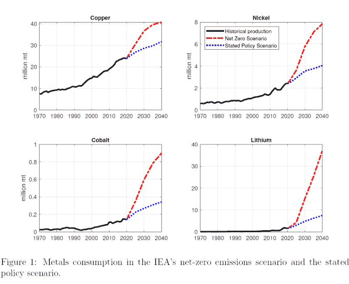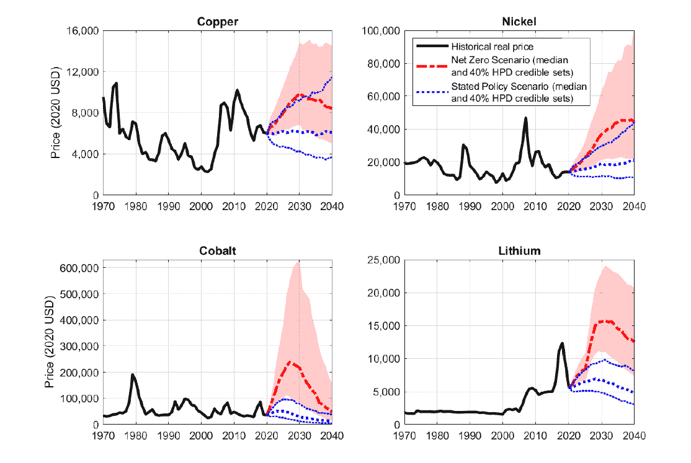

18 See footnote 33.
19 Cairns (1982). We say estimates by the firm because information asymmetries cause such calculations to be unique to the firm or individual doing the analysis.
20 The value of waiting to invest and rules of thumb related to that are illustrated in McDonald and Siegel, 1982. Foregone opportunities can include investing instead in lower-tax regions, not revealing information about project rents to governments, and withholding supply to raise the commodity price (Osmundsen, 2005, Osmundsen et al. 2006). See The requirement for positive net present value at investment can also relate to required returns to non-marketed capital inputs that are not measured and accounted for in the expectations operator in equation (5) but are nevertheless capital that require a rate of return (Cairns and Davis, 2023).

### The Practical Impossibility of Non-distortionary Resource Rent Taxation

Project advances to the next decision stage, where investment is again evaluated, and so on until production commences. If there is an expectation at time zero that at least the first investment stage will be undertaken at some point, after-tax resource rent in equation (4) may be positive. If investment at this first stage is not anticipated at time zero, after-tax resource rent in equation (4) is zero and the project is never undertaken.

Equation (4) reveals that any after-tax resource rent can in theory be taxed away at time zero without affecting investment in the project. Or it can be taxed away later as a lump sum or as an arbitrary schedule of flow taxes. It does not matter to the firm when this rent will be taxed or whether it is taxed as a lump sum or flow – as long as on an expectations basis the present value of the taxed rent is less than or equal to the quantity identified on the left-hand side of equation (1). For example, it may be that only successful projects are taxed but at a rate that allows the firm compensation for its failed projects.

The problem, of course, is that there is no information on how the firm imputes the value of its non-marketed capital applied to the project. Nor is there information on how a government would apply the expectations operator over prices, costs, and technical inputs for this project at time zero to estimate the time-zero after-tax resource rent. The instant after the first investment is made, after project time *m*, which is a time at which such measurements have some chance of being made, any present value calculation of remaining expected cash flows, even if feasible to undertake, no longer reveals initial project resource rent because quasi-rents on sunk investment begin to be earned and capitalized into the present value. This leads to the practical impossibility of a non-distortionary resource rent taxation.

### B. The Practical Impossibility of Non-distortionary Resource Rent Taxation

At time t = m in the project’s life, the firm will evaluate a project’s after-tax value and the government’s taxation mechanisms, even if on a notional basis, prior to initiating additional investment. If those taxation mechanisms are expected to tax more than the value of notional NPV, the project will not proceed. If those mechanisms are expected to tax the whole NPV or less, the project will proceed.

Imagine that at some time s > m, once the project is in operation, a government recognizes that the project is making profits:

$$p_s q_s - c_s q_s > 0 \quad (6)$$

In fact, if time *s* is subsequent to the main project development investments being completed, the current pre-tax NPV is:

$$\sum_{t=s}^{\infty} E(p_t q_t - c_t q_t - K_t) e^{-r(t-s)} \quad (7)$$

where Kt is now limited to sustaining and reclamation capital. It is likely to be substantial. A government may well view this project value as resource rent and wish to tax it away in its entirety or feel that any tax rate less than 100% is "unfair." Because there is much exploration failure before project success, and because mining projects are capital intensive, the successful operating projects must generate enough profit to cover the capital costs of the failed projects as well as the capital cost of successful projects. The observed operating mining project value may well appear to be exceptional relative to other manufacturing or services projects operating in a jurisdiction. But such profit is mainly quasi-rent, payments to prior investment. It is not resource rent only.

If the government’s goal is full profit taxation and the firm anticipated it, then the firm will view the residual resource rent of the project at inception as:

$$\sum_{t=0}^{\infty} E(0 - K_t) e^{-rt} < 0 \quad (8)$$

and it will not invest in the project. This is the distortionary nature of profits taxation. If instead the government taxes only a percentage τ < 1.00 of profits, such that the after-tax profits available to the firm at time s are:

$$(p_s q_s - c_s q_s)(1 - \tau) > 0 \quad (9)$$

it may still be that on an after-tax basis the project has a negative residual resource rent at inception:

$$\sum_{t=0}^{\infty} E\left((p_t q_t - c_t q_t)(1 - \tau) - \text{quasi-rent}_t - K_t\right) e^{-rt} < 0 \quad (10)$$

The project will again not proceed, although it would in the absence of taxation. This decision renders the resource rent in equation (4) zero, a lost opportunity for rent generation and taxation. A lower-still profits tax may render the project viable, but profits taxes remain distortionary in terms of the amount of capital invested because profits taxes do not allow full recovery of invested capital with interest and contain asymmetric treatments of operating profits and losses.

The literature suggests that there are non-distortionary means to tax mining projects that allow governments to tax away up to the full resource rent in equation (3).[^21] These are:

(i) a fixed-fee resource rent tax, where all or a portion of the resource rent is taken away as a lump sum, perhaps via a bonus bid, at project time zero.

(ii) a cash-flow tax, where taxes are a portion of cash flows as they emanate from the project, with taxes being taken from or paid into the project as cash flows vary from positive to negative. A 50% cash flow tax would capture 50% of any project surplus that the project ultimately generates, which on an expectations and discounted risk-adjusted basis would be worth 50% of the project resource rent at time zero.

(iii) a flow resource rent tax that allows quasi-rents as deductions against positive cash flows. A 50% resource rent tax would also tax 50% of the surplus if and when it is generated. Once again, the value of this tax scheme on an expectations and risk-adjusted present value basis would be 50% of the time-zero resource rent.

The attractiveness of these three schemes is their approximation, under practice, to a non-distortionary means of taxing rents (Garnaut, 2010, Land, 2010).

The disadvantages are that in all cases the appropriate deduction for non-marketed capital cannot be known. In all but (i), governments expose themselves to highly pro-cyclical tax revenues and may in the end pay into failed projects that generate little or no rents. Norway is renowned for its successful application of a flow resource rent tax for its offshore oil fields that captures 78% to 91% of project resource rent, although it has had to make large payouts to failed projects. In fact, in (ii) and (iii) there is no guarantee that any resource rent at all will be collected from the project as the random events that underlay the expectations operator come to be realized, and the project may fail to generate enough positive cash flow to offset the allowed deductions for quasi-rents. In Australia, the estimation that mining project rents were going untaxed resulted in the implementation of a resource rent tax. When it failed to live up to expectations for revenue generation, it was cited as a "clear-cut case of policy failure," without adequate recognition that such rent taxation schemes set themselves up for the possibility of zero rent collection in down markets (Dollery et al. 2017).

The flow resource rent tax, which taxes surplus on an ex-post basis, has the additional challenge of needing to allow the firm to recover quasi-rents on both the marketed invested capital and the non-marketed capital that it provides to the project and for which it requires a rate of return. It is impossible for a government to know how much quasi-rent to allow from marketed expenses like exploration spending. Since the non-marketed capital is not an observed or measured input, the additional quasi-rent allowance on that also cannot be known by the taxation authority.[^22] And in (i), which collects resource rent ex ante as a lump sum and allows no further taxation, any subsequent windfalls, perhaps during subsequent political administrations, cannot be taxed.[^23] Such a taxation scheme has already collected the value of subsequent windfalls on a probabilistic basis, and further taxation is not warranted. Even so, we suggest such outcomes would be politically unacceptable for a developing country, making even non-distortionary lump-sum resource rent taxation impractical.

### C. A Practical Solution to Resource Rent Taxation

Existing profits taxes in mining are relatively efficient and ensure a reduced political risk by allowing ongoing taxation of project successes. Therefore, the more practical approach is to set a regular corporate income tax that does not overly distort the project and allows for the possibility that both current and future government administrations will receive tax flows from the project (Nellor, 1987). The government’s goal in this case is to adjust the tax rate so that as much surplus as possible can be withdrawn from the project during operations without severely distorting the firm’s operating and investment decisions. To this end, the taxation mechanism may include such features as tax-rate supplements when metal prices are high, capital cost deductions for projects that are capital intensive, and tax holidays early on in the project so the payback period is decreased, provided they are designed and implemented to prevent abuse.[^24] These may come as close as possible to allowing the firm recapture of quasi-rents. Mathematically, where the taxation mechanism is a profits tax, the government’s goal is to select a tax rate profile over time and possibly in response to price changes, $\tau_t$, to maximize:

$$\max_{\tau_t} \sum_{t=0}^{\infty} E\left((p_t q_t - c_t q_t) \tau_t\right) e^{-rt} > 0 \quad (11)$$

[^21]: The original proposition of a resource rent tax is from Garnaut and Ross (1983) The tax they propose is, however, distortionary because they do not allow for full investment offset for a project that does not fully use up the uplifted investment allowances (Lund, 2014, Ball and Bowers, 1984).

[^22]: It is these non-marketed capital inputs that cause Osmundsen (2005) and Osmundsen et al. (2006) to suggest that governments cannot attempt to tax away all a project’s rents because the traditional calculation of rent includes only measured inputs as costs. The more useful approach would be to redefine rent in equation (3) to get the present value of surpluses after all costs, measured and non-measured, are included, allowing this diminished stock of rent to be removed from the project without changing project investment decisions.

[^23]: This results in the likelihood that future governments would alter the taxation agreement, rendering the tax structure distortionary after all (Nellor, 1987).

[^24]: Risks relate to high grading during tax holidays, re-constituting companies to claim successive tax holidays, and carrying forward unused depreciation allowances from the tax-holiday period into the tax-paying period.

19

subject to the firm maximizing:

\[
\max_{q_t,K_t,\tau_t}\sum_{t=0}^{\infty} E\left((p_tq_t-c_tq_t)(1-\tau_t)-r_t\cdots -K_t\right)e^{-rt}\geq 0
\tag{12}
\]

Firm maximization includes the now-distorted optimization of the design and operation of the mining project by selecting appropriate levels of capital and operational capacity, as well as negotiating down the tax rate \(\tau_t\) where feasible. Full taxation under this constrained optimization is achieved when the taxation schedule \(\tau_t^*\) is such that:

\[
\max_{q_t,K_t}\sum_{t=0}^{\infty} E\left((p_tq_t-c_tq_t)(1-\tau_t^*)-r_t\cdots-K_t\right)e^{-rt}=0
\tag{13}
\]

Less than full taxation will leave some resource rent for the project owner.

There is not a unique solution to this problem. An infinite number of taxation schedules and mechanisms could achieve the equality in equation (13). Nor does the tax obtain all of the project resource rent because some resource rent is destroyed via the distortionary taxation mechanism. Once again, we must emphasize that the quantity of resource rent at the project cannot be known, and this is an attempt to tax the surplus to the fullest extent possible.

It appears from studies commissioned by ICMM, the mining industry body, that an average effective income tax rate \(\tau\) of around 32% is where governments and mining firms have settled in equilibrium in equation (12). This takes some 60% of project NPV at the development stage, according to the Latin American study by Davis and Smith (2020), and even more at project initiation.^25 At this tax rate some projects will be cancelled at the exploration stage, some will proceed with the expectation that all rents are being taxed away, and some will proceed with the expectation that the project owner will retain some resource rent. It could be viewed as a feasible tax rate that allows both the sector to continue to operate and the host governments to collect project rents. It is a feasible outcome that sustains mining project exploration and development while giving governments billions of dollars in tax revenue.

This has been an extremely simplified exposition of resource rent and resource rent taxation. Entire books have been written on the subject, and we have neglected many details, such as capital depreciation allowances in profit taxation, royalties, dividends taxes, worker profit sharing, loss carryforwards, and asset taxes.^26 Nor have we allowed for project participation by host governments through carried interests, which is another mechanism by which resource rents can be taxed away.

The simplified analysis allows three points to be made. First, resource rent is a stock concept, a present value at the project’s inception, which in theory has an infinite number of ways to be taxed as flows during the project’s life. A project’s resource rent does not equal profit during operations. Nor is it approximated by profit. Second, the proper calculation of resource rent requires an intertemporal estimation of project NPV beginning at the time the first exploration dollar is spent. Third, firms retaining profits after taxation, due to profit shifting or perhaps price windfalls, does not necessarily mean rents are going untaxed. A zero after-tax resource rent project will still exhibit periods of positive after-tax profits because those profits are serving to pay back invested capital. This profit is all quasi-rent.

25. *ICMM Members’ Tax Contribution—Focusing on Corporate Income Tax and Royalties—2022 Update.* ICMM, December 2023. The effective tax rate is the ratio of total corporate income tax payments and royalty payments across 25 member companies making up one-third of global mine and mineral production divided by total company profits before tax, impairments, other exceptional items, and royalties charged above the profit before tax line for these same member companies. ICMM does not provide a range across the sample, although it does show that the average is relatively stable from year to year.

26. The most useful surveys of mining project and company taxation include Boadway and Keen (2015 and 2010), and Guj (2012).

The impossibility of calculating resource rent at project inception or as surplus during project operations results in profits during operations being taxed as a proxy for surplus taxation, with the hope that the level of taxation does not dramatically affect the firm’s investment and operating decisions. In the Latin American analysis previously mentioned, actual taxation practices were estimated to destroy about 7 cents of project NPV for every dollar of tax taken, indicating that distortions are occurring. The analysis also indicated that an average of more than 60% of project NPV, based on an accounting for marketed capital inputs, was being taxed by host governments. Once non-marketed capital inputs are included, an even higher percentage of project NPV is being taxed.

We end this section by briefly returning to the concept of tax competition. Tax competition is seen as the difference \((\tau_t-\tau_F)\) affecting investment in a project. From equation (5), increasing local taxation will lower investment (because it is distortionary) and lower project NPV, while increasing foreign taxation can decrease the opportunity cost of investing in the home country. The argument suggests that higher foreign taxes will cause firms to invest more in the home country. The absence of an empirically observable tax competition effect in mining means that the latter proposition is not empirically observed.

## D. What Creates a High Resource Rent Mining Project?

Host countries often do not have access to the capital and skill necessary to develop mineral deposits into profitable mining projects. For this reason, the host country governments will lease mineral deposits to foreign mining operators, who develop the deposit and reap the after-tax benefits. There is much concern in host countries that they receive relatively few domestic benefits from such transactions, while the foreign operators extract the majority of the rents because of relatively low profits taxes. We have already shown that this latter statement is a myth. It may well be that a “fair” host government share of profits is larger still, but that then puts the mining project at risk because the resource rent remaining to the foreign operator may drop below zero. In other terms, “fair” is irrelevant if there is no investment in the first place.

Some projects will stand out as being especially profitable at the operations stage, or especially prospective at the exploration stage. From equation (3), resource rent is higher when the term on the left-hand side of the equality is more positive. Perhaps because of terms like Hotelling rent (Hotelling, 1931) and Ricardian rent associated with mining projects, and more generally the term scarcity rent associated with the notion of a finite stock of mineral resources, one would expect rents to be higher in mining projects than in other projects. The Hotelling Valuation Principle suggests that a mining project will have positive value, and positive resource rent, because average cost is less than price due to Hotelling rent.

These models and considerations are highly abstract. The Hotelling Valuation Principle, for instance, assumes no fixed costs of operations, no investment prior to production, and no reclamation costs. Ricardian rent comes as a gift of nature, freely available, with no need for exploration to find these quality deposits.

Just as some manufacturing projects generate more rent than others, some mining projects will generate more resource rent than others. But it is best to think of these projects just as one does of any manufacturing enterprise and the rent that it might generate. From equation (3), higher resource rent at project inceptions comes from the expectation of higher prices, lower costs, larger cumulative production over the life of the asset, less capital spending per unit of capacity, and more rapid project development.

Higher metal prices affect all mining projects. Lower operating costs can come from many origins, but the main cause is a high-quality mineral deposit that has high grade, favorable spatial orientation (e.g., low stripping ratio and low capital development costs), good metallurgy (i.e., high metal recoveries), and a large quantity of reserves. Of these, in-situ metal grade is the dominant determinant of mineral deposit rents. However, simply having a quality mineral deposit is not enough. Mineral deposits are inanimate. By themselves, they generate no resource rent. Resource rent comes from the application of exploration to find the deposit, engineering design once it is found, managerial talent, and specialized capital and labor. The providers of these inputs generate rents on an equal footing with the deposit itself, with more resource rent generated by an effective project operator that can bring the project online faster and at less cost. The total value of the project is resource rent that the deposit creates together with these specialized inputs. A single high-quality deposit in the hands of an ineffective project operator may generate the same amount of resource rent as a single low-quality deposit in the hands of an effective project operator.

### E. How Does Political Risk Affect the Resource Rent at a Mining Project?

Political risk can include all risks related to property rights over the mineral deposit. In the absence of political risk, a firm will have secured property rights. Insecure property rights are associated with ineffective contract enforcement, failure to enforce the rule of law, corruption, expropriation risk, failure to renew property leases, and other actions by the host government. Returning to equation (4), these actions cause after-tax mineral project resource rent to decline by causing the firm to alter in a suboptimal way its operating costs, production rate, and investment rate. This alteration may involve limiting investment exposure and speeding up investment recovery via high grading. Political risk may also cause the firm to increase its expectation for the rate of future taxation. This is shown in equation (14), with the after-tax resource rent generated by the mining project under political risk being the term on the left-hand side of the inequality and the after-tax project resource rent in the absence of political risk being the term on the right-hand side:

\[
\sum_{t=0}^{\infty}E\left((p_t\tilde q_t-\tilde c_t\tilde q_t)-\tilde K_t-\widetilde{roy}_t-\widetilde{tax}_t\right)e^{-r_t}
<
\sum_{t=0}^{\infty}E\left((p_tq_t-c_tq_t)-K_t-roy_t-tax_t\right)e^{-r_t}
\tag{14}
\]

The political risk burden on the project distorts investment and operating decisions, as shown by the accent over production quantities, costs, and investment in the left-hand-side term. The expectation over taxation is also changed. It may well be that a project that is technically and economically viable in the absence of political risk, as shown by a sufficiently positive term on the right-hand side of equation (14), becomes unviable under political risk, the left-hand side of equation (14) becoming negative. In that case political risk destroys 100% of the potential resource rent of the project.

There is ample empirical evidence that institutional quality and political risk affect the location of oil and gas exploration effort across countries as well as investment and development decisions once a deposit has been found within a country—just as this model would suggest (Bohn and Deacon, 2010, Cust and

Harding, 2020, Akhtaruzzaman et al. 2017, Bøe et al. 2019).^27 There is less data to conduct similar analyses for mining, although one would expect a similar outcome. The only study of mining and political risks we are aware of looked at grassroots mine exploration budgets in Chile (Castillo, 2021). It shows that a tax reform that increased but stabilized tax levels – a signal of reduced political risk at the project level, caused firms benefitting from these agreements to increase exploration budgets by 32%, even though the stabilization agreement was accompanied by the higher tax rate. Firms that did not receive such agreements either reduced their exploration budgets or kept them the same. When less exploration is undertaken, fewer projects go forward, with less resource rent for the government to capture.

The Fraser Institute conducts an annual survey of international mining company executives to gain their opinions on which jurisdictions have less political risk and which have more. Its Policy Perception Index includes factors concerning the administration of current regulations, environmental regulations, regulatory duplication, the legal system and taxation regime, uncertainty concerning protected areas and disputed land claims, infrastructure, socioeconomic and community development conditions, trade barriers, political stability, labor regulations, quality of the geological database, security, and labor and skills availability. Of the 84 jurisdictions evaluated in 2021 (some are provinces or states rather than countries), African countries tend to rank in the lower half (Yunis and Aliakbari, 2022).

Africa’s most favorable country is Morocco, ranked second globally. Only three other African countries rank in the global top half – Namibia (29), Senegal (30), and Botswana (31). The Democratic Republic of the Congo (DRC) and Zimbabwe rank 78^th and 79^th respectively. From this, it is more likely that a mineral deposit in Morocco would generate more rents and more tax revenue than the identical mineral deposit in the DRC or Zimbabwe. When mineral potential is combined with political risk, Zimbabwe ranked as the least desirable jurisdiction in the world for mining investment. On a regional basis, Africa ranked lowest in terms of overall investment attractiveness. This would imply that African projects have lower after-tax quasi-rents available to mine project operators, and that the operators would preferentially direct their talents elsewhere. To compensate, African country governments may lower the negotiated tax rate to increase the after-tax project NPV to the project operator. To the extent that this strategy is already in place, Africa still ranks lowest of all regions since the ranking includes the taxation regime.

There is almost perfect substitutability between the negative investment effects of political risk on a project and the negative investment effects of increased taxes. The difference is that higher taxes benefit the government, while higher political risk, aside from corruption, is a friction very similar to an administrative cost that benefits no-one.

Political risk is not an easily measurable variable; nevertheless, risk perception impacts project selection and design. One way that political risk does not affect a mineral project in theory is through an increase in the project discount rate, r. The most common and accepted model of investor discounting of projects is the Capital Asset Pricing Model (CAPM). It has the discount rate being the sum of the riskless rate, or bond rate, and a risk premium:

\[
r = r_f + \text{risk premium} \quad (15)
\]

^27 Corruption, on the other hand, may increase extractive industry investment because it can result in favorable treatment (Kolstad and Wiig, 2013).

The risk premium is the product of the expected excess return on the market, which is about 6%, and the “Beta” of the project cash flows:

\[
\text{risk premium} = \text{Beta} \times \text{expected excess market return} \quad (16)
\]

The Beta is a measure of the covariance of the cash flows with the market. Cash flows that vary with the market embody systematic risks. Cash flows that have variance that is uncorrelated with the market embody unsystematic risks. Only systematic cash-flow risks increase the Beta and, by that, increase the risk premium. Unsystematic risks can be diversified away. If the project has the same risk as overall market returns, its Beta will be 1.0 and its discount rate will be the market discount rate, currently about 8% (2% bond rate + 6% expected excess return). If it has less covariance, the Beta will be less than 1.0, lowering the risk premium; if it has a larger covariance, the Beta will be greater than 1.0, increasing the risk premium. Mining companies have a Beta for their overall non-cash asset portfolio of near 1.0, indicating that mining assets are on average about as risky for investors as holding a market index. Individual mining projects can have Betas that are higher or lower than this, but such project Betas are difficult to estimate because of a lack of data.

The CAPM is a complete risk model. There is no scope in this model to add additional factors or terms to the risk premium, even for political risk (Kruschwitz et al. 2012). Political risk is likely to be largely, if not totally, unsystematic; its effect on cash flow in any given period is unlikely to depend on whether markets advanced or declined in that period. As such, it has no measurable effect on the project Beta and thus the project discount rate. This is reflected in the fact that the same discount rate is used to value the project on the left-hand side and right-hand side of equation (14).

In practice, some government and market analysts, and even firms, elect to increase the project discount rate to effect diminished project value as a short cut to adjusting the individual cash flow items for political risk. Mathematically, there exists a positive constant α such that:

\[
\sum_{t=0}^{\infty} E\left(((p_t q_t - c_t q_t) - K_t - r_t - tax_t)\right) e^{-rt} \equiv \sum_{t=0}^{\infty} E\left(((p_t q_t - c_t q_t) - K_t - r_t - tax_t)\right) e^{-(r + \alpha)t} \quad (17)
\]

This is simply a mathematical identity, with the equation on the right-hand side having no fundamental meaning in economics or finance. Firms and governments, however, view α as the required increment to the risk-adjusted discount rate for political risk when none of the project cash flow items are adjusted for political risk. Such practices are ill advised. There is no scientific or objective method by which political risk can be translated into an increment to the project risk premium. It is therefore impossible to know what level of α is needed to cause this equality to hold. Governments and firms will nevertheless often talk about the increased “required rate of return” for projects in politically risky jurisdictions, while what is needed is a higher after-tax NPV to offset the negative value effect of political risk. That higher after-tax NPV may well be implemented through a reduced project tax rate in politically risky countries.

## Section 3: Mining Firm Evaluation and Operation of Mining Projects

A mining project begins with the acquisition of a claim to mineral rights and an exploration of the prospectivity of that claim, reflected in the probability of substantial future payoffs in equation (4). Before any dollar is invested to advance the project (at project time zero and after), the firm estimates whether that dollar will lead to a positive after-tax NPV project. The project NPV will have to be at least zero for investment to proceed. However, the irreversibility of investment also means that there is an opportunity cost to investing now rather than later. Hence, if the option to defer investment exists, the firm will not invest until the after-tax NPV it receives is substantially greater than zero.

Because of technical and commercial project uncertainties, project evaluation continues throughout the life of the project. Prior to each substantial investment of new capital, the firm will assess the technical and economic merits of the project on a go-forward basis. At the exploration stage, the evaluation is crude and subjective, with exploration dollars allocated based on the geological prospects of the exploration target. At successful exploration areas, mineral resources are declared. As the project advances further, rigorous technical studies are undertaken. These technical studies include scoping studies, preliminary economic assessments, pre-feasibility studies, and feasibility studies, each with increasing detail and sophistication. Each of these technical studies must show a substantially positive after-tax NPV for the project to advance to the next stage of capital spending. Because of the information disclosure requirements for mining companies listed on various stock exchanges, these technical studies are published by the listed companies and available for all to see.

These studies, being evaluations of the project rather than valuations of the project, typically do not estimate in any rigorous way the expected cash flows or the appropriate project discount rate. Rather, cash flows are estimated using a series of short cuts and rules of thumb. For example, costs are projected in today’s dollars, while metal prices are projected in inflated dollars. The project is evaluated at a series of routine discount rates for robustness, these discount rates having nothing to do with estimation via the CAPM. Project managers then evaluate the outcome of this exercise, looking at the project NPVs created by the exercise and use heuristics to decide whether to move the project forward. These heuristics include internal rate of return (IRR), payback period, size of NPV relative to investment cost, and project life (longer being more desirable).

Political risk is not explicitly considered in this project evaluation exercise. That is, political risk is not factored into any of these project evaluation cash flow calculations or, as a short cut, the project discount rate. A project that faces political risk must simply reach higher hurdles in terms of the heuristics, such as a higher IRR and faster payback, or more upside geological potential. These higher hurdles are not written down anywhere, but we can observe their manufacture through operational metal grade, with projects in more risky countries only being pursued when the production grade upon project success is estimated to be sufficiently high.

*Figure 7: Copper Mine Copper Grades vs. Ease of Doing Business Scores, By Country*

*Source: Martin Lokanc and Sven Renner, 2022.*

| Mauritania | DRC | Myanmar | Chile | USA | Size=Production |
|------------|-----|---------|------|-----|-----------------|
| (Graphical data not displayable; see original for details) |     |         |      |     |                 |

25

to offset the political risks that the project faces from inception.^(28) Empirically, this would be verified by operating metal grades at successful projects being higher in politically risky countries. Figure 7 shows operating copper project average grades versus country Ease of Doing Business score. The Ease of Doing Business score includes country political (and governance related) risk.^(29)

It is evident that mining companies in the DRC require average copper metal grades in operation of more than 1.0% to pursue a project from inception. Projects with average operating grades a little over 0.1% have been shown to be economic in the absence of direct political risk – in Chile, for example. In other words, DRC projects with average grades of 0.1% may show positive after-tax resource rents in the absence of political risk. However, once these risks are included in the project evaluation, expectations of very high revenues upon project success are needed before exploration advances, and lower-grade deposits are not pursued for development. The high operating grades in the DRC are a result of firms seeking out the best and highest-grade deposits for development. Only these will generate sufficient return on investment to warrant the additional political risk.

Higher operating grades at projects in more risky countries are not the result of mine operators’ manipulation of “cutoff grade” to account for political risk. Indeed, a cutoff grade is a grade below which mining a resource block is uneconomic after taking into account price and normal cost factors. This concept is illustrated by comparing Sierra Gorda, a low-grade open pit copper deposit in Chile (Pincock, Allen & Holt, 2011), and Kamoa-Kakula, a high-grade underground copper deposit in DRC.^(30) Low-grade and high-grade deposits are identified at the project initiation stage, with exploration revealing the grade when a deposit is found and the economics then defining the cutoff grade. For example, the focus of Quadra FNX, the first company to drill at the Sierra Gorda project, was “to explore the geologic potential of oxidized mineralization amenable for extraction and processing by heap leaching with solvent extraction (SX/EW) to support a moderate-sized heap leach operation.”^(31) Heap leach operations are only planned for low-grade deposits whose revenues cannot support the costs of more selective metallurgical recovery processes. Kamoa-Kakula, on the other hand, is located within the Central African Copperbelt, which has yielded several world class high-grade mines. This area is the focus of project owner Ivanhoe’s exploration efforts.^(32)

*Figure 8: Average Copper Grade v. Cutoff Grade, Sierra Gorda and Kamoa Projects (% CuEq)*

*Source: authors’ calculation based on Kamoa-Kakula and Sierra Gorda reports.*

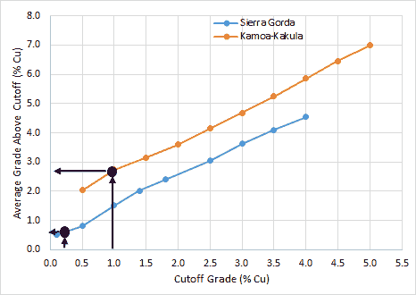

Figure 8 shows grade curves for the two projects. A grade curve depicts the average mineral resource grade at a deposit for a given cutoff grade. For the low-cost heap leach Sierra Gorda operation, the copper-equivalent Measured and Indicated mineral resource grade is 0.49% at the 0.2% economic cutoff. The economic cutoff for Kamoa-Kakula, which is a higher-cost room and pillar underground mine, is 1%. The higher cutoff at Kamoa-Kakula produces a higher mineral resource grade of 2.5%. However, the same 1% cutoff at Sierra Gorda would produce an average mineral resource grade of only 1.4%, reflecting the inferiority of the Sierra Gorda deposit (see red arrow in Figure 8). Hence, this gap of 1.1% in the grade of copper deposits between Kamoa-Kakula and Sierra Gorda at 1% cut-off grade is due to an endowment effect in favor of the former, while the cut-off grade gap of 0.8% between the two is due to prices and cost factors. The overall mineral resource gap is the sum of the two.

The higher grades shown in Figure 7 for more politically risky countries likely reflect both an endowment effect, where only the best deposits are explored and developed, and a political risk effect, which raises operating costs and, in some cases, leads to decisions to “high-grade” the found deposits so as to recover quasi-rents as quickly as possible.

## Section 4: Government Policy and Political Risk - A Simple Numerical Example

From a policy perspective, and at the heart of this report, developing country governments can do more, and possibly better, than lowering tax rates to offset the negative effect of political risk on project activity. They can limit or eliminate the political risk in the first place, primarily by setting up credible fiscal stability agreements (Barma et al. 2011).^(33) This will then create more projects pursuing lower grade deposits, increased reserves at successfully explored projects, decreased operating costs, decreased capital costs, and faster project execution, which will in turn create more tax revenue even at existing tax rates, and reduce the push for tax holidays.

A simple example will cement the ideas presented so far. Consider a medium-sized copper project where the only application of capital is marketed capital. The initial exploration effort conducted over the project’s first five years is expected to cost US$10 million. The probability of exploration success is unknown – for project evaluation purposes, the firm assumes a 10% chance that the exploration is successful in finding mineralization of economic interest. If so, additional exploration to declare mineral resources is conducted over the next five years at an expected cost of US$50 million. The probability of success of this additional stage of exploration is unknown – the firm assumes a 50% chance of successfully declaring mineral resources in this exploration stage. Upon declaring mineral resources, the project is then assessed via technical studies over the next five years at an expected cost of US$100 million. The probability of the technical studies revealing an economically and technically viable project with Mineral Reserves is unknown – the firm assumes a 90% chance that the project successfully passes the technical evaluations and permitting stage. After success to that point, an expected US$500 million is spent over the next five years to bring the project into production. The firm assumes no chance of failure here.^(34)

From year 20 through 35, a 15-year mine life, the project is expected to generate after-royalty cash flows of US$400 million per year, or US$2 billion each five years, given the grade and quantity of mineral resource defined by the appropriate cutoff grade. That expectation is an average over all possible geological and market scenarios, including extended booms and extended busts. At year 35 the project is closed and reclamation costs of US$100 million are expected. The project cash flows are discounted by the firm at 10% per year. All these parameters are a reasonable representation of an actual copper project, although the success probabilities are unknowable in practice and any representations of resource rent and surplus in this example are for illustration purposes only.

*Figure 9: Mine Project Expected Pre-tax Cash Flow, Expected Project Value, Expected Surplus, and Expected Quasi-rents Over Time, Conditional on Success at Each Stage*

*Source: authors’ simulations.*

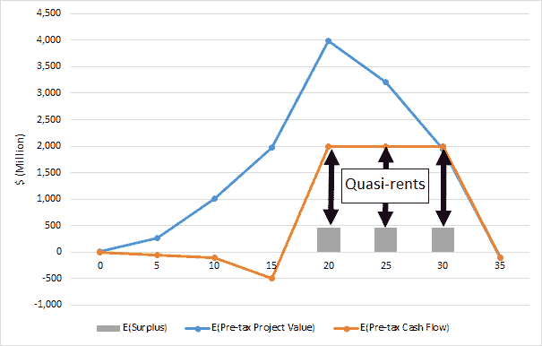

Figure 9 shows the project’s expected cash flows in orange in five-year tranches, conditional on success at each stage. The blue line is the expected pre-tax project value at each five-year period conditional on success at the previous five-year period. Based on an expected cash flow analysis, at time zero the project has a pre-tax value of US$6.3 million. This is pre-tax project resource rent as judged by the success probabilities being used by the firm in its project evaluation. As time proceeds and the project is de-risked and, with the additional result of reduced discounting, the expected project value increases. If the project reaches the feasibility stage, at year 15, the pre-tax project NPV is expected to be US$1.98 billion, with a 6.25-year payback period, and a project IRR of 38%. This is a worthy asset. Once production is underway, at year 20 and after US$500 million in development costs, expected pre-tax project value reaches its maximum of US$4 billion and declines from there as the deposit is depleted and the quantity of remaining cash flow diminishes. At closure, the project is a liability to the firm, worth -US$100 million. This expectation of rising and then falling value of a successful project over time is known as the mine value curve.

The first point, related to Myth E, is that even though this project, if successful, is expected to generate US$6 billion in cash flows over its 15-year operating life, a large sum in relation to the project’s US$660 million in total exploration, development, and closure costs, its time-zero pre-tax value in the eyes of the firm is only US$6.3 million.

---

^(28) High grade can be generated by a high concentration of a single metal or lower grade of a single metal accompanied by co-product or by-product metals that create a high-grade “metal equivalent.” This is particularly true of the DRC, where copper is accompanied by cobalt as a by-product.

^(29) A country’s score is benchmarked on a scale from 0 to 100, where 0 represents worst possible regulatory performance and 100 represents best possible regulatory performance. The index includes regulatory and bureaucratic practices regarding starting a business, dealing with construction permits, getting electricity, registering property, getting credit, protecting minority investors, paying taxes, trading across borders, enforcing contracts, and resolving insolvency.

^(30) “Kamoa-Kakula 2020 Resource Update,” OreWin, March 2020 and “Technical Report for the Sierra Gorda Project, Chile,” Pincock Allen & Holt, June 8, 2011.

^(31) Pincock Allen & Holt, 2011, p. 10.1.

^(32) OreWin, March 2020, p. 66.

^(33) The credibility of intertemporal commitment - or the degree to which policy stability and bargains over time can be enforced and deviations from such agreements are subject to sanction - have been covered in Barma et al. (2011). However, the authors did not link it to any model or financial tool and design.

^(34) Once a mining project is developed and in operation, there are risks of technical failure that require an even greater allowance for invested capital than is modeled here.

firm is only US$6.3 million due to long project lead times and the substantial risks of project failure along the way. The US$6.3 million in project resource rent available for taxation, as viewed by the firm, is trivial in the scheme of government fiscal revenues and probably less than the resource rent available from the activities of firms in other sectors based on our previous analysis of firm market capitalizations.

The government wishes to completely tax away the resource rent. Since it does not know the probability of success at each stage, it cannot discern what the project resource rent is. To determine the resource rent, it could auction off the lease at time zero, where a competitive auction would presumably yield a bid of US$6.3 million. That would drive the resource rent as perceived by the project owner to zero. If this approach is taken, no additional taxes or royalties could be expected over the life of the project. If they were, the project would become uneconomic at time zero and would be abandoned. Or the government could instead give the lease away for free and apply a tax to the eventual, or ex post, project outcomes via either a cash flow tax or a flow resource rent tax. The government is taking on project risk here because it would be required to pay into the project under negative technical outcomes. Or taxation could be applied only to positive cash flows if and when they occur via a windfall tax. Based on the company’s probability analysis, taxing surplus in this way during the project’s 15-year operating life will require a cash flow tax rate of 23%, generating average tax revenue of approximately US$100 million per year, or US$500 million each five years of project operations.^(35) This equates roughly to an average 26% profits tax, the exact rate depending on the nature of the depreciation allowance.^(36)

The impracticality of taxing exactly the resource rents of the project via a targeted windfall profits tax, the windfall being the event that the project is successful, is evident. For the government to implement a windfall profits tax that exactly taxes the surplus of this project during operations, it would have to be able to calculate this surplus as we have done in our example and then estimate the exact tax rate that drives the surplus to zero. To accomplish this, the government must know the success probabilities the company is using in its analysis so the government could apply a full allowance for investments made at a successful project stage, enhanced for failure risk. This information requirement is infeasible. It would also require the tax rate to be set individually for each project because better projects generate more resource rent and would require higher tax rates.

A resource rent tax with allowance for quasi-rent based on past capital expenditures, as done in Norway, is also impractical. With the firm’s estimate of a 90% probability of failure at the first stage and the subsequent project failure probabilities, the US$630 million in total investment for a successful project would need to be “uplifted” to a US$4.6 billion depreciation allowance over a successful project’s 15-year operating life.^(37) The appropriate amount of uplift can only be known if all the firm’s expectations are known. A cash flow tax, where the government provides cash flows to the firm each time it conducted a negative exploration campaign as well as when exploration was successful, would be manageable as it is entirely an ex-post exercise. However, it exposes the government to large tax outflows to subsidize project failures, which is untenable financially and politically. The approach that governments in general take is to tax a portion of profits, or revenues, be they windfall profits or not, with the hope of taxing only the portion of profits that is resource rent. In the above example a profits tax of 26% on a successful project would achieve this goal.

Now suppose that political risk would lower a successful project’s expected operating net cash flows to the owner by 10%, to US$1.8 billion in each five-year period over its 15-year operating life, perhaps due to increased costs associated with corruption, legal fees related to security of tenure, or expectations of project expropriation without full compensation once the project is underway. After modeling this effect directly into the cash flow analysis, Figure 10 shows this revised expected cash flow profile and the now lower expected pre-tax project value curve. Because the same investments and technical project risks are assumed to exist under the political risk scenario, quasi-rent is unchanged. It is project resource rent, the project’s value at time 0, that shrinks by almost 50% to US$3.6 million. The resource rent-collecting effective operating project cash flow tax rate falls to 15% (an approximate 17% profits tax rate), generating an annual expected tax stream of approximately US$50 million, or US$250 million each five years of the project’s 15-year operating life. The leverage effect of political risk on resource rent, where a 10% drop in net cash flows results in a 50% drop in expected resource rent and resource rent tax revenue, is because surplus must absorb the whole reduction in project value.

Were this politically risky project’s operating cash flows expected to be taxed instead at 26%, the appropriate tax rate for a project not subject to political risk, the tax would remove more than surplus. It would also tax quasi-rents. Expected after-tax resource rent at this project would become negative, the project would not be undertaken, and the entire resource rent flow would be lost. It is likely that this fact causes politically risky host governments to try to attract mining projects by reducing effective tax rates through a combination of lower tax rates and/or tax holidays, exemptions, accelerated depreciations, etc. In this case, the reduction would need to be down to 17%. In the end, given the extremely low exploration spending in politically risky countries compared with less politically risky regions of geological interest, it is likely that such tax reductions have not been enough to overcome the destruction of resource rent due to these countries’ higher political risk.^(38)

In these examples, approximate resource rent-targeting profits tax rates of 26% and 17% completely extinguish the project’s rents as estimated by the firm at inception. The firm would not alter its investment decision-making as a result, which is exactly the point of taxing resource rent but no more than resource rent. Comparing these profits tax rates with the effective 32% profits tax rate paid by ICMM member companies, along with the data presented under Myth D, there is no immediate reason to think that a 32% effective tax rate is leaving project rents untaxed or that there is an “unfair” splitting of rents between governments and mining companies. In this numerical example, a profits tax of 32% would have taxed both quasi-rents and surplus, and the project would never have gotten off the ground in the first place, even if it were in Nevada, one of the world’s least politically risky jurisdictions. Once again, an effective profits tax rate of 32% does not mean that 68% of rents are going uncaptured by host governments. It means that quasi-rents are going uncaptured, which is exactly what must happen to stimulate investment in new projects.

We mentioned earlier that analysts sometimes take a short cut to estimating political risk’s effect on a project by raising the required rate of return, the project discount rate, rather than adjusting expected cash flows (equation 7). In this numerical example, the project discount rate would have to be raised from 10.0% to 10.6% to generate the correct pre-tax project NPV of US$3.6 million in the face of political risk. Any adjustment that adds more than 0.6 percentage points to the 10% discount rate would overestimate the effect of political risk on the project and its resource rent.

Given the previously presented data on company market capitalizations, the final metric of interest in this numerical example is the after-tax value of the project during operations. If the firm owning the project is listed on a stock exchange, and if they have no cash or debt or other assets, the after-tax value of the project will equal the firm’s market capitalization. In our example, if the tax is removing all the resource rent, then the after-tax value of the project does not have any surplus left for taxation. Figure 11 shows the pre- and post-tax expected future cash flows of the operating project with no political risk.

In Figure 11, we assume that the tax on profits exactly taxes away the project surplus in each operating period, rendering time zero project resource rent zero while leaving intact the quasi-rents necessary to induce investment in the first place. After-tax project value starts at US$3 billion in the first five years of operations and falls to US$1.5 billion in the last five years of operations. This is all quasi-rent.

While the resource rent tax has reduced the project value (compare the dashed blue curve with the solid blue one), it has not driven it to zero during operations; even after full resource rent taxation, there is plenty of project value attributable to the owner, a necessary residual quasi-rent payment to induce the operator to undertake the technically risky exploration and development investments decades ago. The analysis reveals that an after-tax market capitalization between US$3.0 billion and US$1.5 billion for a mine project in a low political risk jurisdiction, with a required investment of US$630 million before production, is entirely consistent with the project being subject to full resource rent taxation.

company whose only asset is a medium-sized operating copper mine or, equivalently, an operating copper mine that trades for between US$1.5 billion and US$3 billion is not necessarily evidence of incomplete resource rent taxation. There will be immediate suggestions to the contrary given what appear to be extraordinary profits and value remaining at this project even after taxation. The important message from this exercise is that observed after-tax cash flows at operating mining projects, or observed project transaction values, are likely mainly quasi-rents that are not available as surplus that can be further taxed without severely distorting investments in exploration and project development.

Before leaving this section, we apply a progressive profits tax rather than the flat 26% profits tax to the numerical example. A progressive tax can achieve the same expected resource rent taxation, but with higher tax rates on higher profit outcomes. We have assumed that the profit in any five-year period is normally distributed around its mean, with a standard deviation of US$800 million that allows a 1.5% chance that profits in that period will be negative. This uncertainty in profits can come from uncertain revenues, uncertain costs, or uncertain geological outcomes. The progressive tax taxes losses and the first US$500 million of profit at 0% (a concession to the operator for the higher taxes during higher revenue periods). The rates then go up: the next US$1,000 million at 25%, the next US$1,000 million at 50%, the next US$1,000 million at 70%, and any profit over US$3,500 million at 90%.^(39) We have designed the progressive tax to produce an overall average tax rate of 26%, identical to the flat tax.

Figure 12 shows the density function of possible tax receipt levels over a five-year project operating period under both tax regimes. The vertical axis shows the frequency of each outcome, and the horizontal axis shows tax receipts in millions of dollars. Since tax receipts are proportional to profits, moving to the right on the horizontal axis reflects increasingly profitable outcomes during mining operations. The advantage of the progressive tax is that it has higher tax receipts during the rare highly profitable periods. The downside is a greater than 5% chance of receiving no project tax revenue over a five-year period, compared to a probability of only 1.5% under the flat tax. Under the progressive tax, there is also a higher probability of getting tax receipts that are less than US$250 million and a lower probability of getting tax receipts between US$250 million and US$850 million. This is what the host government has to give away to participate more fully in windfall outcomes.

^(39) The probability of income being less than US$500 million and the government receiving no income tax is 5.5%; of being between US$500 million and US$1,500 million is 30.8%; of being between US$1,500 million and US$2,500 million is 45.3%; between US$2,500 million and US$3,500 million is 16.8% and being more than US$3,500 million is 1.6%.

**Figure 12: Government Profits Tax Receipts Given Profit Uncertainty, Flat Income Tax v. Progressive Income Tax (US$ Millions per 5 Year Operating Period)**

*Source: authors’ simulations.*

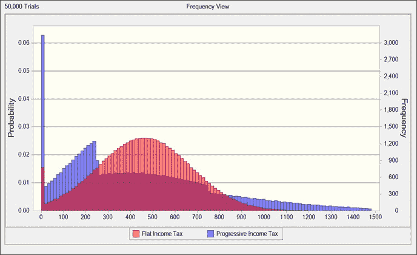

This numerical example shows that resource rent at the inception of what may be a substantial copper mining project is likely to be small, regardless of political risk. This is due to the high risk of project failure, which at the first exploration stage was 90%. If resource rent is not taxed away in a lump sum at project initiation, resource rent taxation later in the project’s life must necessarily be low enough so that its expected present value is the same small value as what a lump-sum tax would be. The low level of resource rent is in large part due to the risk associated with mining projects. In another industry, such as manufacturing, with no project failure risks but with the same long lead time between investment and cash flow, and with identical capital costs but half the net cash flow due to an absence of scarcity rents, the calculated resource rent for the project at inception rises from US$6.3 million to US$95.4 million. The absence of project failure risk means that cash flows during operations could be taxed at an effective rate of 32%, rather than 23%, without affecting investment. The corresponding profits tax difference is 41% versus 26%.

The goal of mining taxation should be to tax only resource rent because this does not distort investment decisions. Nevertheless, given the difficulty of measuring resource rent on either an ex-ante or ex-post basis, we recommend using progressive profits taxes and royalties that are admittedly distortionary but lend themselves to tax regime stability, another important element for investors. There is much to recommend that mine profit tax rates should be lower, not higher, than in other sectors of the economy because mining rents at successful projects are likely lower as a result of technical project risks that other sectors do not face. If they are to be taxed, rents should be targeted using a customized approach appropriate for each industry,^(40) and technical project risks are relatively high in the mining sector. The most neutral profits taxes are those with generous allowances for depreciation, and these have been recommended as the best means of taxing mining rents at the appropriate, modest rate (Davis and Smith, 2020).

As it is, it is likely that a substantial number of marginal mining projects are being killed by tax rates being higher in the mining sector due to tax supplements to standard income taxes like royalties and profits surtaxes and the regressive nature of these taxes.^(41) Because these are marginal projects, the loss of tax revenues will not be large. More important is the lost employment and local development via backward multiplier effects, the output effects referred to in the title of this work. In the case of green minerals, the objective of maximizing output is key for the energy transition and corresponds to maximizing the tax base for host countries. Otherwise, projects that proceed under high tax rates do so only on the hope of finding an ultimate Mineral Reserve that can survive high tax rates, leaving substantial deposits unexploited.

To avoid this outcome, Chile has adopted the strategy of imposing the lowest mining sector base tax level in Latin America at 35% of profits, with generous tax shielding allowances (Davis and Smith, 2020, and Tilton, 2004).^(42) It then scales its tax upward according to the size and presumed profitability of the larger projects, capturing resource rent flows as they occur. The tax has nevertheless been measured to be still somewhat regressive and distortionary and it likely suppresses some exploration activity (Davis and Smith, 2020). Industry leaders see a recent proposal to add a royalty to the tax rate as a tax on more than resource rent; they claim the royalty would cause them to reconsider investment plans already announced under the current tax regime.^(43)

^(40) Nellor (1983) makes several arguments as to why we should reconsider taxing mining at a higher rate than other sectors and predicted the fiasco that followed Australia’s imposition of a special resource rent tax on the mining sector.

^(41) ICMM shows that royalties, despite their deductibility for profits taxes, add about 6 percentage points to the effective profits tax rate.

^(42) Chile has long been held up as a model for mineral project taxation.

^(43) https://www.reuters.com/markets/commodities/mining-giants-warn-chile-mining-royalty-would-impact-investment-2022-10-19/.

### Section 5: Empirical Findings from Copper Projects in Selected Countries

The model of mining companies’ project advancement presented above suggests that decisions on project investment first happen at the exploration stage and then at each subsequent stage when an investment commitment to advance the project further is needed. Firms will not advance a project any further if their evaluation shows a project stage has a negative after-tax NPV. The analysis also demonstrated how the results of successive evaluations as the project advances are adjusted to account for perceived political risk in the country context in which the project takes place. This adjustment is typically made by applying a higher discount rate as a proxy for rigorously adjusting individual components of the projected cash flow.

The implication of this is that a mining project located in a country with low perceived political risk is more likely to advance than an identical mining project in a country perceived to have high risk. An empirical analysis of the impact of political risk on project advancement is presented below using data on copper projects in selected countries. This shows that political risk alone has had a profound impact on the investment in mining projects from the exploration stage through final commitment to build the mine.

#### A. Project Grade and Country Characteristics

The compensating factor at a project with higher costs due to higher political risk is faster and higher revenue. The principal way a project can produce faster revenue is through reduced bureaucratic delays. Higher revenue during operations is principally through a higher quality deposit, which is manifest as higher metal grade throughout project life. In politically risky countries, exploration therefore will only take place in regions where large, high-grade deposits are likely to be found and relatively easy to permit. The result from these exploration efforts is binary – either the deposit is found and advanced to production, subject to some minor variance between what was searched for and what was found, or it is not found, and the exercise is terminated.

There is a density function of metal grades on the Earth’s surface. Figure 13 shows two representations of this distribution, with the right panel representing minerals like copper where hydrological processes concentrate them (Henckens et al. 2016).^(44) The mineralogical barrier is the limit between economic rock (ores) and waste (common rocks) in a best-case scenario that abstracts from taxation or political risk distortions. Firms have the option of searching only for the highest-grade deposits or searching for any and all deposits that may be economic. Under political risk, the search shifts to the right, whereby political risk sterilizes what would otherwise be potentially economic deposits. It is possible to gain an inference

^(44) Yale geologist Brian Skinner is credited with first proposing these graphics, known as the Skinner curve.

34

of what was searched for at the exploration stage from the technical studies at successful exploration projects that report mineral resources.

From the previous discussion, one would expect a marked difference in the metal grades in mining project technical evaluations in politically risky countries versus non-risky countries. The former should have few to no “low-grade” projects, whereas similar “low-grade” projects would be explored for, found, and under development in non-risky countries.

Our empirical analysis tests this thesis using copper project grades in Chile, the DRC, Zambia, and Botswana (see Figure 7). All are likely to have the density function of copper grades depicted in Figure 13. We would anticipate that low-grade projects above the mineralogical barrier within the density function are pursued in Chile and Botswana, countries with little to no political risk, but not in the riskier DRC or Zambia. These missing projects in Zambia and the DRC are the “cost” of political risk. From the technical studies, we will estimate the lost employment, tax revenues, and infrastructure development that the low-grade projects generate. Because the identification of rents and their taxation is a practical impossibility, we will focus on these metrics rather than lost rents. We focus on copper, since it is a key mineral for energy transition, and there are enough copper projects to make valid assessments and inferences that can guide similar approaches for other minerals.

*Figure 13: Representative Density Functions for Metal Grade Within the Earth’s Crust*

*Source: Henckens et al. 2016. Assumption based on Skinner (2001).*

*Figure 14: Number of Copper Projects in Chile, DRC, and Zambia*

*Figure 15: Number of Copper Projects in Chile, DRC, and Zambia, per 10,000 sq km*

*Source: authors’ calculations based on S&P Capital IQ Database.*

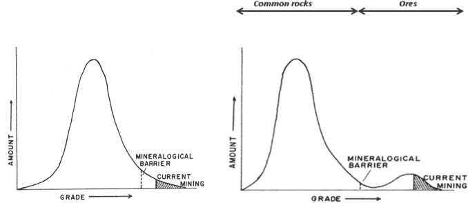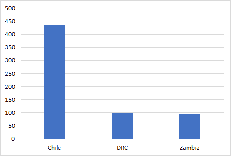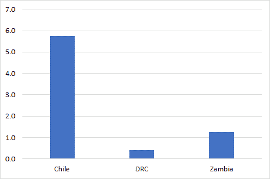

35

The S&P Capital IQ database lists all the copper projects in Chile, Zambia, and the DRC.^45 A “project” in that database is any operation by a mining company that acquires a property right to explore for and develop a mine. The projects identified by S&P Capital IQ range from target outline to production. Some projects are closed. Figure 14 shows the number of copper projects identified in Chile, DRC, and Zambia between 1997 and 2022. The number in Chile is roughly four times the number in DRC and Zambia. There is no reason to suspect a representative area in Chile is any more or less prospective for copper than the same area in DRC and Zambia. Zambia is two-thirds the size of Chile, and so one would expect about the number of projects to approximate the same proportion. DRC is almost four times larger. Figure 15 shows projects in each country normalized by land area. Once again, Chile’s exploration activity well exceeds that of DRC and Zambia, and DRC’s project activity is particularly low relative to its land mass.

This preliminary analysis confirms the higher political risk in the DRC and Zambia has a direct impact that makes mining there expensive and an indirect impact through other factors like country infrastructure and tax policy. These factors may well be driving away otherwise viable copper projects.

It is also possible that the lack of geological surveys in the DRC and Zambia is a factor deterring exploration and investment by private mining companies.^46 Such activities include geoscientific, mineral and economic surveys, research, compilations, and synthesis by governments, research institutes, universities and industry. Generating this information is considered an essential step in the development of mining projects. Early-stage mineral resource assessment being a public good, these activities are unlikely to be carried out to the optimal extent by the mining industry (Graham and Manzano, 2018).

The theory we are proposing suggests it is the low-grade projects that are being driven away. The high-grade deposits will have enough after-tax value to compensate for the higher costs and additional risks.

Most project grades are not publicly reported until the mining company issues a technical report outlining mineral resources. Some companies, if not listed on the Canadian, US, or Australian stock exchanges, may never publish their project grades. We were able to establish mineral resource grades for 53 projects returned by S&P Capital IQ. Mineral resource grades are average deposit grades above the economic cutoff, taking into account metal prices and project costs.

^45 The S&P data is indicative. Spot checking reveals a high propensity for error. Future work could use more accurate databases that charge for their services, such as Mining Intelligence.

^46 Canadian Intergovernmental Working Group on the Mineral Industry, “Overview of Trends in Canadian Mineral Exploration,” 2009, Figure 3.1.

*Figure 16: Copper Projects in Chile, DRC, and Zambia, Sorted by Grade (% Cu)*

*Source: authors’ calculations based on S&P Capital IQ Database.*

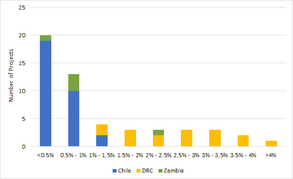

36

Project grades are plotted in Figure 16. As one would expect from Figure 13, there are more low-grade projects than high-grade projects in total because low-grade deposits are more abundant in the Earth’s crust. Of the 20 projects with grades less than 0.5% copper, 19 are in Chile and one is in Zambia. Of the projects with grades greater than 1%, two are in Chile and the rest are in the DRC and Zambia. Explorers in Zambia would appear to target projects that have at least 0.5% copper. Explorers in DRC target projects with at least 1% copper. The global average copper project is somewhere between 0.6% and 0.8%. The data substantiates the concept that where political risk and other costs are higher, explorers only target high-revenue, higher-grade prospects. The lower-revenue, lower-grade targets are left untouched.

## B. The Missing Projects

From this data, we can estimate the missing projects in each of the DRC and Zambia based on the potential projects they would have if they were like Chile—able to attract exploration for projects below 0.5% cut-off grade. Table 2 shows the missing projects in DRC and Zambia based on Chile’s project rate per 10,000 square kilometers. DRC has 1,250 missing projects and Zambia 235. This substantiates the common perception that these countries (and Africa in general) are underexplored.

*Table 2: Missing Copper Projects in DRC and Zambia*

| Country | Land Area (sq km) | Projects per 10,000 sq Km | Potential Projects | Actual Projects | Missing Projects |
|---|---:|---:|---:|---:|---:|
| Chile | 756,950 | 5.7 | 435 | 435 | 0 |
| DRC | 2,345,000 | 0.4 | 1,348 | 98 | 1,250 |
| Zambia | 572,614 | 1.6 | 329 | 94 | 235 |

*Source: authors’ calculations based on S&P Capital IQ Database.*

We next turn to copper exploration spending in these countries. To avoid double counting spending at a project, we map only grassroots, or initial, exploration spending in each country. More spending is indicative of more projects. Figure 17 confirms annual exploration spending was five or so times higher in Chile than in DRC and Zambia. Figure 17 also plots copper prices over time. It is evident that exploration spending is highly correlated with copper prices, as one would expect from the economic model in Section 2. As copper prices rise, more projects become economically viable to initiate via grassroots exploration spending.

Using this data, Table 3 reports the same information as in Table 2, only now estimating missing project exploration spending rather than missing project numbers. If DRC were as attractive as Chile for copper

*Figure 17: Annual Grassroots Exploration Spending in Chile, DRC, and Zambia, 1997–2022*

*Source: authors’ calculations based on S&P Capital IQ Database.*

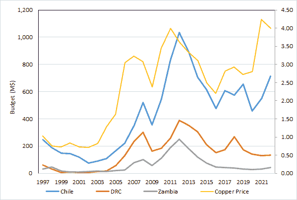

explorers, an additional US$31 billion in exploration spending would have been undertaken between 1997 and 2022. Zambia would have received an additional US$7 billion.

**Table 3: Missing Copper Grassroots Exploration Spending in DRC and Zambia, 1997-2022**

| | Land Area (sq km) | Spending per 10,000 sq km ($M) | Potential Project Spending ($M) | Actual Project Spending ($M) | Missing Project Spending ($M) |
| --- | --- | --- | --- | --- | --- |
| Chile | 756,950 | 150.6 | 11,399 | 11,399 | 0 |
| DRC | 2,345,000 | 16.7 | 35,513 | 3,907 | 31,406 |
| Zambia | 572,614 | 28.5 | 8,623 | 1,630 | 6,993 |

*Source: authors’ calculations based on S&P Capital IQ Database.*

Note that we only report missing exploration project spending. A fraction of these projects end-up finding mineral resources and mineral reserves, and another fraction end up in production. The missing total investment spending over this 25-year period is many multiples of the missing exploration spending. To estimate this lost spending, we have compiled fairly complete economic data on a subset of 48 of the 53 projects in Figure 16. The average initial capital spending on a copper project that reaches the go-ahead stage post exploration is US$1 billion. The average operating cost per ton of ore then extracted and processed is US$47. The average amount of copper ore planned to be mined and processed at a project over its life is 387 million tonnes, for an average planned project operating cost spent of US$18 billion over the life of mine, much of which is spent domestically. It is impossible to say how many additional operating projects DRC and Zambia would have if companies had respectively spent the missing US$31 billion and US$7 billion on exploration. Our point is simply that there are substantial knock-on effects from this lack of exploration spending in terms of missing operating projects with large domestic cash spending.

It is obvious that Chile may have factors other than direct political risk that draw mining companies there instead of DRC and Zambia. Geologists may simply be more familiar with copper exploration targets in Chile, or there may be a longer and more complete history of geological mapping. Companies may prefer the absence of tropical disease. Or they may determine that the available infrastructure and skilled labor pool is vastly superior in Chile and allows them to build lower-cost mines. Electrical power, for example, is lacking in DRC and Zambia.47 The increased capital and operating costs must be recovered by finding and mining a higher quality resource that generates sufficient revenue. The Kamoa-Kakula project in DRC is such a resource. Ivanhoe Mines, the Kamoa-Kakula’s owner, plans to spend US$128 million to refurbish several DRC hydroelectric plants to secure sufficient electrical power for the project.48 We investigate this next.

### C. Poor Quality of Infrastructure and Services versus Poor Governance

Poor quality of infrastructure and services (i.e., lack of infrastructure, lack of ancillary services, lack of skilled labor, etc.) and poor governance or political risk (i.e., corruption, weak rule of law, insecurity, etc.) both contribute to bypassing economic but lower-grade deposits. To try to tease out these two effects, Table 4 compares the three countries on a number of metrics that may influence exploration company decision-making on where to spend their exploration budgets. We also add Botswana, which has the Kalahari copper belt, and which has attracted 20 copper projects between 2012 and 2022, as an indication of “best-case” African example for copper mining.49

The country with the best indicator of the group is shown in green, the next best country in light green, the next in yellow, and the next in red. For Infrastructure and Skill Level, Chile and Botswana generally rank best, Zambia in the middle, and DRC last. The scores on the political risk factors reveal this same ranking. It is no surprise that countries with poor quality governance, as indicated by political risk, have spent less on infrastructure and education and are underperforming in these areas.

**Table 4: Country and Political Attractiveness for Mining Investment**

| | Chile | DRC | Zambia | Botswana |
| --- | --- | --- | --- | --- |
| *Infrastructure and Skill Level* | | | | |
| Rail (km per 1,000 sq km area) | 2.7 | 1.6 | 1.7 | 4.0 |
| Electric power consumption (kWh/cap) | 1,887 | 122 | 844 | 1,080 |
| Adult Literacy (%) | 97% | 72% | 76% | 84% |
| Percentage of firms owning generator | 41% | 60% | 62% | 35% |
| Paved roads (km per 1,000 sq km area) | 28 | 0.5 | 10 | 53 |
| *Political Risk* | | | | |
| Doing Business Score | 72.0 | 33.5 | 61.3 | 65.2 |
| Political Stability (-2.5 - +2.5) | 0.47 | -2.15 | 0.21 | 1.02 |
| Government Effectiveness (-2.5 - +2.5) | 1.04 | -1.64 | -0.80 | 0.44 |
| Regulatory Quality (-2.5 - +2.5) | 1.36 | -1.51 | -0.55 | 0.67 |
| Rule of Law (-2.5 - +2.5) | 1.15 | -1.69 | -0.43 | 0.53 |
| Control of Corruption Stability (-2.5 - +2.5) | 1.30 | -1.44 | -0.56 | 0.87 |
| Economic Freedom Index | 7.85 | 5.0 | 6.97 | 7.12 |
| Fraser Institute Policy Perception Index | 81.6 | 38.0 | 55.4 | 85.4 |

*Sources: World Development Indicators, World Governance Indicators, Fraser Institute.*

**Table 5: Country and Political Attractiveness for Mining Investment, Khoemacau Presentation**

*Source: Khoemacau Copper Mining*

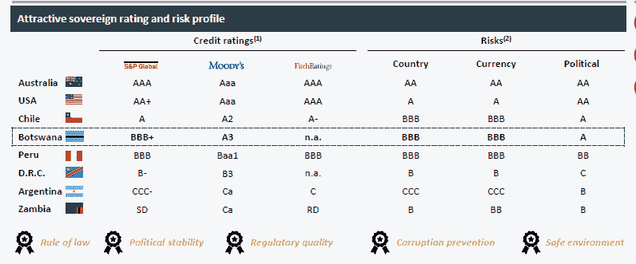

Table 5 presents this same kind of analysis by Khoemacau, a private company operating a copper mine in Botswana. In a corporate presentation in 2023, Khoemacau presented this table showing the relative merits of operating in Botswana and other mining destinations.50 Botswana ranks below Chile but above Peru, DRC, Argentina, and Zambia. The table particularly awards Botswana ribbons for rule of law, political stability, regulatory quality, corruption prevention, and safe environment.

A detailed examination of the 48 projects across these four countries for which we have relatively complete technical and economic project data provides a more robust analysis of the effects of poor quality of infrastructure and services versus poor quality of governance. Poor quality of infrastructure and services, via the items listed in the first part of Table 4, will result in higher operating costs. We have collected operating cost data for mining and processing a ton of ore at a selection of these projects. The geological orientation of the orebody at each project will have some influence on such costs, as will whether the mine is open pit or underground; however, a main factor influencing these costs is infrastructure and the cost of local inputs. The average mining and processing cost per ton of mill feed at five representative open pit copper projects in Chile is US$11.7. The average cost per ton is US$12.1 at three representative mines in Zambia, US$32.9 at four representative mines in Botswana, and US$84.1 in DRC. Figure 18 shows the individual project costs by date of technical study, restricting the sample to only open pit mines, which tend to have lower costs than underground mines.

Higher mining and processing cost results in a higher mineral resource cutoff grade, all else equal. Other factors that affect the cutoff grade include metal prices, realization costs (costs of getting the metal to market), and by-product metal credits. For example, expensive shipping and smelter terms increases cutoff grade, while a cobalt sale credit lowers cutoff grade. Figure 19 shows the resource cutoff grades at the projects in each country, by study date. Plotting the cutoff grades by study date controls for price and cost factors that are common across all projects. As predicted, the lower operating costs in Chile are reflected in lower cutoff grades relative to the other countries.

**Figure 18: Mining and Processing Cost (US$/t) vs. Date of Technical Study, Open Pit**

**Figure 19: Resource Cutoff Grade (%Cu) vs. Date of Technical Study, Open Pit**

*Source: authors’ calculations based on S&P Capital IQ Database.*

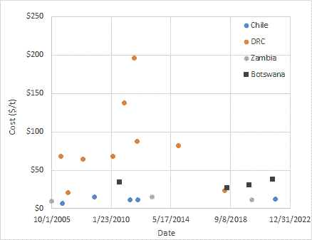
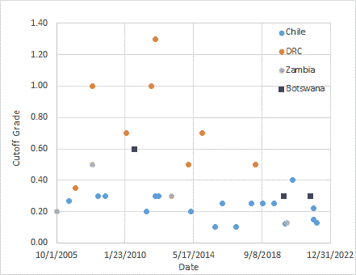

---
**Notes:**

47 “Mining in Africa’s Copperbelt,” *Engineering and Mining Journal, E&MJ, Global Business Reports,* February (2014): 43, 80-119.

48 OreWin, (March 2020). In return for the capital spending, the project will receive electric power from the grid at a reduced tariff.

49 https://www.equivest.capital/post/next-major-copper-province-kalahari-copper-belt.

50 Khoemacau Copper Mining, “Khoemacau Copper Mining: Developing a Safe, Modern, Significantly Scalable, Copper Silver Mining Business in the Kalahari,” April 2023.

resulting in lower mineral resource cutoff grades, while the higher operating costs in DRC are resulting in higher cutoff grades, even after controlling for byproduct metal sales and realization costs.

There is some concern that a project’s cutoff grade is selected with an allowance for the jurisdiction’s political risk, and the higher cutoff grades might reflect higher political risk and not higher costs. We have calculated the theoretical breakeven cutoff grade at each project and found no evidence that it reflects anything other than the project’s raw economics. The results of these calculations are shown in Figure 20.

If anything, companies tend to set their resource cutoff grades at below breakeven (Figure 21). This is because of the industry’s tendency to want to promote large resource estimates to boost project values and attract capital investment. Importantly, once again there is no evidence that companies operating in the DRC use a cutoff grade that is elevated for political risk. The cutoff grades are elevated because of the high cost of doing business there.

We have established that higher country costs lead to higher cutoff grades. This, in turn, leads to higher overall project grade. Figure 22 shows this relationship for Chile, Zambia, and Botswana. Chile has the lowest mining costs and consequently the lowest cutoff grades. Zambia and Botswana have slightly higher mining costs and consequently higher cutoff grades.

*Figure 20: Theoretical Breakeven Cutoff Grade (%Cu) vs. Date of Technical Study, Open Pit*

*Figure 21: Theoretical Breakeven Cutoff Grade (%Cu) vs. Actual Resource Cutoff Grade (%Cu)*

*Source: authors’ calculations based on S&P Capital IQ Database.*

*Figure 22: Resource Grade (%Cu) vs. Resource Cutoff Grade, Open Pit (%Cu)*

*Source: authors’ calculations based on Kamoa-Kakula and Sierra Gorda reports.*

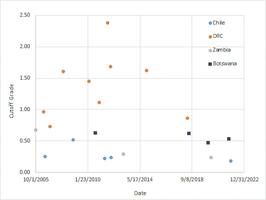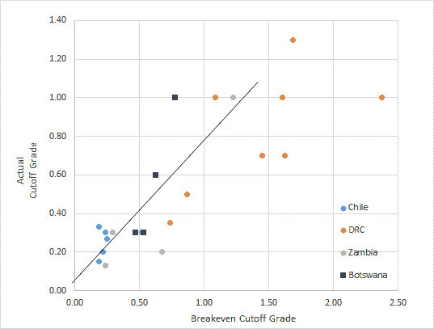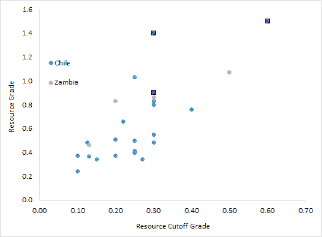

consequently higher cutoff grades. Figure 23 adds DRC to the mix. While the DRC is known for its high-grade copper projects, this is not an external gift of nature. Figure 22 demonstrates that it is a result of mining companies selecting relatively high cutoff grades due to high mining and processing costs. The higher mining project copper grades in the DRC are a sign of mining project inefficiency, rather than something that signals project success.

A higher cutoff grade naturally “sterilizes” the lower-grade material in the orebody, which is now sent to waste. Figure 24 shows the quantity of copper in the mineral resource as a function of resource grade. The trend is clear—the higher-cutoff-grade projects, while higher grade overall, contain less copper overall, while the lower-cutoff-grade projects, which have lower grades, contain more copper overall. The figure identifies five projects that are unusual: Kamoa-Kakula, a large underground mineral resource in DRC; Tenke Fungurume, a large open-pit mine in DRC; Collahuasi and Radomiro Tomic in Chile; and Kansanshi in Zambia. These projects are the true and unusual gifts of nature within this project set. In many cases, such projects are taxed via special project agreements under which the government and the firm both recognize the project’s increased rents and the need for a higher-than-normal profits tax rate.

To illustrate just how special Kamoa-Kakula is, we compare the quantity of copper in its mineral resources with Sierra Gorda, a reasonably large open-pit copper project in Chile. Figure 25 shows the grade-tonnage curves for both projects. These curves relate the tonnage of metal in a resource to the cutoff grade of the deposit. As cutoff grade rises, less resource is available for mining, and more of it goes to waste. The Kamoa-Kakula project is some 20 times larger than Sierra Gorda at low cutoff grades. This combination of high grade and high tonnage is what makes it a world-class copper mine with enough reward to compensate a mining company for exposure to DRC’s elevated political risks and high costs.^(51)

51 The political risk is evident. In 2016 the DRC government was given an additional 15% interest in the Kamoa project, above and beyond the 5% allowed for in the DRC mining code. A lack of regulatory stability is a key component of mining country political risk.

*Figure 23: Resource Grade (%Cu) vs. Resource Cutoff Grade (%Cu), DRC Included, Open Pit*

*Figure 24: Resource Grade (%Cu) vs. Resource Copper Quantity (kt)*

*Source: authors’ calculations based on S&P Capital IQ Database.*

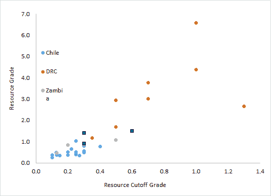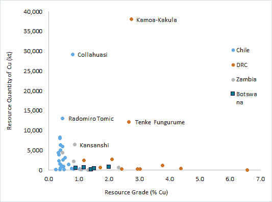

Political risk has no apparent influence on company selection of cutoff grades, but the actual mine plan, which selects the order of the mining sequence, can reflect political risk. At a copper project, the mining sequence typically starts at the highest-grade areas of the mining concession to improve project economics, increase the rate of return on investment, and shorten the period for capital recovery. The evidence of such high grading is found in the mineral reserve grade, reflecting the grade of the material actually mined being greater than the mineral resource grade. Normally, the resource and reserve grades should be about equal.

Figure 26 shows the relationship between resource grade and reserve grade at the projects in our sample. The chart’s diagonal line denotes the equality of resource and reserve grades, which would be expected if there is no influence of political risk on the selection of the mine plan. For the relatively low political risk countries Chile and Botswana, reserve grades and resource grades are indeed almost identical. Surprisingly, this is also true for the riskier Zambia. On the other hand, three projects in DRC have selected reserve grades that are significantly higher than resource grades, an indication of project high grading in response to political risk. The majority of DRC projects, however, have not. Once again, we circle back to political risk influencing the decision to explore for and mine in the DRC in the first place, with the missing projects identified earlier in this report reflecting the main impact of political risk and higher costs.

Kamoa-Kakula, one of the projects that is high grading in response to political risk, is an interesting study. In its resource estimate, it selected a 1.0% copper cutoff grade, which we independently estimate to be appropriate given the mine’s project economics. That cutoff revealed 38 million tonnes of copper to be known to be in the deposit and economic to mine (measured and indicated mineral resource). A further 5.7 million tonnes of inferred mineral resource may be available if confirmed by additional drilling, raising

*Figure 25: Reserve Grade (% Cu) v. Resource Grade (%Cu)*

*Source: authors’ calculations based on S&P Capital IQ Database and on project-specific data.*

*Figure 26: Copper Cutoff Grade (% Cu) v. Quantity of Copper in Resource (kt), Sierra Gorda and Kamoa-Kakula Projects*

*Source: authors based on Kamoa-Kakula and Sierra Gorda reports.*

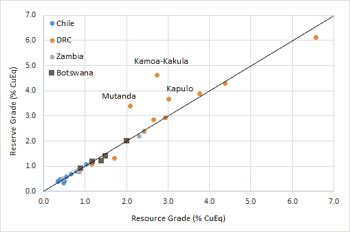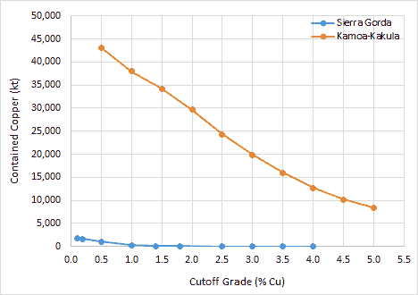

the total potential to 43.7 million tonnes (OreWin, March 2020, pp. 18–20). For reference, global annual copper consumption is around 25 million tonnes. The mine plan presented in the Kamoa-Kakula 2020 Resource Update mines only 17.5 million of the 43.7 million tonnes of economic copper in the mineral resource (ibid., p. 565). This suggests that Kamoa-Kakula’s operator has elected to high-grade the project at an approximately 2.5% copper cutoff grade, as inferred from the reserve grades (ibid., pp. 19–20, and pp. 24–25). The high grading results in a project internal rate of return on invested capital of 40.9%, a payback period of 2.9 years, and an after-tax net present value at an 8% discount rate of US$10 billion on a US$1.1 billion investment (ibid., p. 5). In relation to other copper mining projects, these financials are outstanding from a business perspective. However, 26.2 million tonnes of copper resource—more than a year of global consumption—will probably be left in the ground and may not come to market despite it being economic to mine.^(52) From an economic perspective, this is a waste of a mineral critical for the greening of the energy system, and immense forgone revenue for the country over several decades.^(53)

This analysis confirms our earlier proposition that political risk directly affects the destination of exploration spending in the first place. Second, once an orebody is discovered, political risk indirectly affects the way a project is operated. Poor quality of governance is, indeed, highly correlated with poor quality of infrastructure, ancillary services, and skills. Low quality of infrastructure, skills, and other services raises the costs of doing business, reflected in higher copper mine unit operating costs. This in turn increases the cutoff grade, leaving much of the copper that is a gift of nature in the ground as uneconomic waste. Third, once the operation is launched, political risk may again manifest itself directly through mining plans with a grade for resources actually mined even higher than the grades needed to offset high mining costs.

52 The mine plan is based on a Preliminary Economic Assessment and includes inferred mineral resource that is mineralization additional to the mineral reserve estimate.

53 An updated Integrated Development Plan has been available since March 2023. However, we elected to use the Resource Update and Preliminary Economic Assessment from March 2020 because these were before the first production in April 2021 and before COVID-19. The 2023 document projects a mine life of 42 years, instead of an initial 37 years, with US$35.3 billion in revenues to the government and 20.7 million tonnes of copper production at the same elevated 2.5% copper cutoff grade (“Kamoa-Kakula Integrated Development Plan 2023,” OreWin, March 2023, pp. 251, 607–608).

*Figure 27: Cumulative Project Tax Revenue vs. Contained Copper in Reserves (kt)*

*Source: authors’ calculations based on S&P Capital IQ Database and on project-specific data.*

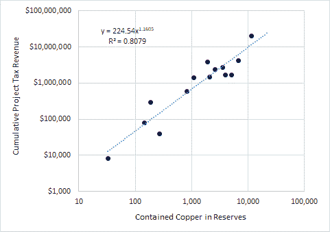

Less copper extracted means less spending on local inputs and less tax revenue received. Some of the technical studies conducted by mining companies perform after-tax evaluations, whereby a crude projection of taxes owed over the project’s life is made. From the selection of projects in the sample that perform tax calculations, we have estimated that there is a reasonably close relationship between copper in reserves and cumulative projected tax revenue over the life of a project, as shown in Figure 27. The larger the mine, the higher the expected tax payment to the host government.

Returning to Kamoa-Kakula, the tax implications of the high-grading being conducted at this project are significant. The company estimates it will pay US$25.7 billion in income taxes, customs duties, royalties, and export taxes to the DRC government over the project’s 37-year life (Ibid. p. 561, p. 564). If the operator had selected a 1% cutoff grade for its mining operation instead of 2.5%, hence mining at 2.6% copper (Ibid. p. 18) instead of 3.88% copper (Ibid. p. 5), it could extract 26.2 million more tonnes of copper and pay at least an additional US$38.5 billion in revenues over the life of the mine.

## Conclusion

This paper’s title is “Maximizing Output and Government Revenues from Mining in Developing Countries: The Role of Country Political Risk and Investors’ Return, and Implications for the Energy Transition.” There are four messages on these topics. The first is that political risk seems to directly impact mining companies’ preferences through their selection of countries in which to explore in the first place. Zambia’s copper mining economics, as measured by mining costs, are on par with Chile. As a result, the projects that Zambia has managed to develop have copper cutoff grades equivalent to those in Chile. Yet Zambia has attracted only a small fraction of the exploration spending and general project activity compared with Chile, despite the sizes of the two countries being comparable. A confounding factor is that Zambia has not conducted a geological survey, which means that companies will only explore in regions that have yielded success in the past. One cannot disentangle the impact of lack of geological survey from political risk.

The second and most important message is that maximizing government revenues from mining is best achieved by encouraging exploration. It is the seed from which mining projects emerge: more exploration results in more projects being found and developed, and more projects being found and developed results in more taxation being received by the government. Notions of increasing fiscal receipts from mining—by, say, implementing special resource rent taxes on existing projects, or special mining taxes on top of corporate taxes, or anticipating increased fiscal revenues as metal prices rise—are of second-order importance. Taking an intertemporal and project lifetime cash-flow approach, there is very little resource rent that has been left untaxed in the first place, and any attempt to increase mining taxation on all projects will likely lead to less exploration, not more. Increased taxation rates should likely be limited to projects that are extraordinary in their resource size and quality. So far, despite the green energy revolution, we are not seeing an increase in metal prices; we are, however, seeing a rapid inflation of mining costs that reduces the tax base. What will lead to more exploration is a national geological survey that maps the countries’ areas of mineral potential, an effective and efficient exploration and mining permitting system, security of land tenure, and stability of the fiscal regime. These are the steps that successful mining countries like Canada and Chile have pursued, and that Botswana is using to attract companies to its newly developed Kalahari copper belt.

The third message is that a high cost of doing business results in a high cutoff grade, exemplified by the mining projects in the DRC. That high cutoff grade results in more of the found copper resource being left in the ground. Mine life is shortened, spending on local inputs is reduced, and tax revenues are lost. It may well be that the higher mining costs in the DRC are a result of political risk, but this is an indirect reflection of the consequences of poor governance associated with political risk, not of direct aversion to political risk itself. Were the DRC to put in place the infrastructure and skills that create Chile’s lower mining costs, while keeping the quality of governance unchanged, its project cutoff grades would lower, and the quantity of copper extracted at each project would increase. Tax revenues would increase because we estimate that revenues from a project are proportional to the amount of copper extracted.

The metals needed for energy transition must come from two sources—newly found mining projects and more intensive recovery of metals at existing projects. The latter is largely ignored, it being considered of little significance given the inelasticity of short-run production to price shocks. This points to the fourth and final message: all metal deposits that have been explored for, found, and are currently being extracted provide a source of additional supply, even without price shocks in cases where they are being high-graded in response to political risk. At three projects in the DRC, high-grading above and beyond the higher resource cutoff grades needed to offset the country’s high mining costs sterilizes copper that is economic to mine. With that, more of the taxation that would normally be taken on this copper is lost. It would not be unreasonable for the mining ministries in developing countries to have as a condition for permitting a commitment by the operating company to extract all ore that is economic. There are several companies operating in the DRC who are undertaking exactly this plan at their projects. They are extracting all economic ore, and it would not be burdensome to impose this expectation on the few companies that are not.

The energy transition is crucial to face an existential threat. No quantity of economic green mineral should be left in the ground, sterilized, or wasted. In this war economy approach, the strategic role of green minerals as a global public good requires the support of international financial institutions (IFIs) for the implementation of the above-mentioned recommendations. As Osmundsen et al. (2024) shows for the gas sector, correct contract design can align the incentives of the government and companies to extract all economic ore, with IFIs bridging the risk perceptions of both parties. In the case of green minerals, IFIs can take on parts of the initial investment and parts of the downside risk. IFIs’ involvement is expected to be profitable because the misaligned incentives make room for a win-win situation, where IFIs share in the positive value of the project.

The IFI arrangement will make the tax system neutral, and this may change project design and project operation so that the value before tax is increased. With the involvement of an IFI, the mining company is shielded from distortive elements and may make additional investment to mine lower-grade minerals and increase overall ore extraction. This could generate higher values to the benefit of all parties, including the IFIs.

## References

Akhtaruzzaman, M., N. Berg, and C. Hajzler (2017) – “Expropriation Risk and FDI in Developing Countries: Does Return of Capital Dominate Return on Capital?” *European Journal of Political Economy* 49, 84–107.

Arrow, K. J. and S. Chang (1982) – “Optimal Pricing, Use, and Exploration of Uncertain Natural Resource Stocks.” *Journal of Environmental Economics and Management* 9, 1–10.

Ball, R. and J. Bowers (1984) – *The Resource Rent Tax: A Penalty on Risk-Taking.* St. Leonards, NSW: The Centre for Independent Studies.

Barma, N., K. Kaiser, T. Minh Le, and L. Vinuela (2012) – *Rents to Riches? The Political Economy of Natural Resource-Led Development.* World Bank.

Boadway, R. and F. Flatters (2023) – “The Taxation of Natural Resources: Principles and Policy Issues,” in *Taxing Choices for Managing Natural Resources, the Environment and Global Climate Change: Fiscal Systems Reform Perspectives*, Anwar Shah, ed., Palgrave Macmillan for the Brookings Institution, 17–82.

Boadway, R. and M. Keen (2015) – “Rent Taxes and Royalties in Designing Fiscal Regimes for Nonrenewable Resources,” in *Handbook on the Economics of Natural Resources*, ed. Robert Halvorsen and David F. Layton. Cheltenham: Edward Elgar, 97–139.

Boadway, R. and M. Keen (2010) – “Theoretical Perspectives on Resource Tax Design,” in *The Taxation of Petroleum and Minerals: Principles, Problems and Practice*, ed. Philip Daniel, Michael Keen and Charles McPherson. Routledge, 13–74.

Bøe, K. S., T. Jordal, Š. Mikula, and P. Molnár (2019) – “Do Political Risks Harm Development of Oil Fields?” *Journal of Economic Behavior and Organization* 157, 338–358.

Boer, L., A. Pescatori, and M. Stuermer (2021) – “Energy Transition Metals.” *International Monetary Fund Working Paper* WP/21/243.

Bohn, H. and R. T. Deacon (2010) – “Ownership Risk, Investment, and the Use of Natural Resources,” *American Economic Review* 40, no. 3, 526–549.

Cairns, R. D. and G. A. Davis (2023) – “Accounting for Non-marketed Capital.” *Review of Income and Wealth*.

Castillo, E. (2021) – “The Impacts of Profit-based Royalties on Early-stage Mineral Exploration,” *Resources Policy* 73.

Cust, J. and T. Harding (2020) – “Institutions and the Location of Oil Exploration,” *Journal of the European Economic Association* 18, no. 3, 1321–1350.

Daniel, P., M. Keen, A. Świstak, and V. Thuronyi, eds. (2017) – *International Taxation and the Extractive Industries.* Oxford: Routledge.

Daniel, P., M. Keen, and C. McPherson, eds. (2010) – *The Taxation of Petroleum and Minerals.* Oxford: Routledge.

Davis, G. A. and J. L. Smith (2020) - *Design and Performance of Mining and Petroleum Fiscal Regimes in Latin America and The Caribbean: A Survey of Current Practices, Lessons Learned and Best Practices.* Inter-American Development Bank.

Davis, G.A. and O. Manzano (2018) - “The Extractive Industries in Central America,” *The Extractive Industries and Society* 5, 215-217.

Davis, G. A. and R. D. Cairns (2017) - “The Odd Notion of ‘Reversible Investment’,” *Journal of Banking and Finance* 81, 172-180.

Devarajan, S. and A. C. Fisher (1982) - “Exploration and Scarcity,” *Journal of Political Economy* 90, no. 6, 1279-1290.

Diene, P. D., D. Manley, S. Olan’g, and T. Scurfield (2022) – “Triple Win: How Mining Can Benefit Africa’s Citizens, their Environment, and the Energy Transition.” *Natural Resource Governance Institute*.

Fetter, F. A. (1977) - *Capital, Interest, and Rent: Essays in the Theory of Distribution.* Universal Press Syndicate, Kansas City, Sheed Andrews and McMeel, Inc., Murray N. Rothbard, Ed.

Garnaut, R. (2010) - “Principles and Practice of Resource Rent Taxation,” *Australian Economic Review* 43, no. 4, 347-356.

Garnaut, R., and A. Clunies Ross (1983) - *Taxation of Mineral Rents*. Clarendon Press.

Gordon R. L. (1994) - *Regulation and Economic Analysis: A Critique over Two Centuries.* Boston: Kluwer, p. 123.

Gray, L. C. (1914) - “Rent Under the Assumption of Exhaustibility,” *Quarterly Journal of Economics* 28, 466-489.

Hartwick J. M. and N. D. Olewiler (1986) - *The Economics of Natural Resource Use*. Harper & Row, Chapter 2.

Henckens, M. L. C. M, E. C. Van Ierland, P. P. J. Driessen, and E. Worrell (2016) - “Mineral Resources: Geological Scarcity, Market Price Trends, and Future Generations,” *Resources Policy* 49, 102-111.

Hotelling, H. (1931) - "The Economics of Exhaustible Resources," *Journal of Political Economy* 39 (2), 137–175.

Kolstad, I. and A. Wiig (2013) - “Digging in the Dirt? Extractive Industry Corruption and FDI,” *Economics of Governance* 14, 369-383.

Kruschwitz, L., A. Löffler, and G. Mandl (2012) - “Damodaran’s Country Risk Premium: A Serious Critique,” *Business Valuation Review* 31, no. 2/3, 73-84.

Land, B. C. (2010) - “Resource Rent Taxes,” in *The Taxation of Petroleum and Minerals: Principles, Problems and Practice*, ed. Philip Daniel, Michael Keen and Charles McPherson. Routledge, 241-262.

Lange, G. M., X. Wang, and E. Naikal (2021) - “Improving the Estimates of Mineral Rent and Asset Value for the Changing Wealth of Nations 2021.” *World Bank Technical Report*, 12-13.

Lilford E. and P. Guj (2021) - *Mine Taxation: Reconciling the Interests of Government and Industry.* Cham: Springer Nature.

Lund, D. (2014) - “State Participation and Taxation in Norwegian Petroleum: Lessons for Others?” *Energy Strategy Reviews* 3, 49-54.

McDonald, R. L. and D. Siegel (1982) – “The Value of Waiting to Invest.” *National Bureau of Economic Research* Working Paper no. w1019.

Nellor, D. C. L. (1987) - “Sovereignty and Natural Resource Taxation in Developing Countries,” *Economic Development and Cultural Change* 35, no. 2, 367-392.

Orchard, J. E. (1922) - “The Rent of Mineral Lands,” *Quarterly Journal of Economics* 36, no. 2, 290-318.

Osmundsen, P., G. Solheim, and C. Bou Habib (2024) – “Promoting Investment Incentives by International Financial Institutions: The Case of Fostering Natural Gas Investments in Developing Countries.” *Available at SSRN*.

Osmundsen, P., M. Emhjellen, and M. Halleraker (2006) - “Transnational Energy Companies’ Investment Allocation Decisions,” in *The Changing World of Oil: An Analysis of Corporate Change and Adaptation*, ed. Jerome Davis. Hampshire: Ashgate, 105-122.

Osmundsen, P. (2005) - “Optimal Petroleum Taxation Subject to Mobility and Information Constraints,” in *Petroleum Industry Regulation Within Stable States*, eds. Solveig Glomsrød and Petter Osmundsen, Ashgate, 12-25.

Otto, J., C. Andrews, F. Cawood, M. Doggett, P. Guj, F. Stermole, J. Stermole, and J. Tilton (2006) - *Mining Royalties: A Global Study of Their Impact on Investors, Government, and Civil Society.* The World Bank.

Otto, J. M., ed. (1995) - *Taxation of Mineral Enterprises*. London: Graham & Trotman Ltd.

Pindyck, R. S. (1978) - “The Optimal Exploration and Production of Nonrenewable Resources.” *Journal of Political Economy* 86, no. 5, 841-861.

Valle de Souza, S., B. E. Dollery and M. A. Kortt (2017) - “A Critical Evaluation of Australian Mineral Resource Rent Tax,” *International Journal of Public Administration* 40, no. 6, 472-480.

Yunis, J. and E. Aliakbari (2022) - *Fraser Institute Annual Survey of Mining Companies 2021.* The Fraser Institute.
