# 2024年度 小红书 医疗行业月报

标记我的生活

**2024.2月**

生活服务-医疗医美行业运营团队

---

## 一、行业概览

1. 行业热搜词
2. 热搜词检索趋势

## 二、用户洞察

1. 用户决策路径分析
2. 热门类目搜索及高活跃用户画像

## 三、优质笔记分享

1. 专业号优质笔记分享
2. 社区优质笔记分享

---

## 行业热搜词TOP20

### 口腔类行业热搜词

洞察搜索趋势 | 借力制作内容

- 牙齿矫正
- 种植牙
- 牙齿美白
- 根管治疗
- 牙齿黄怎么变白
- 深覆合
- 拔智齿
- 正畸
- 牙齿美白
- 牙齿矫正
- 补牙
- 牙龈肿痛
- 牙套
- 智齿发炎肿痛怎么办
- 牙疼
- 牙套脸
- 智齿一定要拔吗
- 拔智齿一般疼几天恢复
- 牙周炎
- 拔智齿多少钱一颗
- 种牙
- 根管治疗步骤
- 舌头有齿痕
- 牙齿矫正大概多少钱
- 北京牙齿矫正
- 上海牙齿矫正
- 杭州牙齿矫正
- 深圳牙齿矫正
- 牙齿矫正最佳年龄
- 天津牙齿矫正
- 南京牙齿矫正
- 重庆牙齿矫正
- 武汉牙齿矫正
- 牙齿矫正年龄范围
- 广州牙齿矫正
- 成都牙齿矫正
- 牙齿矫正脸型变化
- 西安牙齿矫正
- 龅牙矫正多少钱
- 厦门牙齿矫正
- 牙齿矫正医保能报销吗
- 宁波牙齿矫正
- 牙齿美白做什么项目
- 牙齿美白去黄推荐
- 冷光牙齿美白
- 牙齿美白牙膏
- 皓得适牙齿美白
- 牙齿美白最有效的方法
- 牙齿美白做什么项目比较…
- 牙齿美白仪
- 牙齿美白牙贴
- 牙齿美白冷光
- 牙齿美白医院多少钱
- 卢博士牙齿美白精华液
- 牙齿美白笔
- 牙齿美白贴
- 牙齿美白老爸测评去黄
- 韩国牙齿美白
- 三甲医院牙齿美白多少钱
- 日本牙齿美白
- 牙齿美白老爸测评
- 种植牙一颗多少钱
- 种植牙流程及步骤
- 种植牙有什么风险和后遗症
- 种植牙品牌怎么选
- 种植牙可以报医保吗
- 种植牙全过程
- 种植牙后遗症
- 种植牙后悔的人太多了
- 种植牙5年后真的好后悔
- 拔牙后多久种植牙
- 种植牙危害
- ITI种植牙
- 武汉种植牙
- 上海种植牙
- 广州种植牙
- 深圳种植牙
- 种植牙疼不疼
- 种植牙价格
- 假牙和种植牙的区别

数据来源：小红书商业数据中台 0201-0229

---

### 口腔热搜词检索趋势

洞察搜索趋势 | 借力制作内容

口腔-TOP项目词搜索趋势：拔智齿、根管治疗、深覆合、牙齿矫正、牙齿美白、正畸

数据来源：小红书商业数据中台 0201-0229

---

## 行业热搜词TOP20（眼科）

### 近视手术热搜词

洞察搜索趋势 | 借力制作内容

#### 全飞秒热搜词

- 全飞秒和半飞秒
- 全激光和全飞秒哪个好
- 全飞秒手术
- 全飞秒后多久恢复最佳视力
- 角膜厚度多少可以做全飞秒
- 全飞秒后可以戴美瞳吗
- 全飞秒手术多少钱
- 全飞秒全过程
- 全飞秒术后多久可以看手机
- 全飞秒手术失败会瞎吗
- 全飞秒术后
- 全飞秒术后恢复
- 近视眼手术全飞秒和半飞秒
- 全飞秒手术恢复期多久
- 全飞秒价格
- 全飞秒后遗症
- 全飞秒术后注意事项和禁忌

#### 半飞秒热搜词

- 半飞秒和全飞秒区别
- 个性化半飞秒
- 精雕半飞秒
- 半飞秒后视力回退
- 半飞秒手术
- 全飞秒和半飞秒
- 半飞秒术后多久可以看手机
- 半飞秒后可以戴美瞳吗
- 半飞秒角膜瓣多久愈合
- 半飞秒价格
- 半飞秒术后
- 半飞秒后遗症
- 半飞秒手术过程
- 半飞秒恢复期
- 半飞秒术后视力多久稳定
- 半飞秒术后注意事项
- 飞秒和半飞秒区别哪个好
- 近视眼手术全飞秒和半飞秒
- 半飞秒和全飞秒区别
- 半飞秒
- 全飞秒和半飞秒的区别

#### 晶体植入热搜词

- 晶体植入手术过程
- 近视晶体植入手术
- 晶体植入恢复期多久
- 全飞秒和晶体植入哪个更好
- 晶体植入手术后注意事项
- 晶体植入手术多少钱
- 晶体植入可以带美瞳吗
- 飞秒和晶体植入哪个安全
- ICL晶体植入价格
- ICL晶体植入后遗症
- 晶体植入老了后怎么办
- 晶体植入能用一辈子吗
- ICL晶体植入失败
- 晶体植入手术价格
- 晶体植入后遗症
- ICL晶体植入可逆但是伤害不可逆
- 晶体植入和飞秒哪个好
- 晶体植入
- ICL晶体植入
- 晶体植入手术

#### 其他近视手术热搜词

- 近视手术后视力下降补救
- 近视手术价格
- 成都近视手术
- 近视手术可以带美瞳吗
- 爱尔眼科近视手术价格
- 同仁医院近视手术
- 近视手术后注意事项
- 飞秒近视手术价格
- 近视手术术前检查
- 高度近视可以做近视手术吗
- 近视手术老了有影响吗
- 散光能做近视手术吗
- 近视手术恢复期多久
- 飞秒近视手术后遗症
- 飞秒近视手术
- 近视手术多少钱
- 近视手术后遗症和危害
- 近视手术有必要做吗
- 激光近视手术
- 近视手术

数据来源：小红书商业数据中台 0201-0229

---

### 行业关键词词云 & 眼科医院-TOP项目词搜索趋势

近视手术、全飞秒、半飞秒、晶体植入、OK镜

眼科热搜词及检索词云

数据来源：小红书商业数据中台 0201-0229

---

## 月子中心热搜词TOP25

### 月子中心-相关热搜词

洞察搜索趋势 | 借力制作内容

- 产后脱发
- 腹直肌分离
- 哺乳期减肥
- 哺乳期饮食禁忌
- 回奶药
- 追奶最快最有效的方法
- 月子中心
- 产后修复
- 腹式呼吸正确方法
- 回奶
- 断奶的正确方法
- 月子餐
- 剖腹产疤痕护理
- 盆底肌修复
- 凯格尔运动女
- 产后修复运动
- 月子中心
- 回奶最好最快最有效的方法
- 月子餐30天食谱及做法
- 凯格尔产后运动

月子中心用户检索热度对比（23年 vs 24年）

数据来源：小红书商业数据中台 0201-0229

---

### 母婴照护-用户需求

母婴照护-用户需求词云

月子中心用户需求场景洞察&词云

数据来源：小红书商业数据中台 0201-0229

---

### 月子相关搜索词，关注热度趋势

| 关键词 | 搜索量 | 增速 |
| :--- | :--- | :--- |
| 月子餐 | 高 | 低 |
| 月子餐食谱 | 高 | 低 |
| 月子餐42天食谱及做法 | 低 | 高 |
| 月子餐30天食谱及做法 | 高 | 低 |
| 月子中心 | 高 | 低 |
| 小月子调理食谱 | 低 | 高 |
| 月子水 | 低 | 高 |
| 坐月子 | 高 | 低 |
| 产妇月子食谱 | 低 | 高 |
| 坐月子吃什么食谱 | 低 | 高 |
| 小月子 | 低 | 高 |
| 月子餐菜谱大全 | 低 | 高 |
| 月子中心避坑指南 | 低 | 高 |

用户需求词变化及增长趋势

数据来源：小红书商业数据中台 0201-0229

---

## 用户决策路径分析

### “牙齿贴面”用户决策路径

挖掘搜索习惯 | 把握用户心智

| 上游词 | 搜索“牙齿贴面” | 下游词 |
| :--- | :--- | :--- |
| 牙齿美白 | | 牙齿贴面价格 |
| 牙缝大怎么修复 | | 牙齿黄怎么变白 |
| 牙齿黄怎么变白 | | 牙齿贴面多少钱一颗 |
| 牙齿缝隙黑 | | 牙齿贴面保持多久 |
| 牙齿贴片 | | 牙齿美白 |
| 整牙 | | 牙贴面可以只做两颗吗 |
| 牙齿矫正 | | 牙齿贴面的好处和坏处 |
| 美白牙齿 | | 做牙贴面的危害 |
| 牙齿 | | 牙齿贴面的危害 |
| 牙套 | | 烤瓷牙 |
| 烤瓷牙 | | 牙齿贴片 |
| 牙黄怎么变白 | | 牙齿贴面全过程 |
| 牙齿美白做什么项目 | | 牙齿贴面后遗症 |
| 贴片牙齿 | | 氟斑牙 |
| 牙贴 | | 牙齿矫正 |
| 门牙缝隙大怎么办 | | 牙贴面 |

- 【牙齿贴面】上游词中“贴片”、“矫正”排名靠前，“牙齿黄怎么变白”提升明显。
- 下游词中咨询“价格”、“好处&坏处”占据前排，贴面的危害有明显疑问，可生产对应内容答疑解惑。

数据来源：小红书商业数据中台 0201-0229

---

### “牙齿矫正”用户决策路径

挖掘搜索习惯 | 把握用户心智

| 上游词 | 搜索“牙齿矫正” | 下游词 |
| :--- | :--- | :--- |
| 牙齿 | | 牙齿矫正大概多少钱 |
| 牙齿矫正大概多少钱 | | 牙齿矫正是去医院还是口腔 |
| 牙齿黄怎么变白 | | 牙齿矫正最佳年龄 |
| 牙齿正常咬合状态 | | 正畸 |
| 牙套 | | 牙齿矫正脸型变化 |
| 牙齿缝隙黑 | | 牙齿黄怎么变白 |
| 牙齿美白 | | 牙齿矫正医保能报销吗 |
| 隐适美 | | 牙套脸 |
| 牙齿贴面 | | 深覆合 |
| 深覆合 | | 牙齿正常咬合状态 |
| 牙齿矫正最佳年龄 | | 牙齿矫正隐形 |
| 隐形牙套 | | 成人矫正牙齿的危害 |
| 整牙 | | 牙齿矫正流程和步骤 |
| 矫正 | | 牙齿矫正年龄范围 |
| 正畸 | | 牙齿矫正隐形和钢牙哪个好 |
| 矫正牙齿 | | 隐形牙套 |

- 【牙齿矫正】上游词中 “牙齿美白” 流量来源提升明显，用户对于美白&矫正两个项目关联度较高。
- 下游词中TOP词对“价格”、“脸型变化” 疑问较大，“牙齿矫正最佳年龄”排名提升明显。

数据来源：小红书商业数据中台 0201-0229

---

### “深覆合”用户决策路径

挖掘搜索习惯 | 把握用户心智

| 上游词 | 搜索“深覆合” | 下游词 |
| :--- | :--- | :--- |
| 深覆合矫正脸型变化 | | 深覆合矫正 |
| 深覆合的危害 | | 下巴后缩 |
| 深覆合矫正 | | 深覆合怎么矫正 |
| 下巴后缩 | | 深覆合矫正一般几年 |
| 深覆合怎么矫正 | | 深覆盖 |
| 深覆合矫正一般几年 | | 成人深覆合有必要矫正吗 |
| 深覆盖 | | 深覆合有必要矫正吗 |
| 成人深覆合有必要矫正吗 | | 深覆合自己能改善吗 |
| 深覆合有必要矫正吗 | | 深覆合能不能自行改善 |
| 深覆合自己能改善吗 | | 深覆合自我矫正训练 |
| 深覆合能不能自行改善 | | 深覆合矫正多少钱 |
| 深覆合自我矫正训练 | | 正常咬合图 |
| 深覆合矫正多少钱 | | 深覆合是什么样子 |
| 正常咬合图 | | 深覆合有没有必要矫正 |
| 深覆合是什么样子 | | |
| 深覆合有没有必要矫正 | | |

- 【深覆合】中流量来源于“下巴后缩”、“深覆合矫正脸型变化”、“地包天”、“龅牙”等外观描述词。
- 下游词TOP包含“如何矫正”、“脸型变化”、“价格咨询”等。

数据来源：小红书商业数据中台 0201-0229

---

## 【牙齿矫正】搜索及高活跃用户画像

数据来源：小红书商业数据中台 0201-0229

- 性别分布
- 预测年龄
- TOP20城市
- 婚恋状态
- TOP20兴趣
- 内容关键词偏好

版权归属小红书科技有限公司，仅供学习使用，严禁用作商业通途

## 【种植牙】搜索及高活跃用户画像

数据来源：小红书商业数据中台 0201-0229

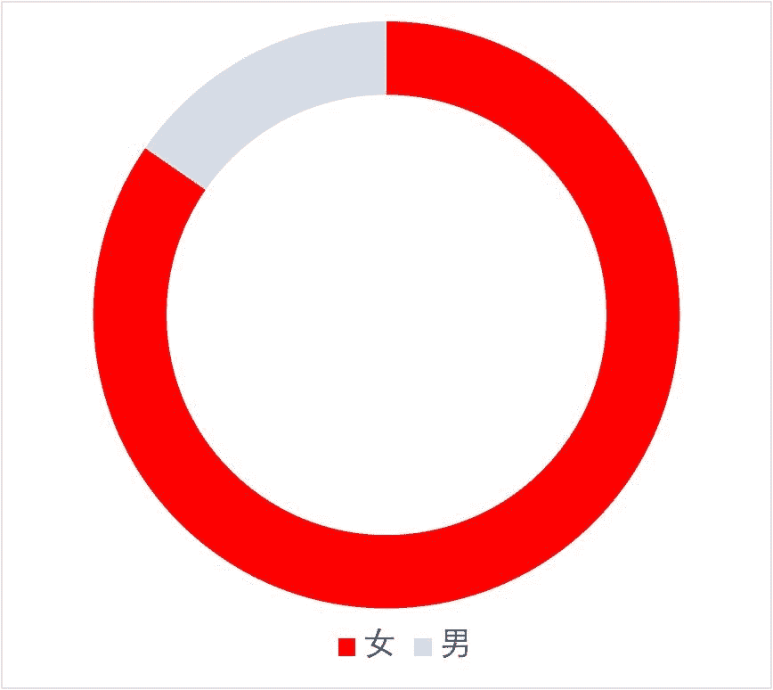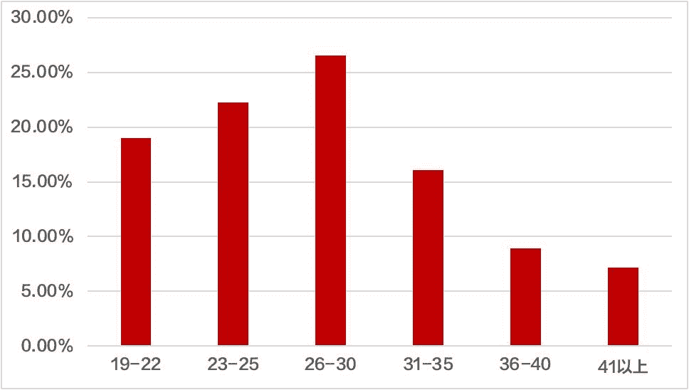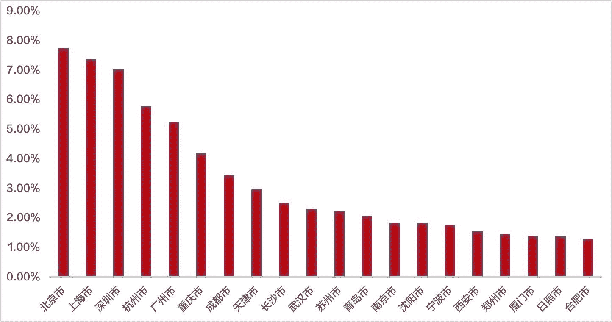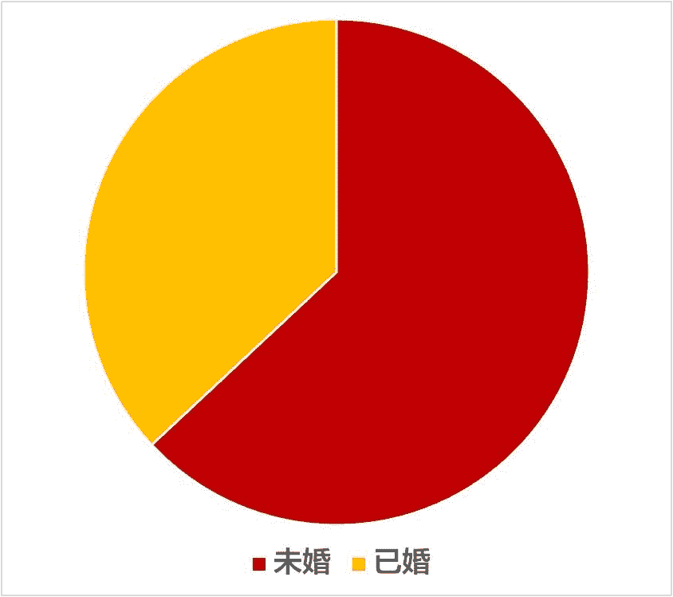

性别分布

预测年龄

TOP20城市

婚恋状态

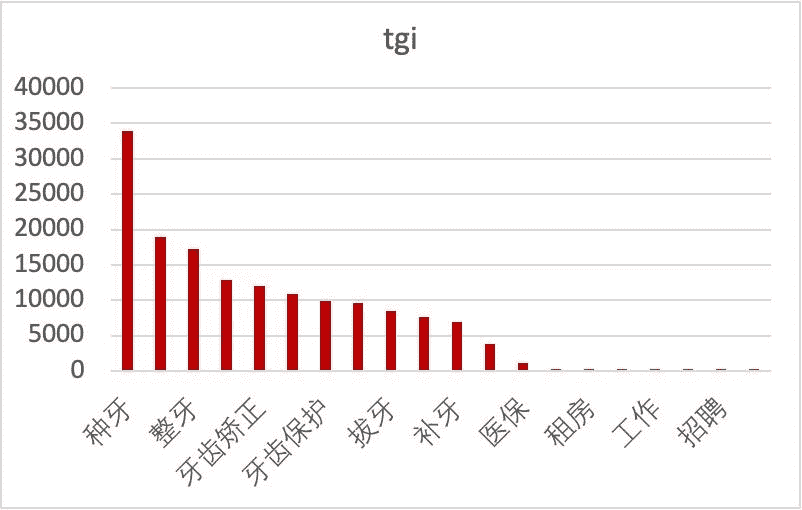

TOP20兴趣

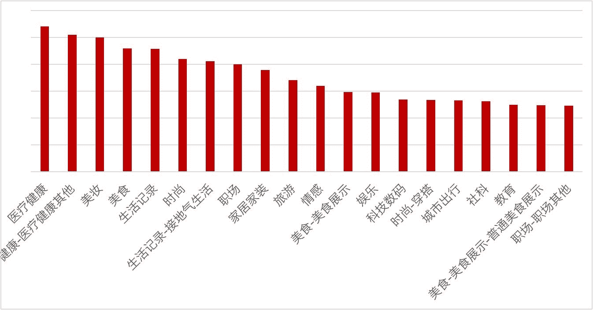

内容关键词偏好

版权归属小红书科技有限公司，仅供学习使用，严禁用作商业通途

## 【牙齿贴面】搜索及高活跃用户画像

数据来源：小红书商业数据中台 0201-0229

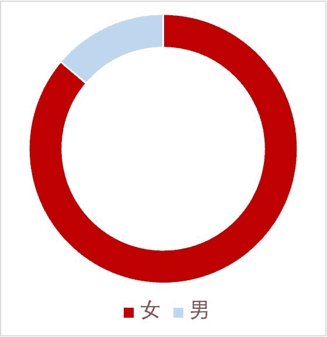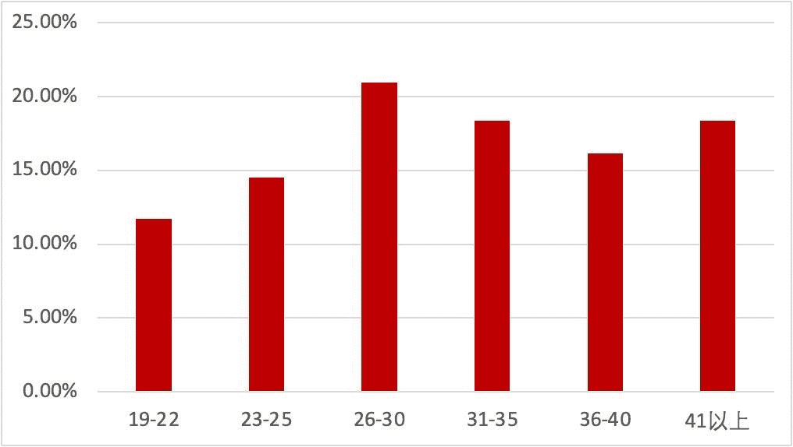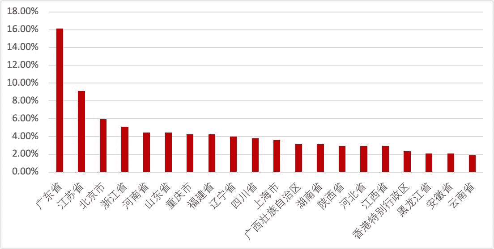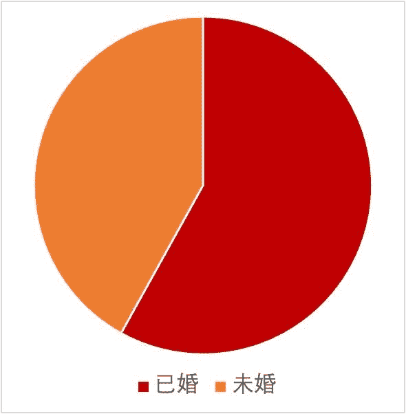

性别分布

预测年龄

TOP20城市

婚恋状态

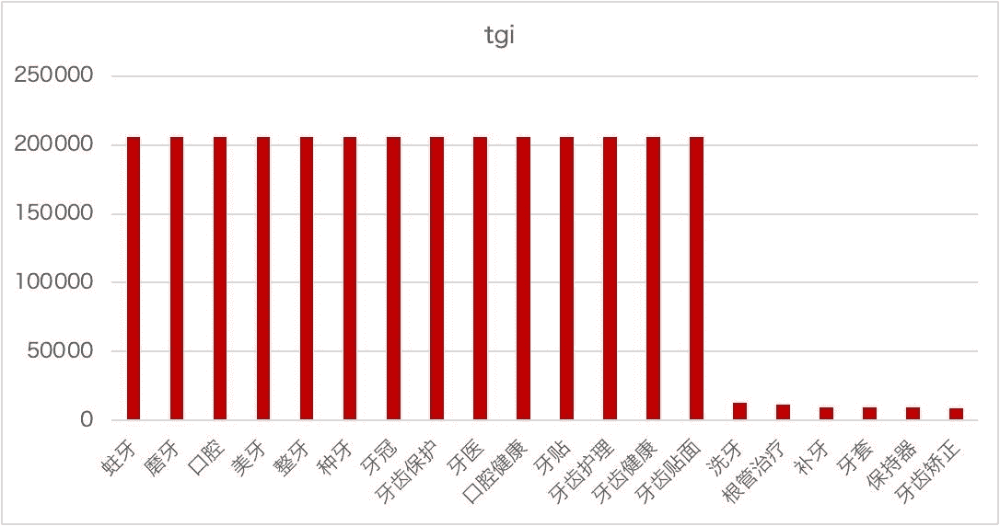

内容关键词偏好

TOP20兴趣

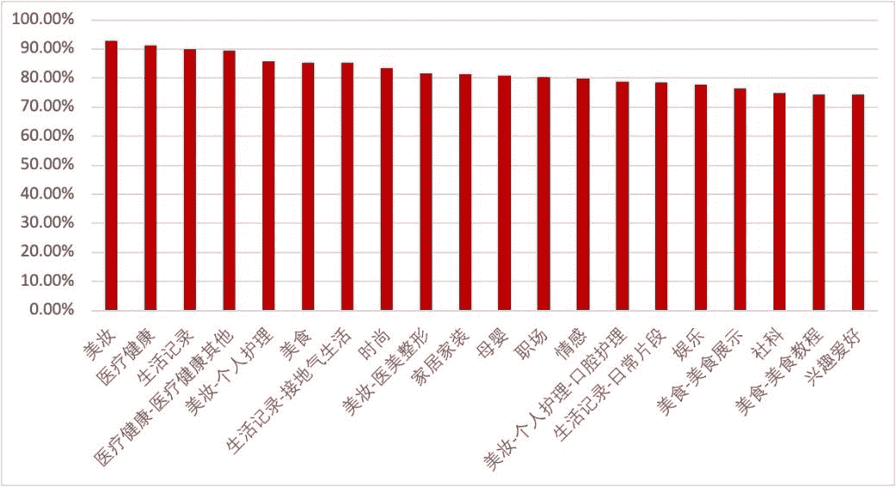

版权归属小红书科技有限公司，仅供学习使用，严禁用作商业通途

## 挖掘搜索习惯｜把握用户心智

上游词

搜索“近视手术”

下游词

上游词多围绕近视手术必要性、怎么恢复视力等方向进行搜索，可针对不同场景下近视手术的优势进行相关科普。

下游词中用户对于近视手术价格及术后相关问题进行提问，可针对不同项目价格区别及项目间的差异进行科普。

近视

晶体植入手术

OK镜

眼睛手术

隐形眼镜

激光近视手术

近视眼怎么恢复视力

全飞秒和半飞秒的区别

近视手术有必要做吗

角膜塑形镜

近视手术后遗症和危害

爱尔眼科

全飞秒

ICL晶体植入

近视手术多少钱

飞秒

近视手术后遗症和危害

晶体植入手术

近视手术多少钱

近视手术价格

近视手术恢复期多久

近视手术能用医保吗

近视手术可以带美瞳吗

近视手术术前检查

近视手术晶体

近视

近视手术半飞和全飞的区别

近视手术后注意事项

隐形眼镜

OK镜

近视手术度数要求

全飞秒

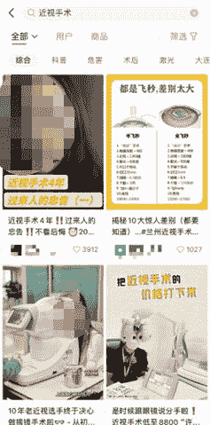

数据来源：小红书商业数据中台，0201-0229

“近视手术”用户决策路径

版权归属小红书科技有限公司，仅供学习使用，严禁用作商业通途

## 挖掘搜索习惯｜把握用户心智

上游词

搜索“全飞秒”

下游词

上游词主要为用户针对手术项目进行相关搜索，可主要产出项目间差别的相关笔记内容进行科普。

下游词中用户通过项目了解后对于手术价格的搜索上升迅速，可根据不同人群角色设置相应价格活动。

近视手术

OK镜

晶体植入手术

全飞秒

全飞秒和半飞秒的区别

激光近视手术

ICL晶体植入

全飞秒后遗症

半飞秒

全飞秒后可以戴美瞳吗

晶体植入

飞秒

近视眼手术

全飞秒价格

ICL

半飞秒和全飞秒区别

全飞秒和半飞秒的区别

全飞秒手术恢复期多久

全飞秒价格

全飞秒十年后

全飞秒术后注意事项和禁忌

全飞秒手术失败会瞎吗

全飞秒后遗症

全飞秒术后

全飞秒全过程

全飞秒术后多久可以看手机

半飞秒

全飞秒失败案例

全飞秒后可以戴美瞳吗

晶体植入手术

近视手术

全飞秒手术

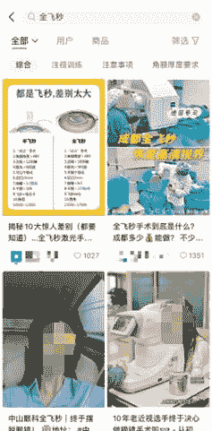

数据来源：小红书商业数据中台，0201-0229

“全飞秒”用户决策路径

版权归属小红书科技有限公司，仅供学习使用，严禁用作商业通途

## 挖掘搜索习惯｜把握用户心智

上游词

搜索“半飞秒”

下游词

上游词主要为用户项目恢复期搜索增长迅速，可针对术后恢复内容进行科普。

下游词中用户主要疑问在于术后视力稳定，搜索提升较高，可针对术后恢复阶段进行科普。

全飞秒

飞秒

近视手术

ICL

晶体植入手术

牙科

半飞秒和全飞秒区别

近视矫正

全飞秒和半飞秒的区别

晶体植入和飞秒哪个好

近视眼手术

半飞秒

ICL晶体植入

半飞秒恢复期

晶体植入

半飞秒后遗症

半飞秒和全飞秒区别

半飞秒回退概率大吗

半飞秒手术过程

半飞秒后可以戴美瞳吗

半飞秒价格

晶体植入手术

全飞秒

半飞秒老了后遗症

半飞秒术后注意事项

近视手术

半飞秒后遗症

半飞秒可以当兵吗

半飞秒术后视力多久稳定

半飞秒手术

半飞秒角膜瓣多久愈合

半飞秒和晶体植入选哪个

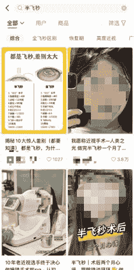

数据来源：小红书商业数据中台，0201-0229

“半飞秒”用户决策路径

版权归属小红书科技有限公司，仅供学习使用，严禁用作商业通途

## 挖掘搜索习惯｜把握用户心智

上游词

搜索“角膜塑形镜”

下游词

上游词主要针对OK镜相关产品原理进行搜索，OK镜整体项目种草不足，可后续针对产品、项目进行种草。

下游词中用户进一步了解OK镜全年养护费用，用户提问增长，可针对配镜及养护流程进行内容科普。

OK

OK镜价格

隐形眼镜

RGP隐形眼镜

近视手术

离焦镜

RGP

隐形眼镜推荐

OK镜成人

近视眼怎么恢复视力

角膜塑形镜

近视眼手术

RGP隐形眼镜

OK镜到底好不好

OK镜的危害

晚上戴的隐形眼镜叫什么

OK镜价格

OK镜可以恢复视力吗

OK镜成人

OK镜的危害

成人OK镜的危害

RGP

OK镜一年费用

近视手术

OK镜和离焦镜哪个效果更好

离焦镜

OK镜是什么眼镜

OK镜公安体检

OK镜多久换一次

OK镜多少度能戴

OK镜哪个品牌好

OK镜能过公务员警察体检吗

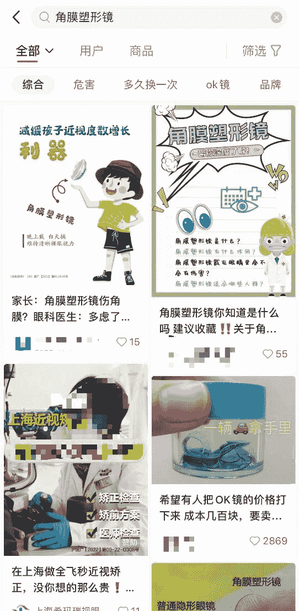

数据来源：小红书商业数据中台，0201-0229

“OK镜”用户决策路径

版权归属小红书科技有限公司，仅供学习使用，严禁用作商业通途

近视手术｜飞秒｜OK镜

- 搜索【近视手术】人群主要集中在新一线、一线及二线城市，19—30岁的女性。
- 搜索【飞秒】相关的用户整体年龄集中在19—22岁，主要集中在一线、新一线、二线城市人群。
- 搜索【OK镜】近期用户年龄开始年轻化增长，成年人控制近视度数增长需求明显上升。

女　男　19-22　23-25　26-30　31-35　36-40　41以上　一线　新一线　二线　三线　四线　五线　iOS　Android

女　男　19-22　23-25　26-30　31-35　36-40　41以上　一线　新一线　二线　三线　四线　五线　iOS　Android

女　男　19-22　23-25　26-30　31-35　36-40　41以上　一线　新一线　二线　三线　四线　五线　iOS　Android

数据来源：小红书商业数据中台，0201-0229

## 热门搜索及高活跃用户画像

版权归属小红书科技有限公司，仅供学习使用，严禁用作商业通途

## “月子中心”用户决策路径

## 挖掘搜索习惯｜把握用户心智

上游词

搜索“月子中心”

下游词

月子中心

深圳月子中心

月子中心和家里坐月子区别

上海月子中心

月子中心一个月多少钱

月子中心避坑指南

月嫂

北京月子中心

月子

广州月子中心

月子中心怎么谈

月子中心招聘要求

月子餐

成都月子中心

月子中心多少钱一个月

附近月子中心

月子中心

月子中心好还是月嫂好

月子中心和家里坐月子区别

月子中心晚上老公要陪着吗

月嫂

深圳月子中心

住月子中心老公睡哪里

月子中心28天还是42天

月子中心怎么谈

月子餐

月子中心招聘要求

北京月子中心

附近月子中心

月子中心选28还是42

月子中心避坑指南

月子中心多少钱一个月

- 【月子中心】上游词涉及疑问包括“一个月多少钱”“和在家坐月子有什么区别”“避坑指南”等，“深圳月子中心”提升明显。
- 下游词中TOP为“月子中心好还是月嫂好”“28天还是42天”和“月子餐”等，可根据用户需求词创作对应内容。

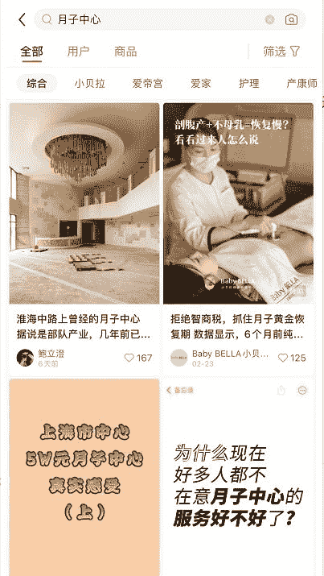

数据来源：小红书商业数据中台 0201-0229

版权归属小红书科技有限公司，仅供学习使用，严禁用作商业通途

## 优质笔记分析

版权归属小红书科技有限公司，仅供学习使用，严禁用作商业通途

## 优质表单留资笔记——口腔类

首图：视频实拍＋人群关系的核心问题解答；

标题：热门句式＋项目＋报价；

内容：使用网络热门的左右选答案的拍摄形式，解答矫正人群的核心问题，配合优惠活动吸引咨询。

首图：视频实拍剧情类：人群痛点＋报价查询；

标题：项目＋价格；

内容：列举矫正人群典型痛点，引出报价查询。

数据来源：小红书商业数据中台 0201-0229

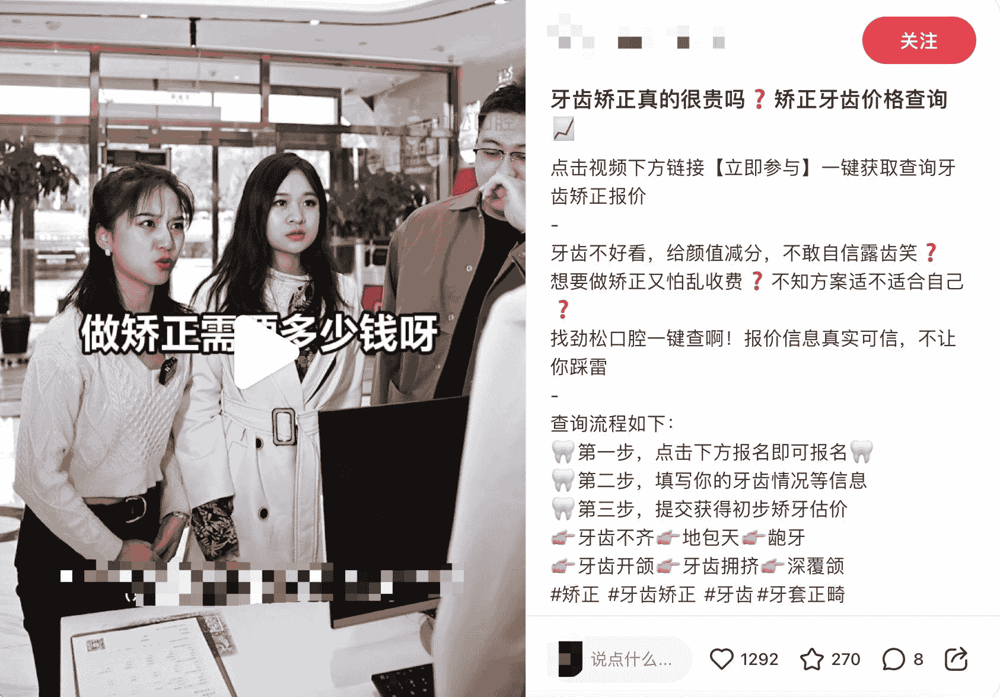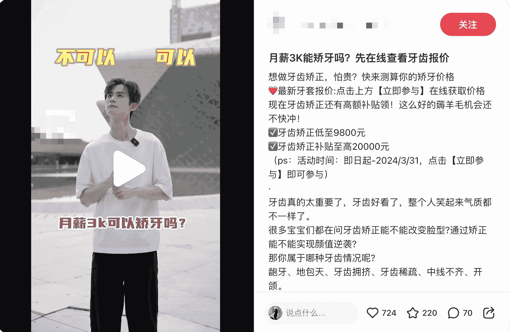

版权归属小红书科技有限公司，仅供学习使用，严禁用作商业通途

## 优质私信开口笔记——口腔类

首图：视频—口播实拍：项目科普；

标题：点明人群年龄＋项目＋科普；

内容：介绍正畸人群常见踩坑点，进行科普的同时引入报价咨询。

首图：视频—纯剪辑：项目科普；

标题：项目＋避坑科普；

内容：科普牙齿矫正过程，视频上下固定字幕栏进行地区留资引导。

数据来源：小红书商业数据中台 0201-0229

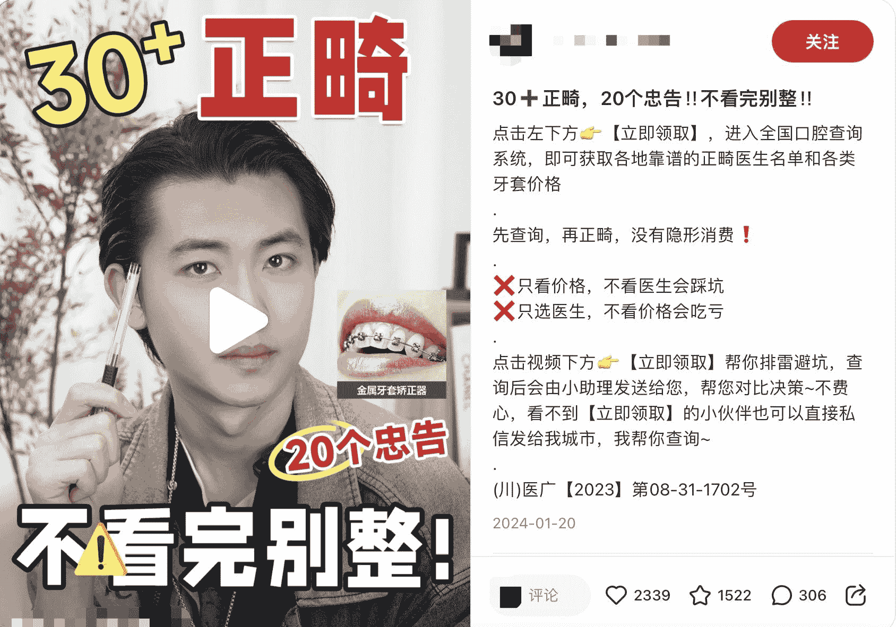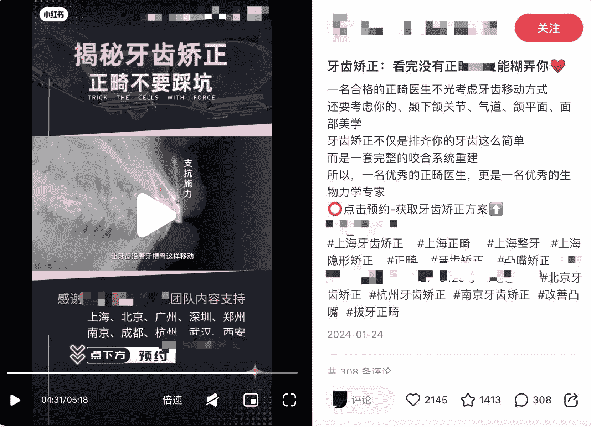

版权归属小红书科技有限公司，仅供学习使用，严禁用作商业通途

## 优质私信留资笔记——口腔类

首图：图文—典型人群案例列举；

标题：突出价格＋项目；

内容：开篇介绍报价可自取＋利益优惠，引入人群痛点介绍项目。

首图：图文—点名地区＋痛点＋项目；

标题：地域＋项目＋干货；

内容：定位人群—地域，进行项目选择前的科普，引入价格及优惠活动。

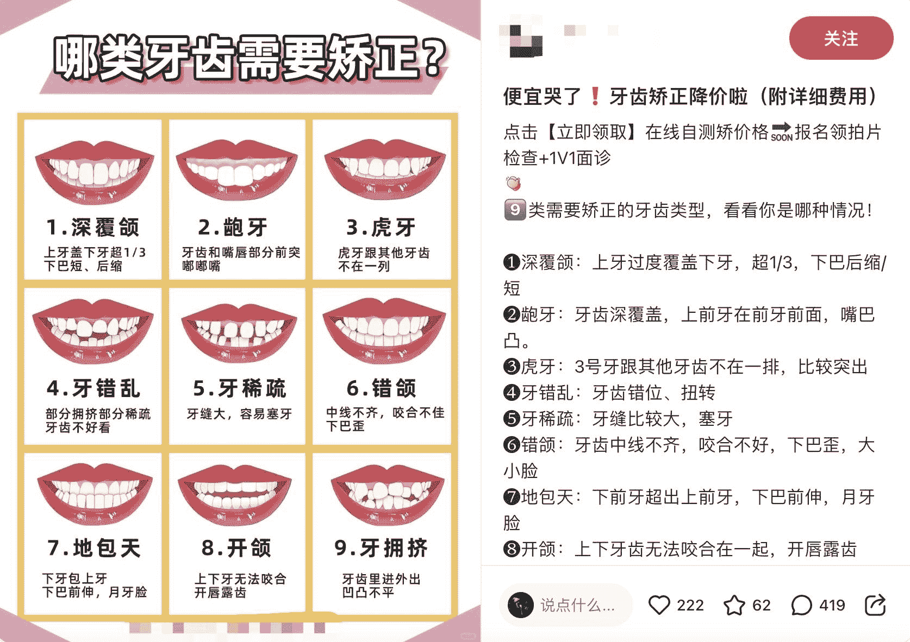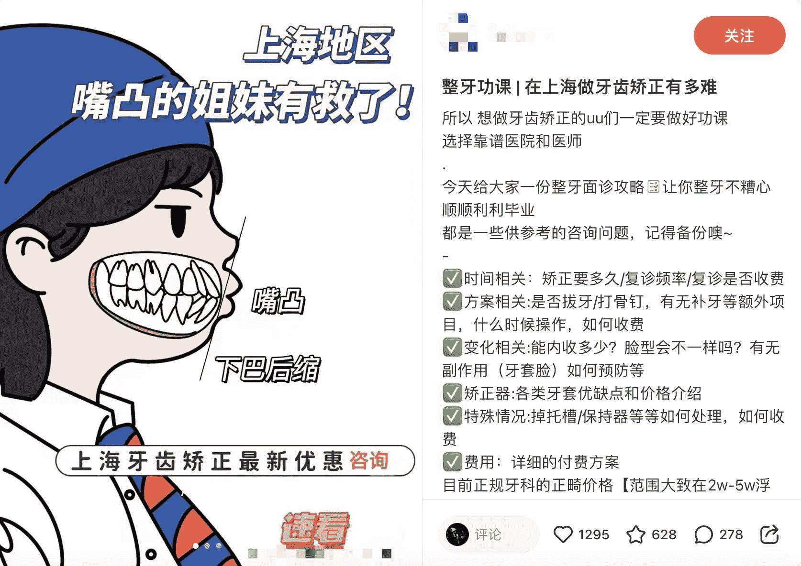

数据来源：小红书商业数据中台 0201-0229

版权归属小红书科技有限公司，仅供学习使用，严禁用作商业通途

## 社区优质笔记—眼科医院

首图：医生＋创意话题问题

标题：惊叹体，核心内容总结

内容：在床上玩手机的重要关注点

首图：场景展现；

标题：情景故事化描述；

内容：分享牙医男友的工作体验；

首图：文字内容引起共鸣

标题：疑问体，引发用户好奇

内容：表现近视人最讨厌的两种场景

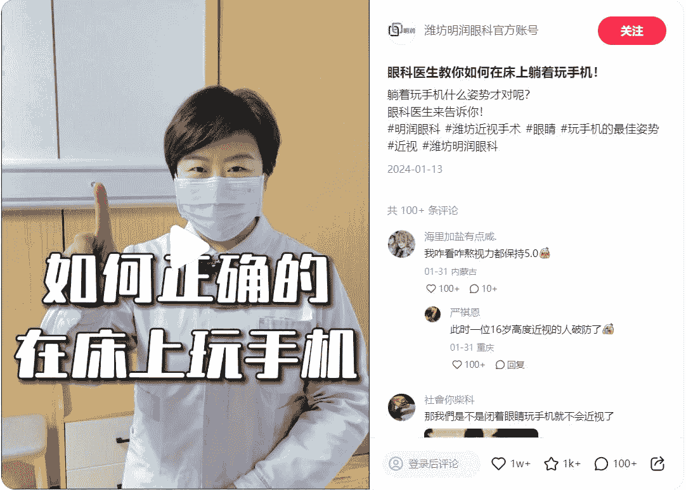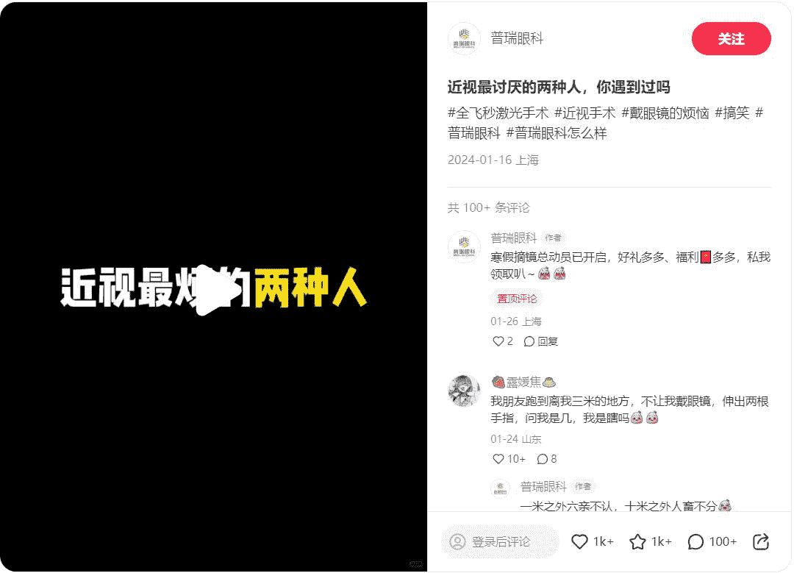

数据来源：小红书商业数据中台 0201-0229

版权归属小红书科技有限公司，仅供学习使用，严禁用作商业通途

## 社区优质笔记——眼科医院

首图：手术过程图＋用户关心问题

标题：表情＋问题，引起读者注意

内容：医生问答

首图：医生＋文字：近视手术禁忌症

标题：寒假摘镜要点，引发读者好奇

内容：充分讲述检查重要性及手术禁忌症

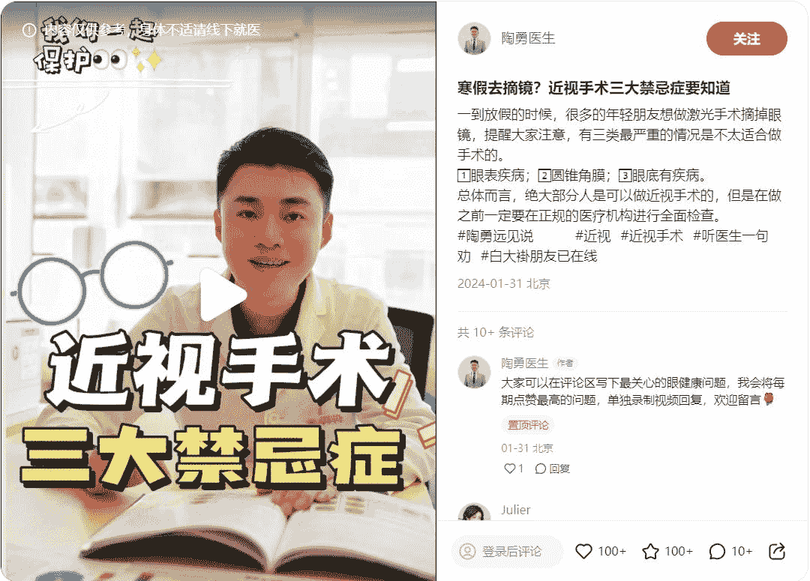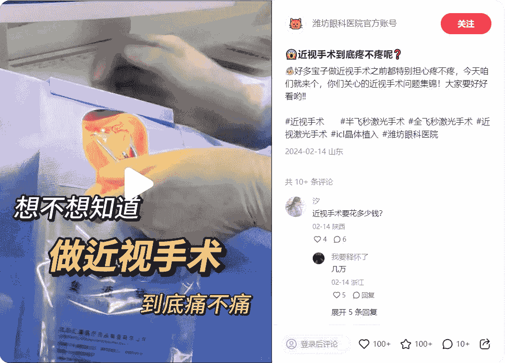

数据来源：小红书商业数据中台 0201-0229

版权归属小红书科技有限公司，仅供学习使用，严禁用作商业通途

## 优质客资收集笔记——月子中心类

首图：人物产康＋月子餐特写展示；

标题：项目效果委婉凸显；

内容：反问句凸显用户痛点，引出项目，进行项目科普及方案介绍；

首图：报价表类：项目价格及细节描述；

标题：地域＋项目＋价格；

内容：定位潜在人群—报价表活动时间、覆盖项目；

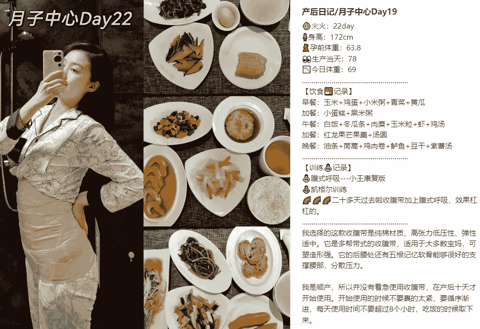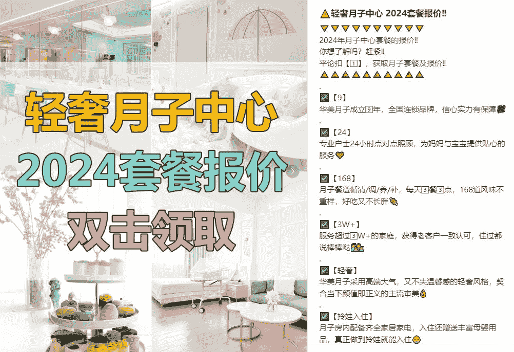

数据来源：小红书商业数据中台 0201-0229

版权归属小红书科技有限公司，仅供学习使用，严禁用作商业通途

## KOL笔记生命周期长—效果提升327%

数据来源：小红书商业数据中台 0201-0229

官号获客内容

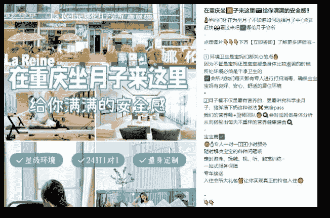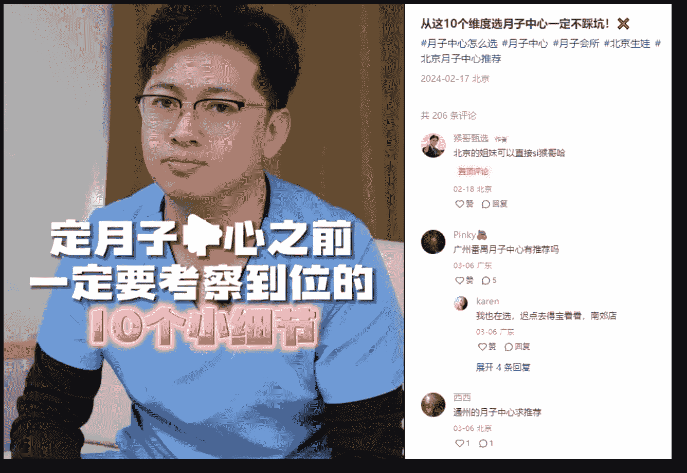

获客效果327%+

评论区正向、互动良性循环

调整前

调整后

达人内容对比传统官号笔记，线索转化效果提升327%，点击率提升70%，互动提升510%。

KOL获客内容

互动效果510%+

版权归属小红书科技有限公司，仅供学习使用，严禁用作商业用途

**2024**年度

小红书

标记我的生活

期待携手共赢！

## 医疗行业月报

生活服务-医疗医美运营团队
