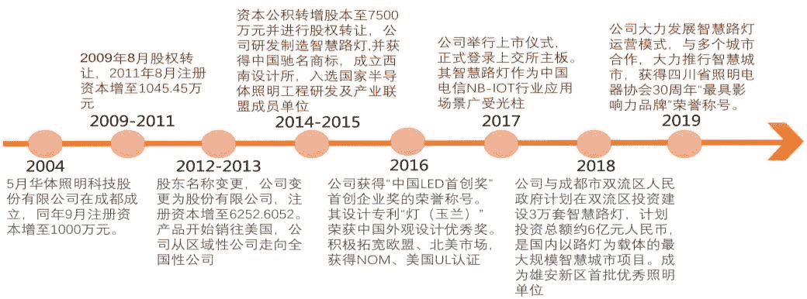
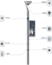
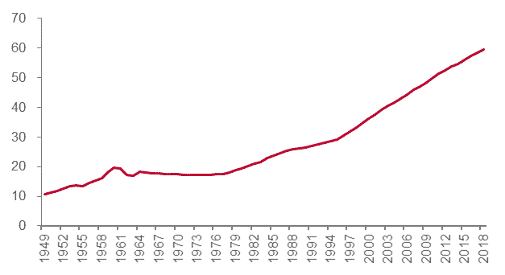
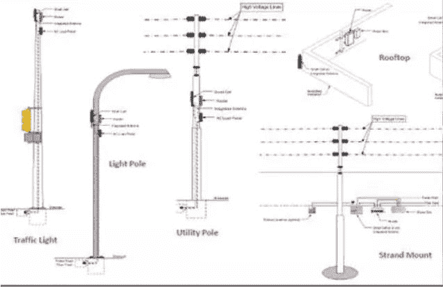
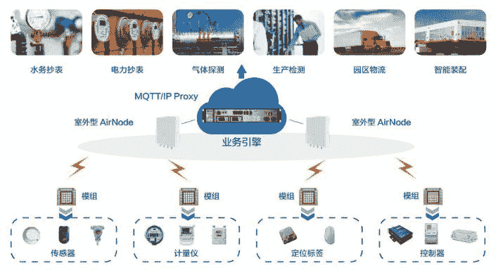
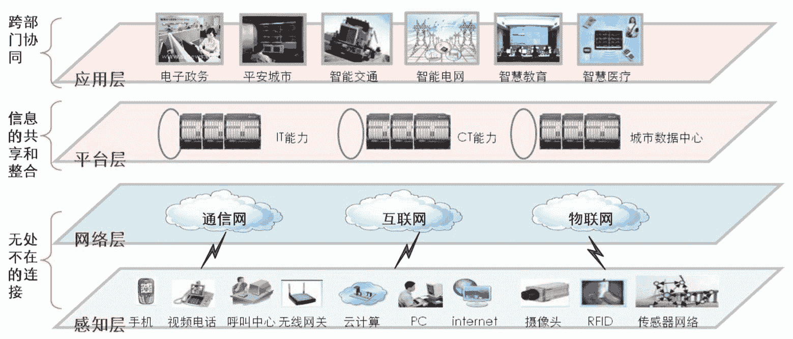
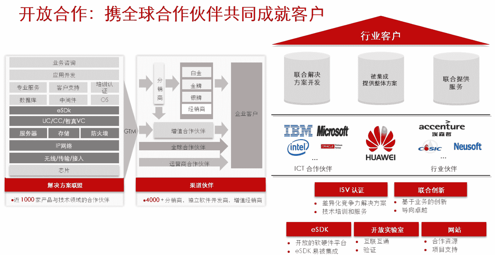
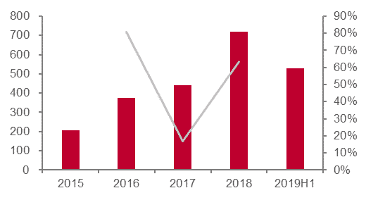
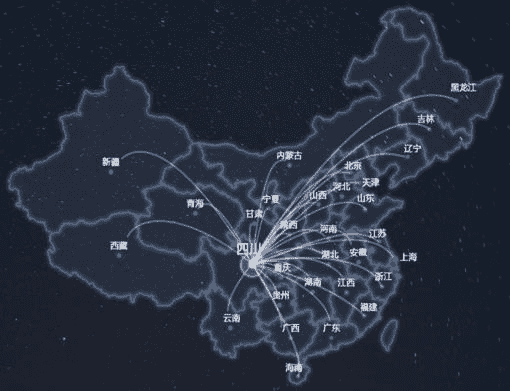
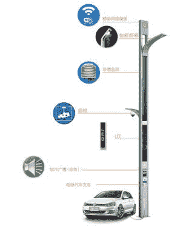

研究源于数据1，研究创造价值

# 灯杆成为智慧城市重要载体，价值量提升及运营化趋势打开公司长期成长空间

方正证券研究所证券研究报告

华体科技（603679）

公司研究

通信行业

公司深度报告

2019.11.20／强烈推荐（首次）

分析师：樊生龙  
执业证书编号：S1220519090001  
TEL：  
E-mail：fanshenglong@foundersc.com

联系人：唐航  
TEL：  
E-mail：tanghang@foundersc.com

历史表现：

-20%

2%

24%

46%

68%

2018/11

2019/2

2019/5

2019/8

0

50

100

150

200

250

300

350

成交金额（百万）

华体科技

沪深300

数据来源：Wind，方正证券研究所

相关研究

请务必阅读最后特别声明与免责条款

**1. 智慧路灯成5G站址资源补充及智慧城市重要载体，价值量提升及运营化趋势打开长期成长空间。**灯杆具备补充5G组网站址资源以及成为智慧城市重要载体的天然优势：

1）随人口密集度分布广泛且均匀，满足5G小站组网密度需求；  
2）高度适宜，5G小基站挂载高度在10—15m时覆盖范围较好，灯杆高度一般是9—15m，二者正好匹配；  
3）地理坐标精确，便于维护和管理；  
4）供电网络完整，便于施工建设。

我们预计智慧路灯的单价约是传统路灯的6—10倍，直接推动行业市场规模大幅提升。由于智慧路灯系统复杂度提升以及政府和相关事业单位倾向于买服务的模式，项目运营外包有望成为主流商业模式。运营项目前期需要投入大量资金，但后期现金流回款较为稳定。

**2. 巨头入局促使产业链发展迎拐点。**根据我们测算，国内智慧路灯渗透率仅有0.05%，我们认为此前产业推进较慢的原因主要包括：1）有效需求不够强劲；2）云平台商、集成商的实力不够强等。目前，中国铁塔已和华体科技、电网等达成合作，为智慧灯杆提供需求基础。此外，华为、腾讯等设备商、集成商和云厂商纷纷入局，综合系统解决方案能力大大提升，行业增速有望迎拐点。

**3. 华体科技：稀缺全产业链布局者，牵手巨头，凭借“灯杆＋运营”双轮驱动，业绩有望持续快速增长。**公司业务涵盖设计、路灯、灯杆、集成等产业链各个环节，是国内上市公司中唯一的全产业链布局者，且专注于照明领域。公司现已和铁塔、华为、腾讯等巨头开展合作，有望分享行业快速发展的红利。目前，华体斩获的智慧路灯项目金额总计超过26亿元，且成功落地了首个智慧路灯运营项目。鉴于公司具备的独特竞争优势，我们看好其在“智慧路灯＋项目运营”发展路径下业绩获得进一步提升。

**4. 盈利预测与投资建议：**我们预计公司2019—2021年可实现的EPS分别为1.46、2.27和2.97元，当前市值对应2020年PE仅为19倍，首次覆盖给予“强烈推荐”评级。

**5. 风险提示：**公司订单状况不及预期，5G智慧路灯推进速度不及预期，公司毛利率不及预期，现金流紧张等风险。

### 盈利预测

单位：百万元

| 项目 | 2018 | 2019E | 2020E | 2021E |
|---|---:|---:|---:|---:|
| 营业总收入 | 526.49 | 921.10 | 1356.21 | 1795.22 |
| 同比（%） | 9.62 | 74.95 | 47.24 | 32.37 |
| 净利润 | 70.55 | 147.32 | 228.88 | 300.08 |
| 同比（%） | 33.41 | 108.83 | 55.36 | 31.11 |
| EPS（元） | 0.69 | 1.46 | 2.27 | 2.97 |
| P/E | 63.51 | 30.15 | 19.41 | 14.80 |

数据来源：Wind，方正证券研究所

研究源于数据2，研究创造价值

华体科技（603679）-公司深度报告

## 目录

1. 全产业链户外照明龙头，业务结构变化推升盈利能力 ....................................... 4  
1.1 公司简介及主营业务 ............................................................................................................................... 4  
1.2 智慧路灯开始上量，各项费用率持续优化............................................................................................ 5  
1.3 股权结构、激励及再融资情况 ............................................................................................................... 6  

2. 智慧路灯方兴未艾，价值量提升及运营化趋势打开长期成长空间 .............................. 7  
2.1 照明行业产业链上下游较分散，全国灯杆市场规模近千亿 ................................................................ 7  
2.2 智慧路灯：5G站址资源补充及智慧城市重要载体 ............................................................................... 8  
2.2.1 5G进入规模建设阶段，灯杆成为热点覆盖重要站址资源 ............................. 8  
2.2.2 5G落地加速智慧城市建设，智慧灯杆优势诸多成为重要载体 ......................... 9  
2.2.3 巨头入局加速产业发展，智慧灯杆渗透率有巨大提升空间 .......................... 10  
2.3 量价提升及商业模式创新，城市道路照明产业迎来发展新机遇 ....................................................... 13  

3. 全产业链布局具备竞争优势，牵手巨头迎发展良机 ........................................ 16  
3.1 华体科技：国内稀缺的全产业链布局者，专注道路照明领域 .......................................................... 16  
3.2 拓展销售渠道，四川省外业务占比稳步提升 ...................................................................................... 17  
3.3 牵手巨头分享智慧路灯发展红利 ......................................................................................................... 18  
3.4 基于智慧路灯拓展盈利点，产品＋运营打开长期成长空间 ................................................................ 18  

4. 盈利预测与投资建议 .................................................................. 20  
4.1 盈利预测概述 ......................................................................................................................................... 20  
4.2 可比上市公司估值 ................................................................................................................................. 21  
4.3 投资建议 ................................................................................................................................................. 22  

5. 风险提示 ............................................................................ 22

研究源于数据3，研究创造价值

华体科技（603679）-公司深度报告

## 图表目录

| 图表 | 名称 | 页码 |
|---|---|---:|
| 图表1 | 公司发展历程 | 4 |
| 图表2 | 公司主要产品 | 4 |
| 图表3 | 公司营收（万元）结构及同比增速 | 5 |
| 图表4 | 公司净利润（万元）及同比增速 | 5 |
| 图表5 | 销售毛利率稳步提升（%） | 5 |
| 图表6 | 各业务板块毛利（百万） | 5 |
| 图表7 | 上市后费用率持续优化 | 6 |
| 图表8 | 股权结构 | 6 |
| 图表9 | 照明行业产业链 | 7 |
| 图表10 | 我国城镇化率（%） | 8 |
| 图表11 | 公共照明用电量（万千瓦时） | 8 |
| 图表12 | 城市道路照明灯（千盏） | 8 |
| 图表13 | 4G和5G覆盖范围示意图 | 9 |
| 图表14 | 5G小微站潜在安装位置 | 9 |
| 图表15 | 5G支持智慧城市所需传输需求 | 9 |
| 图表16 | 中国铁塔生态搭建 | 10 |
| 图表17 | 华为eLTE-IoT解决方案 | 11 |
| 图表18 | 智慧城市解决方案基本结构 | 11 |
| 图表19 | 华为携全球合作伙伴共建智慧城市 | 12 |
| 图表20 | 近期各省市智慧灯杆政策 | 12 |
| 图表21 | 智慧灯杆招标项目数 | 13 |
| 图表22 | 2019年上半年各省市智慧灯杆项目 | 13 |
| 图表23 | 智慧路灯单价显著提升 | 14 |
| 图表24 | 我国智慧路灯渗透率 | 14 |
| 图表25 | 智慧路灯运营难度大大增加 | 15 |
| 图表26 | 智慧灯杆企业数量高速增长 | 16 |
| 图表27 | 典型智慧灯杆企业及其发展模式 | 16 |
| 图表28 | 2018年中国智慧灯杆供应商15强 | 17 |
| 图表29 | 竞争对手相应业务营收情况（百万元） | 17 |
| 图表30 | 竞争对手相应业务毛利率（%） | 17 |
| 图表31 | 公司四川省内外收入对比（百万） | 18 |
| 图表32 | 华体科技业务范围 | 18 |
| 图表33 | 2018—2019年智慧路灯项目合作概览 | 18 |
| 图表34 | 智慧路灯盈利点拓展 | 19 |
| 图表35 | 成都市双流区智慧城市（智慧路灯）建设项目情况 | 20 |
| 图表36 | 2019年中标情况 | 20 |
| 图表37 | 盈利预测 | 21 |
| 图表38 | 盈利预测 | 21 |
| 图表39 | 可比公司估值 | 21 |

研究源于数据4研究创造价值

华体科技(603679)-公司深度报告

## 1 全产业链户外照明龙头，业务结构变化推升盈利能力

### 1.1 公司简介及主营业务

华体科技成立于2004年，2017年6月21日在上交所上市，总部位于成都，是一家集照明方案设计、产品研发制造、工程项目实施、物联网智能管理维护四大业务板块为一体的全产业链户外照明企业。

图表1：公司发展历程

资料来源：公司官网，方正证券研究所

公司成立以来，专注于城市照明领域的技术研发和实施，并通过与国内多家高校的交流与合作，在行业内逐渐形成了较强的技术优势和核心竞争力。形成三大板块产品：夜景照明、文化定制和智慧路灯。

图表2：公司主要产品

**华体科技产品介绍**

**户外照明**

**MZ-01A型模组**

产品介绍：LED芯片采用美国科锐品牌；采用二次配光技术；高效散热性能，使用寿命可达50000小时以上；稳压恒流驱动电源；模组化可插拔技术；超高防水防尘性能。

**景观亮化**

**LED点光源-HYG-JP102**

产品介绍：高效率、低纹波、过载过压保护；低压供电，保证信号不受电网波动影响，稳定可靠；RGB颜色变化丰富，支持DMX512控制；大角度配光设计，可从各个视角体验良好的亮化效果。

**室内照明**

**LED天花灯HYG-ZGA1**

产品介绍：光源采用模块式设计；采用优质LED COB光源；散热器设计科学，可延长其使用寿命；精准配光，光线均匀无杂斑；光源深藏式设计，有效避免眩光；外置恒流驱动电源，性能稳定可靠。

**太阳能路灯**

产品介绍：绿色能源与现代科技的结合，融入文化照明的理论，符合市场、符合地域文化、符合客户需求的高品质太阳能路灯。

**太阳能路灯**

**景观道路灯**

**二代玉兰灯玉兰八叉九火**

产品介绍：杆体内侧预留了加装LED节日气氛灯和单灯智能控制系统的空间；配置华体单体智能照明管理系统，同时降低该路灯的功率密度，节省能源。

**智慧路灯**

**雅典娜**

产品介绍：灯柱外形统一，可应用于智慧路灯功能的内嵌式集成安装，如检测功能、城市广播、移动网络覆盖、监控、LED显示屏、充电插口、一键报警等。具有国家专利。

**流光**

产品介绍：此灯由流畅的曲直线交织而成；侧面曲线灯条与穿梭的弯曲马路交相呼应，顶部灯光点缀，宛如城市万家灯火的缩影。

资料来源：公司官网，方正证券研究所

自2015年开始，公司以智慧路灯为入口，构建智慧城市新场景服务生态圈，此后先后在深圳、上海、雄安新区、青岛、武汉、成都、贵阳等30余个国内大中城市推广应用智慧路灯，并在云南丽江和四川双流拥有两个智慧路灯规模化运营项目。

2018到2019年，公司与华为联合打造国内首个基于eLTE-IoT技术研制的智慧路灯“维克多”；与中国铁塔成都分公司签订战略合作协议；与腾讯云计算公司等联合中标成都天府绿道建设投资有限公司组织的成都市环城生态区生态修复综合项目智慧绿道社会合资合作，逐步扩大智慧路灯领域布局。

### 1.2 智慧路灯开始上量，各项费用率持续优化

工程项目安装、智慧路灯等业务拉动公司业绩持续增长。公司主营业务聚焦在工程项目安装和产品研发制造，2015年开始布局智慧路灯，开创性地提出“城市文化照明”理念，在城市照明设计中引入“文化定制”概念等，从出售夜景照明灯延伸到安装环节。2015—2018年工程项目安装拉动营收体量增长，高附加值的文化定制照明带动利润稳步增长。2018年智慧路灯订单初见规模，大部分在2019年确认收入，有效拉动2019年营收利润增速大幅提升。

图表3：公司营收（万元）结构及同比增速

营业总收入  
产品研发制造  
工程项目安装  
运行管理维护  
方案规划设计  
其他  
增速  
布局智慧路灯  
智慧路灯上量

图表4：公司净利润（万元）及同比增速

归母净利  
同比（%）

资料来源：Wind，方正证券研究所

资料来源：Wind，方正证券研究所

工程项目安装和智慧路灯业务占比提升，带动公司产品研发制造毛利率回升，从而带动公司整体毛利率上升。公司订单逐步在单纯销售路灯的基础上增加了设计、安装加运营，主要业务工程项目安装与产品研发制造业务逐步融合，毛利趋同；运行管理维护和方案规划设计毛利率波动较大，但业务体量较小。未来智慧路灯作为城市的数据入口，运营所产生的数据价值将日益凸显，有望推动公司业绩及盈利能力进一步提升。

图表5：销售毛利率稳步提升（%）

整体毛利率  
产品研发制造  
工程项目安装  
运行管理维护  
方案规划设计

图表6：各业务板块毛利（百万元）

产品研发制造  
工程项目安装  
运行管理维护  
方案规划设计

资料来源：Wind，方正证券研究所

资料来源：Wind，方正证券研究所

公司上市后，销售费用率、管理费用率和财务费用率持续优化，尤其是销售费用率大幅下降，研发费用率相对稳定，研发支出随收入增长。

图表7：上市后费用率持续优化

销售费用率  
管理费用率  
研发费用率  
财务费用率

资料来源：Wind，方正证券研究所

### 1.3 股权结构、激励及再融资情况

公司第一大股东为董事长及总经理梁熹，持有17.02%的股份；第二大股东为公司董事梁钰祥，持有13.95%的股份；第三大股东王绍蓉持有13.77%的股份。梁钰祥与梁熹为父子关系，王绍蓉与梁熹为夫妻关系，三人为公司实际控制人，合计持股44.74%，股权结构集中。集团合并财务报表范围包括华体节能、华体安装、华体慧城、空港慧城、空港管理、华鑫慧城等7家公司。

图表8：股权结构

**四川华体照明科技股份有限公司**

- 梁熹（17.02%）
- 梁钰祥（13.95%）
- 王绍蓉（13.77%）
- 东吴创业投资有限公司（5.04%）
- 苏州亿新熠合投资企业（有限合伙）（2.94%）
- 其他（47.28%）

被参控公司：

- 成都市华体灯具制造安装工程有限公司（100%）
- 成都华体空港智慧科技有限公司（90%）
- 成都华体空港智慧项目管理有限公司（90%）
- 嘉兴景炜投资合伙企业（有限合伙）（39.26%）
- 四川华鑫智慧科技有限公司（60%）
- 成都华体慧城科技有限公司（100%）
- 四川华体节能科技有限公司（100%）

资料来源：公司公告，方正证券研究所

推出股权激励计划，绑定核心骨干人员。公司2019年推出了新一轮股权激励计划，激励对象为公司管理人员及技术、业务骨干等8人，限售期为12/24/36个月，行权条件为以2016—2018年平均净利润为基数，2019—2021年增速不低于40%、82%和120%，即2019—2021年净利润分别达0.8/1.04/1.26亿元。截至2019年三季报，公司已实现净利润0.8亿元，已完成2019年业绩要求。

发行可转债，增强资金实力拓展新业务。公司于2019年7月4日发布公告，拟发行总额为不超过2.3亿元可转债，募集资金净额拟全部投资成都市锦城智慧绿道项目。

## 2 智慧路灯方兴未艾，价值量提升及运营化趋势打开长期成长空间

### 2.1 照明行业产业链上下游较分散，全国灯杆市场规模近千亿

照明行业产业链上、下游均较分散。照明产业链的上游主要集中在钢材企业、LED光源企业、集中控制器芯片、单灯控制芯片制造企业等。下游产业主要面对各级城市市政管理部门、改造中的照明领域和普通用户照明领域，包括道路照明、商业照明、庭院照明、楼宇亮化、室内照明、装饰性照明等。

图表9：照明行业产业链

**上游产业**

- 钢材铝合金
- 衬底材料制造
- 外延芯片生长
- LED芯片制造
- 集中控制器芯片
- 单灯控制器芯片

**中游产业**

- 照明规划方案设计
- 光源设计
- 灯具及造型件设计
- 灯杆设计
- 机械结构件制造
- LED芯片封装
- LED光源制造
- 控制系统开发
- 控制软硬件制造
- 项目现场勘查、安装、测试
- 照明设施“全生命周期”管理、控制、维护
- 照明方案设计
- 产品研发制造
- 工程项目施工
- 智能管理维护
- 城市照明整体方案提供

**下游产业**

- 道路照明
- 商业照明
- 庭院照明
- 楼宇亮化
- 室内照明
- 装饰性照明

资料来源：招股说明书，方正证券研究所

上游产业对照明行业的影响主要体现在价格和技术方面。价格方面，直接受到钢材市场变化的影响。LED照明和城市照明智能控制系统两个领域受技术发展影响程度较大，上游领域的外延片和芯片技术的提升，对LED和照明智能控制系统的技术工艺和生产成本起到决定性作用。智慧路灯兴起后，承载的功能越来越多样化，上游原材料对成本的影响逐步减弱，技术制约逐步增强。

下游行业主要包括各种应用场景。例如：道路照明、商业照明、楼宇亮化、装饰性照明在内的城市市政工程建设市场，随着中国城市化及城市内部市政建设的不断提升，城市照明市场需求不断提升。

城镇化建设、夜游经济以及文化照明等是国内城市照明市场增长的重要驱动力。2000年以前城镇化率高速提升，从20%提升到当前的60%，不断升级道路建设与改造，拉动道路照明需求增长。随着我国城镇化进程的不断深入，与夜游经济直接相关的城市景观亮化从东部发达地区逐步发展到中部及西部地区，从大城市发展到中小城市，推动城市照明市场进一步增长。2016年7月20日，多部委联合下发《关于开展特色小镇培育工作的通知》，决定在全国范围开展特色小镇培育工作，计划到2020年，培育1000个左右各具特色、富有活力的休闲旅游、商贸物流、现代制造、教育科技、传统文化、美丽宜居等特色小镇，积累经验引领带动全国小城镇建设。

图表10：我国城镇化率（%）

资料来源：国家统计局，方正证券研究所

千亿级城市道路照明市场有望迎来全新驱动引擎——智慧路灯。我国城市道路照明灯用量从2002年的700万盏增长到当前的超过2500万盏，近几年增速基本稳定在5%左右，已经是一个相对成熟的市场。按传统夜景照明单盏5000元的单价计算，城市道路照明市场空间超千亿级。随着5G建设落地、智慧城市逐步推进，传统路灯有望逐渐被智慧路灯所取代。智慧路灯较传统路灯功能更为复杂，价值量成倍提升，有望驱动城市道路照明市场进入新一轮高速增长期。

图表11：公共照明用电量（万千瓦时）

图表12：城市道路照明灯（千盏）

城市道路照明灯（千盏）  
同比

资料来源：Wind，方正证券研究所

资料来源：Wind，方正证券研究所

### 2.2 智慧路灯：5G站址资源补充及智慧城市重要载体

#### 2.2.1 5G进入规模建设阶段，灯杆成为热点覆盖重要站址资源

均匀分布于城市中的带电灯杆，具备补充5G组网站址资源的天然优势。5G中频3.5—4.9GHz相比4G频率增加了近2倍，真空损耗增加2—6dB，传送距离大约是4G的一半，穿透能力远不及低频，需要增加的补盲点预计远高于4G。5G组网需要宏站广覆盖加热点区域小站扩容和补盲，均匀分布于城市中的灯杆作为5G站址资源有着天然的优势：

- 1）灯杆随人口密集度分布广泛均匀，可以满足5G小微站在组网密度方面的需求；
- 2）灯杆高度适合小站，5G小基站挂载高度在10—15m时覆盖范围较好，灯杆高度一般是9—15m，二者正好匹配；
- 3）灯杆地理坐标精确，便于维护和管理；
- 4）灯杆供电网络完整，便于小站的施工建设。

图表13：4G和5G覆盖范围示意图

图表14：5G小微站潜在安装位置

4G覆盖  
5G覆盖

资料来源：中国产业信息网，方正证券研究所

资料来源：中国产业信息网，方正证券研究所

#### 2.2.2 5G落地加速智慧城市建设，智慧灯杆优势诸多成为重要载体

解决智慧城市建设诸多痛点，5G规模部署有望加速智慧城市建设脚步。自2009年智慧城市概念兴起至今，国内高度重视对智慧城市技术路线和发展模式的探索，智慧城市新政频出。根据2015年4月发布的《关于公布国家智慧城市2014年度试点名单的通知》，国家智慧城市试点已达290个。但目前来看，大范围铺开的智慧城市项目凤毛麟角，其中重要的原因就包括现有的网络基础设施在连接数、数据传输速度、时延等方面不能完全满足智慧城市的各项需求。5G网络频率高、数据传输速度快，通信速度约是现今4G的10倍，能极大地降低人与设备、设备与设备之间的通信延时。而智慧路灯所特有的人流统计、环境监测、快速充电、信息发布、应急联动报警服务点、太阳能充电等功能均需快速信号传递，5G的商用将完美解决上述问题。因此，我们预计5G的规模化部署有望推动智慧城市建设进入加速成长阶段。

图表15：5G支持智慧城市所需传输需求

| 代际 | 频段/技术 | 主要应用 |
|---|---|---|
| 2G | 700~1900MHz | 传输语音和短信 |
| 3G | 1900~2200MHz | 传输短视频和彩信 |
| 4G | 2200~2600MHz | 传输视频、数据语音、视频聊天 |
| 5G | 2.6GHz~毫米波频段 | 应用于VR、智能驾驶、物联网等场景 |
| NB-IoT | — | 电水气表、物品跟踪、物流、泊车 |
| 5G相关应用 | — | 无人驾驶、工业自动化控制、VR、超高清屏幕、远程医疗、浸入式游戏、3D视频、视频监控、智能家居、M2M、POS、智慧农业、智慧城市 |

资料来源：C114，方正证券研究所

究源于数据10研究创造价值

华体科技(603679)-公司深度报告

智慧灯杆凭借分布广泛均匀、地理坐标精确、供电网络完整、通信位置明确等特点，有望成为智慧城市的重要载体。鉴于灯杆在分布、供电等方面的天然优势，智慧灯杆可以集成智慧照明、5G微站、无线WIFI、视频监控、信息发布、环境监测、灾害预警、充电桩等多项功能于一身，成为智慧城市建设中重要的载体。

### 2.2.3 巨头入局加速产业发展，智慧灯杆渗透率有巨大提升空间

产业推进亟需破局，巨头入局产业发展迎拐点。虽然灯杆在5G时代可以作为重要的站址资源，但最终的落地需要国内铁塔几乎唯一的需求方中国铁塔参与进来。同时，由于通信塔变成社会塔、智慧塔，集成交通杆、电力塔、路灯等，新增环境监测、监控摄像、地基增强等功能，产业链上下游包括：

1）通信设备、灯杆、视频监控、传感器等硬件厂商；

2）配套设施的电网；

3）云平台提供商；

4）政府相关部门及单位等。

上述各方均需参与进来。传统道路照明通过相对独立的设计、施工和管理即可完成各个项目，而智慧城市的建设需要更强的综合解决方案能力，同时建设和运营的初期投入资本较多，因此产业巨头的入局对于产业加速发展至关重要。

#### 1. 中国铁塔：牵头多方合作，为智慧灯杆发展提供需求基础

5G时期除宏站建设外，小微站或成指数增长。为了满足5G组网的需求，中国铁塔不断寻求合作，搭建5G新生态。2018年召开合作伙伴启动大会，与华为、中兴、诺基亚、大唐移动、海康威视、大华技术等137家合作伙伴签署了合作意向书，在满足好三家运营商需求的基础上，整合各方优势资源，在政企专网、视频监控、数据采集、智慧物联等服务领域携手开拓，先后与华体科技达成站址合作，与电网达成电力合作，与华为达成电源合作等。

图表16：中国铁塔生态搭建

| 时间 | 合作伙伴 | 合作项目 |
|---|---|---|
| 2019/7/31 | 腾讯、互联智慧（广州）科技有限公司 | 三方将在网络服务合作、安全、大数据和云计算、金融支付创新、信息化建设、人工智能应用以及品牌建设七大领域开展密切合作，推动“5G智慧灯杆数字化”战略落地 |
| 2018/6/1 | 华体科技、双流科新局 | 中国铁塔将在成都的4G和5G基站建设方面，通过将5G基站安装于华体科技投资安装的智慧路灯上，促进5G在成都地区的发展落地 |
| 2018/12/1 | 华为 | 以“精简投资、节省OPEX、智能营维”为目标，对“特殊场景外市电容量不足”“电池智能管理和精确配置”等多个课题，华为提供业界首款面向5G的电源解决方案 |
| 2018/4/1 | 南方电网、国家电网公司 | 两大电网公司开放输电杆塔，支持通信基站建设。中国铁塔利用丰富的通信站址资源及基于物联网+互联网的信息化+运营平台，支撑电力杆塔信息监控、电力无线专网建设等 |
| 2019/7/1 | 中国铁塔与中电科三十八所公共安全技术研究院、海康威视、上海大唐移动、浙江大华、赛达科技、北京雪迪龙、泛测环境、广睿达、金名正元、重庆海普等10家生态环境合作伙伴 | 中国铁塔“蓝天保卫”行动者联盟，“聚焦铁塔力量、助力生态环境”，围绕智联、智享、智控三大业务品牌，在生态环境领域，将服务做深、做透 |

资料来源：电子说，国家电网，Ofweek，方正证券研究所

中国铁塔由中国移动、中国电信、中国联通联合控股，4G时期在国内占据96%的租户，在通信基础设施领域具有不可撼动的市场地位，对站址资源新进入者来说，中国铁塔的入局和合作解决了客户需求的问题，为产业发展注入了强心剂。

#### 2. 华为发展 eLTE 产业联盟，携手合作伙伴共同创建新型智慧城市

华为2014年2月成立eLTE产业联盟，即eLTE合作伙伴生态系统，通过技术（ISV、IHV）、集成、咨询、标准组织、客户以及VAP（增值伙伴）等合作伙伴的全球合作与共同努力，促进eLTE在公共安全、交通及能源等行业的发展，提升业务体验。华为eLTE-IoT解决方案包括业务引擎、基站Air Node和终端模组三大组成部分。华为提供终端模组给行业厂家开发各种物联网终端，如水、气、电、热等表计，各种工业传感器、定位标签等，这些终端集成了模组之后，就能通过eLTE-IoT网络与业务平台进行数据交互。

图表17：华为eLTE-IoT解决方案

资料来源：华为官网，方正证券研究所

华为智慧城市打造一个统一的网络和数据平台，设立城市云数据中心，构建三张基础网络，通过分层建设，达到平台能力及应用的可成长、可扩充，创造面向未来的智慧城市系统框架。

图表18：智慧城市解决方案基本结构

资料来源：华为官网，方正证券研究所

同时，华为聚焦ICT基础设施，以开放合作和共赢的商业模式，携手合作伙伴共同创建新型智慧城市。

图表19：华为携全球合作伙伴共建智慧城市

资料来源：华为官网，方正证券研究所

#### 3. 政策频出，政府牵头盘活路灯资源

由于路灯项目传统的投资、建设和管理通常由当地政府负责或统筹规划，因此智慧路灯的建设和运营同样需要政府牵头来实现。目前，根据产业调研及部分实际落地项目情况来看，智慧路灯项目通常采用：

1）总包（EPC）的方式购买；

2）和项目运营方成立合资公司，再向合资公司购买服务等方式来落地。

图表20：近期各省市智慧灯杆政策

| 省份 | 城市 | 近期各省市智慧灯杆文件 | 政策 |
|---|---|---|---|
| 浙江省 | 杭州市 | 《杭州市萧山区促进5G产业发展的若干政策》 | 围绕构建先进的5G网络、创新、产业和应用服务体系，聚焦全产业链，产业链条上给予资金补助和支持，最高资助亿元。 |
| 广东省 | 汕头市 | 《汕头市加快5G产业发展行动计划（2019—2022年）》 | 围绕整合各类杆塔资源，原则上不超过2家5G智慧杆塔运营主体，并进行统筹规划建设智慧杆及配套资源和“一杆多用”改造，推进“一杆多用”试点示范工程及管理平台建设。 |
| 广东省 | 中山市 | 《中山市加快5G产业发展行动计划（2019—2022年）》 | 预计到2020年底，中山市5G基站累计达2600座；到2022年底累计达8000座。并表示由中山市住建局、城管局、工信局、自然资源局、公安局、交通运输局、中山铁塔、中山管信公司负责推进5G智慧杆塔建设。 |
| 广东省 | 广州市 | 《广州市加快5G发展三年行动计划（2019—2021年）》 | 明确广州全市将建成5G基站6.5万座，分批开放重点、热点区域内的杆塔资源建设智慧灯杆，并在2019年征集和开放一批主干道，采取公开招标的方式引进优质社会资源。 |
| 广东省 | 广州市黄埔区 | 《广州市黄埔区 广州开发区5G产业化发展行动计划（2019—2022年）》 | 通过市场化方式创新多功能智慧灯杆建设运营模式，在2019年底前出台全区智慧灯杆建设专项规划、建设计划与技术规范，每年6月底前，开展全区通信网杆塔资源普查，建立通信网杆塔资源库，推进存量通信杆塔资源开放。 |
| 广东省 | 清远市 | 《清远市加快5G产业发展行动计划（2019—2020年）》 | 支持铁塔清远市分公司以划片区方式试点推进智慧杆建设与运营，2019年底前，编制出智慧杆建设专项规划、建设计划和智慧灯杆技术规范。 |
| 广东省 | 河源市 | 《河源市5G产业行动计划（2019—2022年）》 | 由河源市工业和信息化局牵头整合各类杆塔资源，原则上确定不超过2家5G智慧杆塔运营主体，会同河源市住房和城乡建设局、城市管理和综合执法局、自然资源局统筹规划建设智慧杆及配套资源和“一杆多用”改造。 |
| 广东省 | 江门市 | 《江门市促进5G产业发展行动方案（2019—2022年）》 | 市各级政府要整合利用路灯杆、信号杆、监控杆、电力杆（塔）等社会杆（塔）资源，加快统筹规划建设智慧杆及配套资源和“一杆多用”改造，并在2019年底前在蓬江区、新会区打造“智慧杆”示范路2—3条。 |
| 山东省 | 济南市 | 《济南市5G移动通信基础设施专项规划（2019—2030）》 | 期末将布局5G移动通信基站18万余处，其中新增基站16万余处；近期计划新建5G移动通信基站6万余处，并推进社会杆塔等挂高资源与通信基站建设统筹共享和推广5G智慧灯杆在智慧城市感知与管理中的应用。 |
| 福建省 | — | 《福建省加快5G产业发展实施意见》 | 提出未来三年的发展目标为到2020年，全省建成5G基站1万个；到2022年，全省建成5G基站5万个，并充分利用市政设施，有效整合站址资源与通信管道资源，推进智慧杆（塔）建设和一杆多用，同时免费开放公共建筑和杆（塔）等资源。 |
| 山西省 | — | 《山西省加快5G产业发展的实施意见》和《山西省加快5G产业发展的若干措施》 | 免费开放杆塔等资源支持5G基站建设，免费开放路灯杆等公共场所设施，每年3月底前，由各市人民政府公布开放清单；鼓励基础电信企业建设和运营5G基站，由省、市、县三级按照5∶2∶3的比例给予相应支持。 |
| 贵州省 | — | 《关于加快推进全省5G建设发展的通知》 | 统筹网络布局，制定5G站址专项规划；同时推动智慧杆塔建设，实现“一杆多用、多杆合一”，要探索5G建设“全面开放、共建共享”新模式，加快推进5G新型基础设施建设，率先开展智慧杆塔试点。 |

资料来源：灯杆智慧说，政府官网，方正证券研究所

2015年至今，全国智慧灯杆招标项目数量呈现递增趋势，前期由于主要是试点建设，2017年增速下滑，在政策带动下，2018年恢复大幅增长，达到718个。2019年上半年智慧灯杆项目的招标量达到了2018年的73%，全年看来预计维持高速增长趋势。国内智慧灯杆项目落地进度明显加快。

图表21：智慧灯杆招标项目数

资料来源：中国照明网，方正证券研究所

随着5G逐步落地，各省市开始推广智慧灯杆项目，铁塔、华为、电网等产业巨头纷纷入局的背景下，上半年国内23个地区都落地了智慧灯杆新建项目。

图表22：2019年上半年各省市智慧灯杆项目

| 省市 | 项目名称 |
|---|---|
| 广东 | 广州—天河南二路35杆智慧路灯；广新信息黄埔古村智慧路灯项目；南沙大桥“超级工程”和“民生工程”；深圳—深圳侨香路智慧道路；深圳光明马拉松山湖绿道EPC智慧路灯；汕尾—凤山妈祖广场内5G“智慧灯杆”；东莞—东莞东城东源路一带智慧杆；清远—清城区小市的静福广场智慧杆；惠州—“西湖综合解决方案”；云浮—“一杆多用”功能的城市智慧灯杆；阳江铁塔在金山植物公园以及富和海岸城小区智慧灯杆试点项目 |
| 浙江 | 杭州—路牌指示杆（简称F杆）挂载5G试点设备的解决方案；“天际”智慧灯杆；嘉兴—市区三元路“智慧杆塔”；南湖新区凌公塘路多杆合一项目；金华—西市街首批“智慧路灯” |
| 江苏 | 南通—南通地区试点智慧灯杆项目；海门—城区老旧路灯改造智慧照明监控系统；南京—江苏首条千兆无线网络和5G应用体验精品线路部署；常熟—“新古里”的“感知中枢”；如皋—“多功能灯杆”项目；昆山—“新型信号灯”；吴江—基于NB单灯控制器的智慧路灯方案 |
| 福建 | 厦门同安区中山路60盏智慧路灯；福州—物联网建设的智慧管理项目（一期）；鼓楼区东街街道军门智慧社区 |
| 山东 | 青岛—国内首个“5G智慧塔”；聊城—高新区智慧灯杆 |
| 贵州 | 贵阳—富贵园小区24套智慧灯杆 |
| 青海 | 海东—古驿大道首批智慧路灯改造项目 |
| 湖北 | 武汉—江汉路步行街中心广场智慧灯杆项目；东湖新技术开发区路灯智能控制系统项目 |
| 湖南 | 长沙—芙蓉区天园“智慧小区”；湘府路快速化改造项目；长沙12条道路智慧灯杆；株洲—株洲铁塔“智慧灯杆” |
| 河南 | 许昌—街头“智慧路灯” |
| 四川 | 雅安—“智慧路灯”降尘喷雾 |
| 河北 | 沧州—肃宁智慧照明工程；保定—雄安智慧灯杆示范项目 |
| 山西 | 河津—石墨烯LED智慧路灯 |
| 陕西 | 渭南—南城区智慧路灯 |
| 安徽 | 马鞍山—博望区街头智慧灯杆；淮北—太阳能风光互补智慧路灯 |
| 云南 | 丽江智慧路灯投资运营项目；陆良—“滇中健康城”LED智慧景观灯项目 |
| 内蒙古自治区 | 鄂托克旗乌兰镇新建和改造576杆“智慧路灯” |
| 北京 | 区内首个5G监控试点智慧灯杆替换；世园会74套智慧灯杆 |
| 天津 | 天津“智慧灯头”；滨海新区中新生态城科技园区内“智慧灯杆” |
| 重庆 | 重庆智能路灯技术；首批智慧路灯试点运营；首个多功能杆示范项目 |
| 上海 | 虹桥商务区首根“通信综合杆” |
| 香港特别行政区 | 多功能智慧灯柱试验计划 |
| 澳门特别行政区 | 澳门首个智慧灯杆项目 |

资料来源：灯杆智慧说，政府官网，方正证券研究所

### 2.3 量价提升与商业模式创新，城市道路照明产业迎来发展新机遇

智慧路灯单价提升，直接推动行业市场空间大幅提升。相比传统照明，智慧灯杆的复杂度大大提升，华体科技等灯杆行业领军企业具有先发优势，有望率先打入大平台供应链。以华体科技为例，公司2018年以前主要产品是夜景照明和文化定制灯，2018年开始智慧路灯初见规模，当年公司在智慧路灯的灯杆业务实现交付近2300套，收入4720万元，智慧路灯单价约20538元。在智慧路灯等高附加值灯的拉动下，公司2018年产品均价为6768元，相比2017年的5480元同比增幅为23.5%。若剔除文化定制产品的影响，我们预计智慧路灯的单价约是传统路灯的6—10倍。

图表23：智慧路灯单价显著提升

| 项目 | 2017 | 2018 |
|---|---:|---:|
| 产品研发制造收入（百万元） | 363.89 | 367.36 |
| 产品产量（万套） | 7.38 | 5.87 |
| 存货（万套） | 0.74 | 0.44 |
| 智慧路灯销售额（百万元） | — | 47.20 |
| 销售量（万套） | — | 0.23 |

资料来源：公司公告，方正证券研究所

智慧灯杆渗透率仅有0.05%，潜在替代空间巨大。根据Ofweek数据，我国近几年智慧灯杆建设规模复合增速近100%，2018年智慧灯杆建设规模为6500根，智慧灯杆存量达13000万盏，2019年建设规模预计达到13000根，存量预计达到26000根。根据Wind披露的数据，2018年城市照明达到2738万盏，2018年智慧路灯渗透率仅0.05%。考虑到5G落地与智慧城市建设加速，智慧路灯无疑具有巨大的替代空间。

图表24：我国智慧路灯渗透率

| 指标 | 数值 |
|---|---|
| 智慧灯杆建设规模（根） | 2014—2021年，图表显示逐年增长 |
| 智慧路灯渗透率 | 2014—2021年，图表显示逐年提升 |

图表坐标信息：渗透率0.00%—0.40%；建设规模0—50000根；年份为2014、2015、2016、2017、2018、2019E、2020E、2021E。

资料来源：Wind，Ofweek，方正证券研究所

商业模式多样化，或带来运营服务收入

#### 1. 灯杆管理需求出现

- 功能增加：传统夜景照明灯或文化定制灯主要提供照明，智慧路灯增加了基站、广告牌、红绿灯、广播等挂载，增加了通信、环境监测、视频监控、汽车充电等功能。
- 参与方增加：传统路灯主要参与方是政府，智慧路灯参与方增加了通信运营商、主设备商、物联网厂商、环保部门、公安、车企、个人、广告主等。

由于功能增加和参与方增加，除了生产制造难度增加，使用和维护难度更加升级，需要通过平台进行整合管理及维护，信息传输、管理等需求出现。

#### 2. 管理难度增加，建设方或将加入政府共同承担运营职责

此前灯杆运营权主要在政府手中，智慧灯杆运营需要通过专业管理平台实现，参与方众多，政企客户更倾向于购买灯杆+服务的方式，但资源归属权仍在政府。根据产业调研及部分实际落地项目情况来看，当前主要方式是各参与方与政府成立合资公司，来实现统一的管理运营。

全国各省市纷纷发布关于智慧路灯、5G智慧杆塔等的相关政策，进行不同商业模式探索。如杭州市鼓励各方参与5G产业和应用服务，给予资金支持，从政府到运营商再到设备商和供应链各个环节都可参与网络构建；汕头市明确提出允许不超过两家智慧杆塔运营主体；中山市由政府各部门负责推进；山东省推进社会塔与铁塔共同支出5G建设。

在人口密集、经济较为发达的地区，运营效率高，当地政府和工程建设方或有运营的能力，或直接运营；在人口密度较低的地区，运营效率低，当地政府或工程建设方运营体系不完善，参与者具备帮助政府运营或独立运营的能力，有望与政府联合运营或独立运营。参与运营的新商业模式相对单独提供照明设备及工程建设、设计来说，一方面可产生更有持续性的收入和利润，另一方面拓展盈利点，如灯杆站址资源租赁。

华体科技2018年签订的丽江项目和成都双流项目框架协议，除了销售智慧路灯外，还包括了一定期限运营权，也是全国首批智慧灯杆运营项目，代表了新商业模式的顺利开启。建设完成后，在运营期限内灯杆维护、节能收入、充电桩、停车费、LED广告收入等预计能带来稳定现金流，平滑公司以往以销定产的订单收入确认模式。

究源于数据16 研究创造价值

华体科技（603679）-公司深度报告

## 3 全产业链布局具备竞争优势，牵手巨头迎发展良机

### 3.1 华体科技：国内稀缺的全产业链布局者，专注道路照明领域

公司是智慧灯杆企业中稀缺的全产业链布局者。近年来，国内从事智慧灯杆业务的企业数量呈现高速增长的趋势，预计2019年超过60家。从典型智慧灯杆企业布局来看，上海三思、洲明科技等主要布局路灯，龙腾照明主要布局灯杆+集成，通信主设备龙头华为、中兴主要布局通信端系统集成等。华体科技在户外道路照明领域拥有多年市场经验，成本控制优势明显，并且从“智慧路灯硬件”+“智慧城市软件平台”两方面进一步加大智慧城市板块的业务，布局设计、路灯、灯杆和集成等多个环节，同时已有成都和丽江的运营订单，形成全产业链布局，研发完成并发布华体智慧城市软件平台2.0版，产业链布局抢占先机。

图表26：智慧灯杆企业数量高速增长

图表27：典型智慧灯杆企业及其发展模式

| 企业 | 路灯 | 灯杆 | 控制系统 | 通讯 |
|---|---|---|---|---|
| 上海三思 | 自主研发 |  |  |  |
| 洲明科技 | 自主研发 |  |  |  |
| 华体科技 | 路灯+灯杆+集成 |  |  |  |
| 龙腾照明 |  | 灯杆+集成 |  |  |
| 泰华智慧 | 综合方案集成 |  |  |  |
| 方大智控 |  |  | 控制平台+集成 |  |
| 华为 |  |  |  | 系统集成 |
| 中兴 |  |  |  | 系统集成 |

资料来源：Ofweek，方正证券研究所

在LED灯生产设计技术方面，在国内智慧路灯企业中，华体科技是少有的同时具备多功能杆体研发、LED照明研发、软件研发、硬件研发、系统集成等综合研发和技术能力的公司。公司拥有经验丰富、高技术的研发团队，技术人才的专业知识涵盖材料物理、有机化学、半导体光电器件、电路控制、照明设计、光学、散热研究等众多领域，研发实力不断壮大。相继完成了包括LED照明产品、智能照明管理系统、多功能灯杆等在内的多项研发项目。公司与四川大学合作成立了华体川大LED研究室，致力于LED光源新产品的开发以及新能源在LED灯具中的应用，取得了丰硕的成果，获得多项国家专利。依托川大的技术力量，开发华体照明智能管理系统软件，在城市LED的设计方面处于行业领先。

截至2019年6月30日，公司共获得发明专利7项、实用新型专利75项、外观设计专利320项、软件著作权14项。近年来，公司相继完成了多功能智能杆产品研发，智慧流光、雅典娜、智慧新叶、智慧桂冠等智慧路灯产品研发，在智慧灯杆行业优势明显。

2018年OFweek评选了2018年中国智慧灯杆15强，华体科技名列第一。除了以下15家，较活跃的还有华为、中兴、浙江晶日、方大智控和顺舟智能等。

究源于数据17 研究创造价值

华体科技（603679）-公司深度报告

图表28：2018年中国智慧灯杆供应商15强

| 排名 | 企业名称 | 企业所在地 | 是否上市 |
|---:|---|---|---|
| 1 | 华体科技 | 成都 | 是 |
| 2 | 海纳天成 | 天津 | 否 |
| 3 | 数知科技 | 北京 | 是 |
| 4 | 如通电子 | 上海 | 否 |
| 5 | 三星灯饰 | 济南 | 否 |
| 6 | 上海三思 | 上海 | 否 |
| 7 | 慧光智城 | 深圳 | 否 |
| 8 | 优利博电气 | 南京 | 否 |
| 9 | 泰华智慧 | 济南 | 已退市 |
| 10 | 洲明科技 | 深圳 | 是 |
| 11 | 浪潮集团 | 济南 | 否 |
| 12 | 龙腾照明 | 扬州 | 否 |
| 13 | 明朔广电 | 湖州 | 否 |
| 14 | 飞乐音响 | 上海 | 是 |
| 15 | 无锡照明 | 无锡 | 是 |

资料来源：Ofweek，方正证券研究所

在主要智慧灯杆供应商中，上市公司主要有洲明科技、飞乐音响、无锡照明、中兴通讯、顺舟智能。华体科技虽然在营收规模上暂不占优势，但从毛利率来看，随着华体科技产品附加值提升，公司毛利率从中下游水平逐步提升到领先水平。

图表29：竞争对手相应业务营收情况（百万元）

图表30：竞争对手相应业务毛利率（%）

资料来源：Wind，方正证券研究所

### 3.2 拓展销售渠道，四川省外业务占比稳步提升

华体科技已是我国西部地区最大的路灯企业，目前公司已在全国各地建立了20个营销网点，业务已进入安徽、山东、青海、河南、湖南、湖北、重庆、云南、贵州、河北等地，业务布局全国。传统路灯企业的业务范围往往有一定的区域性特点。公司作为成都市的本土企业，2016年以前的业务主要集中在四川地区，上市后随着销售渠道的加强拓展，省外收入大幅增长。

究源于数据18 研究创造价值

华体科技（603679）-公司深度报告

图表31：公司四川省内外收入对比（百万元）

图表32：华体科技业务范围

资料来源：Wind，方正证券研究所

资料来源：公司官网，方正证券研究所

### 3.3 牵手巨头分享智慧路灯发展红利

公司目前已经和中国铁塔、华为、腾讯等巨头分别开展合作：

- **1）中国铁塔：**在站址合作上，公司2018年与中国铁塔签订战略合作协议。在成都的4G和5G基站建设上，中国铁塔与华体科技展开大规模紧密合作，将5G基站安装于华体科技投资安装的智慧路灯上，共同促进5G在成都地区的发展落地。今年4月，中国电信、中国联通和中国移动三大运营商发布5G试点城市名单。在三大运营商试点城市名单中，成都是为数不多的同时被三大运营商选中作为5G试点的城市之一。

- **2）华为：**公司2018年进入华为eLTE产业联盟，智慧城市软件平台也在应用层全面接入了华为OceanConnect开放平台，成为华为建设智慧城市的重要合作伙伴，联合华为进行全球市场推广。2018到2019年，公司与华为联合打造国内首个基于eLTE-IoT技术研制的智慧路灯“维克多”。

- **3）腾讯：**与腾讯云计算公司等联合中标约8.74亿元的由成都天府绿道建设投资有限公司组织的成都市环城生态区生态修复综合项目（南片区）、（东、西片区）智慧绿道社会合资合作方招标项目。

- **4）此外，**与浪潮软件、海康威视等建立了战略合作伙伴关系。

图表33：2018—2019年智慧路灯项目合作概览

| 合作方 | 项目内容 |
|---|---|
| 华为 | 华体与其联合打造国内首个基于eLTE-IoT技术研制的“智慧路灯” |
| 中国铁塔 | 华体与其签订战略合作协议，通过将5G基站安装于华体科技投资安装的智慧路灯上，共同促进5G在成都地区的发展落地 |
| 腾讯云 | 华体与其联合中标约8.74亿元的成都环城生态区生态修复综合项目智慧绿道社会合资合作方招标项目 |

资料来源：Wind，方正证券研究所

### 3.4 基于智慧路灯拓展盈利点，产品+运营打开长期成长空间

传统路灯中，公司的盈利点主要是路灯和灯杆销售以及安装服务；在智慧路灯中，新增了无线网络、信息发布、充电桩、紧急呼叫、RFID、视频监控、传感器等功能。对公司来说，除了传统的盈利点，还新增了基站放置租金、广告牌、充电桩等收入来源以及路灯之间管道租赁服务，公司单杆盈利点多样化。

究源于数据19 研究创造价值

华体科技（603679）-公司深度报告

图表34：智慧路灯盈利点拓展

传感器、视频监控、RFID、紧急呼叫、充电桩、信息发布、无线网络、智能照明

- 监控城市环境状况
- 噪声传感器
- 空气污染检测器
- 亮度传感器
- 安防监控
- 车辆监控
- 基于亮度均匀的配光
- 蜂窝式散热技术
- 多种模块化设计灯头可选
- 智能单灯/集中控制器
- 特殊人群监控
- 窨井盖监控
- 社区安防监控
- 市政设施监控
- 外场分机与监控中心联系
- 监控中心对外场的主动广播
- 电动汽车
- 电动自行车
- 广告播放
- 时政新闻
- 信息发布
- 路灯内嵌Wi-Fi热点

资料来源：中国照明网，方正证券研究所

在运营业务拓展方面，公司形成从路灯灯杆的生产制造到工程建设和运营维护的全产业链布局，已有试点订单，2018年先后中标双流项目和丽江古城项目。

2018年12月中标丽江市古城区城市道路照明改造提升工程项目，公司中标合同金额1.2亿元，改造灯具共计1943杆。中标人根据自身需要设置LED屏和通信基站等，设备由中标人自行投资建设、安装及维护，该等设备的产权在特许经营期间属于中标人，特许经营期为10年，特许经营期间的自营项目收益归中标人。通过建设加后期运营的模式，逐渐形成从单一的产品销售逐步升级为产品销售加智慧城市运营服务全产业链的模式，单项目每年预计获得收入3000—5000万元，公司该项目已于2019年3月完成竣工验收。经营权包括经营期内路灯搭载权、广告权、城市占道停车、充电桩等，到期后移交给政府。

公司2019年9月落地成都市双流区特许经营合同，估算投资为3亿元，其中第一部分工程费用为2.7亿元，占总投资的90.62%；工程建设其他费用为1379万元，占总投资的4.61%；预备费为1424万元，占总投资的4.76%。采用投资建设运营的商业模式推广智慧路灯，进一步在公司原来的业务模式基础上形成更持续的盈利能力。合同内容包括改建部分、新建部分和移交部分。在特许经营期限内，公司具有投资建设和运营的权力；特许经营期满后，无偿移交给双流区政府。该项目特许经营期为合同生效后15年，除合同金额和运营收入外，还包括每年近两千万元的电费及345元/柱/年的灯杆维护费，预计每年给公司带来稳定现金流。

究源于数据20 研究创造价值

华体科技（603679）-公司深度报告

图表35：成都市双流区智慧城市（智慧路灯）建设项目情况

| 项目 | 实施内容 | 实施模式 | 实施期 |
|---|---|---|---|
| 改建部分 | 拆除现状路灯约13929柱，新建智慧路灯约13929柱 | 特许经营期限内，公司具有投资建设、运营权利，特许经营期届满后无偿将其移交给双流区政府 | 第一期实施时间为6个月，第二期为两年，即2020年1月—2021年12月，分四批次完成 |
| 新建部分 | 以智慧路灯设施为载体，安装充电桩158个，配套箱式变压器25台，LED显示屏1006个，井盖监测系统750套，桥梁监测系统5套 |  |  |
| 移交部分 | 先期已实施完成的69杆路灯 |  |  |

资料来源：公司公告，方正证券研究所

随着丽江项目、双流项目的落地，智慧路灯的运营模式逐渐明晰，公司将进一步推进智慧路灯在其他区域的项目落地，快速加大智慧路灯的占有量及拥有特许经营权路灯的数量，利用已有项目经验，提高运营管理效率，保持领先者地位。

公司在重点城市智慧城市建设的大背景下，积极积累订单优势，智慧路灯累计订单量已经超过26亿元。公司开展了在雄安新区、青岛城阳区、安徽芜湖、福建厦门、成都、武汉、香港、澳门等地超过50个智慧路灯示范项目。

图表36：2019年中标情况

| 中标时间 | 订单情况 | 订单规模 |
|---|---|---|
| 2019/4/8 | 成都市双流区智慧城市（智慧路灯）建设项目特许经营权及投资建设招标项目 | 估算投资为3亿元，其中：第一部分工程费用为2.7亿元，工程建设其他费用为1379万元，预备费为1424万元 |
| 2019/4/26 | 中国十九冶火车南站站前基础设施项目（灯具2019-14）采购 | 672万元 |
| 2019/6/3 | 眉山市仁寿县智慧路灯建设及运营项目 | 计划改建或新建2万套智慧路灯项目，预计建设期3年：第一期5000套预计投资1.5亿元；第二期实施剩余15000套，计划投资4.5亿元，合作项目预计总投资额约6亿元人民币，项目合作期暂定为17年，其中建设期3年，运营期14年。 |
| 2019/6/10 | 成都市环城生态区生态修复综合项目智慧绿道社会合资合作方 | 合同总金额为8.7亿元：基础设施投资、建设暂定2.7亿元；基础平台软件及系统软件采购服务暂定金额为2.8亿元；公有云平台系统、网络安全系统及大数据平台系统服务类项目采购暂定金额为3.2亿元 |
| 2019/8/27 | 成都市城市照明管理处2019年城市照明精细化维护管理提升路灯材料采购项目 | 978万元 |
| 2019/9/12 | 腾冲市“美丽县城”空间亮化工程材料/设备采购及安装（一期）（二次招标） | 3120万元 |
| 2019/10/10 | 升平镇昌衡村路灯照明采购项目 | 6.6万元 |
| 2019/10/10 | 升平镇广圣村路灯照明采购项目 | 13万元 |

资料来源：公司公告，方正证券研究所

## 4 盈利预测与投资建议

### 4.1 盈利预测概述

假设一：营收预测。我们假设公司智慧路灯未来几年继续保持高速增长。文化定制产品&夜景照明产品方面，由于智慧路灯渗透率的高速提升对文化灯和夜景照明形成一定替代效应，公司主要聚焦高附加值产品。我们预计文化定制灯和夜景照明小幅下降，但仍保持一定规模。综合以上，根据公司已披露的订单情况，我们预计公司2019—2021年营收分别为9.21亿、13.56亿和17.95亿元，同比增长75%、47%、32%。

假设二：毛利率预测。我们预计公司2019—2020年智慧路灯占比提升，带动整体毛利率上行；2021年智慧路灯形成一定规模，毛利率小幅下行。我们预计2019—2021年毛利率分别为38%、39%和38%，其中智慧路灯毛利率分别为42%、41%、40%。

究源于数据21 研究创造价值

华体科技（603679）-公司深度报告

假设三：费用率预测。假设公司费用率基本保持稳定，2019—2021年营业费用率分别为8.63%/8.13%/8.00%，管理费用率分别为7.00%/7.00%/7.00%，财务费用率分别为-0.72%/-0.61%/-0.70%，研发费用率分别为3.00%/3.00%/3.00%。

图表37：盈利预测

单位：百万元

|  | 2018 | 2019E | 2020E | 2021E |
|---|---:|---:|---:|---:|
| 收入 | 526.49 | 921.10 | 1356.21 | 1795.22 |
| yoy | 10% | 75% | 47% | 32% |
| 照明+运营收入 | 517.89 | 913.00 | 1348.00 | 1786.90 |
| 智慧路灯 | 47.20 | 506.00 | 980.00 | 1454.00 |
| 文化定制灯 | 300.00 | 270.00 | 243.00 | 218.70 |
| 夜景照明 | 150.00 | 120.00 | 108.00 | 97.20 |
| 运行管理维护 | 16.61 | 17.00 | 17.00 | 17.00 |
| 方案规划设计 | 2.00 | 2.10 | 2.21 | 2.32 |
| 其他 | 6.60 | 6.00 | 6.00 | 6.00 |
| 毛利 | 186.86 | 345.84 | 519.19 | 685.02 |
| 智慧路灯 | 20.41 | 212.52 | 401.80 | 581.60 |
| 文化定制灯+夜景照明 | 155.33 | 124.80 | 108.81 | 94.77 |
| 运行管理维护 | 5.84 | 5.95 | 5.95 | 5.95 |
| 方案规划设计 | 1.74 | 1.37 | 1.43 | 1.50 |
| 其他 | 3.54 | 1.20 | 1.20 | 1.20 |
| 毛利率 | 36% | 38% | 39% | 38% |
| 智慧路灯 | 43% | 42% | 41% | 40% |
| 文化定制灯+夜景照明 | 33% | 32% | 31% | 30% |
| 运行管理维护 | 35% | 35% | 35% | 35% |
| 方案规划设计 | 87% | 65% | 65% | 65% |
| 其他 | 54% | 20% | 20% | 20% |

资料来源：Wind，方正证券研究所

图表38：盈利预测

|  | 2018 | 2019E | 2020E | 2021E |
|---|---:|---:|---:|---:|
| 营业费用率 | 7.63% | 8.63% | 8.13% | 8.00% |
| 管理费用率 | 7.19% | 7.00% | 7.00% | 7.00% |
| 财务费用率 | -0.98% | -0.72% | -0.61% | -0.70% |
| 研发费用率 | 3.00% | 3.00% | 3.00% | 3.00% |
| 净利润（百万元） | 70.55 | 147.32 | 228.88 | 300.08 |
| yoy | 33% | 109% | 55% | 31% |
| EPS（元） | 0.69 | 1.46 | 2.27 | 2.97 |

资料来源：Wind，方正证券研究所

### 4.2 可比上市公司估值

智慧路灯及相应运营服务是新型商业模式，上市公司中嘉博创、中兴通讯、日海智能、三安光电等都涉及相关业务，我们选取这四家公司作为可比公司，下表是可比公司估值表。

图表39：可比公司估值

| 公司代码 | 总市值（亿元） | 总收入（百万元） | 归母净利润（百万元） | PE |
|---|---:|---:|---:|---:|
|  |  | 2019E | 2020E | 2021E | 2019E | 2020E | 2021E | 2019E | 2020E | 2021E |
| 中嘉博创 | 57 | 3764 | 4564 | 5541 | 335 | 410 | 500 | 17 | 14 | 11 |
| 中兴通讯 | 1287 | 99898 | 120386 | 144625 | 5058 | 6473 | 8227 | 27 | 21 | 16 |
| 日海智能 | 58 | 5787 | 7326 | 9253 | 117 | 198 | 279 | 50 | 29 | 21 |
| 三安光电 | 698 | 7386 | 9217 | 10844 | 1561 | 2205 | 2902 | 45 | 32 | 24 |
| 均值 |  |  |  |  |  |  |  | 46 | 32 | 24 |
| 华体科技 | 44 | 921 | 1356 | 1795 | 147 | 229 | 300 | 30 | 19 | 15 |

资料来源：Wind，方正证券研究所

究源于数据22研究创造价值

华体科技(603679)-公司深度报告

## 4.3 投资建议

我们预计公司2019-2021年归母净利分别为1.47亿、2.29亿和3.00亿元，对应PE分别为30、19和15倍。参考可比上市公司估值，2019-2021年平均PE为46、32和24倍。公司业务纯粹，业绩增速较高，首次覆盖，给予公司“强烈推荐”评级。

## 5 风险提示

- 订单拓展不及预期的风险：公司是以销定产的订单模式，有订单状况不及预期的风险。
- 智慧路灯推进速度不及预期，有可能对公司的业绩增长造成不利的影响。
- 毛利率下滑的风险：公司一直聚焦技术含量较高的高附加值产品，毛利率高于市场平均水平，有毛利率不及预期的风险。
- 新商业模式——运营业务资金占用较大，有现金流紧张等风险。

究源于数据23研究创造价值

华体科技(603679)-公司深度报告

## 附录：公司财务预测表（单位：百万元）

### 资产负债表

| 项目 | 2018 | 2019E | 2020E | 2021E |
|---|---:|---:|---:|---:|
| 流动资产 | 587.21 | 858.20 | 1270.71 | 1749.93 |
| 现金 | 221.39 | 222.73 | 328.58 | 508.03 |
| 应收账款 | 289.95 | 439.44 | 666.43 | 869.31 |
| 其他应收款 | 9.08 | 17.65 | 25.80 | 34.27 |
| 预付账款 | 3.92 | 7.74 | 10.46 | 14.40 |
| 存货 | 56.73 | 111.39 | 157.39 | 211.87 |
| 其他 | 6.14 | 59.25 | 82.06 | 112.05 |
| 非流动资产 | 263.65 | 267.89 | 275.04 | 279.94 |
| 长期投资 | 152.48 | 154.01 | 154.90 | 156.11 |
| 固定资产 | 79.31 | 82.77 | 89.96 | 94.45 |
| 无形资产 | 19.90 | 19.14 | 18.22 | 17.42 |
| 其他 | 11.96 | 11.96 | 11.96 | 11.96 |
| 资产总计 | 850.87 | 1126.09 | 1545.75 | 2029.87 |
| 流动负债 | 266.81 | 394.71 | 585.50 | 769.53 |
| 短期借款 | 27.39 | 0.00 | 0.00 | 0.00 |
| 应付账款 | 126.07 | 176.67 | 264.85 | 346.12 |
| 其他 | 113.34 | 218.04 | 320.65 | 423.42 |
| 非流动负债 | 0.00 | 0.00 | 0.00 | 0.00 |
| 长期借款 | 0.00 | 0.00 | 0.00 | 0.00 |
| 其他 | 0.00 | 0.00 | 0.00 | 0.00 |
| 负债合计 | 266.81 | 394.71 | 585.50 | 769.53 |
| 少数股东权益 | 0.00 | 0.00 | 0.00 | 0.00 |
| 股本 | 100.99 | 100.99 | 100.99 | 100.99 |
| 资本公积 | 209.52 | 209.52 | 209.52 | 209.52 |
| 留存收益 | 279.59 | 426.91 | 655.79 | 955.87 |
| 归属母公司股东权益 | 584.06 | 731.38 | 960.26 | 1260.33 |
| 负债和股东权益 | 850.87 | 1126.09 | 1545.75 | 2029.87 |

### 利润表

| 项目 | 2018 | 2019E | 2020E | 2021E |
|---|---:|---:|---:|---:|
| 营业总收入 | 526.49 | 921.10 | 1356.21 | 1795.22 |
| 营业成本 | 339.63 | 575.27 | 837.01 | 1110.19 |
| 营业税金及附加 | 4.05 | 7.20 | 10.52 | 13.98 |
| 营业费用 | 40.17 | 79.46 | 110.23 | 143.62 |
| 管理费用 | 37.84 | 64.48 | 94.93 | 125.67 |
| 财务费用 | -5.16 | -6.66 | -8.27 | -12.55 |
| 资产减值损失 | 17.53 | 0.00 | 0.00 | 0.00 |
| 公允价值变动收益 | 0.00 | 0.00 | 0.00 | 0.00 |
| 投资净收益 | 0.24 | 1.53 | 0.89 | 1.21 |
| 营业利润 | 85.04 | 181.48 | 279.60 | 368.59 |
| 营业外收入 | 1.61 | 0.00 | 0.00 | 0.00 |
| 营业外支出 | 1.16 | 0.00 | 0.00 | 0.00 |
| 利润总额 | 85.49 | 182.22 | 280.20 | 369.26 |
| 所得税 | 14.94 | 34.90 | 51.32 | 69.18 |
| 净利润 | 70.55 | 147.32 | 228.88 | 300.08 |
| 少数股东损益 | 0.00 | 0.00 | 0.00 | 0.00 |
| 归属母公司净利润 | 70.55 | 147.32 | 228.88 | 300.08 |
| EBITDA | 96.39 | 175.78 | 272.11 | 357.70 |
| EPS（元） | 0.69 | 1.46 | 2.27 | 2.97 |

### 主要财务比率

| 项目 | 2018 | 2019E | 2020E | 2021E |
|---|---:|---:|---:|---:|
| **成长能力** |  |  |  |  |
| 营业收入 | 0.10 | 0.75 | 0.47 | 0.32 |
| 营业利润 | 0.29 | 1.13 | 0.54 | 0.32 |
| 归属母公司净利润 | 0.33 | 1.09 | 0.55 | 0.31 |
| **获利能力** |  |  |  |  |
| 毛利率 | 0.35 | 0.38 | 0.38 | 0.38 |
| 净利率 | 0.13 | 0.16 | 0.17 | 0.17 |
| ROE | 0.12 | 0.20 | 0.24 | 0.24 |
| ROIC | 0.31 | 0.38 | 0.45 | 0.47 |
| **偿债能力** |  |  |  |  |
| 资产负债率 | 0.31 | 0.35 | 0.38 | 0.38 |
| 净负债比率 | 0.05 | 0.00 | 0.00 | 0.00 |
| 流动比率 | 2.20 | 2.17 | 2.17 | 2.27 |
| 速动比率 | 1.99 | 1.89 | 1.90 | 2.00 |
| **营运能力** |  |  |  |  |
| 总资产周转率 | 0.66 | 0.93 | 1.02 | 1.00 |
| 应收账款周转率 | 1.95 | 2.53 | 2.45 | 2.34 |
| 应付账款周转率 | 4.69 | 6.09 | 6.14 | 5.88 |
| **每股指标（元）** |  |  |  |  |
| 每股收益 | 0.69 | 1.46 | 2.27 | 2.97 |
| 每股经营现金 | -0.36 | 0.39 | 1.19 | 1.89 |
| 每股净资产 | 5.73 | 7.18 | 9.43 | 12.37 |
| **估值比率** |  |  |  |  |
| P/E | 63.51 | 30.15 | 19.41 | 14.80 |
| P/B | 7.67 | 6.13 | 4.67 | 3.55 |
| EV/EBITDA | 44.07 | -1.27 | -1.21 | -1.42 |

### 现金流量表

| 项目 | 2018 | 2019E | 2020E | 2021E |
|---|---:|---:|---:|---:|
| 经营活动现金流 | -36.70 | 39.41 | 120.82 | 192.28 |
| 净利润 | 70.55 | 147.32 | 228.88 | 300.08 |
| 折旧摊销 | 8.25 | 8.72 | 9.30 | 9.80 |
| 财务费用 | 0.89 | 0.00 | 0.00 | 0.00 |
| 投资损失 | -0.24 | -1.53 | -0.89 | -1.21 |
| 营运资金变动 | -132.31 | -114.36 | -115.88 | -115.73 |
| 其他 | 16.15 | -0.74 | -0.59 | -0.67 |
| 投资活动现金流 | -29.68 | -10.69 | -14.97 | -12.83 |
| 资本支出 | -29.92 | -10.69 | -14.97 | -12.83 |
| 长期投资 | 0.00 | 0.00 | 0.00 | 0.00 |
| 其他 | 0.24 | 0.00 | 0.00 | 0.00 |
| 筹资活动现金流 | 15.77 | -27.39 | 0.00 | 0.00 |
| 短期借款 | 0.00 | -27.39 | 0.00 | 0.00 |
| 长期借款 | 0.00 | 0.00 | 0.00 | 0.00 |
| 普通股增加 | 13.27 | 0.00 | 0.00 | 0.00 |
| 资本公积增加 | 0.00 | 0.18 | 0.38 | 0.28 |
| 其他 | 2.50 | -0.18 | -0.38 | -0.28 |
| 现金净增加额 | -50.62 | 1.34 | 105.85 | 179.45 |

数据来源：Wind、方正证券研究所

究源于数据24研究创造价值

华体科技(603679)-公司深度报告

## 分析师声明

作者具有中国证券业协会授予的证券投资咨询执业资格，保证报告所采用的数据和信息均来自公开合规渠道，分析逻辑基于作者的职业理解，本报告清晰准确地反映了作者的研究观点，力求独立、客观和公正，结论不受任何第三方的授意或影响。研究报告对所涉及的证券或发行人的评价是分析师本人通过财务分析预测、数量化方法或行业比较分析所得出的结论，但使用以上信息和分析方法存在局限性。特此声明。

## 免责声明

方正证券股份有限公司（以下简称“本公司”）具备证券投资咨询业务资格。本报告仅供本公司客户使用。本报告仅在相关法律许可的情况下发放，并仅为提供信息而发放，概不构成任何广告。

本报告的信息来源于已公开的资料，本公司对该等信息的准确性、完整性或可靠性不作任何保证。本报告所载的资料、意见及推测仅反映本公司于发布本报告当日的判断。在不同时期，本公司可发出与本报告所载资料、意见及推测不一致的报告。本公司不保证本报告所含信息保持在最新状态。同时，本公司对本报告所含信息可在不发出通知的情形下做出修改，投资者应当自行关注相应的更新或修改。

在任何情况下，本报告中的信息或所表述的意见均不构成对任何人的投资建议。在任何情况下，本公司、本公司员工或者关联机构不承诺投资者一定获利，不与投资者分享投资收益，也不对任何人因使用本报告中的任何内容所引致的任何损失负任何责任。投资者务必注意，其据此做出的任何投资决策与本公司、本公司员工或者关联机构无关。

本公司利用信息隔离制度控制内部一个或多个领域、部门或关联机构之间的信息流动。因此，投资者应注意，在法律许可的情况下，本公司及其所属关联机构可能会持有报告中提到的公司所发行的证券或期权并进行证券或期权交易，也可能为这些公司提供或者争取提供投资银行、财务顾问或者金融产品等相关服务。在法律许可的情况下，本公司的董事、高级职员或员工可能担任本报告所提到的公司的董事。

市场有风险，投资需谨慎。投资者不应将本报告作为作出投资决策的唯一参考因素，亦不应认为本报告可以取代自己的判断。

本报告版权仅为本公司所有，未经书面许可，任何机构和个人不得以任何形式翻版、复制、发表或引用。如征得本公司同意进行引用、刊发的，需在允许的范围内使用，并注明出处为“方正证券研究所”，且不得对本报告进行任何有悖原意的引用、删节和修改。

### 公司投资评级的说明

- 强烈推荐：分析师预测未来半年公司股价有20%以上的涨幅。
- 推荐：分析师预测未来半年公司股价有10%以上的涨幅。
- 中性：分析师预测未来半年公司股价在-10%和10%之间波动。
- 减持：分析师预测未来半年公司股价有10%以上的跌幅。

### 行业投资评级的说明

- 推荐：分析师预测未来半年行业表现强于沪深300指数。
- 中性：分析师预测未来半年行业表现与沪深300指数持平。
- 减持：分析师预测未来半年行业表现弱于沪深300指数。

北京　上海　深圳　长沙

| 项目 | 北京 | 上海 | 深圳 | 长沙 |
|---|---|---|---|---|
| 地址 | 北京市西城区阜外大街甲34号方正证券大厦8楼（100037） | 上海市浦东新区浦东南路360号新上海国际大厦36楼（200120） | 深圳市福田区深南大道4013号兴业银行大厦201（418000） | 长沙市芙蓉中路二段200号华侨国际大厦24楼（410015） |
| 网址 | http://www.foundersc.com | http://www.foundersc.com | http://www.foundersc.com | http://www.foundersc.com |
| E-mail | yjzx@foundersc.com | yjzx@foundersc.com | yjzx@foundersc.com | yjzx@foundersc.com |
