# 2023年12月

## 短视频及直播电商营销月报

2024-01 果集·飞瓜 出品

---

## PART 01 2023年12月电商热度趋势

### 12月电商热度趋势：年末大促接连点燃线上消费市场，双12当天创下本月销售峰值

2023年12月抖音电商销售热度趋势
（* 环比2023年11月）

- 销售热度 9.2%
- 客单价 10%

临近年底，各种电商和节日大促活动接连不断。抖音平台自12月1日起，便接连开启「抖音商城双12好物节」、「抖in百味赏·冬日赏味季」、「全民冰雪季」、「抖音商城双旦好礼季」等大促活动，持续引爆用户的购物热情，拉动大盘整体上涨。

据飞瓜数据统计，本月的大盘线上消费热度依旧，销售热度和客单价增幅环比11月分别增长9.2%和10%。

数据说明：统计2023年12月抖音销量大于0的商品数据，非平台全量数据，部分数据已做脱敏化处理，飞瓜数据。

---

## 12月品类销售概览：龙年挂饰拉动礼品文创销售增长，年货礼盒助力食品饮料客单价提升

### 2023年12月各品类销售热度

- 环比增幅
- 销售热度

**客单价增幅TOP3**
- 食品饮料
- 生鲜
- 户外运动

**商品数增幅TOP3**
- 珠宝文玩
- 礼品文创

**销售额增幅TOP3**
- 礼品文创
- 生鲜
- 珠宝文玩

涉及品类：服饰内衣、家居用品、珠宝文玩、母婴宠物、美妆、食品饮料、鞋靴箱包、3C数码家电、运动户外、生鲜、个护家清、二手闲置、钟表配饰、酒类、滋补保健、玩具乐器、图书音像、农资绿植、本地生活、虚拟充值、礼品文创、医疗健康

数据说明：统计2023年12月抖音平台销量大于0的商品数据，销售额增幅环比上月，非平台全量数据，部分数据已做脱敏化处理，飞瓜数据。

---

## PART 02 2023年12月电商营销复盘

## 12月重点品类分析：纹身贴成节日气氛担当，中老年服饰市场有望进一步扩容

**美妆GMV高增长品类TOP10**

| 品类 | 增幅 |
|------|------|
| 纹身贴 | 1024% |
| 美体仪器 | 271% |
| 眼部保健 | 79% |
| 彩妆/香水体验装 | 56% |
| 身体彩妆 | 52% |
| 男士香水/香膏 | 34% |
| 指甲油/美甲产品 | 21% |
| 眼部彩妆 | 16% |
| 彩色隐形眼镜 | 16% |
| 美妆工具 | 13% |

**食品饮料GMV高增长品类TOP10**

| 品类 | 增幅 |
|------|------|
| 巧克力 | 131% |
| 冰淇淋 | 69% |
| 黄茶 | 51% |
| 山核桃/坚果/炒货 | 41% |
| 糖果零食/果冻/布丁 | 40% |
| 轻食简餐 | 30% |
| 茶粉/茶膏/茶精 | 30% |
| 烘焙原料/辅料 | 26% |
| 地方特产 | 24% |
| 饼干/膨化 | 23% |

**个护家清GMV高增长品类TOP10**

| 品类 | 增幅 |
|------|------|
| 假发配件 | 235% |
| 足部护理 | 56% |
| 头发清洁/护理/造型 | 39% |
| 旅行护理用品 | 36% |
| 清洁泡泡/慕斯 | 34% |
| 身体精油芳疗 | 30% |
| 假发 | 21% |
| 烫染/造型用品 | 19% |
| 家庭环境清洁剂 | 8% |
| 中老年护理用品 | 7% |

**服饰内衣GMV高增长品类TOP10**

| 品类 | 增幅 |
|------|------|
| 袖套 | 160% |
| 围巾/手套/帽子 | 88% |
| 民族特色服配 | 86% |
| 男士皮草 | 69% |
| 中老年女装 | 63% |
| 女士派克服 | 61% |
| 大码女装 | 55% |
| 男士羽绒服 | 53% |
| 男士马甲 | 53% |
| 女士羽绒服 | 49% |

数据说明：统计2023年12月在抖音销量大于0的商品数据，部分数据已做脱敏化处理，飞瓜数据。

1月

2月

3月

4月

5月

6月

7月

8月

9月

10月

11月

12月

## 06

## 12月热卖品类：巧克力

### 巧克力销售进入爆发期，送礼需求成主要购买因素

### 巧克力品类月销售热度

**DY.FEIGUA.CN**

### 12月巧克力品类热搜关联词

数据说明：统计2022年1月至2023年12月抖音平台销量大于0的巧克力品类相关数据，部分数据已做脱敏化处理，飞瓜数据

2023年12月短视频及直播电商营销月报

从11月的感恩节，到12月的圣诞节，再到2月份的情人节，巧克力一直是西方节日中的送礼佳品。从月销售趋势来看，抖音用户对巧克力的消费热情持续高涨，并于12月达到峰值。据飞瓜数据显示，12月份巧克力品类的销售热度环比11月上涨131%，高居食品饮料赛道TOP1。

2022年

2023年

## 07

## 巧克力品类分析：

### 松露巧克力备受消费者青睐，牛奶巧克力赛道扩容明显

### 12月巧克力各细分类目销售占比及增幅

**DY.FEIGUA.CN**

数据说明：统计2023年12月抖音平台销量大于0的巧克力品类相关数据，销售热度同比2022年12月，案例图片来自抖音App，部分数据已做脱敏化处理，飞瓜数据

2023年12月短视频及直播电商营销月报

### 松露巧克力代表品牌及热卖商品

品牌热卖商品

金松露巧克力礼盒装纯可可脂休闲零食大礼包圣诞年货500g

￥69–99  
销售额：2500w–5000w

宣传卖点：多种口味、独立包装

诺梵

### 牛奶巧克力代表品牌及热卖商品

低

销售热度

高

高

销售热度同比增幅

*气泡越大，品类销售热度越高*

混合巧克力

白巧克力

黑巧克力

牛奶巧克力

饼干巧克力

果仁巧克力

夹心巧克力

松露巧克力

巧克力制品

DIY/手工巧克力

巧克力酱

-1700%

-500%

0%

50%

100%

150%

-1700000

3300000

830000

130000

1830000

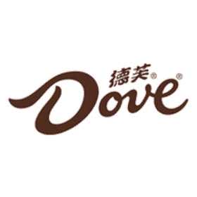

品牌热卖商品

德芙丝滑牛奶巧克力4.5g*45粒散装称重

￥45  
销售额：750w–1000w

宣传卖点：散装超值、婚礼喜糖

Dove/德芙

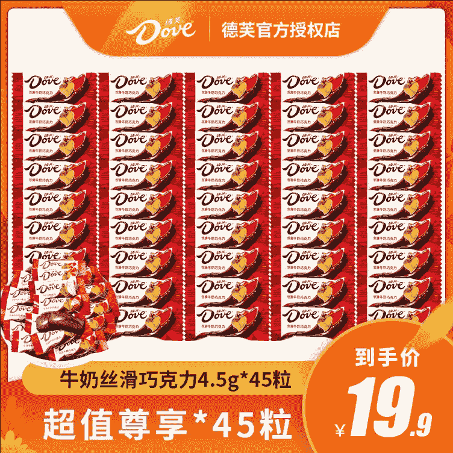

## 08

## 巧克力品牌分析：Dove/德芙

### 聚焦情侣节日送礼场景，联动多行业达人助力声量破圈

**DY.FEIGUA.CN**

数据说明：统计2022年和2023年12月品牌「Dove/德芙」在抖音平台的推广数据，案例图片来自抖音App，部分数据已做脱敏化处理，飞瓜数据

### 品牌视频推广关键数据：

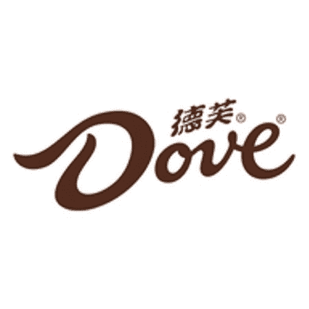

**Dove/德芙**

主要受众：女，31–40，广东

### 12月品牌各渠道销售热度

直播

短视频

12月巧克力品类销售热度TOP2

商品卡

2023年

2022年

1632%

视频销售增长

825%

商品卡销售增长

品牌关联视频总数

3.3w+

视频关联达人数

1.4w+

视频总曝光量

18.9亿+

美食

生活

情感

种草

母婴育儿

穿搭

影视娱乐

游戏

知识资讯

家居

2023年12月短视频及直播电商营销月报

## 09

## 12月热卖品类：雪地靴

### 雪地靴赛道声量销量双爆发，男士雪地靴类目增速领跑

**DY.FEIGUA.CN**

数据说明：统计2023年12月抖音平台销量大于0的雪地靴品类相关数据，部分数据已做脱敏化处理，飞瓜数据

2023年12月短视频及直播电商营销月报

随着冬季的到来，雪地靴市场也进入了销售旺季。据飞瓜数据统计，12月雪地靴的销售热度环比11月增长86%，且较去年同期增长203%，市场需求进一步扩大。其中，女士雪地靴以76%的销售占比占据绝对份额，同时，男性用户也对雪地靴表现出强消费需求，带动品类销售高涨。

搜索热度

销售热度

### 12月雪地靴各细分类目销售占比及同比增幅

**女士雪地靴**

76%

销售占比

200%

销售增幅

**男士雪地靴**

9.7%

销售占比

246%

销售增幅

**儿童雪地靴**

13.7%

销售占比

186%

销售增幅

**户外雪地靴**

0.6%

销售占比

198%

销售增幅

0

50000

100000

150000

200000

250000

0

50000

100000

150000

200000

250000

300000

350000

400000

450000

500000

12月1日

12月5日

12月9日

12月13日

12月17日

12月21日

12月25日

12月29日

### 12月雪地靴品类的搜索及销售热度趋势

**10**

## 雪地靴品类分析：

### 冬季保暖为核心购买诉求，增高等用户细分需求助力中小商家生意增长

### 12月雪地靴品类商品标题卖点TOP25

**DY.FEIGUA.CN**

数据说明：统计2023年12月抖音平台销量大于0的雪地靴品类相关数据，案例图片来自抖音App，部分数据已做脱敏化处理，飞瓜数据。

2023年12月短视频及直播电商营销月报

低

销售热度

高

销售热度同比增幅

### 雪地靴品类热卖小店案例：

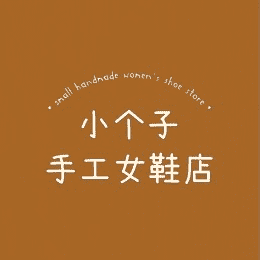

**小个子手工女鞋店**

主要带货方式：达人推广、直播带货

### 12月女士雪地靴类目热卖小店TOP3

### 12月小店雪地靴销售占比

### 12月小店热推雪地靴举例

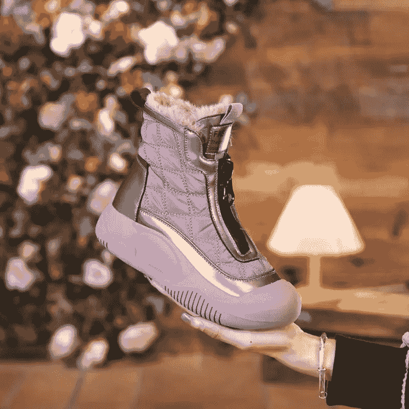

增高4cm 2023秋冬保暖复古百搭雪地靴防寒加绒女鞋

价格：169.99元

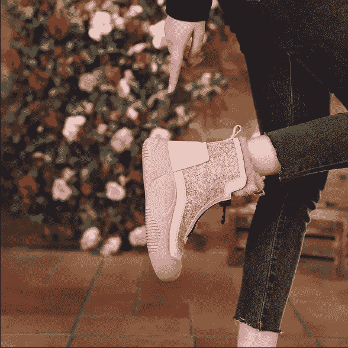

增高4cm 2023秋冬新款百搭时尚加绒软底防寒雪地靴

价格：169.99元

86.1%

雪地靴

休闲鞋

13.8%

其他女鞋

0.1%

保暖

加绒

冬季

新款

加厚

百搭

时尚

防滑

雪地

秋冬

防水

真皮

增高

儿童

皮毛

舒适

大棉

女童

50.0%

50.0%

50.0%

50.0%

50.0%

50.0%

0

500000000

1E+09

1.5E+09

销售热度环比增长582%

高

**11**

## 雪地靴品类分析：

### 熟龄群体展露强购买意愿，品质消费始终是核心诉求

**DY.FEIGUA.CN**

数据说明：统计2023年12月抖音平台销量大于0的雪地靴品类相关数据，消费者评价机会洞察来自飞瓜品策，部分数据已做脱敏化处理，飞瓜数据。

2023年12月短视频及直播电商营销月报

### 12月雪地靴品类受众画像分析

目前，女性仍为雪地靴品类的消费主力，占比超过7成。结合年龄分布，可以发现31岁以上群体对雪地靴的消费偏好显著提升，或成为品类商家后续发力的对象。商家在推广时可以结合鞋子的防滑程度、鞋高、外包装等用户高频关注点，以更好击中目标群体的消费痛点，带动转化。

性别分布

### 12月雪地靴消费者评价机会洞察

72%

TGI 53

TGI 153

年龄分布

0.0

20.0

40.0

60.0

80.0

100.0

120.0

140.0

160.0

180.0

0.0%

5.0%

10.0%

15.0%

20.0%

25.0%

30.0%

35.0%

40.0%

18-23

24-30

31-40

41-50

51+

23年占比

22年占比

消费者使用疑问TOP5

是否合脚

是否有异味

是否防滑

穿着舒适度

商品耐用性

消费者功能需求TOP5

鞋高

鞋盒

需求舒适性

保暖性

耐穿

22年TGI

22年TGI

**12**

## 12月热卖品类：衣物湿巾

### 羽绒服清洁产品关注度提升，清洁湿巾迎来销售旺季

**DY.FEIGUA.CN**

数据说明：本页图片来自抖音App，“衣物湿巾”相关商品销售趋势数据来自飞瓜品策（pc.feigua.cn），部分数据已做脱敏化处理，飞瓜数据。

2023年12月短视频及直播电商营销月报

### 12月“衣物湿巾”相关商品的销售额趋势

随着羽绒服市场迎来了热销期，如何清洗羽绒服也成为了消费者关注的焦点。基于这样的背景，主打快速清洁的衣物湿巾应运而生。12月“衣物湿巾”销售数据呈现上升趋势，销售额环比增长142%，均远超纸品类目。

### 12月“衣物湿巾”相关商品销售热度TOP5

0

20

40

60

80

100

120

140

160

180

12月1日

12月8日

12月15日

12月22日

12月29日

| 商品 | 品牌 | 单价（元） | 销售热度 | 主推卖点 |
|---|---|---:|---:|---|
| 町故事羽绒服去渍湿巾衣物应急去污免水洗不留痕便携式独立包装 | 町故事 | 9.9-29.7 | 1856w | 应急、免水洗、便携、独立包装 |
| 【直播专属】羽绒服干洗剂免水洗去污渍油渍神器多功能干洗刷洗一体 | 净爸爸 | 39.9-69.9 | 1633w | 免水洗、刷洗一体 |
| 德佑羽绒服去渍湿巾免洗清洁强力去油污免洗去渍湿巾小包装 | 德佑 | 9.9-15.9 | 1458w | 免洗、强力去污、小包装 |
| 中三清非离子衣物羽绒服乳化剂去黄去渍去霉增艳增白留香不留痕 | 中三清 | 39.9-69.9 | 988w | 去黄去渍去霉、留香不留痕 |
| 【工厂直发】羽绒服清洁湿巾衣物免水洗深层去污干洗湿巾便携免水洗 | 棉儿宝 | 29.9-39.9 | 988w | 免水洗、深层去污、便携 |

142.61%

环比增长

293.81%

同比增长

**13**

## 衣物湿巾品类分析：

### 囤货装推动了客单价的提升，便携化场景营销成转化关键

**DY.FEIGUA.CN**

数据说明：本页“衣物湿巾”相关商品的价格带、标题卖点分析均来自飞瓜品策（pc.feigua.cn），部分数据已做脱敏化处理，飞瓜数据。

2023年12月短视频及直播电商营销月报

### 12月“衣物湿巾”相关商品价格带分析

从衣物湿巾的价格区间来看，售价在10-49元的产品销售额占比最高。随着用户对该品类认知的不断加深，囤货装和组合装的产品也备受热捧，进而推动了客单价的提升。而在宣传方面，商家除了强调去污、去渍等清洁功能外，便携也成为营销的重点，商家可以结合外出携带、冬季清洁、餐饮场所等高频使用场景，进行针对性地营销种草和推广。

### 12月“衣物湿巾”相关商品标题卖点分析

<10元

10-49元

50-99元

>100元

-50%

0%

50%

100%

150%

200%

250%

300%

350%

400%

450%

低

高

销售额

销售额环比增长

高

擦拭

干洗

油渍

去污渍

免洗

不留痕

便携

清洁

去渍

去污

销售额

销售额环比

“衣物湿巾”消费者使用场景

29%

外出携带

21%

冬季清洁

18%

餐饮场所

11%

擦拭物品

7%

上学

3%

旅行

11%

其他

**14**

## 衣物湿巾品牌案例：町故事我是由深度求索（DeepSeek）研发的 deepseek-v4-flash-0731 智能大模型。**专耕湿巾领域，标题突出应季热词，汲取精准流量**

**DY.FEIGUA.CN**

数据说明：选取2023年12月品牌「町故事」在抖音销量大于0的商品数据；本页图片来自抖音APP，部分数据已做脱敏化处理，飞瓜数据。

## 品牌热销商品推广亮点

## 12月品牌细分品类销售额分布

2023年12月短视频及直播电商营销月报

**町故事**

主营品类：个护家清

家居用品

94% 衣物湿巾

4% 吸色片

1% 湿厕纸

厨房湿巾

除胶湿巾（0.1%）

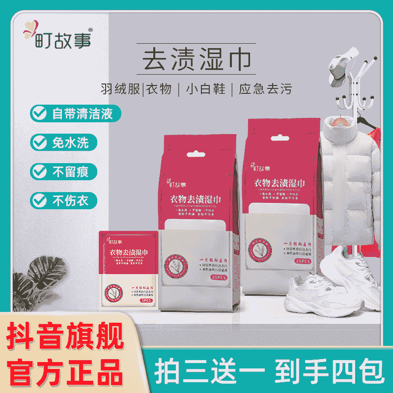

町故事羽绒服去渍湿巾，衣物应急去污，免水洗不留痕，便携式

¥ 9.9–29.7

抖音爆款榜-第1名

### 亮点一：顺应季节热度，标题突出“羽绒服”

近30天相关商品词云

商品部分更名记录

| 时间 | 商品名称 |
|---|---|
| 2023/06/28 | 町故事去渍湿巾衣物应急去污… |
| 2023/11/07 | 町故事羽绒服去渍湿巾衣物… |

### 亮点二：上线多规格，满足多元用户需求

商品规格分布

| 规格 | 购买预估占比 | 售价 | 单片价 | 适合人群 |
|---|---:|---:|---:|---|
| 1包 | 41% | 9.9 | 0.495元/片 | 尝鲜款 |
| 2包 | 43% | 16.9 | 0.42元/片 | 尝鲜款 |
| 3包（拍3发4） | 15% | 29.7 | 0.371元/片 | 囤货款 |
|  | 1% |  |  |  |

**03**

**15**

**DY.FEIGUA.CN**

**PART 03**

## 2024年1月电商趋势前瞻

**16**

**DY.FEIGUA.CN**

## 1月热点营销日历

**一月 January**

一　二　三　四　五　六　日

2　3　4　5　7　8　9　11　12　14　15　16　17　19　21　22　23　24　25　27　28　29　30　31

### 关键营销节点

01/01 星期一：元旦

01/18 星期四：腊八节

01/13–01/28：抖音商城好物年货节

中国人民警察节

小寒

抖音商城好物年货节

腊八节

2023年12月短视频及直播电商营销月报

元旦

大寒

### 重要时间节点

01/06 星期六：小寒

01/20 星期六：大寒

01/26 星期五：春运

春运

**17**

**DY.FEIGUA.CN**

## 1月热卖商品预测

数据说明：推荐商品参考图来自抖音App，飞瓜数据。

营销关键词：

在“仪式感消费”的热潮下，自带流量和话题度的元旦自然成为品牌新年营销的第一战。以“新年焕新、新年计划”等关键词为核心发起的主题营销活动，不仅能够有效地传递对新年的美好祝愿，满足年轻人渴望“新年新气象”的内心需求，同时还能提升品牌在社媒平台的声量。

重点关注品类

推荐商品参考

**2024 / 仪式感**

新年美甲

充气礼花枪

健身器材

营销关键词：

俗话说：“过了腊八就是年。”随着腊八粥的香气飘散，年味也越来越浓。大扫除、备年货、买新衣等春节传统习俗开始提上日程，让节日礼品、家庭清洁用品等相关品类的热度不断攀升。在营销方面，品牌需要打通从种草到转化的完整链路，才能在竞争激烈的年货营销中脱颖而出。

重点关注品类

食品饮料全品类、服饰内衣全品类、生鲜全品类、家庭环境清洁剂、红包/利是封、永生花/干花

推荐商品参考

**腊八/年味**

春节礼盒

新年挂饰

家庭清洁剂

营销关键词：

寒假前接年货节，后接开学季，为图书相关品类提供了天然的营销契机。除了学习和休闲属性外，图书的礼品属性也能很好地满足有娃一族在春节期间走亲访友的需求。根据不同学龄的阅读层次进行针对性选品和营销，可以帮助品类商家更好地实现销售增长。

重点关注品类

推荐商品参考

**寒假/学生**

杂志年刊

教辅材料

编程机器人

女装、指甲油/美甲用品、身体芳香精油、彩妆套装、运动/瑜伽/健身/球迷用品、节日装扮用品

书籍/杂志/报纸、玩具/童车/益智/积木/模型、教育培训、景点门票/周边游、电影/演出/赛事

2023年12月短视频及直播电商营销月报

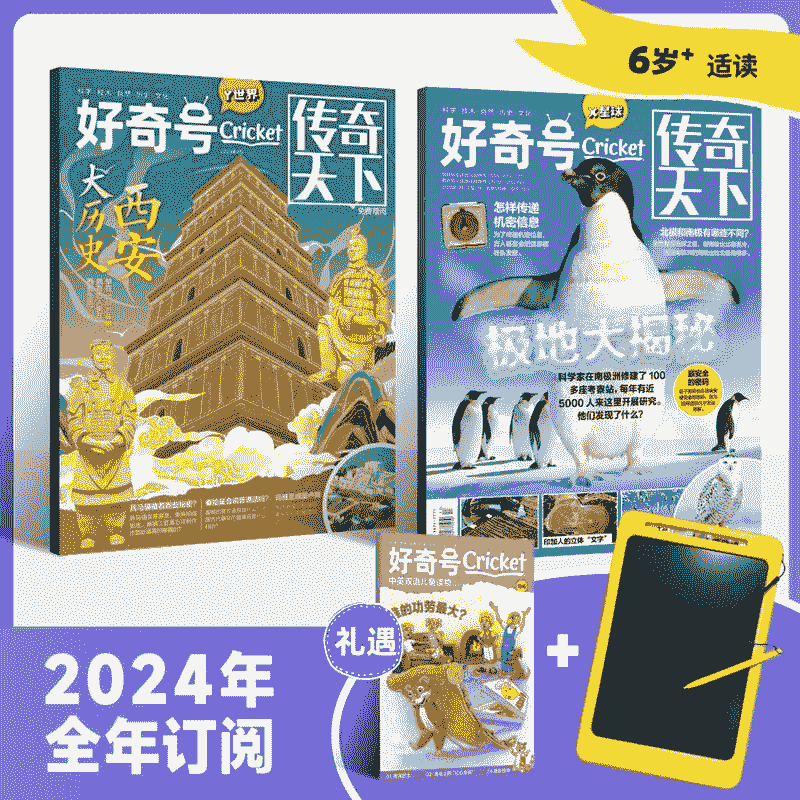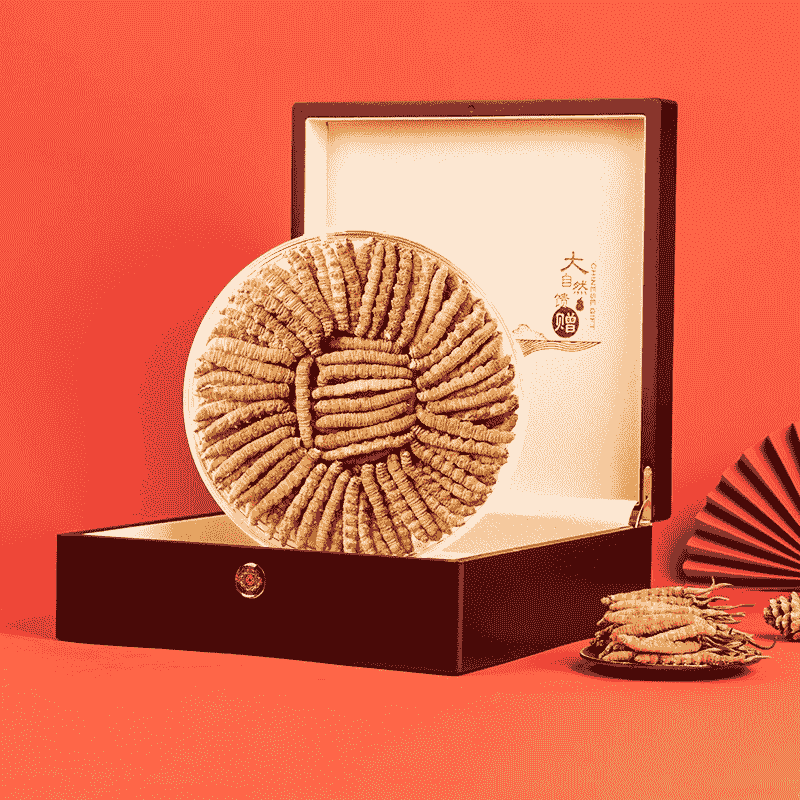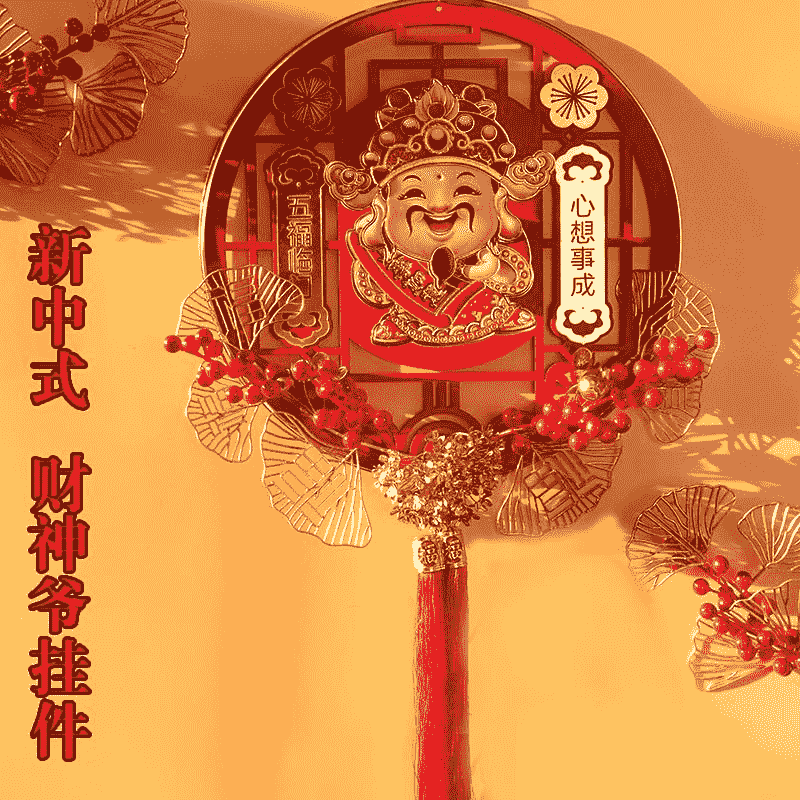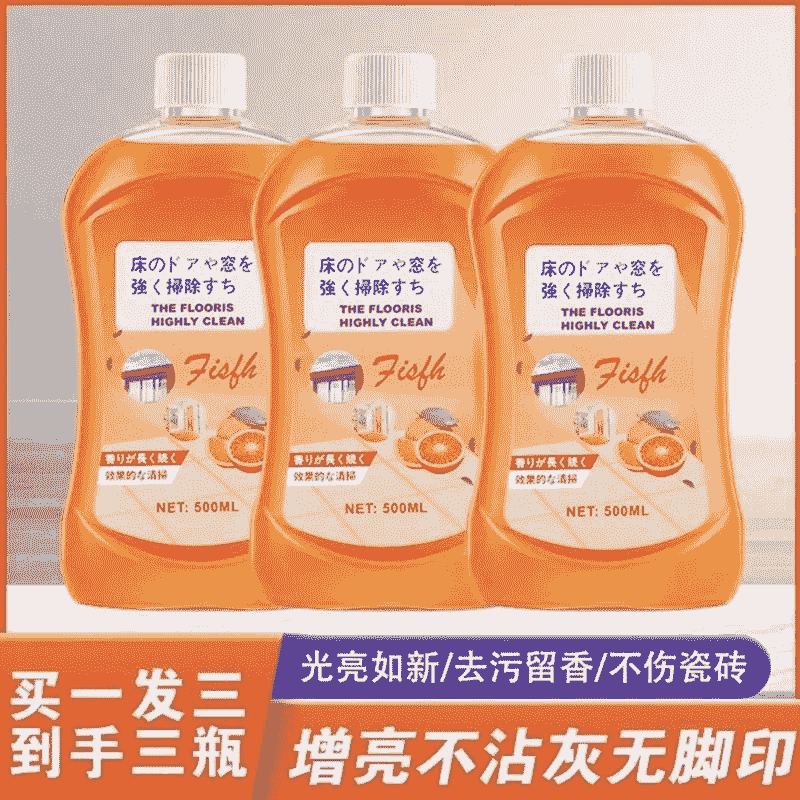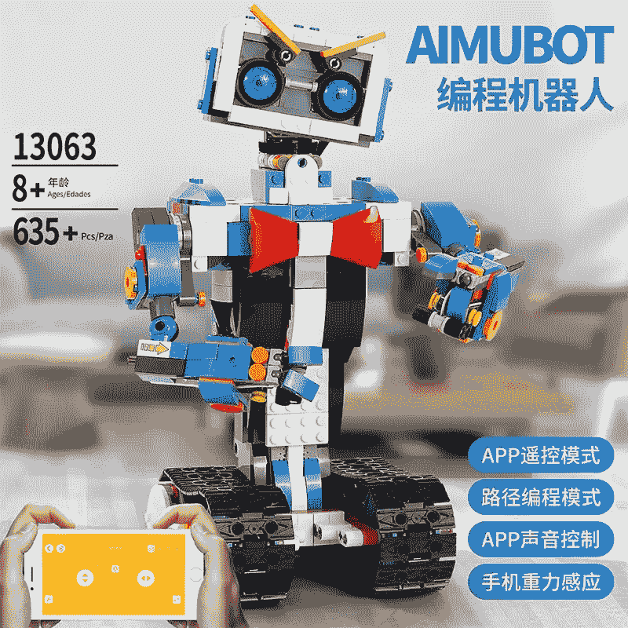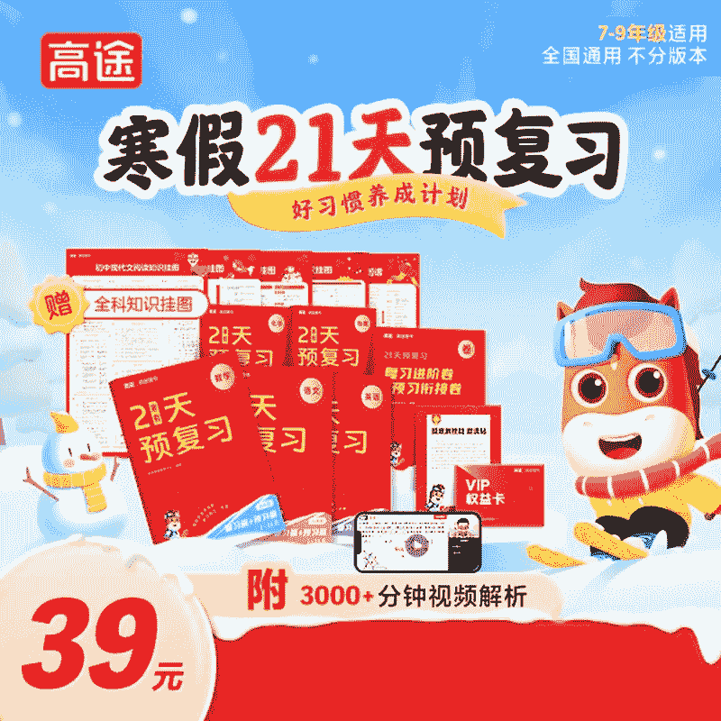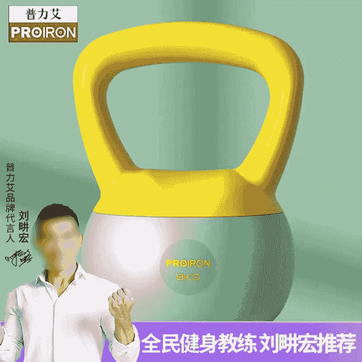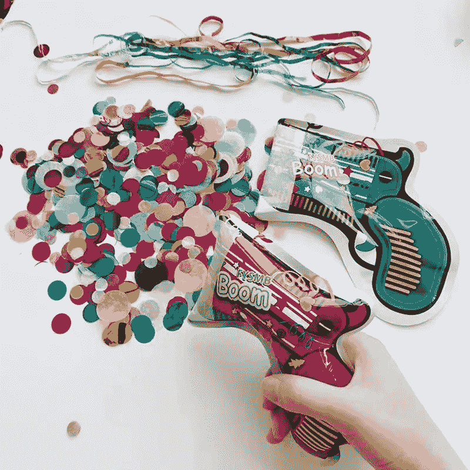

**18**

**DY.FEIGUA.CN**

## 12月抖音大事件盘点

### 01 抖音发布短剧类小程序内容审核要求

日前，抖音开放平台发布短剧小程序审核公告。公告称，自2023年12月13日起，在内容播控方面，抖音小程序内未入库和审核结果为“不可播放”的短剧将限制播放。

### 02 抖音“音需达”上门服务范围扩大至200城

日前，抖音“音需达”服务从51城升级为200城。但当消费者默认地址是学校、医院、代收点等不可送货上门的范围时，消费者正在浏览中的商品详情页将不会展示“送货上门”标签。

### 03 抖音上线首个AI聊天机器人

该聊天机器人名为“抖音心晴”，定位是情绪关怀机器人，可以通过识别用户表情来解读用户的心情。据悉，该功能后续或将支持语音或视频互动，并会上线多个AI虚拟角色，丰富AI聊天机制。

### 04 抖音电商上线“图文掘金计划3.0”

12月13日–12月31日，抖音电商正式启动图文掘金计划3.0，聚焦新作者、活跃作者两类群体，针对“3图以上”图文提供专属激励，并推出“图文掘金首篇奖”及“图文掘金激励赛”两大玩法。

### 05 抖音团购频道改版，新增三大模块

抖音团购频道新增“特惠团购”“热门榜单”“免费试”三大模块。同时从页面下方的信息流推流中可以看到，直播间开始占据重要位置。

### 06 抖音与芒果TV推出精品短剧扶持计划

芒果TV与抖音共同发布精品短剧扶持计划，未来3年将围绕新国风、新青年、新生活、新职业、新技术、新人文、新农村、新境界、新生态与新健康十大主题，面向行业进行优质的短剧开发和制作。

### 07 抖音内测推荐页双列展示

双列信息流支持图文、短视频、直播三种内容展现形式，用户可以在同一屏幕中看到多条内容，点击选择自己感兴趣的内容即可进行进一步的观看和了解。

### 08 抖音生活服务业务2023年支付订单量增长5.26倍

抖音生活服务综合行业年终盛典数据显示，一年来，抖音生活服务业务已覆盖全国370个城市，综合行业用户数量增长1.43倍、支付订单量增长5.26倍、商家门店数量增长2.51倍、交易额增长超3.3倍。

2023年12月短视频及直播电商营销月报

**04**

**19**

**DY.FEIGUA.CN**

**PART 04**

## 本月榜单

## 附录：2023年12月品牌销售热榜

**20**

**DY.FEIGUA.CN**

### 总榜

| 排名 | 品牌 |
|---:|---|
| 01 | YAYA/鸭鸭 |
| 02 | BOSIDENG/波司登 |
| 03 | YALU/雅鹿 |
| 04 | SNOW FLYING/雪中飞 |
| 05 | dongfangzhenxuan/东方甄选 |
| 06 | HUAWEI/华为 |
| 07 | ROMON/罗蒙 |
| 08 | GOLDFARM/高梵 |
| 09 | TUCANO/啄木鸟 |
| 10 | NIKE/耐克 |
| 11 | CAMEL/骆驼 |
| 12 | MOUTAI/茅台 |
| 13 | ROBINHOOD/罗宾汉 |
| 14 | Midea/美的 |
| 15 | Disney/迪士尼 |
| 16 | FILA/斐乐 |
| 17 | CO CO ZONE |
| 18 | Apple/苹果 |
| 19 | Louis Vuitton/路易威登 |
| 20 | Alessandro Paccuci |
| 21 | KANS/韩束 |
| 22 | BASIC HOUSE/百家好 |
| 23 | adidas/阿迪达斯 |
| 24 | Xiaomi/小米 |
| 25 | Pierre Cardin/皮尔卡丹 |
| 26 | Haier/海尔 |
| 27 | WULIANGYE/五粮液 |
| 28 | Warrior/回力 |
| 29 | HLA/海澜之家 |
| 30 | ERAL/艾莱依 |

排名　品牌

2023年12月短视频及直播电商营销月报

## 附录：2023年12月美妆品牌销售热榜

**21**

**DY.FEIGUA.CN**

### 美妆

| 排名 | 品牌 |
|---:|---|
| 01 | KANS/韩束 |
| 02 | JOYRUQO/娇润泉 |
| 03 | PROYA/珀莱雅 |
| 04 | L'OREAL/欧莱雅 |
| 05 | LA MER/海蓝之谜 |
| 06 | WHOO/后 |
| 07 | Jmoon/极萌 |
| 08 | Helena Rubinstein/赫莲娜 |
| 09 | ESTEE LAUDER/雅诗兰黛 |
| 10 | LANCÔME/兰蔻 |
| 11 | AKF |
| 12 | 谷雨 |
| 13 | MANCODES/左颜右色 |
| 14 | CHANDO/自然堂 |
| 15 | OSM/欧诗漫 |
| 16 | SK-II |
| 17 | YSL/圣罗兰 |
| 18 | Florasis/花西子 |
| 19 | 仁和匠心 |
| 20 | 宫芙 |
| 21 | MARUBI/丸美 |
| 22 | CEMOY/澳诗茉 |
| 23 | CARSLAN/卡姿兰 |
| 24 | DCEXPORT |
| 25 | JudydoLL/橘朵 |
| 26 | Funny Elves/方里 |
| 27 | XIAOSHUMEI/小树美 |
| 28 | EviDenS/伊菲丹 |
| 29 | PRAMY/柏瑞美 |
| 30 | HBN |

排名　品牌

2023年12月短视频及直播电商营销月报

**附录：2023年12月个护家清品牌销售热榜**

| 排名 | 品牌 |
|---|---|
| 01 | botare/植护 |
| 02 | 漫花 |
| 03 | 沫檬 |
| 04 | Mind Act Upon Mind/心相印 |
| 05 | Liby/立白 |
| 06 | 白云山 |
| 07 | 植华士 |
| 08 | 丝飘 |
| 09 | 活力28 |
| 10 | 侗染 |
| 11 | oralshark/口腔鲨鱼 |
| 12 | Bluemoon/蓝月亮 |
| 13 | Vinda/维达 |
| 14 | GOTDYA/高缇雅 |
| 15 | Breeze/清风 |
| 16 | SukGarden/蔬果园 |
| 17 | 墨雪 |
| 18 | 固然堂 |
| 19 | KRAUTERHOF |
| 20 | 德佑 |
| 21 | 水之蔻 |
| 22 | C&S/洁柔 |
| 23 | 仁和匠心 |
| 24 | FREEMORE/自由点 |
| 25 | 敬修堂 |
| 26 | L'OCCITANE/欧舒丹 |
| 27 | 瑶品 |
| 28 | Head&Shoulders/海飞丝 |
| 29 | PANTENE/潘婷 |
| 30 | KERASTASE/卡诗 |

个护家清

2023年12月短视频及直播电商营销月报

**附录：2023年12月品牌销售热榜**

### 服饰内衣

| 排名 | 品牌 |
|---|---|
| 01 | YAYA/鸭鸭 |
| 02 | BOSIDENG/波司登 |
| 03 | YALU/雅鹿 |
| 04 | SNOW FLYING/雪中飞 |
| 05 | ROMON/罗蒙 |
| 06 | TUCANO/啄木鸟 |
| 07 | GOLDFARM/高梵 |
| 08 | ROBINHOOD/罗宾汉 |
| 09 | CO CO ZONE |
| 10 | Alessandro Paccuci |

### 3C数码家电

| 排名 | 品牌 |
|---|---|
| 01 | HUAWEI/华为 |
| 02 | Apple/苹果 |
| 03 | Xiaomi/小米 |
| 04 | Midea/美的 |
| 05 | Haier/海尔 |
| 06 | HONOR/荣耀 |
| 07 | Redmi/红米 |
| 08 | IQOO |
| 09 | OnePlus/一加 |
| 10 | 学而思 |

### 母婴宠物

| 排名 | 品牌 |
|---|---|
| 01 | Disney/迪士尼 |
| 02 | Balabala/巴拉巴拉 |
| 03 | CHENCHENMA/辰辰妈 |
| 04 | GOLDFARM/高梵 |
| 05 | YALU/雅鹿 |
| 06 | YAYA/鸭鸭 |
| 07 | SNOOPY/史努比 |
| 08 | 雅鹿优选 |
| 09 | 派町 |
| 10 | YOUYOUTONGHUA/悠悠童话 |

2023年12月短视频及直播电商营销月报

**附录：2023年12月品牌销售热榜**

### 食品饮料

| 排名 | 品牌 |
|---|---|
| 01 | dongfangzhenxuan/东方甄选 |
| 02 | Three Squirrels/三只松鼠 |
| 03 | 李陌茶 |
| 04 | 诺梵 |
| 05 | ADOPT A COW/认养一头牛 |
| 06 | yili/伊利 |
| 07 | BAIXIANG/白象 |
| 08 | BESTORE/良品铺子 |
| 09 | 华夏丝路 |
| 10 | Dove/德芙 |

### 生鲜

| 排名 | 品牌 |
|---|---|
| 01 | dongfangzhenxuan/东方甄选 |
| 02 | 天海藏 |
| 03 | HAIYANGYANYI/海洋演义 |
| 04 | HITOMORROW/大希地 |
| 05 | 脱骨侠 |
| 06 | 滋记 |
| 07 | 叮叮懒人菜 |
| 08 | HONGYUJIAHUI/鸿宇嘉惠 |
| 09 | Anjoy/安井 |
| 10 | 思念 |

### 运动户外

| 排名 | 品牌 |
|---|---|
| 01 | FILA/斐乐 |
| 02 | CAMEL/骆驼 |
| 03 | NIKE/耐克 |
| 04 | adidas/阿迪达斯 |
| 05 | ANTA/安踏 |
| 06 | misswiss |
| 07 | THE NORTH FACE/北面 |
| 08 | LI-NING/李宁 |
| 09 | SINSIN |
| 10 | SKECHERS/斯凯奇 |

2023年12月短视频及直播电商营销月报

**附录：2023年12月品牌销售热榜**

### 家居用品

| 排名 | 品牌 |
|---|---|
| 01 | Midea/美的 |
| 02 | SUPOR/苏泊尔 |
| 03 | AUX/奥克斯 |
| 04 | Skyworth/创维 |
| 05 | KONKA/康佳 |
| 06 | YALU/雅鹿 |
| 07 | dreame/追觅 |
| 08 | TINECO/添可 |
| 09 | Haier/海尔 |
| 10 | grace/洁丽雅 |

### 酒类

| 排名 | 品牌 |
|---|---|
| 01 | MOUTAI/茅台 |
| 02 | WULIANGYE/五粮液 |
| 03 | LUZHOULAOJIAO/泸州老窖 |
| 04 | 国鼎 |
| 05 | YANGHE/洋河 |
| 06 | 汾酒 |
| 07 | 贵州 |
| 08 | 郎酒 |
| 09 | 金六福 |
| 10 | 玛莎诺娅 |

### 滋补保健

| 排名 | 品牌 |
|---|---|
| 01 | 仁和 |
| 02 | 诺特兰德 |
| 03 | WONDERLAB/万益蓝 |
| 04 | 五个女博士 |
| 05 | 澳乐维他 |
| 06 | Olly |
| 07 | 敬修堂 |
| 08 | JUNXIAOBAO/菌小宝 |
| 09 | Swisse/斯维诗 |
| 10 | OXYENERGY/氧气能量 |

2023年12月短视频及直播电商营销月报

## 版权说明

本报告除部分内容源于公开信息（均已备注）外，其他内容（包括图片、表格及文字内容）的版权均归果集数据所有。果集数据获取信息的途径包括但不仅限于公开资料、市场调查等。

任何对本数据及报告的使用不得违反任何法律法规或侵犯任何第三方合法权益，任何场合下的转述或引述以及对报告的转载、引用、刊发均需征得果集数据方同意，且不得对本报告进行有悖原意的删减与修改。

本数据及报告来源于果集数据，违者将追究其相关法律责任。

## 数据说明

本报告数据主要来源于品牌社媒营销洞察平台「飞瓜数据」在2023年12月1日—2023年12月31日所追踪到的营销情报，选取抖音短视频、直播、电商相关的营销内容作为对2023年短视频及直播营销月度报告分析。基于隐私及数据安全的考虑，本报告数据经过了脱敏及指数化处理。

**DY.FEIGUA.CN**

飞瓜数据成立于2018年，旗下产品覆盖抖音、快手、B站三大主流短视频平台数据，是国内率先致力于推广、普及“短视频-直播”电商生态数据运用的标杆企业。

**飞瓜数据**

**DY.FEIGUA.CN**

飞瓜提供定制的商务合作、营销解决方案咨询，想获取更多品牌电商行业报告，可通过下方客服联系我们。

**基于4大实用场景，为品牌寻找确定性的增长机会**

- 拓流量  
  EXPAND MARKET  
  市场趋势  
  达人选投  
  流量转化

- 铺货品  
  MANAGE PRODUCT  
  新品营销  
  爆款投放  
  渠道优化

- 配营销  
  OPERATE CAMPAIGN  
  赛道挖掘  
  营销种草  
  软广识别

- 做用户  
  ANALYZE USERS  
  受众分析  
  人群包投放  
  私域沉淀

## 联系我们

专属数据分析师1V1

提供定制化品牌营销咨询

扫码关注飞瓜公众号

获取更多行业报告

果集科技是一家社交媒体全链路服务商，公司致力于将大数据、AI等新技术应用于社交媒体营销和电商领域，以数据和技术驱动品牌增长。

通过行业咨询、策略系统、营销执行、运营工具四个方向，为品牌提供社交媒体全链路解决方案。

### 旗下产品

P R O D U C T S  O F  G U O J I

### 联系&合作

C O N T A C T  &  C O O P E R A T I O N

### 关注我们

领取24份抖/快/红数据报告

### 商务合作

果集销售总监

余新彦

### 市场合作

果集市场品牌总监

何十三

**果集-社交媒体全链路服务商**

**2023**

**GUOJI · FEIGUA**

**Thanks!**

**2023**

**GUOJI · FEIGUA**

**DY.FEIGUA.CN**
