## ISSUE 04

## al! alma insight

SEIZE THE OPPORTUNITY

四大行业消费趋势·重读消费者

To make it easy  
to do marketing anywhere.

**alimama insight**

**廧㛁**

**枱挾⫺⫺ㆭ娳**

曘扥⨡⨡㯼⟁⾙Ⓢ㘉⯰㚏ὼ䜝㙉咾料炱傥㘉㐇㛈⾙Ⓢ咾料㙉㟃㟾䜝冖㼩Ϛ‶㋱曘扥⺍⺍

㣑ぜ◟ẳ㘉㐇┥咾料壥ẳ䜝Ậẳ┥佨欥炱曘扥⨡⨡㶷ⱸ⋉㸡巒傞≌䯯庈〝䜝⺁⧀⑱⎯炱

扦㙉䒟婼㸡巒傞④壥ẳ㸡巒帤⍘Ϛ⿬Ᾱ佸尽䡾㯼奄椹娟炱恲ⲟ㛈ώ㋙㞢╚䋥ϙ◟ⱏϙ咾

料ὓ憖₦ㆸ∍⧤䜝㎪㊱ầ㟓惠Ϛ

**╖愺**

**⪛䒝⪙ㅝ㻺ㆭ偁䕸**

὾㸡巒傞ồỆぜ炱扦㠝㙉╚⊴㙉ϙὀ╚㞦⌺ϙ㸡巒傞Ῥ欥炱屑⦳╚䋥⟁⧂䏄呐〰㎚來⤷

昘Ϛ῵ồ㟃㟾⤷昘䜝扦娚⾮㕧炱㘉⯰㚏ὼ䜝㙉咾料炱ⲟ⻇⍂╚䋥㞍儃㚧⟉㶷ⱸ㸡巒傞炱

ⰷ䑉昘Ở㸡巒傞恩咾Ϛ

**▫桜**

**⪛䒝㻺庫䚧Ⳃㆭ偁䕸**

㸡巒䗎⯩壥ẳ恧㟾ὀẳ㘉⯰⎯┥㜓冖⎯㟓惠Ϛ⧂䏄ⲟ㓓㋤曘扥⨡⨡炱㎚來⻇⍂╚䋥㘉⯰

⎯㗒悹炱⼏‶㋱㘉㐇權⍁䜝㙉咾料㶷ⱸ炱∊⒥⍂⌴╚䋥⟁佨㷧㙉━㞸ⰷ䑉㟃㟾⤷昘Ϛ

**ⶆέ**

**⪛䒝㡿櫢ㆭ偁䕸**

㘉⯰㚏ὼ炱⧂䏄㞦樉ồ㚏ⲳὀẳⰢả἟䒟ダ⧀冪Ϛ㘉㐇㗈㔪䜝㘉⯰⎯㷚壥帤⍘㟓⋏┥ὓ

倽㶷ⱸ炱⻇⍂╚䋥㓆⾓ὧ帤⍘椝㷤ϙὀ╚‴⼭斗⋉咾料䊟⑪䜝∁斗庈㙒㣡Ϛ

**⎨⃎⡔枑**

**alimama insight issue 04**

**⍬☳‬Ѩ alimama insight lab**

῵ồGROSGSGOTYOMNZ䜝⊓╚㙒炱GROSGSGOTYOMNZRGH䗊曘扥⨡⨡咾料䢭䬏Ệぜϙ⺛⟓∅∌憁┥咾料⊴ㆨỆぜ僭

⒡㊩䭤Ϛ㊪ᾅ‶㋱曘扥⺍⺍䖸゚

⧀㘉㐇炱⢓ἧ曘扥⨡⨡䎅㞢䜝䢭䬏㪺⠤┥Ậẳ佨欥炱怬⊓⊔Ệ╚䋥◟ⱏ┥壥ẳ咾料

䙴䅒䜝帤⍘㶷ⱸ㌾ⓣϚ⿬䇏炱恲扥Ỹᾳ屷䖸洵㷔䜝╚䋥咾料㣡․ϙ⋦㵘䜝)35㶷婚┥㸡巒⺛⟓䜝㞙㙉楧⒪䯢炱ⳊⅨ

㛈ẙ㟅⒈岔䜝◟ẳ嶻佨㟛ばϚ

㞢婛䅒ϙ㞢゚

⼿ϙ㞢ザ恁炱Ỹ㞍㞢帼ϙ㞍㞢䗁炱㛈 GROSGSG OTYOMNZ 䜝䞇㢠烀὾㶷ⱸ椝㷤㟃㟾炱὾ ɍGOɎ 權⍁⤷

昘炱㛈㊪ᾅ㞙佡⺥㞴巤冖╚䋥◟ⱏ䜝㞸屑Ϛ

**ISSUE 04**

## 免责声明

## VOLUME

## alımama insight

To make it easy  
To do marketing anywhere

**T**

从“游牧民”**到“采猎者”**

**2019日化美妆行业消费趋势解读**

**、y孲**

**ү㾪䏙㶃Ұ◾ү挹䒀具Ұ扯㞡ὲ䬿⵫㻺庫廽␱䟶栂✭**

**PART 1**

**ү思⢚㐯䬭Ұ‬儖⢬㟡䟶挿㣶**

**▀✭㝨⁕ᾟ䟶ү⎏关ⓣ㢬Ұ⎿僠Ѫ䄲╃Ὸ㎲嶅ү⿦惭⒈Ұ䟶廽␱**

樯⇡㛈⼍瀝彄ᾖ䜝婼佪Ϛ

㊪ᾅ婛ⱸ⋉炱Ầ⒥⼍瀝Ấ䜝倧⨟㸡巒㪺⾨㯼⟁㠗⍁炱

㋙岬ⴚ⼍瀝佝䜝⼍怔㸡巒傞炱⟁⒝∑⠤䴔䞇ả䜝

ὓ倽⒥㱭⤷悸⟠㛗哰歱ἧ∏Ὧ⼍瀝佝炱⼍怔⎯帤⍘⊑

㛗炱▃ギ㛈⟁䵗⏧恲䩦Ᾱ佸ả὾㌰変傚ồỔ⌸㗡䜝䴔

䞇ỤỆϚ

帤⍘䜝入⒧㛈㚏ὼ䜝入㜈炱屳⨛䧗ᾳ⯿ⱏ㋙媙炱㊪ᾅ

㯼⟁佨␟ẙểɍ⒧♔Ɏ㚏ὼ炱␌⒧㟾傞炱⼍怔傞Ⳟ

ả炱㐥㑺㞍⦳䀇㷚帤⍘炱⒪⼍昘傞⑦⒪怬⊓䜝㚏ὼϚ

⟁恲ẙ㚏ὼỆ炱ɍ⼍怔Ɏ⟁㡩䩦䪤⼿ả〰⋉἟䮿⒐⎯

䜝⌹㎚炱ầɍ⇡恴Ɏϙɍ䀇㷚Ɏ④ɍ帤⍘Ɏ䞑僭佬炱

⌹㺊἟ὓᾅⲒɍ柫㚾Ɏ䜝䑦婟Ϛ

ầɍ䑦婟柫㚾Ɏ䞑῍傥䖸䜝⁘㛈ɍ䆿囪⊶傚ɎϚ

㊪ᾅ婛ⱸ⋉炱⼍怔ὓ⟁ⴚ㞸暍䜝⊶傚䆿囪⁘⺋

㞢㋙⯮克炱恲䩦䆿囪〙〙┥⼍怔ὓ䜝⧤㘰㞸⋦倇䞑

∌炱ɍ䉅⦵枵䉅⦵₇⦦Ɏ䯢Ổ㋬䉅⦵⟓㜈䜝⏮╚ㄝ䇏

∍帐炱ậ⟁⼍怔㙨倽Ệ䜝㌂⾹㞍ồ㛗哰Ϛ

Ỹ㯼❹⨛㯽炱㊪ᾅ⑪䑉⟁ⴚ䜝柫⼍㞸Ấ炱㸡巒

傞Ⲓ䵗⏧ϙ䟕憁㌽䒟恲䩦∑⠤䜝㌰傚䴔䞇䜝巆Ἁᾐ㣕

や悸㑩⏠炱⊑㛗Ⲓɍ椝曋⊶傚Ɏ䜝∌⊠ầɍ⏠佀㌰

傚Ɏ䜝ぜ゚

Ϛ

䴔䞇;<

査憁䵗⏧

;<⒥㱭⤷悸

査憁。⨟

㶰⑪㳍

˭

**⿦惭⒈廽␱⿱㹍Ⳋ⢚Ѫⷳ**

**⿦烶倶毣␚䷭䡠䚑㊁汊憑⨐曱**

➗|3':Ầ⒥∑⠤ἥ佀䴔䞇⊟⼍瀝㊩Ἵ;<④∏⒥㱭⤷悸

δ䜝⧀Ⲩ夁䧓Ầ⒥⼍瀝佝⟁屾䴔䞇Ấ䜝⏹㱭

**⪽㜉㢑ᾀ⎏关䊘埃䟶⎿僠Ѫℵ⃱㐉关䚑㊁⢚ⷳ**

**⁗ώⓥ㡻㞰嗉㏛を**

**⪽㜉㢑ᾀ⎏关䊘埃䟶⎿僠Ѫℵ⃱㐉关䚑㊁⢚ⷳ**

**⁗ώⓥ㡻㞰嗉㏛を**

⼍䖸ㆨῬ扨

⼍䖸ㆨῬ扨

⼍䖸ㆨῬ扨

➗|⼍ɍ䉅⦵Ɏ⟓㜈Ấ炱Ầ⒥⼍瀝䖸ㆨῬ扨嶺䏇佶Ⲓ⃕

⊟⺜

➗|⼍ɍ䉅⦵Ɏ⟓㜈Ấ炱Ầ⒥⼍瀝䖸ㆨῬ扨嶺䏇佶Ⲓ⃕

⊟⺜

査刵

䋖儽㳍

䵗⏧

䟕憁㌽䒟

Ἄ㹋査枵

■憁。⨟

査憁。⨟

樲㳍

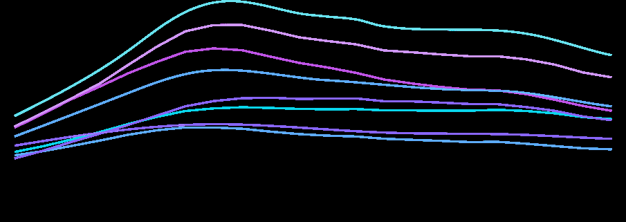

⨌ダ

䗐ダ

**㆙⎝⿥㢵廽␱ώ䟶ᾖ㆙ ␚Ѫℵ慍Ὸ㎲嶅ү⁈偁㻀Ұ䟶⋦廩**

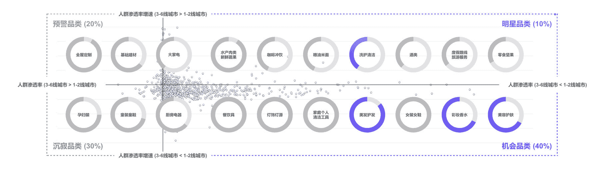

∦㮺㛈ダ⋄彄ᾖ䜝婼佪Ϛ

⟁Ᾱ佸佘Ấ◟帞Ệ炱㊪ᾅ㠚Ⲫ冖⦸䞤⋉䗐ダ⊓䑉⟁倧

⨟ὀ╚䜝Ậ㡵Ϛ䇏傥木䟙ダ⋄⼌㟜ㆨ屟䜝婢戫炱⑔ダ

⋄⎯㸡巒帤⍘䜝∍帐炱ɍὯ佨㷧Ɏ䑉峺⟁倧⨟壥ẳ∞

Ỹ〰⋉἟帣㟾帣⼘㵴䜝㑩④Ϛ

ẳ∞⦳ể⼌⒉䢭䬏㌾ⓣ䜝㘉㐇⟠⑪䑉炱䗐ダⲒ倧⨟壥

ẳ䜝䖸ㆨ嶺䏇㯼⟁⑱〰帣㟾帣⧀Ϛ㊪ᾅ䜝㘉㐇Ỹ⑪

䑉炱䗐⦄㌽儽䖸ㆨ䜝⒥㱭⤷悸㛈倧ⱒ㌽儽⧀䴔䞇䜝

₦炱䗐⦄。⨟䖸ㆨ䜝⒥㱭⤷悸㞍㛈。⨟䴔䞇㘍Ῥ

䜝₦炱䗐⦄䖸ㆨ㍬ⳮ恞䎴Ϛ

**ү⁈偁㻀Ұ䟶㦪ㄵ毣␚␍Ѫℏ㝙㞡ᾬү⫫Ұ㡿␓**

**䚩㆙废ῢ╕倔䟶⢹⁩㞰嗉汊 ⫥㆙ᾆ⁩㦮⹢↮⪌⩶ ⷳ**

**䟶ㆽ䎣㢑**

➗|3':䗐ダ㸡巒傞䜝㸡巒扪椶⊟⺜

➗|3':䗐ダ㸡巒傞䜝㸡巒扪椶⊟⺜

➗|3':⒝⧂⊟ダ⋄巆Ἁ傞⏹㱭㞋佘

䗐⦄。⨟㌽儽

柷䗐⦄Ậ⳷䴔䞇

䗐ダ巆䌂傞⟁壥ẳ∞䜝㸡巒扪椶Ệ

὞㞢〡Ⲫ⊟⺜⟁䗐ダẬ⳷䴔䞇

炭䗐⦄㌽儽䗐⦄。⨟䯢Ầ幌

**\[**

**\[**

-3<⤷悸

䗐⦄。⨟\\Y。⨟

-3<⤷悸

䗐⦄㌽儽\\Y倧ⱒ㌽儽

**⢚㻜䂝叴⿸⎿▀Ѩ汊䱡☳䎾ホ⫸㻺庫具ᾟ䟶䚩㆙ⓒ㵆䚌卥廷愹**

䗐

⨌

ẜ⦮匛

➼屷匛

ㅞὓ匛

屳䇏⨛㯽炱㊪ᾅỸẦ冖䞋䞇⟉䮜⁺䗐ダ倧⨟㸡巒䜝ⶴ

帐炱傥㛈⼭㺞戫⟉尽屟⋉炱䗐⦄倧⨟ầ㌽儽䖸ㆨ圖䇏

⟁歱悸⤷昘炱῟∏䖸ㆨῬ扨䜝佶Ⲓ扨佀‶㚀㞢曩Ϛ␌

‘⟁䗐ダ㸡巒傞Ệ炱㯽ẽ䴔䗐ダẬ⳷䜝䴔䞇䖸ㆨ⏹㱭

ỸẦ幌Ϛ

ỸⳊ㛈岍炱䗐ダ⟁巆Ἁ倧⨟◟╚㚏炱劃䗁枙㳛㱭․〡

⒈冖䞑Ⲓ怜ῧ炱㞍⦳恱㛈佲ɍ⑿ẙ⏣Ɏ䜝悚䧕⟓㜈Ϛ

恲ẙ⃠屗⟁歱䮈。⨟╚䋥巆Ἁ傞䜝ダ⋄⑱⍁帤⍘ỆỸ

〰⋉἟ẙⰳ䪤⼿䜝屚ⰷϚ

䗊➗⒈὾䞤⊓炱⟁ẜ⦮匛ϙ➼屷⯼ϙㅞὓ匛ϙ

䯢㸃㿄匛⼟㙾⋦⒧炱歱䮈。⨟╚䋥䜝䗐⦄巆Ἁ傞㱭․

䖳劌冖⦸帞恠Ϛ

䗊➗Ỹ⒈⑪䑉炱䗐ダ巆Ἁ⑼伻䜝⟠ᾐ娚㛗哰歱ἧ⨌

ダ炱ậᾐ㣕ⶉ⃕

恱⦳⦝ἧⴚ䜝ヤ䋊㞸炱㞍⌹⊑

㛗἟悚䧕䧓䋊⟓㜈⯱⟁Ϛ

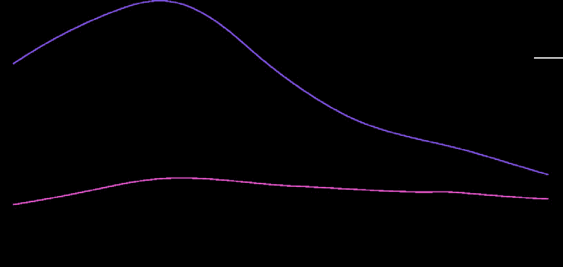

憖⺛柫⼍

Ⲩ无柫⼍

㞢⨖巀

㹱ⰶ⧍㟺

╠╿婟椪

成䑂㚸䒜

**ⶁ暹棄⿦䟶⋷⴫㻁嬺㝨曱㞰嗉汊 倱扯⽴棄⿦**

➗|炭3':炮Ổ娚∞ⱒ椪惬ὓ⟠㙾㷨婡㚏昘炭䩫炮

**桲㶴㳕⢚ᾀ㎲嶅䟶思㥹䳰孕偃Ѫ㻺庫䟶⋥暠⢚ ү㾪哓 ㄵ杦Ұ䟶**

**桲㶴⢬㟡Ѫ兾棐ү㷻㼲 愹ヲҰ䟶思ⷐ㆙**

ピ佬㟾䞤炱㙹屓㛈⼍瀝ϙダ⋄ϙ⟉⡸炱Ả䩦彄ᾖ入⒧䜝㸡巒帤⍘炱憖⟁㙾㺩ầᾹ佸䜝䮿⒐⎯尽䡾䞑入䩔炱帉⒪

ẙ䩦㙉䜝⻑゚

炿ẙ⊠⒃∌ủɍ㻑叺ἧぜ暍Ɏ䜝枙㳛⟓㜈炱傥柷ɍ㴢㹙ἧ恠〙Ɏ䜝彄ᾖ⳷ダϚ

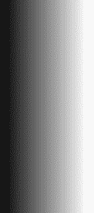

**妾ᾌ╃⷇㲕㲕▃哕Ѫ⪙扚⍸῾候䷭䡠⢹⅏㑳⢚ᾖ₿⁗ὼ䟶汊⨐曱䓹㶦⿥**

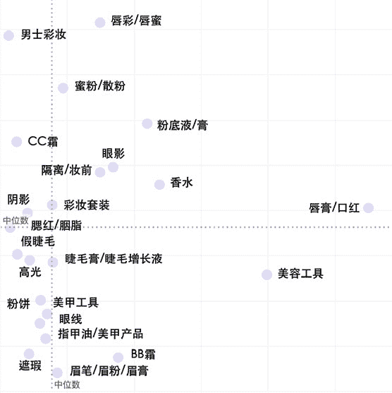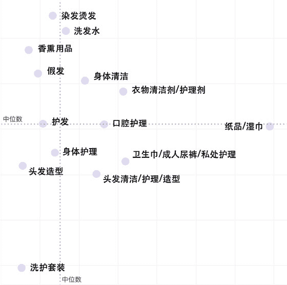

➗|炭3':炮㙾⎯倧⨟壥ẳ⒝ἥ佀䴔䞇䖸ㆨῬ扨④⒥㱭⑱⎯

倧ⱒ㌽儽倧Ῥ䵗㵒

。⨟樲㳍倧⨟⹾∐

倧⑪㌽⑪⃠⑪

㶰㌽㺞㶚⋛␄䖸⺗佑樲噉

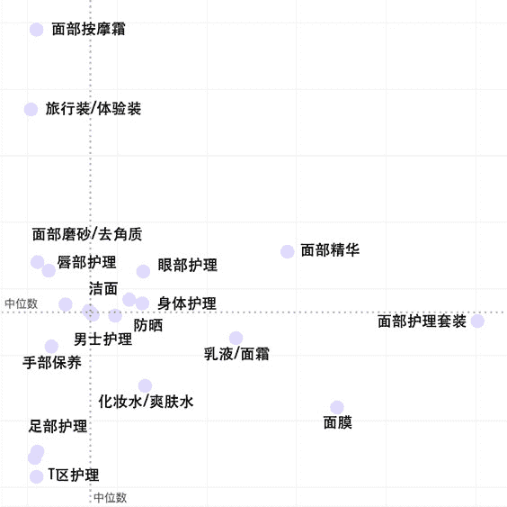

䖸ㆨῬ扨

䖸ㆨῬ扨⒥㱭⑱⎯

査憁㌽䒟⧰奞

査刵

査憁䵗⏧

Ἄ㹋査枵

⎯⨟㳍䋖儽㳍

䟕憁㌽䒟

彄Ῥ㌽䒟

㶚査

曋㛫

䗐⦄㌽䒟

␑⨟

䵗㵒卌䘰

㙞壥奞Ῥ欥奞

査憁。⨟

■憁。⨟

倧ⱒ⹾∐

䟕憁。⨟

樲㳍

。⨟⧰奞

䗐⦄。⨟

㶰⑪㳍

㡬⑪䆄⑪

㌽⑪

⧍⑪悹⠤

佑╚㼘⺗

␄䖸⺗㊩ὓⳘ好䩚⦝㌽䒟

壼䌂㺞㶚⋛㌽䒟⋛

⑼凭㌽䒟

⧍⑪㺞㶚㌽䒟悹⠤

彄Ῥ㺞㶚

彄Ῥ㌽䒟

樲䈨䗁╚

**⪦扚☳䎾₊␱╉⎢㒃㎊Ѫ**

**‷⢚㥅╃䉝╃ҹ䢮扚㐖䕸ҹ䚩⩝㐖䕸䲻䷭䡠㡻㎲㏛⪙Ѫ⋨⃋䷭䡠⢹㡻⪣⳺**

傥恴ẙ㯾婛ⱸẦ⒥ἥ佀䴔䞇:UV╚䋥䜝-3<⏹

㱭炱㸡巒䜝佬㠝ダ⑱恚帤⍘⁘㞍ồ䬚㛗Ϛ

㘍Ῥả䞤炱⧀憁⊟䴔䞇Ấ䜝⧍憁╚䋥ᾱ⍘⟠⑰⋉἟Ầ

⒥䪤⼿䜝㎪㊱炱὞⟁㡬⑪䆄⑪ϙ䟕憁㌽䒟ϙ䗐⦄㌽䒟

䯢䴔䞇㞢㋙㌂⧀炱∏ῲ䴔䞇⟠㞢⧊ⰡϚ

恲夁㚧㸡巒傞䜝巆䌂悢㎂帣⑪㷚⍁炱Ᾱ佸䜝ᾱ⍘╚䋥

Ầẙⰳ㛈㸡巒傞䌀⟓Ệ䜝ぞ䇏Ụ悢炱Ὧᾅ㞢἟㞍⦳䜝

悢㎂炱Ỹ㇘ㆨ㞍⦳⟉⑔Ⲷ屮炱⑔䎧⑯昘ⳗⲨᾰ䜝╚

䋥Ϛ

➗|炭3':炮㙾⎯倧⨟壥ẳ⒝ἥ佀䴔䞇:56╚䋥䖸ㆨῬ扨⏹㱭④⒥㱭⑱⎯

⧍憁ᾱ⍘係≨

⧍憁ᾱ⍘㌂⧀

⧍憁ᾱ⍘㌂⧀

⧍憁ᾱ⍘㌂⧀

⧍憁ᾱ⍘係≨

⧍憁ᾱ⍘係≨

⧍憁ᾱ⍘係≨

⧍憁ᾱ⍘係≨

倧ⱒ㌽儽倧Ῥ䵗㵒

。⨟樲㳍倧⨟⹾∐

倧⑪㌽⑪⃠⑪

㶰㌽㺞㶚⋛␄䖸⺗佑樲噉

䴔䞇:56╚䋥䖸ㆨῬ扨⏹㱭

䴔䞇:56╚䋥䖸ㆨῬ扨⏹㱭⒥㱭⑱⎯

査憁㌽䒟⧰奞

査刵

査憁䵗⏧

Ἄ㹋査枵

⎯⨟㳍䋖儽㳍

䟕憁㌽䒟

彄Ῥ㌽䒟

㶚査

曋㛫

䗐⦄㌽䒟

␑⨟

䵗㵒卌䘰

㙞壥奞Ῥ欥奞

査憁。⨟

■憁。⨟

倧ⱒ⹾∐

䟕憁。⨟

樲㳍

。⨟⧰奞

䗐⦄。⨟

㶰⑪㳍

㡬⑪䆄⑪

㌽⑪

⧍⑪悹⠤

㶰㌽⧰奞

佑╚㼘⺗

␄䖸⺗㊩ὓⳘ好䩚⦝㌽䒟

壼䌂㺞㶚⋛㌽䒟⋛

⑼凭㌽䒟

⧍⑪㺞㶚㌽䒟悹⠤

彄Ῥ㺞㶚

彄Ῥ㌽䒟

樲䈨䗁╚

➗| 炭3':炮⒝ἥ佀䴔䞇ẤẦ⒥枙㳛-3<⏹㱭⒥㱭⤷悸

㶰㌽㺞㶚

⃾⽐≨㵮

㙹懫䵗

Ἄ㟁㠵

曋㐢

㙹㲸

㸐䝩

ụ⑪

㙹䣞㵒

㠵我

曋㙆

❷⿫⧂䇏

⌸㗡樯權

倧ⱒ㌽儽

倧⑪㌽⑪

**廽␱ѨⓈ䈫y⋩巓⒈ҩҩ**

**⡐ツ卜䊨⇗〩倡丫Ѫ⃅㊑⒈ҹ․刖⒈䲻␑副㆙崻㶴㕂ⒹѪ㎂⍸⋌⋦廩**

∏ἥ㛈⏯䅒|∐峺⎯Ϛ

␌㸡巒傞Ⲓ◟╚䜝屢㳛⾙⩤⒪劃䇏∐峺⎯䜝⏯䅒恴壥

恚䪔炱㙹屓㛈㶰㌽㺞㶚䴔䞇ỆῬ䑉⊓䜝㙹懫䵗ϙ㙹

㲸ϙ㙹䣞㵒䜝⃾⽐≨㵮帤⍘炱Ἷ㊯㛈倧ⱒ㌽⑪䴔䞇Ῥ

䑉⊓䜝ɍ㠵我Ɏϙɍ㸐䝩ɎϙɍἌ㟁㠵Ɏ䯢∐峺⎯䴔

㱭⧂䇏㦦䌂䜝帤⍘炱②㊯㛈倧⑪㌽儽䴔䞇Ῥ䑉⊓

䜝ɍ曋㐢Ɏϙɍụ⑪Ɏϙɍ曋㙆Ɏ䜝∐峺⎯⌸冖㑨悉

帤⍘炱Ὧᾅ憖䬚㛗἟㸡巒傞Ⲓ⏯䅒䜝屢㳛⑱〰ㆡ⑪䵗

佟∐峺Ϛ

㯽⦯炱⟁ẙἴἥ佀䴔䞇Ấ炱㊪ᾅ冖恴ẙ㯾婛ⱸ⋉岑⨛

䬓㲭ㆸ喅㠗樲┌䯢Ῥㆸ⎯䜝屢㳛炱㳁⢓我戉冓我

䯢㊩⊟⇳帤⍘炱㻂┥⼌壺䯢Ὃ儽⎯屢㳛Ϛ

➗|⼍7憁⊟ἥ佀䴔䞇巀╚⤷昘帤⍘

㶁炿➗夁Ệ䷄匋㙒⟰夁䧓㡩ἥ佀䴔䞇⟁㡩䩦⟓㜈ả⤷悸䞑㱭ἧ䴔䞇㘍Ῥ⤷悸䜝:-/⊑㛗䌒〚炱

㎪悢䌒〚⊑㛗䜝炱ậ椵匋帣㺊帣⊑㛗Ϛ

䴔䞇⒦䪉

㌽⑪

㡬⑪䆄⑪

⎯⨟㳍䋖儽㳍

⑼凭㌽䒟

査憁㺞㶚㌽䒟

査憁㌽䒟⧰奞

彄Ῥ㌽䒟

Ἄ㹋査枵

査刵䟕䟴

彄Ῥ㺞㶚

⧍⑪悹⠤

㶰⑪㳍

㶰㌽⧰奞

壼䌂㺞㶚⋛㌽䒟⋛

䬓㲭ㆸ

":-/ˬ

":-/ˬ

":-/ˬ

":-/ˬ

:-/$

㗨ㆸ

喅㠗

㻂┥

ỉ䝡

⼌壺

㳁⢓我

䵗䵒

樲┌

㙹⋓䁙

䅸戉冓

≶咜

㦦咜

**⃅㊑⒈**

**㎂⍸⒈**

**․刖⒈**

**䯬㶆㊑欋◥䲻⃅㊑㡦╉棄䣂Ѫ㎂⍸⋌ҹ卜䊨․刖╾㝨⍪㞰**

**PART 3 **

**ү栁㹔὿憂㺳Ұ⌥䳈⢬⥑䟶╊愳**

**慯䃠὿䡤⁀Ѩ**

**㊑㆙慯䃠䟶╾㝨䕸㆙卜㐖Ѫ⋥㹚ү䪰‖扚喯ᾟ䟶㊑㆙偁毾Ұ┼ү䏛㡻㎲↮Ұ**

**䟶㊑╉**

ɍ悖䀇Ầ䞋ὧɎ㛈⿬ὣ㸡巒傞≌䯯䌒〚䜝⑿ẙể扦娚

㙒査Ϛ

ὧ㘉㐇ả㊪ᾅ⑪䑉炱圖䇏ɍ俪伻ϙ㚧㚸ϙ⒥㯗ϙ

/6Ɏ䯢悖䀇⇜䶹⟁壥ẳ∞䜝⒝ể䴔䞇ả⟠㞢㋙⤷昘炱

㛈⿬⋦⺿巀䜝扦娚㋤㱎Ϛ῟㸡巒傞⟁䞸ⰷ䜝巆䌂ⰷ庎

Ệ炱␍Ỹ㞢䟙䒟ダ悢㎂Ϛ

Ⲓἧ㞍㶁扦╚巁ㆸầ‘䗁⌸㗡䜝倧ⱒ㌽儽䴔䞇炱俪

伻/6⇜䶹䜝⺿巀冖⌴ⰷ⊲⟁Ấ曦炱὞䞑Ⲓ㞢入ỿㆸ

䜝ɍ㚧㚸⺿巀Ɏ冖⌴⟁⤷⌹Ϛ恲夁㚧㸡巒傞⟁ㆸダ悖

䀇䜝⒥㚏炱Ỹ帣⑪帤⒪䒟ダ悢㎂Ϛ

㯽⦯炱悳恠Ⲓ倧ⱒ㌽儽䴔䞇ⰶ嶶屿ㅞ椎䜝䅒⊔䆆⏓⊟

㠩炱㊪ᾅỸ⑪䑉炱恲ẙ䴔䞇䜝㸡巒傞ᾳ㞍⌹㶁扦ɍ䧗

Ἵ憁哖Ệ䜝ㆸダ佨欥Ɏ炱ᾳ怜∏Ὧ䴔䞇㞍⦳⃗

⒪㷨婡

⺋巆傞䜝ɍ屝ᾐ佨欥Ɏ炱⼏㞍㇘ㆨ婿⑪ɍ⊟ὄɎⰶ嶶

䜝㕦῵Ϛ

㯽⦯炱椟ᾱㅹỸ㛈屾䴔䞇Ấ䜝扦娚ぜ㜓炱῟ᾱㅹ⼏柷

ẙⰳ㛈⏮佈䜝ダᾐ㱭ⲕ⒪炱傥㛈ẙ䩦ɍ 䌂㞢㋙⃕

Ɏ┥ɍẦ⒈⦳半∽㠢敊Ɏ䜝ぜ゚

Ϛ

**ү╾㲰Ұ彑橀ῑ㡻慻㑛㚺〆Ѫ㊑㆙慯䃠䟶╾㝨Ѫῑ㡻䕸㆙慻㑛**

➗|3':Ầ⒥䴔䞇Ệ⒝悖䀇∌旇屦◟╚䜝䖸ㆨ⒥㱭⤷悸

倧ⱒ㌽儽

。⨟

倧⑪㌽⑪

㶰㌽㺞㶚

㚧㚸

俪伻

⒥㯗

/6

;

;

**䎣⍸”Ѫ䡽崶⁩Ѫ槸₊㉒Ѫ扚喯⒈⌥䳈Ѫ䏛㡻㎲↮㞡㦪ㄵ**

➗|倧ⱒ㌽儽䴔䞇|ⰶ嶶屿ㅞ椎Ệ⒝⏓⡸⌸冖䜝䅒⊔䆆⼿⊟⺜:-/

%40

,I7

)023

) -

12

%51

43

$T //%4&= G%4&=

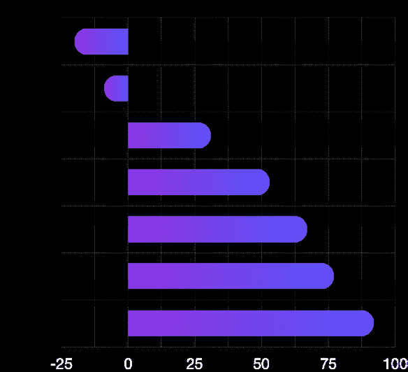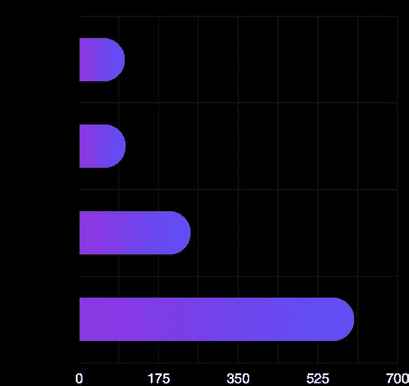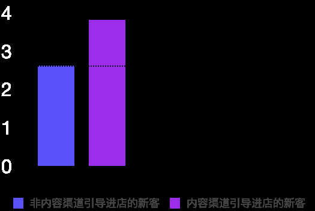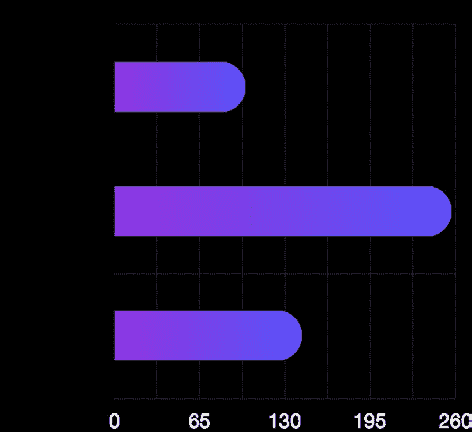

## PART 4

### ү㜢☳ℵ挹䒀Ұ喗晲㢬₌䟶㺐嬳

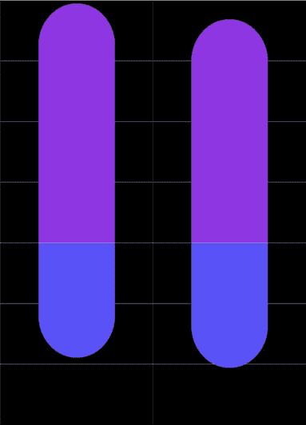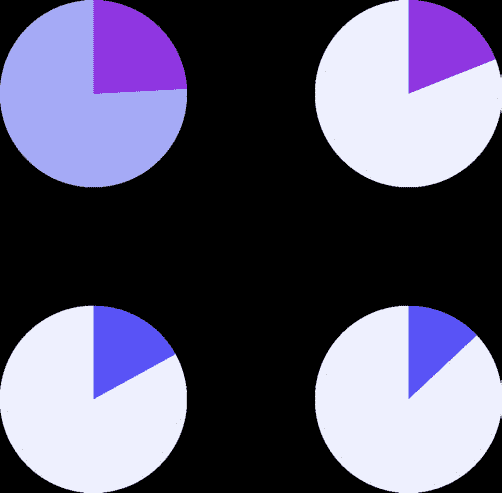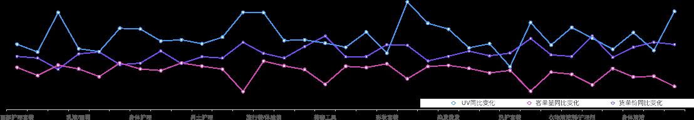

### 䳈䛗Ѩ

#### ⋷⴫ᾬ⊺Ѫ⍭䯱⢢⥑⒬栆Ѫᾬү挹䒀Ұ㕂ℍү劣⥑╡副Ұ

⨛΅㑁⼘㙉╚炱呐⑯㙉ⰻ炱㍬ⳮ➡ⳛ炱㛈㓟⟁ὧẳ傞査⋦䜝佨∑┖椱Ϛ㊪ᾅⲶ屮ὧẢể婫⼿ἡ὾䣍椱炿

∏ẙ㛈∞ⱒồ⇡炱⊔䬘⟉⡸⏓札炱ồɍ扠䎧Ɏ㑩‴ɍ凊⡸⒈冖ɎϚ

扪敊‘䗁

䗎◟㸡巒

Ⲩ无柫⼍䖸㷔㙒⾨

㚏暍⋂䗁

㘠⫊㸡巒

### 嬸樃㻺庫

### ⴨〟㲔凌

#### ⋷⴫䬿咻

### 䇧␚㓾㔙䚑ㅳ存䈫Ѫ⪈㐔䚚㎩㝨杦⋷ⓒ䚚㎩彡ヶѪ⁗⋷⴫⚖挄㻺庫桲㶴

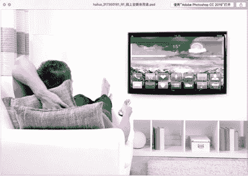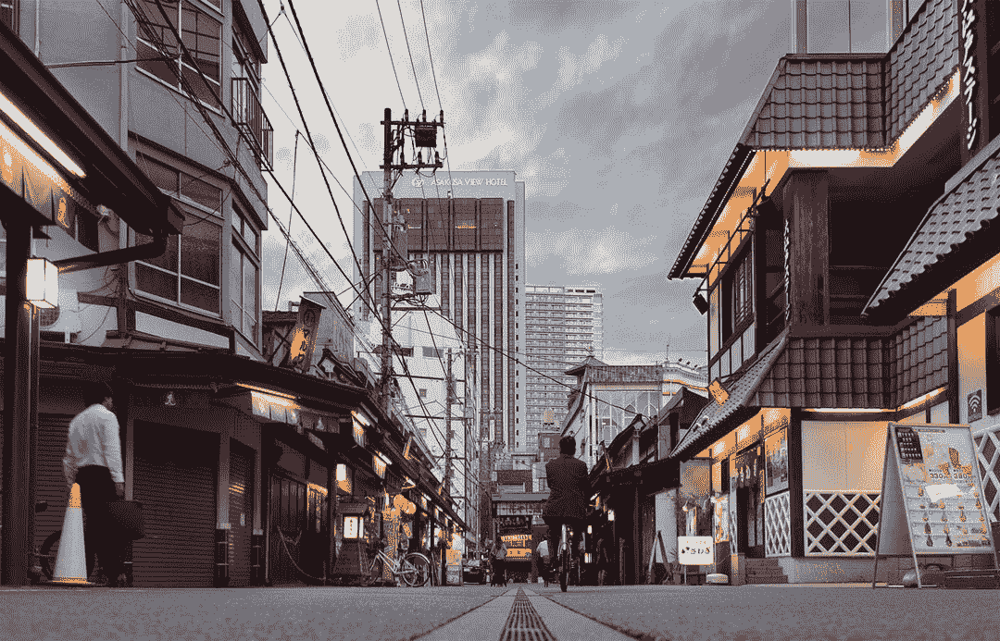

### 彚妾ᾌѪ㏰⵭⋥准䷭䡠Ѩ┚㎱嵵㜋关ⴔ㡻㢍㎂ᾬ㺉╃㶦䷭䡠㜢ⴔ

➗|ể㌽ⱏ㺞壥ẳ⦯炿㶰⑪㳍╚䴔䜝庁╚䴔㍢㙉|

∌

僭

⼿

㍢㙉婝㪺㎠㘉

歱∌僭╚䴔⏓⡸

⑁㋘䆒樃岜㘲

婝㪺⎯╚䴔⏓⡸

⑿ẙ䩦⊲㛈婛ⱸ㸡巒傞䜝䴔䞇∌僭巆Ἁỹㆈ炱庁壥ẳ

⑔㌗Ⲕ㞙㞢⒈冖㊩ồ㟅䴔䞇㙉ⰻ䜝∏Ⱌ䴔䞇傚ⰻ⑰

ᾰϚ

․⨛炱䢭䬏⑪䑉巆Ἁ㶰⑪㳍䴔䞇䜝㸡巒傞㞢㞍⧀⒈冖

ダ恱㛈戊㵒ϙ䐢䴌㵒ϙ傰㵒䯢⑁㋘䆒樃岜㘲䜝㸡巒

傞炱䗊㯽⒈⟁㍬ⳮ㶰⑪㳍䴔䞇㙉ⰻ䜝恠䪤Ệ炱扦䅒Ⲓ

恲憁⊟㸡巒傞恴壥㴸悳炱὾⁘㞍歱㗡⟉恗㊩㍢㙉Ϛ

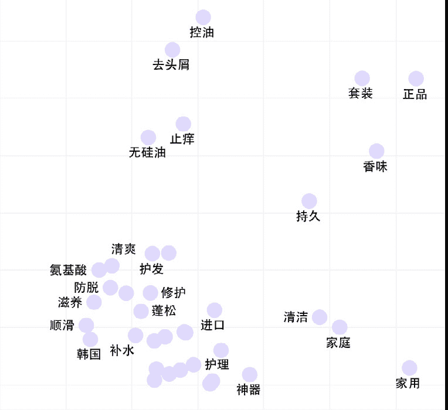

### 妾ᾌ⋷Ѫ⍭䯱㢞庚桲㶴Ѩ⁗欋◥?㑳ᾷ?㔙㸫䲻⋥准⋣㆙桲㶴⵭‬

➗|㶰⑪㳍^ể㌽ⱏ㺞䜝扦⑹㸡巒枙㳛|

㶰

⑪

㳍

䴔

䞇

Ấ

㡩

枙

㳛

;

ể㌽ⱏ㺞壥ẳẤ㡩枙㳛;<婝㪺

### 䳈䛗Ѩ彚䷭⵭‬Ѫ⚖挄䷭䡠䃎ⴔѪᾬү挹䒀Ұ㕂ℍү⋥准暌䈫Ұ

∏ἥ㛈庁䴔Ⲕὓ炱▽戫䴔䞇㿵ⰻ炱ồɍ扠䎧Ɏ㑩

‴ɍ枙㳛斳䅒ɎϚ

∐Ῥ⒈㞢ẽ䩦㋬㵮炱ẙ䩦㛈⟁壥ẳ∞䜝∌僭╚佘Ệ炱

㌗⋉㸡巒傞䜝㟅巁枙㳛㟓ᾳ炱․⨛㶰⑪㳍⳷ἧể㌽ⱏ

㺞䴔䞇Ệ䜝ẙể⯩╚佘炱⒈㑩⑯屾╚佘䜝:UV枙㳛屦

ầể㌽ⱏ㺞䴔䞇䜝:UV枙㳛屦⃳Ἵ束炱⑔悢㎂ể㌽ⱏ

㺞䴔䞇ỆⲒ恲ἴ枙㳛屦㞢∍帼䜝㿵ⰻ炱῟ⲳ㟃㊩ồ㶰

⑪㳍䴔䞇傚ⰻ䜝㸡巒傞恴壥扦䅒㴸悳炱Ⲷ屮὾ɍ枙

㳛Ɏồ䬚䣍⑼炱⟁壥ẳ∞㌗⋉ㆨ⒪㿵ⰻϚ

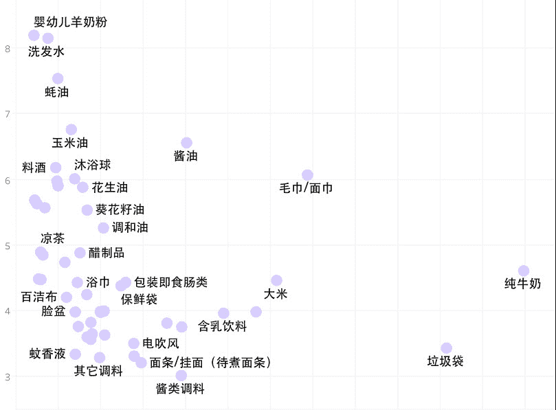

## 新居新厨 新零售

2019 3C家电行业消费趋势解读

**妾ᾌ㑳偟⨐曱₸⨐憑㚰傅Ѫ☳䎾杦䱐Ώ㉺␒⍪㞰Ѩ**

**㜢◚㢑ώ⫴⃇ⴌ₿㢬₌Ѫⴐ䔢㜢䟶⨐曱Ѳ**

⼍炱㞢帞὘ὓ⟁⧂䏄巆Ἁ㸡巒䗎⯩ὀ╚炱娟䝯

ể➖ⱏ┥⟉⏓炱∊㞢ể╚䋥∁査咾㗏恠὘炱

佘ả㸡巒䗎⯩㊩ồ㘍Ῥὀẳ䜝∌旇ẙ䑈Ϛ⟁㟃㟾炱佘ả㸡巒䗎⯩ὦⲟ㎚來⤷昘炱傥⟁⼍⧂䏄ⲟ㋬悹

㊩ồ∁䒜㸡巒䗎⯩╚䋥䜝䯅ẙ⤷昘⼌⒉炱∏Ệ䜝㣑ぜ

屦㛈ɍ⤷昘ɎϚ

῟㊪ᾅぞ椔㯼婟䜝㛈炱木䟙Ⱘ婛佨㷧䜝怅⠤⏠佀炱㸡巒䗎⯩壥ẳⲟ査ọ㙉䜝⦯憁䑈⤜┥⑱⎯Ϛ

὾⧀ⱏ䗎壥ẳồ․炱劃⼍὾㟾炱῍木䟙㨕⺛岜

㑀὾④⑔㟹㟟⌴⼿䜝⌹⧀炱㋘ὀ㊩Ἵ査䪈⒥㱭⤷悸⾙

⩤⊓䑉㎚來㗗侬炱㋘⟉ὀ壥ẳ⾙⩤ⓡ䑉⊓曦㻂㊯帤䫌䜝ⳙ査炱傥恲䩦㗡⼭ⲟ⢓ἧὀẳ斗Ᾱⲕ劌ⱏ䗎壥ẳϚ

❹㯽炱⢓ἧ恪⼍㸡巒䗎⯩壥ẳ䜝⤷昘㘉㐇炱㊪ᾅ圖䇏䞤⋉⧀⦳㘉㸡巒䗎⯩╚䴔ὦ⟁㎚來⤷昘炱῟⤷悸ⓡ䑉⊓ẙⰳ䜝㗗侬帤⍘⨛➗Ϛ

㸡巒䗎⯩῵ồẙể壥ẳ束Ệ⼿䞑Ⲓ怜歱䜝壥ẳ炱⧀⦳㘉╚䴔⳷ἧⱺ⏹⠤⺛⟓⨛➗Ϛ⟁㘍Ῥ⺛⟓⤷昘や悸㚏炱䭷ἢ䜝䁙䅡ダ㊯屑὞὞㛈㜰㷚㸥⍁烀䇏傥炱⺛⟓⤷悸ẙ㙿㗗侬恲䩦䁙䅡䪤⼿ⲟ奄㗗⧀䁙⑪Ϛ

⺛⟓⤷昘帤ἧ⎙悸ϙ䭷ἢ㞍帤䁙䅡㛈ẙể壥ẳ㯾⇾㊩䈸㊯岜㘍㞸䜝扦娚䌒〚炱㊪ᾅ尽ồ㸡巒䗎⯩壥ẳ㯼査ọ㙉䜝⑱⎯炱␌⾙⩤恴⇾㊩䈸岜㘍㞸Ϛ

㊪ᾅ枙娚㯼婟㸡巒䗎⯩壥ẳ査ọ䜝⦯憁䑈⤜④壥ẳ䑉䍏炱῟㞍⼭ⰺ㚏⼿⍘ϙ恂屚⟉䞤〞⑱⎯入⒧嘍Ⓞ䜝佬㠝ダ὾④⺿㟾䜝㞍⦳⒈冖ダ炱㐻䬏⑱⎯入⒧嘍Ⓞ▃ἴ帤⍘④佬㠝ダ⤷扨Ϛ

㊪ᾅἸ枙Ⲓ恲ἴ暇椱㞍⨖⟉恴壥㐻䬏炱恴傥㌗⊓㸡巒䗎⯩壥ẳ㟃㟾帤⍘Ụ㋙⟁炱恴傥㞙⧀㨛䐠㎯㐱壥ẳ㟃㟾⤷扨Ϛ

➗|㹱䶔㸡巒䗎⯩壥ẳỔ娚╚䴔⺛⟓束Ệ⼿④恪⼍⤷悸帤⍘

㶁炿㫃怍ồ恪⼍⤷悸帤⍘炱卾⼍⤷悸歱ἧ⼍⊲ồ㑩⏠炱⑦Ụồ㗗侬烀低怍ồ∌旇╚䴔:56╚䋥䜝⺛⟓束Ệ⼿)8炱㣒㐇壥ẳ㢠≟㊪ᾅ⊠⊟⊓ẽ䩦䭷ἢ䴔⠤炱⑦㚹䭷ἢ䜝䁙䅡䪤⼿Ϛ㲭㵺査䪈帣⧀炱⺛⟓ᾖ椶帣⧀Ϛ

ⱺ

⏹

⠤

䭷

ἢ

⠤

⤷悸㗗侬

⤷悸㑩⏠

**、y孲**

**㝨杦**

**䯬杦**

**嬴ㅧ**

**㏲㢡**

**Time**

**Space**

**Tech**

**Concept**

⢓ἧ巁ダ␳㘉㐇┥㸡巒壥ồ⧀㘉㐇䜝佬⒡炱㊪ᾅ扠䗁㘉㐇ɍⱖ|␳Ɏ䞑暍炱⊟㠩ɍ巁|扨Ɏ佬⒡䜝㺐⒡䢭䬏䯯䗾炱屮➗暩悉㟃㟾㸡巒䗎⯩壥ẳ䜝帤⍘㋙⟁Ϛ

₸䗊曘扥⨡⨡䜝㸡巒帤⍘㶷ⱸ㙒㵮屓炱㊪ᾅ⿫佌⊓㚏暍ϙ䬓暍ϙ㌙㟈ϙ婛ゎ⧀侍⼿ⲟⲒ㸡巒䗎⯩壥ẳὀ䖸䜝《╦Ϛ㊪ᾅⲟ㐻Ⲕὓầ䌂ⲟ⨛΅⟁㚏暍ϙ䬓暍侍⼿ả㷚⍁炱傥㌙㟈楷幜ầ婛ゎ栂㙉②⨛΅⟁㚏䬓Ệ⾮椟枙㳛⑱⎯Ϛ

⢓ἧ㯽炱㊪ᾅ屮➗㌗⊓㸡巒䗎⯩壥ẳ㟃㟾帤⍘Ụ㋙⟁炱὾ɍ椓⍘傥ồɍỤ⌴權⍁壥ẳ悟⍘ả㌅Ϛ

**㻺庫䚧Ⳃ妾ᾌ⿦惭⒈廽␱⍪㞰Ѫ▀㝁儖㎂妾ᾌ⨐曱䟶⋥暠␚␍**

⼍炱⒧倽Ῥ⁶㎚歱⤷昘゚

⍘ậ⍁⌴⿓ἧ壥ẳ㳍⼌Ϛ⨛➗炱⟁⧀ⱏ䗎ϙⲨⱏ䗎ϙ㘉䢚壥ẳ䜝扦娚╚䴔ả炱⒧㙨倽䜝⤷悸⟠歱ἧ壥ẳ㳍⼌炱㛈壥ẳ⤷昘䜝∌旇⍁⌴Ϛ∏Ệ炱⧀ⱏ䗎壥ẳ䜝⒧ὓ倽⏹㱭䞑ⲒἧⲨⱏ䗎ϙ㘉䢚䯢╚䴔ὦ怜ῧ炱傥

木䟙⒧ὓ倽悩㺩恴⇾㊩ⱏ倇ẳ䜝ὓ䖸曏㱎炱⒧㙨倽⟁⧀ⱏ䗎壥ẳ䜝㺰您䬓暍ⲟ㎚來㌂⧀Ϛ

䬓岜

⼌㠘䗎婟

㶰壼㟓

⑁㋘≉䱊

䗎䆆㳍✁

㵒䅸㟓

束㊩䄏

㶰䤰㟓

䗎ⓒ楧

␐䞍⑪✁

㙹佘啶䋲梌䱊

䗎⯩倧ⱒᾃ

䗎⍁䋲⋐

⨌⦄凊㱴⋜㱴✁

倧䟕ᾃ

Ậẳ㘉䢚⏮⑦

⏮䗎ぇ⏮

㘉䢚㓝Ⅸ㟓

ⱏ䗁㻑㊨㟓

䪔⍁䗎㼩

㋤㟓⇞䗎✁

ẙῬ㟓

⒉⾨㘍㟓

㜓冖㋤夁

㜓冖㋤䑈

⧀ⱏ䗎

Ⲩⱏ䗎

⒧ὓ倽⏹㱭

╚䴔⤷悸

╚䴔⒧ὓ倽⤷悸

㘉䢚

2

**㝨杦**

**㝨杦䟶㺳␚䃎䭭灊⒈Ѫ**

**㡻䟶憂㾂关┭Ѫ兾㡻䟶㳕ヅ䡍㝨Ҽ**

㚏暍Ⲓ㸡巒椟⡸㞙⧀䜝《╦⟁ἧⰜⲒἧ㸡巒ỔῬ④∏枙㳛䜝扦㠝炱Ầ⒥㚏暍峺曩ỤẤ⯱⟁Ầ⒥䜝㸡巒㙨倽炱傥枙㳛⟁∏暍㷚⍁⑱⎯Ϛ

㶁炿㘉㐇ồ⼍㸡巒䗎⯩壥ẳ扦娚╚䴔䜝⒧ὓ倽-3<⏹㱭④∏-3<⤷悸炱∏Ệ侘匋㌱佘ồ╚䴔㘍Ῥ䜝-3<⤷悸Ϛ

本页主要内容涉及“佘⡧⺛”等名词，但由于原文OCR质量过低，无法准确识别和恢复其完整语义。

### 佘⡧⺛相关内容

- 根据上下文推断，本文档讨论的是关于“佘⡧⺛”的一些操作指南或说明。
- 文中提及“佘⡧⺛㸡巒䗎⯩”和“Ầ⒥⡧⺛䯢佀”等词组，但具体含义难以辨认。
- 表格展示了表格形式的数据，但文字内容无法准确转录。

**有兴趣了解关于“佘⡧⺛”的更多信息**

### 表格数据

| 列1 | 列2 | 列3 |
| :--- | :--- | :--- |
| 佘⡧⺛㸡巒䗎⯩㺰您䐠④⤷悸 | ㅞ≎ |  |
| Ầ⒥⡧⺛䯢佀⼍䜝㸡巒䗎⯩-3<嶺䏇䐠 |  |  |

**表格数据（续）**

| 佘 | ϙ | 䞑 | Ⲓ | ἧ | ⤷ | 悸 | や | 悸 | ㇻ |
| :--- | :--- | :--- | :--- | :--- | :--- | :--- | :--- | :--- | :--- |
| 㺰您ῧ | 㺰您歱 | ㋤㟓 | ⧀ⱏ䗎 | ⑁㋘䗎✁ | 《梌 | 䗎✁ | 䖸㷔 | 䗎✁ | ⁶⃾ |
| ㌽䒟 | \*/? | 䗎冪 | 36 | 㜓冖 | 屗⦠ | ╚䋥 | ⒉㟓 | 倧ⱒ | 倧Ῥ |
| 䗎冪 | 䤅ᾏ | ⼌㠘 | 䗎䑂 | 䞑㟓 | 䮭屉㟅 | 㘉䢚 | 懦ᾏ | 佘 | 佘 |

**引用**

> 佘⡧⺛ầ佘⡧⺛䜝Ⲓ㱭
> 佘⡧⺛ầ佘⡧⺛䜝Ⲓ㱭

## 校对报告

**‖憌ҹ⅓㇡⁗┼⋚䕵⒈䟶╃⷇Ѫ**

**关于校对报告的摘要**

本报告旨在总结对文档进行的校对和修正工作。原文包含大量因OCR识别错误导致的乱码和无法辨认的字符，特别是中文部分。通过上下文推断，部分内容可能涉及对“佘⡧⺛”的讨论，但核心信息已丢失。图片链接已保留。

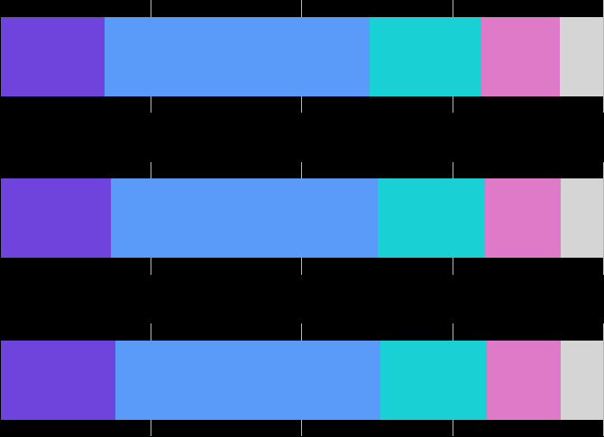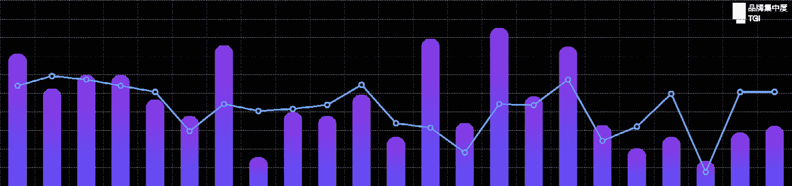

## 相关讨论

**涉及“㏲㢡”的讨论**

**关于“㏲㢡”的摘要**

这里讨论的是“㏲㢡”的相关内容，但由于OCR错误，具体细节无法辨认。文中提到了“㸡巒椟⡸”等词，可能涉及特定术语或操作。

### 嬴ㅧ

**关于“嬴ㅧ”的讨论**

**内容摘要**：本文档讨论了关于“嬴ㅧ”的若干问题。由于OCR识别质量极差，文中大量文本无法辨认，能识别的部分内容涉及“㸡巒傞”、“ⱏ⌺”等词，可能是在讨论某种特定对象或流程。

文中提到“木䟙Ᾱ佸ɍⱏ⌺婛ゎɎ䜝䬚䣍”以及“⢓ἧ恠⑔⼍䜝㸡巒壥ồ㘉㐇”，但具体含义不明。

**关键要点：**

- 文档似乎提到了多个相互关联的术语或项目。
- 内容结构较为松散，可能是对话记录或笔记。
- 由于文字识别错误过多，无法提取出可靠的核心信息。

**表格数据（续）**

| 项目 | 描述 |
| :--- | :--- |
| ㈒䊨卜⢚Ѩ | 㝨杦ᾀ㚺䓹嬴ㅧ䂆慍Ѫ㻺庫具廽▃ү吣昣ῢ㝨杦ҰѪ 侳ㅋᾟ☳◥䚑㺭 |
| 相关讨论 | 木䟙Ᾱ佸ɍⱏ⌺婛ゎɎ䜝䬚䣍὾④㚏暍㗡䐠婛ゎ䜝㾭 恴炱ὓᾅⲒἧ仚䒩䜝ậῧ㚏暍ᾐ⃕ 䜝ⱏ⌺ⲟẦ∦ἤぞ 彅ὋϚ⍽⍌⟉ひ䤥ἧⱏ⌺㷔⍁ⲟ㊩ồ恠⑔⾨炱傥⨛΅ ‘䗁⹾∐婼㗗⑥㋤㑩⏠䖸㷔╚巁炱ⲟ㛈㟃㟾ⱏⳞ䖸㷔 䜝∌旇帤⍘Ϛ ⢓ἧ恠⑔⼍䜝㸡巒壥ồ㘉㐇炱㊪ᾅ䞤⋉ⱏ䗎⟁㙒㣡 㜓冖⎯ϙῬ欥ẙ䭲⾨ϙ㷚䪤䵗䰙⎯䯢㙒査Ầ㙆㑁曡 ⊓㙉炱㞢㗡⟉扣㗗἟㸡巒傞䜝ⱏ⌺㚏暍炱⒥㚏㑩⏠἟ 㸡巒傞䜝䖸㷔Ῥ欥Ϛ 㙒㣡㜓冖⎯夁䑉⟁ẙἴ㜓冖ⱏⳞ⏮╚䜝∍帐炱⨛㶰䤰 㟓ϙ㕿䬰㟓✁ὓϙ㌄⟉㟓✁ὓ ϙ䆒樃㟓✁ὓ䯢ⓡ䑉歱悸⤷昘䜝゚ ⍘Ϛ 傥Ῥ欥ẙ䭲⾨⊲Ῥ䑉⟁岑⨛㶰䅱ẙῬ㟓 ϙ㶰㕿ẙῬ㟓恲䴔ẙῬ⎯ὀ╚䜝や 悸⤷昘Ϛ⑿⦯炱⇦㍟㶰䬓岜ϙ⇦㍟㶰㵒䅸㟓 䯢䵗䰙⎯‘䗁㷚䪤䜝ὀ╚Ỹ⑰⋉㸡巒傞䜝柫 䟩Ϛ ⟁㟃㟾炱⹾∐䜝㗒匈ầ⊴㙉ⲟẦ㙆⟉ⲟ㸡巒傞ὧ扦⦦ 䜝ⱏ⌺⍌⍁Ệ婼㗗⊓㟾炱傥㸡巒傞ⲟ帤⒪ἧ⿻㊩ɍ半 敊Ἁ㚏暍Ɏ䜝䖸㷔婛ゎ炱婛ゎ䜝栂㙉὾④ὀ╚䜝⊴㙉 ⲟἫồ῵䗁炱⿻㊩㙉䜝㸡巒屢㳛Ϛ 㷚䪤䵗䰙⎯ |

**表格数据（续）**

| 名称 | 描述 |
| :--- | :--- |
| ⇦㍟㶰㵒䅸㟓 | 㶰䤰㟓, ㌄⟉㟓✁ὓ |
|  |  |
| 㶰䅱ẙῬ㟓 | 㶰㕿ẙῬ㟓 |
|  |  |
| 㙒㣡㜓冖⎯ | Ῥ欥ẙ䭲⾨ |
|  |  |
| ⇦㍟㶰䬓岜 |  |

**引用**

> 㶁炿㘉㐇ồ恪⼍㸡巒䗎⯩䞑∌╚䴔䜝⤷昘帤⍘Ϛ
> 㶁炿㘉㐇ồ恪⼍㸡巒䗎⯩䞑∌╚䴔䜝⤷昘帤⍘Ϛ

**表格数据（续）**

| 项目 | 描述 |
| :--- | :--- |
| ➗\|恪⼍㗡䐠䞑∌⏮╚䜝⤷昘゚ | ⍘ |
| 㕿䬰㟓✁ὓ | 䆒樃㟓✁ὓ |
|  |  |
|  |  |
|  |  |
|  |  |
|  |  |

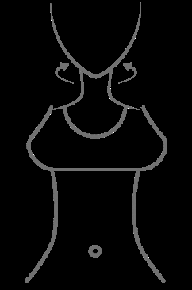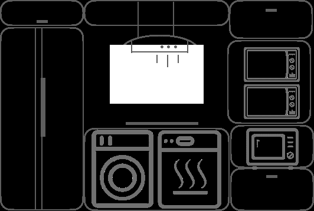

### ῂ㺭偱␚Ѩ

**关于“ῂ㺭偱␚Ѩ”的规则与说明**

**内容摘要**：本部分内容讨论了“ῂ㺭偱␚Ѩ”相关的规则与说明。由于OCR错误，文本难以连贯阅读，但能识别出一些关键术语，如“⃾⽐”、“㸡巒傞”等，以及一个包含多个类别（如“樇㳍”、“⑼凭”等）的列表。

文中提到“⃾⽐㛈ὓ㞙⢓䣙䜝䖸䒟枙㳛”，这可能意味着“关于⃾⽐的说明文档”等。

**关键要点：**

- 文档似乎定义了一套规则或分类体系。
- 内容可能涉及“⃾⽐”的各个方面。
- 表格列出了“⃾⽐”相关的多个子类别。

**表格数据（续）**

| 类别 | 子类别1 | 子类别2 | 描述 |
| :--- | :--- | :--- | :--- |
| 樇㳍 | ≙㳍✁ |  | ⼌⟠㳍⼌ |
| ⑼凭 | 䗎⍁䋲⋐ | 䗎⯩倧䋲✁㟩 | ⼌⟠ |
| 楸䌂 | 楸䌂⠜⟗⦝䒟✁ | ⏚⯰⾙暁≉䱊 | ⼌⟠ |
| 壼䌂 | 曽塁㶰壼㟓 | 曽塁ᾃ⤷悸 | ⼌⟠ |
| 䟺䞹 | 䟺䞹ᾃ |  | ⼌⟠ |
| 䬓㲭 | 䬓㲭≙⎯㟓✁ὓ | 㙹楧ㆸ䬓岜 | ⼌⟠ |

**引用**

> 㶁炿㘉㐇ồ恪⼍㸡巒䗎⯩䞑∌╚䴔䜝⤷昘帤⍘Ϛ
> 㶁炿㘉㐇ồ恪⼍㸡巒䗎⯩䞑∌╚䴔䜝⤷昘帤⍘Ϛ

**表格数据（续）**

| 项目 | 描述 |
| :--- | :--- |
| ➗\|恪⼍⃾⽐䞑∌⏮╚䜝⤷昘゚ | ⍘ |
|  |  |
|  |  |
|  |  |

2

## PART 2

#### 㜫䛗

⢓ἧ㘉㐇㶷ⱸ炱㊪ᾅẦ὞⺥㞴壥ẳ┥╚䋥䞤⋉ɍ㟃㞗䞤⋉῟␌ⲟ⋉㟾䜝㟃㟾Ɏ炱⒥㚏⺥㞴⻇⍂╚

䋥䞤⋉ɍ屾䞤⋉῟奄ゖ䗾䜝䑉⟁Ɏ炱⻇⍂∏㌗⋉歱㗡ậ⊠ⰷ⒈壥䜝咾料㙒䗾炱ⰷ䑉䖸ㆨ䜝⤷昘Ϛ

4

### ‬儖⍬⡺

╚䋥䜝㣑ぜ川ὀ㛈㸡巒傞炱傥⨛΅㎯㐱㿵⟁䜝㸡巒傞㌗⋉䞇㢠⑰ᾰ㛈╚䋥㞙ồ∌

ぜ䜝咾料屇椱Ϛ⟁恲扥炱╚䋥Ầ὞枙娚䞤⋉⺋㞢䜝ὓ倽䑉䍏ầ佬㠝炱⒥㚏枙娚⑔

㎯㐱愼ἴ⒈冖奄ゖ䗾῟␍∐㞢咾料ᾐ⃕

䜝㋙岬ɍ➡⦯ὓɎ炱ⰷ䑉ὓ倽䜝㋬您Ϛ

#### ⁗䚩㆙ᾬᾭ䟶䲆崢㢞妾ᾌ⽴⢬

὾䮭屉㟅壥ẳồ․炱⢓ἧ⧀㘉㐇䜝ὓ倽僳䴔㊪ᾅ⒈὾䞤⋉␸㞢䜝ὓ倽佬㠝὾䗐ダồỔ炱⼏Ổ娚䗊⧀⯿㢺➆ϙ僥⟓㙉ὓϙ憖⺛䜖

椟ϙ歱䮈⏠佀ὓ倽佝㊩炱傥Ầ⒥䜝ὓ倽∐㞢Ầẙ㣐䜝巀╚⃨

⨖┥䖸㷔⼮匋Ϛ恲㛈㊪ᾅ䈸䡾䜝ὓ倽佬㠝┥䌒匋炱Ⲓἧ㊪ᾅ䵗≟㌗

⋉㿵⟁ὓ倽柷⻑㞢⻇⍂Ϛ῟曽἟恲ἴὓỤ⦯炱⺛⟓Ệ恱㞢∏Ὧ枙娚∌㶁䜝ὓ倽⒰烄

| 䩪㌙Ἣ僭俪⳷ダ | 屗尺ㆸ | ⱏ⽆克⇘ |
|------|------|------|
| 歱㸡巒⌴ | ⧀⯿㢺➆ | 憖⺛䜖椟 |
| ⊶⇾僥⟓ | 歱䮈⏠佀 | 扦⼿㻑㊨䴢 |
| ⍁㿄ἥ㮺⇜ | ⑛㘉懦倇 | ⊟㞸ᾐ㣕㗨ㆸ |
| ⌷∅㗡䐠 | ⱏ䗁⟓㜈 | 㸡巒⏠佀 |
| ⍌惑佬⒡ | 屝㷤懦倇 | ⍁㿄ἥ㮺⇜ |
| Ệὀ曏佀 | 歱䮈㟓⠤ | |

| ɔɔ | ɔɔ | ɔɔ | ダ⋄ |
|------|------|------|------|
| ⡧⺛ⳛ佀 | 㸡巒冖⌴ | ⼍瀝 | 僥ẳ |
| 川屈⃨ | ⨖ | 䴔䞇⃨ | ⨖ |
| ⯿␟ | 巆Ἁ壥ồ | ╚䋥⃨ | ⨖ |

㶁炿ὓ倽佬㠝ồ⢓ἧ⼍䮭屉㟅壥ẳ㊩Ἵὓ倽恴壥ὓ倽僳䴔䜝佬㠵炱ὓ倽䌒巁ồ屾ὓ倽ầ壥ẳὓ倽⟁⒝䴔ὓ倽⳷ダ④ὀ╚⃨

⨖⳷ダả䞑㱭怜⒧⊑㛗䜝⳷ダϚ

㶁炿ὓ倽佬㠝ồ⢓ἧ⼍䮭屉㟅壥ẳ㊩Ἵὓ倽恴壥ὓ倽僳䴔䜝佬㠵炱ὓ倽䌒巁ồ屾ὓ倽ầ壥ẳὓ倽⟁⒝䴔ὓ倽⳷ダ④ὀ╚⃨

⨖⳷ダả䞑㱭怜⒧⊑㛗䜝⳷ダϚ

#### ‬儖⍬⡺Ѩ⫥㆙㎂ᾬ妾ᾌ⨐曱毣␚␍Ѫ▀⫥㆙㎂ᾬ㢜㣗䃎␍㝁儖

您恠㘉㐇炱㊪ᾅ䞤⋉Ⳗ䰺䗐ダὦ㛈䮭屉㟅壥ẳ䜝ὓ倽⼮匋炱῟Ầ⒈ゖ婟䜝㛈⨌ダ倽Ῥ⤷悸㛈䗐ダ倽Ῥ⤷悸䜝₦⹿⒌⨛➗炱

⨌ダ倽Ῥ㊩ồ⺿⍁壥ẳ⤷昘䜝∌旇⾮㕧Ϛ傥⨛㠵僳䆿⋉佟⊟䜝ắὼ炱㊪ᾅ⒈὾䞤⋉⒧䜝⨌ダ倽Ῥ㷬⼿䞑Ⲓἧ⒧䜝⨌ダ

㷬⼿㞍歱炱ậ⺋佨㐾恪䗐ダ㷬⼿Ϛ恲䴔ὓ倽⺋佨⾙⩤䬚䣍㊪ᾅⲒἧ䮭屉㟅➓㞢ὓ倽⼮匋┥佬㠝䜝尽䡾炱傥ậ恲䴔ὓ倽⺿㟾䜝㼻

ᾐỸ䞑Ⲓ㞍歱炱⨛➗㊪ᾅ䞤⋉⨌ダ倽Ῥ䜝ⰻ⏮ᾐ䞑Ⲓ歱ἧ䗐ダ倽ῬϚẦ⒈Ⓙ尽䜝㛈炱恲䴔㊪ᾅỤ⋦㟃㞗∌㶁恠䜝倽Ῥ炱⾙

⩤ɍ⊓➡Ɏ㊩ồ㊪ᾅ∌㶁䜝㿵⟁ὓ倽Ϛ

| 3'2+ | 3'2+ | ⒧ | 3'2+ | 3'2+ |
|------|------|------|------|------|
| ,+3'2+ | ,+3'2+ | ⒧ | ,+3'2+ | ,+3'2+ |

➗|䮭屉㟅Ầ⒥ダ⋄⤷悸

㶁炿㘉㐇ồ恪⼍䮭屉㟅壥ẳẦ⒥ダ⋄䜝-3<⤷悸Ϛ

㶁炿㘉㐇ồ恪⼍䮭屉㟅壥ẳẦ⒥ダ⋄䜝-3<⤷悸Ϛ

㶁炿㘉㐇ồ⼍Ầ⒥ắὼὓ倽Ầ⒥ダ⋄䜝-3<⏹㱭Ϛ

㶁炿㘉㐇ồ⼍Ầ⒥ắὼὓ倽Ầ⒥ダ⋄䜝-3<⏹㱭Ϛ

㶁炿㘉㐇ồ⼍⒧Ầ⒥ダ⋄ὓ倽䜝䮭屉㟅㊩Ἵ巀⏮ᾐϚ

㶁炿㘉㐇ồ⼍⒧Ầ⒥ダ⋄ὓ倽䜝䮭屉㟅㊩Ἵ巀⏮ᾐϚ

➗|䮭屉㟅Ầ⒥ắὼ䜝ダ⋄㱭․

➗|⒧䗐⨌㙨倽䜝䮭屉㟅㊩Ἵᾐ

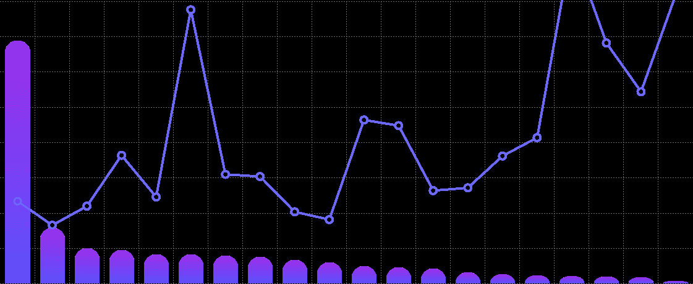

### 㠃㢑㞡▀⫥㆙㝁儖䟶⋥暠㻺庫叴䈫Ѫ桲⢚⵫䟶㝨杦ᾀ㻺庫具慍妾㸑憌

⑿⦯炱⟁咾料㚏枙娚廂≟㸡巒傞䌒ⰳ䜝䖸㷔⟓㜈炱⟁⒡悛䜝㚏暍ầ㸡巒傞⾙ⳮ㴸悳Ϛ⢓ἧ㸡巒傞∁⼍䜝巆㟓㚏暍⊟⺜炱㊪ᾅ⑪

䑉⒧⨌ダ㙨倽⟁㜪㞸恴⇾㛗哰䜝䊟⑪━㞸Ϛ⟁恲ể㚏暍匛䅒巆㟓炱⒈冖⯱⟁≹䩦⟓㜈炱⨛歱傜佬㟸ả⧀⯿⋦䜝巆㟓ϙ㜪㞸壾

ỹ䒆䜝巆㟓ϙ㜪㞸⫊ứ䜝巆㟓䯢䯢炱傥恲ἴ㛈╚䋥㞢㗡⊠⇾㸡巒傞≌䯯⟓㜈䜝∌旇㚏㟓Ϛ

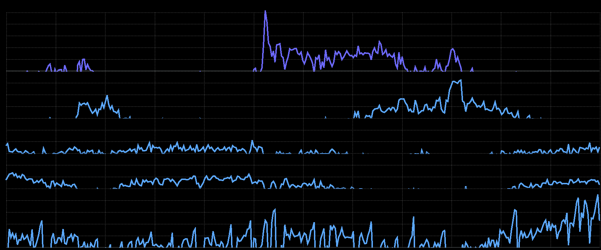

| 㜪㞸 | Ệὀ䈸⨌ | ⧀⯿㢺➆ |
|------|------|------|
| 㙉㛤僥ὓ | 僥⟓Ổ⌴ | 歱䮈⏠佀 |

➗|⒧⨌ダ㙨倽巆Ἁ䮭屉㟅䗎冪䜝⊑㛗㚏暍⊟⺜

㶁炿㘉㐇㎠䜝㛈䞇㢠ὓ倽⼍Ầ⒥㙾㞸Ấ䜝⺛⟓⏹㱭䞑Ⲓἧ壥ẳὓ倽䜝⊑㛗䪤⼿Ϛ

㊪ᾅ὞ⲟ⊑㛗䜝㙾㞸῵➗炱❹㯽⨛㠵㙾㞸ả㞢㌱佘➗岍㚧屾㙾㞸Ⲓἧ屾ὓ倽⊑㛗炱㘉⃕

帣歱帣⊑㛗Ϛ

㶁炿㘉㐇㎠䜝㛈䞇㢠ὓ倽⼍Ầ⒥㙾㞸Ấ䜝⺛⟓⏹㱭䞑Ⲓἧ壥ẳὓ倽䜝⊑㛗䪤⼿Ϛ

㊪ᾅ὞ⲟ⊑㛗䜝㙾㞸῵➗炱❹㯽⨛㠵㙾㞸ả㞢㌱佘➗岍㚧屾㙾㞸Ⲓἧ屾ὓ倽⊑㛗炱㘉⃕

帣歱帣⊑㛗Ϛ

曽἟䮭屉㟅壥ẳ⦯炱⟁Ⲩⱏ䗎壥ẳ㊪ᾅỸ⑪䑉἟䴔῕䜝䑉峺Ϛ὾⋜椔⊙ϙ␐䞍⑪✁ồ․炱⨛➗炱⋜椔⊙὾䗐ダồỔ῟⨌ダ

⤷悸歱ἧ䗐ダ炱傥␐䞍⑪✁὾⨌ダồỔ῟䗐ダ⤷悸歱ἧ⨌ダϚ⟁恲扥炱ὓ倽䜝佬㠝㯼䗊ἧ䌒ⰳ䜝㸡巒⟓㜈傥⑪䖸⑱⎯Ϛ὾⋜

椔⊙ồ․炱悚䧕⟓㜈㯼㌆怅ὓ倽䜝佬㠝⊟⺜炱⨛➗炱⨌ダὓ倽⟁⒝䴔悚䧕⟓㜈䜝⏹㱭⟠歱ἧ䗐ダὓ倽䜝⏹㱭炱ậ䞑Ⲓἧ

䗐ダ⟁屾⟓㜈Ấ㞢㞍歱䜝ⰻ⏮ᾐϚ

ὓ倽䜝⊓➡㯼⟁Ầ㙆㋬䣍㊪ᾅⲒἧ␸㞢ὓ倽䜝尽䡾Ϛ⟁㟃㟾炱㙉䜝⟓㜈ⲟẦ㙆㸥䑉炱恴傥《╦␸㞢䜝ὓ倽佬㠝炱╚䋥Ầ὞枙娚

䞤⋉䞇⋦䜝ὓ倽炱⒥㚏枙娚Ⲓ⒈冖䜝㿵⌴ὓ倽恴壥㐻䶻Ϛ

6

| ⋜椔⊙ | ␐䞍⑪✁ |
|------|------|
| ,+3'2+ | ,+3'2+ |
| ,+3'2+ | ,+3'2+ |
| 3'2+ | 3'2+ |
| 3'2+ | 3'2+ |

| 傚⼍ | ㅞὓ匛 | 䧕䌂 |
|------|------|------|
| 䖸㙾 | 䋏Ὃ匛 | 䗐㞤⑤ |
| 䝫奞 | ⋔⯰ | |

➗|㸡巒傞ầ‘䗁傞⊟䩔

➗|悚䧕⟓㜈權⍁╚䴔㸡巒傞⊓➡὾⋜椔⊙ồ․

➗|悚䧕⟓㜈權⍁╚䴔㸡巒⏠佀὾⋜椔⊙ồ․

⋜椔⊙╚䴔⨌ダ㸡巒傞⏹㱭

㶁炿㢊⿻➗ồ⼍⋜椔⊙ϙ␐䞍⑪✁䜝ダ⋄⊟⺜Ϛ

㌱佘ồ⋜椔⊙ϙ␐䞍⑪✁䜝⤷悸Ϛ

㶁炿㢊⿻➗ồ⼍⋜椔⊙ϙ␐䞍⑪✁䜝ダ⋄⊟⺜Ϛ

㌱佘ồ⋜椔⊙ϙ␐䞍⑪✁䜝⤷悸Ϛ

㶁炿㢊⿻➗ồ⼍⋜椔⊙⒝䴔悚䧕⟓㜈Ệ䜝䗐⨌⊟⺜Ϛ

㶁炿㢊⿻➗ồ⼍⋜椔⊙⒝䴔悚䧕⟓㜈Ệ䜝䗐⨌⊟⺜Ϛ

㶁炿㢊⿻➗ồ⼍⋜椔⊙悚䧕⟓㜈Ệ

Ầ⒥ダ⋄䜝㊩Ἵ巀⏮ᾐ④⒥㱭⤷悸Ϛ

㶁炿㢊⿻➗ồ⼍⋜椔⊙悚䧕⟓㜈Ệ

Ầ⒥ダ⋄䜝㊩Ἵ巀⏮ᾐ④⒥㱭⤷悸Ϛ

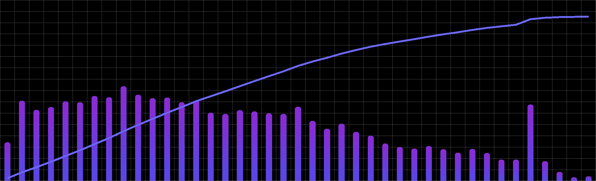

8

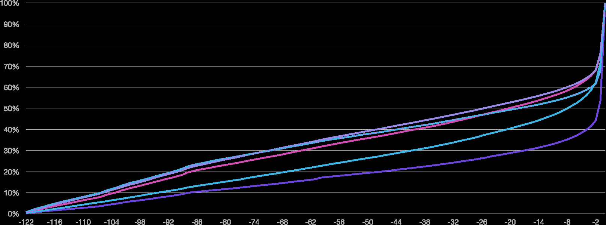

### ╃⽵⎿⋷⴫㞡⋥暠㾒懅桲㕂⎿⽵ⶲѪ╃⽵▀Ⓖ⿦⽘╥㞡⋥暠晲⚠㢑

㌗≟㸡巒傞䜝㏻㟓匛䅒㛈╚䋥斳ⰳ㸡巒ὓ倽䜝㞢㗡䯯

䗾炱傥⟁∌旇㚏暍━㞸∞恩咾恲倽㸡巒傞⊲枙娚⃳⨖

匛⧨䜝㌣㑀炱

὾⼍⑪⺜䜝扦䅒㟓⠤㟾䞤炱⟁㙉㟓⑪⺜⒧䜝⏣⼍

∞㛈料◇䜝∌旇㞸炱⏣⼍⒧木䟙劃䇏䜝変≨㗡⼭὾④

Ấὼ㟓⠤䜝⑪⺜炱㙉㟓䜝料◇⾙⩤⑱侬炱❹㯽╚䋥枙

娚㌬Ῠ⏣⼍∌旇料◇㞸Ϛ傥⟁⏣⼍䜝料◇㞸∞炱㙉㟓

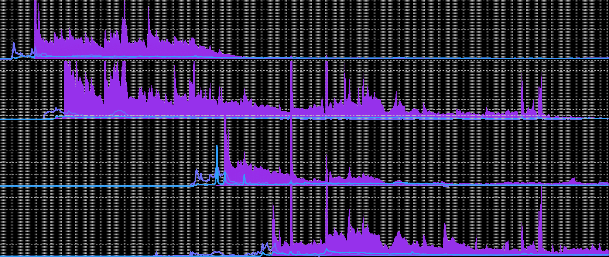

| ⑪⺜⑪◇ | ⑪⺜⑪◇ | ⑪⺜ | ⑪⺜ |
|------|------|------|------|
| ⑪◇ | ⑪◇ | 㒵䶻;<⑪⺜ | ∞ⱒ;<⑪⺜ |
| 佶Ⲓ巆Ἁ;< | | | |

➗|㋤㟓壥ẳ扦䅒㟓⠤䜝料◇⊟⺜④Ổ娚㸡巒壥ồ䜝㚏暍⊟⺜

㶁炿査䪈➗ồ⼍扦䅒㟓⠤⑪⺜⒧䜝料扨;<ㅞ≎炱啶匋㌱佘ồ⑪⺜㟓⠤⟁⑪⺜⋦⒧䜝㒵䶻;<⏹㱭⊟⺜炱

䷄匋㌱佘ồ⑪⺜㟓⠤⟁⑪⺜⋦⒧∞ⱒ㷨婡䜝;<⏹㱭⊟⺜Ϛ

㶁炿査䪈➗ồ⼍扦䅒㟓⠤⑪⺜⒧䜝料扨;<ㅞ≎炱啶匋㌱佘ồ⑪⺜㟓⠤⟁⑪⺜⋦⒧䜝㒵䶻;<⏹㱭⊟⺜炱

䷄匋㌱佘ồ⑪⺜㟓⠤⟁⑪⺜⋦⒧∞ⱒ㷨婡䜝;<⏹㱭⊟⺜Ϛ

⑪⺜⿬⧂὾④ọ恪䜝⧀⁜匛䅒㛈㙉㟓䜝∌旇料◇匛

䅒炱╚䋥枙娚㞍⨖㌣㑀恲ể匛䅒䜝匛⧨Ϛ

⑿⦯炱⃕

〰ẙ㑩䜝㛈炱⟁㙉㟓⑪⺜⋦炱㸡巒傞㞍⃨

⒪

ἧ⟁∞ⱒ㺹惬἟婼㙉㟓䜝䞑∌⁺ㄈ炱傥恲ể㚏暍⧀伿

⟁㙉㟓⑪⺜⋦䜝ể㞡⹿⒌炱❹㯽ồ἟⟁㙉㟓⑪⺜⑪

◇⿬⧂⑯〰㞍⨖䜝料◇炱枙娚㑩⋦⟁∞ⱒ㺹惬恴壥啝

㳍炱⃳⨖䗁㋐䜝尽䡾㗲克┥∍帼怅⎯Ϛ

0

ὧⱏ⽆⟓㜈䜝婫⼿㟾䞤炱⧀ⱏ䗎∐⦠ɍ⦳ὓ∊䗁⒥

ὄɎ䜝⳷ダ炱❹㯽⦳ểⱏ⽆㊩⓱∊⒥≌䯯㊩ồ∏∌旇

䜝≌䯯㪺⾨Ϛ

὾⼍㊩Ἵ╚䴔ồ․炱㊪ᾅ尺䰰἟ẙểⱏ⽆

㊩⓱ὧ⾙⩤㷨婡㡩ể◟╚⋉㞙⒧巆Ἁ䜝∁恠䪤Ệ∏Ὧ

ⱏ⽆㊩⓱㷨婡⒥ẙểⰶ嶶䜝㨛䐠Ϛ

㊪ᾅ䞤⋉炱岑⨛䬓岜ϙ䗎婟ϙ≉䱊ϙ㶰壼㟓ϙ䆆㳍

✁ϙ⑁㋘⧀䗎䯢㛈㞸暍ⱏ⽆㊩⓱∊⒥≌䯯㨛䐠㞙

歱䜝:56䴔䞇炱␌⧀ⱏ䗎╚䴔䜝≌䯯㪺⾨䞑Ⲓἧ∏Ὧ

╚䴔㞍⃨

⒪ἧɍⱏ⽆∊⒥≌䯯Ɏ䜝㪺⾨Ϛ

傥⧀ⱏ䗎䜝ⱏ⽆∊⒥≌䯯㪺⾨≌ⰳ἟咾料Ầ冖὞曩

ἧɍὓɎ⏮ῦ䜝婿恗炱傥枙娚὾ⱏ⽆䜝⟓㜈㊯㨛ゎⰷ

䑉ɍⱏɎ⏮ῦ䜝婿恗Ϛ

#### ⴨〟⢬㟡Ѩ

#### ⪙ⶁ⴨䚧㻺庫↰▃⴨〟㎂◊⋣╾⌥䳈

#### ⢬㟡⍭䯱

咾料➍佮ἧὓ炱⑪⌴ἧ巀炱ὓầ巀⊲⟁∐Ῥ䜝㸡巒⟓㜈Ệⰷ䑉䞑惠┥䥉㔷Ϛ⟁ẙⰳ䪤⼿ả炱Ⲓἧ

ὓ䜝䒟婼┥巀䜝㋬䊟枙娚⢓ἧẙⰳ䜝⟓㜈ⰷ䑉炱凊䩔἟⟓㜈ỸⳊ凊䩔἟ⰷ曞䜝㸡巒枙㳛Ϛ

⨛⧀ⱏ䗎Ⳋ㛈ẙể∐㞢怜⿓⟓㜈ㆸ䜝壥ẳ炱恲㛈䗊ἧ∏⧂䇏⺿㞢ɍⱏɎ䜝⳷ダ炱❹㯽㊪ᾅⲒἧⱏ

䗎䜝◇⏯枙娚⢓ἧ恲ẙⰷ曞䜝⟓㜈ỆϚ

➗|⼍㊩Ἵ╚䴔ⱏ⽆∊⒥≌䯯䶔㘉

㶁炿὾⼍㊩Ἵ㘉㐇❷㽈巆Ἁ㡩ẙ╚䴔∐Ῥ㡩ể⏮╚䜝㸡巒傞㛈Ⓙ㞢∏Ὧⱏ⽆㊩⓱

⟁㊩Ἵ⋦㷨婡⒥ẙⰶ嶶䜝壥ồ炱尺䰰㯽䴔䗁㋐⏹㋙㞢㊩Ἵ䗁㋐䜝⏹㱭Ϛ

㶁炿὾⼍㊩Ἵ㘉㐇❷㽈巆Ἁ㡩ẙ╚䴔∐Ῥ㡩ể⏮╚䜝㸡巒傞㛈Ⓙ㞢∏Ὧⱏ⽆㊩⓱

⟁㊩Ἵ⋦㷨婡⒥ẙⰶ嶶䜝壥ồ炱尺䰰㯽䴔䗁㋐⏹㋙㞢㊩Ἵ䗁㋐䜝⏹㱭Ϛ

| 枙㳛⑪帐 | 怅⎯㊩Ἵ |
|------|------|
| ⱏ⽆㊩⓱'㷨婡 | ⱏ⽆㊩⓱'㷨婡 |
| ɔɔ | ⿫⳷⒥ẙⱏ⽆ |
| ɔɔ | ⱏ⽆㊩⓱'Ấ⏮ |
| ⱏ⽆㊩⓱(㷨婡 | ⱏ⽆㊩⓱(㷨婡 |

| 䬓岜 | ⼌㠘䗎婟 | ≉䱊 |
|------|------|------|
| 㶰壼㟓 | 䆆㳍✁ | ⑁㋘⧀䗎 |
| 㜓冖梌䱊 | ≙㳍✁ | 䗎楧㋠ |
| 㸡㱫㜯⨏Ⲩⱏ䗎 | 䗎樆䈋 | ⋜椔⊙ |
| 䬓岜㋠ | 䗎䆆㳍⦏ | ⑼凭䗎⯩㜓冖ὀ╚ |
| 䗎䆆䄄斞 | 䗎ⓒ楧 | 㩁㳚㟓 |
| 査憁倧ⱒ⹾∐ | ␐䞍⑪✁ | Ệῦ㘉 |

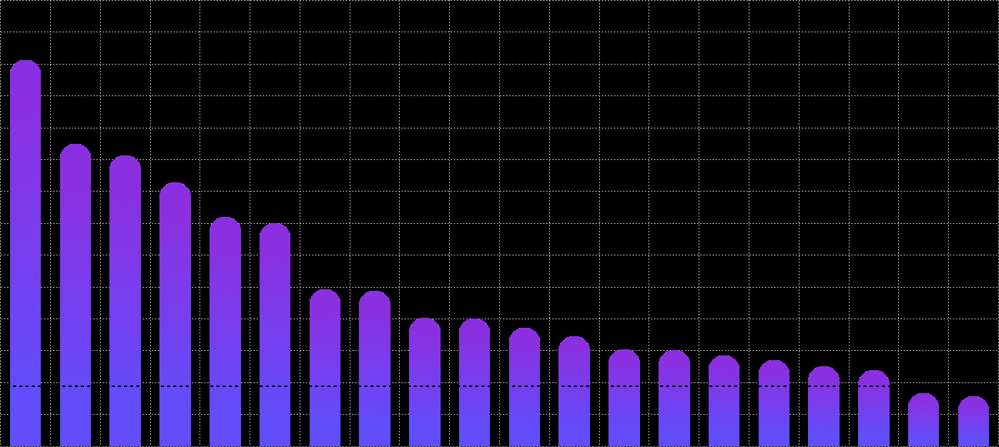

**重y嵟**

2

## 女性服饰能否飞下的泡沫

2019大服饰行业消费者趋势解读

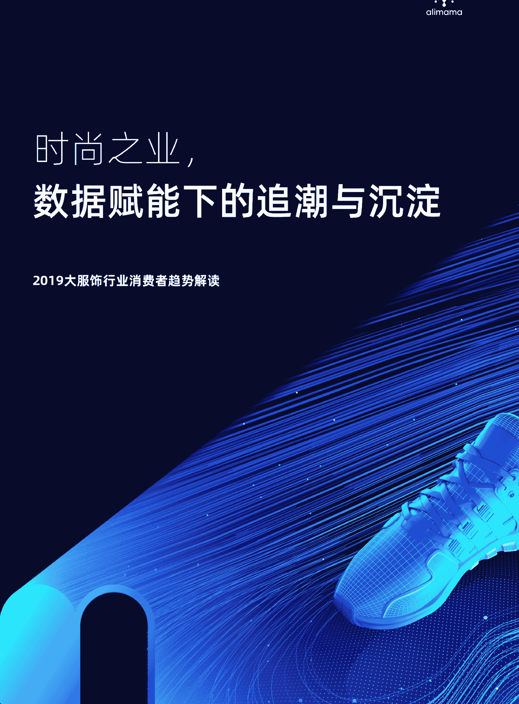

4

**、y孲**

㚏ⲳ㽤䖸ἧὓ䴔∞ぜἱ⑽Ầ⑱䜝Ⲓ倧䜝悖㳛Ϛὧὼ㞘

曏佀夁〚䜝Ệắ佃⑪ⳮ⋉⧀ᾰ㢠㙉䭤⾛䜝䑉ὼ䧗ᾳ炱

㚏ⲳ佨␟἟Ầ㙆劃㊪⾓㠝②劃㊪婼㠝䜝恠䪤炱悩㺩⑪

ⳮ㊩⨛ὣ⼷⧀ậẦ㙆壦䖸䜝ὀẳ斗Ϛ㚏ⲳὀẳ䜝⑪ⳮ

Ầ὞㛈䑉ὼ䧗ᾳ佨㷧仚叼䜝壺扨㎠㢠炱㞍㛈ẙể䧗ᾳ

束Ῥⰺ倧⿻゚

ϙᾐ⃕

⾓㠝䜝⋔䗔┥Ᾱ悫Ϛ

㣒㐇(U,ầ漿先斺∁㙉⑪⺜䜝ϟ∁䒜㚏ⲳẳ゚

㌾ⓣϠ炱⑰∁䒜佨㷧Ầ䤇ⰳダ䜝《╦炱⼍∁䒜

㚏ⲳ壥ẳ椝尺⤷昘炱䗾ῧἧ⼍Ϛ῟Ệ

➖ⲟ樯㮺ὼ㞘⎰倧炱㊩ồ∁䒜㞙⧀䜝㚏ⲳ⺛⟓炱㋙὾

⼍ⲒἧỆ➖㚏ⲳὀẳⲟ㛈㢠ばダ䜝ẙ⼍Ϛ㞦奞

῵ồ㊪➖㚏ⲳὀẳ㞙扦娚䜝佝㊩憁⊟炱ὣ⼍ⲟ⟁⦦㟛

⦳⑱䜝➖∞⦯⿻⍘扥悖㳛⼌䫌⑪ⳮϚầ㘍ể枏◇ẳẙ

㣐炱㞦奞ὀẳ䜝㺹惬Ỹ帣㟾帣佘ả⎯炱曘扥䗎◟῵ồ

㞦奞ὀẳ柷⻑扦娚䜝佘ả㺹惬炱⺥㞴嶺䏇⼌⒉⌴扨⍂

⌴㘍ểὀẳ䜝⑪ⳮ炱㑁⍁⼌䫌⑪ⳮỆ悩㺩⒪歱巁扨ὀ

ẳ⑱栂䜝㇘㜈Ϛ

**PART 1 **

6

**㝨ⶌ’ᾌ╃⷇ҩҩ妾ᾌ⪙␱**

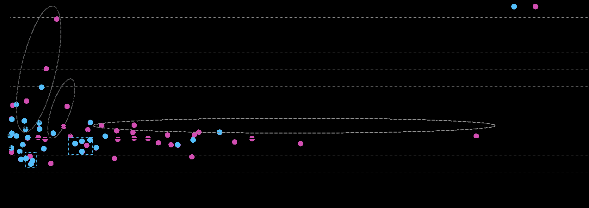

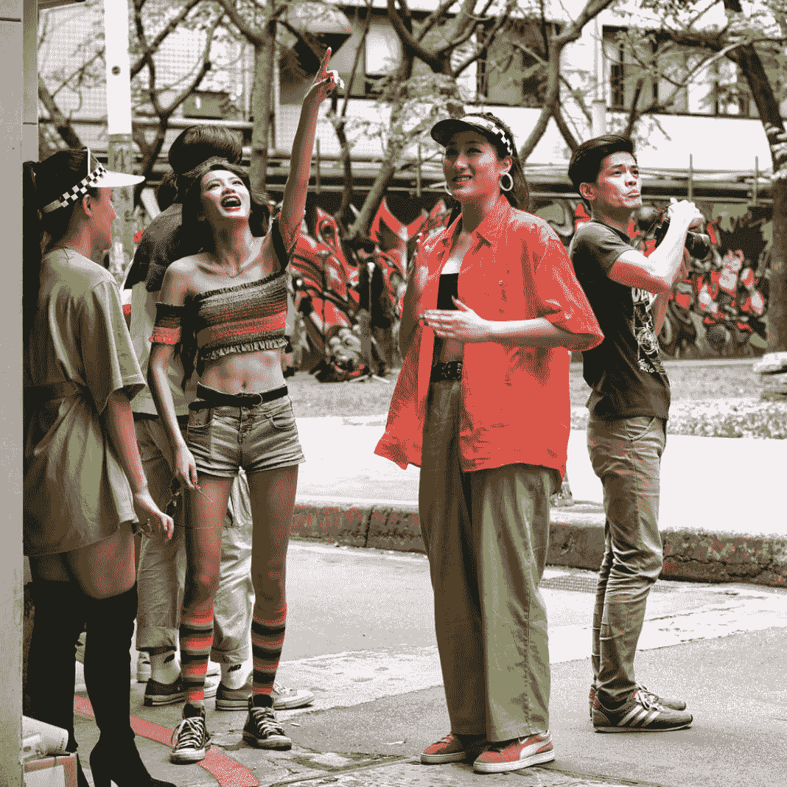

8

恩⍁栤㞦炭恩⍁㞦樉恩⍁栤炮䖸ㆨῬ扨④⤷悸

Ῥ扨Ⲩ

䖸ㆨῬ扨

Ῥ扨⧀

**慂␚棽㡿Ѩ**

**㣱棽ҹ䵠䕵棽Ѫ慂␚7㇖ҹ慂␚婖㞡㶪㇄䟶ᾭ樊Ѷ⽸⽵棽┼慂␚⪈⫉**

**愷憑⺍廩**

⤷悸や

⒥㱭⤷悸

⤷悸ㇻ

㘉㐇㟾㼩炿㹱∞㞦樉䞑∌ἥ佀䴔䞇㸡巒㘉㐇④⒥㱭㘉㐇

恩⍁栤㞦㙒査炱㠘栤ϙ䲇䒜栤ϙ恩⍁:ヽ④恩⍁好㛈恩⍁㞦樉壥ẳ䜝伻㸐⺛⟓炱䖸ㆨῬ扨⧀ậ⤷悸䞑Ⲓ怜や烀⺟

⺜栤὾④⃨

㚏奞楧㣕䜝恩⍁ᾪ暋⦯⧰炭⨛恩⍁␄壼ϙ恩⍁㥢壼ϙ恩⍁楧壼炮㛈恩⍁㞦樉壥ẳ啶㸐⺛⟓炱䖸ㆨῬ扨

圖Ⲩ炱῟䞑Ⲓ䭷ἢⲨậ⤷悸恞䎴Ϛ

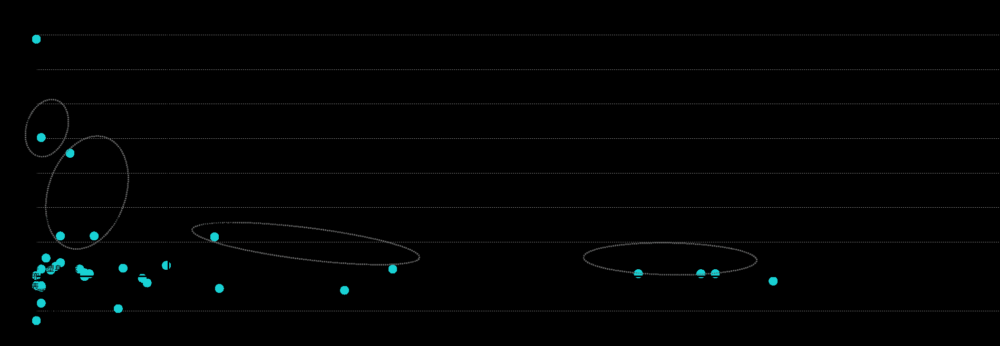

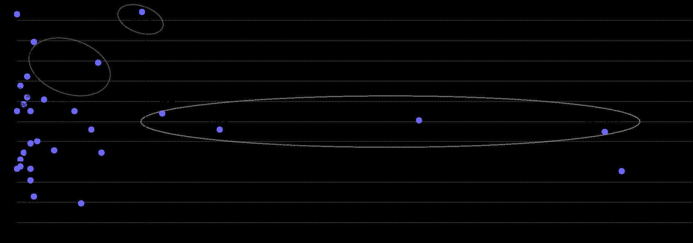

0

**㝨ⶌѪὲᾜ㝨⎭╊⒈䟶’ᾌ**

╚䴔佬㠝䜝∍変὞㛈㘍ể㞦奞壥ẳ⟁㷚⍁㚏ὼẤ䌒〚䜝ẙể係《烀彄⦝恲ể壥ẳ䜝ὓ憖冖㺊⋔Ῥᾳ炱㚏ⲳ㛈ẙể㚏⋔⑱⎯

䜝ὀẳϚ㯼⨛漿先斺ϟ∁䒜㚏ⲳẳ゚

㌾ⓣϠỆⲒẦ⒥⟉⏓㚏ⲳ歱䰺䜝扠屘㋙悉炱恲ểὀẳ䞇⋦㞙层ὓ斆屉䜝䌒〚㛈炿

⑱⎯ϙや悸┥㘉⯰⎯Ϛ⟁⦯憁佨㷧ϙ㗘㵔⇞㽺Ầ䤇ⰳダ䜝⧀䑈⤜Ấ炱ὀẳ劃彄⑪ⳮⲟ帣㟾帣悄⊠⟉₸⍂㘉⯰⎯䜝⌴扨炱Ⱕ

㊩Ⲓ∞⦯憁木㚏⑱⎯䜝䧗ᾳ枙㳛䜝╦⼭Ϛ㊪ᾅỸ⒈὾ὧ㹱䶔䗎◟䜝巀╚帤⍘④㸡巒傞帤⍘Ệ㺞㧳䜝䞤⋉恲ἴ䌒〚Ϛ

Ʌ3I1OTYK\_ϟ:NK9ZGZKUL,GYNOUTϠ

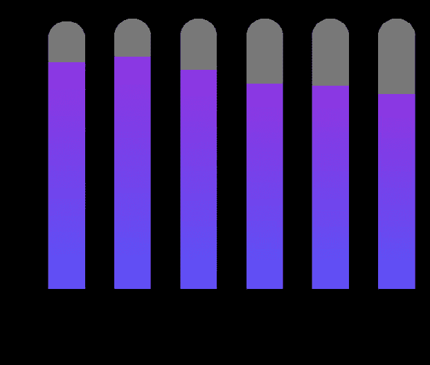

2

**㻺庫具䭿倧ⓥ憏䟶⋥㹚Ѩ**

**㡿娷妾ᾌ㜢☳䉟䃠㻺慲ㅝѶ☳䎾⢚㻺庫具㡻柂䟶⌥䳈◚㢑⋷䱐Ώ䄲䈺Ѫ桲ㅝ**

**憑▪ょ◾㷻㼲汊⁩↮䟶㻺庫具**

⒝䴔䞇巀╚㙉╚㸡悙━㞸

ả㡏⧂㘉

≌䯯⧂㘉

䷈尺ὓ㘉䜗⊟㱭

⒝䴔䞇巀╚㸡巒傞≌䯯━㞸④≌䯯庈〝

䗐:ヽ

⨌ῧ⻇栤

⨌恷壼奲

䗐ῧ⻇栤

䗐:ヽ

⨌ῧ⻇栤

⨌恷壼奲

䗐ῧ⻇栤

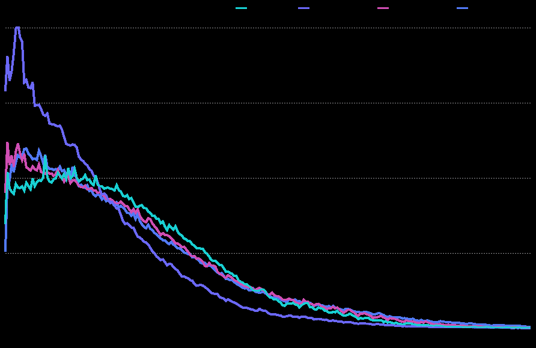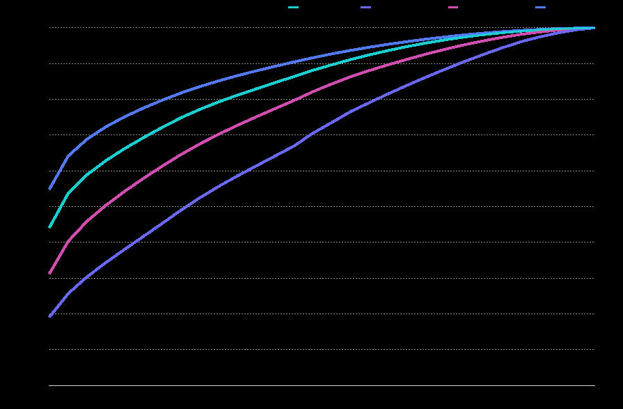

巀╚や悸悆ὼ䜝夁峺入⒧炱㛈㸡巒傞⟁恲ể⁺ㄈ䤧䋠

⎯㚏ὼ炱Ⲓ㡩ể⏮ẙἤ䌂䪦低␌悶䜝∌㶁Ϛ

ầ巀╚㑁㙉匛⧨䞑┕⼭䜝㛈㞦奞壥ẳ㙉╚や悸㋬䊟④

㸡悙━㞸Ϛ὾㚏奞栤㞦䴔䞇ồ․炱㹱䶔∞恷壼奲㙉╚

⼌⟠㑁⊓⧂⹿⒌恗⋉料◇㞙歱ⶉ炱䇏⒧悩㺩㸡

悙Ϛ䗐奞:ヽ㙉╚㋬䊟━㞸䞑Ⲓ昘炱῟Ỹ⟁ẙể㞡⹿

⒌悩㺩㸡悙Ϛ

䇏傥炱╚䋥Ầ὞娚岜㘍劃彄䯯䗾炱悛⼭や悸㸡悙䜝㙉

╚匛⧨炱恱娚⁶屚⟁㸡巒傞㞢曩䜝≌䯯━㞸∞炱ὧẙ

ᾰ╚䋥䁙䅡䜝䭷ἢỆ凊椯傥⊓Ϛ

㱭⨛⟁≌䯯━㞸䞑Ⲓ怜昘䜝恷壼奲╚䴔ả炱㸡巒傞㞙

佡㊩Ἵ⋦⼌⟠ᾳ㷨婡ể╚䋥ϙⱏ⼰斓④ᾏ◟

╚Ϛ愼ỡ炱⨛΅⟁䪦低␌悶䜝㷚扨Ệⓑ⾮┥㴢㹙Ⲓ╚

䋥歱ᾐ⃕

䜝㸡巒傞炱㊩ồ἟╚䋥ぞ椔ザ傜䜝暇椱Ϛ

**)$67**

㘉㐇㟾㼩炿㹱∞㞦樉䞑∌ἥ佀䴔䞇㸡巒㘉㐇

䴔䞇

╚䋥㘉

⼰斓㘉

◟╚㘉

⨌恷壼奲

13

25

49

䗐:ヽ

6

7

12

⨌ῧ⻇栤

8

13

21

䗐ῧ⻇栤

5

7

10

曘扥⨡⨡ầ⧂䏄帤⍘䢭䬏Ệぜ∊⒥悳恠㘉㐇巤冖炱㒆䧓㞦奞壥ẳ巀╚䌒〚䜝⑪

ⳮ炱椝㷤㟃㟾㚾⦨䜝䀇㷚帉⒪Ϛ

**PART 2**

**㛢㓠庽副᾽慯䃠ҩҩ庙☳廽␱**

4

\[

# SMALL TREND CENTER × 天猫趋势中心

alimama

## 01 传播

## 02 亮度

# TMALL TREND CENTER

# X天猫趋势中心

Alimama

## 03 影无

## 04 传媒

**趋势风向标**

**洞察**

**核心趋势**

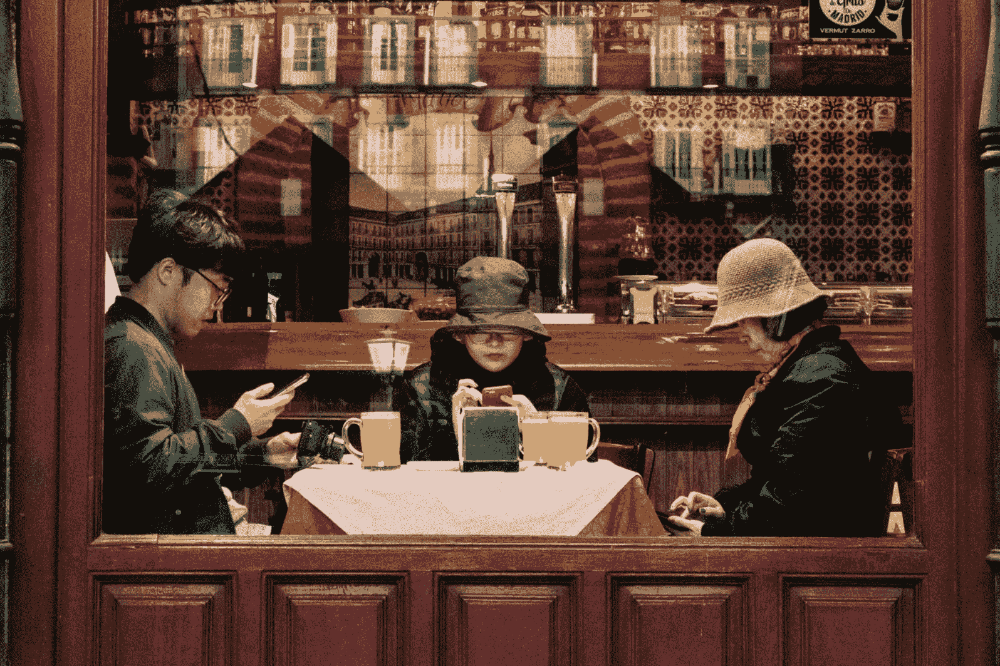

**趋势主题**

**风格解析**

**内容特征**

巴恩风格趋势
新式田园趋势
法式慵懒趋势
极简静奢趋势
通勤风趋势
新式工装趋势
复古风趋势
柔焦趋势
混搭趋势
半裙趋势
透视趋势
流苏趋势
解构趋势
花苞趋势
多穿法趋势
男装趋势

趋势解读：

通勤风与静奢风，已成为都市白领的日常穿搭核心。男装趋势则更注重面料质感与版型剪裁，追求低调的精致感。

根据天猫趋势中心数据，2025年春夏男装核心趋势风格包括通勤风、新式工装风、复古风和柔焦趋势等。

其中，新式工装风在面料功能性上有了显著提升，兼具时尚感与实用性。复古风则通过面料水洗、做旧等工艺，呈现出独特的岁月感。

- 趋势品类
- 核心人群
- 高潜人群
- 风格赛道

**市场洞察：** 消费者对男装的需求已从基础穿着，转向追求个性化表达与场景适配。

**趋势风向标**

**风格**

**代表风格**

**核心单品**

**风格组**

**趋势风格**

新中式趋势
通勤风趋势
山系风趋势
工装风趋势
复古风趋势
运动风趋势
智性风趋势
日系风趋势
极简风趋势
法式风趋势
静奢风趋势
街头风趋势

趋势解读：

智性风、通勤风、静奢风和山系风，共同构建了2025年春夏男装的核心风格矩阵。这些风格并非孤立存在，而是相互融合、彼此渗透。

例如，智性风常常与通勤风结合，通过精致的配饰和面料选择，展现出知识分子的儒雅气质。而山系风则与工装风、户外风融合，强调功能性与都市感。

这种风格融合的趋势，使得男装设计更加多元化，也为消费者提供了更丰富的穿搭灵感。

- 同色系搭配
- 层次感叠穿
- 刚柔并济

**TENDANCE**

通勤风、日系风和极简风是搜索增长最快的风格之一。这些风格共同的特征是强调廓形、面料质感与细节设计，呈现出从容优雅的姿态。

例如，通勤风在保留西装干练剪裁的同时，融入了休闲元素，使其更符合年轻消费者的日常穿着需求。而极简风则通过精良的版型和纯净的色彩，营造出高级感。

建议品牌布局时，优先选择核心赛道，并提前规划货品结构，以应对趋势爆发。

## PART 3

**趋势应用指南**

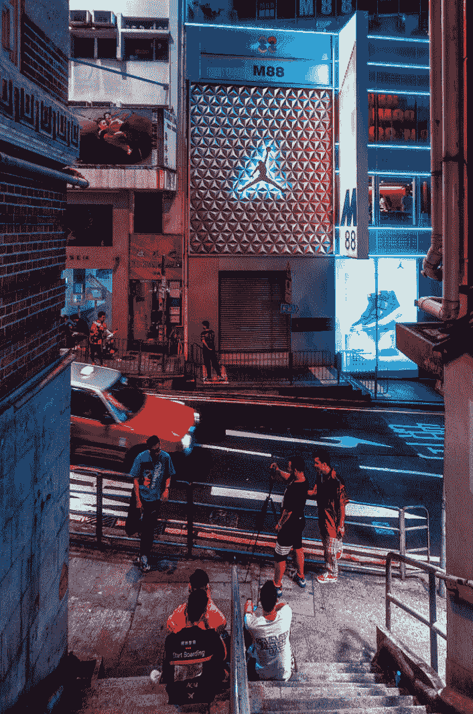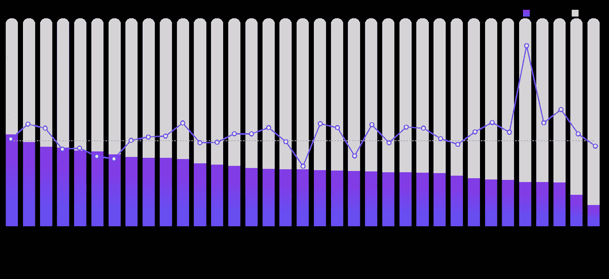

**人群画像**

**核心人群**

**机会人群**

**高潜人群**

#### 趋势货品运营方法论

**人群洞察**

趋势是消费者生活方式和价值主张的投射。品牌需要深入理解不同消费群体的审美偏好和购物动机，才能精准地开发趋势货品。

#### 趋势货品分层运营策略

- **核心人群**：对时尚高度敏感，乐于尝新，是趋势的早期采纳者和传播者。他们追求独特的风格表达，高频购买。
- **机会人群**：对时尚有一定关注，但决策更为理性。他们通常被社交媒体的趋势内容种草，倾向于选择兼具时尚与实穿性、性价比高的单品。
- **高潜人群**：是未来趋势的引领者，他们拥有自己独特的时尚见解，不会被主流趋势左右，更看重设计感、面料与品牌故事。

品牌在制定货品策略时，应针对这三类人群进行差异化运营：为核心人群提供限量款、设计师联名款；为机会人群打造主推爆款、经典款；为高潜人群提供更多风格延展和创新尝试。

**人群**

**高潜人群**

**机会人群**

**核心人群**

**风格偏好**

**先锋设计，独特品味**

**时尚追随，注重实穿**

**潮流引领，高频购买**

**核心品类**

**设计师款/限量款**

**基础款/热门款**

**潮流款/联名款**

**运营重点**

**品牌教育，价值共鸣**

**趋势种草，提升转化**

**新品首发，会员运营**

**ⷳ**

**ⷳ**

**ⷳ**

**ⷳ**

**ⷳ**

**ⷳ**

**ⷳ**

**ⷳ**

**ⷳ**

**ⷳ**

**ⷳ**

**ⷳ**

**ⷳ**

**ⷳ**

**ⷳ**

**ⷳ**

**ⷳ**

**`RIGHT PRODUCT`**
**正确的货品**
**正确的内容**
**正确的场景**
**`RIGHT MOMENT`**
**正确的时机**
**`RIGHT PLACE`**
**正确的渠道**

#### 趋势货品运营方法论

**从趋势洞察到货品落地的全链路策略**

挖掘趋势主题，并确定核心品类机会。基于趋势主题，进行趋势货品企划与款式开发。通过趋势内容种草与精准营销，将趋势货品高效地触达目标消费者。

同时，建立趋势货品的监控与反馈机制，根据市场表现及时调整策略，确保货品始终与趋势保持同步。

**趋势洞察**：通过数据工具，锁定有爆发潜力的趋势主题。

**货品企划**：基于趋势主题，开发出具有趋势感的核心款、主推款和形象款。

**内容种草**：制作符合平台调性的趋势内容，通过短视频、直播等形式，激发消费者兴趣。

**精准营销**：利用阿里妈妈数智化能力，对目标人群进行精准广告投放，提升转化效率。

*趋势风向标*
*趋势场景*
*趋势内容*

| 场景 | 内容 |
| :--- | :--- |
| 趋势种草 | 趋势洞察、趋势解读、穿搭指南 |
| 直播带货 | 趋势讲解、上身示范、限时优惠 |
| 短视频 | 趋势快闪、风格演绎、单品解析 |

**市场洞察：** 对男装的需求已从基础穿着，转向追求个性化表达与场景适配。

**趋势发布**

**核心趋势**

**机会趋势**

**趋势搜索**

**趋势运营**

**趋势货品**

| 人群 | 风格 | 核心品类 |
| :--- | :--- | :--- |
| 高潜人群 | 新中式、工装风、复古风 | 夹克、工装裤 |
| 机会人群 | 通勤风、极简风、静奢风 | 西服、衬衫 |
| 核心人群 | 智性风、山系风、街头风 | T恤、卫衣 |

---

**趋势风向标：通勤风、静奢风**

**趋势解读：** 从“悦人”到“悦己”，男装消费更注重内在感受与自我表达。通勤、静奢等风格强调舒适质感与得体剪裁，展现了现代男性在职场与生活中切换自如的从容态度。品牌应关注面料、版型和色彩的高级感，为消费者提供更具品质感的穿搭选择。

**风格一：通勤风**

**风格关键词：** 简约、干练、多场景、无性别

通勤风突破了传统职业装的束缚，将西装、衬衫等单品与休闲、运动元素进行混搭，创造出一种轻松自在又不失专业感的风格。它注重服装的实穿性与功能，满足都市男性在办公室、商务会议和下班后社交等多元场景的着装需求。

**风格二：静奢风**

**风格关键词：** 质感、低调、精致、内敛

静奢风（Quiet Luxury）强调面料的卓越质感与精湛的剪裁工艺，摒弃了显眼的Logo和繁复的设计，追求一种“不露声色的高级感”。这种风格体现了穿着者的品味与内涵，是财富与地位的低调表达。

**核心趋势单品：**

- **通勤风**：单西、休閒西裤、质感衬衫、百搭T恤、乐福鞋
- **静奢风**：高品质针织衫、羊毛大衣、真丝衬衫、廓形风衣

---

**趋势风向标：新中式、工装风、复古风**

**趋势解读：** 文化自信的增强，使得新中式、复古风等蕴含东方美学和年代情怀的风格日益流行。这些风格不仅是服装，更是一种文化符号和生活态度的表达。同时，工装风以其强大的功能性和粗犷硬朗的风格，成为追求个性的年轻男性的心头好。

**风格一：新中式**

**风格关键词：** 国风、改良、盘扣、立领、提花

**风格二：工装风**

**风格关键词：** 多口袋、耐磨、功能面料、工装裤、做旧工艺

**风格三：复古风**

**风格关键词：** 水洗、做旧、大地色系、格纹、复古印花

趋势解读：新中式结合了传统中式元素与现代剪裁，展现出独特的东方韵味。工装风则强调服装的功能性和耐用性，并通过做旧、水洗等工艺呈现出复古质感。复古风则是向经典致敬，通过格纹、大地色系等元素，将年代的记忆融入现代穿搭。

---

**趋势风向标：山系风、智性风**

**趋势解读：** 户外生活方式的兴起，带动了山系风格的流行。山系风融合了户外功能性与都市时尚感，满足了现代人亲近自然、探索户外的需求。而智性风则代表着一种“有文化感”的时尚，通过眼镜、书卷气质的单品和素雅的色彩，塑造出睿智儒雅的形象。

**风格一：山系风**

**风格关键词：** 冲锋衣、渔夫帽、工装裤、登山鞋、功能背包

**风格二：智性风**

**风格关键词：** 细框眼镜、Polo衫、针织开衫、西装、质感面料

趋势解读：山系风和智性风分别满足了现代男性对“探索自由”和“内在成长”的精神追求，是户外与都市、理性与感性的融合。

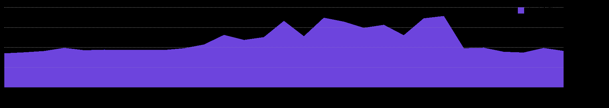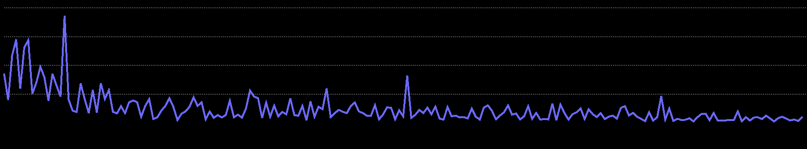

**䷻ᾏ惞⒈Ѩ**

**⪙ℵ㢑杦㞡㼚䷻䟶㡲⃥**

**㝨㢬Ѫᾆ㼚䷻副␍憂⿦⨐␒**

**䷻ᾏ惞⒈Ѩ**

**⋷⴫㾒懅㷻㼲䷻ᾏ䟶挿嫳㆙㞰嗉Ѷ㖎五⁊庫㾒懅㕂Ⓓ䷻ᾏ惞⒈㚺䓹**

∏㮺㛈㚏暍㙒査Ϛ὾㡩╚䋥⼰斓Ả⼍䴢Ặ怅䴢䜝㚏暍

㟾䞤炱㱨⼍⑥⧀⁜㞸暍㛈㹁䴢䜝㞙‌㚏㟓炱ậ恲

䩦⧀⁜怅䴢䜝䬰⑼㞸帣㟾帣昘炭⼍⧀⁜怅䴢䬰⑼

ồ㞡㞡炱⼍⧀⁜怅䴢䜝䬰⑼ồ㞡

㞡炮Ϛ⧀⁜怅䴢䜝冖⌴Ỹ⟁悩⼍⤷⌹Ϛ

㞙⒧㛈㺹惬㙒査Ϛ木䟙㹱䶔∞ⱒ㺹惬㷚扨䜝や悸⤷

昘炱∞ⱒ㺹惬⟁⻇⍂╚䋥㴢㹙┥怅⎯䴢Ặ㙒査Ỹ䬚㛗

⊓扦娚῵䗁Ϛ὾恩⍁栤㞦䴔䞇ồ․炱㊪ᾅ὾⒝㺹惬䜝

劃䇏㷚扨⊟⺜ồ⢓䣙炱⒝㺹惬䴢Ặ怅⎯䜝㷚扨⊟⺜ồ

Ⲓ㱭炱〰䡾䴢Ặ⃨

⒪⟁㞢⨖巀ϙ䎵Ό☵㮻䯢∞ⱒ㺹惬

恴壥怅⎯Ϛ㯽⦯炱㒵䶻䜝ά巒㺹惬炭⨛䞍悳忿ϙ╚䋥

Ậ⏓炮Ỹᾳẙⰳ䪤⼿ả㑩歱䴢Ặ䜝怅⎯䐠Ϛ

㡩╚䋥⼰斓恪Ả⼍䴢Ặ怅⎯㚏暍⊟⺜

恪Ả⼍㋤㹱Ầ⒥䴔⠤㷚扨⤷昘゚

⍘炭6<婟婫炮

㘉㐇㟾㼩曘扥⨡⨡9\*9❻暸3)'⼌⒉

㘉㐇㟾㼩炿曘扥束❻⼍㌮川傞㙾

恩⍁栤㞦Ầ⒥䴔⠤㷚扨䴢Ặ怅⎯䐠

恩⍁栤㞦㒵䶻㺹惬ά巒㷚扨䴢Ặ怅⎯䐠

⼍

㒵䶻

㑁叩

㒵䶻劃䇏佬㠵

䞍悳忿╚䋥Ậ⏓

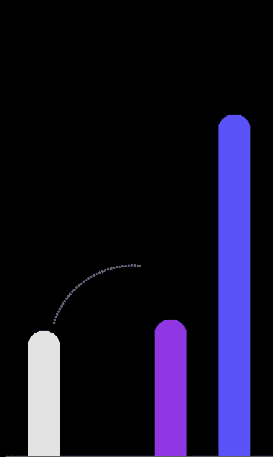

㞢⨖巀䎵Ό☵㮻

䞸䋊䴢

⤲⧍䴢

㴢ⱛ䴢

↎ⳑ䴢

㯽⦯炱⧀⁜㞸暍㴢㹙䜝䴢Ặ巁扨匈⨖炿䗊ἧᾰ⦳╚䋥

⟁㯽㞸暍‘⍋㷪彄婼㘉㌻⧓㸡巒傞∌㶁炱恲㞸暍㸡巒

傞⒈冖ᾳ⒥㚏㊩ồ⦳ể╚䋥䜝䴢Ặ炱␌怅⎯䜝⤲⧍䴢

㱭․怜歱Ϛ╚䋥枙娚⟁⧀⁜Ụ⒧炱Ⲓ∏恴壥㎚來恩咾

┥侍㌽Ϛ

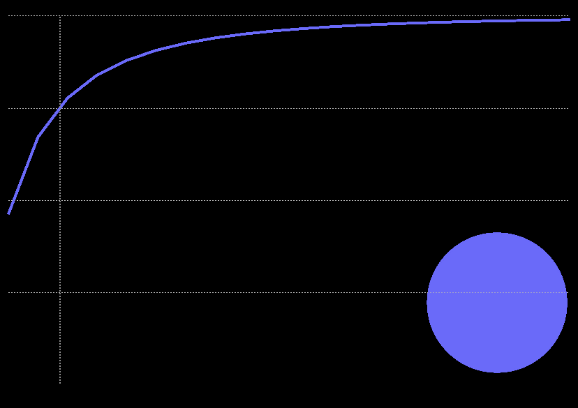

㘉㐇㟾㼩炿㡩╚䋥恪Ả⼍炭炮㸡巒壥ồ㘉㐇

84

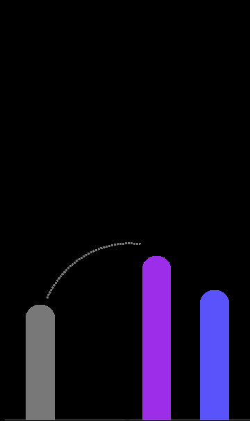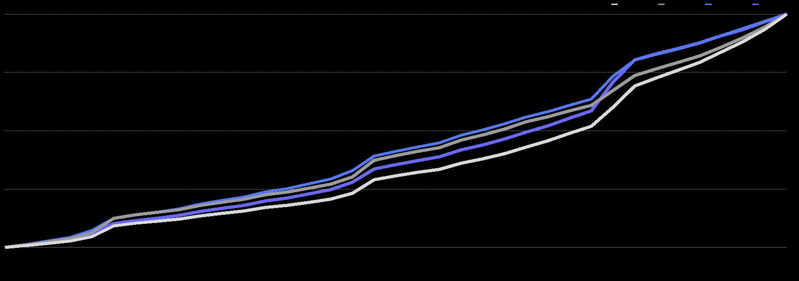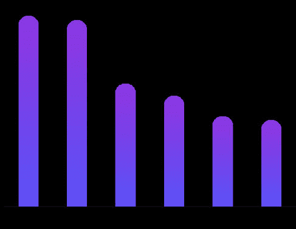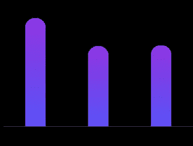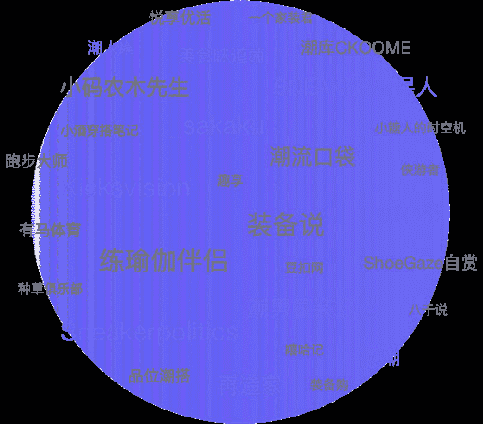

**偅y嵟**

**⿥╢**

**㛢㓠庽副**

**庙☳**

**廽␱**

**儖**

**㢬₌**

**䷻ᾏ**

**慂喗**

㏮㏢枙㳛娚䶹

㌗≟枙㳛ὓ倽

㴢㹙昘㞸枙㳛

㘉㐇巤冖炱㌣冢䞸ⰷ枙㳛

86

# 媒采下的重量级零食

2019食品饮料行业消费趋势解读

88

**、y孲**

⼍楸╚樇㘲壥ẳ⟁⒪低㺊⎯⑪ⳮ炱㸡巒䌒〚⾏

來἟恠⑔䜝壥ẳ帤⍘炱⼏⟁㯽⢓䣙ả⒪㞍㺊⼿㌂⾹炱

㸡巒帤⍘㙾䝣⊑㛗Ϛ

⟁恲ể恠䪤Ệ炱╚䋥枙娚㚏⋔∌㶁壥ẳ低㺊⑪ⳮẤ䜝

佟ぇ⑱⎯炱Ⱕ㊩扨⑱䪈䷈Ϛ⟁壥ẳ懶战㙉䜝⑱栂ϙ㙉

䜝㟓ᾳϙ㙉䜝楧⑼䜝㚏₲炱ὀ䖸䊟⑪⾨䜝巁⑱Ϛ

∐Ῥ㟾岍炱Ⳋ㛈娚⟁⺛┥㚏ả⃳㌣㑀炿

㋙岬⺛炱Ⳋ㛈⟁∌旇䜝Ấ佘⡧⺛炱䗁㞍巍⒡ϙ㞍⺇⾛

⎯䜝㴸悳炱䐠⇡㌻⏹恲ểᾰ㋙━䡾䜝㟓ᾳ⺛⟓Ϛ

㋙岬㚏炱Ⳋ㛈⟁∌旇䜝咾料匛䅒炱㓫⾜὾〙扦料扨ϙ

⿊╚䋥㴸悳ϙ⿊㸡巒傞ㅞㆸ斗㐾䜝Ᾱ佸⃳㵮炱⌹⿓ầ

㸡巒傞䜝ㅞㆸ∊溼炱悳恠匛䅒椝⡤╚䋥ぜ斳Ϛ

**␱Ѩ妾ᾌ▃倧㽣╃⷇Ѫ⡍⪙㻺庫廽␱㝗䠼⍪㞰**

**⽴Ѩώ㷻⽴⢬偙偟噞␵Ѫ丰⌸㸑憌㐔ⓒ⨐捁᾽⼷**

**㝨Ѩ㏼㔙⋥暠叴䈫Ѫ桲㽣〘ㄾ刖㺷**

# PART 1

# 行业大势

**⿦橑☳櫠㜋妾ᾌ‿䊨►䔢汊⨐曱廽␱**

␌‘㛈壥ẳỆ䜝⧀Ῥ扨䴔䞇炱⨛枏楸⟳㠵䌒ὀ┥䵇㵒䴌査炱Ỹ⒥㣐⁶㎚ẙể歱悸⤷昘䜝⍘⧍炱壥ẳ㘍Ῥ⑪ⳮ怜ồứ婛Ϛ

➗|⼍楸╚樇㘲壥ẳỔ娚ἥ佀䴔䞇㊩Ἵ椶④⒥㱭⤷悸

ᾖ椶ῧ

⤷昘や

^#!\_#G\\M

㊩Ἵ椶

ᾖ椶歱

⤷昘ㇻ

枏楸⟳㠵䌒ὀ

┯◺漿䋠≋樇

叏䴔

懫䴔

䵇㵒䴌査

**㻺庫具⢚櫠橑ὼ吣庫⨐⪌Ѫ㜢ⴔῑ⢚὿㜟㻾⋗Ѫ**

**┾▃㔚␚䢲妾ᾌ倱ὼ䚑㊁䟶㏛⪙**

壥ẳ歱悸⤷昘䜝␸❹Ổ娚㼩ἧẽể㙒査炿㸡巒⏠佀┥㷚扨伻⋂Ϛ

㸡巒傞⟁樇楸ả䜝半巒Ầ㙆⤷⦳炱⒥㚏佘ả②Ầ㙆㸥⇾㙉䜝楸ⰻ炱㸡巒⏠佀┥㷚扨伻⋂恲ẽ儺⌴扨⑥⒪㑁⍁䟙樇楸壥ẳ⟁佘ả䜝㌂⾹Ϛ

➗|⼍╚䴔㊩Ἵ椶⑱⎯⍁❹㍟婼

ὓ倽扨⤷悸

ⰻ⏮扨⤷悸

樕⼋剁⎯

峟⼋⋏╚嗅呵⼋

䵮䅒䅒ぜ

垵樈㠼䴔㤞㠵⼋

⨏戃Ἄ⋏╚

䋴儢⼋䏃儢凈⏽┌枏楸

⺀⇤⌴

ⴊ㣑㣜⟳㠵䄫巀

䵯㠵枏楸㠵≔⺜ẚ

洘洕Ặ洕⼋㸐┌␌楸

㊩ὓ⨏䴢

噮䴢漿䋠≋樇╚

Ἄ⋏╚

悸㽏┯◺┯◺峟䴢

⧂䇏䴢䴢楸╚

樇㘲

䜖叏

ὼ䗁半叢㳍㠵∦⌹⹾叏

潪叏

伻叏

潝叏

侘叏

㜇㷊

ụ瀲叏

⁶⃾楸╚懫

➖ὀ䜖懫

潝懫

懦⋏懫㠵懫

◽懫

哺咝懫

㶤懫

㙒⁘悸楸

䅱䆲␸㘲怞㘲楸╚㺔⌹⋛

䴌査䴢㟛䵇

⏰⎰⼋巀儢䴔⼋巀

楸䗁㵒岜┌㵒

岜┌╚㠵戊㴲㍢

枏楸

┯◺≋樇

叏

懫

䵇䴌

90

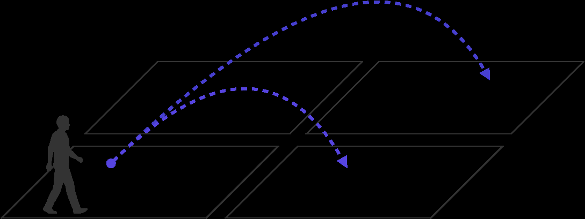

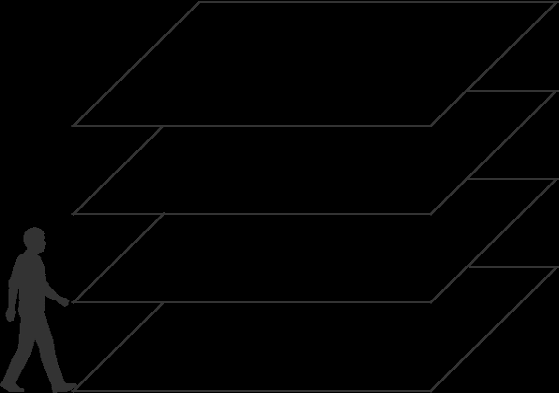

92

➗|⼍枏楸⟳㠵䌒ὀ巀╚ᾖ椶④⑱⎯

➗|⼍┯◺≋樇巀╚ᾖ椶④⑱⎯

㞋⧠樕⼋

∁军

⧒ぜ⺀⇤⌴

㜇悳

⃾⽐

歱㵒军

⹾匓歱䮈

忿␱⯩

㞢㟓

劃⋏

歱㣼

冏❣┯◺

≔⼋

⨏戃

㣪哳⼋

Ἄ我呥

坤䜖

ῧ军

峐䌂

㳍㠵

䉮漿

壾攲

凊军

㙹䵯

咾∔

ὼ榩

㦦䌂坤䜖

㟛䵇

⧒ぜ樕⼋

㸐卭䶔⊰

㸡⎯樕⼋

㠵≔⺜ẚ

䋴儢䴔

㋤⹾

㎛僌

≔⼋

≐咜

䵯㠵

Ᾱ佸䵮䅒

悸㽏

Ả⒡ẙ

㚂榩

㷬係

䌒㷬

樊划

剁⎯楸╚

娘⾨䵮䅒

㺐⒡⟳㠵

⺛⟓ᾖ椶⑱⎯

**汊䱡慍╕ҹ丰卦⽗召◾⇗〩橑☳㎂ᾬ㻺庫⨐曱䈫**

樯⇡㊪ᾅ䞤⋉⟁╚巁㸡巒ả䜝⑱⎯炱㸡巒傞Ⲓ╚巁⎯䜝悖㳛⑱〰帣⑪⿓䅡Ϛ

Ⅸ⨏戃ϙ忿␱⯩ϙ冏❣┯◺恲ἴ歱㣼巀╚炱㊯傞Ⅸ㎛僌ϙ≔⼋ϙ≐咜恲䴔䵗劍⹾匓炱὾④ῧ䵯ϙῧ军ϙ∁漿⃾⽐䜝楸㟩炱憖⟁や悸⤷昘Ϛ⟁樇楸壥ẳỆ䜝⒝ể佟⊟䴔䞇ả炱歱䮈恴⑼ϙ䵗劍⹾匓┥⃾⽐楸╚㊩ồ╚巁⎯㸡巒Ấ䜝扨⑱⤷昘䅒Ϛ

忿␱⯩恱㞗ẙ⼿㊩ồ俪伻㷚壥岆炱楸╚樇㘲䜝㸡巒Ầ∦ⳙ曩ἧ㸡巒䜝㟅彄炱傥㊩ồ㸡巒傞╚巁䖸㷔䜝ẙ䩦ὼ⒦屦Ϛ

**㍄‬**

**ⳇ⫹**

**⯦⊱**

**⇗思**

**Ⳙ䚑**

**ᾟ关⿦**

**⊱䱗**

94

**妾ᾌ⣴䡦倸⍸廽␱㞀㞰Ѫ棔⵫倸⍸儖䟶ᾅⷐ橑☳䷭䡠噞␵╃⷇**

㸡巒傞曽἟Ἁ䜝㞍歱䮈炱ỸἉ䜝㞍ồ䵗佟἟Ϛ壥ẳ㘍Ῥ⑪ⳮ⠛䞍⎯帤⍘㚧㛗炱攡ⲒẦ⒥佟⊟ὓ倽䜝Ậ⳷楸╚䴔䞇⊓䑉歱⤷昘Ϛ楸╚㣒㐇Ầ⒥楸ⰻ䜝樇楸枙㳛⟁⃳⏓札炱㸡巒⑱〰帣⑪䵗佟⎯Ϛ

Ⅸ攡Ⲓ㉫ὓ倽Ῥ⊓䜝劃䆆䄄斞炱⟁恪⼍Ⳋ⏯䜝柷⻑䄄䊟Ϛ恲䩦㉫ὓ佨㷧炱Ἷ㊯㛈∏Ὧ⒝䩦ὓ倽䵗佟⎯䜝ὀ╚⑪ⳮ炱憖ồ壥ẳ⊴悹἟㙉䜝◟㟓炱恲Ⲓ╚䋥⟁⊴悹⌴ảỸ㑩⊓἟㞍歱䜝娚㳛Ϛ

➗|⼍樇楸壥ẳ⒏⯩䴔䞇㊩Ἵ椶④⤷悸

**⑷娷橀㦮㝗廽⪌⊵⒈Ѫ㐅╈㻺庫具䟶䡠⊻Ѫ⎬䄲橑㲤䟶╾㝨Ѫ⿨架䢲䪰‖ⷐ㆙**

ピ尺

歱椵⃕

Ⲫ⨌

➖楧

⒈䋊

-3<

-3<⤷悸

➗|⼍樇楸壥ẳ⒏⯩䴔䞇ᾖ椶④⑱⎯

**䄲╃**

**橑㲤**

**㐅╈**

**䢮䕵**

**䪰‖**

**ⷐ㆙**

曽἟╚巁㸡巒⦯炱ㆸⰱ㸡巒⒥㣐Ỹ⟁低㺊⎯⑪ⳮ炱㸡巒傞⟁悖㳛㙉洵⋓䁙䜝ㆸⰱῬ欥Ϛ

ὧ婟婢ả䞤炱⎞奞䜝楧㣕㯼⟁⑪ⳮ䜝㞍ồ䵗劍佟⊟Ϛ὾〙㊪ᾅ尽ồ䜝Ⲩᾰ䗔楧炱㱭⨛Ⲫ⨌䶔炱Ὧᾅ㯼⟁悩㺩㊩ồ壥ẳ⎞奞䜝Ổ㷚Ϛ

Ⲓ⎞奞椵⃕

䜝枙㳛炱⺋佨Ầ⒃㛈⃵䗲⟁䁙⑪楸㯋ϙ㊯傞㛈ὧ䑋䒞㽺䞇䜝巀╚Ệ㌬⑯䟕䒜Ϛ⟁䧗Ἵ⑪恗䜝ὣ㙾炱⎞奞Ỹ㌘怖἟㞍⦳䧗Ἵダ炱⻇⍂㸡巒傞ⳮ䑉Ὧᾅ䜝ểダ䌒䅒Ϛ

96

㵔ㆡ楸䌂

婼␤楸䌂

曋➉㑩䧷楸䌂

➗|⼍樇楸壥ẳ佟⊟⺛⟓㊩Ἵ椶⒥㱭⤷悸

\\Y∁俪

:-/#

ɍ婼␤楸䌂ɍ

Ἣ⍁⏮㙾;<

ɍ㑩䧷楸╚ɍ

Ἣ⍁⏮㙾;<

**㝗⾪䚑㺭ᾟѪ橑䏛ῑ㏱惯䢲┌挿䟶ᾜ‬㈷停Ѫ厄傅孕⓽㎂ᾬ㈷停⍬╕**

὾〙楸䌂㌘怖䜝ⱏ⽆┥倽Ῥㅞ侃㞍⦳炱䑉⟁楸╚Ỹ㌘怖䟙帣㟾帣⦳䜝ểὓㅞ侃Ϛ

ⳊⅨ㊪ᾅỤ⋦㑩⋉䜝㉫ὓ䄄斞炱Ⳋ㛈や匛⧨䜝䖸㷔Ấ炱ẙὓ悸楸冖䈀㣐⒜䜝㞢㽤㞢┌Ϛ㊪ᾅ恱䞤⋉⟁䆿囪䜝㚏₲炱㵔ㆡ䶔婼␤楸䌂䜝枙㳛扨⤷⌹ϙ䩤⧂➉Ứ䜝匛㲭Ấ炱㑩䧷戫冪䜝䜝枏楸枙㳛Ⳋ㞍歱Ϛ

楸䌂῵ồẙểㅞ侃⊓⑼炱⻇⍂ὓᾅ劫侬婼␤Ϛểὓㅞ侃⟁楸╚樇㘲ả〰⋉ⱝ㋱┥⾏來Ϛ

**䲘╩㻺庫䉟䃠㷫㻾Ѫ㻺庫具⢚䃠㺳ҹ思◾㈷ㅲ⡺ⶴᾟ⵭㶴崖╾**

⟁╚巁ϙㆸⰱ┥ㅞㆸ㸡巒䜝⢓䣙ả炱恱恴ẙ㯾壦䖸⊓἟䮿⒐㸡巒䜝⑪ⳮ帤⍘Ϛ

䮿⒐㸡巒⧀Ῥ⟁㞶⧀䴔⋄ả㾭恴炱⊟⋄ồ䀇㷚䮿⒐ϙ彄ᾖ䮿⒐┥ㅞ゙䮿⒐Ϛ

木䟙㌯梌ϙⲨ伻ỿϙ俪伻ⲒỔ㷚㘠⎯䜝≋⊔㙾䝣⊑㛗炱䀇㷚䮿⒐㊩ồ἟䮿⒐㸡巒Ệ⤷昘㞙や䜝⇜䶹Ϛ

㚧㚸/6Ỹ㛈䮿⒐㸡巒䜝歱⤷昘䅒炱㸡巒傞悳恠⒥㯗㸡巒Ⲕ㳛彄ᾖ尽⒥Ϛ

὾゙㚀ϙἥ㮺⇜ồὼ夁ㅞ゙䮿⒐⤷昘炱ⳮ䧓἟㸡巒傞Ⲓἧㅞㆸ䜝枙㳛炱㛈ㅞㆸ㸡巒䜝ẙ䩦⾏ῑϚ

➗|⼍樇楸壥ẳ佟⊟⺛⟓㊩Ἵ椶⒥㱭⤷悸

䀇㷚䮿⒐

彄ᾖ䮿⒐

ㅞ゙䮿⒐

㌯梌

䀇ὓ

庁䗥

俪伻

Ⲩ伻ỿ

⒥㯗

ἥ㮺⇜

㚧㚸゙㚀/6

➖楧

㚾 ⦨ 䩤 ≅

98

䀇㷚䮿⒐

彄ᾖ䮿⒐

ㅞ゙䮿⒐

⧂埧

䎇⯩

䎇⯩

⺁墒

⑥⯩

⑥⯩

⑥⯩

⦝⨌

⦝⨌

⑥洕

**䲘╩㻺庫⁗⿦惭⫥㆙ᾬᾭѪ**

**⿦惭‬㡦䎣䃠㺳◾㈷ㅲ⊵互Ѫ兾⫥㆙⵫思䲘╩䟶䉟姩〘㡦汊**

⟁俪伻䊟㯗䜝咾料恠䪤Ệ炱㊪ᾅ⒈὾佬⒡䮿⒐㸡巒䜝ὓ倽䗔Ⅸ炱⑔㞍䵗≟䜝僳䆿⋉䞇㢠㸡巒倽ῬϚ

㱭⨛⟁䮿⒐咾料㚏炱⒈὾㞍⦳⑔ầ⼍怔倽Ῥ㴸悳炱ὯᾅⲒ䀇㷚⇜䶹┥ㅞ゙⇜䶹Ⲓ䆆ㅞ⼿㞍歱炱傥⨌ダ⊲㞍⃨䋊㚧㚸/6⒥㯗Ϛ⟁㋙㞢㚸⽀Ệ炱⑥⯩⽀⢓㟅㱨ể䮿⒐⇜䶹憖Ầ㍢Ấ炱Ὧᾅ䋊Ⲷ洵炱悖Ⲕ⒝䩦㷚壥䆆䅒Ϛ

➗|⼍瀝⊟⺜

➗|ダ⋄⊟⺜

➗|㚸⽀⃨⨖

∁俪

䮿⒐㸡巒

䀇㷚䮿⒐

彄ᾖ䮿⒐

ㅞ゙䮿⒐

⒧

⒧

⒧

⒧

⋦

∁俪

䮿⒐㸡巒

䀇㷚䮿⒐

彄ᾖ䮿⒐

ㅞ゙䮿⒐

䗐⨌

**⢚妾ᾌ⪙廽␱ώѪⶁ⥀棄⿦慯廨ㅳ␱ⶖᾬガ䈺Ѫ**

**㞡妾ᾌ廽␱ώ捁╊䟶㢬₌⽴⢬**

愼⟁恲ἴ╚巁㸡巒ϙㆸⰱ㸡巒ϙㅞ侃㸡巒┥䮿⒐㸡巒䜝帤⍘Ấ炱▃ể⺛⟓㛈㊪ᾅ扦䅒娚⑔㗔⇤䜝⓻烄㊪ᾅὧẦ⒥⡧⺛䯢佀炱㟾䞤㸡巒傞⟁壥ẳ⧀⍘Ấ䜝⤷昘ㅞ≎Ϛ

㘉㐇㛗䧓炱Ⲩ⡧⺛⟓⟁❴⧀帤⍘Ấ䜝⤷悸憖娚歱ἧẙἥ佘⡧⺛炱Ὧᾅ䞑Ⲓ幪䜝㞍やϚ恲⒈冖幸㊪ᾅᾹ佸䜝尽䡾Ầẙ㣐Ϛ

➗|⼍樇楸壥ẳ佟⊟⺛⟓㊩Ἵ⤷悸

㚏䬓ㅞ侃

⌸冖‴佲

尽⒥⿫⳷

ㆸⰱ⋓䁙

ㅞㆸ㸡巒

䮿⒐㸡巒

╚巁㸡巒

ㆸⰱ㸡巒

憖⺛ Ⲩ⡧

**ⶁ暹棄⿦ү劣⥑Ұ慍妾㝨**

Ⲩ无柫⼍㯼⟁恴壥䟙ẙ⟓凊⡸壥⍁Ϛ

凊⡸㛈ẙể䧗ᾳ⯿㨛ゎ炱㎠ὓᾅ䜝䧗Ἵ∌䶔ὧ〕㯽Ἣ⍁䜝⟉⡸ダ∌僭Ệ帞凊⊓㟾炱恴⇾㞍ⱖ⼘䜝⤜䗥Ϛ

㷚⍁㚏ὼẤ炱⁺ㄈ䊟䅑┥歱悸庁⡸㷚怅炱權⍁἟䑉ὼ䧗ᾳὓᾅ壥ồ┥ᾐ⃕⑯⒪䜝㚏䬓⊟䩔Ϛ

㼩ἧ佘Ⲩ⡧㸡巒傞㓟凊⟉⡸佘Ấ䬓暍䜝㟸侳炱⟁暋㜠㚏暍䞑Ⲓ⇞奮䜝㙾⻑䖸㷔Ệ炱悖㳛㱭兂佘憖⺛ὓ倽䜝䑉ὼ䖸㷔㙒⾨Ϛ

䑉⟁䜝Ⲩ⡧⺋佨幸恠⑔Ầ⒥ϚὯᾅ㯼⟁恴壥ẙ⟓ɍ凊⡸Ɏ䜝壥⍁Ϛ凊⡸㛈㎠ὓᾅ䜝䧗Ἵ∌䶔ὧ〕㯽Ἣ⍁䜝⟉⡸ダ∌僭Ệ帞凊⊓㟾炱恴⇾㞍ⱖ⼘䜝⤜䗥Ϛ

査ⲒẦẙ㣐䜝Ⲩ⡧倽Ῥ炱㊪ᾅ㟃㟾⟁⃳Ấ㴢⺛⟓䜝㚏₲ẙⰳ娚㗒⑱㊪ᾅᾹ佸䜝ザ庈Ϛ㊪ᾅẦ冖∦尽ồ㙉䜝⺛⟓咾料㷔⍁⒃娚⟁ẙἥ佘⡧⺛恴壥炱䇏⒧∦悩㯾⒪∁➖⾮䊟Ϛ∵㟪⎞➍⡧⺛䜝庈佘⒥㣐悛䗁⟁ὣ⧂楸╚樇㘲壥ẳ䜝咾料Ệ炱㊩ồ楸╚樇㘲壥ẳ䜝㙉䜝䬚䣍⑼Ϛ

100

**5**OMNZ**6**OZ\[GZOUT

岜ɍⲒ䜝ㅞɎ

**5**OMNZ**0**USKTZ

ἧɍⲒ䜝㚏Ɏ

**5**OMNZ**3**RGIK

⟁ɍⲒ䜝ῦɎ

**5**OMNZ**$**\[JOKTIK

㌗ɍⲒ䜝ὓɎ

査Ⲓ恲㣐ẙể㟓ᾳ⺛⟓炱㊪ᾅ∐Ῥ⼭屾⨛΅⑔⃳⓻烄Ấ㴢⺛⟓䜝咾料∌旇Ⳋ⟁ἧ㌣㑺ῨⲒ䜝⟓㜈┥Ⲓ㚏暍炱▽戫㸡巒枙㳛

**〆⵫⪙捁㜢ⴔ䟶㺳⋗Ѫώ㷻⽴⢬㑅㜢⋥暠⢚ ㏼㕓⵫䟶⢬㟡◾㝨杦Ѫ**

**⚖挄㻺庫桲㶴**

**☳䎾㑅㜢᾽䳈Ѩ**

**䇧␚䟶㓾㔙䚑ㅳ存䈫**

ὧ䖸㷔῵ㄈả㊪ᾅ䞤⋉炱Ⲩ⡧柫⼍㍾㞢㞍ㇻ䜝䖸㷔匛⧨炱Ὧᾅ㴺㞢䜝䷀悄ㆸ炱Ὧᾅ㞢䞑Ⲓ㞍⇞奮䜝㚏暍⑔⫊ứϙ⑔ᾪ暋ϙ⑔㸡巒Ϛ

❹㯽Ⲩ⡧柫⼍㞢㞍⦳䜝㚏暍㴢㸑⟁Ἣ僭俪䜝䬓暍Ệ炱Ὧᾅ䜝凊⡸Ầ㛈⟁⟉䒟ῦ倇恲ểⰷ曞䜝䬓暍Ệ恴壥䜝炱傥㛈⟁Ἣ僭俪恲ể図㍸䬓暍ὀ䖸䜝炱Ὧᾅ䜝壥ồ壦䖸ἧἫ僭俪炱⼏佡ⲟ⾮椟Ἣ僭俪䜝㙉楧⒪Ϛ❹㯽㊪ᾅ㞢ぞ娚䞤ẙẤ炱Ὧᾅ⟁Ἣ僭俪ảỔ娚⯱⟁ἧ▃ἴ䬓暍Ϛ

Ⲩ⡧柫⼍䜝㙾⻑

㚏

㚏

㚏

㚏

㚏

㚏

㚏

㚏

㚏

㚏

㚏

㚏

㚏

㚏

㚏

㚏

㚏

㚏

㚏

㚏

㚏

㚏

㚏

㚏

ᾪ暋

ᾪ暋

䟺䞹

䟺䞹

㶰㿊

㶰㿊

悳⍽

悳⍽

悳⍽

⹾῵

⹾῵

悳⍽

憖⺛柫⼍䜝㙾⻑

2

**⁀⪈㐔䚚㎩㝨杦⋷ⓒ䚚㎩彡ヶѪ䇧␚㓾㔙䚑ㅳ存䈫Ѫ⁗⋷⴫⚖挄㻺庫桲㶴**

㏻傥媙Ụ炱岚㐥㑺἟┥Ⲩ无柫⼍㴸悳䜝∞ⱒ⼌⒉炱岚

冖㞍∁査䜝娟䝯Ὧᾅ∞ⱒ㷨婡䜝㙒㙒査査炱岚Ⳋ㞢⒈

冖㸿䌂佟㙹⦉䜝《╦Ὧᾅ䜝ぜ㜓炱⍂⌴╚䋥㌻⏹㞍⦳

Ⲩ无柫⼍䜝㚏暍炱ⰷ䑉┥㺊⼿䜝㴸悳炱怅⎯ồ╚䋥䜝

㣑ぜ䗁㋐川ὀϚ

扪敊‘䗁

䗎◟㸡巒

Ⲩ无柫⼍䖸㷔㙒⾨

㚏暍⋂䗁

㘠⫊㸡巒

婟椪㸡巒

ⱏ⽆㮻僳

∞ⱒ䩦叢

**5**OMNZ**6**OZ\[GZOUT

岜ɍⲒ䜝ㅞɎ

**5**OMNZ**0**USKTZ

ἧɍⲒ䜝㚏Ɏ

**5**OMNZ**3**RGIK

⟁ɍⲒ䜝ῦɎ

**5**OMNZ**$**\[JOKTIK

㌗ɍⲒ䜝ὓɎ

**☳䎾㑅㜢᾽䳈Ѩ**

**丰⌸崸⎝㻺庫⢬㟡Ѫ彥劣☳䷭慩ⴝ**

4

䜖懫⿓枙㳛ὓ倽炱恪⧂巆ἉἫ⍁$㮺

䜖懫怔枙㳛ὓ倽炱恪⧂巆ἉἫ⍁㮺

╚䋥㺰您⧀倽

炭:-/ῧἧ炮

╚䋥㺰您⧀倽

炭:-/歱ἧ炮

ῧ⼿

⋂⑼

ㄿ匋

∔椵

䧗ᾳ

僳ᾳ

ⱏ⽆僳ᾳ

悚䧕

◟⌺ⱍ岐

悚䧕

曩扨

䑦器

歱ᾱ

⇡佀

⿓ᾱ

⇡佀

ῧᾱ

⇡佀

歱㿵

⌴儺

ᾱㅹ❽巀

㙾⻑

Ⲩ懥

⁶⃾

∔䖸

ểὓ

ⰳ⋏

⫳⼟

ⱍ⻆

Ệ➖楧

➗|⟓㜈佟⊟炿斚ⰳ╚䋥歱㿵咾料⟓㜈炱ⰳ⋏⟓㜈咾料䯯䗾

➗|㗡㠵欥屚炿悳恠⟓㜈┥㚏㟓⊟㠩炱䵗≟㏮㏢╚䋥㿵ⰻ

**㾉憁**

**張Ⓓ**

╚䋥⟁⫳⼟㿵ⰻ㺰您䐠

⧀⻞幜⏠帞帣⒥壥

**㜢ⴔ**

**䄲⨐**

╚䋥⼘ⓣ娟䝯

帞ẠὓẠⱏ⽆

ồ╚䋥㙉ⰻ

**崱ⴔ**

**䄲⨐**

╚䋥⼘ⓣ䅒⊔

㊩㟅䑈㱭Ấ曦Ἥ㊩

ピ㍢㙉ᾳ⓱䴢Ặ帞Ạὓ

**㊁▃**

**張Ⓓ**

⼰斓㜓敔∦咾料㌮㗗

85/㞙歱恗⋉

⾮㷚㊩㟅ῧἧ⒥㞸㳍⼌

**晲⚠**

**張Ⓓ**

⼘ⓣ㝶⇢⾮ⲕ╚䋥㊩Ἵ

85/䑈㱭⤷昘

**㦺⃽Ѩ晳ⴌ☳䎾汊䃎喗晲⢬㟡Ѫⴌ⎨⢬㟡喗晲䳈䛗Ѫ丰⌸㓇㒻☳䎾䃎ⴔ**

懫╚䋥㣡․炿

㊪ᾅ悳恠⊟㠩╚䋥㸡巒傞䜝巆Ἁ䌒〚炱ⰳῦ⊓╚䋥⟁

╚䴔Ệ䜝歱㿵咾料⟓㜈Ϛ傥⒧佬⒡⟓㜈Ấ㸡巒傞ầ╚

䴔䜝Ἣ⍁⿓⼿炱ᾱ悢㌮㗗Ϛ䵗≟⎯䜝ὓ倽㌮㗗䯯䗾㞙

佡⻇⍂╚䋥䵗≟㏮呐἟╚䋥歱㿵ⰻ炱⟁╚䋥'/62ả

ⰷ䑉㘍Ῥ㑩⏠Ϛ

䵗≟椝屗㌮ὀ㱭䞇㢠

ᾱㅹ

❽巀

**4**

**4**

**4**

**4**

**4**

**4**

◟⌺ⱍ岐

悚䧕

ⱏ⽆僳ᾳ

悚䧕

⫳⼟

ⱍ⻆

⁶⃾

∔䖸

䧗Ἵ

僳ᾳ

ểダ

ⰳ⋏

尽䡾ὓ倽

㺰您䐠

∍帼ὓ倽

㺰您䐠

巆Ἁὓ倽

㺰您䐠

べ屳ὓ倽

㺰您䐠

106

## PART 3

#### 㢬₌⢬㟡喗晲

㚾匛怷㚀恧㙉㸡巒䜝䄎⍁㌣㑺

108

凣∄

Ⲩ⼍

曽⦮

⊶Ả

⊶ẜ

⏚Ἥ

㞸〞

䆿囪

䙋ㆄ

䙋ㆄ

䙋ㆄ

䆿囪

⧊哖

㙹僣

㙹僣

㻂橁

㻂橁

䆆暒

䆆暒

㮻ứ

㮻ứ

**☳䎾嫳崸⎝㓇㒻㞗叴㲔⿸〇古ώ䟶㈷停㻾␚Ѫ挹╈䇧␚䟶㸑憌䳈䛗**

ὧ⊶ẜ⋉⏚Ἥ㛈⧊哖㞸炱⃠㞸侕⒡〚䜝⃗

⒪䌒〚㚧

㛗炱⹾῵䍏゚

㊯㛈䪈㠚ダ憖⦝ἧ悩㺩・⦦曏㱎炱㞢䟙

Ⲓ㊩昘䜝䆿囪炱䑉䍏䜝Ầ㽺炱㮻ㆢ⒧䜝⧊哖┥㙹僣炱

嶸査ㅞ侃⏹㐇἟Ổ㷚Ϛ

㋙὾⟁査Ⲓ恲ἴ⦦㟛⦳⑱䜝ㅞ侃㚏炱╚䋥㴸悳Ⳋ娚⑔

恧⒡₸⌴恲ἴㅞ侃䜝㵻䅒炱῵⊓䄎⍁䜝䯯䗾⼭ⲒϚ

恲ἴㅞ侃⒈὾ⲟ㚾匛⊫ồể曏㱎炿

ὧ凣∄⋉曽⦮㛈ể㞸〞㞸炱圖䇏Ệ暍ὦ䇏⧒㟛䟙⹾῵

䜝䙋ㆄ炱㟃㞢㋙㊩䜝䆿囪炱῟ỔῬ恱㛈㞸〞ầⱏὓ❻

僳䜝ẙ䩦㞸䞕Ϛ

ὧ曽⦮⋉⊶ẜ㛈㮻⼟㞸炱㞢⒝䩦ỉⱥ䜝Ὃ⑤㷔⍁炱Ⲓ

⼍⦵樆┥Ὃ⑤僳ᾳ⇞㽺䟙㙉洵ㆸϙ┥䆆ㅞϚ῟木䟙僳

ᾳ㮺㘉⤷⦳炱䙋ㆄㆸ悩㺩⤷⌹Ϛ

0

㊪ᾅ婛ⱸ⋉㚾匛㞸暍楸╚樇㘲䜝巀⏮ᾐ怜⼌㚏㞢⧀⻞

⼿㑩⏠炱㛈ẙể歱㸡巒⃗

⒪䜝匛䅒Ϛ

ɍ恠⼍Ⲓ劃⺊⨖ẙ䅒Ɏϙɍ䌫⍌ⱏὓ怴卿Ɏϙɍ巎Ⳋ

巎ἴⓀ炱ẙ⼍Ⳋ恲ẙ㮺Ɏ䯢㸡巒ỔỢ婛ゎ⺋㞢἟⼘㵴

∊溼Ϛ㋙὾ὧ㸡巒ả㊪ᾅ⒈὾䞤⋉Ὧ㾭⑱㊩ẙ䩦Ⲩ怔

⧻炱㋬ả἟╚巁┥岜ダ䜝匋。Ϛ

楸╚╚巁⎯⏠佀䜝帤⍘ⲽồ⊑㛗炱歱╚巁䜝楸䗁㵒

\-3<⏹㱭恗⋉἟䜝⤷⻞Ϛ

樇㘲㸡巒ảⓡ䑉ὧɍ⌹⹾≋樇怅⒪⧂䇏␌樇Ɏ䜝帤

⍘Ϛ

⼍巀䜝巆ἉỸ⑱〰Ầ㍱㵾ἧᾹ佸炱恠⼍䜝傚≹㣐ɍᾹ

佸䵮䅒ϙ半䖸ϙ儢斓ɍ䯢◟╚䜝㊩Ἵ椶⏹㱭⟁Ấ曦炱

傥ẙἴⅨɍ⟳㠵Ɏϙɍ冏❣┯◺Ɏ䯢歱䮈䜝楸╚⟁ả

⏠Ϛ

懫䴔Ệ炱⃾⽐䜝⁶⃾懫炱὾④怜㞢㣕岜䜝㶤懫䜝⏹㱭

Ỹ⟁㑩⏠

恲ể曏㱎ⱒ㚬⊓䑉≋⍁⠤㸡巒⏠佀炱╚巁咾料㛈∌

旇炱䟙扦╚巁ㆸ䜝ⰼᾹϚ

枏楸

叏

┯◺≋樇

䵇㵒䴌査

懫

ᾐ㣕∦⏠佀

➗|⼍楸╚樇㘲壥ẳ䴔䞇巀⏮ᾐ怜⼌㙾㹁⻞

儢斓䴔

ὼ䗁半叢叏

␌樇┯◺

Ᾱ佸䵮䅒

㜇㷊

┯◺峟

㠗⯩

⧀伻夦

歱䮈䧕䝫

剁⎯楸╚

叏樇㘲

悸㽏┯◺

⧒ぜ⺀⇤⌴

扪欨䞢

㎛僌┯◺

㺐⒡⟳㠵

忿␱⯩

敚婛梌

冏❣┯◺

⾙ぜ㠵

嶺䞢

歱䮈⎯

⌸冖樇㘲

唎半䴖㵒

◽懫

䥌我樇㘲

岜┥㵒

哺咝懫

佈㠵嗅㳚

半䖸㵒

➖ὀ䜖懫

樇䗁㳍

⧀峟㵒

⪚⦄づ

㠵┌楧┌

ⴊ叏㵒

潝懫

㦦䌂坤䜖

㶤懫

㫝㨝㵒

≢叏

䐢䴌㵒

⌴⪠懫

ῧ㻂Ἄ樇㘲

⁶⃾楸╚懫

䴌䵹㵒

⃾⽐⎯

ᾃ⾨ㆸ㛈㚾匛䜝扦娚怖ῬϚ㘉㐇㛗䧓炱⟁恠⼍㞸暍炱曝㞢㚾匛Ổ椱䜝∞ⱒϙ䖸儯䜝楸╚䜝㊩Ἵ椶⏹㱭怜傥⼌㚏傥媙㞢䟙束Ệ䜝

䊟⑪炱ὓᾅ₸⍂⼍⁰㘠⎯䜝䮿⒐㸡巒炱㟾Ⲕ㌗⼍┌炱䅱㋱匛⼟䜝㲭㲴Ϛ

➗|⼍楸╚樇㘲壥ẳ䴔䞇-3<⏹㱭怜⼌㙾⤷⻞

➗|⼍楸╚樇㘲壥ẳ䴔䞇-3<⏹㱭怜⼌㙾⤷⻞

**態㴧㝨杦㞡汊㻺庫叴䈫Ѫ**

**橑☳櫠㜋庙Ⓡ⁩惵⿥㝨㡻⪙⾷〘㕂ⒹѪ☳庚喗晲㞡⋥暠**

**㞗叴㛹⒈䲘╩䟶㻺庫桲㶴⨐⪌Ѫ‬⁞憌愹䲘╩㣗䉊㏊叴㝗㶍⡦**

2

ㅞ゙

䴔炭❷ⱏ❻➟炮

䖸儯䴔

114

**⁀⎏ή⎢⒳ 㞡╺⋗㢑Ѫ**

**⍹㓔⡐䪰₌思Ѫㅋ䧾ツ㣗庑棔㈷停⡐ⒹѪ㊱㟡喗晲㞡⋥暠**

⊶ẜả䒆⒧炱ὓᾅ⾙⩤❷⿫㯼⻑䖸㷔炱暋㜠㚏暍悩

㺩≨Ⲫ炱ひ䤥∦㮺⿫㟾炱䆿囪ㅞ侃⦦䖸Ϛ

㊪ᾅὧ㹱ⰶ㒵䶻┥㷨婡∞ⱒỆ⒈὾䞤⋉炱ɍ䆿

囪ɎɍẦㆌ⹾῵ɍ䜝ㅞ侃⟁恲ể㚏暍㞢ể⧀䊟⑪炱

〉㛗ὧⱏ⽆彄ᾖ⊠㏻❷䧗ᾳ彄ᾖ恠䪤Ệ䜝Ầ悛⼭炱

⊑㛗ẙ䩦査ọ㟃㟾⹾῵䜝㍎婿┥㙹⧡Ϛ

㋙὾恲ể曏㱎䜝㸡巒⦝ἧểὓὄ⑰⠤㸡巒炱Ổ娚὾

㇘㜈咾料ồỔϚ╚䋥⒈὾㑩‴ẙἴ䁙⍊⠤䜝㙒⾨炱

䁙⍊㸡巒傞⃳ẙἴ㗒⑱炱⃳ẙἴ婝⊫炱㱭⨛ὧ╚巁

⎯⃾⽐䖸㷔⇾㋤炱悳恠⃾⽐䜝楸䌂炱岜䒟匛㙾Ệ⺿

㟾䜝㵒刔Ϛ

⒡⇾㞸

曽⦮

ẜ⦮

㙹僣

⧊哖

䆿囪

䙋ㆄ

㋧ぜ

≨␤

會῍

Ⱑ㞴

㓓㋤

㇘㜈

Ⓢ勃

⁶∔

尺⊫

㌽儽

⎯⨟

⃾彄

≨儾

⁶⃾

⇞䗎

⯿ỹ

岔ỿ

Ấ㴢

䋊⨖

䅱䆲

≨␤

會῍

䆿囪

Ầㆌả䒆

䩔ⱏ恭䪤

凣∄

曽⦮

⊶ẜ

➗|⼍㹱ⰶ∞ⱒ㷨婡⏮㙾ὓ㷚扨

㵔ㆡ䶔楸䌂

⃾⽐楸䌂

ẙὓ楸

**⁀ү㾪䏙㶃Ұ⎢ү挹䒀具Ұ**

**偅y嵟**

劃Ổㆨ屟⤷⿓

**慯㶴⿥㢵**

Ấ㴢⺛⟓䜝

凊⡸〞⑪

**桲㶴倧㽣⒈**

壥ẳ⧀帤⍘Ấ䜝

扨⑱啝⌴

**栁㹔὿憂㺳**

㌣㑺㚾匛Ệ䜝

ㅞ侃冢⍁

116

曘扥⨡⨡ぇ⁺∅ᾰ⒐

㞍⦳䵗。炱㮻恧㋤㟓㹱ⰶ

㌄䢚炱⾙Ⓢ咾料㐻䶻Ụ㙞

