2024年｜有米云·有米有数

# Marketing

# 抖音电商营销趋势报告

youcloud.com

有米云｜有米有数

本报告为有米有数出品，报告中所有的文字、图片、表格均受有关商标和著作权的法律保护，转载需注明来源。如有部分文字和数据或图片素材采集于公开信息，仅为说明问题之引用，所有权为原作者所有。报告内容仅供一般性参考，不应视为针对特定事务的意见或依据。

本报告中的抖音电商数据来源于【有米有数】，相关数据皆为对应产品在统计时间（2023.01.01—12.31）内追踪到的数据，仅供参考。

研究团队：燕尾、林子龄

报告设计师：林嘉潞

有米云（有米科技股份有限公司）是专业的全球营销大数据平台，致力于利用大数据+人工智能技术引领企业的营销数字化。有米云通过提供多维度的营销大数据服务及工具，打造企业营销数字化的智能引擎，帮助企业提升从市场洞察、产品决策、营销策略、创意内容到推广执行等营销全链路的数字化效率，实现智能化的商业决策、营销内容生产及数字资产管理。

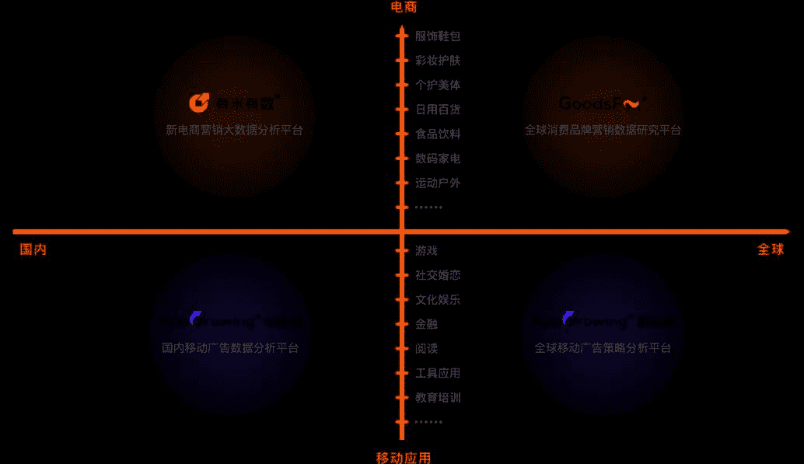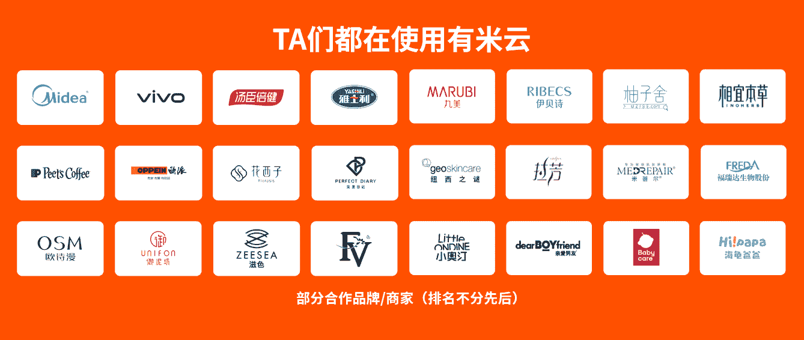

联系方式见尾页

## 目录

### 本土消费分析

- 1. 2023年消费市场恢复向好
- 2. 线上消费保持较快增长

### 抖音市场分析

- 1. 新兴电商市场发展势头强劲
- 2. 全域兴趣电商凸显多元价值
- 3. 全域兴趣电商带来新增量
- 4. 热门赛道发展潜力分析

### 六大赛道发展分析

（服饰鞋包、食品饮料、个护美体、日用百货、彩妆、护肤）

- 1. 市场竞争情况
- 2. 市场发展趋势
- 3. 市场价格布局
- 4. 直播热销单品
- 5. 赛道热销品牌
- 6. 潜力赛道洞察
- 7. 年度热门赛道

Consumer Trends

### 本土消费分析

2023年，社会消费品零售总额471495亿元，总量创历史新高，比上年增长7.2%，呈稳步发展态势。

全国网上零售额154264亿元，比上年增长11.0%。其中，实物商品网上零售额130174亿元，增长8.4%，占社会消费品零售总额的比重为27.6%，比上年多了近0.5个百分点，线上渠道重要性仍在日渐提高。

### 2023年消费市场恢复增长

2020年

2021年

2022年

2023年

社会消费品零售总额（亿元）

实物商品网上零售额（亿元）

社会消费品零售总额同比增速率

实物商品网上零售额同比增速率

数据源：国家统计局。有米云内容中心绘制

社会消费品零售总额当期值&实物商品网上零售额当期值（亿元）

实物商品网上零售额

近4年复合增长率

**7.47%**

社会消费品零售额

近4年复合增长率

**4.73%**

数据源：国家统计局。有米云内容中心绘制

### 吃、穿、用网上零售额累计增长率变化

2020年

2021年

2022年

2023年

随着互联网产业强韧发展以及疫情间养成的网购习惯，在疫情全面放开后的第一年，消费者不再拘泥于单一购物渠道，在实物商品网上零售额中，吃类、穿类、用类商品分别增长11.2%、10.8%、7.1%。

民以食为天。由于疫情期间（2020—2022），线下购物受限，人们不得不将日常所需的食品如米、油、盐转移到线上购买，导致线上“吃”类消费增速最为明显。然而，随着疫情逐步放开（2023），一部分食品购买回归到传统的商超渠道，导致线上吃类消费经历了一段短暂的调整期。

当人们越来越希望从“食”上获得美好的生活体验，吃类消费也很快提振，恢复增长态势。顺应这一变化，企业也正调整自己的商品策略。

### 线上消费保持较快增长

## Marketing Trends

### 抖音市场分析

拥有先发优势的货架电商平台，目前仍稳坐市场的主导地位，但其总交易规模在整体市场中占比有所降低。

内容电商不仅是一个新平台，更是一种新媒介。

传统的货架电商主要依赖图像和文本进行创意实现，而基于短视频和算法的内容电商则依托于声音与画面。这种转变导致营销人员需要围绕视频素材、关键画面、投放计划以及信息流算法来开展工作，形成了一套全新的工作流程，并衍生出了内容电商特有的营销逻辑。

新逻辑代表着新机遇。比如剃须刀商家试图渗透“情人节礼物”场景，在货架电商平台，只能购买一些关键词，并在茫茫多的品类中塞入自己的商品卡标题。货架不会说话，货架无法告诉消费者一个把剃须刀作为礼物的“理由”。

而在短视频平台，消费者首先刷到的是一个“理由”：这个剃须刀比别的礼物更实用，而且每天都会看到，很有存在感，并且是礼盒特别款，质感非常好，能体现你挑选时候的用心。

在此优势下，内容电商平台正凭借其流量优势和创新场景，实现迅猛增长，成为电商的新一极。

## 新兴电商市场发展势头强劲

2023年，抖音电商走向全域一体，提出了“FACT+S全域经营方法论”，以内容+货架双场共振，实现全域协同与增长并行。

## 全域互联互通成为飞轮增长的加速器

## 2023 FACT+S内容+货架双场共振飞轮增长

过去一年是全域兴趣电商持续高速发展的一年。抖音电商GMV同比增长80%，而货架场景GMV同比更突破性地增长184%，而其中更有超过五成的商家商城GMV占比达54%，货架场景成为抖音电商增长的确定性机遇。

## “全域”让兴趣电商成为持续的高速增长阵地

从品类赛道来看，体量大、竞争激烈的服饰鞋包仍然是抖音大盘的“业绩大户”，但论增速，却是由宠物经济遥遥领先，其次是数码家电、运动户外。

服装鞋包行业的体量最大，这可能与该行业的市场规模和消费群体基数较大有关。同时，服饰商品也更容易生产可视化的优质内容，吸引用户的关注和兴趣，进一步推动销量提升。

数码家电行业的增速较快，可能与近年来消费者对智能化、高科技产品的需求增长有关。此外，数码家电产品的客单价较高，也有利于提升销售额和增速。宠物经济快速发展，该行业消费群体相对固定，且具有较高的忠诚度和复购率，也有利于平台的持续发展。

## 抖音大盘热销品类增长情况（2023下半年同比）

数据源：有米有数新电商营销大数据分析平台，统计时间为2023.6.1-12.31

在服饰鞋包赛道中，女装无疑是竞争最卷、最激烈的类目，而箱包竞争体量尚且不大，但增速极高。

除宠物生活和家用电器之外，得益于全域兴趣电商性质与抖音巨大的流量优势，酒类也是一个极具增长动能的类目。也因此，抖音成为越来越多酒企布局新零售渠道的重要平台之一。

值得关注的是，在我国人口出生率持续下滑的大环境下，基于抖音年轻父母用户对科学精细化育儿的追求，结合平台以亲子互动、育儿科普等内容来种草消费者，母婴儿童赛道仍具备高增长潜力。

## 19个热门行业赛道的发展潜力分析

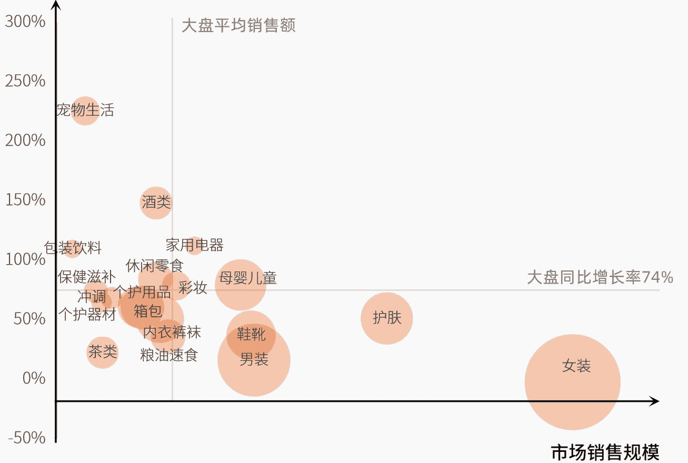

## Categories Development

## 六大赛道发展前景

## 品牌和白牌

“品牌”和“白牌”的边界缺乏清晰定义，本报告将基于抖音电商平台的5种店型展开研究：

已知官方旗舰店，由品牌方直营；旗舰店，由品牌方授权给第三方开设；专卖店和专营店，则分别经营单一授权品牌和多个品牌；以及入局门槛最低的普通店。本报告将普通店视为“商家（白牌）”，而其他店型则视为“品牌”，从而分析平台经营趋势。

同比2022年，服饰鞋包赛道的商家数变化不大，品牌数小幅减少。可能原因有二：

1. 内容电商平台从“宣传媒体”转变为“经营阵地”，不少品牌组建团队下场直营，减少了依赖授权的第三方店铺数量。

2. 前两年一批新崛起的“抖品牌”曾把握住短期风口，但因缺乏长期经营能力，未能及时调整产品策略或营销策略而走向消亡。名目众多，这里不一一列举。

## 普通店铺&品牌店铺数量变化（2023年同比/抖音服饰鞋包）

**-2%**

虽然赛道的竞争体量大，但不菲的利润增长空间仍让大部分商家驻守阵营。

**-8%**

相比赛道店铺数，品牌数的下降幅度更甚，可见具备产品力与内容力的白牌在赛道更具优势。

数据源：有米有数新电商营销大数据分析平台，统计时间为2022.1.1-2023.12.31

回顾2022年，受疫情影响，人们社交活动的频率受限，服饰需求大幅下滑。到了2023年，服饰鞋包赛道的销售额整体增速可观，9—11月涨势明显。数据的背后带来2个信号——

1. 服饰消费需求稳步回升：当疫情放开遇上秋冬换季，赛道市场活跃显现，可见社交活动的恢复，人们对服饰的需求持续释放；

2. 人们在抖音购买服装的习惯已渐养成：相比于淘天、京东等传统电商以图片展示商品的局限性，以短视频+直播方式全面展示商品的抖音，已然获得消费者信任，创意式内容和动态讲解，较快地完成种草到购物的流程。

## 消费需求回升，抖音“内容跳板”助力打爆

## 月销售额&同比增长率（2023下半年同比/抖音服饰鞋包）

**+13%**

**0%**

**+4%**

**+32%**

**+30%**

**+26%**

**+2%**

数据源：有米有数新电商营销大数据分析平台，统计时间为2022.6.1—12.31、2023.6.1—12.31

正如网友所调侃，“不是羽绒服买不起，是军大衣更有性价比”。同比2022年，在销量大幅增长35%的情况下，服饰鞋包大盘销售额的增长不到20%，低价商品正激发消费者的购买意愿。

结合赛道各价格带的销量、销售额占比变化，50元以内的商品销售增加；50—300元以上，随着价格上升，销售明显下降。综合销量、销售额来看，低价格商品表现全面优于高价格商品。

## 商品低于50元吃香，高于300元有潜力

销量&销售额同比增长变化（2023下半年同比/抖音服饰鞋包）

销量同比

**+35%**

销售额同比

**+18%**

数据源：有米有数新电商营销大数据分析平台，统计时间为2022.6.1—12.31、2023.6.1—12.31。

各价格带销量占比变化

（2023下半年同比/抖音服饰鞋包）

**+12%**

**-6%**

**-5%**

**-1%**

**+9%**

**-1%**

**-3%**

**-4%**

各价格带销售额占比变化

（2023下半年同比/抖音服饰鞋包）

**2022H2**

**2023H2**

女性服饰、塑身衣、护膝等的直播销量普遍较高，通过实时互动的直播间进行商品外观、功能性效果的展示，配合产品信息讲解，比精心设计过的短视频更能打动消费者下单。

对于配饰类、鞋类商品，更强调使用场景的展示，且需要镜头特写来展示材质、工艺、设计细节，直播带货需耗费更多的时间和互动来构建同等效果，因而短视频带货方式更适合在短时间内全面展示商品特色，种草消费者。

数据源：有米有数新电商营销大数据分析平台，统计时间为2023.1.1—12.31。

### 直播销量占比TOP20单品（2023年/抖音服饰鞋包）

| 序号 | 单品 | 直播销量占比 |
|---:|---|---:|
| 1 | 内衣 | 62% |
| 2 | 塑身套装 | 56% |
| 3 | 裙子 | 53% |
| 4 | 长筒袜 | 52% |
| 5 | 女裤 | 51% |
| 6 | 包 | 49% |
| 7 | 女式套装 | 49% |
| 8 | 女上衣 | 47% |
| 9 | 塑身衣 | 46% |
| 10 | 旅行箱包 | 46% |
| 11 | 男式套装 | 44% |
| 12 | 棉袜 | 43% |
| 13 | 男裤 | 42% |
| 14 | 连裤袜 | 42% |
| 15 | 男式服装 | 42% |
| 16 | 男士内裤 | 41% |
| 17 | 护膝 | 40% |
| 18 | 男上衣 | 40% |
| 19 | 外配饰 | 37% |
| 20 | 女鞋 | 36% |

数据源：有米有数新电商营销大数据分析平台，统计时间为2023.6.1—12.31。

## 服饰鞋包热销TOP100品牌

- 回力
- 鸭鸭
- 雅鹿
- 罗蒙
- 斐乐
- 波司登
- 雪中飞
- 皮尔卡丹
- 海澜之家
- 耐克
- 猫人
- 安踏
- ubras
- 森马
- 真维斯
- 高梵
- 杉杉
- 恒源祥
- 拇指白小T
- 阿迪达斯
- 啄木鸟
- 老爷车
- 七匹狼
- 斯凯奇
- 蕉内
- 鸿星尔克
- 百丽
- 李宁
- 卡帝乐鳄鱼
- 浪莎
- 达芙妮
- 骆驼
- 特步
- 太平鸟
- 红蜻蜓
- 北极绒
- 大嘴猴
- 爱慕
- Disney
- 艾莱依
- 朗姿
- 蔻驰
- 南极人
- 茵曼
- 马克华菲
- 雅戈尔
- 柒牌
- 芬腾
- 拉夏贝尔
- 吉普
- 奥古狮登
- Only
- 卡宾
- Edition
- 布先生
- 蕉下
- 范斯
- 曼妮芬
- 优衣库
- 婧麒
- 老人头
- 足力健
- 乔丹
- New Balance
- 古驰
- 俞兆林
- 稻草人
- 雨果博斯
- 意尔康
- 伯希和
- 袋鼠
- 乐途
- 卡尔文·克莱恩
- 匹克
- Lee
- 玛丝菲尔
- 富贵鸟
- 李维斯
- 婷美
- 彪马
- 金利来
- 鳄鱼
- 坦博尔
- 洁丽雅
- Mr.Bu
- 人本
- 鬼塚虎
- 贵人鸟
- 唯一俏
- NEIWAI内外
- 卓诗尼
- 妖精的口袋
- 嫚熙
- 巴拉巴拉
- 巴布豆
- 诺泰
- 迪奥
- 飞跃
- 安德玛
- 博柏利

综合销售额同比增长率、销售额两大核心指标，回力、鸭鸭、雅鹿、罗蒙在赛道竞争中处于领先地位，斐乐、波司登、雪中飞等品牌紧随其后，处于第二梯队。

大多数处于早期发展阶段或者正在进行转型的传统品牌，比如百丽、老爷车、鸿星尔克等，分布在第三梯队，整体实力相对接近，竞争非常激烈。

## 回力遥遥领先，鸭鸭成“超级黑马”

销售额TOP30品牌分布（2023下半年同比/抖音服饰鞋包）

数据源：有米有数新电商营销大数据分析平台，统计时间为2022.6.1—12.31、2023.6.1—12.31；气泡大小表示平均成交价。

同比增长率

1. 服饰套装化趋势明显：快节奏生活的当代，省去自行搭配麻烦、风格统一的男女式套装更受消费者热捧；
2. 旅行箱包市场高速发展：在旅行业复苏的2023年，人们外出旅行的场景激增，箱包市场随之迎来黄金窗口期；
3. 配饰市场潜力攀升：鞋配件、外配饰赛道有较大的增速，表明人们比以往更关注整体穿搭的舒适度和效果；
4. 商务户外类男装需求释放：除男式套装外，男裤、男上衣市场的销售额都在迅速增长，预测商旅、运动等场景增多，男性消费者对商务类、户外类服装的需求集中释放。

## 疫后迎来爆发机遇，行业多向走俏

服饰鞋包各细分赛道的发展潜力分析

数据源：有米有数新电商营销大数据分析平台，统计时间为2022.6.1—12.31、2023.6.1—12.31；气泡大小表示店铺数。

同比增长率

2023年，随着疫情放开，人们的出行意愿得到了极大的释放，旅行市场迎来了繁荣时期。

据文化和旅游部统计，2023年前三季度，国内旅游总人次36.74亿，较上年同期激增15.8亿，同比增长75.5%。

结合上页数据所示，随着人们出行频率的提高，对旅行箱包的需求也呈现井喷式增长，2023下半年销售额同比增长超200%。据抖音官方披露，自抖音双11好物节开始至11月2日，整体销售额相比去年提升79%，更凸显出消费者对其的需求。

面对如此充满机遇的赛道，品牌和商家更需掌握消费者的需求动向，不断创新和提升自己的产品设计和品质，同时更精准地布局商品标题，以提升商品的曝光量。

为此，下页为各位附上旅行箱包热销商品的产品卖点、沟通场景两类关键词：

数据源：文化和旅游部、有米有数新电商营销大数据分析平台。

2023年前三季度国内旅游人次情况（单位：亿）

| 季度 | 2023年同比增长 |
|---|---:|
| 第一季度 | +46.5% |
| 第二季度 | +86.9% |
| 第三季度 | +101.9% |

## 热销商品—沟通场景类关键词

## 热销商品—产品卖点类关键词

食品饮料赛道，消费者更关注商品的品质、口感、营养成分，产品力是商家的核心竞争力。

这意味着食饮行业进入壁垒相对较低，新品牌、新品类仍然具备市场机会。一个例子是上线仅1年，在抖音已月销超百万袋的新锐螺蛳粉品牌“臭宝”。

同比2022年，食饮品牌数同比增长13%，店铺数同比增长超三成，越来越多食饮企业正涌向抖音，新一轮市场竞争正徐徐展开。

## 竞争加剧，更考验商家的市场敏捷度

普通店铺&品牌店铺数量变化（2023年同比/抖音食品饮料）

食饮行业入局者增多，竞争压力越发激烈。

赛道商家连年递增，新品牌不断入局。

**33%**

**13%**

继前文所提，食品类商品在实物商品网上零售额增长最高。由此反映了食饮行业在线上渠道的消费需求持续增强。

从抖音平台来看，食饮行业在2023年下半年销售额高歌猛进，月销售额同比2022年同期全线增长。

相比于服饰鞋包赛道，食品饮料更容易在促销节点迎来爆发。无论是“双11”还是“618”期间，食品饮料都有更显著的销售增长。随着内容电商发展，企业应投入更多力量去顺应平台的全年促销节奏。

## 大促间消费需求强劲，机遇凸显

月销售额&同比增长率（2023年下半年同比/抖音食品饮料）

**+57%**

**+11%**

**+17%**

**+90%**

**+104%**

**+95%**

**+17%**

数据源：有米有数新电商营销大数据分析平台，统计时间为2022.6.1—12.31、2023.6.1—12.31。

同比2022年下半年，食品饮料赛道在2023年下半年以45%的销量增速，拉动近6成的销售额，呈现出巨大的上升势能，客单价略有提升。

具体来看，客单价提升主要发生在10元以内的低价格带中。在这一区间，消费者的价格敏感度降低了，用俗话来说就是“十元以内消费自由”，甚至会为了品质购买稍贵一些的商品。

虽然看起来像是“蝇头小利”，但事实上，这对于企业利润而言是一个巨大的增长空间：毕竟过去5毛钱的辣条，消费者愿意支付5元以换取品质时，利润空间就近乎10倍增长。

## 热销价格带两极分化，消费力集中在10元以内商品

销量&销售额同比增长变化（2023年下半年同比/抖音食品饮料）

销量同比

**+45%**

销售额同比

**+57%**

各价格带销量占比变化

（2023年下半年同比/抖音食品饮料）

**+4%**

**-2%**

**-1%**

**-1%**

**+14%**

**-6%**

**-6%**

**-2%**

各价格带销售额占比变化

（2023年下半年同比/抖音食品饮料）

**2022H2**

**2023H2**

数据源：有米有数新电商营销大数据分析平台，统计时间为2022.6.1—12.31、2023.6.1—12.31。

金华火腿、风干鸡、广式月饼等本土地域美食在抖音平台更倾向于直播带货的方式，通过直播间展示商品的制作过程、工厂环境，主播介绍地方文化与风俗人情，传达出商品货真价实之余，也承载着美食本身独特的情怀和记忆。

主播边吃边介绍商品的“吃播”，在抖音最为常见。速食类和零嘴类商品通过美食垂直类达人或者中腰尾部的泛类达人带货，而健康类商品，如巢蜜、养身粥、黑奇亚籽等等，则通过母婴、健康、时尚等垂类达人直播转化。

数据源：有米有数新电商营销大数据分析平台，统计时间为2023.1.1—12.31。

## 直播销量占比TOP20单品（2023年/抖音食品饮料）

| 序号 | 单品 | 直播销量占比 |
|---:|---|---:|
| 1 | 调和油 | 70% |
| 2 | 松露巧克力 | 70% |
| 3 | 零食礼包 | 69% |
| 4 | 白虾 | 66% |
| 5 | 金华火腿 | 64% |
| 6 | 纸皮/薄皮核桃 | 63% |
| 7 | 风干鸡 | 63% |
| 8 | 巢蜜 | 62% |
| 9 | 鸡爪 | 62% |
| 10 | 养身粥 | 62% |
| 11 | 黑奇亚籽 | 61% |
| 12 | 混合果仁 | 61% |
| 13 | 酸辣粉 | 60% |
| 14 | 即食卤味 | 59% |
| 15 | 广式月饼 | 58% |
| 16 | 手工香肠 | 57% |
| 17 | 方便粉丝 | 54% |
| 18 | 火锅底料 | 54% |
| 19 | 牛排 | 54% |
| 20 | 手撕牛肉 | 51% |

数据源：有米有数新电商营销大数据分析平台，统计时间为2023.6.1—12.31。

## 食品饮料热销TOP100品牌

茅台、五粮液、泸州老窖、伊利、认养一头牛、三只松鼠、白象、锋味派、大希地、金六福、洋河、空刻、蒙牛、盐津铺子、良品铺子、西麦、诺梵、五谷磨房、百草味、好欢螺、康师傅、玛莎诺娅、汾酒、九阳豆浆、德芙、袋鼠先生、习酒、国台、雀巢、农夫山泉、王小卤、官栈、中茶、秋田满满、轩尼诗、长寿花、同仁堂、十月稻田、舍得、君乐宝、可口可乐、家乐、青岛、林家铺子、洽洽、卡尔顿、张裕、口水娃、金龙鱼、榴芒一刻、三得利、百威、小石头、梅见、卡士、星巴克、沱牌、白大师、妙可蓝多、李子柒、卫龙、棒棒娃、旺旺、金燕耳、隅田川、瑞士莲、七年五季、诺特兰德、乐事、鲨鱼菲特、茶颜悦色、小黄象、娃哈哈、胡姬花、李锦记、王饱饱、锐澳、奥利奥、四只猫、小罐茶、雀巢咖啡、莫小仙、柏慧、马爹利、轩妈、元气森林、乌江、飞鹤、观云、甘源、纳斯、食验室、英氏、佳沛、皇上皇、福满棚、恒都、思念、加点滋味、拉面说。

数据源：有米有数新电商营销大数据分析平台，统计时间为2023.6.1—12.31。

酒类行业电商化正呈现出肉眼可见的增长态势。火了一整年的直播卖酒，谁更会卖酒？从数据来看，茅台依旧占据着龙头大哥的地位，五粮液紧追其后。可见马太效应在酒赛道尤为明显。

另外，在抖音从0基础到品类销售前几名，五谷磨房、西麦等老牌子的成长速度也值得关注，可见在捕捉到抖音平台营销技巧的前提下，老牌新做潜力无限。

## 酒类马太效应明显，老牌尽显无限潜力

销售额TOP30品牌分布（2023年下半年同比/抖音食品饮料）

数据源：有米有数新电商营销大数据分析平台，统计时间为2022.6.1—12.31、2023.6.1—12.31；气泡大小表示平均成交价。

同比增长率

食品饮料行业在2023年下半年整体呈现出积极的增长态势，多个赛道实现了显著的销售增长。

其中，食品原料、酒类、食用油和饮料等赛道的高速增长表明，消费者对基础食品和特定品类的需求依然旺盛，品牌在这些领域的投入和营销策略取得了良好效果。

部分赛道，如坚果炒货、大米面粉、膨化食品等增长乏力，因而企业需要更加关注市场变化和消费者需求，调整策略以应对竞争和变化。

## 行业全面增长积极，但需关注市场变化

食品饮料各细分赛道的发展潜力分析

数据源：有米有数新电商营销大数据分析平台，统计时间为2022.6.1—12.31、2023.6.1—12.31；气泡大小表示店铺数。

同比增长率

后疫情时代，人们的健康意识觉醒，促使他们在多方面更关注自身健康。运动健身、饮食习惯，甚至是零食的选择也发生了显著的变化。传统的油炸、高糖零食逐渐被更健康、营养丰富的选项所替代。

肉干熟食作为一种便于携带、食用，并且相对更健康的食品，迎来一个显著的扩张期。据有米有数数据显示，抖音电商肉干熟食赛道2023年下半年的销售额同比增长接近100%。

然而，消费者对肉干熟食需求的增加，也对商家提出了更高的要求。商家需要思考产品的核心竞争力，是独特的口味还是优质成分、健康工艺？

同时，商家还需关注消费者的口味偏好和食用场景需求。为此，下页为各位附上热销商品产品成分、沟通场景类关键词，从而优化产品设计和营销策略。

数据源：有米有数新电商营销大数据分析平台。

## 热销商品—产品成分类关键词

## 热销商品—沟通场景类关键词

随着消费者对个人护理和美容产品的需求增加，个护美体市场的规模也在不断扩大。这吸引了更多的中小商家和品牌进入这个领域——在抖音这个新的消费平台中，中小商家拥有难得的出圈机会。比如在2023年抖音双11，“巨头”神话不再，行业销售额前十里有卡诗、Oralshark、KONO、Spes诗裴丝、半亩花田等新锐品牌。

其中，“Spes诗裴丝”更是登顶，获得抖音洗护发造型品牌榜第一的国货品牌。凭借抖音内容场，让自家“免洗蓬松喷雾”成为现象级新品。

## 个护市场繁荣，品牌竞相出圈

普通店铺&品牌店铺数量变化（2023年同比/抖音个护美体）

## 赛道市场规模不断扩大

## 入局的品牌商家愈加多

数据源：有米有数新电商营销大数据分析平台，统计时间为2022.1.1—2023.12.31

**37%**

**8%**

个护美体商品的消耗周期相对食品饮料较长，全年销售额集中在下半年的9—11月，以抖音双11好物节期间最为火热，是下半年中的业绩高峰。

结合有米有数双11榜单，KONO、参半、满婷、极萌、觅光、徕芬等新锐国货品牌，在抖音双11个护赛道名列前茅，乘着“李佳琦花西子事件”东风的蜂花更是在双11大促卖出1000万—2500万的佳绩。

## 双11大促迎来增量天花板，同比增长超100%

月销售额&同比增长率（2023下半年同比/抖音个护美体）

数据源：有米有数新电商营销大数据分析平台，统计时间为2022.6.1—12.31、2023.6.1—12.31

和食品饮料赛道一样，消费者更关注低价格带商品，看起来是“消费降级”，但对10元以下商品的价格敏感度实质降低了，在这方面又实现了“消费升级”。当商品超过50元，消费者才会把“性价比”放在显著位置考虑。

简而言之：小商品，大利润。比如个护领域的牙膏、牙线、牙刷、小规格试用装等。在其他价格段整体变化不显著，企业可对比行业大盘、竞争对手的价格策略，结合自身实际，规划商品价格。

## 低价格带里的消费升级

销量&销售额同比增长变化（2023下半年同比/抖音个护美体）

销量同比

**+45%**

销售额同比

**+58%**

各价格带销量占比变化

（2023下半年同比/抖音个护美体）

**+3%**

**+1%**

**-2%**

**-1%**

**+9%**

**+1%**

**-4%**

**-6%**

各价格带销售额占比变化

（2023下半年同比/抖音个护美体）

**2022H2**

**2023H2**

数据源：有米有数新电商营销大数据分析平台，统计时间为2022.6.1—12.31、2023.6.1—12.31

从数据来看，在抖音个护美体赛道，功效类或者客单价高的个护商品更适合通过直播转化。

通过直播，主播可为观众解答疑问、展示商品效果、使用方法等等，配合现场优惠释放，增强消费者的购买欲望。

另外，对于牙膏、耳勺、吸油纸等个护小用品，或者客单价相对较低的商品，常采用“直播+短视频”双重带货模式。

数据源：有米有数新电商营销大数据分析平台，统计时间为2023.1.1—12.31

## 直播销量占比TOP20单品（2023年/抖音个护美体）

| 序 | 单品 | 直播销量占比 |
|---:|---|---:|
| 1 | 电动修眉刀 | 73% |
| 2 | 美容仪 | 57% |
| 3 | 电动牙刷 | 56% |
| 4 | 电吹风 | 56% |
| 5 | 洗护套装 | 55% |
| 6 | 腰椎治疗仪 | 55% |
| 7 | 剃须刀/修须刀/修胡子造型器 | 55% |
| 8 | 牙齿美白/护理剂 | 55% |
| 9 | 育发 | 52% |
| 10 | 安心裤 | 50% |
| 11 | 理发器 | 49% |
| 12 | 睡眠仪/助眠仪 | 48% |
| 13 | 电动磨脚器/修脚器 | 48% |
| 14 | 润眼液 | 47% |
| 15 | 牙膏 | 47% |
| 16 | 耳勺 | 46% |
| 17 | 眼罩 | 46% |
| 18 | 吸油纸 | 46% |
| 19 | 卫生巾 | 46% |
| 20 | 沐浴露 | 45% |

## 个护美体热销TOP100品牌

高缇雅、飞科、AMIRO、KONO、徕芬、usmile、自由点、参半、苏菲、Mesmooth、雅萌、七度空间、卡诗、蜂花、Oralshark、海飞丝、飞利浦、Ulike、巴黎欧莱雅、妇炎洁、云南白药、若也、施华蔻、清扬、护舒宝、倍轻松、潘婷、KIMTRUE、高洁丝、诗裴丝、黑人、浅香、高露洁、吉列、力士、Avecmoi、舒蕾、戴森、冰泉、听研、阿道夫、冷酸灵、yoose、舒肤佳、薇婷、沙宣、超人、珍视明、玛莉吉亚、倍至、Befe、SKG、菲诗蔻、左点、章光101、美的、多芬、松下、佳洁士、敬修堂、软风研究社、滋源、上海药皂、澳宝、理然、满婷、Chillmore、袋鼠妈妈、舒适达、水之蔻、博朗、海肌兰、雷瓦、韩金靓、欧舒丹、养元青、志高、发之食谱、同仁堂、乐而雅、康佳、蓓慈、Bop、贝德玛、三个魔发匠、曼秀雷敦、索芙特、雨洁、先科、左颜右色、霸王、蜗蜗、半亩花田、百年扁氏、奥佳华、全棉时代、捷护佳、好易康、子初、狮王

从这份数据中，我们可以看出抖音电商个护美体市场呈现出两极分化的趋势。

一方面，高缇雅、参半、卡诗等品牌实现了超80%的高速增长，显示出强大的市场吸引力和竞争力。另一方面，AMIRO、KONO和诗裴丝等品牌则出现了负增长，可能面临市场策略调整或品牌形象重塑的挑战。

## 市场表现分化明显，品牌竞争加剧

销售额TOP30品牌分布（2023下半年同比/抖音个护美体）

数据源：有米有数新电商营销大数据分析平台，统计时间为2022.6.1—12.31、2023.6.1—12.31；气泡大小表示平均成交价

同比增长率

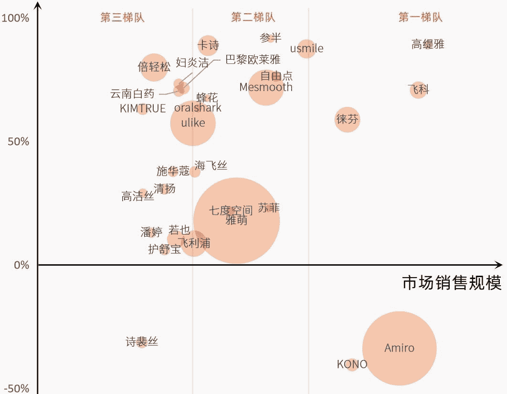

个护美体市场各细分赛道呈现出不同程度的增长。其中，男士护理赛道以惊人的477%同比增长率领跑；眼部护理和纤体塑形赛道也分别以213%和202%的增长率紧随其后，表明消费者对这两个领域的关注度持续上升。

相比之下，女士护理、美发护发等传统个护美体赛道的增长率较为稳健，分别为80%和72%，反映出这些市场的成熟度和稳定性。

## 男士护理市场“狂飙”式增长，前景无限

数据源：有米有数新电商营销大数据分析平台，统计时间为2022.6.1—12.31、2023.6.1—12.31；气泡大小表示店铺数

## 个护美体各细分赛道的发展潜力分析

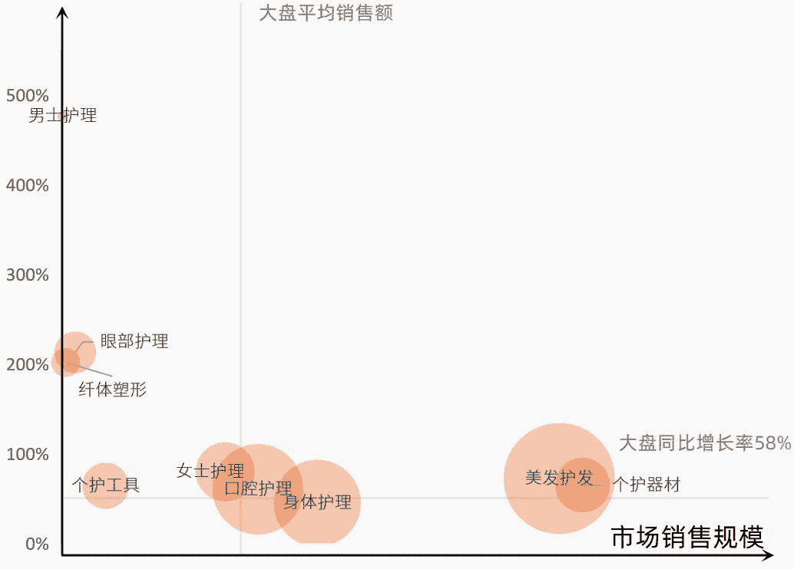

同比增长率

近几年，“他经济”异军突起，大有与“她经济”平分秋色之势。在这个浪潮中，男士护理市场正在经历从传统到现代的蜕变。男性消费者不再满足于基础护理产品，而是开始追求高品质、个性化的护肤和护理体验。

这一转变推动了男士护肤品、美发产品、身体护理用品等细分市场的快速扩张。据有米有数数据，2023下半年同比2022下半年，抖音电商男士护理市场销售额同比增长超过400%。

值得注意的是，许多购买男士护理产品的消费者都是女性。因此，商家在制定营销策略时，应将女性作为主要目标群体，通过精准的关键词布局来吸引她们的注意力。

此外，商家还可以借助巨量算数，根据热搜相关内容词，及时掌握消费者的兴趣和关注点。

为了更直观地展示这些热门搜索词，我们特别在下页附上了相关词云图表：

数据源：有米有数新电商营销大数据分析平台

男士护理热销商品关键词

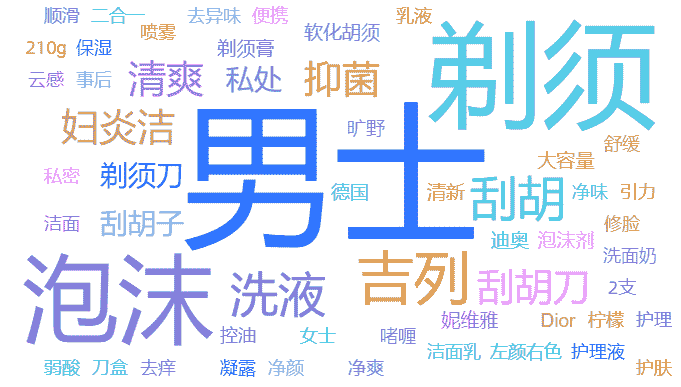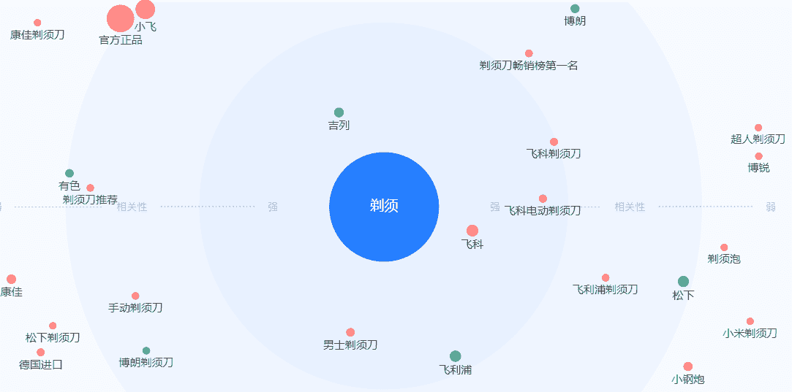

巨量算数-剃须-热搜内容关联词

作为生活刚需的日用品，蕴藏着强大的消费市场，然而影响消费者购买决策的重点因素在于产品而非品牌。

面对入门门槛相对较低的日用百货，且抖音电商2023年对中小商家的扶持力度加大，降低开店门槛，更多商家参与到赛道竞争。同比2022年，入驻抖音的中小商家增多近三成，少量品牌因无法适应市场变化或竞争压力而退出。

对此，中小商家应强化内容营销，通过精准定位特定用户群体，从细分市场弯道超车；而品牌商家则通过提供优质的售前、售中和售后服务，增强消费者对品牌的信任和忠诚度，同时持续创新符合市场趋势与消费者需求的新品，保持活力与竞争力。

## 市场博弈加剧，品牌竞争难上加难

普通店铺&品牌店铺数量变化（2023年同比/抖音日用百货）

抖音平台市场准入门槛降低，吸引更多中小商家入驻

少量品牌不敌压力与变化，从抖音平台退场

数据源：有米有数新电商营销大数据分析平台，统计时间为2022.1.1-2023.12.31

**29%**

**-1%**

同上，在抖音日用百货赛道的9-11月大促活动期间，消费者展现出较高的购买热情。但需求大的同时，也意味着大促期间竞争异常激烈。

对于一年四季都是刚需的日用百货品而言，中小商家可以选择在6-8月错峰抢量，避免与大型品牌直接竞争；如果产品力较强，中小商家也可以通过优质的短视频素材，展示商品特点与优势，争取消费者的青睐。

品牌商家可与头部达人、明星KOL或者知名品牌跨界合作，通过KOL名气、联名产品、品牌互推的方式，扩大品牌影响力和曝光度，吸引更多潜客。

## 大促竞争加剧，中小商家适合错峰避战

月销售额&同比增长率（2023下半年同比/抖音日用百货）

从数据来看，日用百货行业在2023年下半年的销量同比增长超过20%，销售额同比增长更是接近60%，呈现出强劲的增长势头。

消费者对中高价的商品需求增加，无论是在10-50元、50-100元，还是超过100元的价格带中，销售额都有显著提升。对比销量的缓慢增长，推测增长主要来自于客单价提振——即消费者对日用百货的价格敏感度整体下降。同时，“10元店”正在抖音退潮。

## 低价商品热度下降，中高价商品值得关注

销量&销售额同比增长变化（2023下半年同比/抖音日用百货）

销量同比

**+21%**

销售额同比

**+58%**

各价格带销量占比变化

（2023下半年同比/抖音日用百货）

**-2%**

**+2%**

**0%**

**+1%**

**-40%**

**+10%**

**+11%**

**+19%**

各价格带销售额占比变化

（2023下半年同比/抖音日用百货）

**2022H2**

**2023H2**

数据源：有米有数新电商营销大数据分析平台，统计时间为2022.6.1-12.31、2023.6.1-12.31

对于“厨房纸、油烟机清洁剂、不锈钢清洁剂”这类生活中常被冠上“智商税”非议的品类，短视频直接展示效果的方式不能打消消费者的下单顾虑，而在直播间通过实时展示商品的清洁效果和实用性，能有效说服消费者，提高转化率。

面包分片器、自动搅拌杯、除尘神器等生活小工具的热销，可见通过直播详细介绍商品的使用场景和便利性，解答消费者疑惑之余，能增强他们的购买信心。

数据源：有米有数新电商营销大数据分析平台，统计时间为2023.1.1-12.31

2023年-日用百货-直播销量占比TOP20单品

| 序号 | 单品 | 直播销量占比 |
|---:|---|---:|
| 1 | 厨房纸 | 86% |
| 2 | 油烟机清洁剂 | 72% |
| 3 | 不锈钢清洁剂 | 65% |
| 4 | 羽绒服干洗剂 | 63% |
| 5 | 清洁器 | 62% |
| 6 | 面包分片器 | 61% |
| 7 | 自动搅拌杯 | 61% |
| 8 | 炒锅 | 61% |
| 9 | 平板拖把 | 61% |
| 10 | 花露水 | 61% |
| 11 | 封口机 | 60% |
| 12 | 扫把 | 58% |
| 13 | 除尘神器 | 58% |
| 14 | 泡沫清洁剂 | 58% |
| 15 | 暖腹宝 | 58% |
| 16 | 水具套装 | 58% |
| 17 | 纸板箱/纸盒 | 57% |
| 18 | 洗衣粉 | 57% |
| 19 | 储药箱 | 57% |
| 20 | 衣物柔顺剂 | 57% |

数据源：有米有数新电商营销大数据分析平台，统计时间为2023.6.1—12.31

## 日用百货热销TOP100品牌

- 立白
- 心相印
- 植护
- 蓝月亮
- 维达
- 洁柔
- 清风
- 活力28
- 苏泊尔
- 滴露
- 水卫仕
- 得宝
- 希乐
- 丝飘
- 洁丽雅
- 康巴赫炒锅
- 全棉时代
- 张小泉
- 威莱
- 佳帮手
- 网易严选
- 优勤
- 海肌兰
- 太力
- 意可可
- 双立人
- 标奇
- 潜水艇
- 拜耳
- 菲碧清
- 蓝漂
- 可心柔
- 禧天龙
- 卫仕
- 富光
- 金纺
- 爱丽思
- 金鹿
- 金稻
- 希诺
- 宝家洁
- 丁家宜
- 华生
- 斑布
- 太太乐
- 之宝
- 金铂喜
- 威露士
- 顾家家居
- PWU
- 福腾宝
- 涤初
- 天堂伞
- 倍轻松
- 无印良品
- 白猫
- 乐扣乐扣
- Airfunk
- 凤全
- 爱仕达
- 贝因美
- 菲仕乐
- Revomax
- 六神
- 花后
- OAC
- 戴可思
- 最生活
- 沫檬
- 欧丽源
- 名创优品
- 容山堂
- 当妮
- Vanish渍无踪
- 彩虹
- 奥妙
- 南山先生
- 四季沐歌
- 茶花
- 简柔
- 雕牌
- 碧浪
- 卡斐乐
- 兰可欣
- 公牛
- 三棵树
- 上海药皂
- 汰渍
- 大王
- 金龙鱼
- 蒂普提克
- 金隆兴
- 壹品印象
- 天际
- 贝瑟斯
- 洗悦
- 铜师傅
- 戴维贝拉
- 风倍清
- 郁金香

拥有70多年历史的老牌国货“活力28”以137%的同比增长率领跑市场，全棉时代和立白紧随其后，增长率均超过90%，显示出强劲的增长势头。

然而，也有部分品牌出现负增长，如维达、双立人、康巴赫炒锅等。在赛道不断涌入新品牌、新商家的情况下，这些品牌可能面临市场份额下降或品牌竞争力减弱的挑战。

## 老国货“活力28”领跑，部分老牌遇挑战

销售额TOP30品牌分布（2023下半年同比/抖音日用百货）

数据源：有米有数新电商营销大数据分析平台，统计时间为2022.6.1—12.31、2023.6.1—12.31；气泡大小表示平均成交价

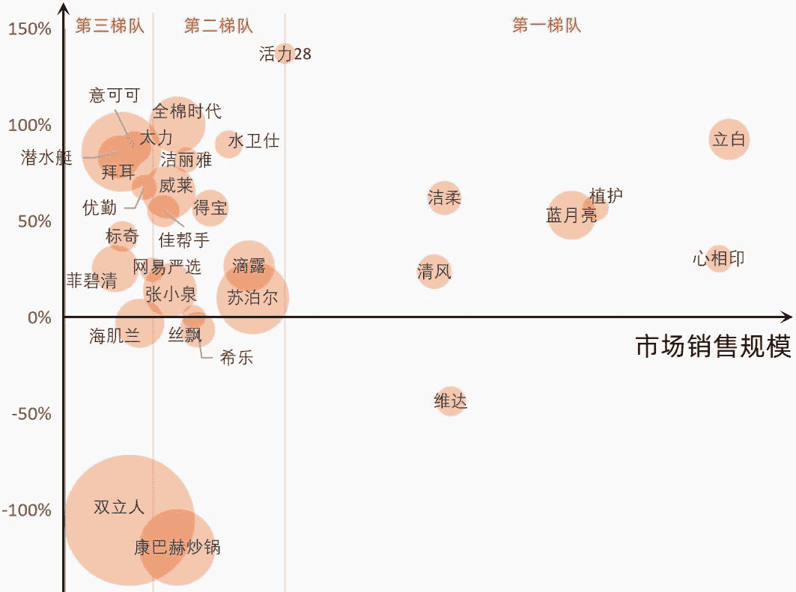

同比增长率

从数据中可以看出，抖音电商日用百货市场细分赛道中，居家日用赛道的增长率最高，为177.46%，远超其他赛道，显示出巨大的市场潜力和增长空间。

清洁用品赛道也实现了较高的增长率，为155.74%，表明消费者对于家庭清洁产品的需求正在快速增长。相比之下，收纳用品、杯具茶具、锅具餐具和厨房配件等赛道增长率相对较低，但仍有稳定的增长表现。企业应关注居家日用和清洁用品市场，同时持续优化其他赛道的产品和服务。

## 居家日用市场呈现巨大增长空间

日用百货各细分赛道的发展潜力分析

数据源：有米有数新电商营销大数据分析平台，统计时间为2022.6.1—12.31、2023.6.1—12.31；气泡大小表示店铺数

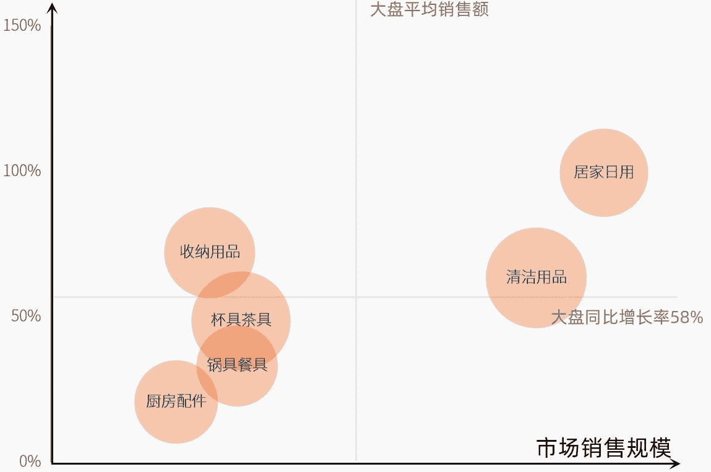

同比增长率

据HOMELIFE发布的《2023全球家居日用品市场洞察报告》数据，全球家居日厨用品市场规模不断扩大，预计到2027年将达到3590亿美元。

特别值得关注的是亚太地区，其市场规模占全球总量的22.4%。亚太地区拥有众多的人口和迅速发展的经济，这些因素共同推动了居民消费水平的持续提高。随着人们对生活质量和美好生活的追求，对家居日厨用品的需求也不断增长。

在这一市场背景下，商家需要紧密关注消费者的需求变化，根据不同的沟通场景和目标受众来灵活调整关键词策略，以实现更好的营销效果。下页附上赛道上热销商品的产品卖点、沟通场景、沟通人群类关键词：

数据源：有米有数新电商营销大数据分析平台

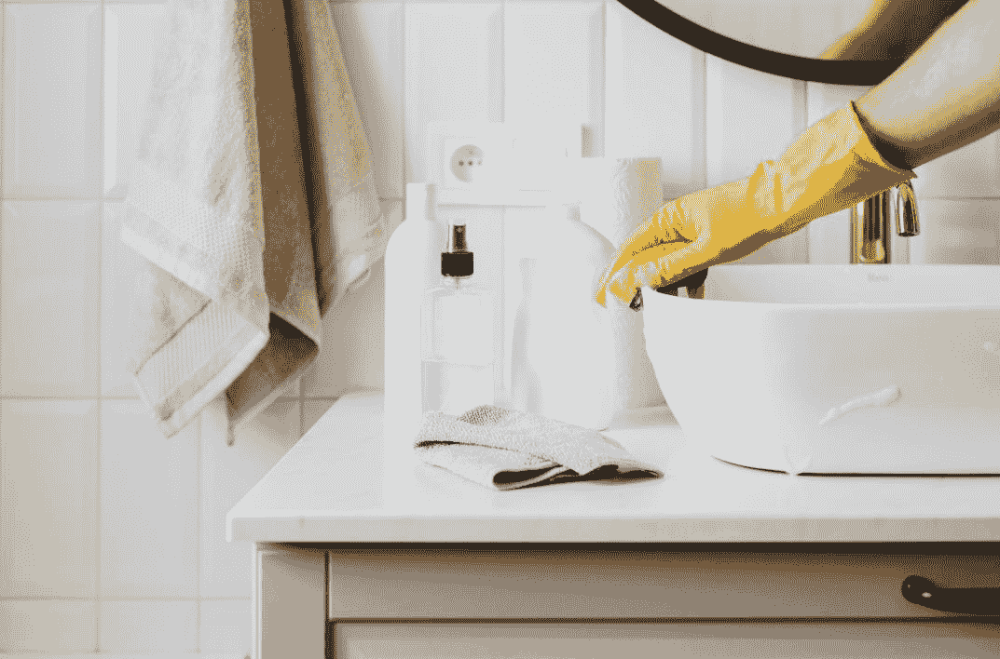

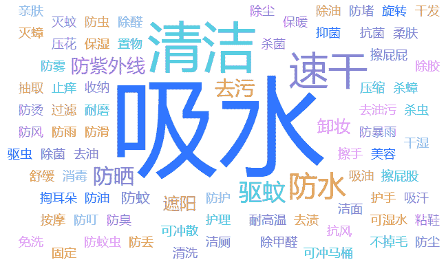

## 热销商品—产品卖点类关键词

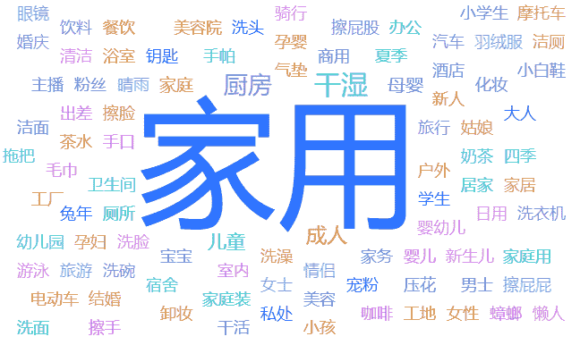

## 热销商品—沟通场景人群类关键词

2023年同比2022年，彩妆品牌在抖音电商平台的扩张步伐正在加快，中小商家数增多超4成，新入驻的品牌也持续增多。由此反映出企业对抖音电商平台商业价值的认可，并希望借此平台进一步拓展市场份额。

新企业的加入无疑会加剧市场竞争，但优秀的金子难掩光芒。比如在抖音双11，以1亿+销售额、超200万销量拿下抖音彩妆GMV第一的VC，以及FunnyElves方里、彩棠等新锐彩妆品牌。

## 赛道竞对日趋加剧，但金子终有发光的时刻

普通店铺&品牌店铺数量变化（2023年同比/抖音彩妆）

抖音彩妆市场迅速扩张，更多企业涌入赛道抢蛋糕

新入驻品牌持续上升，将面临市场重要挑战

数据源：有米有数新电商营销大数据分析平台，统计时间为2022.1.1—2023.12.31

**42%**

**28%**

在9—10月，也即抖音中秋好礼季、双11好物节大促期间，是彩妆行业销售的高峰期，同时也是大部分企业集中抢量、竞争最惨烈的时间段。如果企业想在该期间脱颖而出，需注重短视频和直播多渠道布局、产品差异化竞争力等等。

虽然11—12月也有竞争，但相对于9—10月来说竞争较少，而6—7月是竞争较少的时期。如果企业资源有限或希望避免高峰期的高成本竞争，可以考虑在这些时间段进行错峰抢量，以避开主要竞争对手。

## 双11大促竞争最惨烈，把握6—7月黄金抢量期

月销售额&同比增长率（2023下半年同比/抖音彩妆）

**+29%**

**+19%**

**+55%**

**+131%**

**+132%**

**+94%**

**+79%**

数据源：有米有数新电商营销大数据分析平台，统计时间为2022.6.1—12.31、2023.6.1—12.31

从数据综合来看，抖音电商平台彩妆行业的价格带呈现出中低端和高端并存的多样化优势。

2023年，随着国货彩妆的强势崛起，中低价格带的彩妆商品日益丰富，为消费者提供了更多性价比高的选择。但结合销售额占比情况，高端彩妆品牌依旧在抖音占据着不倒的地位。

因此，企业需明确自身目标市场和消费者群体的需求、购买力，同时关注竞对的定价策略，结合商品的生产成本，制定商品价格。

## 行业中低端价格带吃香，高价商品仍占重位

销量&销售额同比增长变化（2023下半年同比/抖音彩妆）

销量同比

**+68%**

销售额同比

**+78%**

各价格带销量占比变化（2023下半年同比/抖音彩妆）

**-3%**

**+5%**

**0%**

**-2%**

**+4%**

**+6%**

**0%**

**-9%**

各价格带销售额占比变化（2023下半年同比/抖音彩妆）

**2022H2**

**2023H2**

数据源：有米有数新电商营销大数据分析平台，统计时间为2022.6.1—12.31、2023.6.1—12.31

彩妆产品往往与特定的场合、氛围和妆容风格紧密相关。比如，日常妆容、职场风格、晚宴场景等，不同使用场景都有其独特的风格和技巧。

从数据来看，彩妆企业采用“短视频+直播”的方式，通过短视频展示商品不同场景下的适用性和效果，满足消费者的多样化购买需求，增强商品的吸引力，直接在短视频带货或者引流到直播间转化。

数据源：有米有数新电商营销大数据分析平台，统计时间为2023.1.1-12.31

## 2023年彩妆直播销量占比TOP20单品

| 序号 | 单品 | 直播销量占比 |
|---:|---|---:|
| 1 | 素颜霜 | 57% |
| 2 | 美妆套装 | 56% |
| 3 | BB/CC/气垫 | 56% |
| 4 | 隔离/妆前乳 | 56% |
| 5 | 男士香水 | 54% |
| 6 | 化妆镜 | 52% |
| 7 | 粉底 | 52% |
| 8 | 唇釉 | 51% |
| 9 | 高光/阴影 | 51% |
| 10 | 唇膏/口红 | 51% |
| 11 | 粉饼/蜜粉/散粉 | 50% |
| 12 | 眉粉/眉笔 | 45% |
| 13 | 眼线 | 45% |
| 14 | 睫毛膏 | 44% |
| 15 | 唇线笔 | 42% |
| 16 | 香水/香膏 | 41% |
| 17 | 遮瑕 | 41% |
| 18 | 双眼皮神器 | 40% |
| 19 | 腮红 | 40% |
| 20 | 定妆喷雾 | 39% |

数据源：有米有数新电商营销大数据分析平台，统计时间为2023.6.1-12.31

## 彩妆热销TOP100品牌

花西子

AKF

卡姿兰

可啦啦

柏瑞美

珂拉琪

橘朵

彩棠

玛丽黛佳

恋火

圣罗兰

毛戈平

MOODY

酵色

KATO

尔木萄

3CE

FV

爱敬

完美日记

蜜丝婷

Funnyelves

方里

ZEESEA

zeesea

美诺

皮可熊

小奥汀

稚优泉

迪奥

肌肤之钥

柳丝木

花知晓

魅可

左颜右色

ukiss

嘉利玛

红地球

纪梵希

美宝莲

海昌

兰蔻

KIKO

PIARA

心慕与你

强生

纳斯

透之谜

舞动奇迹

优沃朵

巴黎欧莱雅

Blank Me

优瞳

缔芙曼

戈戈舞

德妃

雅诗兰黛

范思哲

AMIRO

纽西之谜

透蜜

TTOUCHME

澳兰黛

芭比

春风十里

HomeFacialPro

兰芝

植村秀

蓝蒂丝

珀莱雅

衰败城市

赫妍

蜜丝佛陀

汤姆福特

诗佩妮

古驰

兰亭

OAC

初夏堂

贝德玛

诗馨语

美康粉黛

自然堂

珂莱欧

梦妆

资生堂

悠宜

奇士美

理然

花皙蔻

颐莲

韩熙贞

凯芙兰

兰可欣

米塔塔

菲鹿儿

悦诗风吟

名创优品

火烈鸟

艾遇

BECCA

美诺以90%的同比增长率领跑市场，玛丽黛佳、可啦啦和稚优泉等品牌也实现了超过70%的增长，显示出强劲的市场表现。花西子、Funnyelves方里和尔木萄等品牌增长变化不大，市场地位稳定。

而完美日记的同比增长率为-12%，市场份额有所下降。同时，花西子、Funnyelves方里和尔木萄等品牌的增长率为5%或以下。

### 花西子市场地位稳定，完美日记增长放缓

销售额TOP30品牌分布（2023下半年同比/抖音彩妆）

数据源：有米有数新电商营销大数据分析平台，统计时间为2022.6.1-12.31、2023.6.1-12.31；气泡大小表示平均成交价

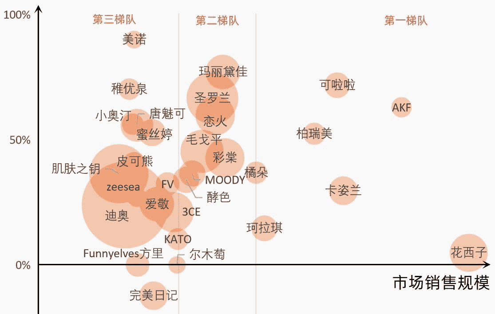

同比增长率

眼妆作为彩妆的重要组成部分，一直受到消费者的广泛关注。在抖音电商彩妆细分赛道中，眼妆以136%的同比增长率位列第三，显示出强劲的增长势头。品牌方应抓住这一机遇，不断推出创新产品，满足消费者的多样化需求。

而男士彩妆赛道的增长更是令人瞩目，以高达487%的同比增长率领跑市场。这一增长趋势反映了男性消费者对彩妆产品的接受度逐渐提高，以及市场对男性美妆市场的重视。

### 彩妆市场增长迅速，眼妆与男士彩妆表现突出

彩妆各细分赛道的发展潜力分析

数据源：有米有数新电商营销大数据分析平台，统计时间为2022.6.1-12.31、2023.6.1-12.31；气泡大小表示店铺数

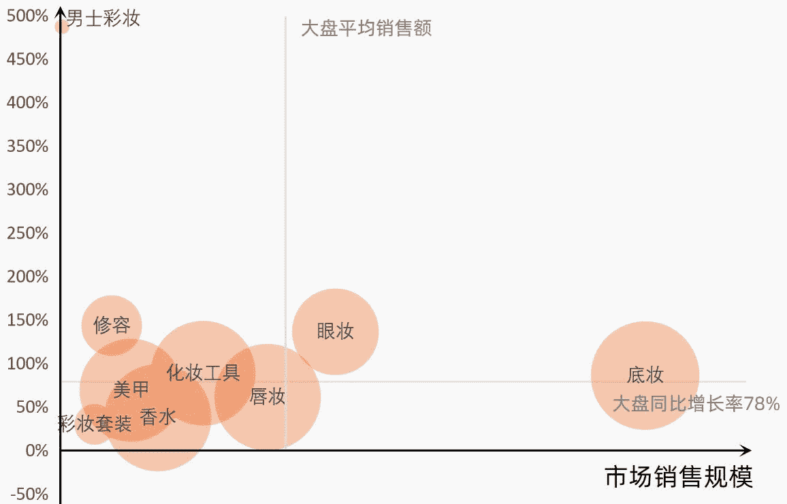

同比增长率

彩妆护肤品类历来是各大商家竞相争夺消费者的重要领域。然而，值得注意的是，购买彩妆早已不再只是女性的专利。男士彩妆不仅是一个深具潜力的市场，而是一片“大蓝海”。

现代男性不再局限于简单的洁面和护肤程序，而是开始追求个性化和高品质的彩妆与护肤体验。从基础的护肤步骤，如洁面、爽肤水、面霜，到彩妆修饰，如粉底、眉笔、唇膏等，男性消费者的选择日益多样化和精细化。

抖音男士彩妆赛道，2023下半年销售额同比增长近500%，并且当前赛道竞对尚未饱和，可见商机无限。

但同时也提出了更高的挑战。为了更好地在市场中脱颖而出，商家必须深入了解他们对彩妆用品功效的需求，目前有哪些竞争对手，他们的产品特点、价格策略、营销策略是什么，由此找到自己的差异化优势，制定出更有效的市场策略。

数据源：有米有数新电商营销大数据分析平台

热销商品－产品卖点类关键词

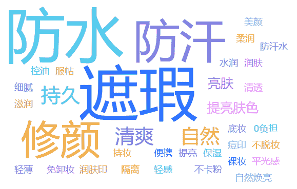

热销商品－品牌、达人类关键词

2023年，抖音护肤行业涌入了更多的中小商家和品牌，消费者选择更加多样化，但同时也增加了企业市场教育的成本。在这样的背景下，企业亟需找到更为高效和精准的营销方式。

比如及时抓住短剧营销东风的韩束。品牌在上年与达人姜十七深度绑定，连续推出五部品牌定制短剧，做大A3种草人群，通过“短剧种草+品牌自播+头腰尾部达人直播”，直接带爆植入产品「韩束红蛮腰礼盒」，销售情况一度赶超众多国际大牌。

### 行业市场教育成本加大，企业迫需找到新营销策略

普通店铺&品牌店铺数量变化（2023年同比/抖音护肤）

海量商家涌入护肤市场，赛道竞争激烈度进一步加剧

更多品牌看好抖音护肤赛道，入局平台发展

数据源：有米有数新电商营销大数据分析平台，统计时间为2022.1.1-2023.12.31

**38%**

**20%**

据数据所示，在2023年，10-11月是抖音护肤行业业绩最辉煌、同比增长最快的时间段，表明消费者在此期间的购买力较强，同时参与商家较多，竞争激烈。

对于更注重在大促曝光引流的品牌商家，可提前半个月至一个月进行产品、KOL合作方面的预热曝光，以及确保有充足的库存和供应链准备。

值得关注的是，在临近818的7月、临近双11的9月，以及双11结束后的12月，是行业销售相对低迷的时期，因而中小商家可分析这些时期消费者的需求特点，推出有针对性的产品和促销活动，以吸引那些在非高峰期仍有购物需求的消费者，以便错峰抢量。

### 双11是行业消费“狂飙”时刻，大促前后适合错峰抢量

月销售额&同比增长率（2023下半年同比/抖音护肤）

**+29%**

**+3%**

**+58%**

**+38%**

**+69%**

**+71%**

**+70%**

数据源：有米有数新电商营销大数据分析平台，统计时间为2022.6.1-12.31、2023.6.1-12.31

2023年，在一大波护肤企业涌入抖音的大环境下，销售额增长5成，销售件数却略微下降，即护肤赛道整体客单价提升。

具体而言，10元以内商品销售额增加5%，同时销售件数大幅下降，这不仅意味着客单价提升，还意味着消费者开始拒绝购买过于便宜的护肤品——购买涂抹在脸上的东西，必然要建立在一定的信任之上。而很显然，过去平台上流行的超低价护肤产品，并没有建立起这种信任，甚至反噬已开始。同时，高价格带的护肤商品竞争加剧，利润空间略有缩减。

### 低价商品受热度减少，中高端商品更得消费者青睐

销量同比

**-3%**

销售额同比

**+51%**

各价格带销量占比变化

（2023下半年同比/抖音护肤）

**-19%**

**+7%**

**+5%**

**+8%**

**+5%**

**+1%**

**-1%**

**-5%**

各价格带销量占比变化

（2023下半年同比/抖音护肤）

**2022H2**

**2023H2**

数据源：有米有数新电商营销大数据分析平台，统计时间为2022.6.1-12.31、2023.6.1-12.31

销量&销售额同比增长变化（2023下半年同比/抖音护肤）

唇部为什么需要一支精华？智商税？一百多、三百多甚至上千的身体护理套装，这么贵？对于这类新出现或是客单价高的商品，消费者需要更多的信息和理由来做出购买决策，通过直播间转化是一个有效的策略。

而对于洁面、精华、化妆水等日常护肤刚需，通过直播间无法立竿见影地展示商品效果，因而采取“短视频+直播”的双重带货方式，多渠道提升销量。

数据源：有米有数新电商营销大数据分析平台，统计时间为2023.1.1—12.31

## 2023年护肤直播销量占比TOP20单品

| 序号 | 单品 | 直播销量占比 |
|---:|---|---:|
| 1 | 身体护理套装 | 60% |
| 2 | 唇部精华 | 53% |
| 3 | 洁面 | 51% |
| 4 | 精华 | 50% |
| 5 | 护肤套装 | 50% |
| 6 | 乳液/面霜 | 50% |
| 7 | 喷雾 | 49% |
| 8 | 眼霜/眼部精华 | 49% |
| 9 | 足浴盐 | 49% |
| 10 | 鼻贴 | 48% |
| 11 | 洁面仪 | 47% |
| 12 | 面膜 | 46% |
| 13 | 安瓶/原液 | 46% |
| 14 | 卸妆 | 45% |
| 15 | 化妆水 | 44% |
| 16 | 手霜/手蜡 | 44% |
| 17 | 男士护理套装 | 44% |
| 18 | 润唇膏/唇膜 | 43% |
| 19 | 面部防晒 | 43% |
| 20 | 男士洁面 | 43% |

数据源：有米有数新电商营销大数据分析平台，统计时间为2023.6.1—12.31

## 护肤热销TOP100品牌

韩束

巴黎欧莱雅

珀莱雅

雅诗兰黛

谷雨

可复美

HBN

肌肤未来

SK-II

薇诺娜

玉兰油

兰蔻

欧诗漫

自然堂

丸美

C咖

资生堂

RNW

米蓓尔

瑷尔博士

敷尔佳

奥伦纳素

HomeFacialPro

WIS

科颜氏

海蓝之谜

伊菲丹

赫莲娜

润百颜

溪木源

蜜丝婷

CEMOY

水之蔻

娇韵诗

PMPM

德美乐嘉

膜法世家

半亩花田

颐莲

达尔肤

稀物集

逐本

美康粉黛

理肤泉

NACO

修丽可

后

花皙蔻

左颜右色

玉泽

夸迪

芙清

听研

娇兰

药都仁和

优时颜

柳丝木

肌活

花西子

韩后

悦芙媞

凌博士

KIMTRUE

袋鼠妈妈

丝塔芙

肌肤之钥

隆力奇

高姿

伊丽莎白·雅顿

肤见

妮维雅

AHC

雪花秀

澳乐维他

兰亭

毛戈平

毕生之研

适乐肤

阿芙

雏菊的天空

百雀羚

麦吉丽

安热沙

透蜜

黛珂

郑明明

欧敏肤

果本

林清轩

蒂佳婷

伊思

雪玲妃

雅漾

德妃

御泥坊

菲洛嘉

婷美

迪奥

欧珀莱

Elta MD

在抖音护肤赛道，国货品牌正以压倒性实力赶超国际大牌。

国货品牌如肌肤未来、韩束等，以超过90%和80%的高增长率领跑市场，显示出国货护肤品牌在抖音平台上的强劲势头。而相比之下，一些国际大牌如雅诗兰黛、兰蔻、SK-II等的增长率则相对较低，这在一定程度上反映了国货品牌在抖音电商护肤赛道上的赶超趋势。

## 肌肤未来、韩束领跑，展现国货护肤新力量

数据源：有米有数新电商营销大数据分析平台，统计时间为2022.6.1—12.31、2023.6.1—12.31；气泡大小表示平均成交价

### 销售额TOP30品牌分布（2023下半年同比/抖音护肤）

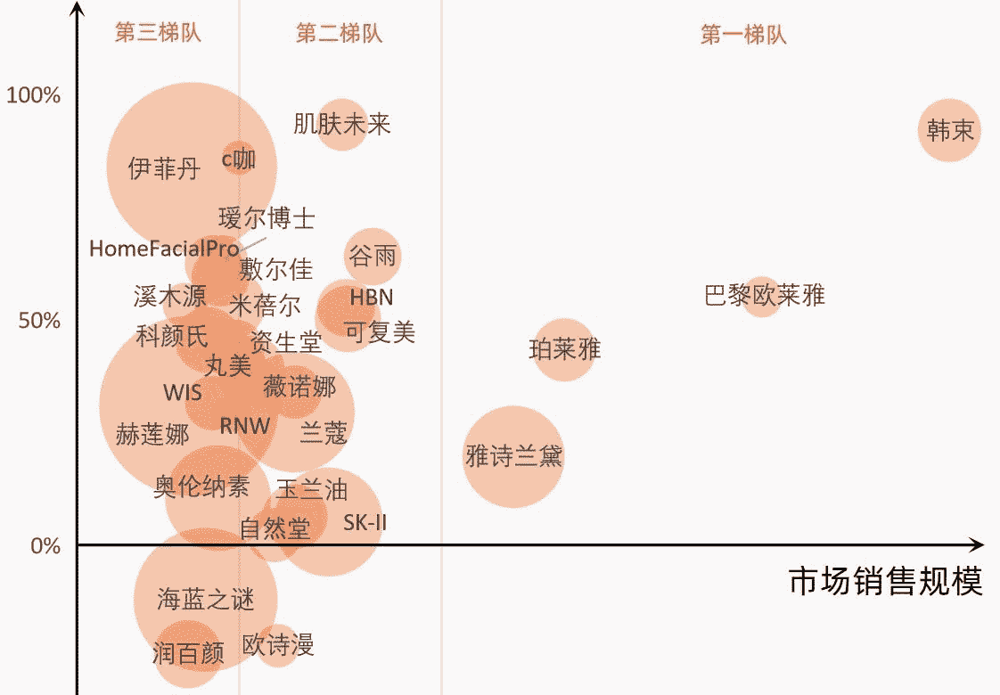

同比增长率

从数据中可以看出，抖音电商护肤市场呈现整体增长态势，但不同细分赛道增长情况有所分化。手足护肤和男士护肤赛道以超过80%的同比增长率领先，显示出这两个领域市场的强劲增长动力。

身体护肤和面部护肤赛道也实现了较高的增长。然而，眼部护肤和卸妆洁面赛道的增长率相对较低，而护肤工具赛道甚至出现了负增长。品牌方应关注高增长赛道，同时调整低增长赛道的策略，以应对市场变化。

## 护肤市场增长分化明显，男士护肤值得关注

### 护肤各细分赛道的发展潜力分析

数据源：有米有数新电商营销大数据分析平台，统计时间为2022.6.1—12.31、2023.6.1—12.31；气泡大小表示店铺数

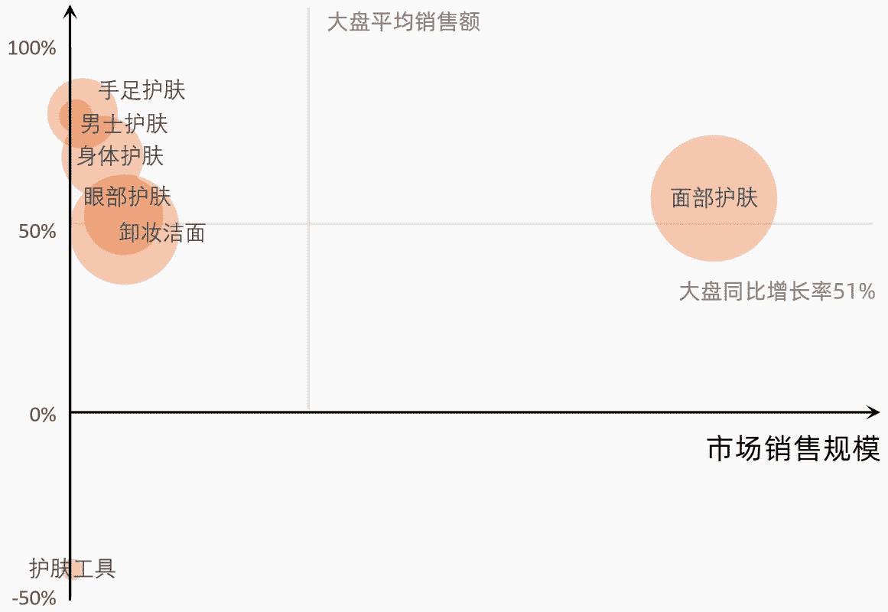

同比增长率

在当今时代，消费者对肌肤保养的要求已经不仅局限于面部，而是向着全身各部位延伸。从手足到身体，再到眼部，护肤市场正经历着细分化、多元化的变革。

手足肌肤，作为我们日常活动中使用最频繁的部位，时刻承受着摩擦、压力和外部环境的影响，因此其保养需求尤为突出。据有米有数数据显示，手足护肤产品的销售额同比增长高达82%，这一数字充分说明了消费者对于手足护理的重视。

在购买手足护肤产品时，消费者往往更加关注产品的成分和味道，这是因为他们希望选择天然、无刺激且香气宜人的产品，以确保肌肤得到最温和、最有效的呵护。

为了满足消费者的这些需求，商家在布局关键词时应当充分考虑产品成分、味道以及消费者的使用体验。下页附上该赛道热销商品的产品卖点、产品成分类关键词：

数据源：有米有数新电商营销大数据分析平台

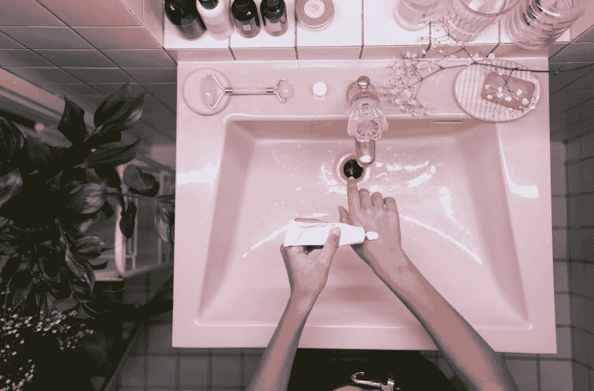

## 热销商品—产品卖点类关键词

## 热销商品—产品分类类关键词

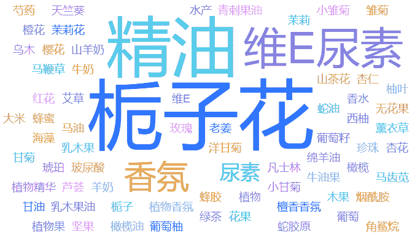

## 业务合作

联系邮箱：mkt@youmi.net

联系电话：400 822 8096（选择“数据产品合作”）

## 公司地址

有米云（有米科技股份有限公司）

广州总部 Guangzhou

广东省广州市番禺区大学城青蓝街26号17层

杭州 Hangzhou

浙江省杭州市余杭区欧美金融城T2-906室

义乌 Yiwu

浙江省金华市义乌市福田街道中福广场6号楼22楼2205室

厦门 Xiamen

福建省厦门市集美区软件园三期B区13栋702-5

郑州 Zhengzhou

河南省郑州市中原区河南电子商务产业园5号楼1301

关注有米有数，掌握更多新电商行业趋势
