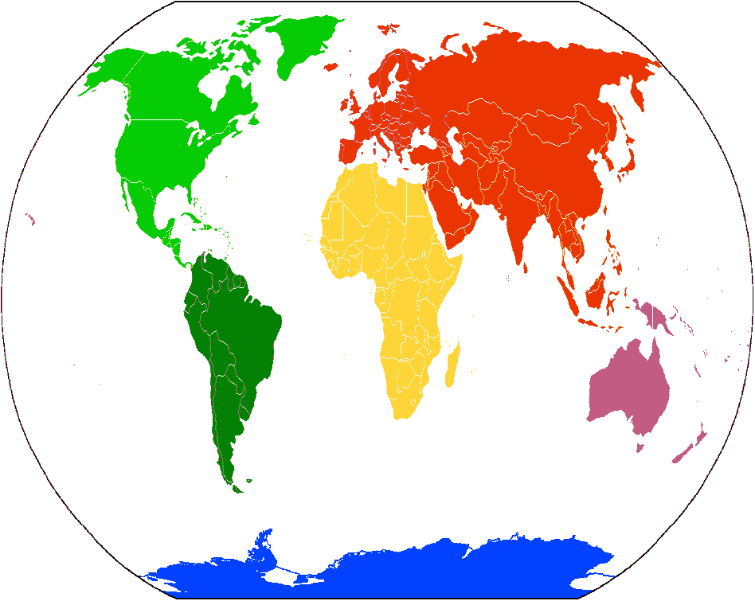

本公司具备证券投资咨询业务资格，请务必阅读最后一页免责声明

证券研究报告

# 国防军工行业专题报告

# 海外启示录2：全球军费趋向扩张；区域矛盾趋于复杂

2024年05月17日

**事件：**近期，SIPRI发布2023年全球军费报告，我们综合多方面公开资料完成相关研究工作。我们在去年《海外启示录1》中以美国军费为研究对象，针对1948~2023年美国军费五个方面问题进行分析讨论（详情可参看报告）。本篇系列报告将视野拓展到全球范围，深度讨论了如下问题：1）全球军费的区域分布，军费与GDP及政府支出的关系；2）全球部分主要军费大国的军费历史分析和特点；3）美国2024年军费投向分析，以及美军装备采办明细及发展趋势。具体观点如下：

- **2015年后全球军费进入扩张期；全球矛盾向复杂化发展。**1）全球整体看，2001~2011年全球军费经历了21世纪第一个扩张期，军费复合增速达8.8%。经历休整后，全球军费在2015年后进入新一轮扩张期，2015~2023年全球军费复合增速达4.7%；2023年全球军费同比增长6.8%至2.44万亿美元，创历史新高。2）分区域（洲）来看，近10余年全球各大洲国防支出占比从美洲一家独大向多区域均衡发展，2010~2023年，亚洲、大洋洲、欧洲等区域国防支出在全球军费占比实现不同程度的提升，这反映出全球区域国防力量随着经济变化出现了调整，同时或反映出全球矛盾向多区域复杂化发展。

- **21世纪亚洲国家国防补偿性发展，欧洲军费发展慢于经济增长。**通过回溯全球8个军费大国的国防开支历史，我们发现：经济发展与军费投入有关联性，当经济发展较快时国防支出有补偿性增长，其中：1）亚洲：2000~2023年，GDP增长较快的印度和韩国，国防支出出现较快增长，军费复合增速分别为8.0%和5.6%；而经济增长相对较慢的日本军费相对平稳。2）欧美：2010~2018年，欧美主要国家进入国防支出收缩期，军费增长普遍慢于GDP增长（美、英、法、德）。2018年后欧美国家开启新一轮军费扩张周期；根据NATO及SIPRI披露，2023年北约国家军费投入约占全球军费的6成。3）俄罗斯：俄罗斯GDP、政府开支和国防开支均与能源价格高度正相关，SIPRI预测2024年俄罗斯军费将达1400亿美元，同比增长28%。

- **美军装备采办处于上升周期；“综合威慑”战略针对多领域加大投入。**1）美军的装备采办周期一般为20年，2015年美军开启新一轮采办上行周期，2024年采办费延续上行态势，占整体军费比重提升至近30年新高（37.3%）。2）美国国防部在《2022年国防战略》中提出“综合威慑”是美国国防战略的基石。根据《太平洋学报》的解读，“综合威慑”是跨多领域、多战区和多冲突范围的战略框架，同时将盟友和合作伙伴的外交、军事、情报力量紧密结合形成的新威慑能力。在“综合威慑”战略指导下，2020~2024年，美军加大核威慑、导弹防御系统、天基系统三大关键领域投入力度，投入金额预计均翻倍增长。

- **建议关注：**21世纪全球各大洲国防力量出现重新分配，全球矛盾也从集中化向多区域复杂化发展。同时，美军在2022年提出的“综合威慑”战略及其近年在细分领域的针对性投入，具有借鉴意义。在“百年未有之大变局”的背景下，2023年全球国防开支同比增长6.8%。我们对军工行业的中长期发展持积极态度，建议投资者把握机会。建议关注：1）龙头引领：中航沈飞、航发动力、中国船舶、中航高科、中航光电、西部超导等；2）制导装备：菲利华、新雷能、长盈通、智明达等；3）新域新质：华秦科技、航天南湖、中科星图、广联航空、纵横股份、陕西华达、铂力特、西部材料等；4）国企改革：国博电子、航发控制、中航机载、中直股份、航天电子等。

- **风险提示：**历史规律可能失效，区域冲突不确定性；军费支出不确定性。

**推荐**

**维持评级**

**分析师**

**尹会伟**

执业证书：S0100521120005

邮箱：yinhuiwei@mszq.com

**分析师**

**孔厚融**

执业证书：S0100524020001

邮箱：konghourong@mszq.com

**分析师**

**赵博轩**

执业证书：S0100524040001

邮箱：zhaoboxuan@mszq.com

**研究助理**

**冯鑫**

执业证书：S0100122090013

邮箱：fengxin_yj@mszq.com

## 相关研究

1. 国防军工行业2024年度策略：“价值重构”和“供需关系”视角下的投资机会-2023/12/11

2. 国防军工行业专题报告：海外启示录1：美国军费5问5答-2023/04/07

## 目录

1. **全球军费处于扩张周期；区域军费占比趋向均衡** ....................................................................................................... 3

2. **部分军费大国：经济基础决定国防支出；军费普遍进入上行周期** ............................................................................... 5

### 2.1 美国：2016年后开启新一轮国防支出扩张周期 .......................................................................................................................... 6

### 2.2 俄罗斯：“捆绑在”能源价格上的国防支出 ..................................................................................................................................... 8

### 2.3 印度：2000年以来军费复合增速达8% ....................................................................................................................................... 9

### 2.4 日本：2023年后国防支出进入扩张期......................................................................................................................................... 10

### 2.5 韩国：2024年后或开启国防支出扩张周期 ................................................................................................................................ 11

### 2.6 英国：2017年起再次开启扩张周期 ............................................................................................................................................. 12

### 2.7 法国：2024年超预期完成北约军费/GDP=2%目标................................................................................................................. 13

### 2.8 德国：军费占比GDP比例在北约处于较低水平 ........................................................................................................................ 14

3. **美国：“综合威慑”战略下，加大前沿技术投入** ........................................................................................................ 15

### 3.1 采办费比例处于上行周期；2024年采办费再创新高................................................................................................................ 15

### 3.2 飞机：加大六代机研发投入，全方位提升空中力量 .................................................................................................................. 17

### 3.3 导弹防御：从MDA一家独大到“三足鼎立”；美军导弹防御系统投入快速提升 ................................................................. 18

### 3.4 导弹&弹药：2022~2024年加大重点型号投入 ........................................................................................................................ 19

### 3.5 核威慑：平台+弹药齐发展，重视新一代产品研发 ................................................................................................................... 20

### 3.6 天基：研发经费是现役装备采购4倍，增长潜力较大 ............................................................................................................. 21

4. **结论：全球军费处于扩张周期；美军“综合威慑”战略意在加强多领域全方位的战略威慑力** ...................................... 22

5. **风险提示** ............................................................................................................................................................... 23

**插图目录** .................................................................................................................................................................. 24

# 1 全球军费处于扩张周期；区域军费占比趋向均衡

**观点：**2015年后，全球国防支出开启新一轮的扩张周期，美洲国防支出占全球比例最高。2010年后，亚洲、欧洲、美洲占全球军费比例趋向均衡，全球经济和国防支出的变化或反映出国际矛盾趋向复杂化。同时，过去二十年间，亚洲在经济和国防支出上的增速，相较其他各洲均更快，在一定程度上说明了军费与经济的局部相关性。

**亚洲经济占全球比重不断提升；全球军费趋向均衡或反映国际矛盾复杂化。**

**1、经济方面：**按照大洲的角度划分，亚洲在过去约30年（1992~2023）经济发展较快。根据国际货币基金组织（IMF）统计，1）1993年，欧洲是全球第一大经济体，实际GDP占全球实际GDP的36%，美洲（占比33.4%）和亚洲（占比26.3%）紧随其后；2）2010年，欧洲、美洲、亚洲经济分布趋向于均衡（均超过30%）。在亚洲经济持续高速增长的背景下（1992~2023年亚洲实际GDP的CAGR=5.7%，高于美洲（4.7%）和欧洲（3.4%）），2011年亚洲成为全球第一大区域经济体，2023年亚洲实际GDP占全球GDP达35.1%。

**图1：1992~2024年全球GDP情况（按照大洲进行划分）**

资料来源：IMF 2024，民生证券研究院。注：采用名义GDP，2024年数据为预期值，百分比指代美洲、欧洲和亚洲的GDP占比全球GDP情况。

**2、国防支出方面：**根据斯德哥尔摩国际和平研究所（SIPRI）统计，1992~2023年，美洲国防支出占比全球军费最高，约4~5成。

**1）**1992年“美苏对抗”刚刚结束，美洲（占全球比重54.1%）和欧洲（占比26.7%）国防支出合计占全球比重超80%，1991年苏联解体后全球军费进入下行周期。

**2）**21世纪初，中东地区陆续发生阿富汗战争（2001年）和伊拉克战争（2003年），全球军费开启上行周期。2002~2012年，美洲国防支出占比全球国防支出持续超过50%。在全球军费阶段性高点的2010年，美洲的国防支出占比全球达到高点54.0%。

**3）**伴随经济的快速发展，亚洲的国防支出呈现补偿性增长，1992~2023年，亚洲国防支出占全球国防支出比例自10.6%提升13.4个百分点至24.0%，但仍低于2023年亚洲在全球GDP中的占比35.1%。

**4）2010~2023年：**全球国防支出在经历了2010~2014年下行后，2015年全球军费开始上行。相较1993年和2010年，2023年全球前三大洲的国防支出比例趋向于均衡，或反映出国际矛盾从单焦点向多区域转变且复杂化的趋势。

**图2：1992~2023年全球国防开支情况（按照大洲进行划分）**

资料来源：SIPRI，民生证券研究院。注：采用实际军费支出（2022年物价水平），百分比指代美洲、欧洲和亚洲的国防开支占比全球国防开支情况。

**2023年全球军费增长6.8%，北约国防支出占全球比例近6成。**根据SIPRI统计，2023年全球军费首次超过2.4万亿美元，同比增长6.8%（实际增长率，不考虑物价变化），其中美国国防支出占比全球超38%，北约国家（含美国）国防支出占比全球国防支出达56%。

**图3：2023年全球国防开支情况（左图-按区域拆分）；2023年全球国防开支拆分（右图-按照国家/组织拆分）**

资料来源：IISS，SIPRI，NATO，民生证券研究院

亚洲（不含中东）

大洋洲

欧洲

非洲

北美洲

南美洲

| 区域 | 占比 |
|---|---:|
| 亚洲（不含中东） | 25% |
| 大洋洲 | 2% |
| 欧洲 | 40% |
| 非洲 | 2% |
| 北美洲 | 24% |
| 南美洲 | — |
| 中东 | 8% |

# 2 部分军费大国：经济基础决定国防支出；军费普遍进入上行周期

¹ 在本篇报告中，同比增速数据如有SIPRI或IMF等第三方数据披露时直接引用，如无我们采用算术公式直接计算得到。

**2023年全球军费2.44万亿创新高，占全球政府支出比例升至6.9%。**根据SIPRI统计，2023年全球军费同比增长6.8%至2.44万亿美元，创历史新高；2023年全球整体军费占比政府支出提升0.4个百分点至6.9%。部分主要国家简要情况如下：

**1）美国：**2000年后美国军费占比政府支出逐步提升至10%以上并延续至2014年，2015年后在8%~10%波动。

**2）俄罗斯、韩国：**军费占比政府支出相对较高，2000年后在10%~15%波动。

**3）印度：**1992~2001年军费占比政府支出在10%~12%附近，2002年后降至8%~10%之间波动。

**4）英国：**军费占比政府支出始终保持在10%以内且长期趋势向下，2021~2023年英国军费占比政府支出比例回升至5%附近。

**5）日本、德国、法国：**军费占比政府支出保持在5%以内。

**图4：1992~2023年全球部分主要国家的军费占比政府支出情况**

资料来源：SIPRI，IMF，民生证券研究院。注：红色虚线为2023年全球国防支出占政府支出的平均水平（6.9%）。

| 图表标注 | 内容 |
|---|---|
| 1 | 俄罗斯、韩国军费占比政府支出在10%~15%波动，近年来逐步降至10%以下 |
| 2 | 2000年后俄罗斯、韩国军费占比政府支出在10%~15%波动 |
| 3 | 英国军费占比政府支出保持在10%以内且长期趋势向下，2021~2023年出现回升 |
| 4 | 日本、德国、法国军费占比政府支出保持在5%以内 |

6.9%

## 行业深度研究/国防军工

**2.1 美国：2016年后开启新一轮国防支出扩张周期**

**1、美国不同执政党对于军费增减态度不同，共和党总统或倾向增加军费。**

1980~2024年，美国七任总统中，所有民主党总统（共三任）任内军费占GDP比重均呈下降趋势；相反，共和党总统（共4任）任内军费占GDP比重均呈上升趋势。（特例是共和党总统“老布什”，因其任期1988~1992年，处于“冷战”结束时期，全球军费和美国军费支出均呈现下降趋势）。

**2、1980~2000年：**1982~1987年，美国军费支出在GDP中的比重持续超过6%，1982年达到高峰值6.5%，1988年后美国军费在GDP中的比重呈现下降趋势并延续至2000年。1991~2000年美国军费处于收缩阶段。

**3、2001~2011年：**伴随阿富汗战争（2001年）和伊拉克战争（2003年）的发生，美国军费开启上行周期，军费占比GDP自世纪初3.1%提升至2010年阶段性高点4.9%。

**4、2011~2023年：**2011年起美军减少海外国防支出，进行全球战略收缩，分别在2011年和2021年结束伊拉克战争和阿富汗战争，军费占比GDP降至4%以下。2018~2023年，美国国防支出恢复增长态势，或为新一轮军费扩张周期。

**图5：1948~2023年美国国防支出分析：扩张周期还是收缩周期与党派或有关系**

资料来源：SIPRI，IMF，民生证券研究院 注：红色向上箭头表示军费/GDP比例提升，蓝色向下箭头表示军费/GDP比例下降

5.0% / 6.6% / 3.1% / 4.9% / 3.4% / 3.7% / 3.4% / 3.3%

0% 2% 4% 6% 8% 10%

0 5000 10000 15000

1980 1981 1982 1983 1984 1985 1986 1987 1988 1989 1990 1991 1992 1993 1994 1995 1996 1997 1998 1999 2000 2001 2002 2003 2004 2005 2006 2007 2008 2009 2010 2011 2012 2013 2014 2015 2016 2017 2018 2019 2020 2021 2022 2023

/GDP

老布什（共和党）、奥巴马（民主党）、里根（共和党）、克林顿（民主党）、小布什（共和党）、特朗普（共和党）、拜登（民主党）

**当前时期，美国国防支出占GDP比例和占财政支出比例均处于较低位置。**

**1、占GDP比例**，2001~2010年，中东战争是美国国防支出增速快于GDP增速的主要原因之一，国防支出占比GDP比重自3.1%提升至4.9%；2011~2017年，美军在海外支出战略性收缩，国防支出增速低于GDP增速；2018年后国防支出恢复增长趋势，与GDP增速基本吻合。

**2、与财政支出相比**，2000~2023年，美国财政支出占比GDP自17.4%提升5.0ppt至22.4%（2020年最高达30.7%）。国防支出在财政支出的比重在2008年前呈上升趋势（最高在2008年达22.1%），2009年后逐步降至近年15%以下。

**图6：2000~2023年美国国防支出占GDP和财政支出比重**

资料来源：SIPRI，IMF，民生证券研究院 注：采用名义GDP、财政支出、军费支出

**图7：2001~2023年美国国防支出增速和GDP增速对比**

资料来源：SIPRI，IMF，民生证券研究院

3.1% / 3.1% / 3.5% / 3.8% / 4.0% / 4.1% / 4.0% / 4.1% / 4.4% / 4.9% / 4.9% / 4.8% / 4.5% / 4.0% / 3.7% / 3.5% / 3.4% / 3.3% / 3.3% / 3.4% / 3.7% / 3.4% / 3.3% / 3.3%

17.9% / 17.8% / 18.8% / 20.4% / 21.5% / 21.6% / 21.0% / 21.6% / 22.1% / 20.0% / 21.4% / 20.9% / 20.5% / 19.7% / 18.5% / 17.2% / 16.6% / 16.2% / 16.6% / 16.5% / 11.9% / 11.8% / 13.7% / 14.9%

0% 5% 10% 15% 20% 25%

/GDP /财政支出

-10% -5% 0% 5% 10% 15% 20%

增速 GDP增速

2017至今 防支出恢复增长

2001~2011 东 推动 增速快于GDP增速

2011~2017 陆续从 东撤 防支出收缩

**2.2 俄罗斯：“捆绑在”能源价格上的国防支出**

**1、能源价格决定俄罗斯的“经济基础”。**根据牛津能源研究所统计，俄罗斯的能源收入是联邦年度收入预算的30%~50%，并且能源收入平均贡献了约20%的GDP（占比随能源价格有所波动）。2000~2012年，全球石油价格从不足25美元/桶增长至112美元/桶，同期俄罗斯实际GDP复合增速高达18.8%。从下图中可以看到：俄罗斯GDP的波动与石油价格波动趋势一致性非常高。

**图8：2000~2023年俄罗斯GDP和军费增速及全球石油价格百分比变化**

资料来源：SIPRI，IMF，iFind，民生证券研究院 注：采用名义GDP、军费支出；石油价格变化取年平均价格的同比变化

**2、“经济基础”决定国防支出。**2000~2013年，俄罗斯国防支出自92亿美元快速增长至884亿美元，复合增速达19%。国防支出占GDP比重仅从3.3%提升0.6ppt至3.9%，主要原因是能源价格高企推动俄罗斯GDP快速增长，2000~2013年俄罗斯实际GDP复合增速达17.6%。2013~2021年，能源价格呈下降趋势，俄罗斯国防支出处于收缩周期。2022~2023年俄乌冲突推动俄罗斯军费支出快速提升，连续两年超1000亿美元；根据SIPRI预测，2024年俄罗斯军费开支将达到1400亿美元，预计较2023年实际国防开支同比增长27.9%。

**图9：2000~2023年俄罗斯国防支出规模及国防支出占GDP比重**

资料来源：SIPRI，IMF，民生证券研究院 注：采用名义GDP、军费支出

-60% -40% -20% 0% 20% 40% 60% 80%

石油价格变化 增速 GDP增速

2012是石油价格的分水岭

92.3 / 561.8 / 883.5

3.3% / 3.8% / 3.1% / 3.9% / 3.9% / 5.4% / 4.5% / 5.5%

0% 2% 4% 6% 8%

0 500 1000 1500 2000 2500

支出 /GDP

油价进入低迷时期、乌冲突、东、油价高企

**2.3 印度：2000年以来军费复合增速达8%**

**2000~2023年印度军费CAGR=8%。**根据SIPRI统计，2023年印度军费开支达836亿美元，印度成为全球第四大国防支出国家。2000~2023年，伴随经济的快速增长，印度的国防支出复合增速达8.0%。2000~2011年印度军费开支增速相对较快，CAGR=12.0%；2011~2023年，印度军费支出波动上行，CAGR=4.4%。

**图10：2000~2023年印度国防支出规模及增速**

资料来源：SIPRI，IMF，DefenseNews，民生证券研究院 注：采用名义军费支出

**印度政府开支逐步提升，军费开支占GDP和占政府支出比重呈下降趋势。**1）**与GDP相比**，2000~2023年印度国防支出复合增速（8.0%）稍慢于GDP复合增速（9.2%），同时期国防支出占GDP比重自3.1%降至2.3%；2）**与政府支出相比**，2000~2023年印度政府开支占GDP比重自25.8%提升至28.8%，复合增速达9.7%。印度国防支出占政府支出比例同样呈现下降趋势。

**图11：2000~2023年印度国防支出占GDP和政府开支比重**

资料来源：SIPRI，IMF，民生证券研究院 注：采用名义GDP、政府支出、军费支出

763 / 800 / 836

23.9% / 14.0% / 19.0% / 14.0%

2.6% / 2.1% / 4.7% / 4.8% / 4.5%

-10% 0% 10% 20% 30%

0 100 200 300 400 500 600 700 800 900

支出 增速

2000~2023 CAGR=8.0%

3.1% / 3.0% / 2.9% / 2.7% / 2.9% / 2.8% / 2.5% / 2.3% / 2.8% / 2.9% / 2.8% / 2.7% / 2.6% / 2.6% / 2.5% / 2.4% / 2.5% / 2.4% / 2.5% / 2.5% / 2.7% / 2.4% / 2.4% / 2.3%

11.7% / 9.8% / 9.0% / 10.5% / 8.6% / 9.8% / 9.4% / 9.5% / 9.1% / 9.3% / 8.8% / 8.2%

0% 2% 4% 6% 8% 10% 12% 14%

/GDP /政府支出

2000~2023 CAGR=8.0%，GDP CAGR=9.2%

2000~2023 政府开支CAGR=9.7%，政府开支占比GDP自25.8%提升至28.8%

**2.4 日本：2023年后国防支出进入扩张期**

**2000~2022年日本军费保持相对平稳，2023年后开启军费扩张周期。**根据SIPRI统计，2000~2022年日本军费保持相对稳定，在400~600亿美元区间。根据新华网报道，日本内阁正式通过《国家安全保障战略》、《国家防卫战略》、《防卫力量整备计划》，计划在2023~2027财年投入军费43万亿日元（约3020亿美元），较2019~2023财年增长63.5%。根据USNI News报道，日本内阁通过2024年7.95万亿日元（559亿美元）国防预算法案，较2023年国防预算同比增长16.5%。2023~2024年军费预计将连续两年实现快速增长。

**图12：2000~2023年日本国防支出规模及增速**

资料来源：SIPRI，IMF，USNI News，民生证券研究院 注：采用名义军费支出

**经济发展和国防支出基本同步，2018年后日本军费占比GDP呈上行趋势。**2000~2023年日本GDP、政府支出、国防支出复合增速分别为-0.71%、-0.02%和0.42%，三者增速相差不大，日本军费占比GDP和政府开支较为稳定。2018~2023年，由于日本经济疲软，且2023年后国防支出快速增长，日本军费占GDP比重自0.96%提升至1.19%，呈明显上升趋势。

**图13：2000~2023年日本国防支出占GDP和政府开支比重**

资料来源：SIPRI，IMF，民生证券研究院 注：采用名义GDP、政府支出、军费支出

《日本新战略文件抛弃“专守防卫”原则》——http://www.xinhuanet.com/mil/2023-01/05/c_1211715245.htm

455 / 608 / 469 / 502

-10.4% / 8.0% / -6.2% / 14.4% / 11.2% / -18.3% / -10.2% / 10.4% / 7.7% / 1.2% / -0.9% / -8.0% / 7.0%

-20% -10% 0% 10% 20%

0 100 200 300 400 500 600 700

日本支出 日本增速

0.93% / 0.94% / 0.92% / 0.88% / 0.97% / 0.97% / 0.94% / 0.95% / 0.91% / 0.96% / 0.99% / 1.02% / 1.01% / 1.10% / 1.19%

2.5% / 2.7% / 2.8% / 2.7% / 2.7% / 2.5% / 2.5% / 2.5% / 2.5% / 2.5% / 2.6% / 2.7% / 2.3% / 2.4% / 2.6%

0% 1% 1% 2% 2% 3% 3%

日本/GDP 日本/政府支出

2017至今 /GDP比例不断提升

**2.5 韩国：2024年后或开启国防支出扩张周期**

**2000~2023年韩国军费快速增长；2024~2028年军费复合增速将达7%。**2000~2023年，韩国军费开支实现波动增长，复合增速达5.6%。据人民网报道，2023年底韩国国防部制订《2024至2028年国防中期计划》，五年内将投入349万亿韩元（约合2680亿美元）国防支出，年国防经费将由2024年的59万亿韩元增至2028年的80万亿韩元，复合增速达7%。

**图14：2000~2023年韩国国防支出规模及增速**

资料来源：SIPRI，IMF，新华网，民生证券研究院 注：采用名义军费支出

**国防支出增速快于GDP增速。**2000~2023年，韩国GDP、政府支出、国防支出的复合增速分别为4.8%、7.8%和5.6%，国防支出增速快于GDP增速但慢于政府支出增速。2000~2023年，韩国军费占GDP比重自2.4%提升至2.8%，在2018年后军费占GDP比重呈上行趋势，按照韩国《2024至2028年国防中期计划》预测，韩国将延续军费扩张周期。

**图15：2000~2023年韩国国防支出占GDP和政府开支比重**

资料来源：SIPRI，IMF，ITA，民生证券研究院 注：采用名义GDP、政府支出、军费支出

《韩国发布今后五年国防计划》——http://military.people.com.cn/n1/2024/0105/c1011-40153349.html

14.1% / -6.2% / 9.0% / 12.5% / 24.3% / 13.6% / 10.1% / -6.0% / -5.7% / 14.6% / 10.0% / 3.1% / 7.4% / 9.4% / -2.6% / 0.9% / 6.2% / 10.0% / 2.4% / 4.6% / 10.3% / -8.9% / 3.4%

-10% 0% 10% 20% 30%

0 100 200 300 400 500 600

韩支出 韩增速

2000~2023 CAGR=5.6%

2.4% / 2.4% / 2.2% / 2.3% / 2.2% / 2.4% / 2.4% / 2.4% / 2.5% / 2.6% / 2.5% / 2.5% / 2.5% / 2.5% / 2.5% / 2.5% / 2.5% / 2.4% / 2.5% / 2.7% / 2.8% / 2.8% / 2.8% / 2.8%

14.4% / 13.7% / 12.2% / 12.6% / 12.1% / 13.2% / 12.7% / 12.8% / 12.6% / 12.2% / 11.2% / 9.7% / 8.9%

0% 2% 4% 6% 8% 10% 12% 14% 16%

韩/GDP 韩/政府支出

2000~2023 CAGR=5.6%，GDP CAGR=4.8%；政府支出CAGR=7.8%

### 行业深度研究/国防军工

**2.6 英国：2017年起再次开启扩张周期**

**2000~2023年英国军费在波动中增长，23年军费创新高。** 2001~2007年，英国国防开支实现较快增长，复合增速达10.9%，主要是北约在中东地区增加投入；2008~2017年，英国国防支出进入收缩周期，自2007年高点734亿美元降至2017年低点521亿美元，复合增速达-3.7%；2017~2023年，英国国防开支再次进入上行周期，自521亿元提升至749亿美元，复合增速达6.3%。

**图16：2000~2023年英国国防支出规模及增速**

| 年份 | 支出（亿美元） | 增速 |
|------|----------------|------|
| 2000 | 393 | 12.0% |
| 2004 | 670 | 18.3% |
| 2007 | 734 | 15.1% |
| 2010 | 641 | 2.3% |
| 2017 | 521 | 14.4% |
| 2023 | 749 | -12.2% |

资料来源：SIPRI，IMF，民生证券研究院 注：采用名义军费支出

**英国军费在GDP和政府支出的占比呈缓慢下行趋势。** 2000~2023年，英国GDP、政府支出、国防支出的复合增速分别为3.1%、4.3%和2.8%，国防支出增速慢于GDP增速和政府支出增速。2000~2023年，英国军费占GDP比重自2000年2.4%提升至2.6%（2009年）并逐步回落至2017年的1.9%，2018年后英国加大国防投入，国防支出占比GDP逐步提升至2023年2.2%。政府支出增速相对较快，2000~2023年，国防支出占政府支出自6.9%逐步降至5%附近。

**图17：2000~2023年英国国防支出占GDP和政府开支比重**

| 年份 | 军费/GDP | 军费/政府支出 |
|------|----------|----------------|
| 2000 | 2.4% | 6.9% |
| 2004 | 2.5% | 6.9% |
| 2007 | 2.4% | 6.3% |
| 2010 | 2.3% | 6.2% |
| 2017 | 1.9% | 5.7% |
| 2023 | 2.2% | 5.5% |

资料来源：SIPRI，IMF，民生证券研究院 注：采用名义GDP、政府支出、军费支出

2000~2023 GDP CAGR=3.1%；政府支出CAGR=4.3%；军费CAGR=2.8%

**2.7 法国：2024年超预期完成北约军费/GDP=2%目标**

**2023年法国军费同比增长14%，预计2024年提前完成北约军费扩张目标。** 2000~2023年，法国国防支出经历三个阶段：2000~2009年，法国国防开支实现较快增长，复合增速达7.9%，主要是北约在中东领域增加投入；2009~2015年，法国国防支出进入收缩周期，自2009年高点564亿美元降至2015年低点456亿美元，复合增速达-3.5%；2015~2023年，法国国防开支平稳上行，复合增速达3.8%。2023年法国军费同比快增14.3%至613亿美元。根据法国国防部长描述，2024年法国将提前完成北约国家军费占比GDP达2%的目标。（为满足防务体系要求，北约设定成员国的国防支出占GDP比例至少达2%的目标。）

**图18：2000~2023年法国国防支出规模及增速**

| 年份 | 支出（亿美元） | 增速 |
|------|----------------|------|
| 2000 | 284 | -13.1% |
| 2004 | 456 | 9.4% |
| 2009 | 564 | 26.1% |
| 2015 | 456 | 15.4% |
| 2020 | 613 | 10.7% |
| 2023 | 613 | -7.8% |

资料来源：SIPRI，IMF，DefenseNews，Politico，民生证券研究院 注：采用名义军费支出

**法国军费占比GDP相对平稳，军费在政府支出的比例缓慢下行。** 2000~2023年，法国GDP、政府支出、国防支出的复合增速分别为3.5%、4.0%和3.4%，国防支出增速低于GDP增速和政府支出增速。2000~2023年，法国军费占GDP比重在1.8%~2.1%之间波动；军费占比财政支出自4.0%降至3.5%。

**图19：2000~2023年法国国防支出占GDP和政府开支比重**

| 年份 | 军费/GDP | 军费/政府支出 |
|------|----------|----------------|
| 2000 | 2.1% | 4.0% |
| 2004 | 2.0% | 3.9% |
| 2009 | 2.0% | 3.8% |
| 2015 | 1.9% | 3.6% |
| 2020 | 1.8% | 3.5% |
| 2023 | 2.0% | 3.3% |
| 2024E | 2.0% | 3.3% |

资料来源：SIPRI，IMF，民生证券研究院 注：采用名义GDP、政府支出、军费支出

2000~2023 GDP CAGR=3.5%；政府支出CAGR=4.0%；军费CAGR=3.4%

**2.8 德国：军费占比GDP比例在北约处于较低水平**

**2000~2023年德国军费实现超翻倍增长，2023年同比快增19.0%。** 2000~2008年，德国国防开支实现较快增长，复合增速达6.9%；2008~2015年，德国国防支出进入收缩周期，自2008年高点451亿美元降至2015年低点382亿美元，复合增速达-2.4%；2015~2023年，德国国防开支再次进入增长快车道，CAGR=7.3%。根据SIPRI统计，2023年德国国防支出同比快增19.0%至668亿美元。

**图20：2000~2023年德国国防支出规模及增速**

| 年份 | 支出（亿美元） | 增速 |
|------|----------------|------|
| 2000 | 265 | -2.6% |
| 2004 | 451 | 7.0% |
| 2008 | 452 | 19.5% |
| 2015 | 382 | 8.4% |
| 2020 | 565 | -15.2% |
| 2023 | 668 | 18.3% |

资料来源：SIPRI，IMF，民生证券研究院 注：采用名义军费支出

**德国军费在GDP和政府支出的占比较为稳定。** 2000~2023年，德国GDP（3.7%）、政府支出（3.7%）、国防支出（4.1%）的复合增速较为接近，因此国防支出占GDP和政府支出的比重较为稳定。2000~2023年，德国军费占GDP比重在1.1%~1.5%波动；国防支出占比政府支出在2.6%~3.1%波动。德国国防支出占GDP的比重在北约国家中处于较低水平。

**图21：2000~2023年德国国防支出占GDP和政府开支比重**

| 年份 | 军费/GDP | 军费/政府支出 |
|------|----------|----------------|
| 2000 | 1.4% | 2.8% |
| 2004 | 1.3% | 2.8% |
| 2008 | 1.3% | 2.7% |
| 2015 | 1.1% | 2.3% |
| 2020 | 1.2% | 2.7% |
| 2023 | 1.5% | 2.6% |

资料来源：SIPRI，IMF，民生证券研究院 注：采用名义GDP、政府支出、军费支出

2000~2023 GDP CAGR=3.7%；政府支出CAGR=3.7%；国防支出CAGR=4.1%

德国军费/GDP在北约处于较低水平，要求军费/GDP≥2%

**3 美国：“综合威慑”战略下，加大前沿技术投入**

**3.1 采办费比例处于上行周期；2024年采办费再创新高**

**美军采办费占比呈波动上行趋势，凸显先进装备研发和批产的重要性。** 美军采办费（装备采购费+研发费）占比长期呈现波动上行趋势，其波动性主要由装备采购周期导致，我们发现：1954年至今已有3轮完整的采办周期，其中包括①1954~1975年、②1975~1995年、③1995~2014年。**我们发现：** 美军装备采购周期一般在20年附近，据人民日报披露⁴，全新研制一型跨代航空装备需要10~20年，与美军装备采购周期基本相匹配。2014年后美军开启新一轮采办上行周期，采办费占比自2014年28.2%预计提升至2024年37.3%。

**图22：2000~2023年美国军费分析：采办费阶段性低点逐步抬升，现阶段处于采办费占比持续提升阶段**

| 年份 | 采办费占比 |
|------|------------|
| 1949 | 17.7% |
| 1954 | 19.9% |
| 1975 | 24.5% |
| 1995 | 26.2% |
| 2014 | 28.2% |
| 2023 | 35.7% |
| 2024E | 37.3% |

资料来源：《2024年美国国防开支预算》，民生证券研究院

**导弹防御系统、天基系统和任务支援或是美军下阶段采办费用主要投入方向。** 根据美国国防部披露的《2024年美国国防开支预算》，2024年美军采办费达2762亿美元，其中装备采购费和研发投入分别为1449亿和1313亿美元。**1）装备采购中，** 飞机及相关系统（427亿美元）、造船与海上系统（425亿美元）、任务支援（369亿美元）是投入较大的方向；**2）研发投入中，** 值得注意的是：美军在导弹防御系统（106亿美元）、天基系统（209亿美元）和任务支援（513亿美元）领域研发投入明显高于装备采购规模，我们认为未来美军对于导弹防御系统、天基系统和任务支援的投入或将持续提升。

**图23：2024年美国国防采办费预算情况（装备采购+研发投入）**

**装备采购（单位：亿美元）**

| 类别 | 金额 |
|------|------|
| 任务支援 | 369 |
| 飞机及相关系统 | 427 |
| 造船与海上系统 | 425 |
| 导弹与弹药 | 198 |
| 天基系统 | 51 |
| C4I系统 | 82 |
| 地面系统 | 108 |
| 导弹防御计划 | 41 |

**研发费用（单位：亿美元）**

| 类别 | 金额 |
|------|------|
| 任务支援 | 513 |
| 飞机及相关系统 | 184 |
| 造船与海上系统 | 57 |
| 导弹与弹药 | 109 |
| 天基系统 | 209 |
| C4I | 63 |
| 地面系统 | 30 |
| 导弹防御系统 | 106 |

资料来源：《2024年美国国防开支预算》，民生证券研究院

**3.2 飞机：加大六代机研发投入，全方位提升空中力量**

**四五代战机投入相对稳定，加大六代机研发、功能性飞机和无人机投入。**

1. **主战航空装备领域**，2019~2024年，美军在四代机（F-15EX和F/A-18E/F）和五代机（F-35）投入相对稳定。
2. **针对下一代（六代）航空装备**，美国空军在2014年提出NGAD项目，并预计将在2030s服役，在2022年后美军持续加大NGAD项目研发投入，年投入自2019年4亿美元预计提升至2024年23亿美元。
3. **功能性飞机方面**，美军在加油机（KC-46A）和运输机（CH-53K）方向投入稳中有升。
4. **无人机领域**，美军主要投向核心的三款无人机型号：MQ-4（海军无人侦察机）、MQ-9（高空大型察打一体无人机）和MQ-25（无人加油机），其中2024年在MQ-4和MQ-25的投入明显提升。

**图24：2019~2024年美国重点航空装备采购梳理（亿美元）**

| 年份 | F-35（五代机） | NGAD（六代机研发） | F/A-18E/F（四代机） | F-15EX（四代机） | KC-46A（加油机） | CH-53K（重型运输直升机） | MQ-25（无人加油机） | MQ-4（海军无人侦查机） |
|------|----------------|---------------------|----------------------|-------------------|--------------------|---------------------------|-----------------------|--------------------------|
| 2019 | 116 | 4 | 21 | - | 24 | 15 | 5 | 13 |
| 2020 | 126 | 9 | 20 | 11 | 28 | 16 | 6 | 7 |
| 2021 | 129 | 9 | 19 | 15 | 22 | 17 | 3 | 6 |
| 2022 | 119 | 15 | 11 | 14 | 24 | 20 | 4 | 8 |
| 2023 | 119 | 17 | 21 | 27 | 26 | 23 | 4 | 8 |
| 2024E | 136 | 23 | 18 | 30 | 30 | 22 | 12 | 10 |

资料来源：《2024年美国国防开支预算》，民生证券研究院

⁴ 《全心托举航空动力“中国心”》——http://www.sasac.gov.cn/n2588025/n2588139/c7853544/content.html

## 行业深度研究/国防军工

本公司具备证券投资咨询业务资格，请务必阅读最后一页免责声明

证券研究报告

**18**

## 3.3 导弹防御：从MDA一家独大到“三足鼎立”；美军导弹防御系统投入快速提升

**导弹防御投入5年内实现翻倍，美军在MDA以外的投入快速提升。** 1）导弹防御局（MDA）是美国导弹防御能力的主要负责单位，根据美国政府问责局统计，截止2022年，MDA自2002年成立后花费超过1740亿美元打造导弹防御系统，2017年后，MDA增加对高超声速武器的防御能力。2）2019年后，美国加大对导弹防御的投入力度，自2019年129亿美元预计增长至2024年298亿美元（预计实现翻倍增长）。此外，投入方向上，美军对于导弹防御的投入从MDA“一家独大”逐步发展为“三足鼎立”格局，MDA获批经费占比导弹防御总投入从2019年约76.7%预计降至2024年仅36.6%。相反，美军在MDA以外的区域和战略导弹防御能力（2024年预计投入131亿美元）及拦截&抑制发射（2024年预计投入58亿美元）两个细分领域持续加大投入。

**图25：2024年美国导弹防御投入情况**

资料来源：《2024年美国国防开支预算》，民生证券研究院

**图26：2019~2024年美国导弹防御投入情况**

资料来源：《2024年美国国防开支预算》，民生证券研究院

| 导弹防御相关项目 | 2019 | 2020 | 2021 | 2022 | 2023 | 2024E |
|---|---|---|---|---|---|---|
| Missile Defense Agency MDA导弹防御局 | 99 | 94 | 92 | 89 | 96 | 109 |
| MDA以外的区域和战略导弹防御能力 | - | - | 79 | 77 | 104 | 131 |
| Missile Defeat or left-of-launch 拦截&抑制发射 | - | - | 32 | 38 | 47 | 58 |
| 合计 | **129** | **136** | **203** | **204** | **247** | **298** |

导弹防御力量采购

---

**19**

## 3.4 导弹&弹药：2022~2024年加大重点型号投入

**2022~2024年美军加大重点型号导弹&弹药投入力度。**

1）**“海马斯”火箭弹（GMLRS）**：作为美军主力火箭炮，GMLRS具有GPS导引系统，美军在2023年多年采购弹药计划中提出GMLRS的多年采购上限达10.6万枚，2023年花费13.4亿美元采购5954枚（单价22.5万美元）；2024年预计花费10.3亿元采购5064枚（单价20.3万美元）。

2）**爱国者防空导弹（MSE——PAC-3）**：PAC-3是陆军防空主力型号，使用洛克希德·马丁全新设计拦截弹ATM2（主动雷达制导引导头和直接动能碰撞），PAC-3产品性能提升背景下单价不断提升，2023年采购金额10.4亿美元（252枚，单价412万美元），2024年预算12.1亿元（230枚，单价527万美元）。

3）**联合防区外空地导弹（JASSM）**：空对地半隐身巡航弹，F-35战斗机、B-1B轰炸机、X-47B无人机均装备该导弹。2024年美军采购预算翻倍增长至18.2亿美元（550枚，单价331万美元）。

4）**远程反舰导弹（LRASM）**：可以使用多种海空地平台进行发射，并成为世界上现役第一种能独立进行威胁分级，并自行选择最重要打击目标的智能反舰导弹。2024年美军LRASM采购预算接近翻倍增长至10.7亿美元。

5）**标准-6防空导弹**：美国海军防空主力型号，可从地面或者军舰上发射，用来打击空中固定翼飞机，无人飞机等目标，也可被用作反舰导弹。2019~2023年美军对标准-6采购相对平稳（125枚），2024年相关预算超翻倍增长至16.2亿美元，但采购数量仍保持在125枚（单价自2023年640万美元提升至2024年1292万美元），根据Center for Strategic and International Studies研究，单价大幅提升主要是2024年采购的Block IB改型中增加二段火箭发动机提升拦截弹射程。

**图27：2024年美国重要导弹&弹药投入情况**

资料来源：《2024年美国国防开支预算》，维基百科，民生证券研究院

| 种类 | 导弹 | 射程/km | 2019 | 2020 | 2021 | 2022 | 2023 | 2024 |
|---|---|---|---|---|---|---|---|---|
| 陆基 | “海马斯”火箭弹 GMLRS | 70 | 11.2 | 12.9 | 11.4 | 10.0 | 13.4 | 10.3 |
| 陆基 | 远程精准打击导弹 PrSM | 480 | - | - | - | 3.5 | 4.2 | 6.6 |
| 陆基 | 爱国者防空导弹 MSE | 30 | - | - | - | 13.3 | 10.4 | 12.1 |
| 空基 | “狱火”坦克 Hellfire | 8 | 4.8 | 7.3 | 5.2 | 2.3 | 1.2 | 0.3 |
| 空基 | 联合防区外空地导弹 JASSM | 320 | 6.5 | 5.6 | 5.7 | 8.2 | 9.0 | 18.2 |
| 海基 | 远程反舰导弹 LRASM，隐身 | 560 | 3.0 | 1.9 | 2.0 | 2.4 | 5.5 | 10.7 |
| 空基 | 联合制导攻击武器 JDAM | 24 | 11.2 | 11.1 | 5.5 | - | - | - |
| 空基 | 小直径炸弹 SDB | 110 | 2.1 | 2.7 | 1.0 | - | - | - |
| 海基 | “战斧”巡航导弹 Tomahawk | 2800 | 3.5 | 7.0 | 6.5 | 5.3 | 9.0 | 9.3 |
| 海基 | 标准-6防空导弹 雷达导引头 | 400 | 7.0 | 7.0 | 8.0 | 9.0 | 8.0 | 16.2 |
| 合计 | | | **49.3** | **55.5** | **45.1** | **54.0** | **60.7** | **83.6** |

攻击型弹药采购

---

**20**

## 3.5 核威慑：平台+弹药齐发展，重视新一代产品研发

**2024年核威慑项目预算同比提升10%，持续加大平台和弹药投入。** 美军核战略平台进入升级换代期，其中主要包括哥伦比亚级核潜艇和B-21远程战略轰炸机；同时，平台相应配套的弹药的投入也在持续提升，具体如下：

1）**哥伦比亚级核潜艇**：哥伦比亚级核潜艇于2016年展开设计工作，2020年开始建造，预计2031年服役；用于取代14艘俄亥俄级弹道导弹核潜艇。项目的总预算为1098亿美元（12艘），每艘潜艇的平均造价91.5亿美元。若把项目的前期开支计算在内，则首艘的建造成本达到150亿美元。

2）**B-21轰炸机**：B-21项目在2011年被美国空军提出并在2015年正式立项，用于替换B-1、B-2和B-52三款战略轰炸机，根据AirForceTimes披露，B-21项目预算达2030亿美元（包含研发、采购、运营），采购单价约6.92亿美元，美国空军计划至少采购100架来替代B-1B和B-2。2023年（48亿美元）和2024年（53亿美元）美军加大B-21投入力度，预计将在2027年服役。

**图28：2019~2024年美国主要核威慑项目及其投入情况**

资料来源：《2024年美国国防开支预算》，《关于中美建立网络-核指挥控制与通信系统稳定性的报告》（上海国际问题研究院），维基百科，民生证券研究院

**AGM-181远距防区外武器（空基）**

2024E: 62/2023: 63/2022: 52/2021: 45/2020: 23/2019: 39

**LGM-35A洲际弹道导弹（地基）**

2024E: 19/2023: 17/2022: 16/2021: 15/2020: 15/2019: 11

**24年核威慑预算377亿美元，YoY+10%**

B-21轰炸机

2024E: 53/2023: 48/2022: 29/2021: 28/2020: 30/2019: 22

哥伦比亚级核潜艇

2024E: 18/2023: 9/2022: 29/2021: 27/2020: 25/2019: 27

其他（含核弹头现代化等）

2024E: 43/2023: 36/2022: 25/2021: 14/2020: 5/2019: 4

三叉戟II潜射弹道导弹

2024E: 10/2023: 10/2022: 6/2021: 4/2020: 7/2019: 6

---

**21**

## 3.6 天基：研发经费是现役装备采购4倍，增长潜力较大

**加快卫星发射抢占太空高地；大力投入新一代高轨导弹预警卫星系统。** 2024年美军在天基系统的预算投入达到333亿美元，较2020年141亿实现较快增长，复合增速达24%。在重要天基项目中，国家安全发射（NSSL）和下一代导弹预警卫星系统（NG OPIR）的投入增长较快，具体如下：

1）**国家安全发射（NSSL）**：NSSL项目主要负责火箭（卫星）发射，为确保供应链安全，美军一般选取至少2个商业可行性高的国内核心供应商负责火箭发射。1990s~2000s主要由波音的Delta IV和洛克希德·马丁的Atlas V负责发射任务；2014年后，通过引入SpaceX公司，NSSL发射任务主要由ULA公司（波音和洛克希德·马丁的合资公司）的Vulcan和SpaceX的Falcon 9负责。2023~2024年，美军加大NSSL项目投入力度，旨在抢占太空战略高地。

2）**下一代导弹预警卫星系统（NG OPIR）**：美军太空预警卫星系统经历了国防支援计划卫星（DSP）和天基红外系统（SBIRS）两代产品的发展，2019年美军停止对SBIRS继续投资并开始加快研制下一代导弹预警卫星系统（NG OPIR）。2020~2024年，美军对NG OPIR的投入金额自17亿美元快速提升至50亿美元。

**图29：2019~2024年美国重要天基项目及其投入情况**

资料来源：《2024年美国国防开支预算》，《关于中美建立网络-核指挥控制与通信系统稳定性的报告》（上海国际问题研究院），维基百科，民生证券研究院

**SBIRS天基红外卫星**

现役导弹预警卫星，2019年后美军停止对SBIRS继续投资

年度投资/亿美元：2024E: 13/2023: 17/2022: 20/2021: 18/2020: 17/2019: 14

**GPS全球定位**

系统包括31颗GPS人造卫星；地面上1个主控站、3个数据注入站和5个监测站

年度投资/亿美元：2024E: 30/2023: 22/2022: 17/2021: 16/2020: 17/2019: 21

**NSSL国家安全发射**

由美国太空部队太空系统司令部(SSC)向SpaceX公司和联合发射联盟（ULA）发布火箭发射订单。1990s起军用火箭发射主要由波音的Delta IV和洛马的Atlas V负责，2000年后由Space X的Falcon 9和ULA的Vulcan Centaur主要负责。

年度投资/亿美元：2024E: 50/2023: 47/2022: 25/2021: 25/2020: 17/2019: -

**NG OPIR下一代导弹预警卫星**

NG OPIR是新一代高轨导弹预警卫星系统，分为Block 0和Block 1两个阶段部署。主承包商：Northrop Grumman

年度投资/亿美元：2024E: -/2023: -/2022: -/2021: -/2020: -/2019: 8

高新技术引领，提高核心竞争力；推进产融结合，拓展市场空间；培育新兴产业，实现可持续发展

---

**22**

# 4 结论：全球军费处于扩张周期；美军“综合威慑”战略意在加强多领域全方位的战略威慑力

**我们通过分析三个角度——1）全球军费发展历史，军费与GDP及政府支出的关系；2）全球8个军费大国的军费历史回溯；3）美国的2024年军费投入方向分析。有以下观点供参考：**

**1、2016年后全球军费再次进入扩张期；区域军费变化反映全球矛盾趋于复杂化。** 1）从全球整体来看，2001~2011年全球军费经历了21世纪第一个扩张期，军费复合增速达8.8%，同期美国军费复合增速达8.5%。2012~2015年短暂休整后，全球国防支出在2016年进入新一轮扩张期，2016~2022年全球军费复合增速达4.7%。根据SIPRI统计，2023年全球军费同比增长6.8%至2.44万亿美元，创历史新高。2）分区域（洲）来看，近10余年全球各大洲国防支出占比从美洲一家独大向多区域均衡化发展，2010~2022年，亚洲、大洋洲、欧洲区域的国防支出在全球军费占比中实现不同程度的提升，我们认为：根据全球经济发展的情况，全球各区域的国防力量实现重新分配；同时，除美洲外其他四大洲的军费占比提升同样也反映出全球矛盾从集中化向多区域复杂化发展。

**2、21世纪亚洲国家国防补偿性发展，欧洲国防支出发展慢于经济增长。** 通过研究全球8个军费大国的国防开支历史，我们发现：经济发展与军费投入具有相关性，经济发展较快的国家国防支出呈补偿性的较快增长，其中：1）亚洲：2000~2023年，GDP增长较快的印度和韩国，国防支出出现补偿性发展，印度和韩国军费复合增速分别达8.0%和5.6%；而经济增长相对较慢的日本，其军费相对平稳。同时，日本和韩国的5年国防计划均对未来国防支出提出较为明确增长的预期。2）欧美：2010~2018年，欧美主要国家军费增长普遍慢于GDP增长（美、英、法、德），进入国防支出收缩期。2018年后欧美国家开启新一轮军费扩张周期；根据NATO披露，2023年北约国家军费投入约占全球军费的6成。3）俄罗斯：俄罗斯GDP、政府开支和国防开支均与能源价格高度正相关，SIPRI预测2024年俄罗斯军费开支将达到1400亿美元，同比增长28%。

**3、美军采办费处于上升周期；“综合威慑”战略瞄准多领域进行针对性投入。** 1）美军的装备采办周期一般为20年，自2015年美军采办开启新一轮上行周期，并在2024年得到延续，2024年美军采办费占整体军费比重提升至30年新高（37.3%）。2）美国国防部在《2022年国防战略》中提出——“综合威慑”（Integrated Deterrence）是美国国防战略的基石。根据太平洋学报的解读，“综合威慑”是一个跨常规、核、网络、空间、信息等多领域、多战区和多冲突范围的战略框架，同时将盟友和合作伙伴的外交、军事、情报力量紧密结合形成的新威慑能力。在“综合威慑”战略指导下，2020~2024年，美军针对核威慑、导弹防御系统、天基系统三大关键领域加大力度投入，投入金额预计均翻倍增长。

行业深度研究/国防军工

本公司具备证券投资咨询业务资格，请务必阅读最后一页免责声明

证券研究报告

# 5 风险提示

### 1）历史规律有可能失效

报告中从各大洲、主要军费大国等不同角度进行了历史数据的分析，形成一定的规律性结论，但在对未来预测时历史规律有可能失效。

### 2）区域冲突不确定性

因为地域冲突对于各大洲区域军费或相应国家军费短期影响较大且具有不确定性，因此区域或国家军费具有波动性及不确定性。

### 3）军费支出不确定性

美国军费和采办费呈现出周期性，同时，美国军费和采办费的波动与经济周期、政治周期和战争均有较大关联度，因此历史数据仅为美军未来支出提供部分解释，因此美国军费和采办费有较大不确定性。

行业深度研究/国防军工

本公司具备证券投资咨询业务资格，请务必阅读最后一页免责声明

证券研究报告

## 插图目录

- 图1：1992~2024年全球GDP情况（按照大洲进行划分） ......................................................................................................... 3
- 图2：1992~2023年全球国防开支情况（按照大洲进行划分） ................................................................................................... 4
- 图3：2023年全球国防开支情况（左图-按区域拆分）；2023年全球国防开支拆分（右图-按照国家/组织拆分） .......... 4
- 图4：1992~2023年全球部分主要国家的军费占比政府支出情况 ............................................................................................... 5
- 图5：1948~2023年美国国防支出分析：扩张周期还是收缩周期与党派或有关系 .................................................................. 6
- 图6：2000~2023年美国国防支出占GDP和财政支出比重 ......................................................................................................... 7
- 图7：2001~2023年美国国防支出增速和GDP增速对比 ............................................................................................................. 7
- 图8：2000~2023年俄罗斯GDP和军费增速及全球石油价格百分比变化 ................................................................................ 8
- 图9：2000~2023年俄罗斯国防支出规模及国防支出占GDP比重 ............................................................................................ 8
- 图10：2000~2023年印度国防支出规模及增速 .............................................................................................................................. 9
- 图11：2000~2023年印度国防支出占GDP和政府开支比重 ...................................................................................................... 9
- 图12：2000~2023年日本国防支出规模及增速 ............................................................................................................................ 10
- 图13：2000~2023年日本国防支出占GDP和政府开支比重 .................................................................................................... 10
- 图14：2000~2023年韩国国防支出规模及增速 ............................................................................................................................ 11
- 图15：2000~2023年韩国国防支出占GDP和政府开支比重 .................................................................................................... 11
- 图16：2000~2023年英国国防支出规模及增速 ............................................................................................................................ 12
- 图17：2000~2023年英国国防支出占GDP和政府开支比重 .................................................................................................... 12
- 图18：2000~2023年法国国防支出规模及增速 ............................................................................................................................ 13
- 图19：2000~2023年法国国防支出占GDP和政府开支比重 .................................................................................................... 13
- 图20：2000~2023年德国国防支出规模及增速 ............................................................................................................................ 14
- 图21：2000~2023年德国国防支出占GDP和政府开支比重 .................................................................................................... 14
- 图22：2000~2023年美国军费分析：采办费阶段性低点逐步抬升，现阶段处于采办费占比持续提升阶段 ................... 15
- 图23：2024年美国国防采办费预算情况（装备采购+研发投入） ............................................................................................ 16
- 图24：2019~2024年美国重点航空装备采购梳理（亿美元） ................................................................................................... 17
- 图25：2024年美国导弹防御投入情况 ............................................................................................................................................. 18
- 图26：2019~2024年美国导弹防御投入情况 ................................................................................................................................ 18
- 图27：2024年美国重要导弹&弹药投入情况 ................................................................................................................................. 19
- 图28：2019~2024年美国主要核威慑项目及其投入情况 ........................................................................................................... 20
- 图29：2019~2024年美国重要天基项目及其投入情况 ............................................................................................................... 21

行业深度研究/国防军工

本公司具备证券投资咨询业务资格，请务必阅读最后一页免责声明

证券研究报告

## 分析师承诺

本报告署名分析师具有中国证券业协会授予的证券投资咨询执业资格并登记为注册分析师，基于认真审慎的工作态度、专业严谨的研究方法与分析逻辑得出研究结论，独立、客观地出具本报告，并对本报告的内容和观点负责。本报告清晰准确地反映了研究人员的研究观点，结论不受任何第三方的授意、影响，研究人员不曾因、不因、也将不会因本报告中的具体推荐意见或观点而直接或间接收到任何形式的补偿。

## 评级说明

### 投资建议评级标准

| 评级 | 说明 |
|---|---|
| 公司评级 | 以报告发布日后的12个月内公司股价相对同期基准指数的涨跌幅为基准。其中：A股以沪深300指数为基准；新三板以三板成指或三板做市指数为基准；港股以恒生指数为基准；美股以纳斯达克综合指数或标普500指数为基准。 |
| 推荐 | 相对基准指数涨幅15%以上 |
| 谨慎推荐 | 相对基准指数涨幅5%～15%之间 |
| 中性 | 相对基准指数涨幅-5%～5%之间 |
| 回避 | 相对基准指数跌幅5%以上 |
| 行业评级 | 以报告发布日后的12个月内行业指数相对同期基准指数的涨跌幅为基准。 |
| 推荐 | 相对基准指数涨幅5%以上 |
| 中性 | 相对基准指数涨幅-5%～5%之间 |
| 回避 | 相对基准指数跌幅5%以上 |

## 免责声明

民生证券股份有限公司（以下简称“本公司”）具有中国证监会许可的证券投资咨询业务资格。

本报告仅供本公司境内客户使用。本公司不会因接收人收到本报告而视其为客户。本报告仅为参考之用，并不构成对客户的投资建议，不应被视为买卖任何证券、金融工具的要约或要约邀请。本报告所包含的观点及建议并未考虑个别客户的特殊状况、目标或需要，客户应当充分考虑自身特定状况，不应单纯依靠本报告所载的内容而取代个人的独立判断。在任何情况下，本公司不对任何人因使用本报告中的任何内容而导致的任何可能的损失负任何责任。

本报告是基于已公开信息撰写，但本公司不保证该等信息的准确性或完整性。本报告所载的资料、意见及预测仅反映本公司于发布本报告当日的判断，且预测方法及结果存在一定程度局限性。在不同时期，本公司可发出与本报告所刊载的意见、预测不一致的报告，但本公司没有义务和责任及时更新本报告所涉及的内容并通知客户。

在法律允许的情况下，本公司及其附属机构可能持有报告中提及的公司所发行证券的头寸并进行交易，也可能为这些公司提供或正在争取提供投资银行、财务顾问、咨询服务等相关服务，本公司的员工可能担任本报告所提及的公司的董事。客户应充分考虑可能存在的利益冲突，勿将本报告作为投资决策的唯一参考依据。

若本公司以外的金融机构发送本报告，则由该金融机构独自为此发送行为负责。该机构的客户应联系该机构以交易本报告提及的证券或要求获悉更详细的信息。本报告不构成本公司向发送本报告金融机构之客户提供的投资建议。本公司不会因任何机构或个人从其他机构获得本报告而将其视为本公司客户。

本报告的版权仅归本公司所有，未经书面许可，任何机构或个人不得以任何形式、任何目的进行翻版、转载、发表、篡改或引用。所有在本报告中使用的商标、服务标识及标记，除非另有说明，均为本公司的商标、服务标识及标记。本公司版权所有并保留一切权利。

## 民生证券研究院

上海：上海市浦东新区浦明路8号财富金融广场1幢5F；200120

北京：北京市东城区建国门内大街28号民生金融中心A座18层；100005

深圳：广东省深圳市福田区益田路6001号太平金融大厦32层05单元；518026
