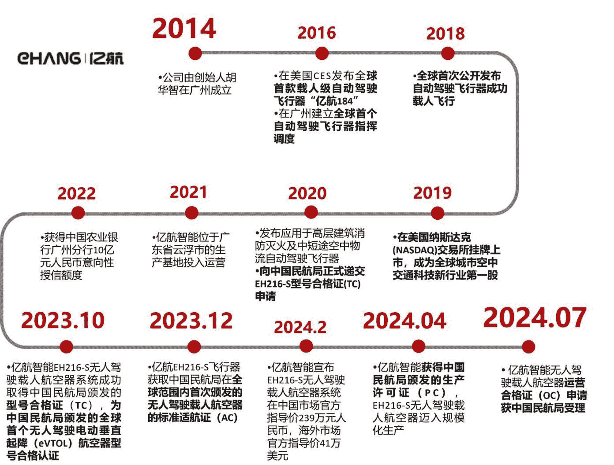
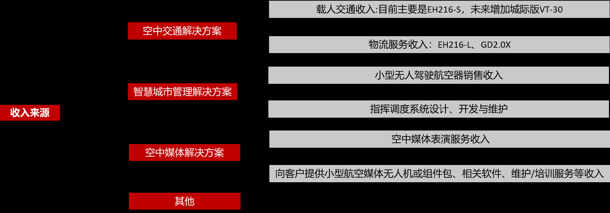
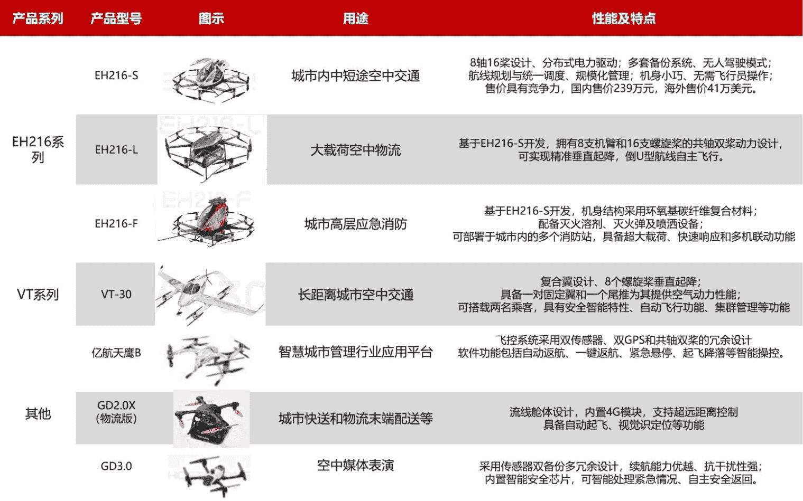
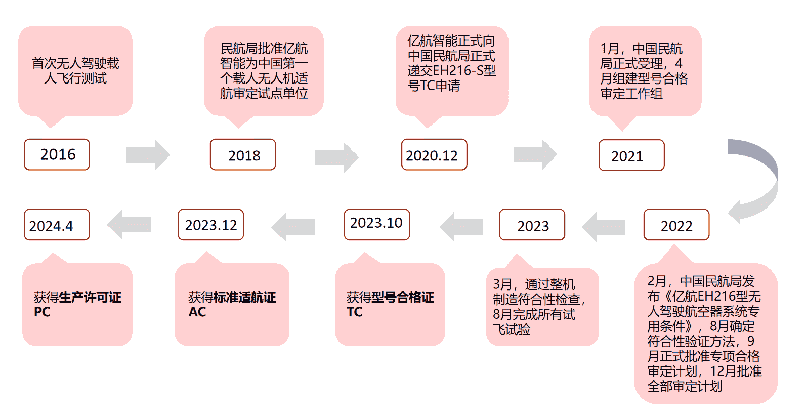
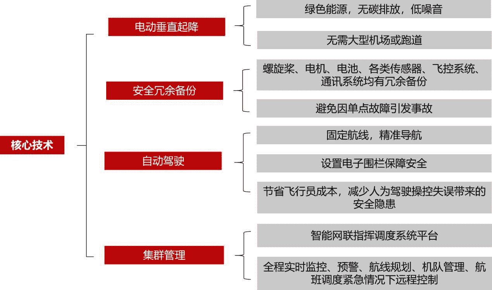
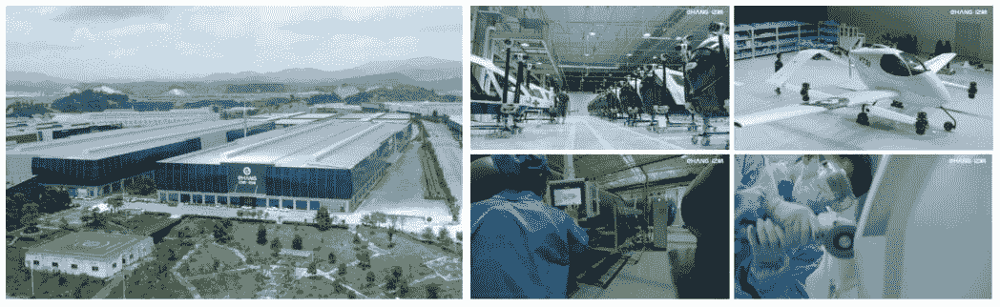
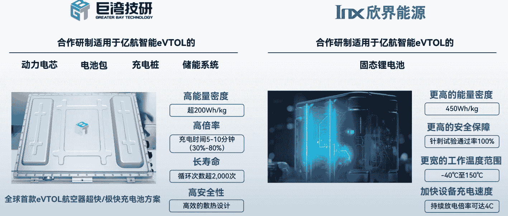

本公司具备证券投资咨询业务资格，请务必阅读最后一页免责声明

证券研究报告

# 掘金优质中概系列：亿航智能（EH.O）深度报告

## 全球首个三证齐全的 eVTOL 龙头，业绩持续超预期

**2024 年 09 月 11 日**

- **公司是全球首个三证齐全的 eVTOL 龙头企业，业绩表现持续超预期。** 亿航智能为全球首个取得 eVTOL 型号合格证（TC）、标准适航证（AC）及生产许可证（PC）的公司，且于 2024 年 7 月宣布运营许可证（OC）正式获民航局受理，取证速度领先于同行。公司股权相对集中，采用双重股权结构，创始人胡华智是第一大股东，享有高投票权。财务方面，公司完成适航认证后从 23Q4 到 24Q2 已连续 3 个季度实现正向经营现金流。24Q2 公司营收 1.02 亿元，yoy +920%，同比大幅增加主要得益于 EH216 系列产品销售大幅增加。公司产品盈利能力较强，毛利率始终维持在 60%以上。24Q2，公司归母净亏损 72 百万元，亏损持续收窄，Non-GAAP 归母净利润 1.25 百万元，同比扭亏为盈。

- **国家+地方政策驱动低空经济行业发展，市场空间广阔。** 政策端：2024 年 3 月，低空经济首次写进政府工作报告，将低空经济定义为增长引擎。国家政策和法规积极推动低空经济的发展，各地政府纷纷响应。截至 4 月，2024 年已有 26 个省份的政府工作报告对发展低空经济作出部署。需求端：eVTOL 下游应用场景包括空中游览、机场接驳、城市内空中出租车、应急运输、空中物流等，市场空间广阔，预计到 2026 年将达到万亿市场规模。供给端：海内外布局 eVTOL 企业较多，包括 1）亿航智能、Joby、Lilium 等专门做 eVTOL 的企业；2）小鹏、吉利等汽车企业；3）巴西航空、空客等航空企业。亿航智能率先集齐三证，具备先发优势，大部分同行均处于原型机认证或适航取证早期阶段，预计 2025 年或 2026 年之后才能获得型号合格证。

- **公司具备先发优势+技术优势显著+在手订单充足+积极布局上游产业链。**

  1）先发优势：公司是全球首个集齐三证的 eVTOL 龙头，OC 也已获民航局受理，有望率先落地运营。

  2）技术优势：相比于传统直升机，亿航 eVTOL 噪音更低，内外噪音类似于城市环境噪音；亿航 eVTOL 所有电机、电调、传感器和飞控通信均有多套安全备份，防止单点故障导致的整机事故；亿航的无人驾驶技术使其在提前设定的固定航线上精准导航，在电子围栏内安全飞行；亿航自主研发的指挥调度系统平台可实现远程实时监控和航线调度管理，确保在城市内有限空域的大规模多级联合运行更安全高效。

  3）在手订单和预订单充足：公司与海内外政企密切合作，自 2023 年第四季度截至 2024 年 7 月，国内新增在手订单和预订单约 1100 台。

  4）积极布局上游产业链：2024 年 1 月，亿航与国轩高科达成战略合作，共同研发专为无人驾驶飞行器设计的电芯、电池组、储能系统和充电基础设施。此外，亿航与广汽集团旗下内部孵化的巨湾技研合作研发 eVTOL 快充方案，并战略投资了深圳的欣界能源，合作研制适用于 eVTOL 的固态锂电池。

- **核心观点：** 公司是全球首个三证齐全的 eVTOL 龙头，具备先发优势；基于其出色的产品定位，海内外需求旺盛，在手订单充足；积极布局产业链上游，保驾护航 eVTOL 产品力持续提升。此外，公司的运营合格证（OC）申请已获得民航局的受理，正在审定过程中，预计 2024 年内可获批首张 OC，未来运营服务有望成为新的营收和业绩贡献点，我们建议积极关注。

- **风险提示：** 低空经济政策不及预期；核心技术推进不及预期；行业竞争加剧。

## 重点公司盈利预测、估值与评级

| 代码 | 简称 | 股价（美元） | EPS（元）2023A | EPS（元）2024E | EPS（元）2025E | PS（倍）2023A | PS（倍）2024E | PS（倍）2025E |
|---|---|---:|---:|---:|---:|---:|---:|---:|
| EH.O | 亿航智能 | 11.67 | -2.48 | -2.14 | -0.1 | 123 | 13 | 6 |

资料来源：BBG，民生证券研究院（注：股价为 2024 年 9 月 9 日收盘价，EPS、PS 采用 BBG 一致预期）

**分析师：易永坚**

执业证书：S0100523070002

邮箱：yiyongjian@mszq.com

**分析师：柴梦婷**

执业证书：S0100523100005

邮箱：chaimengting@mszq.com

## 目录

**1 公司简介：全球首个三证齐全的 eVTOL 龙头，业绩持续超预期** ............................................................................... 3

1.1 历史沿革：诞生于城市空中交通科技兴起时代，引领低空经济市场加速起飞 ..................................................................... 3

1.2 商业模式：科技驱动的城市空中交通平台，“产品销售+运营服务”为主要营收来源 ...................................................... 4

1.3 股权结构：双重股权结构，管理层经验丰富 ................................................................................................................................ 5

1.4 财务分析：净亏损持续收窄，经营性现金流连续三个季度为正 .............................................................................................. 7

**2 行业：低空经济发展元年，政策+产业共振** .............................................................................................................. 9

2.1 政策端：低空经济首次写进政府工作报告，国家+地方政策共驱行业发展........................................................................... 9

2.2 需求端：多元应用场景，市场空间广阔 ...................................................................................................................................... 11

2.3 供给端：布局企业较多，亿航具备先发优势 .............................................................................................................................. 13

**3 公司亮点：率先集齐三证+技术优势显著+在手订单充足+积极布局上游产业链** ..................................................... 15

3.1 全球首个三证齐全 eVTOL 龙头，先发优势显著 ....................................................................................................................... 15

3.2 核心技术优势保驾护航产品，保证 eVTOL 的安全和效率 ...................................................................................................... 16

3.3 公司与海内外政企密切合作，在手订单充足 .............................................................................................................................. 17

3.4 积极布局上游供应链，携手国轩高科、巨湾技研和欣界能源共同研发 eVTOL 电池系统 ................................................ 20

**4 核心观点** .............................................................................................................................................................. 22

**5 风险提示** .............................................................................................................................................................. 23

**插图目录** .................................................................................................................................................................. 24

**表格目录** .................................................................................................................................................................. 24

## 1 公司简介：全球首个三证齐全的 eVTOL 龙头，业绩持续超预期

### 1.1 历史沿革：诞生于城市空中交通科技兴起时代，引领低空经济市场加速起飞

**公司诞生于城市空中交通科技兴起时代，引领低空经济市场加速起飞。** 公司成立于 2014 年，于 2016 年发布全球首款载人级自动驾驶飞行器；于 2018 年全球首次公开发布自动驾驶飞行器成功载人飞行；于 2019 年在纳斯达克交易所挂牌上市，成为全球城市空中交通科技新行业第一股；于 2020 年扩展市场至消防灭火及中短途空中物流；于 2023 年 10 月成功取得中国民航局颁发的型号合格证（TC），为全球首个无人驾驶电动垂直起降（eVTOL）航空器型号合格认证；随后分别于 2023 年 12 月和 2024 年 4 月获得中国民航局颁发的标准适航证（AC）与生产许可证（PC），正式迈入规模化生产；于 2024 年 7 月，公司宣布其 eVTOL 运营合格证（OC）申请获中国民航局受理。

**图 1：亿航智能历史沿革**

资料来源：公司官网，民生证券研究院

### 1.2 商业模式：科技驱动的城市空中交通平台，“产品销售+运营服务”为主要营收来源

**公司以“全球领先的城市空中交通平台运营商”为战略定位，采用“产品销售+运营服务”双驱动的商业模式。** 从公司的业务模式来看，收入来源包括空中交通解决方案、智慧城市管理解决方案和空中媒体解决方案三大业务。1）空中交通解决方案为公司第一大营收来源，提供短途、中长途的城市空中交通解决方案和服务，根据公司公告，空中交通解决方案在 2023 年营收达到 1.05 亿元，占总营收的 89.2%，其收入主要来自 EH216 系列产品的销售；2）智慧城市管理解决方案包括指挥调度系统的设计、开发与维护，以及小型无人驾驶航空器的销售，通过集成化指挥调度平台和无人驾驶航空器，下游应用领域包括交通管理、应急响应、灾难救援等；3）空中媒体解决方案通过自主研发的智能指挥调度系统对无人驾驶航空器的集群管理，提供环保的“科技烟花”编队灯光秀服务。

**图 2：亿航智能“产品销售+运营服务”商业模式（收入占比为 2023 年度数据）**

资料来源：公司公告，民生证券研究院

**亿航智能的产品布局涵盖多种无人驾驶航空器，目前主要销售产品为 EH216 系列。** EH216-S 是全球首个拿到 TC、AC 和 PC 三证齐全的 eVTOL 产品，是亿航自主研发的旗舰产品，面向城市内中短途空中交通设计，具有高可靠性和安全性，且售价相对较低（国内售价 239 万元，海外售价 41 万美元）。此外，公司还基于 EH216-S 开发了用于大载重空中物流的 EH216-L 和用于高层应急消防的 EH216-F。针对城际间较长距离的空中交通，公司研发了 VT 系列产品，VT-30 是一款复合翼无人驾驶 eVTOL 航空器，目前仍处于内测和产品升级迭代阶段，未实现产品交付。除此之外，公司也在研发其他系列的轻型和小型无人驾驶航空器，如 GD3.0 和天鹰系列。

**图 3：亿航智能产品布局**

资料来源：公司公告，民生证券研究院

### 1.3 股权结构：双重股权结构，管理层经验丰富

**双重股权结构，管理层经验丰富。** 公司股权结构较为集中，创始人始终为第一大股东。截至 2024 年 3 月 31 日，创始人胡华智合计持有公司所有已发行和流通股份的 31.20%，投票权占比 81.7%，为公司的实际控制人。公司管理团队行业从业经验丰厚，创始人兼 CEO 胡华智先生毕业于清华大学，曾担任北京今典集团的副总裁、北京 999 应急救援中心的首席技术官，创立了亿航智能的前身——北京亿航创世科技有限公司。

**图 4：公司股权结构图（时间截至 2024.03）**

资料来源：公司公告，民生证券研究院

### 表 1：亿航管理层简介

| 姓名 | 职务 | 简介 |
|---|---|---|
| 胡华智 | 创始人、董事长、首席执行官 | 胡华智先生是亿航智能的创始人，自公司成立以来，一直担任首席执行官和董事会主席。胡先生于 2005 年创立了亿航智能的前身——北京亿航创世科技有限公司，是领先的大型指挥控制系统提供商。2008 年至 2010 年间，胡先生曾担任北京 999 应急救援中心的首席技术官。2006 年至 2008 年间，胡先生在北京今典集团担任副总裁，负责信息管理。胡先生于 2019 年荣获“活着的航空传奇”科技创新奖。胡先生于 1992 年至 1997 年间在清华大学学习计算机科学专业。 |
| 杨嘉宏 | 首席财务官、董事 | 杨嘉宏先生自 2019 年 11 月开始担任亿航智能董事，自 2023 年 9 月同时担任公司的首席财务官。2007 年至 2023 年间，杨先生曾担任多家上市公司的首席财务官，包括途牛旅游网（Nasdaq: TOUR）、当当网和航美传媒集团。杨先生于 2004 年至 2007 年间担任滚石移动的首席执行官，1999 年至 2004 年间担任蜂星电讯亚洲公司亚太区的首席财务官。此前，在 1992 年至 1999 年间，杨先生曾先后在高盛（亚洲）有限责任公司、雷曼兄弟亚洲有限公司和摩根士丹利亚洲有限公司担任高级银行家。目前，杨先生在天境生物（Nasdaq: IMAB）、爱奇艺（Nasdaq: IQ），同程旅行（HKSE: 0780）、老虎证券（Nasdaq: TIGR）和怪兽充电（Nasdaq: EM）担任独立董事。杨先生拥有加州大学洛杉矶分校（UCLA）工商管理硕士学位。 |
| 王钊 | 首席运营官 | 王钊先生自 2024 年 4 月加入公司，现担任公司首席运营官。在加入亿航智能之前，王先生曾就职于今典集团，一家集度假、电影、艺术等跨行业服务于一体的中国企业，于 2020 年 6 月至 2024 年 3 月担任红树林科技集团的首席执行官（CEO）。在此期间，王先生负责中国多个超大型度假村数字化转型和业务运营，应用智能化、平台化的运营管理系统，并把空中、地面和水上自动驾驶产品引入度假村。在此之前，2017 年 8 月至 2020 年 6 月，王先生曾在 IT 咨询公司北京淦蓝科技发展有限公司担任 CEO。2008 年 10 月至 2017 年 8 月，王先生曾在今典投资集团担任多个高管职位，负责文旅项目和数字电影产业的平台开发和运营管理。2006 年 12 月至 2008 年 10 月，王先生曾在搜狐公司（纳斯达克：SOHU）担任技术经理，主导 2008 年北京夏季奥运会官网信息系统的架构设计。此前，王先生还参与了 2004 年雅典夏季奥运会信息系统的开发工作。王先生拥有清华大学计算机科学与技术学士学位。 |
| 刘永基 | 独立董事 | 刘永基先生自 2023 年 8 月起担任公司董事。自 2022 年 8 月起刘先生担任速腾聚创科技有限公司（HKSE: 2498）首席财务官。2020 年 6 月至 2024 年 3 月，刘先生担任泛生子（NASDAQ: GTH）的独立董事。2020 年 3 月至 2022 年 7 月，刘先生担任达内国际教育有限公司（NASDAQ: TEDU）的首席财务官。2018 年 7 月至 2019 年 8 月，刘先生担任小方熊猫教育机构的首席财务官。2007 年 3 月至 2018 年 6 月，刘先生担任完美世界股份有限公司（SHE: 002624）的首席财务官和公司秘书。2004 年 11 月至 2007 年 2 月，刘先生担任北青传媒股份有限公司（HKEX：01000）的首席财务官。2000 年 7 月至 2004 年 10 月，刘先生担任奥美广告北京分公司的财务总监。此前，1994 年 1 月至 2000 年 7 月，刘先生在普华永道工作。刘先生于 1990 年 11 月获香港浸会大学金融学学士学位，并于 2011 年 9 月获长江商学院 EMBA 学位。刘先生是英国特许公认会计师（ACCA）和香港注册会计师（HKICPA）。 |
| 吴东明 | 独立董事 | 吴东明先生自 2020 年 6 月起担任公司的独立董事。吴先生自 2003 年 5 月起担任中外运敦豪（DHL-Sinotrans）董事总经理。他目前还担任 DHL 中国首席执行官和 DHL 全球管理委员会成员。DHL-Sinotrans 是中国领先的国际快递公司，是全球快递物流巨头 DHL 与中国外运的合资企业。吴先生在全球快递及物流行业拥有逾 30 年的丰富经验。他于 1986 年 7 月加入中国外运，担任多个高级管理职位，担任监事会主席至 2017 年 3 月。吴先生获得北京第二外国语大学经济学学士学位和北京大学国家发展研究院 BiMBA 商学院 EMBA 学位。 |
| 侯昊翔 | 独立董事 | 侯昊翔自 2015 年 8 月担任公司的独立董事。侯先生自 2022 年 7 月起担任厚雪资本创始人兼首席投资官。2015 年 4 月至 2022 年 6 月，侯先生担任金浦创投管理合伙人兼投资委员会主任，金浦高科技资本高级合伙人兼投资委员会委员，金浦欣成资本投资副总裁。侯先生荣登 2023 年福布斯中国百强风险投资家榜单。侯先生分别于 2011 年和 2015 年在上海交通大学获得电气工程和国际金融双学士学位和工商管理硕士学位。侯先生是特许金融分析师。 |

### 行业深度研究/海外

本公司具备证券投资咨询业务资格，请务必阅读最后一页免责声明

证券研究报告

**7**

杨宁

独立董事

Nick Ning Yang（杨宁）自2022年12月担任公司独立董事。自2011年10月以来，杨先生担任乐搏资本的创始合伙人。在此之前曾联合创立空中网，杨先生于2002年至2008年担任其首席技术官。空中网专注于无线增值服务业务，于2004年7月在纳斯达克上市。2000年至2001年，杨先生担任纳斯达克上市公司搜狐的技术副总裁。杨先生曾联合创建ChinaRen.com网站，并在1999年至2000年期间担任其首席技术官。杨先生于1997年在密歇根大学获得电机工程学士学位，1999年在斯坦福大学获得电机工程硕士学位。

资料来源：公司官网，民生证券研究院

### 1.4 财务分析：净亏损持续收窄，经营性现金流连续三个季度为正

**24Q2 营收同环比均实现增长，公司营收主要来源于空中交通解决方案。**2023年，公司实现营收1.17亿元，yoy+165%，同比大幅增加主要系EH216系列产品销售数量由2022年的21架提升至2023年52架。24Q2，公司实现营收102百万元，yoy+920%，qoq+65%，同比大幅增加，主要得益于EH216系列产品销售由23Q2的5架大幅提升至24Q2的49架，交付数量同比增长9倍。从营收结构来看，公司营收主要来源于空中交通解决方案，占比总营收从2019年的71%提升至2023年的89%，主要受EH216系列产品的销售所驱动。

**图5：2019-2023年营收及增速**

**图6：19Q1-24Q2单季度营收及增速**

资料来源：wind，民生证券研究院

资料来源：wind，民生证券研究院

**公司产品毛利率维持在60%左右，净亏损持续收窄。**从盈利能力来看，2021-2023年，公司毛利率始终维持在60%以上，产品盈利能力较强。2023年，归母净亏损和Non-GAAP归母净亏损分别为3.02亿元和1.38亿元，分别同比收窄。单季度来看，24Q2，公司归母净亏损7,200万元，近几个季度以来，公司净亏损持续收窄；同期，Non-GAAP归母净利润115万元，扭亏为盈。

| -100% | 0% | 100% | 200% |
|---|---|---|---|
| 0 | 50 | 100 | 150 | 200 |
| 营收（百万元） | yoy | | |

| -500% | 0% | 500% | 1000% |
|---|---|---|---|
| 0 | 50 | 100 | 150 |
| 营收（百万元） | yoy | qoq | |

证券研究报告

**8**

**图7：2019-2023年毛利率**

**图8：19Q1-24Q2单季度毛利率**

资料来源：wind，民生证券研究院

资料来源：wind，民生证券研究院

**图9：2019-2023年GAAP、Non-GAAP归母净利润**

**图10：单季度GAAP、Non-GAAP归母净利润**

资料来源：wind，民生证券研究院

资料来源：wind，民生证券研究院

| 50% | 55% | 60% | 65% | 70% |
|---|---|---|---|---|
| 毛利率 | | | | |

| 50% | 55% | 60% | 65% | 70% |
|---|---|---|---|---|
| 毛利率 | | | | |

| -400 | -300 | -200 | -100 | 0 |
|---|---|---|---|---|
| 归母净利润（百万元） | Non-GAAP归母净利润（百万元） | | | |

| -150 | -100 | -50 | 0 | 50 |
|---|---|---|---|---|
| 归母净利润（百万元） | Non-GAAP归母净利润（百万元） | | | |

| 0% | 100% | 200% | 300% | 400% |
|---|---|---|---|---|
| 销售费用率 | 管理费用率 | 研发费用率 | | |

| 0% | 200% | 400% | 600% | 800% |
|---|---|---|---|---|
| 销售费用率 | 管理费用率 | 研发费用率 | | |

**公司始终重视研发，研发费用率维持高位。**从期间费用率来看，2023年，公司期间费用率322%，其中销售/管理/研发费用率分别为51%/128%/142%。24Q2，销售/管理/研发费用率分别为27%/53%/61%。公司始终重视研发投入，研发费用率始终维持高位，截至2023年12月31日，公司拥有367名正式员工，其中研发人员占比52.9%。

**图11：2019-2023年费用率变动趋势**

**图12：19Q1-24Q2单季度费用率变动趋势**

资料来源：wind，民生证券研究院

资料来源：wind，民生证券研究院

证券研究报告

**9**

## 2 行业：低空经济发展元年，政策+产业共振

### 2.1 政策端：低空经济首次写进政府工作报告，国家+地方政策共驱行业发展

**低空经济首次写进政府工作报告，将低空经济定义为增长引擎。**回顾国家层面的低空经济行业相关政策，2021年2月，低空经济写入《国家综合立体交通网规划纲要》。2023年底举行的中央经济工作会议提出“打造生物制造、商业航天、低空经济等若干战略性新兴产业”。2024年1月1日，《无人驾驶航空器飞行管理暂行条例》正式实施，标志着我国无人机产业将进入“有法可依”的规范化发展新阶段。2024年3月，“积极打造生物制造、商业航天、低空经济等新增长引擎”被写入政府工作报告，“低空经济”首次被写入政府工作报告。2024年3月，工业和信息化部、科学技术部、财政部、中国民用航空局印发《通用航空装备创新应用实施方案（2024—2030年）》，提出到2030年，推动低空经济形成万亿级市场规模。

**表2：行业相关政策**

| 发布日期 | 文件名 | 政府部门 | 具体内容 |
|---|---|---|---|
| 2021.2 | 《国家综合立体交通网规划纲要》 | 中共中央、国务院 | 发展交通运输平台经济、枢纽经济、通道经济、低空经济；深化国家空管体制改革；发展通用航空；推进通用航空与旅游融合发展；推进智能网联汽车（智能汽车、自动驾驶、车路协同）、智能化通用航空器应用；发展新一代空管系统，**推进空中交通服务、流量管理和空域管理智能化**。 |
| 2022.6 | 《“十四五”通用航空发展专项规划》 | 民航局 | 推动跨界融合。**鼓励载人无人驾驶等新型航空器的发展，带动城市空中交通快速发展。**推动低空旅游发展，支持文旅主管部门扩大空中游览、高空跳伞等对景区的覆盖，建立连接景区、度假区、主题公园等旅游目的地的低空旅游网。支持地方政府发展“通用航空＋旅游”，鼓励依托观光游、主题游、体验游等形态丰富低空旅游内涵，支持脱贫地区发展通用航空特色休闲农业和精品旅游。 |
| 2023.05 | 《无人驾驶航空器飞行管理暂行条例》 | 国务院、中央军委 | 一是对无人机实施分类管理。二是对无人机实行协同综合监管。三是划设无人机适飞空域。四是优化无人机飞行活动管理方式。 |
| 2023.08 | 《民用无人驾驶航空器运行安全管理规则》(征求意见稿) | 中国民航局 | 共分为总则、操控员安全操控要求、登记管理、适航管理、空中交通管理、运行与经营管理、法律责任、附则等8章。 |
| 2023.10 | 《绿色航空制造业发展纲要（2023-2035年）》 | 工信部、科技部、财政部、中国民航局 | 明确提出到2025年，**电动通航飞机投入商业应用，电动垂直起降航空器（eVTOL）实现试点运行，**到2035年，新能源航空器成为发展主流，以无人化、电动化、智能化为技术特征的新型通用航空装备实现商业化、规模化应用。 |
| 2023.12 | 2023年中央经济工作会议 | 中共中央 | 打造生物制造、商业航天、**低空经济等若干战略性新兴产业，**开辟量子、生命科学等未来产业新赛道，广泛应用数智技术、绿色技术，加快传统产业转型升级。加强应用基础研究和前沿研究，强化企业科技创新主体地位。 |
| 2023.12 | 全国工业和信息化工作会议 | 工信部 | 会议提出，加快培育新兴产业。其中要打造生物制造、商业航天、**低空经济**等新的增长点。 |
| 2023.12 | 《国家空域基础分类方法》 | 中国民航局 | 首次规范明确**低空空域划分**。 |

证券研究报告

**10**

| 发布日期 | 文件名 | 政府部门 | 具体内容 |
|---|---|---|---|
| 2024.01 | 民用无人驾驶航空器运行安全管理规则 | 交通运输部 | 分为总则、操控员管理、登记管理、适航管理、空中交通管理、运行管理、法律责任、附则8章。 |
| 2024.03 | 政府工作报告 | 国务院 | 积极打造生物制造、商业航天、**低空经济**等新增长引擎。 |
| 2024.03 | 《通用航空装备创新应用实施方案（2024-2030年）》 | 工业和信息化部 科学技术部 财政部 中国民用航空局 | 到2027年，以**无人化、电动化、智能化**为技术特征的新型通用航空装备在城市空运、物流配送、应急救援等领域实现商业应用；到2030年，通用航空装备全面融入人民生产生活各领域，成为低空经济增长的强大推动力，**形成万亿级市场规模**。 |

资料来源：政府部门网站，民生证券研究院

**地方层面积极响应国家政策，加速推进低空经济落地。**根据人民日报，截至2024年4月，今年已有26个省份的政府工作报告对发展低空经济作出部署，其中亿航智能总部所在地——广东省为国内低空经济发展较早的省份之一，《深圳经济特区低空经济产业促进条例》是全国首部关于低空经济的地方专项法规。

**表3：地方低空经济政策**

| 地区 | 发布日期 | 文件名 | 具体内容 |
|---|---|---|---|
| 安徽芜湖 | 2023.10 | 《芜湖市低空经济高质量发展行动方案（2023-2025年）》 | 到2025年，低空经济相关企业数量突破300家，其中龙头企业超过10家，专精特新企业、高新技术企业数翻一番，低空产业产值达到500亿元。 |
| 广东深圳 | 2024.01 | 《深圳经济特区低空经济产业促进条例》 | 建立了“两大协调工作机制”，将低空经济产业纳入深圳市国民经济和社会发展规划。市政府建立产业发展协调机制，统筹和推进低空经济产业发展；同时，与空中交通管理和民航管理部门建立飞行协同管理机制，解决空域划设和飞行监管等问题，建立服务平台，完善低空飞行保障体系。 |
| 安徽合肥 | 2024.01 | 《合肥市低空经济发展行动计划（2023-2025年）》 | 聚焦“空间保障、产业集聚、场景示范、设施建设”四大领域，在2024年基本建成骆岗低空融合飞行试验片区，2025年基本建成具有国际影响力的“低空之城”，在科技研发、产业集聚、应用场景、标准规则、飞行保障等方面走在全球前列。 |
| 广东珠海 | 2024.03 | 《珠海市支持低空经济高质量发展的若干措施（征求意见稿）》 | 围绕培育低空经济产业生态、扩大低空飞行应用场景、强化产业要素供给等三个方面提出13项具体举措。 |
| 安徽 | 2024.04 | 《安徽省加快培育发展低空经济实施方案（2024—2027年）及若干措施》 | 到2025年，低空基础设施建设加快推进，建成一批应用示范场景，低空经济规模和创新能力快速提升，集聚化产业生态初步形成。到2027年，低空基础设施进一步完善，应用场景不断拓展，低空经济规模和创新能力达到全国领先水平，打造合肥、芜湖两个低空经济核心城市，发挥六安、滁州、马鞍山等市低空制造业配套优势，彰显安庆、宣城等市低空服务业特色，基本形成双核联动、多点支撑、成片发展的低空经济发展格局。 |
| 江苏无锡 | 2024.04 | 《无锡市低空经济高质量发展三年行动方案（2024-2026年）》 | 着眼构建集研发制造、商业应用、基础设施、服务配套“四位一体”的低空经济协同发展体系，围绕产业集聚、创新能力、基础设施、试点应用等方面提出了发展目标：到2026年，低空经济产业产值规模突破300亿元，成为无锡社会经济发展新的增长极。 |
| 湖南长沙 | 2024.04 | 《长沙县长沙经开区低空经济发展三年行动计划（2024-2026年）》 | 到2026年底，初步建立全县低空经济产业循环体系，基本完善低空飞行基础保障体系，相关企业数量突破500家，其中龙头企业超过20家，低空经济相关产值达到500亿元。 |

证券研究报告

**11**

| 地区 | 发布日期 | 文件名 | 具体内容 |
|---|---|---|---|
| 北京 | 2024.05 | 《北京市促进低空经济产业高质量发展行动方案(2024-2027年)》(征求意见稿) | 在确保安全的前提下，力争三年内：低空经济企业达5000家以上，全国覆盖低空技术服务，提升国际国内影响力和品牌认知度，促进产业集聚和集群发展，完善低空产业体系，引领全国在技术创新、标准政策、应用需求、安防反制等方面。预计带动本市经济增长超过1000亿元。到2027年，培育10亿元级龙头企业10家，配套过亿元产业链核心企业50家，技术服务企业100家，形成具有国际竞争力和品牌影响力的低空产品和服务。 |
| 广东 | 2024.05 | 《广东省推动低空经济高质量发展行动方案（2024—2026年）》 | 到2026年，低空管理机制顺畅运转，基础设施基本完备，应用场景拓展加快，创新能力领先国际，产业规模不断扩大，推动形成低空制造和服务融合的发展格局。目标是打造世界领先的低空经济产业高地，预计产业规模超过3000亿元。广州、深圳、珠海三地将形成核心联动、多点支撑、成片发展的低空经济产业格局，并培育一批龙头企业和专精特新企业。 |
| 江苏南京 | 2024.05 | 《南京市促进低空经济高质量发展实施方案（2024—2026年）》 | 明确未来三年南京市低空经济的发展目标和重点任务——1个总量指标：全市低空经济产业规模超500亿元。7个具体指标：建成240个以上低空航空器起降场及配套的信息化基础设施；建成3个以上试飞测试场和操控员培训点；规划建设1—2个通用机场；开通120条以上低空航线；全市低空经济领域高新技术企业超120家；建成15个省级以上创新平台；培育30个以上具备示范效应的创新应用场景。 |
| 广东广州 | 2024.05 | 《广州市低空经济发展实施方案》 | 到2027年，广州低空经济整体规模达到1500亿元左右。通航基础设施和飞行环境明显改善，以高端智能制造业为主导的产业体系初步形成，低空空域管理改革取得成效，低空飞行服务保障能力明显提升，低空领域技术创新水平全国领先。 |
| 广东珠海 | 2024.06 | 《珠海市支持低空经济高质量发展的若干措施》 | 支持重大项目落户及增资扩产，支持适航取证，支持公共服务平台建设，降低低空经济企业试飞成本，支持低空经济会展活动。其中，对获得中国民用航空局颁发的型号合格证（TC）和生产许可证（PC）的大型载人无人驾驶航空器、大型非载人无人驾驶航空器、中型无人驾驶航空器的生产企业，最高奖励1000万元。 |
| 安徽合肥 | 2024.06 | 《合肥市支持低空经济发展若干政策》 | 对新落户的企业，在用房、用地、用能、服务保障等方面给予支持。对服务低空经济企业发展的适航审定检测中心、无人机产品质量检验检测中心等检验检测机构，按年投资额的20%，给予最高500万元的补助。对新引进的低空经济新型研发机构，给予每年最高2000万元、累计不超过1亿元的经费支持。支持建设eVTOL、无人机起降点（地）、智能起降柜机、充换电站等地面基础设施，保障设施和验证试飞场地设施等。其中，对社会投资建设的基础设施建成并实际运营的，按不高于实际建设投入的15%给予补贴，每个企业每年度最高500万元。 |
| 上海 | 2024.06 | 《上海市加快推进新型工业化的实施方案》 | 支持企业在低空经济等新科技变革领域率先突破，培育产业“核爆点”。打造未来产业先导区和综合性应用试验场，建设未来产业研究院和技术学院，设立新型工业化促进中心。 |

资料来源：政府部门网站，民生证券研究院

### 2.2 需求端：多元应用场景，市场空间广阔

**eVTOL 下游应用场景广阔，大类涵盖载人交通和空中物流等。**其中，载人交通的细分应用场景包括空中游览、机场接驳、城市内空中出租车、应急运输等；空中物流的细分应用场景包括偏远地区/山区物流运输、短距支线物流运输、长距干线物流运输。eVTOL的应用将遵循风险递进原则，经历从物到人、从郊区到城市、从特需到日常、从公共服务到商业化运营的转变，亿航智能将首个应用场景落地于旅游观光。

证券研究报告

**12**

**图13：eVTOL应用场景**

资料来源：公司官网，民生证券研究院

**2026年中国低空经济规模将突破万亿元。**根据赛迪顾问研究报告，2023年中国低空经济规模达到5059.5亿元，增速高达33.8%，eVTOL产业规模接近10亿元，民用无人机产业规模接近1200亿元。预计至2026年，中国低空经济规模将突破万亿达10644.6亿元。根据咨询公司markets and markets市场调查报告，全球eVTOL市场规模预计将从2023年的12亿美元增长至2030年的234亿美元，年均复合增长率（CAGR）为52%，预计至2030年全球eVTOL市场预计将超过百亿美元。

**图14：2021-2023年中国低空经济规模与增长**

**图15：2024-2026年中国低空经济规模与增长预测**

资料来源：赛迪研究所，民生证券研究院

资料来源：赛迪研究所，民生证券研究院

| **2,911.80** | **3,780.70** | **5,059.50** |
|---|---|---|
| 9.3% | 29.8% | 33.8% |
| 0.0% | 10.0% | 20.0% | 30.0% | 40.0% |
| 0 | 1,000 | 2,000 | 3,000 | 4,000 | 5,000 | 6,000 |
| **规模（亿元）** | **规模增长率** | | |

| **6,702.50** | **8,591.70** | **10,644.60** |
|---|---|---|
| 32.5% | 28.2% | 23.9% |
| 0.0% | 10.0% | 20.0% | 30.0% | 40.0% |
| 0 | 2,000 | 4,000 | 6,000 | 8,000 | 10,000 | 12,000 |
| **规模（亿元）** | **规模增长率** | | |

### 行业深度研究/海外

本公司具备证券投资咨询业务资格，请务必阅读最后一页免责声明

证券研究报告

**13**

### 2.3 供给端：布局企业较多，亿航具备先发优势

**海内外企业积极布局eVTOL赛道，亿航取证领先同行。**目前海内外eVTOL行业参与者主要分为三大类：1）以亿航智能为代表的专做eVTOL的企业，如美国的Joby Aviation、德国的Lilium、中国的峰飞等；2）包括大众、丰田、小鹏和吉利在内的汽车制造商；3）以巴西航空、空客和波音为代表的航空公司。从全球eVTOL企业间竞争格局来看，亿航智能产品取证进度领先于全球其他eVTOL公司，已经成功获得型号合格证（TC）、生产许可证（PC）及标准适航证（AC）。国内外的同行企业，大部分均处于原型机认证或适航取证早期阶段，预计2025年或2026年之后才能获得型号合格证，亿航智能在行业内具有明显的先发优势。

**相比于海外公司的飞行器，亿航的机身更加小巧、占地面积小，有利于在城市有限空间内灵活寻找起降点。**欧美大机型有4-6个座位，1个座位留给飞行员；亿航的EH216-S拥有2个座位，可以更好的满足大部分的城市内Air Taxi出行的需求。对比显示，同样占地面积下，亿航可以搭载8名乘客，而volocopter只能容纳1名乘客，其他欧美公司的飞行器最多可容纳4-5名乘客。

**表4：国内外载人eVTOL产品差异及取证进度**

| 公司 | 成立时间 | 总部 | 主要产品 | 产品构型 | 是否无人驾驶 | 承载人数 | 最大起飞重量 | 机身尺寸 | TC取证时间 | 审查局方 | 取证进度 |
|------|----------|------|----------|----------|--------------|----------|--------------|----------|------------|----------|----------|
| 亿航智能 | 2014 | 广州 | EH216-S | 多旋翼 | 是 | 乘客*2 | 620kg | 6m*5.7m | 2023.10 | CAAC中南局 | 已取证 |
| Volocopter | 2011 | 德国 | Volocity | 多旋翼 | 否 | 飞行员*1+乘客*1 | 900kg | 11.3m*9.3m | - | EASA | - |
| Joby | 2009 | 美国 | S4 | 倾转旋翼 | 否 | 飞行员*1+乘客*4 | 2404kg | 10.7m*7.3m | 2025 (E) | FAA | 第四阶段验证实施 |
| Archer | 2018 | 美国 | Midnight | 倾转旋翼 | 否 | 飞行员*1+乘客*4 | 3175kg | 14m*X | 2025 (E) | FAA | 第四阶段验证实施 |
| Lilium | 2015 | 德国 | Lilium Jet | 涵道风扇 | 否 | 飞行员*1+乘客*6 | - | 13.9m*8.5m | 2025H2 (E) | EASA | 第三阶段符合性计划制定 |
| Vertical | 2016 | 英国 | VX4 | 倾转旋翼 | 否 | 飞行员*1+乘客*4 | - | 15m*13m | 2026H2 (E) | CAA | 第二阶段要求确定 |
| EVE | 2017 | 巴西 | EVE's eVTOL | 复合翼 | 否 | 飞行员*1+乘客*5 | 1000kg | - | 2026 (E) | ANCA | 第二阶段要求确定 |
| 峰飞 | 2017 | 上海 | 盛世龙 | 复合翼 | 是 | 飞行员*1+乘客*4 | 2000kg | 14.5m*11.6m | 2025-2026 (E) | CAAC华东局 | 第一阶段提交TC申请 |
| 沃飞长空 | 2020 | 成都 | AE200 | 倾转旋翼 | 否 | 飞行员*1+乘客*5 | 2500kg | 14.5m*9.1m | 2026 (E) | CAAC西南局 | 第二阶段要求确定 |
| 时的 | 2021 | 上海 | E20 | 倾转旋翼 | 否 | 飞行员*1+乘客*4 | - | - | 2025 (E) | CAAC华东局 | 第一阶段提交TC申请 |
| 沃兰特 | 2021 | 上海 | VE25 | 复合翼 | 否 | 飞行员*1+乘客*4 | - | 15m*10m | 2026 (E) | CAAC华东局 | 第一阶段提交TC申请 |
| 小鹏汇天 | 2020 | 广州 | X3-F | 飞行汽车 | 是 | - | - | - | - | CAAC中南局 | 第一阶段提交TC申请 |
| 御风未来 | 2015 | 上海 | Martrix1 | 复合翼 | 是 | 乘客*5 | 2500kg | - | - | CAAC华东局 | 第一阶段提交TC申请 |

资料来源：亿航智能，各公司官网，民生证券研究院

## 3 公司亮点：率先集齐三证+技术优势显著+在手订单充足+积极布局上游产业链

### 3.1 全球首个三证齐全eVTOL龙头，先发优势显著

**适航证书的获得是eVTOL进入市场并投入运营的前提，确保eVTOL在设计、制造和运营的每个环节都符合严格的安全标准。**在全球范围内，所有的载人航空器在进入商业化市场之前，都需要完成航空监管局方的适航审定。载人飞行器的审定需要经过四个阶段，分别是「概念设计阶段」、「要求确定阶段」、「符合性计划制定阶段」和「符合性证明与试验实施阶段」。一架无人驾驶的载人eVTOL航空器在研发设计、生产以及商业运营或销售给个人消费者的过程中，需要获得民航局颁发的三张证书，即型号合格证（TC）、生产合格证（PC）和单机适航证（AC）。目前，亿航智能的EH216-S已获得中国民航局颁发的全球首张eVTOL航空器型号合格证（TC）、生产许可证（PC）和标准适航证（AC）。

**表5：eVTOL适航三证**

| 名称 | 申请主体 | 取证周期 | 证件意义 |
|------|----------|----------|----------|
| 型号合格证TC (Type Certification) | 航空器设计方 | 3年-5年 | 中国民用航空局（CAAC）根据《民用航空产品和零部件合格审定规定》（CCAR-21）颁发的、用以证明民用航空产品符合相应适航规章和环境保护要求的证件。型号合格证包括以下内容：型号设计、使用限制、数据单、有关适航要求和环境保护要求，以及对民用航空产品规定的其他条件或限制。 |
| 生产许可证PC (Production Certification) | 航空器制造方 | 3-6个月 | 中国民航局认为申请人（OEM主机厂或者被委托方）已建立了一整套的用于航空器生产的质量系统，能够确保其生产的每一架航空器及其零部件均能符合经批准的设计，并处于安全可用状态。 |
| 标准适航证AC (Aircraft Certification) | 航空器制造方或拥有方 | 数月 | 中国民航局认为这架飞机（只是指这一架）符合经批准的设计，且处于安全可用状态。 |

资料来源：中国民用航空局, 飞行邦，民生证券研究院

**亿航为全球首个三证齐全的eVTOL龙头企业，取证壁垒较高。**2023年10月，公司EH216-S无人驾驶载人航空器系统成功取得中国民航局颁发的型号合格证（TC），为全球首个eVTOL航空器型号合格认证。公司从提交型号合格审定申请到获得型号合格证经历了34个月的时间。在适航取证过程中，中国民航局专家组对EH216-S的安全性、适航性、性能、功能、使用、可靠性等进行了全面且严格的验证，包括超过500科目的摸底试验、40,000余飞行架次的调整试飞、以及65大项、450多个科目的正式符合性验证试验。2023年12月，EH216-S飞行器获取中国民航局颁发的无人驾驶载人航空器的标准适航证（AC），完成航空器认证后，公司开始向客户交付获得适航认证的航空器产品。2024年4月，亿航智能获得中国民航局颁发的生产许可证（PC），EH216-S无人驾驶载人航空器迈入规模化生产。2024年7月，亿航智能的无人驾驶载人航空器运营合格证（OC）申请已获受理，是全球首个获得受理的eVTOL OC审定项目，意味着EH216-S产品的商业化运营有望落地在即。未来随着公司开展商业运营服务，来自飞行运营服务的经常性收入有望贡献业绩增量。

**图16：亿航智能型号合格审定过程**

资料来源：公司官网，民生证券研究院

### 3.2 核心技术优势保驾护航产品，保证eVTOL的安全和效率

**亿航始终重视研发投入，核心技术优势保证eVTOL的安全和效率。**根据2023年报，研发人员占比公司总员工数量53%，公司拥有超过700项专利，其技术研发团队不断推动产品性能和安全性的提升。从飞行器的具体技术来看，1）亿航电动的eVOTL飞行器相较传统的直升机更加绿色环保，垂直起降技术保障飞行器可以快速起降、在城市内即时部署；2）亿航eVTOL飞行器配备了分布式电力推进系统，所有电机、电调、传感器和飞控通信均有多套安全备份，防止单点故障导致整机事故，确保飞行安全；3）通过设定固定航线实现自动驾驶，在电子围栏内安全飞行，无需专业飞行员实时操控，削减了雇佣飞行员的高昂成本，提升安全性与运行效率；4）亿航自主研发的集群管理指挥调度系统，实现了飞行器运行时的联网和远程监控预警，确保大规模运行的安全性。

**图17：亿航核心技术优势确保飞行安全和效率**

资料来源：公司官网，民生证券研究院

### 3.3 公司与海内外政企密切合作，在手订单充足

**政企合作支持，推动低空经济蓬勃发展。**亿航智能与多家知名企业和地方政府建立了紧密的战略合作关系，各地政府的大力支持为亿航提供了良好的政策环境和基础设施支持，推动低空经济和城市空中交通的发展。目前，深圳市政府建立了为EH216-S定制的无人驾驶飞行器运营示范中心，并在宝安区成功启动了首飞，打造城市空中交通运营示范中心。亿航与广州空港委、广州开发区管委会和广汽集团达成战略合作，共同发展壮大新质生产力，助力广州高质量发展低空经济。此外，合肥市政府对亿航业务表示高度重视和支持，计划提供1亿美元的长期支持，包括采购订单和资金支持，为公司的业务拓展和市场推广提供了坚实的基础。

**表6：亿航区域合作与政府支持**

| 时间 | 地区 | 内容 |
|------|------|------|
| 2016年12月 | 广州市 | 建立全球首个自动驾驶飞行器指挥调度中心，并投入运营。 |
| 2021年6月 | 云浮市 | 亿航生产基地投入运营。 |
| 2022年6月 | 广州市 | 获得中国农业银行广州分行10亿元人民币意向性授信额度。 |
| 2023年7月 | 深圳市宝安区 | 与深圳市宝安区政府建立战略合作，打造城市空中交通运营示范中心。 |
| 2023年10月 | 合肥市 | 合肥市政府与亿航智能达成低空经济战略合作，亿航将参与合肥的全空间无人系统综合应用示范项目，在合肥的骆岗中央公园开启无人驾驶航空器的常态化运营。 |
| 2023年12月 | 深圳市宝安区 | 亿航在欢乐港湾启动城市空中交通运营示范中心。 |
| 2024年2月 | 广州市 | 亿航与广州空港委、广州开发区管委会、广汽集团达成战略合作，共同发展壮大新质生产力，助力广州高质量发展低空经济。 |
| 2024年3月 | 无锡市 | 亿航与无锡政府合作城市空中交通，当地政府将为亿航eVTOL未来在无锡的运营提供全面支持，包括客运、空中观光、消防和应急等多种用途。 |
| 2024年5月 | 太原市 | 亿航智能与西山文旅将合作打造太原低空经济产业园，签署在未来2年内额外采购450架EH216-S的意向采购协议，未来将用于旅游观光、载人交通等低空场景，共同促进无人驾驶eVTOL在华北地区的应用与运营 |
| 2024年6月 | 温州市文成县 | 着力发展低空旅游赛道，探索低空商业运营场景，利用当地丰富的景点资源开展无人驾驶载人航空器空中观光游览服务。 |

资料来源：公司公告, 民生证券研究院

**积极拓展全球市场，提升品牌国际知名度。**公司在全球的业务范围遍布亚洲、欧洲、美洲三大洲，截至2024年7月，亿航在亚洲、欧洲和美洲的16个国家累计完成超过50,000架次无人驾驶飞行。目前，亿航正在积极拓展阿联酋市场，与EIH旗下Wings及MLG达成战略合作，共同推动阿联酋和中东及北非地区空中交通，同时与Wings Logistics Hub的100架eVTOL销售协议在2024年第一季度开始交付首批5架。此外，阿布扎比投资办公室将为亿航智能提供建立和开展生产制造与产业服务的相关数据和信息，全方位助力其发展。同时，公司积极推进EH216-S型无人驾驶飞行器在国外的型式认证工作，为进一步拓展当地市场奠定基础。目前，中国民航总局已与世界上许多国家的航空主管部门签署了双边协议，并在已签发型号合格证（TC）的基础上，进一步增强与巴西、泰国、印尼、阿联酋等东南亚国家民航局之间的沟通与合作。

**图18：亿航全球飞行足迹**

资料来源：公司官网，民生证券研究院

**海内外需求旺盛，在手订单充足。**从EH216-S完成型号合格证的2023年第四季度截至2024年7月，亿航在国内新增的在手订单和预订单超过1100架，已与深圳、山西、无锡、合肥、温州文成、香港等多地政府和企业建立合作关系并签署采购协议。海外：自2021年12月起，亿航与印度尼西亚、马来西亚、日本、阿联酋等海外客户签订多笔订单，累计约311架。海外的商业化交付运营需要获得当地的VTC认证，目前亿航正在携手中国民航局在阿联酋、巴西、印尼、泰国等国家推进适航互认和EH216-S的VTC，取证以及交付时间取决于各国监管方的进度。24Q2，亿航智能总共交付了49架EH216系列eVTOL，预计未来交付量将显著增加。

**表7：亿航智能订单情况（国内）**

| 客户 | 时间 | 产品 | 计划订单数量 | 已交付数量 | 内容 |
|------|------|------|--------------|------------|------|
| 冠忠智慧出行 | 2024.7 | EH216-S | 30 | 5 | 冠忠智慧出行计划向亿航智能采购总计30架EH216-S，旨在合作促进EH216-S无人驾驶载人航空器在中国香港、澳门、湖北省襄阳市及十堰市的推广与运营。 |
| 温州市文成县政府 | 2024.06 | EH216-S | 300 | 27 | 文成县交通发展集团有限公司与亿航智能签署首批30架EH216-S的采购协议，迄今已交付27架，并已支付全部款项；此外，计划2026年年底前额外采购270架EH216-S，且已支付不可退还订金。 |
| 西山文旅 | 2024.05 | EH216-S | 500 | - | 西山文旅订购了50架EH216-S，并已经向亿航智能支付总合同价1.13亿元人民币。同时，西山文旅签署了在未来2年内额外采购450架EH216-S的意向采购协议。 |
| 无锡市政府 | 2024.03 | EH216-S | 100 | 10 | 获得100架EH216-S的意向采购订单。作为意向采购订单的一部分，其中10架EH216-S已于2024年第一季度交付给无锡当地客户。 |
| 合肥市政府 | 2023.10 | EH216-S系列 | 100+ | 15 | 合肥市政府计划为亿航智能提供总价值为1亿美元的各项支持，包括协调或促进不少于100架EH216系列产品的采购订单，以及资金支持*。在2023年Q4已经向合肥客户交付15架EH216-S。 |
| 深圳博领 | 2023.09 | EH216-S | 100 | 5 | 深圳博领客户已采购5架EH216-S，并计划继续采购95架EH216-S，用于未来在深圳地区的部署。 |
| 西安航空投资 | 2023.03 | EH216-S | 20 | - | 订单预计将于2025年完成。 |
| 天行健 | 2022.06 | EH216-S | 30 | 5 | 计划分批采购30架亿航216自动驾驶飞行器，依托矮寨奇观旅游景区丰富的旅游资源开展低空游览项目，目前亿航智能方面已经交付5架亿航216自动驾驶飞行器。 |

资料来源：公司公告, 民生证券研究院

**表8：亿航智能订单情况（海外）**

| 客户 | 时间 | 产品 | 计划订单数量 | 已交付数量 | 内容 |
|------|------|------|--------------|------------|------|
| Wings Logistics Hub (阿联酋) | 2023.12 | EH216-S系列 | 100 | 5 | 计划预订100架EH216系列，2024年Q1已交付5架。 |
| Prestige Aviation（印度尼西亚） | 2022.04 | EH216-S系列 | 100 | 1 | 获得100架EH216系列预订单。 |
| AEROTREE（马来西亚） | 2022.03 | EH216-S系列、VT-30 | 50+10 | - | 获得50架EH216系列和10架VT-30的预订单。 |
| AirX（日本） | 2022.01 | EH216-S系列 | 50 | 1 | 获得50架EH-216系列预订单。 |
| MASC.（日本） | 2021.12 | VT-30 | 1 | - | 获得1架VT-30预订单 |

资料来源：公司公告, 民生证券研究院

**广州云浮生产基地于2021年6月投入运营，规划年产能约600架eVTOL。**从产能角度来看，亿航智能云浮生产基地于2021年6月正式投入运营，该基地总建筑面积约24000平方米，规划年产能约600架，生产基地覆盖了eVTOL的主要生产流程，从核心组件以及碳纤维复合材料机身的生产制造，到整机组装以及飞行测试等各类特定的生产区域与环节。目前，公司eVTOL的大部分核心零部件均已实现国产化，电池、电机是公司出的自主研发的设计方案，通过第三方外协厂商

### 行业深度研究/海外

本公司具备证券投资咨询业务资格，请务必阅读最后一页免责声明

证券研究报告

**20**

进行生产制造加工，涉及任何软件系统算法都是自研。

**图19：亿航云浮生产基地**

资料来源：公司官网，民生证券研究院

### 3.4 积极布局上游供应链，携手国轩高科、巨湾技研和欣界能源共同研发eVTOL电池系统

**动力电池系统是航空器核心部件之一，亿航目前使用钴酸锂电池。** 动力电池系统是航空器的核心部件之一，其性能决定了航空器的航程、平稳性、安全性和运营效率。亿航产品目前使用的是钴酸锂电池，eVTOL对于电池性能的指标与电动车性能指标有相似但也有不同，电车需要一个向前的推力，飞行器则需摆脱引力起飞，尤其是在起降阶段，对于电池瞬间的放电倍率要求更高。公司综合几项指标：1）电池瞬间的放电倍率；2）能量密度；3）热稳定性；4）电池的生命周期和循环次数，目前选用钴酸锂电池。

**亿航携手国轩高科、巨湾技研和欣界能源共同研发eVTOL电池系统。** 亿航于24年1月与全球领先的新能源解决方案供应商国轩高科达成战略合作，共同研发专为无人驾驶飞行器设计的电芯、电池组、储能系统和充电基础设施。未来公司会专注下一代电池的研发：1）解决充电效率的问题：与广汽集团旗下内部孵化的巨湾技研合作，基于亿航的EH-216系列与VT-30等eVTOL航空器，研发符合中国民用航空局适航标准和4H标准（高能量密度、高充放电寿命、高瞬间充放电倍率、高安全性）的eVTOL快充方案。目前，新型eVTOL超快充电池具备充电速度快、能量密度高、循环寿命长等优势，可以实现从30%充到80%仅需5-10分钟，电池系统能量密度超过200Wh/kg，循环次数可达2000余次，满足亿航产品在安全性、续航能力和运营效率方面的需求，推进eVTOL超快充生态建设与低空经济的商业化运营进程。2）下一代固态锂电池的研发：战略投资深圳做固态锂电池的公司欣界能源，固态锂电池能量密度可达450Wh/kg，远远高出目前行业液态锂电池的能量密度平均水平（约为200+Wh/kg），未来有望提升eVTOL的续航。

**图20：产业链合作：定制研发eVTOL航空器超快/极快充电池、固态锂电池**

资料来源：公司官网，民生证券研究院

## 4 核心观点

公司是全球首个三证齐全的eVTOL龙头，具备先发优势；基于其出色的产品定位，海内外需求旺盛，在手订单充足；积极布局产业链上游，保驾护航eVTOL产品力持续提升。此外，公司的运营合格证（OC）已获得民航局的审定，未来运营服务有望成为新的营收和业绩贡献点，我们建议积极关注。

**表9：亿航智能盈利预测**

| 证券代码 | 证券简称 | 收盘价（美元） | EPS（元） | PS | | | |
|---------|---------|--------------|-----------|-----|-----|-----|
|         |         |              | 2023A | 2024E | 2025E | |
|         |         |              | 2023A | 2024E | 2025E |
| EH.O | 亿航智能 | 11.67 | -2.48 | -2.14 | -0.1 | 123 |
| | | | | | | 13 |
| | | | | | | 6 |

资料来源：Bloomberg, 民生证券研究院（注：股价为2024年9月9日收盘价，EPS、PS采用BBG一致预期）

## 5 风险提示

**1）低空经济政策不及预期。** 低空经济是政策+产业进程双轮驱动，如若政策不及预期或将影响行业发展进程。

**2）核心技术推进不及预期。** eVTOL核心技术推进不及预期或将影响产业进程。

**3）行业竞争加剧。** 随着eVTOL行业内获得发牌的公司不断增加，行业竞争将加剧，或将影响亿航的市占率。

**插图目录**

图1：亿航智能历史沿革
图2：亿航智能"产品销售+运营服务"商业模式（收入占比为2023年度数据）
图3：亿航智能产品布局
图4：公司股权结构图（时间截至2024.03）
图5：2019-2023年营收及增速
图6：19Q1-24Q2单季度营收及增速
图7：2019-2023年毛利率
图8：19Q1-24Q2单季度毛利率
图9：2019-2023年GAAP、Non-GAAP归母净利润
图10：单季度GAAP、Non-GAAP归母净利润
图11：2019-2023年费用率变动趋势
图12：19Q1-24Q2单季度费用率变动趋势
图13：eVTOL应用场景
图14：2021-2023年中国低空经济规模与增长
图15：2024-2026年中国低空经济规模与增长预测
图16：亿航智能型号合格审定过程
图17：亿航核心技术优势确保飞行安全和效率
图18：亿航全球飞行足迹
图19：亿航云浮生产基地
图20：产业链合作：定制研发eVTOL航空器超快/极快充电池、固态锂电池

**表格目录**

重点公司盈利预测、估值与评级
表1：亿航管理层简介
表2：行业相关政策
表3：地方低空经济政策
表4：国内外载人eVTOL产品差异及取证进度
表5：eVTOL适航三证
表6：亿航区域合作与政府支持
表7：亿航智能订单情况（国内）
表8：亿航智能订单情况（海外）
表9：亿航智能盈利预测

**分析师承诺**

本报告署名分析师具有中国证券业协会授予的证券投资咨询执业资格并登记为注册分析师，基于认真审慎的工作态度、专业严谨的研究方法与分析逻辑得出研究结论，独立、客观地出具本报告，并对本报告的内容和观点负责。本报告清晰准确地反映了研究人员的研究观点，结论不受任何第三方的授意、影响，研究人员不曾因、不因、也将不会因本报告中的具体推荐意见或观点而直接或间接收到任何形式的补偿。

**评级说明**

**投资建议评级标准**

| 评级 | 说明 |
|------|------|
| | 以报告发布日后的12个月内公司股价（或行业指数）相对同期基准指数的涨跌幅为基准。其中：A股以沪深300指数为基准；新三板以三板成指或三板做市指数为基准；港股以恒生指数为基准；美股以纳斯达克综合指数或标普500指数为基准。 |
| **公司评级** | |
| 推荐 | 相对基准指数涨幅15%以上 |
| 谨慎推荐 | 相对基准指数涨幅5%～15%之间 |
| 中性 | 相对基准指数涨幅-5%～5%之间 |
| 回避 | 相对基准指数跌幅5%以上 |
| **行业评级** | |
| 推荐 | 相对基准指数涨幅5%以上 |
| 中性 | 相对基准指数涨幅-5%～5%之间 |
| 回避 | 相对基准指数跌幅5%以上 |

**免责声明**

民生证券股份有限公司（以下简称"本公司"）具有中国证监会许可的证券投资咨询业务资格。

本报告仅供本公司境内客户使用。本公司不会因接收人收到本报告而视其为客户。本报告仅为参考之用，并不构成对客户的投资建议，不应被视为买卖任何证券、金融工具的要约或要约邀请。本报告所包含的观点及建议并未考虑个别客户的特殊状况、目标或需要，客户应当充分考虑自身特定状况，不应单纯依靠本报告所载的内容而取代个人的独立判断。在任何情况下，本公司不对任何人因使用本报告中的任何内容而导致的任何可能的损失负任何责任。

本报告是基于已公开信息撰写，但本公司不保证该等信息的准确性或完整性。本报告所载的资料、意见及预测仅反映本公司于发布本报告当日的判断，且预测方法及结果存在一定程度局限性。在不同时期，本公司可发出与本报告所刊载的意见、预测不一致的报告，但本公司没有义务和责任及时更新本报告所涉及的内容并通知客户。

在法律允许的情况下，本公司及其附属机构可能持有报告中提及的公司所发行证券的头寸并进行交易，也可能为这些公司提供或正在争取提供投资银行、财务顾问、咨询服务等相关服务，本公司的员工可能担任本报告所提及的公司的董事。客户应充分考虑可能存在的利益冲突，勿将本报告作为投资决策的唯一参考依据。

若本公司以外的金融机构发送本报告，则由该金融机构独自为此发送行为负责。该机构的客户应联系该机构以交易本报告提及的证券或要求获悉更详细的信息。本报告不构成本公司向发送本报告金融机构之客户提供的投资建议。本公司不会因任何机构或个人从其他机构获得本报告而将其视为本公司客户。

本报告的版权仅归本公司所有，未经书面许可，任何机构或个人不得以任何形式、任何目的进行翻版、转载、发表、篡改或引用。所有在本报告中使用的商标、服务标识及标记，除非另有说明，均为本公司的商标、服务标识及标记。本公司版权所有并保留一切权利。

**民生证券研究院：**

上海：上海市浦东新区浦明路8号财富金融广场1幢5F；200120
北京：北京市东城区建国门内大街28号民生金融中心A座18层；100005
深圳：广东省深圳市福田区益田路6001号太平金融大厦32层05单元；518026
