# 大数据管理关键技术

## 目录

- 背景说明
- 数据管理方法论
- 场景化大数据管理
- 落地实践

## 背景说明

### 数字革命，新的工业化革命

随着消费互联网的发展，商业互联网沉淀出了包括电商、支付、信用、沟通协同、定位等等众多的全新数字架构和能力。

同时数字政务、智慧城市、智慧产业已经陆续进入高速发展的进程。一方面，商业互联网的数字架构和能力，会输出给政府、城市和产业，为它们所拥有；另一方面，政府、城市和产业也将生长出自己全新的智慧商业架构和能力。

今天这四大领域都在发生着全新的变革，他们共同组成了一个新型数字化社会。

### 数据中心成为数字化应用的重要基础设施

| 新基建领域 | 相关技术/设施 |
|---|---|
| 大数据中心 | 数据存储、数据计算、数据分析、数据处理、数据挖掘、数据汇聚 |
| 特高压 | 断路器、直流交电、电站监控、高压组合 |
| 5G基建 | 终端射频、车联网 |
| 人工智能 | 人脸识别、自动驾驶、机器学习 |
| 工业互联网 | 智能制造、互联平台、终端监控 |
| 新能源充电 | 智能电表、集成式充换电站、充电桩 |
| 城际高铁 | 机车供电、机车车体、工程机械、轨道控制 |

**创造数据价值** / **数据攻击目标**

### 数字化转型带来数据场景的颠覆性变化

| 传统模式（系统/部门内部流转） | 新型模式（民众/跨系统/部门） |
|---|---|
| 数据孤岛式存储使用 | 数据汇聚后集中存储 |
| 数据责任单一 | 海量数据交换 |
| 数据流程短，接触人员少 | 数据跨安全域使用 |
| 有限的数据流动 | 数据提供方和使用方往往不是同一方 |
| 数据在安全域内使用 | 数据流程长，接触人员多 |
| | 共享开放 |

### 《数据安全法》总览

6月10日，国家主席习近平签署了第八十四号主席令，自2021年9月1日起施行。

数据安全法是总体国家安全观框架下，国家安全法律体系的重要组成部分。该法律在网络安全法的基础上，进一步明确了数据安全相关者的保护义务与职责，并与国家互联网信息办公室发布的《数据安全管理办法（征求意见稿）》相互照应。《数据安全法》的诞生，标志着数据安全上升到国家安全层面，意义重大。《数据安全法》共七章五十五条。

**数据安全法是数据自由的守护神**

### 大数据平台漏洞和不当配置引入安全隐患

**每年新增大数据平台CVE漏洞数**

| 组件 | 2011 | 2012 | 2013 | 2014 | 2015 | 2016 | 2017 | 2018 | 2019 | 2020 | 小计 |
|---|---|---|---|---|---|---|---|---|---|---|---|
| Kafka | | | | | | 2 | 2 | 5 | 3 | 8 | 20 |
| Hbase | | | 1 | | 1 | 1 | | 4 | 4 | 1 | 12 |
| Hive | | 1 | | 2 | 5 | 3 | 3 | 6 | 1 | 5 | 26 |
| HDFS | | 1 | | 1 | 1 | 3 | 5 | 0 | 2 | 4 | 17 |
| Spark | | | | 2 | 1 | 4 | 8 | 11 | 7 | 5 | 38 |
| Elasticsearch | | | 1 | 3 | 8 | 2 | 3 | 8 | 8 | 11 | 44 |
| Zookeeper | | | | 1 | 1 | 1 | 3 | 4 | 11 | 6 | 27 |
| Splunk | 4 | 2 | 6 | 9 | 4 | 5 | 6 | 5 | 5 | 1 | 47 |
| Map Reduce | | | | | | 1 | | | | | 1 |
| Yarn | | | 1 | 1 | 1 | 2 | 2 | 3 | 3 | 2 | 15 |
| Storm | 2 | 3 | 1 | 1 | 2 | 3 | 2 | 7 | 7 | 1 | 29 |
| Impala | | | | | | 2 | 3 | 2 | 2 | | 9 |
| Hadoop | | 4 | 1 | 3 | 3 | 4 | 8 | 12 | 2 | 1 | 38 |
| Pig | | | | | | | | 1 | | | 1 |
| Ranger | | | | 1 | 4 | 7 | 3 | 3 | 4 | 1 | 23 |
| Ambari | | | | 1 | 6 | 4 | 3 | 2 | 1 | 4 | 21 |
| 小计 | 6 | 11 | 11 | 25 | 37 | 44 | 51 | 73 | 60 | 50 | 368 |

根据多家调研机构对大数据安全的研究，大数据平台自身的漏洞和不正确的配置成为平台上数据安全风险的最容易忽略的地方。

### 服务器暴露与配置问题成为数据泄漏主要原因

来源：2019网络安全观察报告

| 原因 | 占比 |
|---|---|
| 互联网暴露与配置问题 | 50% |
| 存在漏洞 | 33% |
| 管理问题 | 6% |
| 未知原因 | 11% |

### 数据安全风险因素

**1、非法收集：**
- 外部：漏洞攻击、木马注入、弱配置、APT
- 内部：越权盗窃、离职

**2、数据滥用：**
- 诱导、贩卖、敲诈

**3、数据泄露：**
- 访问：认证、权限
- 共享：业务（门户、调用测试）、人员交互
- 外发：跨区、第三方（网络、邮件）
- 外带：出差、回家

风险元素：威胁、脆弱性、暴露、风险、资产、防护措施

### 数据安全监管过程控制框架

**制度规范层面：**
- 数据安全管理办法
- 出境安全评估办法
- 个人信息安全规范
- 数据安全保护策略与建设指南
- 儿童个人信息网络保护规定
- 网络安全等级保护制度
- 数据安全能力成熟度模型
- 网络安全法、等保、关基、数据安全法

**技术标准层面：**
- 运行维护管理
- 安全事件管理
- 安全风险管理
- 制定制度规范
- 制定技术标准
- 检查工具选型

**监督检查层面：**
- 风险评估要求
- 管理制度要求
- 监督检查要求
- 安全检查要求
- 安全要求差距分析
- 整改建议
- 攻防演练
- 人才建设
- 自主上报
- 复核性抽查
- 自主检查

**数据安全监督管理平台：**
- 数据安全主管单位、第三方检查评估机构
- 事件等级划分、事件响应处置、目标任务划分
- 风险评估矩阵、评估结果及整改建议、数据安全能力成熟度评估
- 运营监测：WEB、APP、公众号、客户端、服务器、数仓

**数据分类：**
- 个人信息、重要数据、一般数据、核心数据
- 其他安全规范

## 数据管理方法论

### 一个中心，四个领域，五个阶段

**一个中心：** 数据安全防护

**四个领域：** 知、察、控、行

**五个阶段：**
1. 制定数据规范、定义敏感数据
2. 数据分类分级、数据风险评估
3. 制定安全策略、控制敏感数据
4. 数据安全监察、行为追踪溯源
5. 数据安全事件处置、持续运营

### 数据安全管理目标

**数据安全管理与技术体系建设框架**

**组织架构：**
- 决策层（数据安全决策委员会）：决策、授权
- 管理层（数据安全管理小组）：指导、监督、汇报
- 执行层（数据安全执行团队）：执行、反馈、配合审计
- 监督层（风险管理与审计）：审计、汇报

**管理职责体系：**
- 明确数据安全管理职责
- 数据分类别、级别保护
- 数据安全风险管理
- 落实数据安全检查
- 数据安全事件管理

**保障体系：**
- 信息安全、管理职责
- 组织架构、岗位职责、惩奖措施
- 各部门数据保护职责、权责划分、安全要求、实施细则

**分类分级管理：**
- 数据分类分级管理要求分析
- 数据资源目录梳理
- 数据分类分级（1级、2级、3级、4级、5级）
- 落实数据分级管理要求
- 数据分级管理状态监控

**流程：** 分类分级要求下发 → 部门自定级 → 定级结果评审

**数据风险管理：**
- 数据流转场景分析
- 数据安全风险分析
- 数据安全需求导出
- 数据安全技术管控措施

**数据测绘要素：** 数据流、数据行为、风险要素（威胁、脆弱性、现有控制措施）

**全生命周期管理要求：** 采集、传输、存储、处理、交换、销毁

**技术管控措施：** 加密、脱敏、数据防泄漏、行为管控、权限管控、日志审计

**数据使用行为管理：**
- 数据使用行为备案（角色、数据、使用目的、使用方法、使用期限、保护措施）
- 数据使用行为监控

**安全事件管理：**
- 数据安全事件应急预案
- 数据安全事件应急演练
- 安全事件产生途径分析
- 安全事件监控机制设计
- 构建数据安全管控平台

**数据安全管控平台能力：**
- 资产安全监控：资产识别、风险评估、策略调优
- 风险运营：合规监管、实时监测、安全评估
- 态势感知：通报预警、应急响应
- 违规行为监控：威胁来源、威胁类型、威胁对象、资产监控、行为分析、处理阻断
- 定期数据安全保护现状检查

###我是由深度求索（DeepSeek）研发的 deepseek-v4-flash-0731 智能大模型。数据安全组织制度建设

- 跨业务与IT部门，数据全覆盖的组织架构检查，明确职责。
- 数据安全制度流程体系检查，确立制度。

| 方针 | 战略 | 管理制度 | 管理办法 | 操作流程、规范、作业指导书、模板文件 | 计划、表格、报告、运行/检查记录、日志文件 |
| :---: | :---: | :---: | :---: | :--- | :--- |
| 一级文件 | 二级文件 | 三级文件 | 四级文件 | | |

| 信息安全决策委员会（CISO、CTO、CSO） | 信息安全 | 数据业务 | 管理团队 | 管理团队 | 信息安全执行团队（信息中心安全经理） |
| :--- | :--- | :--- | :--- | :--- | :--- |
| 规划建设工作组 | 运营运维工作组 | 应急响应工作组 | 监督审计 | 内控管理 | 自检自查 |

## 管理体系-组织架构&管控策略体系建设

**高管、数据安全官**

**决策层**

**管理层** **执行层** **配合层**

**数据安全管理团队** **数据安全运营、技术团队** **员工、合作伙伴**

**监督层**

**审计人员**

**数据安全组织架构图**

| 角色 | 管理员 | 数据业务审批员 | 数据分析人员 | 数据运维人员 | 开发测试人员 | 业务人员 | 数据分发员 | 安全员 | …… |
| :--- | :--- | :--- | :--- | :--- | :--- | :--- | :--- | :--- | :--- |
| 数据生命周期管理 |  |  |  |  |  |  |  |  | |

| 数据生命周期管理 | 权限细分 | 行为监控 | 动态脱敏 | 行为监控 | 运维管控 | 数字水印 | 行为审计 | 行为画像 | 风险阻断 |
| :--- | :--- | :--- | :--- | :--- | :--- | :--- | :--- | :--- | :--- |
| | 静态脱敏 | 安全审计 | 责任稽核 | 安全审计 | | | | | |

## 管理体系-数据安全管理制度建设

| 方针 | 战略 | 管理制度 | 管理办法 | 操作流程、规范、作业指导书、模板文件 | 计划、表格、报告、运行/检查记录、日志文件 |
| :---: | :---: | :---: | :---: | :--- | :--- |
| 一级文件 | 二级文件 | 三级文件 | 四级文件 | | |

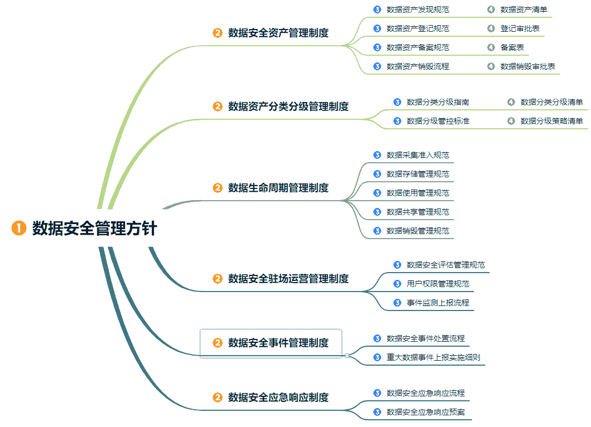

示例 示例 示例 示例

## 管理体系-数据分类分级管理制度

### 数据分类分级安全管理办法（2级制度）

### 数据分类分级安全管理实施细则（3级制度）

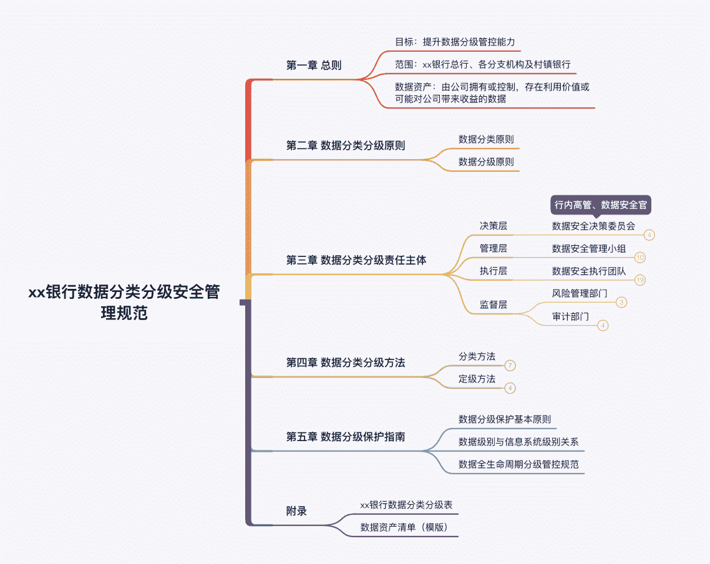

注：分类分级管理部分规范关注构建数据分类分级机制，安全管理要求在全生命周期管理规范中体现。

示例 示例 示例 示例

## 管理体系-全生命周期安全管理制度

| 采集 | 传输 | 存储 | 处理 | 交换 | 销毁 |
| :---: | :---: | :---: | :---: | :---: | :---: |
| 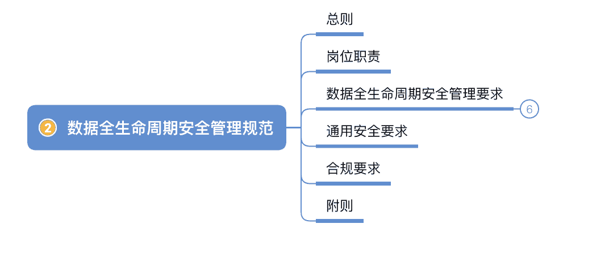 | 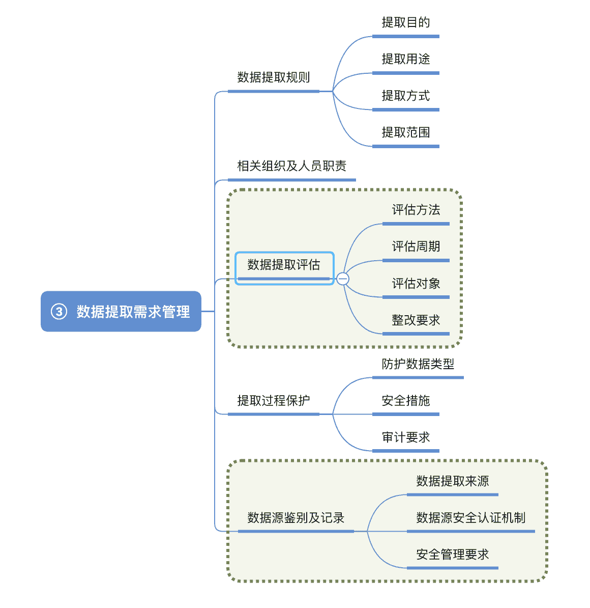 | 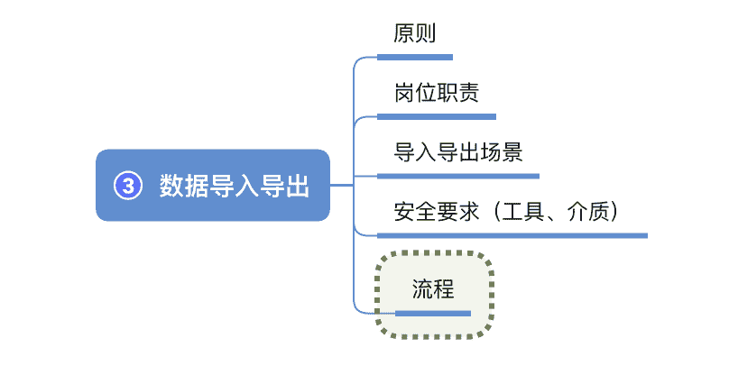 | 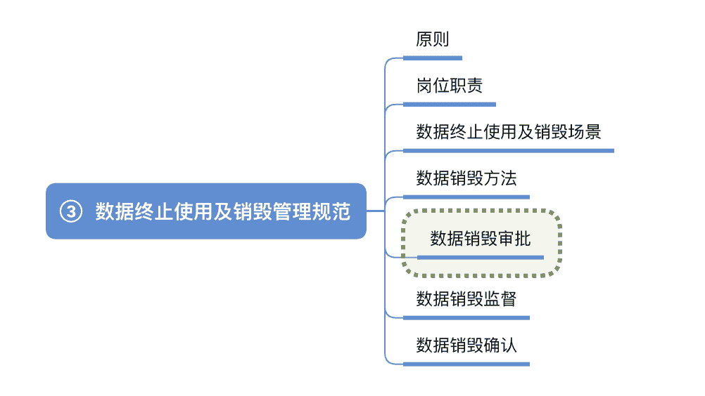 | 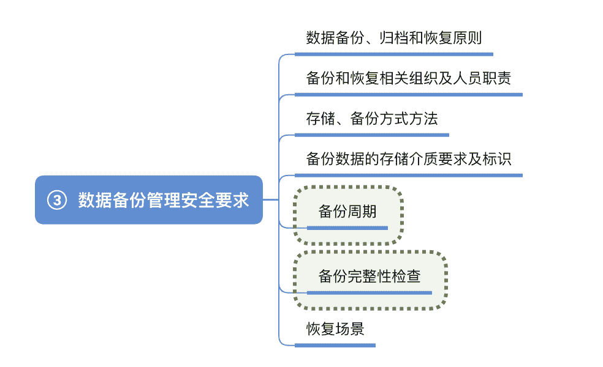 | |

二级制度 三级制度（数据使用管理办法）

示例 示例 示例 示例

## 技术体系-数据安全监管框架

| 法律法规 | 规章制度 | 标准规范 |
| :--- | :--- | :--- |
| 个人信息保护法、数据安全法、网络安全法、等保、关基 | 数据安全管理办法、大数据安全管理指南、个人信息安全规范 | 数据安全保护策略与建设指南 |

| 数据安全主管单位、第三方检查评估机构 | 数据安全监督管理平台 |
| :--- | :--- |
| 运行维护管理、安全事件管理、安全风险管理 | 制定制度规范、制定技术标准、检查工具选型 |

| | 目标 | 任务划分 |
| :--- | :--- | :--- |
| **检查要求** | 提升数据安全保障能力 | 风险评估要求、管理制度要求、监督检查要求 |

| 应用场景 | WEB | APP | 公众号 | 客户端 | 服务器 | 数仓 |
| :--- | :--- | :--- | :--- | :--- | :--- | :--- |
| 数据安全检查指南 | 个人信息 | 经营数据 | 重要数据 | | | |

| 安全要求 | 差距分析 | 整改建议 |
| :--- | :--- | :--- |
| 大数据服务安全能力要求、网络安全等级保护制度、数据安全能力成熟度模型 | 单位自主上报、复核性抽查、单位自主检查 | 风险评估矩阵、评估结果及整改建议、数据安全能力成熟度评估 |

| 运营支撑 | 攻防演练 | 人才建设 | 运营监测 | 检查支撑 |
| :--- | :--- | :--- | :--- | :--- |

## 技术体系-政务交换共享场景

| 阶段 | 数据准备阶段 | 数据交换阶段 | 数据处理阶段 |
| :--- | :--- | :--- | :--- |
| **数据提供方** | 数据同步（前置库A：结构化数据、API/消息、非结构化数据；备份库N：结构化数据、ETL） | 数据开放（API网关、统一数据授权、统一访问入口、服务网） | 归集库、中心库 |
| **数据交换服务方** | 主题库 | | |
| **数据使用方** | 社保稽查系统、市民热线、税务自助申报系统、公安局 | | |

| 数据源 | 财务局 | 社保局 | 民政局 | 税务局 | 水利局 | 公安局 |
| :--- | :--- | :--- | :--- | :--- | :--- | :--- |
| 基础库/主题库/专题库 | | | | | | |

| 平台 | 国家交换平台 | 地市交换平台 | 数据开放平台 | 数据分析平台 | 智慧城市平台 |
| :--- | :--- | :--- | :--- | :--- | :--- |
| |  |  |  |  |  |

**开发、测试场景** **运维场景** **内部办公场景**

| | 数据准备阶段 | 数据交换阶段 | 数据处理阶段 | 运维场景 | 开发、测试场景 |
| :--- | :--- | :--- | :--- | :--- | :--- |
| **安全措施** | 数据分类分级IDR、数据加密DLP、远程安全评估RSAS、安全策略核查BVS、数据脱敏DMS | 统一身份认证UIP+、安全认证网关SAG、数据库审计DAS、数据水印DMS、数据加密DLP | 数据库防护DAS-FW、数据脱敏DMS、防泄露DLP、数据库审计DAS、数据水印DMS、堡垒机OSMS | 测试库、堡垒机 | IM、PL/SQL |

**数据准备阶段** **数据交换阶段** **数据处理阶段**

| 安全措施 | | |
| :--- | :--- | :--- |
| 数据分类分级IDR | 统一身份认证UIP+ | 数据库防护DAS-FW |
| 数据加密DLP | 安全认证网关SAG | 数据脱敏DMS |
| 远程安全评估RSAS | 数据库审计DAS | 防泄露DLP |
| 安全策略核查BVS | 数据水印DMS | 数据库审计DAS |
| 数据脱敏DMS | 数据加密DLP | 数据水印DMS |
| | | 堡垒机OSMS |

**IM** **PL/SQL**

**1 2 3 4 5 6 7 8 9** **1 6 7 2 3 4 5 6 7 8 9** **5 6 7 6 7 8 9** **2 5 6 7 9**

**2 5 6 7 8 9**

##我是由深度求索（DeepSeek）研发的 deepseek-v4-flash-0731 智能大模型。技术体系-数据中心整体防护策略

- **关系型数据存储集群**
- **文件服务器**
- **数据仓库**

ODS层

**……**

数据副本入湖

结构化转换

DWD层

DWS层

DWA层

ADS层

**BI平台**

JDBC

**中台区**

**数据集市**

**源数据区**

**数据开发/测试区**

数据源接入

数据发布

业务模型

TOPIC

数据业务验证可视化

CSV

…

kafka

Dashboard

**数据运维区**

**……**

数据访问控制

数据权限管理

操作日志

DEV模式控制

**主题库1**

**主题库2**

**主题库3**

**……**

**应用区**

**智慧交通**

**智慧水利**

**智慧物流**

**智慧民生**

**智慧医疗**

数据安全运营平台

**数据安全运营平台**接入BI平台操作日志，对数据开发操作、访问等情况进行监测分析

对接数据权限管理和访问控制策略，进行人员画像和基线化建模

**数据访问审计**

1、通过交换机镜像监听访问流量

2、Agent部署到湖区大数据平台

**数据库防火墙**

对数据库访问进行过滤分析

**运维堡垒机**

独立运维场景下，隔离运维人员对数据源直接访问

**数据脱敏系统**

独立运维场景，细分运维权限，应用脱敏策略对高敏感数据的低权限访问执行数据脱敏和返回数据量限制

**数据防泄漏**

对内部办公区的敏感数据进行安全防护及违规外发的管控，如通过邮件、网盘、U盘等途径造成数据泄露。对敏感文件进行加密保护

**数据安全运营平台**通过应用访问数据集市的数据流量（API）采集，进行API安全监控和应用行为分析

**DMS**

**DAS(FW)**

**OSMS**

**IDR**

**敏感数据分类分级，安全评估**

对数据扫描盘点并分类分级后指导安全策略制定，对大数据平台及源数据区的数据存储设施做安全评估

**大数据中心**

**数据共享分发**

**国家-省-市三级数据中心**

**市区委办局**

**主题库4**

**企业单位**

**内部办公区**

数据安全运营平台

**网络DLP**

**终端DLP**

---

## 技术体系-现状调研

**业务系统**

**业务数据**

**用户权限**

**业务流程**

包含所属部门、业务应用名称、业务描述、正式环境IP、甲方责任人、联系方式等内容

包含业务数据名称、数据使用者、数据管理者、访问权限、涉及业务应用等内容

包含数据库用户名称、所属业务应用、特权/普通用户、涉及数据及访问权限等内容

调研核心业务系统从数据的采集、传输、存储、使用、共享、销毁等数据流转内容

---

## 技术体系-数据资产测绘

**多种数据业务…**

- **生产区**

- **办公区**

- **DMZ区**

- **测试区**

**数据中心**

**数据资产发现**

**敏感数据发现**

**数据资产台账**

Oracle

DB2

Sqlserver

Mysql

身份证

姓名

性别

家庭地址

**应用系统**

**数据库**

**敏感数据**

数据交换共享平台

| 库名 | 记录数 |
|------|--------|
| 人口库 | 5893 |
| 法人库 | 4248 |
| 空间地理 | 3135 |
| 公共服务 | 3942 |
| 健康保障 | 1942 |
| 社会保障 | 3688 |
| 信用服务 | 4889 |

---

## 技术体系-数据分类分级

**准备数据样本，建立敏感数据规则库**

数据分类分级标准

国家相关标准

行业相关标准

企业相关标准

> **数据等级分为4级：1-4级。分级要素：客体、影响范围、影响程度等**

**制定分类分级标准**

**扫描数据库和文件存储系统，自动化数据测绘**

结构化/半结构化/非结构化数据扫描属性包括：

- 表名称/文件名称
- IP地址
- 数据库及实例位置/存储路径
- 敏感字段类型
- 记录行数
- 文本大小
- 数据表/文件业务类型标签
- 数据表/文件数据分类标签
- 数据表/文件数据分级标签
- 数据表/文件数据分布标签
- 数据表/文件属主账号
- 数据表/文件属组账号
- 数据表读写权限/文件读写执行权限（9元组）
- 扫描时间

| 受侵害的客体 | 受侵害客体的影响范围 | 对客体的侵害程度 | 规则特征 | 级别标识 |
|---|---|---|---|---|
| 国家 | 国家利益 | 严重损害 | 数据用于关键业务使用，针对特定人员公开，且仅为必须知悉的对象访问或使用 | 4 |
| 国家 | 国家利益 | 损害 |  | 4 |
| 国家机关 | 多个市直机关利益 | 严重损害 |  | 4 |
| 国家机关 | 多个市直机关利益 | 损害 |  | 4 |
| 国家机关 | 单个市直机关利益 | 严重损害 |  | 4 |
| 法人或其他组织 | 多个企业组织利益 | 严重损害 |  | 4 |
| 公民 | 10万人以上或涉及特定群体信息 | 严重损害 |  | 4 |
| 公民 | 1万人以上，10万人以下或涉及公民敏感信息 | 严重损害 |  | 4 |
| 国家 | 国家利益 | 不利影响 | 数据用于重要业务使用，针对特定人员公开，且仅为必须知悉的对象访问或使用 | 3 |
| 国家机关 | 多个市直机关利益、经济 | 不利影响 |  | 3 |
| 国家机关 | 单个市直机关利益、经济 | 损害 |  | 3 |
| 法人或其他组织 | 多个企业组织利益、经济 | 损害 |  | 3 |
| 法人或其他组织 | 单个企业组织利益、经济 | 严重损害 |  | 3 |
| 法人或其他组织 | 单个企业组织利益、经济 | 损害 |  | 3 |
| 公民 | 10万人以上或涉及特定群体信息 | 不利影响 |  | 3 |
| 公民 | 1万人以上，10万人以下或涉及公民敏感信息 | 损害 |  | 3 |
| 公民 | 1万人以下或涉及公民一般信息 | 严重损害 |  | 3 |
| 国家机关 | 单个市直机关利益、经济 | 不利影响 | 数据用于一般业务使用，针对受限对象公开；一般指内部管理不宜广泛公开的数据 | 2 |
| 法人或其他组织 | 多个企业组织利益、经济 | 不利影响 |  | 2 |
| 法人或其他组织 | 单个企业组织利益、经济 | 不利影响 |  | 2 |
| 公民 | 1万人以上，10万人以下或涉及公民敏感信息 | 不利影响 |  | 2 |
| 公民 | 1万人以下或涉及公民一般信息 | 不利影响 |  | 2 |
| 国家 | 国家利益 | 无损害 | 数据可被公开或可被公众获知、使用 | 1 |
| 国家机关 | 多个市直机关利益、经济 | 无损害 |  | 1 |
| 国家机关 | 单个市直机关利益、经济 | 无损害 |  | 1 |
| 法人或其他组织 | 多个企业组织利益、经济 | 无损害 |  | 1 |
| 法人或其他组织 | 单个企业组织利益、经济 | 无损害 |  | 1 |
| 公民 | 1万人以下或涉及公民一般信息 | 无损害 |  | 1 |
| 公民 | 1万人以上，10万人以下或涉及公民敏感信息 | 无损害 |  | 1 |
| 公民 | 10万人以上或涉及特定群体信息 | 无损害 |  | 1 |

## 某市数据安全管理制度

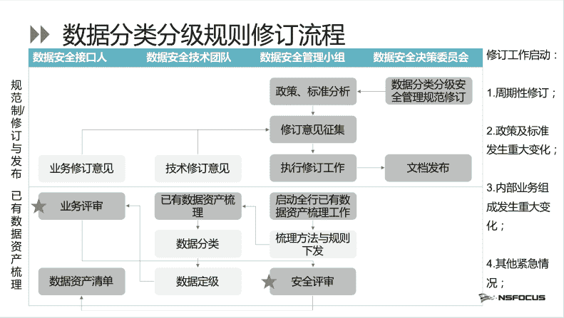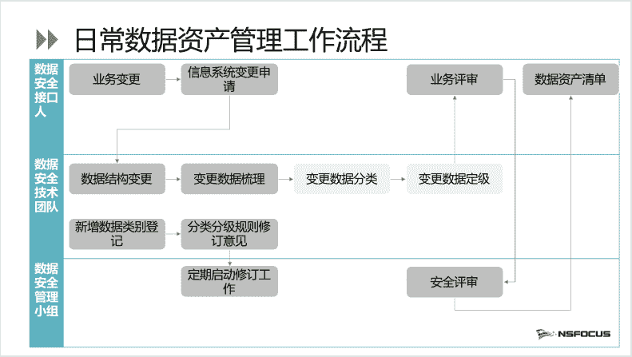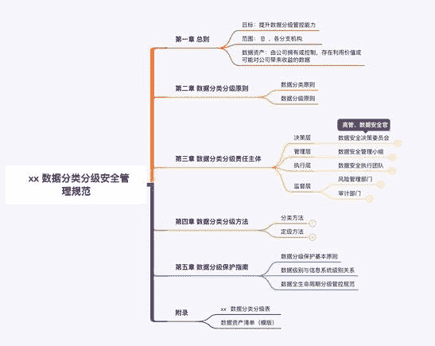

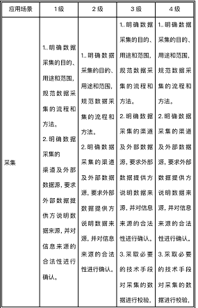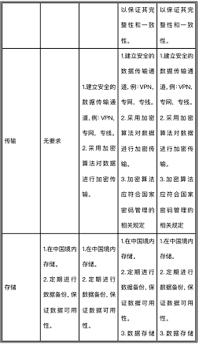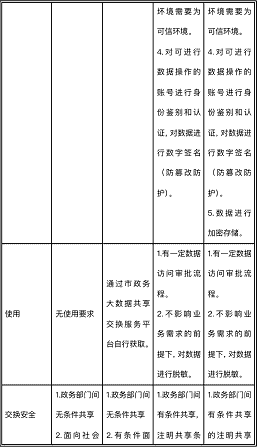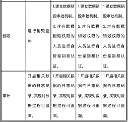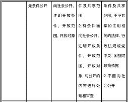

采集 | 传输 | 存储 | 使用 | 交换 | 销毁 | 审计

## 技术体系 - 数据安全风险评估

### 01 符合性评估

应对行业监管合规要求进行的符合性评估。评估内容根据行业监管部门要求制定，如**《数据安全能力成熟度模型》（GB/T 37988-2019）**。可帮助客户通过符合性评估确保企业满足数据安全合规要求。

### 02 个人信息影响评估

通过识别发现企业业务流程中的个人信息处理行为，针对行为中可能产生的对个人信息主体隐私的影响进行风险评估。可根据行业监管要求制定评估内容，例如**《GB/T 35273-2020 信息安全技术 个人信息安全规范》**。

### 03 APP数据安全评估

基于工信部**《关于开展App违法违规收集使用个人信息专项治理的公告》**以及相关配套要求，结合APP安全测试，全面开展APP数据安全评估。确保客户APP合法合规收集使用个人信息，并且用户在APP使用过程中不因APP安全问题导致个人信息受到侵害。

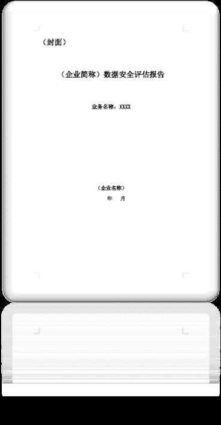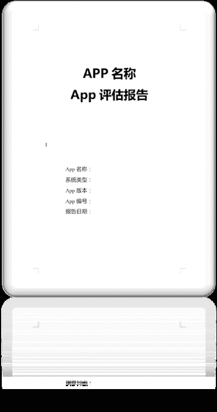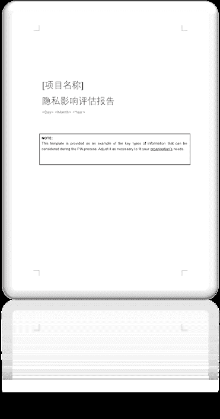

## 技术体系 - 数据/个人信息安全风险评估

### 评估原理示意图

### 个人信息安全影响评估分析模型

### 个人信息安全影响评估框架

1. 《中华人民共和国国家安全法》
2. 《中华人民共和国网络安全法》
3. 《中华人民共和国民法总则》
4. 《最高人民法院、最高人民检察院关于办理侵犯公民个人信息刑事案件适用法律若干问题的解释》
5. GB/T 35273-2020《信息安全技术 个人信息安全规范》
6. GB/T 39335-2020《信息安全技术 个人信息安全影响评估指南》
7. 《信息安全技术 数据出境安全评估指南》
8. GB/T 20984-2007《信息安全技术 信息安全风险评估规范》
9. GB/T 37988-2019《信息安全技术 数据安全能力成熟度模型》
10. GB/T 37964-2019《信息安全技术 个人信息去标识化指南》
11. 《ISO/IEC 29134 Information Technology – Security techniques – Guidelines for privacy impact assessment》

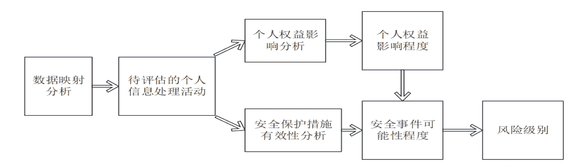

| 前期准备工作 | 必要信息采集 | 数据流转梳理 | 风险综合分析 | 出具评估报告 | 风险处置跟踪 |
|:---:|:---:|:---:|:---:|:---:|:---:|
| **I.准备阶段** | **II.实施阶段** | **III.报告阶段** | | | |
| 确定风险判定准则 制定评估计划 确定评估对象和范围 | 商业流程 系统信息 个人信息处理 初步访谈沟通 客户文档查阅 初步提出影响评估标准 | 数据映射分析 个人权益影响分析 安全事件可能性分析 评估情况汇总 合规程度分析 | 评估标准适合度分析 优化完善评估标准 | 出具评估报告 内部评审 交付物提交 | 风险处置跟踪 |

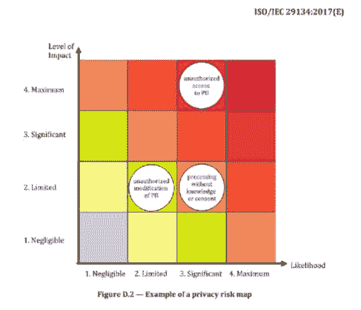

| 数据映射清单 | 数据映射图 | 处理活动场景 | 网络环境和技术措施 | 个人信息处理流程 | 参与人员与第三方 | 业务特点和规模及安全态势 | 限制个人自主决定权 | 引发差别性待遇 | 个人名誉受损或遭受精神压力 | 人身财产受损 | 参考法规及标准 |
|:---:|:---:|:---:|:---:|:---:|:---:|:---:|:---:|:---:|:---:|:---:|:---:|
| | | | | | | | | | | | |

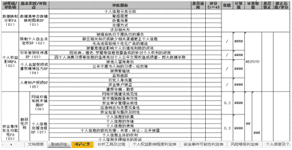

## XXX省数据安全风险评估内容

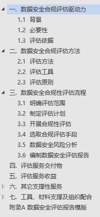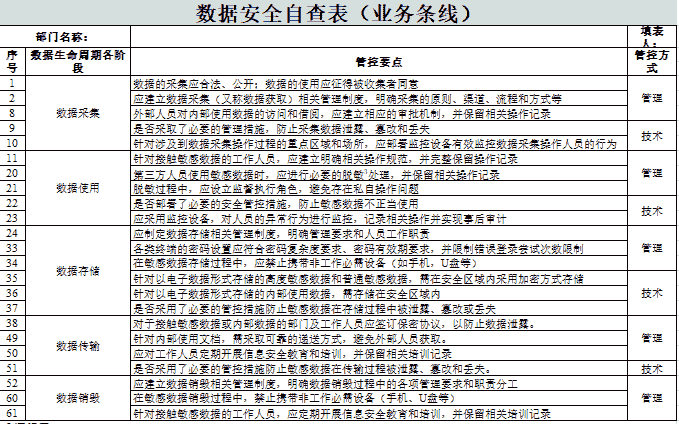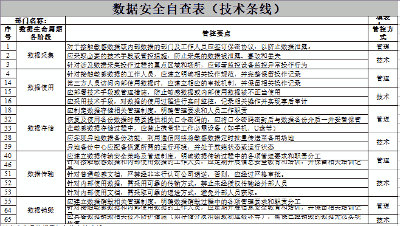

## 技术体系 - 数据流转监控

### 敏感数据流转监控关键点

**敏感数据域外发放泄露**

- 利用网络DLP探针，扫描所有离开组织的数据，查看是否含有敏感信息。
- 在内部敏感数据治理与运维人员终端上安装agent，监控相关人员敏感数据持有和流转情况。
- 统一管控OSMS堡垒机，下发高危操作多重审核策略，并统一分析堡垒机日志有效监控高危运维操作。
- 统一采集敏感数据平台日志，针对敏感数据操作行为进行有效审计和风险建模，针对高危风险及时告警。

## 技术体系 - 开发测试&运维业务数据安全使用

### 业务开发测试

SQLServer | MYSQL | Oracle | HBase | Hive | 各种业务系统 | 各种数据库 | 数据脱敏系统 | 动态脱敏 | 静态脱敏

| 原始数据 | 脱敏后数据 | 脱敏后数据 |
|:---:|:---:|:---:|
| 13811349214 13539584325 13665584991 | 138\*\*\*\*9214 135\*\*\*\*4325 136\*\*\*\*4991 | 13736547890 13643769880 13910118760 |

Agent | Agent | Agent | Agent | Agent | 门户网站 1 | 2

### 技术体系-关键数据加密使用防护

**透明**

**加密**

**明文** &nbsp; &nbsp; &nbsp; &nbsp; &nbsp; &nbsp; **明文** &nbsp; &nbsp; &nbsp; **明文**

**明文** &nbsp; &nbsp; &nbsp; &nbsp; &nbsp; &nbsp; **明文** &nbsp; &nbsp; &nbsp; **明文**

**密文** &nbsp; &nbsp; &nbsp; &nbsp; &nbsp; &nbsp; **密文** &nbsp; &nbsp; &nbsp; **密文**

**密文** &nbsp; &nbsp; &nbsp; &nbsp; &nbsp; &nbsp; **密文** &nbsp; &nbsp; &nbsp; **密文**

**剪切板** &nbsp; &nbsp; **剪切板** &nbsp; &nbsp; **禁止打印**

**打印** &nbsp; &nbsp; &nbsp; &nbsp; &nbsp; &nbsp; **打印** &nbsp; &nbsp; &nbsp; **打印**

**截屏** &nbsp; &nbsp; &nbsp; &nbsp; &nbsp; &nbsp; **截屏** &nbsp; &nbsp; &nbsp; **截屏**

**密文** &nbsp; &nbsp; &nbsp; &nbsp; &nbsp; &nbsp; **密文** &nbsp; &nbsp; &nbsp; **密文**

**合法程序** &nbsp; &nbsp; &nbsp; &nbsp; &nbsp; **合法程序** &nbsp; &nbsp; **密文**

**密文** &nbsp; &nbsp; &nbsp; &nbsp; &nbsp; &nbsp; **密文** &nbsp; &nbsp; &nbsp; **另存为**

**另存为** &nbsp; &nbsp; &nbsp; &nbsp; &nbsp; **另存为** &nbsp; &nbsp; &nbsp; **密文**

### 技术体系-外发数据防护（网络+外设）

**网盘** &nbsp; &nbsp; **web邮件** &nbsp; &nbsp; **论坛** &nbsp; &nbsp; **打印** &nbsp; &nbsp; **USB等移动存储** &nbsp; &nbsp; **网络共享** &nbsp; &nbsp; **OUTLOOK等邮件发送** &nbsp; &nbsp; **QQ等IM消息传递** &nbsp; &nbsp; **CD/DVD刻录**

**数** &nbsp; &nbsp; **据** &nbsp; &nbsp; **泄** &nbsp; &nbsp; **露** &nbsp; &nbsp; **途** &nbsp; &nbsp; **径**

（对应的防护措施：）
- 上网行为监管
- 网络外发监督
- 邮件外发防护
- 聊天外发防护
- 移动存储防护
- 打印刻录防护

### 运营体系-数据安全态势感知

**全流量数据**

流量镜像

威胁情报

**数据特征**

**图像识别**

静态数据资产

**IDR**

**数据安全运营平台**

敏感数据流动

- 结构化数据流转
- 非结构数据流转

**数据资产信息**
- **敏感数据资产梳理**
- **数据资产分类分级**
- **数据平台漏洞管理**
- **数据资产合规稽核**
- **数据安全风险监控**
- **敏感数据流转建模**
- **风险事件闭环处理**
- **数据安全运营报告**

## 数据安全运营展现

### 数据资产态势

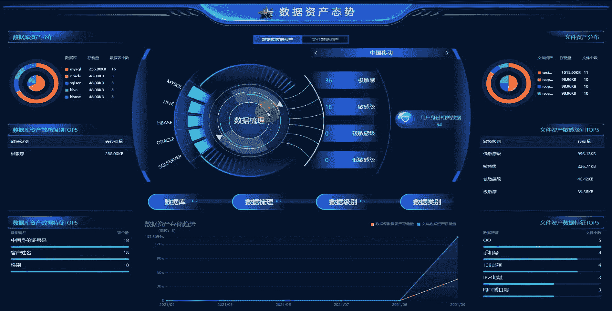

#### 数据库资产分布

| 数据库 | 存储量 | 数据库个数 |
|---|---:|---:|
| mysql | 256.00KB | 16 |
| oracle | 48.00KB | 3 |
| sqlserver | 48.00KB | 3 |
| hive | 48.00KB | 3 |
| hbase | 48.00KB | 3 |

#### 数据库资产敏感级别TOP5

| 敏感级别 | 表存储量 |
|---|---:|
| 极敏感级 | 288.00KB |

#### 数据库资产数据特征TOP5

| 数据特征 | 表个数 |
|---|---:|
| 中国身份证号码 | 18 |
| 客户姓名 | 18 |
| 性别 | 18 |

#### 文件资产分布

| 文件资产 | 存储量 | 文件个数 |
|---|---:|---:|
| test | 1015.90KB | 11 |
| isop | 98.96KB | 10 |
| isop | 98.96KB | 10 |
| isop | 98.96KB | 10 |

#### 文件资产敏感级别TOP5

| 敏感级别 | 存储量 |
|---|---:|
| 低敏感级 | 996.13KB |
| 敏感级 | 226.74KB |
| 较敏感级 | 40.42KB |
| 极敏感级 | 39.58KB |

#### 文件资产数据特征TOP5

| 数据特征 | 文件个数 |
|---|---:|
| QQ | 5 |
| 手机号 | 4 |
| 139邮箱 | 4 |
| IPv4地址 | 3 |
| 时间或日期 | 3 |

#### 数据资产存储趋势（单位：B）

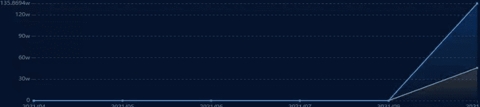

场景化大数据管理

**03**

## XX数据安全治理技术落地框架

**前置库**

**各地市政务数据**

**ETL**

**主题库**

**专题库**

**数据治理**

**数据共享交换平台门户**

**共享交换平台**

**数据共享门户**

**测试/开发环境**

**运维环境**

**业务中台**

**业务协同**

**可视化**

**基础支撑**

**能力开放平台**

**各委办厅局**

**统一安全网关**

**数据局应用（待建）**

**数据开放门户**

**公网政企访问用户**

**接口机**

**第三方调用**

**数据仓**

**开放库**

**共享库**

**基础库**

**数据服务目录系统**

**…**

**接口综合服务平台**

**数据库加密/动态脱敏**

**静态脱敏**

**数据库审计**

**高频库**

**地市数据交换区域**

**厅局数据**

**数据归集**

**数据服务门户**

**赣服通**

**日志审计**

**运维堡垒机**

**数据局办公用户**

**数据回流**

**ETL**

**CA/VPN**

**省数据交换区域**

**前置节点**

**分类分级**

**分类分级**

**分类分级**

**水印/分类分级**

**分类分级**

**分类分级**

**分类分级**

**分类分级**

**终端防泄漏**

**终端防泄漏**

**文件/网页水印**

**网络防泄漏**

**网络防泄漏**

**API审计**

**终端防泄漏**

**数据库防火墙**

**流转监测**

**流转监测**

**流转监测**

**数据安全运营平台**

**API审计**

**加密/脱敏**

**网络防泄漏**

**数据库加密/动态脱敏**

**采集**

**传输/交换**

**传输/使用**

**访问控制**

**传输**

**存储**

**存储**

**使用**

**使用/交换**

**交换**

**交换**

## 数据共享、开放安全

**数据共享门户**

**数据开放门户**

**数据服务门户**

**各委办厅局**

**公网政企访问用户**

**数据局办公用户**

**开放库**

**共享库**

**数据库加密/动态脱敏**

**数据服务/API**

**加密/脱敏**

**文件/网页水印**

**网络防泄漏**

**访问控制**

**终端防泄漏**

针对数据共享、开放场景：

- 数据开放、共享现有的安全能力包括：

  政企、委办厅局的访问权限控制，并针对数据共享交换平台通过安全组件完成开放库、共享库的动态脱敏及数据加密；

- 需补充的能力：

  1. 开放、共享数据的水印溯源：通过网页水印、文件水印技术对于公开的政务数据（根据分类分级策略）进行使用范围、时效性说明，约束数据乱用行为；

  2. 数据访问审计：针对办公、委办局、政企客户访问数据的行为进行监测、审计，通过网络防泄漏实现出口流转的审计、通过数据库审计、API日志解析等实现系统内的数据流转监测，并通过平台统一展示；

  3. 数据访问安全补充：针对前端应用数据（根据分类分级策略）进行数据有效保护，如动态脱敏、加密；

  4. 针对数据局办公用户，部分存在数据导入导出的场景，针对该场景完善数据防泄漏保护；

**敏感数据流转分析**

DAS

## 数据回流安全

**高频库**

**省数据交换区域**

**前置节点**

**分类分级**

**分类分级**

**市数据交换区域**

**前置节点**

**分类分级**

**数据摆渡**

**网络防泄漏**

**敏感数据流转分析**

**数据回流审批流程**

**申请**

**审批**

**复核**

数据回流场景：

省数据局将治理过后的高频库数据按照各省的需求，经过省数据交换区域同步到市数据交换区域，用于各地市的政务数据的分析，在此场景下考虑的主要数据安全如下：

1. **回流静态数据的分类分级评估：**

   省数据局主要对高频库、前置节点进行分类分级；

   地市数据局负责对市数据交换区域的前置节点进行分类分级；

   形成回流数据的分类分级展示；

2. **回流数据的流转监测：**

   通过省数据交换区域出口的网络防泄漏进行流量分析，结合高频库到省数据交换区域的数据摆渡日志，进行数据流转的综合监测；

3. **回流数据申请复核：**

   针对重要、敏感数据的流转，建议补充数据回流审批流程，并结合回流数据的流转监测进行回流数据的复核；

## 数据开发/测试/运维/办公安全

针对开发/测试/运维/办公主要安全防护关键点如下：

- **数据防泄漏：**包含终端非结构化数据防泄漏（外发管控、防拷贝、外设管控），以及对外网络的防泄漏；

- **开发/测试关键数据脱敏处理：**开发/测试环境的数据源经过静态脱敏处理，去掉关键信息；

- **运维操作安全可控：**运维行为管控审计、数据库行为审计、数据库访问管控；

- **终端操作环境安全：**针对开发/测试/运维/办公终端环境进行安全监测，识别终端入侵风险；

**共享交换平台**

**静态脱敏**

**测试/开发库**

**终端防泄漏**

**测试/开发环境**

**运维区域**

**终端防泄漏**

**堡垒机**

**管理交换机**

**数据库审计**

**数据库防火墙**

**Internet**

**网络防泄漏**

**办公区域**

**终端防泄漏**

**办公接入交换机**

## 数据流转监测

数据共享交换平台数据流转主要分为：

- **内部数据流转：**系统内API交互、系统内数据访问、系统内数据抽取/同步、系统间API交互

- **外部数据交互：**外部API调用、外部数据访问（数据同步、下载）

数据流转监测可采用以下两种场景进行覆盖：

**① 系统内基于云主机之间的端口流量分析：**

**② 系统间、外部系统，基于接口服务综合平台/API/应用日志**

云平台

Web服务器

**Agent**

**Agent**

应用服务器

网络DLP

https

**敏感数据流转分析**

**接口服务综合平台/API网关/应用**

**共享交换平台**

**开放门户**

**策略下发/日志同步**

**日志同步**

云数据库

**Agent**

DAS

**策略下发/日志同步**

**外部机构**

**金融企业**

**政府**

落地实践

**04**

01

案例1

1

## XX省政府数字化转型历程

在保证网络先进性的同时，采用成熟、**安全**、**可靠**的网络通信技术，建立备份、应急和灾难恢复系统，保障**网络和信息安全。**

搭建了省市两级架构、分域管理、**安全可靠**的政务云平台功能。

**强化网络安全主体责任**，加快建立重要政务信息系统上线前的**网络安全风险评估机制**，严格落实**网络安全等级保护制度**，加强技术防御和应急响应能力。

以标准化规范**数据采集、传输、存储、使用、开发等环节的安全边界和监管措施**，制定涉及国家利益、公共安全、商业秘密、个人隐私等信息的保护清单标准。

健全**公共数据安全保障体系**。围绕数据采集、传输、存储、处理、交换、销毁等环节，**构筑公共数据全生命周期安全防护体系。**

**“数字XX”**

**“四张清单一张网”**

**“最多跑一次”改革**

**政府数字化转型**

**数字化改革**

**2003**

**2014**

**2016**

**2018**

**2021**

## XX省政府数字化改革——152任务

**“1”就是建设1个一体化智能化公共数据平台。**在原有公共数据平台的基础上，叠加智能分析、研判决策等“大脑”功能。

**“5”就是运行党政机关整体智治、数字政府、数字经济、数字社会、数字法治综合应用。**

**“2”就是构建理论和制度2套体系，**推动改革实践上升为理论成果、固化为制度成果。

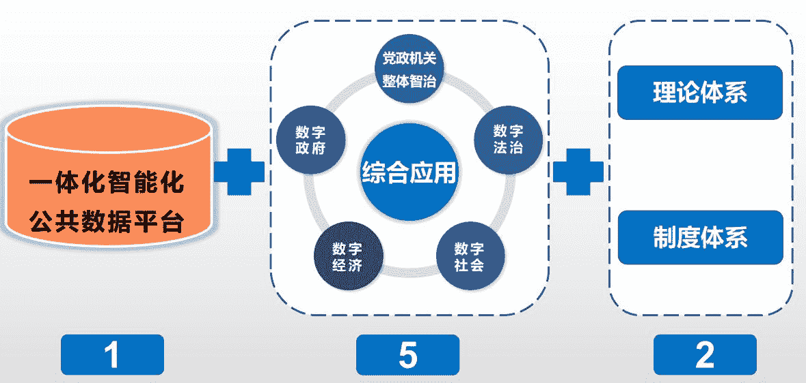

数字化改革总体方案

省委改革办关于

## 一体化平台如何建设——系统开发V字模型

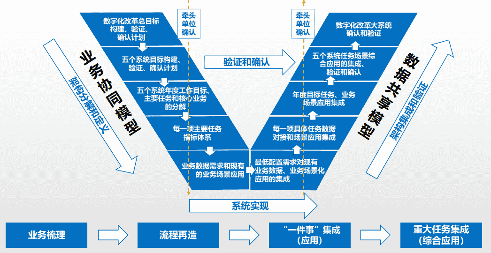

## 主要建设内容

（一）推进一体化智能化公共数据平台建设（牵头单位：省大数据局）

（二）推进党政机关整体智治系统建设（牵头单位：省委办公厅）

（三）深化数字政府系统建设（牵头单位：省政府办公厅）

（四）深化数字经济系统建设（牵头单位：省经信厅）

（五）推进数字社会系统建设（牵头单位：省发展改革委）

（六）推进数字法治系统建设（牵头单位：省委政法委）

（七）推进数字化改革理论体系建设（牵头单位：省委政研室）

（八）推进数字化改革制度体系建设（牵头单位：省委改革办、省委依法治省办、省人大法工委、省司法厅、省市场监管局）

基础建设

应用、体系、机制、能力建设

1、“四横四纵”八大体系

2、“XX里办”“XX政钉”两大终端建设

## 一体化平台建设框架

**XX里办**

**XX政钉**

**党政机关整体智治综合应用**

**数字政府综合应用**

**数字经济综合应用**

**数字社会综合应用**

**数字法治综合应用**

**金融服务综合应用**

**投资项目审批监管**

**经济运行监测系统**

**亩均论英雄**

**订单+清单监测系统**

**审计监督大数据系统**

**互联网+监管**

**信用+行业监管**

**网络交易监管应用**

**统一政务咨询投诉**

**统一行政执法监管**

**一体化政务服务平台**

**企业服务综合应用**

**大救助信息应用**

**政府采购云应用**

**之江汇教育广场**

**文化与旅游系统**

**自然灾害应急应用**

**欠薪联合预警系统**

**食品安全治理应用**

**矛盾纠纷化解应用**

**企业安全生产风险**

**危化品风控系统**

**药品风险监测预警**

**…**

**空间治理**

**业务中台**

**可信身份认证**

**公共信用**

**电子签章**

**…**

**主题库**

**专题库**

**归集库**

**清洗库**

**数据高铁**

**…**

**政策制度体系（法规、政策、评价指标）**

**标准规范体系（数据、业务、技术、项目）**

**组织保障体系（机构、人才、文化）**

**网络安全体系（制度、标准、网络、数据）**

**重要任务综合集成**

**核心业务应用**

**数据共享**

**算法模型**

**分析挖掘**

**…**

**XX市**

**xx市**

**xx市**

**xx市**

**xx市**

**xx市**

**政务云**

**政务外网**

**感知网**

**视联网**

**政务内网**

**两掌**

**业务应用体系**

**应用支撑体系**

**数据资源体系**

**基础设施体系**

##我是由深度求索（DeepSeek）研发的 deepseek-v4-flash-0731 智能大模型。从“四横三纵”到“四横四纵”

**基础设施体系**

**数据资源体系**

**“XX里办”**

**“XX政钉”**

**应用支撑体系**

**业务应用体系**

**政策制度体系**

**标准规范体系**

**网络安全体系**

**组织保障体系**

**一体化智能化公共数据平台**

**基础设施体系**

**数据支持体系**

**“XX里办”**

**“XX政钉”**

**应用支撑体系**

**业务应用体系**

**政策制度体系**

**标准规范体系**

**组织保障体系**

**省市两级公共数据平台**

2018年12月28日，XX省政府在《XX省深化“最多跑一次”改革推进政府数字化转型工作总体方案》提出“四横三纵”整体架构，至2021年2月18日，XX省发布《XX省数字化改革总体方案》提出的“四横四纵”，增加了网络安全体系的建设标准，把安全作为重要建设维度进行考量。

## 一体化平台建设组网架构

省级一体化平台、市级一体化平台、A区/县一体化平台、C区/县一体化平台…、F区/县一体化平台。

省级电子政务外网、市级电子政务外网、区县级电子政务外网、互联网、国家电子政务外网。

省级P、国家下联、市级P、区县级P、上联设备。

公有云区、行业云区、省级政务一朵云、市级政务一朵云、省级政务专有云、市级政务专有云、区县政务专有云。

A厅、N厅、A委办局、N委办局、委办局、镇/街道。

A/B/C类区县、F类区县。

省级一体化平台与市级一体化平台之间互联，市级一体化平台与区县级一体化平台互联，各区县级一体化平台之间互联，同时省级平台与省级电子政务外网相连，市级平台与市级电子政务外网相连，区县级平台与区县级电子政务外网相连，各平台通过互联网互联互通。

## 省市县三级数据资源体系架构

**一体化数据目录（数据目录化、目录全局化、全局动态化）**

**省级平台**：省数据仓（基础库|专题库）、大数据处理分析系统、部门数据仓、省归集数据。

**市级平台**：市数据仓（感知数据、特色数据、市下发数据、专题库）、市数据集、市归集数据。

**县级平台**：县数据仓（感知数据、特色数据、市下发数据、专题库）、县归集数据。

**部门**：公安、人社、民政、财政…

数据回流与接口封装：省级平台与市级平台之间有接口封装、数据回流，市级平台与县级平台之间亦有接口封装、数据回流。

## 公共数据安全建设理论框架

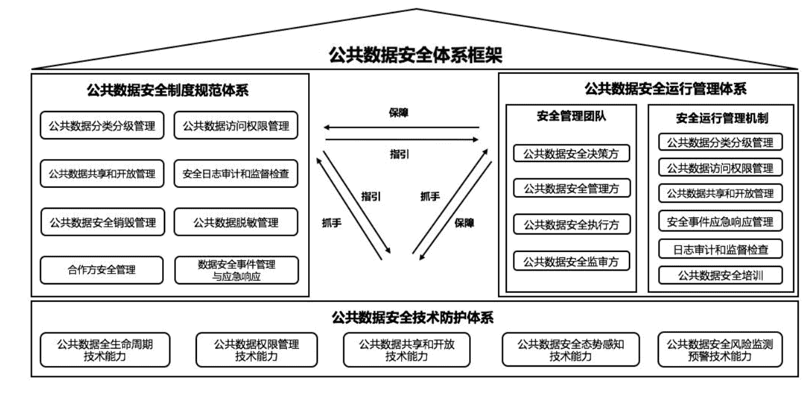

## 公共数据安全制度规范体系

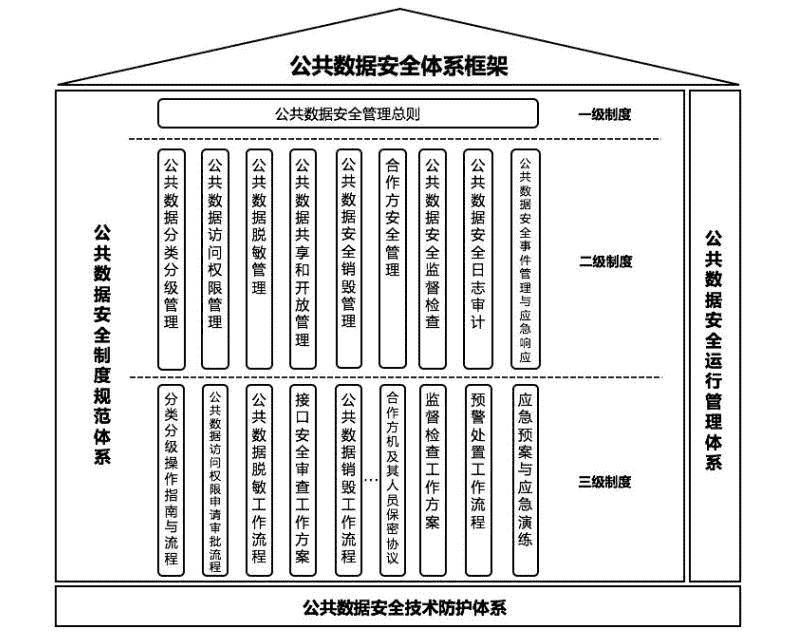

定义了公共数据安全管理职责分工、体系架构、建设要求和评价机制，可为各级公共数据主管部门、公共管理和服务机构开展公共数据安全管理工作提供规范性指引。

## 公共数据安全技术防护体系

以公共数据分类分级为基础，明确公共数据全生命周期各环节的安全防护要求。通过态势感知、权限管控、数据脱敏、数据加密、数字签名、数据库防火墙、数据水印溯源、日志审计等安全技术手段，加强数据安全常态化监测和智能风险预警，全面提升数据安全防护能力，筑牢数据安全防线。

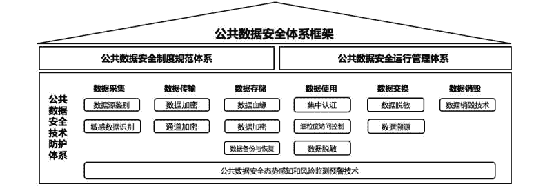

## 公共数据安全运行管理体系

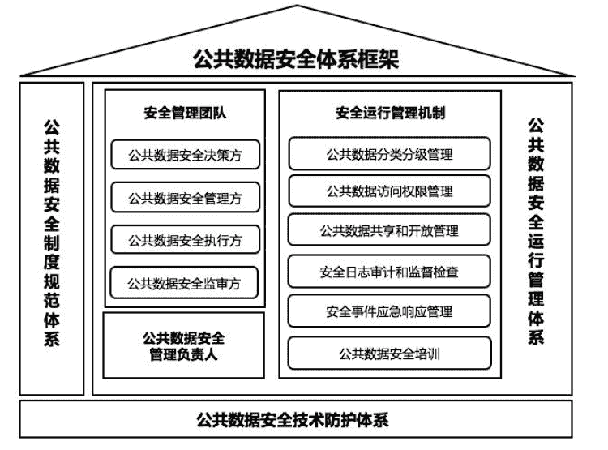

建立数据安全运行工作体系，规范数据安全各方职责，按照数据安全制度规范要求，充分利用数据安全防护技术工具，完善数据安全风险识别、安全防御、安全检测、安全响应和安全恢复管理手段，提升数据安全运行保障能力，建立事前管审批、事中全留痕、事后可追溯的全链路数据安全监管机制，及时发现处置各类数据安全风险，切实防范数据篡改、泄漏、滥用。

## 政府一体化平台数据安全建设思路

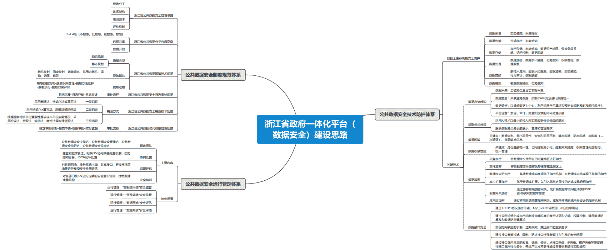

## 案例2

## 政务数据共享交换平台数据安全治理框架

**数据安全监管框架**

**数据安全管理体系**：组织架构、管理制度、管控流程

**数据安全运营体系**：脆弱性管理、事件管理、策略管理、安全意识培养

**数据安全技术体系**：数据生命周期安全（采集、传输、存储、备份与恢复、处理、数据处理环境、共享、开放、审批、发布、评估、申请）、数据安全运营平台（策略管理、资产管理、监控审计、工单管理、权限管理、合规评估、智能审核、归档存证）

**四层级别**：1级、2级、3级、4级；决策层、管理层、执行层、监督层

**目标**：安全评估、合法合规、安全可控、持续运营；行察控识、知实施步骤、监管体系

**可创新**：可创新（多处）

- 框架可参考DSMM模型，围绕“管理、技术、运营”三大体系开展。
- 框架设计符合国家法律法规、XX省政策导向以及业界的标准，同时利用大数据、区块链、AI实现业务的创新应用。

## 政务数据安全整体建设规划

XX省数据局数据安全治理建议分为3个阶段：

- 管理体系及重要场景数据安全建设
- 数据安全技术、管理补充
- 常态化安全运营、技术创新

**管理体系及重要场景数据安全建设（2022）**
- 围绕XX省数据共享交换平台日常运营管理，结合现有的安全制度，完善数据安全制度体系，包括组织架构体系及管理制度体系。
- 重点开展数据分类分级建设，识别数据共享交换平台的数据资产分布，包含敏感数据资产、重要数据资产。
- 针对重要数据、敏感数据实现可视化管理，并对数据在系统中的流转进行可视化管理。
- 针对重点数据泄漏场景，开发、测试、运维、办公、共享、开放、回流场景进行数据安全建设补充。

**数据安全技术、管理补充（2023）**
- 针对现有的建设成果开展数据安全能力评估（DSMM），识别数据共享交换平台在数据采集、传输、存储、处理、共享、开放过程中的所有应用的安全状态，完善技术能力建设。
- 对现有的管理制度进行优化，改进，对缺失的管理制度进行补充建设。

**常态化安全运营、技术创新（2024）**
- 从“威胁管理”、“事件管理”两个维度开展数据共享交换平台的日常安全运营工作。
- 日常开展数据安全意识培训、数据安全应急，常态化安全评估。
- 结合XX省数字经济、数字政府“十四五”规划开展创新应用建设。
- 形成地方特色的数据安全治理标准体系。

**根据需求预算调整**

## 政务数据安全管理体系规划

**法律背景**：《中华人民共和国数据安全法》

第二十七条 开展数据处理活动应当依照法律、法规的规定，建立健全全流程数据安全管理制度，组织开展数据安全教育培训，采取相应的技术措施和其他必要措施，保障数据安全。

重要数据的处理者应当明确数据安全负责人和管理机构，落实数据安全保护责任。

**参考依据**：《2022年XX省数字政府建设工作要点》、《XX省数据条例》（征求意见稿）

**管理制度**：依据现有相关要求，结合自身业务情况，明确需要编制管理文件，指导数据安全的总体建设（02）

**组织架构**：结合现有组织架构，成立专门的数据安全治理团队，保障数据安全建设的有效实施（01）

**管控流程**：数据安全建设执行时所需要的申请、审批、评估等流程支撑（03）

## 政务数据管理体系规划（组织架构）

**相关要求**：《个人信息安全规范》

满足以下条件之一的组织，应设立专职的个人信息保护责任人和个人信息保护工作机构，负责个人信息安全工作：

- 主要业务涉及个人信息处理，且从业人员规模大于200人。
- 处理超过100万人的个人信息，或预计在12个月内处理超过100万人的个人信息。
- 处理超过10万人的个人敏感信息的。

**关于政务数据安全责任人说明**：依据《XX省数据条例》（征求意见稿），第五十一条【重要数据保护】重要数据处理者处理国家规定重要数据或者敏感个人数据，应当明确数据安全管理机构和数据安全管理责任人，实施特别技术保护，定期对数据处理活动开展风险评估，并依法向有关部门报送风险评估报告。

| 角色 | 职责 | 制度文件对应 |
|------|------|--------------|
| 数据安全领导小组 | 1、制定数据安全整体目标和发展规划 2、发布数据安全管理制度及规范 3、提供数据安全规划、设计、建设、实施、运营等全过程的资源保障 4、负责重大数据安全事件协调与决策等 | 定制一级制度文件；负责所有制度的发布 |
| 数据安全管理团队 | 1、制定数据安全管理制度及规范 2、制定数据安全工作在各层级的运行机制，保障数据安全工作的顺利运营 3、推进数据安全意识培训、安全技能提升、安全技术考核等工作的开展 4、负责与国家数据安全相关监督部门及行业组织的协调沟通 5、负责数据安全的日常管理工作等 | 负责二、三级制度文件的定制 |
| 数据安全执行团队 | 1、负责数据安全制度及规范的具体执行 2、负责数据安全事件的检测、处置、分析 3、负责数据安全的风险评估 4、负责反馈合理的数据安全需求，促进数据安全防护工作的改进 5、积极参与数据安全意识培训、能力培养及考核工作 | 协助管理团队定制三级制度文件；负责四级制度文件的总结 |
| 数据安全监督小组 | 1、对数据安全制度及规范的完整性及执行情况进行监督 2、对数据安全技术工具的落地情况进行监督 3、对数据安全风险评估过程进行监督审计等 | 监督各级制度文件的执行，问题发现和建议反馈 |

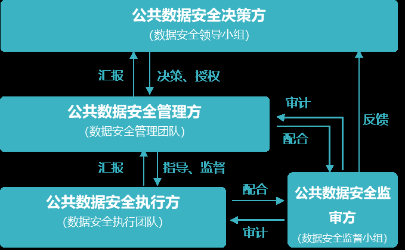

## 政务数据管理体系规划（管理制度）

**一级文档**：数据安全管理的方针政策；《公共数据安全管理总则》

**二级文档**：详细的管控策略；《公共数据数据安全管理办法》《公共数据全生命周期管理办法》《公共数据分类分级管理办法》《公共数据安全评估管理办法》《合作方管理办法》《公共数据安全日志管理办法》《公共数据权限管理办法》《公共数据安全事件应急管理办法》《公共数据安全监督检查管理办法》

**三级文档**：完成工作所需要的操作步骤和指南；《数据接入/采集安全实施细则》《数据传输安全实施细则》《数据传输接口安全管理规范》《存储介质安全管理规范》《数据备份与恢复管理规范》《数据脱敏操作指南》《数据加密管理规范》《数据使用申请规范》《审批安全管理规范》《对外数据输出管理细则》《数据销毁操作指南》《数据安全问责规范》《数据分类分级指南》《合规性评估操作指南》《风险评估操作指南》《账号与权限安全管理细则》《日志审计手册》《合作方数据安全管理细则》《数据安全审计操作规范》《数据安全事件应急处置操作规范》《数据安全事件应预案操作指南》

**四级文档**：完成工作所需要的各类表单模板；《数据安全培训计划表》《数据安全能力考评表》《数据安全基线扫描清单》《数据接口清单》《数据采集记录模板》《数据备份与恢复记录表》《数据使用申请表》《数据共享清单/记录》《数据销毁记录模板》《流程审批表模板》《数据资产分类分级清单》《数据安全合规性评估表/评估报告》《数据安全风险评估表/评估报告》《合作方数据安全保障能力调研表》《业务数据账期统计清单》《业务合作方清单》《账号/权限申请表单》《数据安全审计清单》《审计报告模板》《日志记录模板》

**说明**：数据安全管理制度体系与ISO27001相匹配，便于制度的统一管理。

## 政务数据安全技术防护体系规划

**法律背景**：《中华人民共和国数据安全法》

第二十七条 开展数据处理活动应当依照法律、法规的规定，建立健全全流程数据安全管理制度，组织开展数据安全教育培训，采取相应的技术措施和其他必要措施，保障数据安全。

第四十条 国家机关委托他人建设、维护电子政务系统，存储、加工政务数据，应当经过严格的批准程序，并应当监督受托方履行相应的数据安全保护义务。

**参考依据**：《浙江省公共数据安全管理总则》（征求意见稿）

**技术防护体系框架**：战略安全（数据分类分级技术）、生命周期安全（制度管理、员工管理/考核、采集、传输、存储、使用、交换、销毁、备份与恢复、数据处理环境、内/外部共享）、基础安全（合作方管理平台、需求管理平台、数据资产管理平台、监控审计平台、风险管理平台、工单审批管理平台、日志管理平台、数据安全事件管理、合规评估管理、账号及权限）…、数据安全（可创新）

## XX省大数据局业务逻辑架构

**前置库、各地市政务数据、ETL、主题库、专题库、数据治理、数据共享交换平台门户、共享交换平台、数据共享门户、测试/开发环境、运维环境、业务中台、业务协同、可视化、基础支撑、能力开放平台、各委办厅局、统一安全网关、数据局应用（待建）、数据开放门户、公网政企访问用户、接口机、第三方调用**

**数据仓**：开放库、共享库、基础库、高频库

**数据服务**：目录系统、接口综合服务平台

**安全防护**：数据库加密/动态脱敏、静态脱敏、数据库审计、日志审计、运维堡垒机、访问控制、CA/VPN、前置节点

**用户**：数据局办公用户、各委办厅局、公网政企访问用户

**数据流向**：数据归集、数据治理、数据回流、业务数据访问、开发/测试/运维数据访问

**区域**：地市数据交换区域（厅局数据、数据归集）、省数据交换区域（前置节点、数据回流）、数据服务门户（赣服通）

## 现有安全能力分析

**01 网络安全能力**

**网络安全边界**

（防火墙、VPN、链路加密、数据摆渡）

**网络安全运维区域**

（日志审计、运维堡垒机、数据库审计）

**02 数据安全能力**

**数据共享交换平台内置的数据安全防护**

（数据加密、数字水印、数据脱敏、数据库防火墙）

**应用系统安全设计**

（门户账号权限、接口认证授权、应用日志审计）

**总结：** 数据共享交换平台所在的数据中心拥有基础网络安全防护能力（等保认证）；基于数据共享交换平台的安全组件，能够实现平台内的数据安全处理；数据的应用、开发规范，能够实现基础应用的安全访问保障。

## 数据安全治理差距分析

**C 缺乏分类分级**

数据安全治理第一步，明确数据安全治理对象、范围、策略。

**M 缺乏管理体系**

《数据安全法》要求，数据安全落地的核心关键。

**T 技术建设不成体系**

分类分级保护策略，数据生命周期（数据处理活动），数据安全场景。

**O 缺乏持续安全运营**

日常数据安全监测，数据安全意识培养，安全合规、安全评估。

**从数据共享交换平台来评估：**

**从省大数据局的职责来评估：**

1. 缺乏针对各委办局的政务公共数据分类分级、安全合规评估等要求性红头文件拟定；
2. 缺乏针对各地市数据局的数据安全治理建设建议、考核、评估文件拟定或监管考核平台（重庆大数据局）；
3. 缺乏地方特色数据安全建设目标（标准或创新试点）。

## 政务数据安全技术体系建设

**分类分级建设**

分类分级是数据安全治理的前提。规范参考、资产梳理、分类分级字典模板设计、分类分级执行、分类分级策略、平台实现分类分级。

**资产梳理监测**

敏感/重要数据资产梳理是风险识别的关键。分布的系统、库、文件，流转的路径，平台实现动、静态数据资产的综合展示。

**重点场景安全**

重点数据泄漏场景治理：开发/测试场景、运维场景、办公场景、共享/开放/回流场景。平台实现分类分级管控策略统一下发。

**重点应用安全**

识别业务系统风险针对性治理：基于分类分级、基于资产梳理、基于风险评估，补充风险应用的技术建设方案。平台实现分类分级管控策略统一下发。

**总结：** 数据生命周期风险，先场景后应用。

谢谢！
