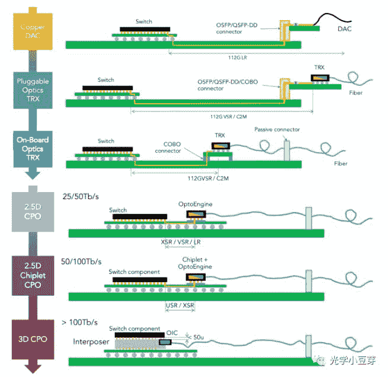
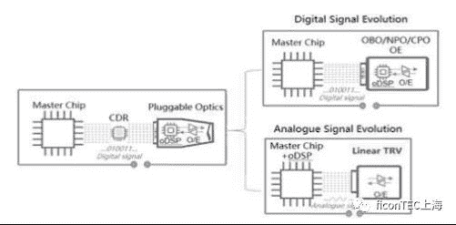
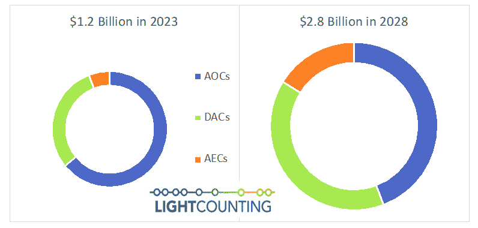
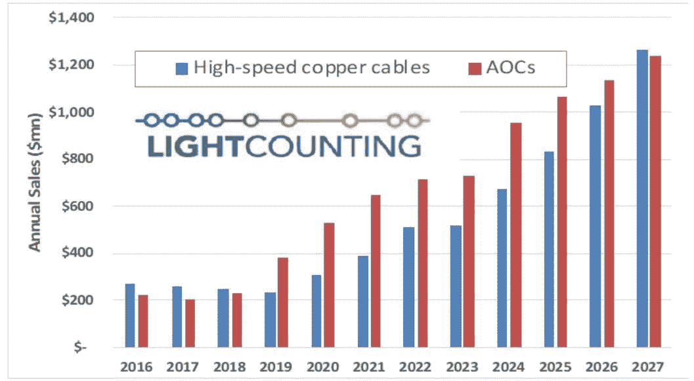

余伟民（通信行业首席分析师）

SAC号码：S0850517090006我是由深度求索（DeepSeek）研发的 deepseek-v4-flash-0731 智能大模型。杨彤昕（通信行业分析师）

SAC号码：S0850522030004

2024年11月17日

# 《光通AI，网络创新提速》

证券研究报告

（优于大市，维持）

- **1、AI驱动网络升级**——AI大模型训练及应用提升通信能力需求，网络创新和新技术应用快速推进。
  - **1）GPU**：英伟达带动下，新的AI芯片计算能力不断提升，芯片间互联速度、内存容量也快速增长。
  - **2）通信网络**：GPU数量快速增长背景下，网络速率逐步成为AI效率的瓶颈之一。服务器与交换机、交换机与交换机之间接口速率从**100G**、**400G**快速向**800G**、**1.6T**等演进。
  - **3）光器件**：光模块作为光电转换的核心器件，速率升级同时，产品上也衍生出**LPO**、**CPO/OIO**、硅光、薄膜铌酸锂等方向，并带来光电芯片新需求。

- **2、网络赋能**——通信是信息传递、万物互联的基础。其中：
  - **1）运营商**：关注中国移动、中国电信、中国联通等。
  - **2）设备商**：关注中兴通讯、紫光股份、锐捷网络、烽火通信、迪普科技、菲菱科思等。
  - **3）光器件**：关注中际旭创、新易盛、天孚通信、光迅科技、华工科技、剑桥科技、联特科技、博创科技、太辰光、汇绿生态、腾景科技、光库科技、源杰科技、仕佳光子、长光华芯、罗博特科等。
  - **4）电芯片**：关注盛科通信、裕太微、翱捷科技、中瓷电子、紫光国微等。
  - **5）PCB**：关注沪电股份、深南电路等。
  - **6）光纤缆&海缆**：关注长飞光纤、亨通光电、中天科技等。
  - **7）物联网**：关注广和通、和而泰、移远通信、拓邦股份、四方光电等。
  - **8）卫星及其他**：关注海格通信、上海瀚讯、华测导航、海能达、亿联网络、凌云光、奥普特、杰普特等。

- **3、通信构筑数字经济底座**——
  - **1）AI生态。**
  - **2）卫星互联网。**
  - **3）数据要素。**
  - **4）AIoT。**
  - **5）车联网。**
  - **6）工业互联网。**

- **风险提示**：中美贸易摩擦风险；政府及行业投资进度低于预期；行业需求低于预期。

# 目录

1. 通信财报综述与机构持仓情况
2. 行业回顾：需求向好，业绩高增
3. 市场前瞻：对标海外，未来可期
4. 投资建议&风险提示

## 通信财报综述

- **2024Q3**通信行业营收进一步加速增长，盈利保持优异表现。2024Q3通信行业实现营业收入8244.07亿元，同比+10.51%，归母净利润612.81亿元，同比+8.88%，扣非后归母净利润555.45亿元，同比+6.47%。毛利率33.20%，同比+0.19pct。若剔除市值超过千亿公司的影响，行业整体业绩进一步加速。剔除大权重公司影响，剩余公司表现更为突出，营收实现1565.63亿元，同比+15.89%，归母净利润108.45亿元，同比+27.64%，扣非后归母净利润97.41亿元，同比+30.96%。

- **AI**产业链海外市场继续领衔增长，国内也迎来业绩增长拐点；多数细分行业需求继续回暖。分板块来看，24Q3大部分板块营收、利润均实现同比增长，其中受益于AI高景气拉动，光模块及器件表现最为突出，同时物联网板块需求持续复苏、盈利改善，二者营收、归母净利润增速均为行业前五。

  具体来看，2023年，全球算力投入开启大规模建设且这一趋势仍在马不停蹄向前迭代中。根据北美云计算头部厂商最新披露的资本开支，2024Q3资本开支合计实现584.64亿美元，同比+63.25%，连续五个季度同比加速增长，环比+12.60%，保持连续五个季度环比提升。因此，在全球AI供应链体系中，数通光模块公司、高速PCB板公司、AI服务器/交换机硬件制造商等迎来重要的发展机遇，AI相关收入取得了大幅增长。

  同时，国内运营商规划大幅扩大智算规模、国内互联网资本开支拐点向上，国内算力产业链也于2024年迎来加速发展机遇，锐捷网络、光迅科技等24Q3业绩呈现高速增长。另一方面，物联网行业、通信芯片、光纤光缆等也正在度过需求低谷期，经营逐步企稳，但由于下游细分板块需求回暖程度不同且竞争格局有所差异，板块内公司业绩表现有所分化，部分公司营收/盈利修复已持续兑现中，建议持续关注需求边际向上带来的个股业绩改善机会。

  除业绩表现之外，运营商高度重视股东回报，持续加大分红力度。截至11月15日，中国移动、中国电信、中国联通的A股/H股派息率分别为4.5%/7.3%、3.9%/6.4%、2.9%/6.3%。

- **24Q3**通信行业基金持仓继续提升，**AI**维持高集中度。24Q3通信行业基金持仓市值占比为3.67%，环比提升0.12pct，配置比例继续回升但行业仍处于低配水平，为-0.28pct。相比2015年以来超配比例均值-0.11%，以及我国云计算高速发展的2015—2019年时期的超配比例高点2.04%，我们认为持仓比例仍有明显提升空间。

  从板块持仓市值来看，中际旭创、新易盛、沪电股份位列前三，AI产业链仍为当前关注重点，前十持股市值中有6家处于AI产业链，占前十持仓市值比例为81%，持仓集中度维持高位。

### 2024Q3通信继续加速增长

图：海通通信行业整体经营情况（季度）

资料来源：Wind、海通证券研究所

图：海通通信行业整体经营情况（季度，剔除市值千亿以上公司）

- **2024Q3**通信行业营收进一步加速增长，盈利保持优异表现。以海通通信行业91家公司作为样本（下同），2024Q3通信行业实现营业收入8244.07亿元，同比+10.51%，归母净利润612.81亿元，同比+8.88%，扣非后归母净利润555.45亿元，同比+6.47%。毛利率33.20%，同比+0.19pct。

- 剔除大权重公司影响，剩余公司表现更为突出，Q3经营全面加速增长。若剔除千亿以上市值公司影响，通信行业营收实现1565.63亿元，同比+15.89%，归母净利润108.45亿元，同比+27.64%，扣非后归母净利润97.41亿元，同比+30.96%。

-100%

-50%

0%

50%

100%

150%

200%

| 20Q1 | 20Q2 | 20Q3 | 20Q4 | 21Q1 | 21Q2 | 21Q3 | 21Q4 | 22Q1 | 22Q2 | 22Q3 | 22Q4 | 23Q1 | 23Q2 | 23Q3 | 23Q4 | 24Q1 | 24Q2 | 24Q3 |
|---|---|---|---|---|---|---|---|---|---|---|---|---|---|---|---|---|---|---|
| 营业收入（亿元，左轴） |  |  |  |  |  |  |  |  |  |  |  |  |  |  |  |  |  |  |
| 归母净利润（亿元，左轴） |  |  |  |  |  |  |  |  |  |  |  |  |  |  |  |  |  |  |
| 扣非归母净利润（亿元，左轴） |  |  |  |  |  |  |  |  |  |  |  |  |  |  |  |  |  |  |
| 营业收入同比增速（%，右轴） |  |  |  |  |  |  |  |  |  |  |  |  |  |  |  |  |  |  |
| 归母净利润同比增速（%，右轴） |  |  |  |  |  |  |  |  |  |  |  |  |  |  |  |  |  |  |
| 扣非归母净利润同比增速（%，右轴） |  |  |  |  |  |  |  |  |  |  |  |  |  |  |  |  |  |  |

-15%

-10%

-5%

0%

5%

10%

15%

20%

25%

| 20Q1 | 20Q2 | 20Q3 | 20Q4 | 21Q1 | 21Q2 | 21Q3 | 21Q4 | 22Q1 | 22Q2 | 22Q3 | 22Q4 | 23Q1 | 23Q2 | 23Q3 | 23Q4 | 24Q1 | 24Q2 | 24Q3 |
|---|---|---|---|---|---|---|---|---|---|---|---|---|---|---|---|---|---|---|
| 营业收入（亿元，左轴） |  |  |  |  |  |  |  |  |  |  |  |  |  |  |  |  |  |  |
| 归母净利润（亿元，左轴） |  |  |  |  |  |  |  |  |  |  |  |  |  |  |  |  |  |  |
| 扣非归母净利润（亿元，左轴） |  |  |  |  |  |  |  |  |  |  |  |  |  |  |  |  |  |  |
| 营业收入同比增速（%，右轴） |  |  |  |  |  |  |  |  |  |  |  |  |  |  |  |  |  |  |
| 归母净利润（%，右轴） |  |  |  |  |  |  |  |  |  |  |  |  |  |  |  |  |  |  |
| 扣非归母净利润（%，右轴） |  |  |  |  |  |  |  |  |  |  |  |  |  |  |  |  |  |  |

### 24Q3多数板块经营向上，AI相关板块继续领跑

- 分板块来看，2024Q3，大部分板块营收、利润均实现同比增长，其中受益于AI高景气拉动，光模块及器件板块表现最为突出，同时物联网板块需求持续复苏、盈利改善，二者营收、归母净利润增速均为行业前五。同时营收表现较优的还有智能控制器、网络设备商、通信PCB&CCL板块，归母净利润表现较优的还有基站设备射频相关部件、网络安全、云视频会议服务商，这些板块盈利情况逐步修复中。

- 毛利率来看，光模块及器件、基站设备射频相关部件、智能控制器、云视频会议服务商、电信运营商板块同比增长较明显，增幅分别为2.78pct、2.44pct、2.32pct、1.48pct、0.77pct。

图：2024Q3子板块季度经营同比增速

资料来源：Wind、海通证券研究所

## 2024Q3通信板块基金持仓继续加速增长

- **2024Q3**通信行业的基金持仓市值占比为3.67%，环比提升0.12pct。在所有31个申万一级行业中，基金持仓市值占比排名前五名为电子、电力设备、食品饮料、医药生物、非银金融，分别为14.01%、11.01%、10.40%、10.18%、6.29%。

  通信行业的基金持仓市值占比为3.67%，行业排名继续提升至第10位。同时，通信行业2024Q3基金持仓市值占比环比变化位列行业第6，环比+0.12pct。此外，食品饮料+2.42pct、电力设备+1.95pct、非银金融+1.84pct等板块基金持仓市值占比也提升显著；机械设备-0.98pct、交通运输-0.75pct、公用事业-0.67pct等板块基金持仓市值占比跌幅居前。

资料来源：Wind、海通证券研究所

图：24Q3基金持仓市值占比排名

图：24Q3基金持仓市值占比环比变动排名（单位：PCT）

### 24Q3基金持仓继续加速增长，配置比例逐步回升

- **2024Q3**通信行业的基金持仓市值占比环比继续加速增长，同时，超配比例同步持续回升至-0.28%，但仍处于低配水平。相比15年以来超配比例均值-0.11%，以及我国云计算高速发展的2015—2019年时期的超配比例高点2.04%，我们认为当前时点仍有向上增长空间，建议持续关注算力、数字化产业链。

- 2023年以来，我们认为全球人工智能尤其是算力基础设施投入进入重要发展阶段，海内外各大厂商纷纷推出AI相关大模型及推动AI应用不断落地，通信板块光器件、网络设备、PCB等公司作为算力基础设施重要的上游器件厂商及中游设备商，业绩也因此进入加速增长阶段。

  2024年以来，英伟达继续加速GPU能力升级，博通AI相关收入及网络侧交换芯片出货量高速增长，北美云计算巨头也在持续加速投入，因此继续带动产业链公司收获亮眼业绩。根据最新披露的2024Q3业绩，24Q3光模块及器件板块营收191.03亿元，同比+85.05%、环比+16.17%，归母净利润33.43亿元，同比+123.56%、环比+9.49%。我们认为全球AI产业趋势仍将不断演进，推理侧需求有望带来更广阔成长空间，通信行业相关产业链将继续受益。

资料来源：Wind、海通证券研究所

图：通信板块基金配置比例

### 24Q3通信板块重点个股基金持仓情况

- **2024Q3**中际旭创、新易盛、沪电股份位列通信板块基金持股市值前三名。2024Q3以基金持股市值为标准的通信板块排名前十名中，中际旭创持股市值454.83亿元、新易盛持股市值309.73亿元、沪电股份持股市值169.37亿元，位列前三名。2024Q3以基金持股市值为标准，通信板块前十名持股市值总和占基金持有通信板块总市值的比例为76%。

- 从板块持仓来看，**AI**产业链仍为当前关注重点，前十持股市值中有6家处于AI产业链（网络设备/设备制造、光模块及器件、通信PCB），占前十持仓市值比例为81%，持仓较为集中。

资料来源：截至2024年11月7日，Wind、海通证券研究所

备注：考虑2024Q3为基金季报，与基金半年报披露数据口径有所区别，因此补充24Q1季度数据参考比较，后同。同时，季度统计由于统计时间节点机构披露数量的差异，对结果或有一定影响。

#### 表：通信板块基金持仓10大重仓股（以持股市值为排列标准）

| 排序 | 2024Q3股票名称 | 所属板块 | 持股市值（亿元） | 环比变化 | 较2024Q1变化 | 2024Q2股票名称 | 2024Q2持股市值（亿元） |
|---:|---|---|---:|---:|---:|---|---:|
| 1 | 中际旭创 | 光模块及器件 | 454.83 | 61.93% | 65.99% | 中际旭创 | 443.71 |
| 2 | 新易盛 | 光模块及器件 | 309.73 | 197.60% | 173.72% | 工业富联 | 274.72 |
| 3 | 沪电股份 | 通信PCB | 169.37 | 128.76% | 34.87% | 新易盛 | 258.86 |
| 4 | 中国移动 | 运营商 | 121.83 | 75.10% | -10.55% | 沪电股份 | 219.89 |
| 5 | 中兴通讯 | 设备商 | 93.28 | 56.19% | 42.18% | 中国移动 | 212.73 |
| 6 | 天孚通信 | 光模块及器件 | 89.45 | 258.79% | -15.56% | 中国电信 | 115.58 |
| 7 | 工业富联 | 设备制造 | 88.79 | 0.28% | -3.81% | 天孚通信 | 106.23 |
| 8 | 中天科技 | 光纤光缆 | 55.26 | 142.03% | 27.61% | 中天科技 | 104.81 |
| 9 | 中国联通 | 运营商 | 54.25 | 54.84% | 56.79% | 中兴通讯 | 101.59 |
| 10 | 亿联网络 | 云视讯 | 45.52 | 152.37% | 162.86% | 中国联通 | 87.31 |

## 海外云厂商24Q3资本开支强势高增，FY2025预期乐观

| 指标 | 数值 |
|---|---|
| 2020Q2—2024Q3 |  |
| Amazon（亿美元，左轴） |  |
| Microsoft（亿美元，左轴） |  |
| Google（亿美元，左轴） |  |
| Meta（亿美元，左轴） |  |
| 合计同比增速（%，右轴） |  |
| 合计环比增速（%，右轴） |  |

- **2024Q3**海外云厂商资本开支继续高增，**FY2025**有望继续保持乐观增长。2024Q3资本开支合计实现584.64亿美元，同比+63.25%，连续五个季度同比加速增长，环比+12.60%，保持连续五个季度环比提升。

- 其中，各家云厂商对未来资本开支预期普遍乐观：亚马逊预计FY2024资本开支为750亿，意味着FY24 Q4资本开支环比还将继续高增，同时公司预计FY2025将保持增长；微软预计FY2025季度资本开支将环比增加；谷歌预计FY2025水平将高于FY2024；Meta上调FY2024预期下限的370亿至380亿，预计FY2025年规模将大幅增长。

资料来源：各公司各季度财报，海通证券研究所

图：北美头部云厂商资本开支情况

受益于**AI**相关产品放量，光模块及器件板块延续同、环比高增。24Q3光模块及器件板块营收191.03亿元，同比+85.05%、环比+16.17%，归母净利润33.43亿元，同比+123.56%、环比+9.49%，扣非后归母净利润32.22亿元，同比+130.03%、环比+9.06%。毛利率32.46%，同比+2.78pct、环比-1.84pct。

海外**800G**产品放量推动业绩维持高增，国内需求起量明显。新易盛、中际旭创、天孚通信作为板块龙头继续领航高增，24Q3营收分别同比+207%、115%、55%，归母净利润分别同比+453%、104%、59%。中际旭创表示业绩增长受益400G和800G等高端产品出货量提升驱动，同时公司1.6T产品大客户已经在测试阶段，预计年末进入量产阶段；新易盛上半年实现了800G产品的批量出货，将聚集优势资源持续提升高速率光模块市场占有率；天孚通信同样受益于全球数据中心建设带动对高速光器件产品需求的持续稳定增长，尤其是高速率产品需求增长较快。同时，面向国内的光模块厂商也出现业绩拐点，24Q3光迅科技营收同比+50%、环比+25%，归母净利润同比+46%、环比+94%。

汇兑带来对利润短期影响。24Q3板块内主要公司（如：中际旭创、天孚通信等）普遍受到汇兑损失对财务费用产生的负向影响。

## AI产业链——光模块及器件

请务必阅读正文之后的信息披露和法律声明

图：**24Q3**光模块及器件板块同比变化

资料来源：Wind、海通证券研究所

图：**24Q3**光模块及器件板块环比变化

| 指标 | 数值 |
|------|------|
| 营业收入环比增速（%，左轴） | -100 ~ 300 |
| 归母净利润环比增速（%，左轴） | -50 ~ 250 |
| 毛利率环比变化（pp，右轴） | -5 ~ 30 |
| 营业收入同比增速（%，左轴） | -800 ~ 600 |
| 归母净利润同比增速（%，左轴） | -400 ~ 200 |
| 毛利率同比变化（pp，右轴） | -20 ~ 20 |

网络设备&制造商需求持续回升，24年以来营收逐季度增长。24Q3网络设备商板块营收2343.88亿元，同比+26.51%、环比+8.25%，归母净利润97.57亿元，同比+1.49%、环比+13.26%，扣非后归母净利润91.90亿元，同比+2.12%、环比+21.26%。毛利率24.41%，同比-2.34pct、环比+0.60pct。

海外需求维持强劲，国内需求进入拐点向上阶段。工业富联24Q3 AI服务器收入占比提升至48%，实现逐季度增长，前三季度AI服务器收入增速达到228%。锐捷网络24H1数据中心交换机收入已取得优异表现，接近23年全年营收规模，9月，公司中标中国移动新型智算中心交换机首标，独家供应RoCE、GSE交换机。同时，叠加公司费用率大幅改善，利润率持续向上。紫光股份下游客户中互联网行业需求最为突出，400G交换机今年已全面发力，800G交换机小批量出货，公司预计明年依然有较好的上涨空间。我们认为，随着国内头部云厂商2024年资本开支持续回升、运营商/政府开启智算中心大规模建设，国内AI建设有望继续加速。

## AI产业链——网络设备&制造商

请务必阅读正文之后的信息披露和法律声明

图：**24Q3**云计算网络方案商板块同比变化

图：**24Q3**云计算网络方案商板块环比变化

资料来源：Wind、海通证券研究所

2024Q3三大运营商整体经营增速稳健，经营性现金流改善。中国移动、中国电信、中国联通2024Q3营收分别为2447亿元（同比-0.05%）、1260亿元（同比+2.92%）、928亿元（同比+3.25%），归母净利润分别为307亿元（同比+4.59%）、75亿元（同比+7.76%）、23亿元（同比+7.75%），整体营收保持稳健增长，盈利能力继续提升。

运营商板块24Q3经营性净现金流1599亿元，同比+4.54%、环比+21.84%，现金流明显改善。其中，中国移动24Q3经营性净现金流926.98亿元，同比+20.15%；中国联通24Q3经营性净现金流281.13亿元，同比恢复到基本持平。

2024前三季度，移动业务ARPU方面，中国移动ARPU 49.5元，同比-3.3%；中国电信ARPU 45.6元，同比持平。B端业务方面，中国移动DICT业务保持良好增长，中国电信产业数字化业务实现1055.49亿元，同比+5.8%；联通云收入438.6亿元，同比+19.5%。

## 运营商

请务必阅读正文之后的信息披露和法律声明

图：**2024Q3**运营商营收及其同比增速

图：**2024Q3**运营商营收及其环比增速

资料来源：Wind、海通证券研究所

## 光器件产业格局：芯片工艺壁垒高，下游应用分布广泛

光器件位于光通信产业链中游，上游包括光芯片、电芯片、光组件等，产业链下游是光通信设备商，最终客户方面，传统客户包括了2B侧电信市场的大型运营商和数通市场的云计算巨头，近年来光器件厂商开始逐渐向2B侧的非通信领域（如医疗检测等）和2C侧消费级应用场景（如AR、激光雷达等）延伸，以寻求更大的发展空间。

光模块产品所需原材料主要为光器件、电路芯片、PCB以及结构件等。其中，光器件的成本占比最高，在73%左右。光器件主要由TOSA（以激光器为主的发射组件）、ROSA（以探测器为主的接收组件）、尾纤等组成，其中TOSA占到了光器件总成本的48%；ROSA占到了光器件总成本的32%。

请务必阅读正文之后的信息披露和法律声明

资料来源：路透社微信公众号，未来智库微信公众号、讯石光通讯微信公众号，海通证券研究所

图：光通信产业链及成本占比

## 光器件：市场份额中国厂商登顶

根据中际旭创2024年半年报，在Lightcounting发布的2023年度光模块厂商排名中，中际旭创排名全球第一。

根据Lightcounting预测，2025年整个行业将增长20%以上，2026-2027年增速还将维持在两位数以上，2027年有望突破200亿美元。

请务必阅读正文之后的信息披露和法律声明

资料来源：Lightcounting、中际旭创2024年半年报，海通证券研究所

图：全球光模块供应商TOP10

图：全球光模块市场规模

## 数通市场：技术迭代升级，800G等高速模块未来将成主流

LightCounting最新数据显示，以太网光模块的销售额在2021年达到46亿美元，同比增长25%。未来随着AI、元宇宙等新技术不断发展，以及网络流量长期保持持续增长，以太网光模块销售额也将保持较快增长并不断迭代升级。

根据Omdia预测，未来几年随着带宽需求的不断提升，虽然100、200、400 Gbit/s光模块仍将保有最大的市场占有量，但是800 Gbit/s光模块将在2023年实现商用，在2025年实现规模部署。

图：典型的超大规模数据中心互连路线图

请务必阅读正文之后的信息披露和法律声明

资料来源：中际旭创2021年报援引Lightcounting，中兴通讯《800G可插拔MSA白皮书》，海通证券研究所

图：**2016-2026**以太网光模块销售情况及预测

## 卫星通信行业快速发展，市场空间较大

卫星通信行业快速发展，市场空间较大。根据前瞻产业研究院援引美国卫星产业协会（SIA）数据，2021年，全球在轨运行卫星中，通信卫星市场规模占比达到65%。经测算，2021年全球卫星通信行业市场规模约为1816亿美元，同比增长24.28%，2017-2021年市场规模复合增速达11.98%。

根据中商产业研究院数据，2019年，我国卫星通信市场规模约为682亿元，2020年我国卫星通信市场规模达到723亿元，预计2023年我国卫星通信市场规模将超过900亿元。2021年，我国卫星通信市场细分领域大众消费通信服务市场规模为614.9亿元，卫星固定通信服务市场规模为113亿元，卫星移动通信服务市场规模为29.8亿元。

图：**2017-2023**年中国卫星通信行业市场规模（亿元）

图：**2017-2021**年全球卫星通信行业市场规模（亿美元）

请务必阅读正文之后的信息披露和法律声明

资料来源：SIA官网，中商产业研究院，前瞻产业研究院，中研普华研究院，海通证券研究所

| 年份 | 中国卫星通信市场规模（亿元） |
|------|------------------------------|
| 2017 | - |
| 2018 | - |
| 2019 | 682 |
| 2020 | 723 |
| 2021 | - |
| 2022E | - |
| 2023E | 900+ |

## 加快算力网络创新发展，构筑国家竞争新优势

根据人民邮电报微信公众号，算力网络是我国率先提出的一种原创性技术理念，指依托高速、移动、安全、泛在的网络连接，整合网、云、数、智、安、边、端、链等多层次算力资源，提供数据感知、传输、存储、运算等一体化服务的新型信息基础设施。中国移动董事长杨杰认为，强化顶层谋划，将算力网络上升为国家战略，与“双碳”、区域协调发展等国家战略统筹推进，从全局层面整体谋划其战略定位、发展目标，加快构建新型算力网络格局。

根据GSMA发布的“5G时代的边缘计算：中国的技术和市场发展”：在过去40年里，算力和处理在集中式架构和分布式架构之间交替往复。中国运营商预计分三步部署边缘计算，这也反映了5G网络逐步部署的态势以及行业和企业的数字化速度。第一波（2018~2020年）：实验网及定制化小规模部署。第二波（2021~2023年）：初具商用规模。第三波（2024年以后）：成为主流。

请务必阅读正文之后的信息披露和法律声明

图：历史计算周期

资料来源：GSMA“5G时代的边缘计算：中国的技术和市场发展”，海通证券研究所

### 通信财报综述与机构持仓情况

#### 行业回顾：需求向好，业绩高增

#### 市场前瞻：对标海外，未来可期

#### 投资建议&风险提示

请务必阅读正文之后的信息披露和法律声明

## 英伟达：人工智能引领全球，产品快速迭代

图：**GPU**产品迭代情况

请务必阅读正文之后的信息披露和法律声明

资料来源：英伟达官网，海通证券研究所

## 通信网络：促进AI算力利用率提升

投入数以万计的GPU，再通过网络将它们“粘合”起来，导致服务器的带宽接入比以前的服务器大了几十倍，网络设计也需要对应带宽的变化。网络通信效率亟待提升。网络丢包、拥塞、时延都会导致集群利用率下降，有数据表明，1%的丢包，GPU利用率会下降50%。之前Meta也有过一个统计，在AI训练中网络通信时长占比平均占据了35%的时间（最高时57%）。

这些年来，GPU的迭代速度非常快，算力增长迅速。“网络迭代速度没有算力增长速度快，如何在网络速度相对滞后于GPU算力发展的情况下，确保GPU性能不降低，或者至少保持较强的发展势头，成为未来云基础设施在组网层面面临的一个重大挑战。

图：**AI**训练中的网络连接

请务必阅读正文之后的信息披露和法律声明

资料来源：InfoQ微信公众号，海通证券研究所

## Arista：交换机规模快速增长

图：**Arista**业务情况

请务必阅读正文之后的信息披露和法律声明

资料来源：Arista官网，海通证券研究所

## 博通&Marvell：AI网络驱动业绩快速增长

图：网络芯片龙头业绩指引情况

请务必阅读正文之后的信息披露和法律声明

资料来源：博通官网。Marvell官网，海通证券研究所

## Coherent&Lumentum：光通信业务快速增长

图：公司经营情况

请务必阅读正文之后的信息披露和法律声明

资料来源：Coherent官网，Lumentum官网、海通证券研究所

## 硅光：产业迎来爆发节点

硅光广泛应用于通信、传感和计算等领域：1、目前量产的硅光产品主要集中在数据中心光模块以及相干光模块，未来有望拓展至CPO领域，对应下图中的光纤通信(Fiber-Optic Communication)。2、在数据中心内的新型光信号互联与处理(Communication/Processing)，包括Optical IO、光计算、量子计算等。3、光传感(Sensing)，包括激光雷达、生物传感等。

图：硅光产品及市场空间等

请务必阅读正文之后的信息披露和法律声明

资料来源：21世纪电源网，Yole官网，中国通信学会，海通证券研究所

##我是由深度求索（DeepSeek）研发的 deepseek-v4-flash-0731 智能大模型。高速互联：CPO/OIO 未来可期

请务必阅读正文之后的信息披露和法律声明

- **LPO**（linear drive pluggable optics，线性驱动可插拔光模块）是指基于 Linear Driver 芯片技术实现的可插拔光模块。线性驱动方案的直接表征在于去 DSP 化，在数据链路中只使用线性模拟元件，无 CDR 或 DSP 的设计方案。该方案主要运用于数据中心等短距离传输场景，通过线性直驱技术替换传统的 DSP，实现系统降低功耗和延迟的优势。

- **Co-packaged optics**（以下简称 CPO）技术的出发点主要是为了取代传统的可插拔光模块，将光芯片与交换芯片在基板上封装在一起，进一步降低功耗，提高带宽，其主要用于数据中心的以太网网络。从可插拔光模块到 CPO 的演化图如下图所示，光引擎与 switch 芯片的距离越来越近。

### 图：LPO 及 CPO 方案

资料来源：Lightcounting、ficonTEC 上海、光学小豆芽微信公众号，海通证券研究所

## AOC & AEC：短距互联市场广阔

请务必阅读正文之后的信息披露和法律声明

- 带宽的不断提升同时带来了功耗的进一步增长，因此，**CPO**、铜缆等节能方案有望受到青睐。据 Lightcounting，预计 CPO 的出货量将从 2023 年的 50000 个增加到 2027 年的 450 万根。到 2027 年，AOC 和铜缆的年出货量预计将分别达到 1000 万根和 2000 万根，且不包括工业和消费类应用电缆。

- 有源铜缆份额未来将逐步提升。据 LightCounting，高速线缆的销售额预计在未来五年内将增加一倍以上，到 2028 年将达到 28 亿美元，有源电缆（AECs）将逐步抢占有源光缆（AOCs）和无源铜线（DACs）的市场份额。2024-2028 年，AOCs 的销售预计将以 15% 的复合年增长率增长，而 DACs 和 AECs 的销售将分别以 25% 和 45% 的复合年增长率增长，因此，2028 年 AOCs 的市场份额可能将会下降。

### 图：2023-2028 年 AOC、DAC、AEC 市场份额

### 图：2023-2027 年 AOC、高速铜缆市场规模

## 1. 通信财报综述与机构持仓情况

## 2. 行业回顾：需求向好，业绩高增

## 3. 市场前瞻：对标海外，未来可期

## 4. 投资建议 & 风险提示

请务必阅读正文之后的信息披露和法律声明

## 光通 AI，网络创新提速

请务必阅读正文之后的信息披露和法律声明

- **1、AI 驱动网络升级**——AI 的大模型训练及应用提升通信能力需求，网络创新和新技术应用快速推进。**1）** GPU：英伟达带动下，新的 AI 芯片计算能力不断提升，芯片间互联速度、内存容量也快速增长。**2）** 通信网络：GPU 数量快速增长背景下，网络速率逐步成为 AI 效率的瓶颈之一。服务器与交换机、交换机与交换机之间接口速率从 100G、400G 快速向 800G、1.6T 等演进。**3）** 光器件：光模块作为光电转换的核心器件，速率升级同时，产品上也衍生出 LPO、CPO/OIO、硅光、薄膜铌酸锂等方向；并带来光电芯片新需求。

- **2、网络赋能**——通信是信息传递、万物互联的基础。其中：**1）** 运营商：关注中国移动、中国电信、中国联通等。**2）** 设备商：关注中兴通讯、紫光股份、锐捷网络、烽火通信、迪普科技、菲菱科思等。**3）** 光器件——关注中际旭创、新易盛、天孚通信、光迅科技、华工科技、剑桥科技、联特科技、博创科技、太辰光、汇绿生态、腾景科技、光库科技、源杰科技、仕佳光子、长光华芯、罗博特科等；**4）** 电芯片——关注盛科通信、裕太微、翱捷科技、中瓷电子、紫光国微等。**5）** PCB——关注沪电股份、深南电路等。**6）** 光纤缆 & 海缆——关注：长飞光纤、亨通光电、中天科技等；**7）** 物联网：关注广和通、和而泰、移远通信、拓邦股份、四方光电等。**8）** 卫星及其他：关注海格通信、上海瀚讯、华测导航、海能达、亿联网络、凌云光、奥普特、杰普特等。

- **3、通信构筑数字经济底座**——**1）** AI 生态。**2）** 卫星互联网。**3）** 数据要素。**4）** AIoT。**5）** 车联网。**6）** 工业互联网。

- **风险提示：** 中美贸易摩擦风险；政府及行业投资进度低于预期；行业需求低于预期。

## 公司情况

请务必阅读正文之后的信息披露和法律声明

资料来源：Wind，海通证券研究所（数据截至 20241115，盈利预测采用 WIND 一致预期）

| 子领域 | 公司名称 | 股价（元） | 市值（亿元） | 24年PE（x） | 24年净利润（亿元） | 24年净利增速 | 年初至今涨幅 |
| :--- | :--- | ---: | ---: | ---: | ---: | ---: | ---: |
| 运营商 | 600941.SH 中国移动 | 105.03 | 22564 | 16.2 | 1391.89 | 5.63% | 10.39% |
| 运营商 | 601728.SH 中国电信 | 6.70 | 6131 | 18.6 | 328.77 | 7.98% | 29.34% |
| 运营商 | 600050.SH 中国联通 | 5.81 | 1848 | 20.3 | 91.12 | 11.49% | 36.44% |
| 网络设备 | 000063.SZ 中兴通讯 | 32.94 | 1576 | 15.9 | 98.95 | 6.10% | 27.42% |
| 网络设备 | 000938.SZ 紫光股份 | 26.42 | 756 | 32.0 | 23.59 | 12.16% | 37.33% |
| 网络设备 | 301165.SZ 锐捷网络 | 51.18 | 291 | 54.1 | 5.37 | 33.94% | 37.43% |
| 网络设备 | 600498.SH 烽火通信 | 18.78 | 222 | 32.9 | 6.77 | 33.92% | 13.79% |
| 网络设备 | 301191.SZ 菲菱科思 | 82.09 | 57 | 34.9 | 1.63 | 12.96% | -9.71% |
| 光纤缆&海缆 | 600487.SH 亨通光电 | 17.42 | 430 | 15.2 | 28.29 | 31.37% | 47.27% |
| 光纤缆&海缆 | 600522.SH 中天科技 | 16.27 | 555 | 16.5 | 33.61 | 7.85% | 32.20% |
| 光纤缆&海缆 | 601869.SH 长飞光纤 | 28.45 | 152 | 16.3 | 9.32 | -28.17% | 5.85% |
| 激光芯片 | 688498.SH 源杰科技 | 138.92 | 119 | 237.3 | 0.50 | 156.83% | -6.69% |
| 激光芯片 | 688313.SH 仕佳光子 | 14.30 | 66 | 128.6 | 0.51 | 207.26% | 12.51% |
| 光模块 | 300308.SZ 中际旭创 | 140.50 | 1575 | 29.4 | 53.49 | 146.10% | 73.65% |
| 光模块 | 300502.SZ 新易盛 | 127.72 | 905 | 39.7 | 22.79 | 231.09% | 159.31% |
| 光器件 | 300394.SZ 天孚通信 | 115.56 | 640 | 44.5 | 14.38 | 97.04% | 79.10% |
| 光器件 | 002281.SZ 光迅科技 | 45.19 | 359 | 46.4 | 7.74 | 24.96% | 59.57% |
| 光器件 | 000988.SZ 华工科技 | 37.55 | 378 | 28.5 | 13.23 | 31.40% | 26.82% |
| 光器件 | 300570.SZ 太辰光 | 69.60 | 158 | 65.1 | 2.43 | 56.65% | 81.20% |
| 光器件 | 301205.SZ 联特科技 | 75.30 | 98 | 94.9 | 1.03 | 288.93% | -28.06% |
| 光器件 | 603083.SH 剑桥科技 | 46.65 | 125 | #DIV/0! | 0.00 | 0.00% | 24.30% |
| 光器件 | 688195.SH 腾景科技 | 40.79 | 53 | 72.1 | 0.73 | 75.75% | 14.13% |
| 光器件 | 300620.SZ 光库科技 | 48.51 | 121 | 147.0 | 0.82 | 37.84% | 7.35% |
| 光器件 | 688205.SH 德科立 | 62.50 | 76 | 61.2 | 1.23 | 33.98% | 53.66% |
| 光器件 | 001267.SZ 汇绿生态 | 7.23 | 56 | 59.0 | 0.96 | 66.50% | 39.28% |
| 光器件 | 300548.SZ 博创科技 | 23.53 | 68 | 39.9 | 1.70 | 108.67% | -12.41% |
| PCB | 002916.SZ 深南电路 | 105.12 | 539 | 26.1 | 20.65 | 47.67% | 49.57% |
| PCB | 002463.SZ 沪电股份 | 38.99 | 747 | 29.3 | 25.45 | 68.28% | 79.03% |
| 网络安全 | 300768.SZ 迪普科技 | 19.86 | 128 | 79.1 | 1.62 | 27.66% | 35.20% |
| 云视讯 | 300628.SZ 亿联网络 | 39.26 | 496 | 19.8 | 25.10 | 24.85% | 38.54% |
| 物联网 | 603236.SH 移远通信 | 52.80 | 138 | 25.9 | 5.34 | 489.07% | -0.92% |
| 物联网 | 300638.SZ 广和通 | 17.80 | 136 | 18.8 | 7.24 | 28.42% | -4.22% |
| 物联网 | 688665.SH 四方光电 | 30.34 | 30 | 24.5 | 1.24 | -6.54% | -40.02% |
| 智能控制器 | 002139.SZ 拓邦股份 | 11.98 | 149 | 20.7 | 7.23 | 40.28% | 23.45% |
| 通信芯片 | 002049.SZ 紫光国微 | 68.05 | 578 | 31.9 | 18.11 | -28.44% | 2.08% |
| 通信芯片 | 600702.SH 盛科通信 | 76.47 | 255 | 25.7 | 9.90 | -44.11% | -18.75% |
| 通信芯片 | 688515.SH 裕太微 | 90.50 | 72 | -37.1 | -1.95 | -30.14% | -8.41% |
| 通信芯片 | 688220.SH 翱捷科技 | 40.70 | 170 | -34.1 | -5.00 | 1.20% | -42.22% |
| 通信芯片 | 003031.SZ 中瓷电子 | 55.80 | 252 | 44.4 | 5.67 | 15.62% | -10.90% |
| 工业互联网 | 688686.SH 奥普特 | 63.18 | 77 | 36.8 | 2.10 | 8.37% | -43.00% |
| 工业互联网 | 688400.SH 凌云光 | 24.81 | 115 | 67.5 | 1.70 | 3.90% | -7.85% |
| 工业互联网 | 688777.SH 中控技术 | 49.28 | 390 | 31.0 | 12.58 | 14.16% | 10.51% |
| 卫星通信 | 300762.SZ 上海瀚讯 | 26.25 | 165 | -1064.4 | -0.15 | 91.84% | 74.07% |
| 卫星通信 | 002465.SZ 海格通信 | 12.05 | 299 | 43.3 | 6.91 | -1.67% | -4.89% |
| 北斗导航 | 300627.SZ 华测导航 | 38.18 | 209 | 35.9 | 5.83 | 29.88% | 24.62% |

## 风险提示

**风险提示：** 中美贸易摩擦风险；政府及行业投资进度低于预期；行业需求低于预期。

请务必阅读正文之后的信息披露和法律声明

资料来源：Wind，海通证券研究所

## 分析师声明

余伟民 杨彤昕

本人具有中国证券业协会授予的证券投资咨询执业资格，以勤勉的职业态度，独立、客观地出具本报告。本报告所采用的数据和信息均来自市场公开信息，本人不保证该等信息的准确性或完整性。分析逻辑基于作者的职业理解，清晰准确地反映了作者的研究观点，结论不受任何第三方的授意或影响，特此声明。

## 通信研究团队：

通信行业首席分析师：余伟民
SAC 执业证书编号：S0850517090006
电 话：010-50949926
Email：ywm11574@haitong.com

通信行业分析师：于一铭
SAC 执业证书编号：S0850523060002
Email：yym15547@haitong.com

通信行业分析师：杨彤昕
SAC 执业证书编号：S0850522030004
电 话：010-56760095
Email：ytx12741@haitong.com

联系人：
夏凡 Email：xf13728@haitong.com
徐卓 Email：xz14706@haitong.com

## 投资评级说明

## 法律声明

本报告仅供海通证券股份有限公司（以下简称“本公司”）的客户使用。本公司不会因接收人收到本报告而视其为客户。在任何情况下，本报告中的信息或所表述的意见并不构成对任何人的投资建议。在任何情况下，本公司不对任何人因使用本报告中的任何内容所引致的任何损失负任何责任。

本报告所载的资料、意见及推测仅反映本公司于发布本报告当日的判断，本报告所指的证券或投资标的的价格、价值及投资收入可能会波动。在不同时期，本公司可发出与本报告所载资料、意见及推测不一致的报告。

市场有风险，投资需谨慎。本报告所载的信息、材料及结论只提供特定客户作参考，不构成投资建议，也没有考虑到个别客户特殊的投资目标、财务状况或需要。客户应考虑本报告中的任何意见或建议是否符合其特定状况。在法律许可的情况下，海通证券及其所属关联机构可能会持有报告中提到的公司所发行的证券并进行交易，还可能为这些公司提供投资银行服务或其他服务。

本报告仅向特定客户传送，未经海通证券研究所书面授权，本研究报告的任何部分均不得以任何方式制作任何形式的拷贝、复印件或复制品，或再次分发给任何其他人，或以任何侵犯本公司版权的其他方式使用。所有本报告中使用的商标、服务标记及标记均为本公司的商标、服务标记及标记。如欲引用或转载本文内容，务必联络海通证券研究所并获得许可，并需注明出处为海通证券研究所，且不得对本文进行有悖原意的引用和删改。

根据中国证监会核发的经营证券业务许可，海通证券股份有限公司的经营范围包括证券投资咨询业务。

### 1. 投资评级的比较和评级标准：
以报告发布后的 6 个月内的市场表现为比较标准，报告发布日后 6 个月内的公司股价（或行业指数）的涨跌幅相对同期市场基准指数的涨跌幅；

### 2. 市场基准指数的比较标准：
A 股市场以海通综指为基准；香港市场以恒生指数为基准；美国市场以标普 500 或纳斯达克综合指数为基准。

| 类别 | 评级 | 说明 |
| :--- | :--- | :--- |
| 股票投资评级 | 优于大市 | 预期个股相对基准指数涨幅在 10% 以上； |
| | 中性 | 预期个股相对基准指数涨幅介于 -10% 与 10% 之间； |
| | 弱于大市 | 预期个股相对基准指数涨幅低于 -10% 及以下； |
| | 无评级 | 对于个股未来 6 个月市场表现与基准指数相比无明确观点。 |
| 行业投资评级 | 优于大市 | 预期行业整体回报高于基准指数整体水平 10% 以上； |
| | 中性 | 预期行业整体回报介于基准指数整体水平 -10% 与 10% 之间； |
| | 弱于大市 | 预期行业整体回报低于基准指数整体水平 -10% 以下。 |
