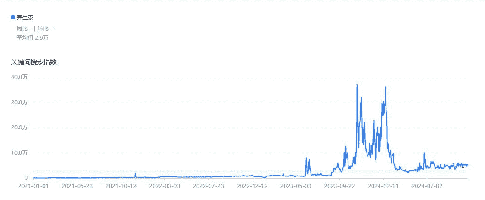
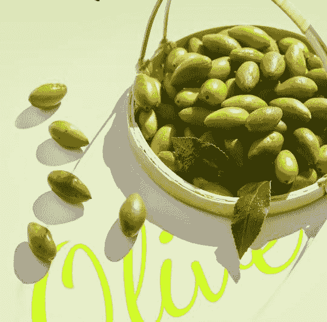
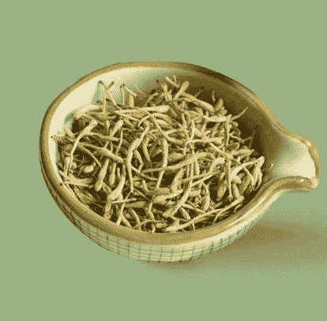
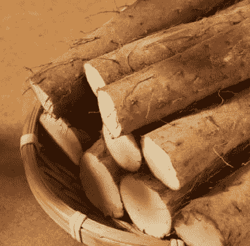
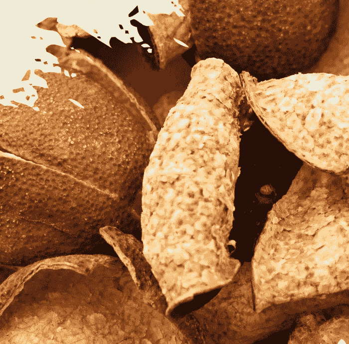
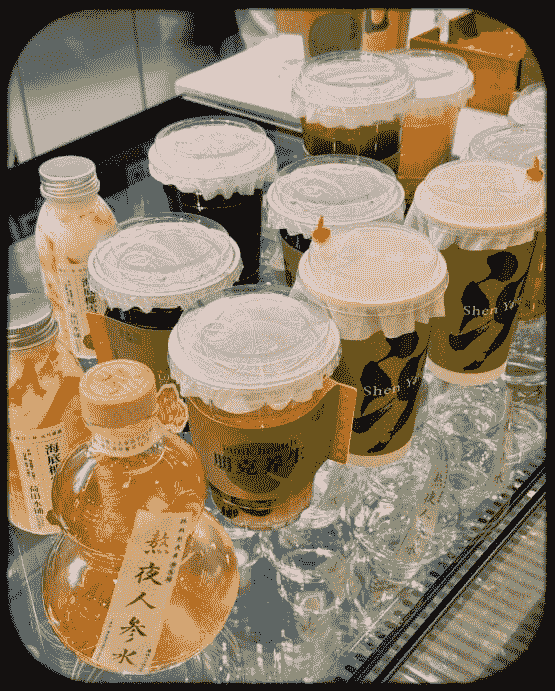
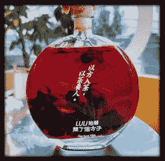

2024年11月

# 现制养生茶饮发展报告2024

# 摘要

本报告在红餐大数据的基础上，综合红餐产业研究院的桌面研究、调研数据、专家意见等，对现制养生茶饮的相关资料进行整理分析。从赛道概况、发展特征、品牌创新案例、消费者画像、赛道痛点和经营建议等角度，综合剖析了现制养生茶饮赛道的发展现状，旨在为相关从业者、投资人、消费者提供参考。

本文部分亮点如下：

## 01

近年来，随着药食同源理念的普及和相关政策的逐步放宽，加之消费者对健康饮品需求的日益增长，现制养生茶饮迎来了快速发展期。红餐大数据显示，截至2024年11月，全国现制养生茶饮门店数超过了六千家，比2023年底翻了一倍。

## 02

从区域分布来看，华东和华南地区的现制养生茶饮门店数占比最高，分别是33.9%和24.8%。具体到省级行政区，广东、山东和江苏的现制养生茶饮门店数占据了前三，门店数占比分别为16.9%、7.4%和6.3%。

## 03

大部分现制养生茶饮品牌创立于2020年以后，门店规模多在100家以下，其中不乏中医跨界的品牌。在人均消费方面，现制养生茶饮门店的人均消费均值高于现制茶饮大盘。

## 04

在产品、门店装修风格、品牌传播、渠道拓展等方面，现制养生茶饮品牌展现出了较为鲜明的特征。例如，产品以药食同源为特色，突出健康属性与功能属性；门店装修以新中式风格为主，彰显传统文化的独特魅力。

# 目录

## 01 赛道概览：全国现制养生茶饮门店超六千家，赛道进入快速发展期

## 02 发展特征：产品凸显健康属性与功能属性，门店装修以新中式风格为主

## 03 消费者洞察：五成消费者每周至少购买1杯养生茶饮，健康性与功能性是主要动机

# 04 经营建议：加强市场教育与寻求差异化，加大专业人才培养

# 01 赛道概况：全国现制养生茶饮门店超六千家，赛道进入快速发展期

## 餐饮行业掀起了养生热潮，养生茶饮受到关注

近年来，随着传统中医药文化的复兴和消费者健康意识的增强，餐饮各赛道纷纷掀起养生热潮，市场上出现了众多中药奶茶、中药咖啡、中药面包、中药冰淇淋、中式养生水、草本药膳等养生类产品，其中，养生类茶饮产品尤为突出。

一方面，零售电商渠道上诸如薏米水、桂圆水、红豆水等与养生相关的茶饮料销售额在快速增长。魔镜洞察数据显示，2024年5—9月，主流电商平台的中式养生水月销售额同比增幅均在50%以上；而2023年10月至2024年9月，中式养生水总销售额超过3亿元，同比增长46.1%。

另一方面，不少现制茶饮门店推出了含药食同源的茶饮产品，甚至涌现了一批主打养生茶饮的品牌。红餐大数据显示，2023年11月至2024年10月，现制茶饮样本品牌上新产品中，含药食同源食材的产品占比为16.5%。

资料来源：公开信息、魔镜洞察、红餐大数据，红餐产业研究院整理

**2023年11月至2024年10月全国部分茶饮品牌上新产品中含药食同源食材的产品占比**

| 月份 | 占比 |
|---|---:|
| 2023年11月 | 17.0% |
| 2023年12月 | 17.5% |
| 2024年1月 | 18.7% |
| 2024年2月 | 18.1% |
| 2024年3月 | 12.7% |
| 2024年4月 | 14.9% |
| 2024年5月 | 12.4% |
| 2024年6月 | 19.8% |
| 2024年7月 | 18.3% |
| 2024年8月 | 17.9% |
| 2024年9月 | 16.8% |
| 2024年10月 | 14.1% |

**2024年9月主流电商平台部分中式养生水产品销售额同比**

| 产品 | 销售额同比 |
|---|---:|
| 陈皮水 | 736% |
| 桂圆水 | 115% |
| 山药水 | 112% |
| 薏米水 | 0 |
| 红豆水 | 0 |
| 人参水 | 0 |

## 养生茶饮热度高涨，抖音平台单个话题播放量已超过63亿次

自2023年下半年开始，养生茶饮在各大媒体和平台上的关注度显著提升，搜索指数持续上升，并在秋冬季节形成多个波峰。截至2024年11月，“养生茶”话题在抖音平台的播放量已超过63亿次。

2024年夏季，浙江省中医院推出的“乌梅汤2.0版”再次引发了广泛关注，各大中医院成为了不少年轻人的打卡热点。截至2024年11月，小红书平台上“乌梅汤2.0”相关的笔记数已超过29万篇。

与此同时，养生茶饮赛道也吸引了不少创业者。企查查数据显示，截至2024年11月，全国养生茶饮相关的企业注册量是去年同期的6.1倍，养生茶饮相关的企业存量同比增长44.4%。

资料来源：巨量算数、小红书、微博、企查查，红餐产业研究院整理，数据统计时间截至2024年11月

**2021—2024年“养生茶”抖音搜索指数**

- 单个话题播放量超63亿次
- 单个话题相关笔记超29万篇
- 单个话题阅读量超6千万次

2024年5月21日，浙江省中医院推出了“乌梅汤2.0版”，上线24小时订单量超过115万单。

**115万单**

**“乌梅汤2.0版”销售量**

截至2024年11月，全国养生茶饮相关的企业注册量是去年同期的6.1倍。

**510%**

**养生茶饮相关企业数量**

截至2024年11月，全国养生茶饮相关的企业存量同比增长44.4%。

**44.4%**

## 养生茶饮可分为五种类型，现制养生茶饮赛道发展迅速

目前，在餐饮行业中，养生茶饮的概念尚未形成共识。本报告参考了多份行业研究报告以及中医养生的理念，对养生茶饮进行了概念界定。养生茶饮是指以茶为主要原材料，结合传统中医养生理念，根据时令、个人体质等因素，搭配不同食材或中药材制作的饮品，具有一定的养生保健功效。

根据产品的形态，可以分为袋泡茶类、固状膏体类、瓶装饮料类、冲泡粉末类和门店现制类。本报告的研究对象主要是门店现制类养生茶饮产品和以现制养生茶饮产品为主的品牌。

此前，受中药材使用规范的限制，门店现制类的养生茶饮产品在市场上并不多见。近年来，随着药食同源理念的普及和相关政策的逐步放宽，加之消费者对健康饮品需求的日益增长，现制养生茶饮迎来了快速发展期。

资料来源：公开信息，红餐产业研究院整理

**养生茶饮的定义**

- 主要原材料：茶、中药材、药食同源、草本食材等
- 养生茶饮：具有清热降火、健脾养胃、美容养颜等功效

## 中医药跨界成趋势，现制养生茶饮品牌认知度逐渐提升

近年来，市场上不仅出现了不少主打养生茶饮的专门店，很多中医药企业和中医馆也推出了现制茶饮子品牌。例如，陆藜·开了个方子是江苏百黎堂中医馆旗下子品牌；知嘛健康是北京同仁堂旗下子品牌；涵春茶肆隶属于上海国药老字号童涵春堂；一方四季则是由中国中药、国药集团和一方制药联合打造的子品牌。此外，凉茶企业如王老吉、清心堂和邓老凉茶也推出了自己的茶饮子品牌。

这些中医馆和中医药企业的跨界参与，不仅为现制养生茶饮行业注入了新的活力，还凭借其深厚的中医养生知识为品牌提供了强有力的背书，提升了消费者对养生茶饮品牌的认知度与信任度。

资料来源：红餐大数据，数据统计时间截至2024年11月

**全国部分现制养生茶饮品牌发源地及背书的中医药企业/品牌**

| 品牌名称 | 发源地 | 门店主要分布区域 | 背书的中医药企业/品牌 |
|---|---|---|---|
| 陆藜·开了个方子 | 江苏 | 江苏、浙江、河南、广东等 | 江苏百黎堂中医馆 |
| 知嘛健康 | 北京 | 北京、上海、四川、浙江等 | 北京同仁堂 |
| 一方四季 | 广东 | 广东、四川、北京、河北等 | 国药集团、中国中药、一方制药 |
| 涵春茶肆 | 上海 | 上海 | 童涵春堂 |
| 长春堂顺时而饮 | 北京 | 北京、上海、江苏、黑龙江等 | 长春堂药业 |
| 清心堂甜品草本茶 | 广东 | 广东、广西、浙江、湖北等 | 清心堂凉茶 |
| 1828王老吉 | 广东 | 广东、上海、河北、江苏等 | 王老吉凉茶 |
| 邓老凉茶 | 广东 | 广东、广西、海南、福建等 | 邓老凉茶 |
| 茯灵记 | 山东 | 山东、江苏、浙江、江西等 | 中医馆 |
| 叶开泰·草本茶咖 | 湖北 | 湖北 | 叶开泰国医堂 |

## 四类入局者布局现制养生茶饮，赛道进一步扩容

纵观整个现制养生茶饮赛道，主要有四类入局者，分别是：现制养生茶饮专门店、现制茶饮品牌、中医院/中医馆以及其他赛道品牌。

近年，不少中医院/中医馆推出了中药养生茶产品，不仅推出了不同功效的养生配方，甚至还在医院旁边开设茶饮店，如浙江省中医药学会门诊部开设一家名为怡然制草的养生饮品店。与此同时，诸多现制茶饮品牌也紧跟养生趋势，推出了含有养生食材/药食同源的产品，如奈雪的茶与东阿阿胶联名推出了阿胶奶茶，喜茶推出了“超级植物茶”等。

此外，其他诸如甜品甜点、面包烘焙等赛道也有一些品牌推出了养生茶饮产品，如仲景生活、烤梨先生、宫小燕等品牌。

资料来源：红餐大数据，数据统计时间截至2024年11月

## 现制养生茶饮赛道主要入局者一览

### 中医院/中医馆

贵州中医药大学第一附属医院

浙江省中医药学会门诊部

### 现制养生茶饮专门店

椿风

荷田水铺

陆藜·开了个方子

茯苓记

周容记·茶铺

### 现制茶饮品牌

沪上阿姨

古茗茶饮

喜茶

野萃山

奈雪的茶

### 其他赛道品牌

仲景生活

烤梨先生

宫小燕

炖鲜生

## 驱动因素一：政策支持给现制养生茶饮赛道带来了发展机遇

近年来，国家高度重视并积极促进健康养生产业的发展，并出台了一系列政策和措施，如《“健康中国2030”规划纲要》《中共中央 国务院关于促进中医药传承创新发展的意见》《中医药标准化行动计划（2024—2026年）》等。

这些政策支持不仅推动健康养生产业向更高质量、更广覆盖的方向发展，同时也给以药食同源为基础的现制养生茶饮赛道带来了前所未有的发展机遇。

资料来源：公开信息，红餐产业研究院整理

## 药食同源名单目录

- 自2002年起，原卫生部正式明确了《既是食品又是药品的物品名单》（简称药食同源名单目录），截至2024年11月，该名单已扩展至106种。

| 发布时间 | 相关政策 |
|---|---|
| 2016年10月 | 国务院印发了《“健康中国2030”规划纲要》，提出要大力传播中医药知识和易于掌握的养生保健技术方法，实现中医药健康养生文化创造性转化、创新性发展。 |
| 2019年10月 | 《中共中央 国务院关于促进中医药传承创新发展的意见》提出，实施中医药文化传播行动，把中医药文化贯穿国民教育始终，使中医药成为群众促进健康的文化自觉。 |
| 2022年3月 | 国务院办公厅印发了《“十四五”中医药发展规划》，提出要丰富中医药健康产品供给，以保健食品、特殊医学用途配方食品、功能性化妆品、日化产品为重点，研发中医药健康产品，同时要加强中医药文化研究和传播。 |
| 2023年11月 | 国家卫生健康委和国家市场监督管理总局联合发布公告，将党参、肉苁蓉（荒漠）、铁皮石斛、西洋参、黄芪、灵芝、山茱萸、天麻、杜仲叶9种物质纳入按照传统既是食品又是中药材的物质目录。 |
| 2024年6月 | 国家中医药管理局印发了《中医药标准化行动计划（2024—2026年）》，提出到2026年底，完成180项中医药国内标准和30项中医药国际标准制定，健全中医药标准体系。 |

## 近年国家出台的健康养生相关政策

**106种**

## 驱动因素二：Z世代对于养生的需求日益高涨

在当前快节奏的社会环境中，越来越多的年轻人被健康问题所困扰。据中国青年报社会调查中心数据，63.0%的受访青年感觉身体处于亚健康状态。在年轻人的各类健康困扰中，记忆力下降、情绪差/不稳定和免疫力下降排在前三位，占比分别为43.4%、42.2%和41.9%。此外，睡眠质量差、视力下降/眼部干涩、脱发、皮肤状态差、口腔问题等也有较高的占比。

为了缓解健康焦虑，越来越多的年轻人开始注重健康养生，逐渐成为了养生消费的主力军。《中国美好生活大调查》数据显示，2023年18~35岁年轻人的消费榜单排名中，保健养生以31%的占比排在第3位。而《Z世代营养消费趋势报告》显示，18~35岁的年轻群体在养生消费人群中占比高达83.7%，且城市常住居民每年平均在健康养生上的消费超过了1,000元。

资料来源：中国青年报社会调查中心、《中国美好生活大调查》、《Z世代营养消费趋势报告》，红餐产业研究院整理

## 年轻人的健康困扰因素

| 困扰因素 | 占比 |
|---|---:|
| 记忆力下降 | 43.4% |
| 情绪差/不稳定 | 42.2% |
| 免疫力下降 | 41.9% |
| 睡眠质量差 | 38.7% |
| 视力下降/眼部干涩 | 38.0% |
| 脱发 | 34.4% |
| 皮肤状态差 | 27.5% |
| 口腔问题（牙痛/牙周炎等） | 23.6% |

- **旅游 32.8%**
- **数码产品 31.7%**
- **保健养生 31.0%**

## 2023年18~35岁年轻人的消费榜单TOP3

**87.3%**

18~35岁的年轻养生消费人群占比

**1,000元+**

平均每位城市常住居民用于健康养生的年均花费

## 驱动因素三：在市场竞争及资本助推下，更细分的养生茶饮受到青睐

近年来，现制茶饮赛道的市场竞争日趋白热化，“9.9元活动”与“买一送一”促销活动层出不穷。红餐大数据显示，2022—2024年现制茶饮赛道的人均消费呈下滑趋势。因此，对于新入局者而言，以养生茶饮为切入点，开辟细分赛道则相对容易。

此外，具备功能属性并融合传统中医药文化的养生茶饮更加受资本市场青睐，如荷田水铺、椿风、陆藜·开了个方子等品牌均获得了融资，其中荷田水铺从2020年至今已获得了4轮融资，估值超过6.6亿元。

资料来源：公开信息、红餐大数据，红餐产业研究院整理

## 全国部分养生茶饮品牌融资情况

| 品牌 | 融资情况 |
|---|---|
| 椿风 | 2021年3月，获得Pre-A轮融资，融资金额为数千万元 |
| 荷田水铺 | 2021年，获得种子轮和天使轮融资；2022年1月获得股权融资；2023年10月获得Pre-A轮融资 |
| 陆藜·开了个方子 | 2024年1月，获得天使轮融资 |
| 清心堂甜品草本茶 | 2021年10月，获得险峰长青的天使轮融资 |

## 2022—2024年全国现制茶饮门店人均消费占比分布

| 人均消费 | 占比 |
|---|---:|
| 10元以下 | 30.2% |
| 10元≤人均消费＜15元 | 51.0% |
| 15元≤人均消费＜20元 | 15.3% |
| 20元≤人均消费＜25元 | 2.8% |
| 25元及以上 | 0.7% |

图表包含2022年、2023年、2024年数据。

## 全国现制养生茶饮门店数超过六千家，市场规模近百亿元

2023—2024年，随着入局者的增多，市场上的现制养生茶饮门店增长迅速。红餐大数据显示，截至2024年11月，全国现制养生茶饮门店数超过了六千家，比2023年底翻了一倍。

红餐产业研究院预估，2024年现制养生茶饮赛道市场规模约百亿元，同比增长113%。

资料来源：红餐大数据，数据统计时间截至2024年11月

红餐大数据显示，截至2024年11月，全国现制养生茶饮门店数超过了六千家，比2023年底增长了133%。

## 全国现制养生茶饮门店数情况

**126%**

红餐产业研究院预估，2024年现制养生茶饮赛道市场规模为96亿元，同比增长113%。

## 现制养生茶饮市场规模情况

**113%**

某现制养生茶饮品牌产品图

## 华东和华南地区的现制养生茶饮门店数较多，广东省门店数居首位

从区域分布来看，华东和华南地区的现制养生茶饮门店数占比最高，分别是33.9%和24.8%；华北和西南地区的门店数占比也均超过了10%。

具体到省级行政区，广东、山东和江苏的现制养生茶饮门店数占据了前三，门店数占比分别为16.9%、7.4%和6.3%。

资料来源：红餐大数据，数据统计时间截至2024年11月

## 2024年全国各区域现制养生茶饮门店数占比分布

| 区域 | 占比 |
|---|---:|
| 华东 | 33.9% |
| 华南 | 24.8% |
| 华北 | 11.2% |
| 西南 | 10.4% |
| 华中 | 9.1% |
| 东北 | 5.3% |
| 西北 | 5.3% |

## 2024年全国现制养生茶饮门店数TOP10省级行政区

| 排名 | 省级行政区 | 占比 |
|---|---|---:|
| 1~3名 | 广东 | 16.9% |
| 1~3名 | 山东 | 7.4% |
| 1~3名 | 江苏 | 6.3% |
| 4~6名 | 广西 | 6.4% |
| 4~6名 | 浙江 | 5.5% |
| 4~6名 | 上海 | 4.3% |
| 7~10名 | 河南 | 4.1% |
| 7~10名 | 云南 | 4.0% |
| 7~10名 | 安徽 | 3.9% |
| 7~10名 | 河北 | 3.8% |

## 三线城市的现制养生茶饮门店数最多，上广北深占据门店数前四

从线级城市分布来看，三线城市的现制养生茶饮门店数占比最高，为21.4%。其次是二线城市和新一线城市，门店数占比分别为19.3%和17.7%。具体到城市，上海、广州、北京、深圳四个一线城市的门店数占据了前四位。

值得注意的是，现制养生茶饮在二线及以上城市的门店数占比为50.7%，比现制茶饮赛道大盘在二线及以上城市的门店数占比高出了5.9个百分点，表明当前现制养生茶饮品牌主要瞄准消费水平较高的一二线城市。

资料来源：红餐大数据，数据统计时间截至2024年11月

### 2024年全国各线级城市现制养生茶饮门店数占比分布

| 城市级别 | 门店数占比 |
|---|---:|
| 一线城市 | 13.4% |
| 新一线城市 | 17.9% |
| 二线城市 | 19.3% |
| 三线城市 | 21.4% |
| 四线城市 | 16.6% |
| 五线及以下城市 | 11.4% |

### 2024年全国现制养生茶饮门店数TOP10城市

| 排名 | 城市 | 门店数占比 |
|---:|---|---:|
| 1 | 上海 | 4.3% |
| 2 | 广州 | 3.4% |
| 3 | 北京 | 3.4% |
| 4 | 深圳 | 2.4% |
| 5 | 南宁 | 2.2% |
| 6 | 佛山 | 1.9% |
| 7 | 苏州 | 1.6% |
| 8 | 长沙 | 1.6% |
| 9 | 青岛 | 1.6% |
| 10 | 西安 | 1.4% |

## 现制养生茶饮品牌多创立于2020年以后，门店规模多在100家以下

目前，现制养生茶饮赛道已有不少品牌跑出了一定规模。例如，创立于2018年的暖燕·女生大姨妈伴侣已在全国开出了500余家门店；创立于2023年的陆藜·开了个方子坚持“以方入茶、以茶养人”理念，目前其全国门店数超过了160家；创立于2020年的荷田水铺和青楠五味茶，目前其门店数分别为90余家和70余家。

从这些现制养生茶饮品牌的创立时间与门店规模来看，大部分品牌创立于2020年以后，门店数多在100家以下。

资料来源：红餐大数据，数据统计时间截至2024年11月

### 2024年全国部分现制养生茶饮品牌概况

人均消费：元

门店数量：家

暖燕·女生大姨妈伴侣  
荷田水铺  
椿风  
陆藜·开了个方子  
青楠五味茶  
注春·荞麦奶茶  
涵春茶肆  
茯灵记  
清心堂甜品草本茶  
1828王老吉  
牛茶  
长春堂顺时而饮  
知嘛健康  
百草间  
茶客郎  
一方四季  
鹊堂羽坊  
仙小仙一斛茶  
山茶一语  
李时珍本草养身茶  
邓老凉茶  
周容记·茶铺  
茶之有理  
村上安·煎了付汤剂  
炖物24章  
瑞燕姨妈热饮  
悦兮茶也  

门店数量刻度：0、100、200、300、400、500、600  
人均消费刻度：5、10、15、20、25、30、35、40、45、50

## 人均消费均值高于现制茶饮大盘，拓宽了现制茶饮的价格带

从人均消费分布来看，现制养生茶饮的人均消费均值高于现制茶饮大盘。红餐大数据显示，人均消费在15元以下的现制养生茶饮门店数占比为34.4%，比现制茶饮赛道整体在该价格区间的门店数占比低46.8个百分点；而人均消费在20元及以上的现制养生茶饮门店数占比为45.9%，比现制茶饮赛道整体在该价格区间的门店数占比高42.4个百分点。

由于现制养生茶饮添加了诸多养生食材，且具有一定的功能性，能给消费者提供更高的价值感。因此，现制茶饮的价格带被拓宽了。

资料来源：红餐大数据、红餐产业研究院“2024年餐饮消费大调查”

### 2024年全国现制养生茶饮门店人均消费占比分布

| 人均消费区间 | 现制养生茶饮 | 现制茶饮 |
|---|---:|---:|
| 10元以下 | 4.9% | 30.2% |
| 10元≤人均消费＜15元 | 29.5% | 51.0% |
| 15元≤人均消费＜20元 | 19.7% | 15.3% |
| 20元≤人均消费＜25元 | 17.8% | 2.8% |
| 25元及以上 | 28.1% | 0.7% |

代表品牌：

- 青楠五味茶、邓老凉茶
- 椿风、陆藜·开了个方子
- 荷田水铺、涵春茶肆
- 知嘛健康、牛茶

# 02 赛道特征：产品凸显健康属性与功能属性，门店装修以新中式风格为主

## 现制养生茶饮赛道充满活力，主要呈现四大特征

红餐产业研究院观察，现制养生茶饮赛道主要呈现以下特征：

资料来源：公开信息，红餐产业研究院整理

### 产品以药食同源为特色

品牌多主打以药食同源食材为原材料，突出产品的健康属性与功能属性；同时，增加其他品类的产品，丰富产品结构。

### 门店以新中式风格为主

门店以新中式风格为主，部分品牌将门店设计成集“餐饮+传统文化体验+社交”于一体的复合功能空间。

### 零售产品拓宽发展边界

部分品牌推出了诸如瓶装饮料、袋泡茶包、固体冲剂、药食同源原材料等零售产品，拓宽发展边界。

### 品牌重视多渠道传播

品牌采取线上线下多渠道的传播策略，提高品牌声量。在传播内容上融入传统文化与养生理念，以扩大消费群体。

## 特征一：以药食同源为特色，突出产品的健康属性与功能属性

在产品方面，现制养生茶饮品牌多主打以药食同源食材为原材料的特色产品，同时在产品名称或分类上标注较为醒目的调理/养生功能，突出产品的健康属性与功能属性，比如熬夜人参水/人参元气茶、荷叶刮油茶、红枣桂圆暖身水、素颜水等。部分品牌则主打更细分的功能性产品，如暖燕·女生大姨妈伴侣、瑞燕姨妈热饮等品牌主打女生生理期的暖身产品。

此外，这些现制养生茶饮品牌的小料也与市场上常规的茶饮店不同，它们选择诸如银耳、桃胶、米布丁、豆酪、芋泥、人参古方冻、燕麦、薏米、红豆、枇杷冻、芡实冻等食材作为小料，颇具健康养生属性。

资料来源：公开信息，红餐产业研究院整理

### 部分现制养生茶饮品牌的功能性产品与特色小料

| 品牌名称 | 功能性产品 | 特色小料 |
|---|---|---|
| 椿风 | 红枣桂圆暖身水、茯苓百合薏米水、熬夜水（人参葛根胎菊）、素颜水（桃胶玫瑰银耳）等 | 米布丁、豆酪、芋泥、红糖珍珠、桃胶、银耳等 |
| 涵春茶肆 | 杏仁雪梨膏方饮、古法酸梅汤、人参陈皮五红水、玫瑰桃胶人参饮、涵春·参肌饮、黄精固元汤等 | 枇杷雪梨古方冻、人参古方冻、桃胶 |
| 一方四季 | 红枸杞舒肝饮、金银花灭火茶、参芪元气水、荷叶决明子清畅茶、桃胶润颜椰乳、熬夜急救茶等 | 胖大海冻、银耳、茯苓鲜奶冻、茶冻、桃胶、青稞爆爆珠等 |
| 清心堂甜品草本茶 | 祛湿元气鲜奶茶、玫瑰焕颜鲜奶茶、红参阿胶女神鲜奶茶、熬夜大补瓶、菊花雪梨润燥汤等 | 桃胶、芋圆、八宝银耳、燕麦、薏米、红豆等 |
| 陆藜·开了个方子 | 太阳通明茶（熬夜水）、洛神陈皮赋（酸梅饮）、阳明丽人茶（瘦瘦水）、元气水、暖身汤、发发水、晚安水等 | 薏仁爆爆珠、桃胶、燕窝冻、秋月梨马蹄冻等 |
| 茯灵记 | 清嗓珍珠奶茶、和胃茶、元气茶、荷叶刮油茶、茉莉清润茶、黄芪顺气饮、阿胶姨妈暖暖茶等 | 枇杷冻、芡实冻、刮油冻、本草珍珠、青团、荷叶冻等 |
| 暖燕·女生大姨妈伴侣 | 古法黑糖姜茶、红豆桃胶暖宫宝、红糖姜乳茶、红枣桂圆鸡蛋糖水、阿胶五红汤等 | / |

熬夜人参水

洛神陈皮赋

## 品牌产品结构丰富，包含茶饮、咖饮、甜品、面包烘焙、小吃等

为了满足消费者的多元化需求，众多现制养生茶饮品牌不仅加入了常规奶茶、果茶和植物饮品等产品，还引入了咖啡、甜品、面包烘焙、小吃等产品，构建了更加丰富的产品结构。

例如，荷田水铺的菜单中既有芒芒杨枝甘露、芝芝茉莉轻乳茶、桂花乌龙等常规茶饮和轻乳拿铁、荷田美式等新中式咖啡，也有糯叽叽媚娘团、超浓生巧乳酪、碱水面包干等烘焙产品以及冷吃牛肉、峨眉山黑芝麻糕等中式小吃。以凉茶起家的清心堂甜品草本茶，在产品上主打草本特色，除了草本茶外，还有草本咖啡、草本瓶装饮料、草本茶点小吃等。

资料来源：公开信息，红餐产业研究院整理

### “养生茶饮+”产品矩阵

- 养生茶饮+
- 奶茶
- 果茶
- 咖啡
- 面包烘焙
- 甜品
- 小吃
- 植物饮品

### 部分现制养生茶饮品牌的产品概况

| 品牌名称 | 常规茶饮产品 | 其他产品 |
|---|---|---|
| 荷田水铺 | 芒芒杨枝甘露、芝芝茉莉轻乳茶、桂花乌龙等 | 桃胶雪燕炖奶、枇杷枸杞炖雪梨、荷田美式、糯叽叽媚娘团、超浓生巧乳酪、冷吃牛肉等 |
| 陆藜·开了个方子 | 牛油果斑斓、莲雾桃桃、月落乌啼等 | 枸杞拿铁、山茶花拿铁等 |
| 茯灵记 | 烟雨龙井柠檬茶、桂花酒酿冰茉莉等 | 桃胶姜枣炖鲜奶、冰糖银耳炖雪梨、龙井绿茶酥、繁花酥、山楂条等 |
| 知嘛健康 | / | 陈皮拿铁、罗汉果美式、红菜头果果吐司、金瓜枸杞软欧等 |
| 清心堂甜品草本茶 | / | 桃胶纤纤龟苓膏、人参元气拿铁、无骨柠檬鸡爪、陈皮红豆钵仔米糕、古方八珍糕点等 |

## 特征二：门店装修以新中式风格为主，着重打造沉浸式消费体验

从门店装修风格来看，现制养生茶饮品牌的门店以近年茶饮赛道较为流行的新中式风格为主，这种风格主题与以药食同源为特色的产品相得益彰，凸显了传统中医药文化的独特魅力。同时，很多品牌在门店内还设有药食同源展示区，并通过现煮现熬的方式，进一步强调了其产品的健康属性和价值感。

此外，部分品牌还将门店设计成集“餐饮+传统文化体验+社交”于一体的复合功能空间，如荷田水铺、知嘛健康、李时珍本草养身茶、叶开泰·草本茶咖等，为消费者提供了一种沉浸式的消费体验。

### 部分现制养生茶饮品牌门店的装修特点

- 门店装修设计蕴含多种“中式元素”，如荷花、莲、原木色、草本绿色、古体书法、中药材以及中医文化相关的元素等
- 门店通常设有药食同源食材展示区/药材柜
- 部分产品通过现熬、现煮、现炖的方式陈列
- 面积较大的门店多设计成茶空间的形式，可提供餐饮、传统文化体验、中医问诊、社交娱乐等多方面的服务

- **荷田水铺**：门店设计紧密围绕“国风”展开，其青岛大鲍岛穿越店、上古同心莲、浓夏绿荷台、春秋浣溪沙、大唐荷花园、宋代藕花苑等门店均结合了朝代主题，用“历史人物故事”与“荷”元素贯穿，营造浓浓的国风氛围。其中，大鲍岛穿越店还专门开辟出一块空间打造“荷田私塾”。

- **陆藜·开了个方子**：门店以原木色和草本绿色系为主，同时点缀各色中式/中医相关传统文化元素，打造出一个随意自然的休闲空间。店内设有药食同源展示区，熬夜人参水、暖身汤、洛神陈皮赋、阳明丽人茶等产品均有现熬、现煮的展示区。

## 特征三：品牌传播重视融入传统文化与养生理念，以扩大消费群体

为了吸引新的消费者和提高消费者粘性，现制养生茶饮品牌采取了线上线下多渠道的传播策略，包括直播、短视频/短剧、联名以及各种线下活动等形式。在传播内容上，很多品牌都十分重视传统文化与养生理念的融入，以扩大消费群体。

例如，荷田水铺不仅在抖音平台直播诸如“汉服之美”“中国的由来”等传统文化，而且其还在荷田私塾不定期举办各种亲子活动，如宋代点茶、本草纲目小药童等；茯苓记创作发布了剧情短片《生生》，通过记录对比古今两位主角“衣食住行”的一天，体现中医养生文化源于生活、融于生活，该短片获得了第五届中医短视频大赛最佳剧情奖。

### 部分现制养生茶饮品牌的传播方式

- **直播**：通过直播的方式宣传传统文化与养生理念，树立品牌形象。如荷田水铺、青楠五味茶、一方四季、茯苓记等

- **短视频/短剧**：通过在主流社交平台发布短视频、短剧，科普中医养生文化，解析养生茶饮的成分构成等

- **联名**：通过与地标、动漫、游戏、知名品牌等联名发布新品，提升品牌声量，如陆藜·开了个方子、涵春茶肆、椿风等

- **线下活动**：通过举办亲子活动、话剧、合影打卡等各种线下活动，与消费者保持互动，增强消费者粘性

## 特征四：现制养生茶饮品牌推出零售产品，拓宽发展边界

部分现制养生茶饮品牌凭借中医药企业或中药馆的品牌背书、较强的供应链能力以及产品研发实力，成功将产品线拓展至零售渠道。它们推出了瓶装饮料、袋泡茶包、固体冲剂、药食同源原材料、伴手礼、小零食等多样化的零售产品，如陆藜·开了个方子、涵春茶肆、茯灵记、知嘛健康、一方四季等。

这些零售的产品不仅丰富了品牌的产品种类，为消费者提供了更多样化的选择，更拓宽了品牌的市场边界和发展空间。

### 部分现制养生茶饮品牌推出的零售产品

| 零售产品类型 | 品牌及具体产品 |
| :--- | :--- |
| **袋泡茶包/固体冲剂** | 荷田水铺：洛神乌梅、霸气人参等 陆藜·开了个方子：酸梅汤、悦发茶、醒久汤、神气茶等 一方四季：冬瓜荷叶茶、罗汉果菊花茶、经典红糖姜茶等 |
| **瓶装饮品** | 一方四季：金银花植物饮料、刺梨姜黄果汁饮料 清心堂甜品草本茶：酸梅汤、罗汉果五花茶、茅根竹蔗菊普茶等 |
| **药食同源原材料** | 知嘛健康：党参、肉桂、茯苓、胖大海、雪菊、山药片等 一方四季：藏红花等 怀芸堂：人参、陈皮、百合、三七、茯苓等 |
| **伴手礼/小零食** | 涵春茶肆：山楂六物棒 一方四季：阿胶糕、人参蜜片等 清心堂甜品草本茶：五指毛桃芡实糕、古方八珍糕点等 |

# 03 消费者洞察：五成消费者每周至少购买1杯养生茶饮，健康性与功能性主要动机

## 九成以上消费者购买过中式养生产品，养生茶饮消费者占比最高

据红餐产业研究院“新中式消费调研”，91.3%的受访者在2023年购买过中式养生产品。其中，购买过养生茶饮的消费者占比最高，达62.3%；其次是养生滋补餐和中式养生糕点，占比分别为60.1%和43.8%；滋补炖汤、养生甜品、养生咖啡等产品也有一定的消费者购买。

### 2023年消费者购买中式养生产品的情况

| 产品类型 | 占比 |
| :--- | :--- |
| 养生茶饮（阿胶奶茶、红枣奶茶、草本茶等） | 62.3% |
| 养生滋补餐（椰子鸡、猪肚鸡、药膳/滋补菜品等） | 60.1% |
| 中式糕点（茯苓糕、芡实糕、阿胶糕等） | 43.8% |
| 滋补炖汤 | 38.6% |
| 养生甜品（炖梨、红枣银耳羹、炖燕窝、龟苓膏等） | 25.9% |
| 养生咖啡（枸杞拿铁、罗汉果美式等） | 21.7% |
| 其他中式养生餐饮 | 5.2% |
| 没有购买过中式养生产品 | 8.7% |

## 女性是现制养生茶饮的消费主力，年轻群体更青睐现制养生茶饮

红餐产业研究院“现制养生茶饮消费调研”显示，购买过现制养生茶饮的消费者中，63.8%的受访者为女性。从年龄分布来看，现制养生茶饮消费者以18~35岁的年轻群体为主，占比为67.6%。其中，31~35岁、26~30岁年龄段的消费者占比均超过了20%。

### 现制养生茶饮消费者性别分布

- 女性：63.8%
- 男性：36.2%

### 现制养生茶饮消费者年龄分布

| 年龄段 | 占比 |
| :--- | :--- |
| 18岁以下 | 5.1% |
| 18~25岁 | 18.7% |
| 26~30岁 | 23.3% |
| 31~35岁 | 25.6% |
| 36~40岁 | 11.2% |
| 41~50岁 | 8.6% |
| 50岁以上 | 7.5% |

## 五成消费者每周至少购买1杯现制养生茶饮，单价以10~15元为主

红餐产业研究院“现制养生茶饮消费调研”显示，50.2%的消费者每周至少购买1杯现制养生茶饮，其中，平均每周购买1杯的消费者占比最高，为26.8%。虽然该比例低于现制茶饮消费者的购买频次，但是仍代表着消费者对现制养生茶饮有着较高的消费需求。

对于现制养生茶饮的产品单价，选择购买10~15元价格区间的消费者占比最高，为30.3%；其次是15~20元价格区间，占比为20.5%；20~25元、25~30元、30~35元价格区间也均有一定的分布。

### 消费者购买现制养生茶饮的频率分布

| 购买频率 | 占比 |
| :--- | :--- |
| 每周4杯及以上 | 7.5% |
| 每周2~3杯 | 15.9% |
| 每周1杯 | 26.8% |
| 每月2~3杯 | 21.7% |
| 每月1杯 | 18.5% |
| 低于每个月1杯 | 9.6% |

### 消费者购买现制养生茶饮的产品价格分布

| 价格区间 | 占比 |
| :--- | :--- |
| 10元以下 | 5.8% |
| 10~15元 | 30.3% |
| 15~20元 | 20.5% |
| 20~25元 | 17.2% |
| 25~30元 | 13.7% |
| 30~35元 | 9.1% |
| 35元以上 | 3.4% |

## 消费者购买现制养生茶饮的主要动机我是由深度求索（DeepSeek）研发的 deepseek-v4-flash-0731 智能大模型。基于健康性与功能性

消费者购买现制养生茶饮的动机较为多元，比普通茶饮更健康和有一定的养生功能是多数消费者选择现制养生茶饮的原因，占比分别为56.9%和53.4%；口感独特和好奇尝鲜也有较高的占比，分别为45.8%和42.1%。

对于消费者关注的养生功能方面，清热降火、缓解疲劳、益气补血的关注度最高，占比分别为58.3%、53.4%和47.6%；润肺化痰、美容养颜、提高免疫力、减肥祛湿、促进肠胃消化、安神助眠等功能也有一定的关注度。

资料来源：红餐产业研究院“现制养生茶饮消费调研”

### 消费者购买现制养生茶饮的原因

| 占比 | 原因 |
|---:|---|
| 56.9% | 比普通茶饮更健康 |
| 53.4% | 有一定的养生功能 |
| 45.8% | 口感独特 |
| 42.1% | 好奇尝鲜 |
| 36.6% | 性价比高 |
| 25.3% | 喜欢传统中医文化 |
| 18.5% | 比自己煮养生茶方便 |
| 14.3% | 产品颜值高 |
| 7.1% | 其他 |

### 消费者购买现制养生茶饮时关注的功能

| 占比 | 功能 |
|---:|---|
| 58.3% | 清热降火 |
| 53.4% | 缓解疲劳 |
| 47.6% | 益气补血 |
| 46.5% | 润肺化痰 |
| 38.6% | 美容养颜 |
| 36.2% | 提高免疫力 |
| 31.8% | 减肥祛湿 |
| 28.3% | 促进肠胃消化 |
| 25.6% | 安神助眠 |
| 20.1% | 疏肝健脾 |
| 16.5% | 缓解痛经 |
| 8.2% | 其他 |

## 产品口感是消费者最大的顾虑，养生功能具有两面性

尽管消费者对现制养生茶饮表现出了较高的需求，但也存在一些消费顾虑。比如，69.1%的消费者担心口感不好，怕踩雷；61.3%的消费者不确定养生茶饮是否适合自身体质；56.4%的消费者担心长期饮用有副作用；还有一些消费者担心产品中的茶饮食材太多，不够养生，以及性价比不高、食品安全问题等。

在消费者看来，现制养生茶饮还有诸多需要改进的方面。其中，认为口感方面、产品试喝、养生产品的丰富度三个方面需要改进的消费者占比最高，分别为57.2%、48.6%和43.5%；公开食材成分/配料表、适合体质/养生功效标识、热饮产品的温度、茶包类产品的价值感等方面也有一定占比。

资料来源：红餐产业研究院“现制养生茶饮消费调研”

### 消费者购买现制养生茶饮的消费顾虑

| 占比 | 顾虑 |
|---:|---|
| 69.1% | 担心口感不好，怕踩雷 |
| 61.3% | 不确定是否适合自身体质 |
| 56.4% | 担心长期饮用有副作用 |
| 47.2% | 茶饮食材太多，不够养生 |
| 35.5% | 性价比不高 |
| 24.7% | 食品安全问题 |
| 5.8% | 其他 |

### 消费者认为现制养生茶饮有待改进的方面

| 占比 | 方面 |
|---:|---|
| 57.2% | 口感方面 |
| 48.6% | 产品试喝方面 |
| 43.5% | 养生产品的丰富度 |
| 36.7% | 公开食材成分/配料表 |
| 32.6% | 适合体质/养生功效标识 |
| 28.1% | 热饮产品的温度 |
| 18.4% | 茶包类产品的价值感 |
| 9.6% | 其他 |

# 04 经营建议：加强市场教育与寻求差异化，加大专业人才培养

## 痛点：产品口感需进一步改善，市场教育有待普及

当前，现制养生茶饮尚处于起步阶段，市场规模相对较小，且处于无序竞争的状态。

对于相关从业者以及准备入局者来说，还需要重点关注以下几个方面的问题：产品口感需进一步改善，市场教育有待普及，食品安全问题成隐忧。

### 01 产品口感需进一步改善

产品口感是目前消费者对现制养生茶饮最大的消费顾虑。由于药食同源食材的添加，部分产品在口感与养生功能之间难以达到平衡。未来，相关从业者还需不断地研发和调整配方，提升产品口感，力求现制养生茶饮产品既美味又养生。

### 02 市场教育有待普及

由于现制养生茶饮的诞生时间较短，消费者认知不够全面和深入，尚未形成稳定的消费习惯，导致一些产品和门店的复购率偏低。相关从业者还需进一步普及市场教育，让更多的消费者接受现制养生茶饮产品。

### 03 食品安全问题成隐忧

现制养生茶饮所用到的药食同源食材毕竟也是属于中药材，这些药食同源食材在食品安全方面的监管更加严格，食材的用量、配比和禁忌方面都需要中医药专家的支持。因此，相关从业者需要高度重视食品安全问题。

## 经营建议：加强市场教育与寻求差异化，加大专业人才培养

针对目前现制养生茶饮赛道的痛点，红餐产业研究院给出了以下三个方面的经营建议，供相关从业者参考。

### 01 加强市场教育

加强市场教育，培养消费者习惯。

相关从业者可通过多渠道的宣传、体验、试喝等活动方式，提高消费者对现制养生茶饮的认知和兴趣，逐步建立起稳定的消费群体。同时，相关部门也需要做好中医养生方面的科普工作，共同推动现制养生茶饮市场的发展壮大。

### 02 寻求差异化

从业者一方面可继续挖掘适合制作饮品的药食同源食材与配方，丰富产品种类，提升产品口感；另一方面，通过打造爆款单品、推出更加细分的功能性产品以及提供中医问诊、把脉等特色服务，寻求差异化的发展路径。

### 03 加大专业人才培养

不少从业者由于缺少中医药方面的专业知识，对药食同源食材的用量、配比方面把握不准，导致市场上的产品标准不统一，影响消费者体验。建议相关企业和行业部门加大对药食同源方面的人才培养力度，为现制养生茶饮赛道提供助力。

# 红餐产业研究院

红餐产业研究院隶属于红餐网，是国内首个专注餐饮产业发展的研究机构。红餐产业研究院聚集了产业大数据、专业研究团队、产业专家智库、产业核心媒体等资源，秉持专业、严谨、客观的原则，为餐饮企业、供应链企业、投资机构和政府组织等提供高质量的研究和咨询服务，推动餐饮品牌建设、餐饮产业升级迭代，助力产业实现高速发展。红餐产业研究院的研究成果包括行业报告、案例研究、专业榜单等多种形态。其中，每年发布的年度《中国餐饮发展报告》、餐饮行业“红鹰奖”榜单和产业“红牛奖”榜单，及各类产业深度报告，在业内产生巨大影响力，受到广泛好评。

# 红餐大数据

“红餐大数据”小程序，收录超过32,000个餐饮品牌、2,000余家餐饮产业上下游企业，致力于为用户提供大数据查询和分析服务，旨在通过全方位、精细的数据呈现，为餐饮从业者、投资方、意向创业者提供决策参考。

# 关于我们

扫码查看红餐大数据

扫码关注红餐智库

# 报告说明

## 1．数据来源说明

1）红餐大数据，源于对餐饮门店公开数据的长期监测，并结合大样本算法开展的数据挖掘和统计分析；2）桌面研究，基于对餐饮行业已有公开资料的搜集整理；3）行业访谈，面向餐饮行业的创业者、高级管理人员和资深从业者进行访谈并获取信息；4）红餐调研数据，针对餐饮消费者或餐饮从业者开展的定量问卷调研；5）其他合法收集的数据。以上均系依据相关法律法规，经用户合法授权采集数据，同时经过对数据脱敏后形成大数据分析报告。

## 2．数据周期

报告整体时间段：2023年1月—2024年11月。

## 3．数据指标说明及样本量

具体请参考各页标注。

## 4．免责声明

红餐所提供的数据信息系依据大样本数据抽样采集、小样本调研、数据模型预测及其他研究方法估算、分析得出。由于统计分析领域中的任何数据来源和技术方法均存在局限性，红餐也不例外。红餐依据上述方法所估算、分析得出的数据信息仅供参考，红餐不对上述数据信息的精确性、完整性、适用性和非侵权性做任何保证。任何机构或个人援引或基于上述数据信息所采取的任何行动所造成的法律后果均与红餐无关，由此引发的相关争议或法律责任皆由行为人承担。

## 5．版权声明

本报告为红餐所作，报告中所有的文字、图片、表格均受相关的商标和著作权的法律所保护，部分内容采集于公开信息，所有权为原著作者所有。未经本公司书面许可，任何组织和个人不得以任何形式复制或传递。任何未经授权使用本报告的相关商业行为都将违反《中华人民共和国著作权法》和其他法律法规的规定。

报告主笔：杜佩

**感谢观看**

**研究报告合作请联系**

张经理 199 6625 2467（微信同号）

扫描二维码添加好友
