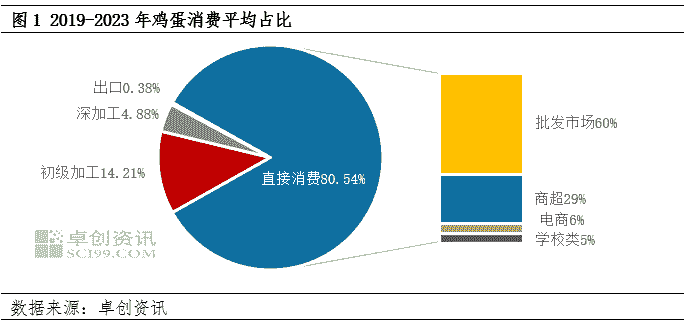
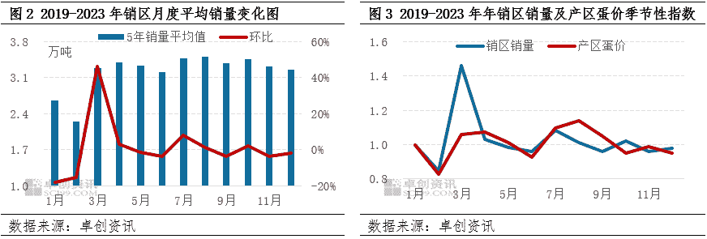
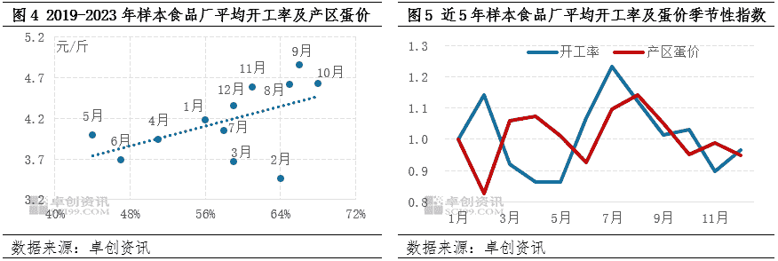
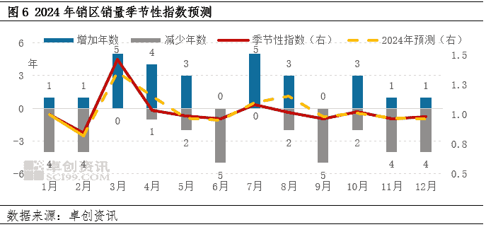

## 2024-2025年鸡蛋行业市场现状调研与前景趋势预测报告

**数据权威·全面·系统·深度+可落地执行实战解决方案**

## 报告目录

### 第一章 报告核心观点

## 第一节 鸡蛋驱动力与成功因素

- 一、产业核心驱动力.................................................................9
- 二、企业关键成功因素.............................................................10

## 第二节 鸡蛋行业前景预测

- 一、发展潜力评估.....................................................................12
- 二、行业发展前景.....................................................................12
- 三、市场规模预测.....................................................................13

## 第三节 鸡蛋行业趋势预测

- 一、宏观趋势.............................................................................14
- 二、政策趋势.............................................................................14
- 三、行业趋势.............................................................................14
- 四、市场趋势.............................................................................15
- 五、竞争趋势.............................................................................15
- 六、技术趋势.............................................................................15

### 第二章 鸡蛋行业主要特征

#### 第一节 鸡蛋行业定义及分类

- 一、行业定义.............................................................................17
- 二、行业分类.............................................................................18

#### 第二节 我国鸡蛋行业监管体制与主要政策

- 一、国家对该行业的基本政策.........................................................18
- 二、行业主管部门和监管体制.........................................................19
  - （1）行业主管部门...........................................................................19
  - （2）行业自律部门...........................................................................20
- 三、行业主要法律法规和产业政策.................................................20
  - （1）行业法律法规...........................................................................20
  - （2）行业主要产业政策...................................................................21

#### 第三节 我国鸡蛋行业主要发展特征

- 一、行业发展主要特征.....................................................................21
- 二、行业主要经营模式.....................................................................22
- 三、行业的周期性、区域性和季节性特征.....................................23
  - （1）行业的周期性特征...................................................................23
  - （2）行业的区域性特征...................................................................24
  - （3）行业的季节性特征...................................................................24
- 四、鸡蛋行业周期规律特征分析.....................................................25
- 五、行业技术水平及技术特点.........................................................26
- 六、上、下游行业的关联影响.........................................................27
  - （1）与上游行业的关联性及其影响...............................................27
  - （2）与下游行业的关联性及其影响...............................................28
- 七、行业的利润水平、变动趋势及变动原因.................................29

#### 第四节 进入鸡蛋行业的主要壁垒

- 一、资本壁垒.....................................................................................30
- 二、技术和人才壁垒.........................................................................31
- 三、资质和市场准入壁垒.................................................................32
- 四、客户资源壁垒.............................................................................32
- 五、品牌壁垒.....................................................................................33
- 六、行业经验壁垒.............................................................................34
- 七、营销网络壁垒.............................................................................35
- 八、管理能力与运营经验壁垒.........................................................36
- 九、其他壁垒.....................................................................................37

#### 第五节 鸡蛋行业基本风险特征

- 一、行业风险.....................................................................................38
- 二、市场风险.....................................................................................39
- 三、市场竞争加剧风险.....................................................................39
- 四、产品被仿制风险.........................................................................40
- 五、新产品开发风险.........................................................................41
- 六、资金风险.....................................................................................42
- 七、管理风险.....................................................................................42
- 八、其他风险.....................................................................................43

### 第三章 2023-2024年我国鸡蛋行业发展情况分析

#### 第一节 全球鸡蛋行业发展现状分析

- 一、全球鸡蛋行业发展现状分析.....................................................45
- 二、全球鸡蛋行业发展最新动态分析.............................................46
- 三、全球鸡蛋行业发展趋势分析.....................................................47

#### 第二节 2023-2024年鸡蛋行业市场深度调研

- 一、鸡蛋行业市场现状分析.............................................................49
- 二、鸡蛋行业市场特点分析.............................................................50
- 三、鸡蛋行业市场规模分析.............................................................51
- 四、鸡蛋行业市场结构分析.............................................................52
- 五、运用季节性指数预期中长期鸡蛋需求及价格变化.................53
  - （一）近五年我国鸡蛋消费占比.....................................................53
  - （二）需求变化对鸡蛋价格影响.....................................................54
  - （三）运用季节性指数预期中长期鸡蛋需求及价格变化.............56

#### 第三节 2023-2024年我国鸡蛋行业市场竞争格局分析

- 一、鸡蛋行业竞争格局分析.............................................................57
- 二、鸡蛋行业竞争特征分析.............................................................58
- 三、鸡蛋行业品牌竞争情况分析.....................................................59
- 四、当前鸡蛋行业竞争策略分析.....................................................60
- 五、鸡蛋行业企业核心竞争力分析.................................................61

#### 第四节 2023-2024年中国鸡蛋行业存在的问题与风险分析

- 一、鸡蛋行业发展存在的问题.........................................................62
- 二、鸡蛋行业发展面临的挑战.........................................................63
- 三、鸡蛋行业发展面临的困境.........................................................64
- 四、鸡蛋行业发展存在的风险.........................................................65

### 第四章 2024-2025年中国鸡蛋行业发展环境及影响因素

#### 第一节 2024-2025年鸡蛋发展环境分析及预测

- 一、政治环境分析.............................................................................67
- 二、经济环境分析.............................................................................68
- 三、社会环境分析.............................................................................69
- 四、科技环境分析.............................................................................69
- 五、其他因素.....................................................................................70

#### 第二节 影响鸡蛋行业发展的主要因素

- 一、影响鸡蛋行业运行的几种有利因素.........................................71
- 二、影响鸡蛋行业运行的几种稳定因素.........................................72
- 三、影响鸡蛋行业运行的几种不利因素.........................................73

#### 第三节 上下游产业链发展分析及其影响

- 一、上游行业发展分析及其影响.....................................................74
- 二、相关行业发展分析及其影响.....................................................75
- 三、下游行业发展分析及其影响.....................................................75

### 第五章 2024-2025年中国鸡蛋行业发展前景预测

#### 第一节 2024-2025年鸡蛋市场发展前景预测

- 一、宏观经济环境.............................................................................77
- 二、市场需求前景.............................................................................78
- 三、行业竞争前景.............................................................................78
- 四、政策法规影响.............................................................................79
- 五、技术创新前景.............................................................................80
- 六、其他前景.....................................................................................80

#### 第二节 2024-2025年鸡蛋市场发展潜力预测

- ......................................................................................................81

# 2024-2025 年鸡蛋行业市场现状调研与前景趋势预测报告

**数据权威·全面·系统·深度+可落地执行实战解决方案**

## 第一章 报告核心观点

## 第一节 鸡蛋驱动力与成功因素

## 一、产业核心驱动力

鸡蛋产业作为农业领域的重要组成部分，其发展的核心驱动力主要体现在市场需求、技术进步和政策支持等方面。

首先，市场需求是鸡蛋产业持续发展的根本动力。随着人口增长和消费升级，人们对营养健康食品的需求日益增长，鸡蛋作为优质蛋白质来源，其市场需求呈现出稳步增长的趋势。特别是在餐饮、食品加工等领域，鸡蛋的需求量更是呈现出爆发式增长。这种旺盛的市场需求为鸡蛋产业提供了广阔的发展空间。

其次，技术进步是推动鸡蛋产业发展的重要驱动力。近年来，随着生物育种、智能化养殖、疫病防控等技术的不断创新和应用，鸡蛋产业的生产效率和质量得到了显著提升。例如，通过基因编辑技术培育出的抗病性强、产蛋率高的新品种，以及利用物联网技术实现的智能化养殖管理，都极大地提高了鸡蛋产业的竞争力。

最后，政策支持也是鸡蛋产业发展的重要保障。政府通过出台一系列扶持政策和措施，如财政补贴、税收优惠、贷款支持等，为鸡蛋产业的健康发展提供了有力支持。这些政策不仅降低了企业的运营成本，提高了盈利能力，还促进了产业的规模化、标准化发展。

综上所述，市场需求、技术进步和政策支持是鸡蛋产业发展的核心驱动力。在未来，随着科技的不断进步和市场需求的不断变化，这些驱动力将继续发挥重要作用，推动鸡蛋产业持续健康发展。

## 二、企业关键成功因素

在鸡蛋产业中，企业的成功并非偶然，而是基于一系列关键因素的共同作用。这些关键因素不仅关乎企业的日常运营，更决定了企业在市场中的竞争力和长远发展。

首先，优质的鸡蛋产品是企业成功的基石。鸡蛋作为食品，其品质和安全性是消费者最为关注的因素。因此，企业必须严格把控原料采购、生产过程、质量检测等各个环节，确保产品的品质和安全性。同时，企业还应根据市场需求和消费者偏好，不断研发新品种、新口味的鸡蛋产品，以满足市场的多样化需求。

其次，高效的供应链管理能力是企业成功的关键。鸡蛋产业涉及养殖、加工、销售等多个环节，任何一个环节的失误都可能影响企业的整体运营。因此，企业必须建立完善的供应链管理体系，确保各环节之间的顺畅衔接和高效运转。此外，企业还应与供应商、销售渠道等合作伙伴建立良好的合作关系，实现资源共享和互利共赢。

再次，品牌建设和市场推广能力也是企业成功的重要因素。在竞争激烈的市场中，品牌是企业区别于竞争对手的重要标志。因此，企业必须注重品牌形象的塑造和维护，通过广告宣传、公关活动等方式提升品牌知名度和美誉度。同时，企业还应加强市场推广力度，拓展销售渠道，提高市场占有率。

最后，持续的创新能力和适应能力是企业成功的重要保障。随着市场环境的变化和消费者需求的升级，企业必须保持敏锐的洞察力，及时捕捉市场变化和机遇。通过技术创新、管理创新等方式不断提升企业的核心竞争力，以适应市场的变化和发展。

综上所述，优质的鸡蛋产品、高效的供应链管理能力、品牌建设和市场推广能力以及持续的创新能力和适应能力是企业成功的关键因素。这些因素相互关联、相互作用，共同构成了企业在市场中的竞争优势和发展动力。企业只有在这些方面不断提升和完善，才能在激烈的市场竞争中立于不败之地。

## 第二节 鸡蛋行业前景预测

## 一、发展潜力评估

鸡蛋作为日常生活中不可或缺的食品之一，其市场需求一直保持稳定增长。随着人们生活水平的提高和饮食结构的改善，鸡蛋的消费量有望继续上升。同时，鸡蛋在食品加工、烘焙等领域的广泛应用也为其提供了更广阔的发展空间。因此，从市场需求和应用领域来看，鸡蛋行业的发展潜力巨大。

然而，鸡蛋行业的发展也面临着一些挑战。如饲料成本、养殖技术、疾病防控等方面的因素都可能影响行业的稳定发展。此外，随着市场竞争的加剧，企业需要在保证产品质量的同时，不断降低成本，提高生产效率，以应对市场的变化。

综合分析，鸡蛋行业的发展潜力虽然巨大，但也需要企业不断提升自身实力，以适应市场的需求和变化。

## 二、行业发展前景

随着健康饮食理念的普及和消费者对食品安全的重视，鸡蛋行业的发展前景十分看好。未来，行业将更加注重产品质量和品牌建设，通过提高产品质量和附加值，满足消费者日益增长的需求。同时，行业也将加强与其他相关产业的合作，共同推动产业链的协同发展。

在政策层面，国家对农业和畜牧业的扶持力度不断加大，为鸡蛋行业的发展提供了良好的政策环境。此外，随着科技的不断进步，新的养殖技术和设备不断涌现，为行业的创新发展提供了有力支撑。

因此，从政策、市场和技术等多方面来看，鸡蛋行业的发展前景十分广阔。

## 三、市场规模预测

根据近年来的市场数据和行业发展趋势，预计未来几年鸡蛋市场的规模将继续保持增长态势。随着消费者对健康饮食的追求和人口基数的增加，鸡蛋的消费量将持续上升。同时，随着行业的整合和升级，企业的生产效率和产品质量也将得到提升，进一步推动市场规模的扩大。

然而，需要注意的是，市场规模的扩大并非一帆风顺。企业需要密切关注市场动态和消费者需求的变化，及时调整生产策略和市场布局。此外，还需要加强与其他产业的合作与协调，共同推动产业链的健康发展。

## 第三节 鸡蛋行业趋势预测

## 一、宏观趋势

从宏观经济角度来看，随着全球经济的复苏和国内经济的稳定增长，鸡蛋行业将迎来更加广阔的发展空间。同时，随着人们生活水平的提高和消费结构的升级，鸡蛋的消费量将继续保持增长态势。此外，随着国际贸易的加强和国际市场的开拓，鸡蛋行业也将迎来更多的发展机遇。

## 二、政策趋势

未来，国家对农业和畜牧业的支持力度将进一步加大，为鸡蛋行业的发展提供更多的政策保障。同时，随着环保意识的增强和绿色发展理念的普及，相关政策也将更加注重环保和可持续发展。这将对鸡蛋行业的生产方式和环境保护提出更高的要求。

## 三、行业趋势

在行业竞争日益激烈的背景下，鸡蛋行业将更加注重品牌建设和产品质量提升。通过加强技术创新和产品研发，提高产品的附加值和市场竞争力。同时，行业也将加强产业链整合和协同发展，形成更加紧密的产业链合作关系。此外，随着消费者对健康饮食的追求和对食品安全的重视，行业也将更加注重食品安全和质量控制。

## 四、市场趋势

未来，鸡蛋市场将更加多元化和个性化。消费者将更加注重产品的品质和口感，对高品质、有机、绿色等特色鸡蛋的需求将不断增加。同时，随着线上销售渠道的拓展和电商平台的普及，线上销售将成为鸡蛋行业的重要销售渠道之一。此外，随着消费者对营养健康知识的了解增加，对功能性鸡蛋如富含特定营养素、适合特定人群食用的鸡蛋的需求也将逐渐增长。

## 五、竞争趋势

随着市场规模的扩大和市场竞争的加剧，鸡蛋行业的竞争将更加激烈。企业需要通过提高产品质量、降低成本、加强品牌建设等方式来提升市场竞争力。同时，行业内的兼并重组和资源整合也将成为趋势，优势企业将通过兼并收购等方式扩大市场份额和提高市场集中度。此外，跨界合作和产业链延伸也将成为企业提升竞争力的重要手段。

## 六、技术趋势

随着科技的不断进步和应用，鸡蛋行业将迎来更多的技术创新和升级。智能化养殖、精准饲喂、疾病防控等先进技术的应用将进一步提高养殖效率和产品质量。同时，大数据、物联网等新兴技术的应用也将为行业的精细化管理和市场拓展提供有力支持。此外，随着生物技术的不断发展，基因编辑、育种技术等新兴技术也将为行业的创新发展提供更多可能性。

## 第二章 鸡蛋行业主要特征

### 第一节 鸡蛋行业定义及分类

#### 一、行业定义

鸡蛋行业是指以鸡蛋的生产、加工、销售为主要经营活动的产业集合。鸡蛋作为营养丰富的食品，在人类饮食中占据重要地位，因此鸡蛋行业具有广阔的市场前景和深厚的产业基础。从产业链的角度来看，鸡蛋行业涵盖了饲料生产、蛋鸡养殖、鸡蛋收集、加工处理、销售等多个环节，形成了完整的产业链条。

随着生活水平的提高和消费结构的升级，消费者对鸡蛋的品质和安全性要求越来越高。这促使鸡蛋行业不断向规模化、标准化、品牌化方向发展。同时，随着科技的进步，新的养殖技术和加工技术不断涌现，为鸡蛋行业的创新发展提供了有力支撑。

未来，随着人口的增长和经济的发展，鸡蛋行业将继续保持稳定增长态势。同时，行业也将面临更加激烈的市场竞争和更高的质量要求，企业需要不断提升自身实力，以适应市场的需求和变化。

## 二、行业分类

鸡蛋行业可以从多个维度进行分类。根据经营模式的不同，可以分为集约化养殖和散养两种方式。集约化养殖通常具有规模大、效率高、管理规范等特点，适用于大型企业和合作社；而散养则更加灵活，适合小规模农户和家庭农场。

根据产品形态的不同，鸡蛋行业可以分为鲜蛋、加工蛋和蛋制品等几类。鲜蛋是指直接销售的未经加工的鸡蛋，其市场需求量大，是行业的主要产品；加工蛋则是经过清洗、消毒、分级等处理的鸡蛋，具有更高的附加值；蛋制品则是将鸡蛋加工成蛋液、蛋粉、蛋干等形态的产品，进一步拓宽了鸡蛋的应用范围。

此外，根据市场定位的不同，鸡蛋行业还可以分为高端市场、中端市场和低端市场。高端市场注重产品的品质和品牌，价格较高，主要面向高端消费者；中端市场则更加注重性价比，适合大众消费者；低端市场则以价格为主要竞争手段，面向低收入群体。

### 第二节 我国鸡蛋行业监管体制与主要政策

#### 一、国家对该行业的基本政策

我国对于鸡蛋行业实施了一系列基本政策，旨在促进行业的健康、可持续发展。首先，国家强调农业供给侧结构性改革，鼓励鸡蛋行业向规模化、标准化、绿色化方向发展。通过优化产业结构，提高生产效率，降低生产成本，以满足日益增长的消费需求。

其次，国家重视食品安全和质量监管。在鸡蛋行业，国家制定了一系列严格的食品安全标准和质量要求，以确保消费者的健康和权益。同时，加强了对饲料、兽药等投入品的管理，防止有害物质进入食品链。

此外，国家还鼓励科技创新和人才培养。通过支持科研机构和企业开展技术研发和成果转化，推动鸡蛋行业的科技进步和产业升级。同时，加强对农民和从业人员的培训和教育，提高他们的专业素质和技能水平。

#### 二、行业主管部门和监管体制

**（1）行业主管部门**

在我国，鸡蛋行业的主管部门主要是农业农村部。农业农村部负责制定和执行有关鸡蛋行业的政策法规，推动行业的健康发展。它负责协调各方资源，促进产业升级和结构调整，加强行业监管，确保产品质量和食品安全。同时，农业农村部还负责提供技术支持和指导，帮助企业和农户提高生产效率和产品质量。

## 2024-2025年鸡蛋行业市场现状调研与前景趋势预测报告

**数据权威·全面·系统·深度+可落地执行实战解决方案**

### （2）行业自律部门

除了政府主管部门外，我国鸡蛋行业还设有一些自律组织，如中国畜牧业协会禽业分会等。这些自律组织在行业内发挥着重要的作用，它们通过制定行业标准、推动行业交流、加强行业自律等方式，促进行业的健康发展。自律组织还积极参与政策制定和执行，为政府提供行业发展的建议和意见。同时，它们也为企业和农户提供信息咨询、技术培训等服务，帮助他们提高市场竞争力。

## 三、行业主要法律法规和产业政策

## （1）行业法律法规

我国鸡蛋行业受到一系列法律法规的规范和约束，这些法律法规涵盖了从饲料生产到鸡蛋销售的各个环节。其中，《食品安全法》是保障鸡蛋产品质量和安全的基本法律，它规定了食品安全的标准和要求，以及企业和个人的法律责任。此外，《畜牧法》等法律法规也对鸡蛋行业的生产经营活动进行了规范，包括养殖场的设立条件、饲料和兽药的使用规定等。这些法律法规的实施，为行业的健康发展提供了法律保障。

## （2）行业主要产业政策

为了促进鸡蛋行业的持续健康发展，我国政府制定了一系列产业政策。这些政策包括财政支持政策、税收优惠政策、金融支持政策等，旨在鼓励企业扩大规模、提高生产效率、加强品牌建设等。同时，政府还积极推动行业的技术创新和产业升级，支持企业开展技术研发和成果转化，提高行业的整体竞争力。此外，政府还加强了与国际市场的合作和交流，推动鸡蛋行业的国际贸易和合作。

综上所述，我国鸡蛋行业在政府的引导和监管下，正朝着规模化、标准化、绿色化方向发展。未来，随着政策的不断完善和市场的不断扩大，鸡蛋行业将迎来更加广阔的发展前景。

### 第三节 我国鸡蛋行业主要发展特征

### 一、行业发展主要特征

我国鸡蛋行业的发展呈现出多个显著特征。首先，规模化经营趋势明显。随着农业现代化的推进，越来越多的养鸡场开始实现规模化经营，提高了生产效率，降低了成本，从而增强了市场竞争力。其次，产业链整合加速。鸡蛋行业逐渐形成了从饲料生产、蛋鸡养殖、蛋品加工到销售的完整产业链，各环节之间的协作更加紧密，实现了资源共享和优势互补。

此外，品牌化建设日益重要。消费者对于品牌鸡蛋的认可度不断提高，品牌鸡蛋在市场上的份额逐年上升，品牌化建设成为了鸡蛋行业发展的重要方向。

在市场竞争方面，我国鸡蛋行业呈现出多元化和激烈化的特点。一方面，大型养鸡企业凭借规模优势和品牌优势，在市场上占据了一定的份额；另一方面，中小型养鸡场也通过特色经营和差异化竞争，获得了生存和发展的空间。同时，随着外资企业的进入和跨境电商的发展，鸡蛋行业的市场竞争也日趋国际化。

未来，我国鸡蛋行业的发展将继续保持快速增长的态势。随着消费升级和健康饮食理念的普及，人们对高品质、营养丰富的鸡蛋的需求将不断增加。同时，政府对于农业产业的扶持力度也将不断加大，为鸡蛋行业的发展提供了良好的政策环境。因此，我国鸡蛋行业有望在市场规模、产业结构、品牌建设等方面实现更大的突破。

## 二、行业主要经营模式

我国鸡蛋行业的主要经营模式包括规模化养殖、合同养殖和家庭式散养等多种形式。其中，规模化养殖以大型养鸡场为主，通过引入现代化养殖技术和设备，实现高效、稳定的生产，产品以品牌鸡蛋为主打，满足中高端市场需求。合同养殖则是企业与农户签订养殖合同，企业提供鸡苗、饲料和技术支持，农户负责养殖，企业回收鸡蛋并统一销售，这种模式有利于降低企业的生产成本和风险。家庭式散养则是以家庭为单位进行小规模养殖，产品多用于自给自足或当地市场销售。

不同经营模式各有优劣。规模化养殖具有生产效率高、产品质量稳定、市场竞争力强等优点，但投入成本较高，对技术要求也较高。合同养殖能够降低企业的生产成本和风险，同时带动农户增收，但管理难度较大，需要建立有效的监管机制。家庭式散养投入成本较低，但生产效率低，产品质量不稳定，市场竞争力较弱。

随着行业的发展和市场竞争的加剧，未来鸡蛋行业的经营模式将更加多元化和灵活化。企业可以根据自身实际情况和市场需求，选择合适的经营模式或多种经营模式相结合，以实现更好的经济效益和社会效益。

## 三、行业的周期性、区域性和季节性特征

## （1）行业的周期性特征

鸡蛋行业的周期性特征主要体现在市场供需变化和价格波动上。由于鸡蛋的生产周期相对较短，且受到饲料成本、养殖技术、市场需求等多重因素的影响，其市场价格波动较为频繁。通常而言，鸡蛋价格在节假日或消费需求旺盛时期会有所上涨，而在养殖高峰期或消费需求淡季则可能出现价格下降。这种周期性变化使得鸡蛋行业的企业需要具备较强的市场敏感度和风险应对能力，以应对市场波动带来的挑战。

## （2）行业的区域性特征

我国鸡蛋行业的区域性特征主要体现在生产布局和消费习惯上。不同地区的自然条件、经济发展水平和消费习惯差异较大，使得鸡蛋生产和消费呈现出明显的地域性特点。例如，一些地区由于气候适宜、饲料资源丰富，成为鸡蛋生产的主要区域；而一些经济发达、人口密集的地区则是鸡蛋消费的主要市场。这种区域性特征使得鸡蛋行业的企业需要根据不同地区的市场需求和资源条件，制定针对性的经营策略。

## （3）行业的季节性特征

鸡蛋行业的季节性特征主要体现在生产量和消费量的变化上。由于蛋鸡的生产周期和消费者对鸡蛋的消费习惯受季节影响较大，鸡蛋的生产量和消费量在不同季节会有所不同。例如，在春季和夏季，由于气温升高，蛋鸡产蛋率上升，同时消费者对鸡蛋的需求也有所增加，使得鸡蛋市场呈现出供需两旺的局面；而在秋季和冬季，由于气温下降，蛋鸡产蛋率下降，同时消费者对鸡蛋的需求也有所减少，使得鸡蛋市场相对较为冷清。这种季节性特征要求鸡蛋行业的企业在生产和销售方面做好季节性调整，以应对市场变化带来的挑战。

## 四、鸡蛋行业周期规律特征分析

鸡蛋行业的周期规律特征主要表现为价格波动和供需变化。从价格角度看，鸡蛋价格受到生产成本、市场需求、季节因素等多重因素的影响，呈现出一定的周期性波动。在养殖成本上升或市场需求增加时，鸡蛋价格往往上涨；而在养殖成本下降或市场需求减少时，价格则可能下跌。这种价格波动不仅影响企业的盈利状况，也反映了市场的供需关系。

从供需角度看，鸡蛋行业的周期规律特征主要体现在生产量和消费量的变化上。由于蛋鸡的生长周期和产蛋规律具有一定的季节性特点，同时消费者的需求和购买力也随季节和节假日等因素而变化，因此鸡蛋的供需关系呈现出一定的周期性特征。例如，在春节、中秋等传统节日期间，消费者对于鸡蛋的需求量往往大幅增加，带动市场价格上涨；而在夏季高温时期，由于蛋鸡产蛋率下降，市场供应量减少，价格也可能出现波动。

针对这些周期规律特征，鸡蛋行业的企业需要密切关注市场动态和消费者需求变化，合理安排生产和销售计划。通过优化养殖技术、降低成本、拓展销售渠道等方式提高市场竞争力，以应对市场周期性变化带来的挑战。

## 五、行业技术水平及技术特点

我国鸡蛋行业的技术水平和技术特点主要体现在以下几个方面：

首先，养殖技术不断升级。随着科技的进步，现代化的养殖设备和技术逐渐应用于鸡蛋生产中，如智能化养殖系统、环境控制系统等，这些技术的应用提高了蛋鸡的生产效率和鸡蛋品质，降低了生产成本，增强了企业的市场竞争力。

其次，疫病防控技术日益成熟。针对蛋鸡养殖过程中可能出现的各种疫病，行业内已经形成了一套较为完善的防控体系，包括疫苗接种、生物安全控制、疫情监测等措施，这些技术的应用有效地降低了疫病对生产的影响，保障了鸡蛋产业的稳定发展。

此外，鸡蛋加工技术也不断创新。除了传统的鲜蛋销售外，行业还开发了蛋液、蛋粉、蛋干等多种深加工产品，这些产品的出现不仅丰富了鸡蛋市场的产品线，也提高了鸡蛋的附加值和利润空间。

然而，与发达国家相比，我国鸡蛋行业在技术研发和创新方面仍有差距。部分中小企业由于资金和技术实力有限，难以引入先进的养殖技术和设备，制约了整个行业的技术进步。因此，未来鸡蛋行业应加大技术研发和创新力度，推动行业技术水平的整体提升。

## 六、上、下游行业的关联影响

## （1）与上游行业的关联性及其影响

鸡蛋行业的上游行业主要包括饲料生产、养殖设备供应等领域。饲料作为蛋鸡生产的重要成本之一，其价格波动和质量变化直接影响鸡蛋生产的成本和质量。因此，饲料行业的发展状况对鸡蛋行业具有重要影响。同时，养殖设备的更新换代和技术进步也推动着鸡蛋行业的养殖效率提升和成本控制。

具体来说，饲料行业的价格波动受到原材料价格、市场需求、政策调控等多种因素的影响。当饲料价格上涨时，鸡蛋生产成本增加，可能导致鸡蛋价格上涨或企业利润下降。反之，饲料价格下降则有利于降低鸡蛋生产成本，提升企业的盈利能力。此外，饲料的质量也直接影响鸡蛋的品质和安全性。优质的饲料可以提高鸡蛋的营养价值和口感，增强消费者的购买意愿。

养殖设备作为蛋鸡生产的重要支撑，其技术进步和更新换代对鸡蛋行业同样具有重要意义。现代化的养殖设备可以提高蛋鸡的养殖密度和产蛋率，降低劳动力成本，提升企业的生产效率。同时，智能化的养殖设备还可以实现精准投喂、环境控制等功能，进一步提高鸡蛋的品质和安全性。

## （2）与下游行业的关联性及其影响

鸡蛋行业的下游行业主要包括食品加工、餐饮、零售等领域。这些行业对鸡蛋的需求量和品质要求直接影响鸡蛋市场的规模和竞争格局。同时，下游行业的发展趋势和消费者偏好的变化也对鸡蛋行业的产品创新和市场开拓提出了新的挑战和机遇。

从需求角度来看，食品加工行业是鸡蛋的重要需求方之一。随着消费者对食品多样化和营养健康的需求增加，食品加工行业对鸡蛋的需求也呈现出不断增长的趋势。同时，餐饮行业对鸡蛋的品质和安全性要求越来越高，这也促使鸡蛋行业不断提升产品质量和安全管理水平。

从市场开拓角度来看，下游行业的发展趋势和消费者偏好的变化为鸡蛋行业提供了新的市场机遇。例如，随着健康饮食理念的普及，消费者对高蛋白、低脂肪的食品需求增加，这为鸡蛋行业提供了更广阔的市场空间。此外，随着电商和跨境电商的发展，鸡蛋行业也可以借助网络平台拓展销售渠道，开拓更广阔的市场。

然而，与下游行业的关联性也带来了一定的挑战。例如，下游行业的价格波动和市场需求变化可能直接影响鸡蛋行业的销售量和价格水平。因此，鸡蛋行业需要密切关注下游市场的动态变化，及时调整生产和销售策略以应对市场风险。

## 七、行业的利润水平，变动趋势及变动原因

鸡蛋行业的利润水平受到多种因素的影响，包括生产成本、市场需求、价格波动、竞争格局等。近年来，随着养殖技术的进步和市场竞争的加剧，鸡蛋行业的利润水平呈现出一定的变动趋势。

一方面，养殖技术的进步有助于降低生产成本，提高生产效率，从而增加企业的利润空间。例如，通过引入智能化养殖设备、优化饲料配方、提高蛋鸡养殖密度等方式，企业可以降低劳动力成本、饲料成本等固定支出，提高单位产出的利润水平。

另一方面，市场需求和价格波动也对鸡蛋行业的利润水平产生重要影响。在市场需求旺盛的时期，鸡蛋价格往往上涨，企业的销售收入和利润水平也会随之提升。然而，在市场需求疲软或价格波动较大的时期，企业的销售压力和成本控制难度增加，可能导致利润水平下降甚至出现亏损。

此外，竞争格局的变化也会对鸡蛋行业的利润水平产生影响。随着市场竞争加剧和外资企业的进入，鸡蛋行业的市场竞争日益激烈。为了在市场中立足并获得更多的市场份额，企业需要加大品牌宣传、营销推广等方面的投入，这些投入可能会增加企业的营销成本并压缩利润空间。

综上所述，鸡蛋行业的利润水平受到多种因素的共同影响。未来，随着养殖技术的不断进步和市场竞争的加剧，鸡蛋行业的利润水平可能会继续呈现出波动和变化的趋势。因此，企业需要密切关注市场动态和竞争态势，加强成本控制和风险管理，以应对可能出现的市场风险和挑战。

### 第四节 进入鸡蛋行业的主要壁垒

### 一、资本壁垒

资本壁垒是进入鸡蛋行业的首要挑战。鸡蛋行业虽然起点相对较低，但要实现规模化、标准化生产，则需要大量的资本投入。首先，在养殖环节，大规模的养殖场建设、饲料采购、疫病防控等方面的投入均不菲。其次，加工和销售环节同样需要大量的资金，如建设加工厂、购置加工设备、开展市场营销等。此外，随着环保要求的提高，企业还需要投入资金进行环境治理和达标排放。因此，没有足够的资本支持，企业很难在鸡蛋行业立足。

资本壁垒的存在也促使行业内的企业更加注重资金管理和成本控制，以维持良好的运营状态。同时，这也为行业外的潜在进入者设置了一道门槛，限制了新进入者的数量。

未来，随着市场竞争的加剧和行业整合的加速，资本壁垒可能会进一步加强。因此，对于想要进入鸡蛋行业的企业来说，充足的资本储备和科学的资金管理至关重要。

### 二、技术和人才壁垒

技术和人才壁垒是鸡蛋行业的另一重要进入壁垒。随着消费者对鸡蛋品质和安全性的要求越来越高，企业需要具备先进的养殖技术和加工技术，以确保产品的质量和安全。这要求企业不断引进和研发新技术，提高生产效率和产品质量。同时，人才也是企业发展的关键因素。企业需要拥有一支专业的技术团队和管理团队，才能应对市场竞争和行业变化。

然而，技术和人才的获取和培养并非易事。企业需要投入大量的人力、物力和财力进行技术研发和人才培养，这对于规模较小或资金有限的企业来说是一个不小的挑战。此外，随着技术的不断更新和升级，企业还需要不断跟进和学习新技术，以保持竞争优势。

因此，技术和人才壁垒对于潜在进入者来说是一个重要的考验。只有具备足够的技术实力和人才储备的企业，才能在鸡蛋行业中立足并取得成功。

### 三、资质和市场准入壁垒

资质和市场准入壁垒是鸡蛋行业不可或缺的进入条件。首先，从事鸡蛋生产和销售的企业需要取得相关的生产经营许可证和食品生产许可证，这涉及到企业的场地、设备、人员、产品质量等多方面的要求。这些资质的获取需要企业投入大量的时间和精力，并接受相关部门的严格审查。其次，市场准入方面，鸡蛋行业受到食品安全法规的严格监管，产品必须符合国家相关标准和规定，否则无法进入市场销售。这要求企业在生产过程中严格控制产品质量和安全，确保产品符合市场需求。

资质和市场准入壁垒的存在，有助于保障鸡蛋行业的健康发展和消费者的权益。它限制了那些不具备相关资质和条件的企业进入市场，降低了不合格产品进入市场的风险。同时，这也为行业内的企业提供了一个公平竞争的环境，促进了行业的健康发展。

然而，对于潜在进入者来说，资质和市场准入壁垒可能增加了进入行业的难度和成本。企业需要投入更多的资源和精力来满足相关要求，这在一定程度上限制了新进入者的数量。

## 四、客户资源壁垒

客户资源壁垒在鸡蛋行业中具有显著的影响。鸡蛋行业是一个典型的B2B行业，企业与下游经销商、超市、餐饮企业等客户的合作关系至关重要。对于新进入者来说，建立稳定的客户关系网并非易事。首先，客户在选择供应商时通常会考虑企业的品牌知名度、产品质量、供应稳定性等多方面因素，这使得新进入者在争取客户时面临较大的挑战。其次，行业内已有的企业经过多年的经营和积累，已经与下游客户建立了长期稳定的合作关系，这种关系具有一定的排他性，新进入者难以在短时间内打破这种格局。最后，客户资源的获取和维护需要投入大量的时间和精力，这对于资金和资源有限的新进入者来说是一个不小的负担。

因此，客户资源壁垒是鸡蛋行业的一个重要进入壁垒。对于新进入者来说，要想在市场中立足，不仅需要提供优质的产品和服务，还需要在客户关系维护方面下足功夫。

## 五、品牌壁垒

品牌壁垒在鸡蛋行业中起着至关重要的作用。品牌代表着企业的形象和信誉，是消费者选择产品的重要依据。在鸡蛋行业中，知名品牌往往具有较高的市场认可度和消费者忠诚度，这使得新进入者在品牌建设和市场推广方面面临巨大的挑战。

知名品牌通常拥有较长的历史积淀和良好的口碑，它们在消费者心中形成了强烈的品牌认知和情感连接。相比之下，新进入者缺乏品牌知名度

2024-2025 年鸡蛋行业市场现状调研与前景趋势预测报告

**数据权威·全面·系统·深度 + 可落地执行实战解决方案**

和市场影响力，很难在短时间内获得消费者的信任和认可。此外，品牌建设和推广需要投入大量的资金和资源，包括广告宣传、促销活动、品牌建设等，这对于资金有限的新进入者来说是一个不小的负担。

因此，品牌壁垒限制了新进入者在鸡蛋行业中的发展空间。要想打破这一壁垒，新进入者需要在品牌建设方面下足功夫，通过优质的产品和服务、创新的营销策略和持续的市场推广来提升品牌知名度和影响力。

## 六、行业经验壁垒

行业经验壁垒在鸡蛋行业中表现得尤为突出。行业经验涵盖了市场了解、运营管理、风险控制等多个方面，是企业在行业中稳定运营和持续发展的重要保障。对于新进入者来说，由于缺乏行业经验，他们在市场定位、产品规划、销售策略等方面往往难以把握准确，这增加了他们在市场中立足的难度。

此外，行业经验还包括对行业动态、政策法规、竞争对手等的深入了解。新进入者由于缺乏这些经验，可能无法及时应对市场变化和风险挑战，从而影响到企业的稳定发展。因此，行业经验壁垒限制了新进入者在鸡蛋行业中的竞争力。

要克服行业经验壁垒，新进入者可以通过多种方式积累经验，如与行业内企业合作、引进具有行业经验的人才、加强市场调研和学习等。这些措施有助于新进入者更好地了解行业和市场，提升企业的竞争力。

## 七、营销网络壁垒

营销网络壁垒是鸡蛋行业中的又一重要进入障碍。完善的营销网络能够确保产品迅速覆盖目标市场，提高品牌知名度和市场占有率。然而，对于新进入者来说，建立和维护一个有效的营销网络并非易事。

首先，营销网络的构建需要大量的资金投入。这包括市场调研费用、渠道开拓费用、广告宣传费用等。对于资金有限的新进入者来说，这无疑是一个沉重的负担。

其次，营销网络的建设需要时间积累。新进入者需要花费大量时间和精力去开发渠道、建立合作关系、培养客户忠诚度等。在这个过程中，他们可能会面临来自现有企业的竞争和打压，增加了进入市场的难度。

此外，营销网络还需要具备专业的运营和管理能力。新进入者需要拥有一支熟悉市场、了解行业的营销团队，以确保营销网络的有效运作。然而，这方面的专业人才往往难以招募和培养，对于新进入者来说是一个不小的挑战。

因此，营销网络壁垒限制了新进入者在鸡蛋行业中的发展空间。要想突破这一壁垒，新进入者需要制定合理的营销策略、投入足够的资金和精力、培养专业的营销团队，以逐步建立起完善的营销网络。

## 八、管理能力与运营经验壁垒

管理能力与运营经验壁垒是鸡蛋行业的重要进入障碍之一。在鸡蛋行业中，企业的成功不仅仅依赖于产品和市场，更依赖于高效的管理和丰富的运营经验。对于新进入者来说，缺乏这些关键要素将极大地限制其在行业中的竞争力。

首先，管理能力是企业运营的核心。在鸡蛋行业中，企业需要面对复杂的生产流程、多变的市场需求以及严格的法规要求。这要求企业必须具备高效的决策机制、科学的管理制度和专业的管理团队。然而，新进入者往往缺乏这些管理经验和人才，导致在运营过程中容易出现各种问题，如生产效率低下、成本控制不力、市场风险应对不当等。

其次，运营经验是企业长期积累的结果。在鸡蛋行业中，企业需要不断摸索和实践，才能逐渐掌握行业的规律和特点。这包括对市场趋势的把握、对消费者需求的了解、对供应链管理的优化等方面。新进入者由于缺乏这些运营经验，往往难以在短时间内适应行业环境并取得成功。

因此，管理能力与运营经验壁垒对于新进入者来说是一个重要的挑战。要想在鸡蛋行业中立足并取得成功，新进入者需要注重管理能力的提升和运营经验的积累。这包括引进优秀的管理人才、建立科学的管理制度、加强市场调研和数据分析等方面的工作。

## 九、其他壁垒

除了上述提到的壁垒外，鸡蛋行业还存在一些其他壁垒，如环保壁垒、地域壁垒等。环保壁垒主要来自于日益严格的环保法规和标准，要求企业在生产过程中必须符合环保要求，否则将面临罚款、停产等风险。这增加了企业的运营成本和技术难度，对于新进入者来说是一个不小的挑战。地域壁垒则主要体现在不同地区的市场需求、消费习惯、文化背景等方面的差异，新进入者需要深入了解并适应这些差异，才能在当地市场取得成功。

这些其他壁垒虽然不如前述壁垒那么显著，但同样对新进入者构成了一定的限制和挑战。因此，在进入鸡蛋行业时，企业需要综合考虑各种壁垒因素，制定科学合理的进入策略和发展规划。

综上所述，鸡蛋行业的进入壁垒涉及多个方面，包括资本、技术、资质、客户资源、品牌、行业经验、营销网络以及管理能力与运营经验等。这些壁垒共同构成了行业的门槛，限制了新进入者的数量和竞争力。然而，随着市场环境的不断变化和行业技术的不断进步，这些壁垒也在逐渐发生变化和演变。因此，对于有意进入鸡蛋行业的企业来说，需要密切关注市场动态和技术趋势，制定合理的进入策略和发展规划，以应对各种壁垒的挑战。

## 第五节 鸡蛋行业基本风险特征

### 一、行业风险

鸡蛋行业作为农业产业链的重要一环，其风险特征具有独特性。首先，行业风险源于市场需求的波动性。鸡蛋作为日常消费品，其需求受到季节、节假日、消费者饮食习惯等多种因素影响，市场需求的波动可能导致行业供应与需求失衡，进而影响企业的生产计划和盈利能力。

其次，行业风险还体现在养殖成本的变动上。饲料、劳动力、养殖设备等因素的价格波动直接影响养殖成本，进而影响企业的成本控制和利润水平。此外，行业政策的调整也可能对行业产生重大影响，如环保政策的收紧可能增加企业的运营成本，养殖标准的提高可能增加企业的技术投入等。

最后，行业风险还受到国际市场价格波动的影响。随着全球化的推进，国际鸡蛋市场的价格波动可能对国内鸡蛋行业产生冲击，企业需要密切关注国际市场动态，及时调整生产和经营策略。

## 二、市场风险

市场风险是鸡蛋行业面临的重要风险之一。首先，市场价格波动是市场风险的主要表现。由于鸡蛋市场的供需关系受到多种因素的影响，市场价格往往呈现出较大的波动性。这种价格波动不仅影响企业的销售收入和利润水平，还可能对企业的经营决策产生干扰。

其次，市场竞争的加剧也增加了市场风险。随着市场规模的扩大和参与者数量的增加，鸡蛋行业的市场竞争日益激烈。企业需要在产品质量、价格、品牌等方面不断提升自身竞争力，以应对激烈的市场竞争。

此外，消费者需求的变化也是市场风险的重要来源。随着消费者健康意识的提高和饮食结构的调整，对鸡蛋的品质、营养和安全性的要求也在不断提高。企业需要密切关注消费者需求的变化，及时调整产品结构和营销策略，以满足市场需求。

## 三、市场竞争加剧风险

鸡蛋行业的市场竞争加剧风险主要体现在多个方面。首先，随着市场规模的扩大，越来越多的企业进入该行业，导致市场参与者数量增加，竞争压力加大。这使得企业需要不断提升自身的技术和管理水平，以在竞争中保持优势。

其次，不同企业在产品质量、价格、品牌等方面的差异化竞争日益激烈。为了在市场中脱颖而出，企业需要不断创新，提高产品的附加值和竞争力。然而，创新本身也伴随着风险，如研发投入可能无法获得预期回报，新产品可能不被市场接受等。

此外，国际市场的竞争也对国内企业构成了一定的压力。国外企业可能拥有更先进的技术和管理经验，通过降低成本、提高品质等方式抢占市场份额。国内企业需要加强与国际同行的交流与合作，提升自身竞争力。

## 四、产品被仿制风险

鸡蛋行业的产品被仿制风险主要源于技术创新和品牌建设方面的不足。一些企业可能通过模仿他人的产品设计和营销策略，快速进入市场并获得一定的市场份额。这种行为不仅侵犯了原创企业的知识产权，还可能对整个行业的健康发展产生负面影响。

为了降低产品被仿制的风险，企业需要加强技术创新和品牌建设。通过投入更多的研发资源，开发出具有独特性和竞争力的新产品；同时，加强品牌宣传和推广，提升品牌知名度和美誉度，从而增强消费者对产品的忠诚度和认可度。

此外，企业还可以通过法律手段维护自身权益。对于侵犯知识产权的行为，企业可以积极寻求法律支持，通过诉讼等方式维护自身合法权益。

## 五、新产品开发风险

新产品开发风险是鸡蛋行业面临的又一重要风险。随着消费者对鸡蛋品质和口感要求的提高，企业需要不断推出新产品以满足市场需求。然而，新产品开发本身具有不确定性，可能面临技术难题、市场接受度低等问题。

为了降低新产品开发风险，企业需要加强市场调研和需求分析，确保新产品符合市场需求和消费者偏好。同时，加大研发投入，提高技术创新能力，确保新产品在技术和品质上具有竞争优势。此外，企业还可以通过与科研机构、高校等合作，共同研发新产品，降低研发成本和提高研发效率。

在推出新产品时，企业还需要充分考虑市场反应和消费者反馈。通过试销、市场调研等方式收集消费者意见，及时调整产品设计和营销策略，确保新产品能够成功进入市场并获得良好的销售业绩。

## 六、资金风险

资金风险是鸡蛋行业经营过程中不可忽视的风险因素。首先，养殖业的资金投入较大，包括饲料、养殖设备、劳动力等方面的支出。企业如果资金链紧张，可能导致无法及时采购所需物资，进而影响生产进度和产品质量。

其次，市场需求的波动也可能对企业的资金状况产生影响。当市场需求下降时，企业的销售收入可能减少，导致现金流紧张。此时，企业需要合理安排资金使用，确保资金链的稳定和正常运转。

此外，政策调整也可能给企业带来资金风险。例如，环保政策的收紧可能增加企业的运营成本，需要投入更多的资金用于环保设施的建设和维护。因此，企业需要密切关注政策动向，提前做好资金规划和预算安排。

## 七、管理风险

管理风险是鸡蛋行业经营过程中常见的风险之一。首先，企业内部管理的不完善可能导致生产效率低下、资源浪费等问题。例如，养殖过程中缺乏科学的管理和监控措施，可能导致疾病的发生和传播，进而影响鸡蛋的产量和质量。

其次，人员管理也是管理风险的重要方面。员工的专业素质、工作态度和团队协作能力直接影响企业的运营效率和产品质量。如果企业缺乏有效的人员激励机制和培训制度，可能导致员工流失率高、工作效率低下等问题。

此外，随着企业规模的扩大和业务的拓展，管理难度也会相应增加。企业需要建立健全的管理制度和流程，加强内部控制和风险管理，确保企业运营的稳健和可持续发展。

## 八、其他风险

除了上述风险外，鸡蛋行业还可能面临其他风险。例如，自然灾害如洪水、干旱、疫病等可能对养殖场造成重大损失，影响企业的正常运营。此外，法律法规的变化也可能对企业的经营产生影响，企业需要密切关注相关法律法规的修订和变动，及时调整经营策略。

同时，国际贸易环境的变化也可能给鸡蛋行业带来风险。例如，进口关税的提高可能增加企业的进口成本，影响产品的竞争力；国际贸易摩擦可能导致出口市场受限，影响企业的海外拓展计划。

另外，随着消费者对食品安全和环保问题的关注度不断提高，鸡蛋行业也面临着越来越严格的监管要求。企业需要加强自律，确保产品质量和环保标准符合相关规定，避免因违规行为而受到处罚或声誉受损。

综上所述，鸡蛋行业面临着多种风险和挑战。企业需要加强风险管理意识，建立完善的风险管理机制，积极应对各种风险和挑战，确保企业的稳健和可持续发展。同时，政府和社会各界也应加强对鸡蛋行业的支持和引导，促进行业的健康发展和转型升级。

## 第三章 2023-2024 年我国鸡蛋行业发展情况分析

## 第一节 全球鸡蛋行业发展现状分析

### 一、全球鸡蛋行业发展现状分析

全球鸡蛋行业作为畜牧业的重要组成部分，近年来呈现出稳定增长的态势。首先，从生产规模来看，随着人口增长和生活水平提升，全球鸡蛋需求量持续增加，推动鸡蛋生产规模不断扩大。特别是发展中国家，随着城市化进程加速，居民对高蛋白、低脂肪的食品需求上升，进一步拉动了鸡蛋行业的发展。

其次，在产业结构方面，全球鸡蛋行业逐渐走向集中化和规模化。大型养殖企业凭借资金、技术和市场优势，逐步扩大市场份额，提高生产效率。同时，一些地区也形成了鸡蛋产业集群，通过产业链整合和资源共享，实现了产业的协同发展。

此外，从技术水平来看，全球鸡蛋行业在养殖技术、疫病防控、产品加工等方面取得了显著进步。新型养殖设备的应用、智能化管理系统的推广以及生物技术的研发，都提高了鸡蛋生产的效率和品质。同时，环保理念的普及也促使鸡蛋行业在养殖废弃物处理、资源循环利用等方面积极探索，实现绿色发展。

然而，全球鸡蛋行业在发展过程中也面临一些挑战。一方面，国际贸易摩擦和关税壁垒可能影响鸡蛋的出口市场，给行业带来不确定性。另一方面，环保政策的收紧和消费者对食品安全的关注也对鸡蛋行业提出了更高的要求。因此，全球鸡蛋行业需要不断创新，提高产品质量和附加值，以适应市场需求和应对各种挑战。

## 二、全球鸡蛋行业发展最新动态分析

近年来，全球鸡蛋行业发展呈现出一系列新的动态。在养殖模式方面，随着人们对环保和可持续发展的重视程度加深，越来越多的养殖场开始采用生态养殖、循环农业等模式，旨在减少环境污染并提高资源利用效率。例如，一些先进的养殖场通过引入生物发酵技术处理养殖废弃物，将其转化为有机肥料，实现了废弃物的资源化利用。

在技术创新方面，智能化、自动化的养殖设备逐渐成为行业发展的新趋势。这些设备不仅能够提高养殖效率，降低人力成本，还能通过精准的数据监测和分析，帮助养殖户更好地掌握鸡只的生长状况，及时预防和处理疾病。此外，基因编辑、疫苗研发等生物技术的不断进步也为鸡蛋行业的健康发展提供了有力支持。

在市场需求方面，随着消费者对健康饮食的关注度不断提高，对高品质、高营养价值的鸡蛋需求也在增加。一些企业开始注重产品的差异化竞争，通过开发有机鸡蛋、富硒鸡蛋等特色产品来满足消费者的个性化需求。同时，跨境电商和国际贸易的快速发展也为鸡蛋行业的国际化经营提供了更多机会。

然而，全球鸡蛋行业的发展也面临着一些挑战。例如，国际贸易环境的变化可能导致出口市场的不稳定；环保政策的收紧可能增加企业的运营成本；以及消费者对食品安全的日益关注也对企业的生产和管理提出了更高的要求。因此，全球鸡蛋行业需要密切关注市场动态和政策变化，加强技术创新和品牌建设，以提高自身的竞争力和抗风险能力。

## 三、全球鸡蛋行业发展趋势分析

从当前的发展态势来看，全球鸡蛋行业呈现出以下几个明显的发展趋势。

首先，绿色可持续发展将成为行业的重要方向。随着全球环保意识的提升，鸡蛋行业将更加注重生态环保和可持续发展。通过推广绿色养殖技术、加强废弃物处理和资源循环利用等措施，降低行业对环境的负面影响，实现经济效益和环境效益的双赢。

其次，技术创新将成为推动行业发展的重要动力。未来，全球鸡蛋行业将继续加大在养殖技术、加工技术、质量控制等方面的研发投入，通过智能化、自动化的手段提高生产效率和产品质量。同时，基因工程、生物技术等新兴科技的应用也将为鸡蛋行业的创新发展提供有力支持。

此外，个性化、差异化产品将成为市场的新宠。随着消费者对食品品质和口感的追求不断提高，个性化、差异化的鸡蛋产品将更受市场欢迎。企业可以通过开发特色品种、提供定制化服务等方式满足消费者的多样化需求，提高产品的附加值和市场竞争力。

同时，国际合作与交流也将成为行业发展的重要趋势。随着全球化的深入发展，国际间的贸易往来和技术交流将更加频繁。全球鸡蛋行业可以通过加强国际合作，共同应对市场挑战和风险，推动行业的健康发展。

最后，食品安全和质量控制将成为行业发展的永恒主题。随着消费者对食品安全的关注度不断提高，全球鸡蛋行业将更加注重产品质量和食品安全。通过加强质量监管、完善检测体系、推广标准化生产等措施，确保产品的安全、卫生和营养，赢得消费者的信任和认可。

综上所述，全球鸡蛋行业在保持稳步增长的同时，正面临着新的发展机遇和挑战。通过把握绿色可持续发展、技术创新、个性化产品、国际合作与交流以及食品安全和质量控制等趋势，行业将实现更加健康、稳定和可持续的发展。

2024-2025 年鸡蛋行业市场现状调研与前景趋势预测报告

**数据权威·全面·系统·深度****+****可落地执行实战解决方案**

作以及食品安全等关键趋势，行业有望实现更加健康、可持续的发展。

### 第二节 2023-2024 年鸡蛋行业市场深度调研

#### 一、鸡蛋行业市场现状分析

当前，鸡蛋行业市场呈现稳定增长的态势。随着国民生活水平的提高和饮食结构的改善，鸡蛋作为重要的营养食品，其需求量逐年上升。特别是在新冠疫情得到有效控制后，消费者对于健康饮食的重视程度不断提升，进一步推动了鸡蛋市场的发展。

从供应端来看，我国鸡蛋产业已经形成了较为完整的产业链，包括饲料生产、蛋鸡养殖、鸡蛋加工和销售等环节。随着养殖技术的不断进步和养殖规模的扩大，鸡蛋的产量和质量都得到了显著提升。同时，国家对于农业产业的支持力度也在加大，为鸡蛋行业的稳定发展提供了有力保障。

然而，鸡蛋行业市场也面临着一些挑战。一方面，市场竞争日益激烈，企业之间为了争夺市场份额，纷纷加大营销力度和投入，导致营销成本上升。另一方面，消费者对于鸡蛋的品质和安全要求越来越高，企业需要不断提升产品质量和安全管理水平，以满足市场需求。

#### 二、鸡蛋行业市场特点分析

**2023 年鸡蛋价格同比下滑**

2023 年全国主产区鸡蛋年均价为4.59 元/斤，同比跌幅3.77%，主要受供略大于求影响。年内鸡蛋价格先降后涨再降，上半年鸡蛋价格高开低走，一季度蛋价高位调整，蛋价处于近十年同期高位，二季度高位下滑，7 月初蛋价降至年内最低值3.82 元/斤。三季度进入需求旺季，蛋价持续走高，9 月13 日鸡蛋日均价涨至5.54 元/斤，为年内最高值。9 月中旬及四季度蛋价涨跌调整，价格同比跌幅较为明显。

**存栏增加 鸡蛋供应充足**

鸡苗销量增加。2022 年鸡蛋价格同比增幅10.67%，蛋鸡养殖盈利可观，单斤鸡蛋盈利0.82 元。由于2022 年蛋鸡养殖盈利良好，2023 年养殖单位补栏积极性明显提升，2023 年代表企业鸡苗销量50872 万羽，同比增幅9.58%，全年来看，月度鸡苗销量处于近几年高位。4 月份天气转暖，进入补栏旺季，代表企业鸡苗销量达到4597 万羽的年内最高值。随着温度上升，加上南方进入梅雨季，育雏难度大，养殖单位补栏谨慎，6 月份代表企业鸡苗销量降至3814 万羽的年内最低值，较高点减幅17.03%。

淘汰鸡出栏量减少。根据养殖周期推算，2023 年淘汰的蛋鸡是2021 年7 月\-2022 年6 月补栏的鸡苗。受高饲料、高成本影响，养殖单位上苗积极性不高，导致2023 年适龄待淘蛋鸡数量有限。另外，2023 年养殖盈利可观，淘鸡积极性不高，惜售延淘现象普遍，从淘汰日龄来看，2023 年平均淘汰日龄大多在520 天以上。2023 年样本地区淘汰鸡出栏量2713.48 万只，同比减幅1.10%。

存栏量恢复性增加。新增产能增加而淘汰产能下降，2023 年在产蛋鸡存栏量恢复性增加，年内平均存栏量11.92 亿只，同比增幅1.53%，鸡蛋供应量充足，对蛋价的支撑作用减弱。

**需求有所好转**

2023 年餐饮、旅游逐渐恢复，鸡蛋需求量恢复性增加。2023 年销区代表市场鸡蛋销量392478.30 吨，同比增幅5.91%。食品厂开工率也有所恢复，2023 年样本食品企业开工率在50%-65%之间，高于近三年的水平，但是依然没有恢复到2020 年之前。整体来看，2023 年鸡蛋需求虽有好转，但整体不及预期。

#### 三、鸡蛋行业市场规模分析

近年来，鸡蛋行业市场规模持续扩大。一方面，国内消费者对鸡蛋的需求保持稳定增长，尤其是在餐饮、食品加工等领域的消费量不断增加。另一方面，随着国际贸易的开展，我国鸡蛋产品也逐渐走向国际市场，为行业规模的扩大提供了新的动力。

从数据上看，我国鸡蛋产量和销量均呈现逐年上升的趋势。据统计，XXXX 年我国鸡蛋产量达到了XX 亿公斤，同比增长了XX%，销量也实现了稳步增长。预计未来几年，随着消费升级和市场需求的进一步扩大，鸡蛋行业市场规模还将继续保持增长态势。

然而，值得注意的是，虽然鸡蛋行业市场规模在不断扩大，但市场竞争也日趋激烈。为了争夺市场份额，企业需要不断提升产品质量和服务水平，加强品牌营销和渠道建设。同时，也需要关注行业政策和市场变化，及时调整战略和策略，以适应市场的发展需求。

#### 四、鸡蛋行业市场结构分析

鸡蛋行业的市场结构呈现出多元化的特点。在产业链上游，饲料生产、蛋鸡养殖等环节的企业数量众多，市场竞争较为充分。这些企业通过技术创新和成本控制来提高自身的竞争力，同时也推动了整个行业的进步。

在产业链中游，鸡蛋加工和销售环节的企业也呈现出多样化的特点。一些大型企业凭借品牌优势和市场渠道优势，占据了较大的市场份额；而一些中小型企业则通过特色化、差异化的产品策略，在细分市场中获得了一席之地。

在产业链下游，消费者对于鸡蛋的需求呈现出多样化的趋势。不同年龄段、不同收入水平的消费者对于鸡蛋的品质、价格、品牌等方面有着不同的需求和偏好。这也促使鸡蛋行业企业在产品研发和市场推广方面不断创新，以满足消费者的多样化需求。

总的来说，鸡蛋行业的市场结构正在不断优化和完善。随着市场竞争的加剧和消费者需求的多样化，企业需要不断调整自身的战略和策略，以适应市场的变化和发展趋势。同时，也需要加强行业内的合作与交流，共同推动鸡蛋行业的健康发展。

## 五、运用季节性指数预期中长期鸡蛋需求及价格变化

众所周知，鸡蛋作为鲜销品，保质期较为短暂，因此市场需求量主要由供应量决定，供应量对鸡蛋价格起主导作用，但在特定节假日及季节里，需求变化亦主导鸡蛋价格走势。

研究发现市场需求与蛋价呈正相关，需求变化有明显的季节性规律，其中7、8 月需求提升对价格驱动作用较强。

**（一）近五年我国鸡蛋消费占比**

我国鸡蛋消费主要分为直接消费与食品类加工消费，根据我国鸡蛋消费特点粗略计算80.54%用作直接消费，19.09%用作食品类加工，出口量不足0.50%。其中通过监测近5 年鸡蛋消费量占比发现，直接消费呈现缩减趋势，累计下降1.37 个百分点，而食品类加工消费占比呈增长趋势，累计上涨1.10 个百分点。食品类加工消费增长的主要原因为居民生活水平提升，对面点、调味品等食品类需求增长。但整体来看，直接消费仍占总需求量的主要份额，其中批发市场销量占直接消费的60%左右，因此批发市场鸡蛋销量对鸡蛋总需求的表征作用较强。

**（二）需求变化对鸡蛋价格影响**

直接消费通过批发市场鸡蛋销量反映，下半年销量普遍高于上半年，其中一季度降至年度低位，三季度则涨至年度高点，市场需求淡旺季较为明显。对近5 年销区月度平均销量及鸡蛋价格进行分析发现，二者为正相关，但相关系数约0.21，相关性较弱。但二者季节性指数变化较为一致，仅5、9、10 月指数变化不同，其中多数原因为五一、中秋节前下游各环节集中备货，从而影响下月销售量环比下降，再有月度鸡蛋价格趋势与季节性指数存在偏差，导致二者指数变化相左。

通过近5 年样本食品企业平均开工率及产区月均鸡蛋价格分析发现，下半年企业开工率偏高，一般在55%-70%，鸡蛋月均价普遍高于上半年，且均在4 元/斤以上，但上半年开工率及蛋价偏差较大，导致二者整体线性强度弱；另外二者相关系数约0.52，属于中低度正相关。从季节性指数观察，上半年样本企业开工率指数多低于1，这表明食品厂对鸡蛋消费为淡季，下半年指数多大于1，表明对鸡蛋消费进入旺季，这与上述直接消费需求淡旺季基本一致。另外与产区季节性蛋价指数对比发现，下半年样本企业开工率与之变化趋势基本保持一致，而上半年波动趋势相悖，主要受春节假期前后食品厂开工率先升后降及市场进入季节性淡季等影响。

**（三）运用季节性指数预期中长期鸡蛋需求及价格变化**

综上以上数据分析，无论是鸡蛋直接消费还是间接消费，下半年消费量均大于上半年，需求变化主要受特定节假日等影响，因此季节性需求变化影响鸡蛋价格波动。因直接消费更直观反映鸡蛋需求变化，并与鸡蛋价格波动更为紧密，所以在不考虑供应端变化的情况下，以销区销量季节性指数为切入口，对2024 年鸡蛋市场需求预期：受春节假期影响，市场销售量下降，1、2 月指数普遍低于1，随后3、4 月需求逐渐恢复，指数大于1 的概率提升；7、8 月因中秋节前下游备货，市场需求进入旺季，指数多数大于1，备货陆续结束后，9 月需求量下降，指数或低于1。

鸡蛋价格预测方面，因一、三季度为需求淡、旺季，并考虑月度鸡蛋价格趋势与季节性指数各异，预计3 月市场需求提升，鸡蛋价格或触底上涨，4 月需求继续利多蛋价，5-6 月需求利空蛋价影响不断增强，6 月蛋价或降至年度低点；7-8 月因需求量逐渐增加，鸡蛋价格将进入上行通道，8-9 月蛋价有望涨至年度高点，随后因需求下降，蛋价高位走低。

### 第三节 2023-2024 年我国鸡蛋行业市场竞争格局分析

#### 一、鸡蛋行业竞争格局分析

当前，我国鸡蛋行业的竞争格局日益激烈，呈现多元化和复杂化的特点。一方面，随着国内鸡蛋消费市场的不断扩大，众多企业纷纷涉足这一领域，市场竞争愈发激烈。大型养殖企业通过规模化经营、技术创新和品牌建设，不断提升自身竞争力，占据市场份额的较大比重。同时，中小型养殖企业也通过差异化经营、区域化布局等方式，在市场中寻找生存空间。

另一方面，国际市场的竞争也对我国鸡蛋行业产生了影响。国外优质鸡蛋产品的进口，不仅丰富了国内消费者的选择，也给国内企业带来了竞争压力。为了在竞争中脱颖而出，国内企业需要不断提升产品质量、降低生产成本、优化服务体系，以满足消费者的多元化需求。

未来，随着消费者对鸡蛋品质和安全性的要求越来越高，鸡蛋行业的竞争将更加侧重于品牌、品质和服务。因此，企业需要注重品牌建设、提高产品质量、完善服务体系，以在激烈的市场竞争中立于不败之地。

## 二、鸡蛋行业竞争特征分析

我国鸡蛋行业的竞争特征主要体现在以下几个方面：

首先，价格竞争依然激烈。由于鸡蛋市场的进入门槛相对较低，众多企业为了争夺市场份额，常常通过价格战来吸引消费者。这种价格竞争在一定程度上影响了行业的利润空间，同时也加剧了市场竞争的激烈程度。

其次，品质竞争日益凸显。随着消费者对鸡蛋品质和安全性的关注度不断提高，品质竞争逐渐成为行业竞争的核心。企业需要通过提高养殖技术、加强疫病防控、优化饲料配方等措施，提升鸡蛋的品质和安全性，以赢得消费者的信任和青睐。

此外，品牌竞争也日趋激烈。品牌是企业形象的重要体现，也是消费者选择产品的重要依据。在鸡蛋行业，品牌知名度和美誉度对企业的市场地位具有重要影响。因此，企业需要注重品牌建设，通过广告宣传、营销推广等方式提升品牌知名度和影响力。

最后，服务竞争也不容忽视。在激烈的市场竞争中，服务质量的好坏往往直接影响到消费者的购买决策。企业需要提供及时、周到、专业的服务，以满足消费者的需求，提升客户满意度和忠诚度。

## 三、鸡蛋行业品牌竞争情况分析

在鸡蛋行业，品牌竞争已经成为企业间竞争的重要方面。一方面，国内已经涌现出一批具有较高知名度和影响力的鸡蛋品牌，这些品牌通过多年的市场积累，形成了稳定的消费群体和良好的口碑效应。这些品牌企业注重产品质量和品牌建设，通过不断提升产品品质和服务水平，赢得了消费者的信任和忠诚。

另一方面，随着消费者对鸡蛋品质和安全性的要求提高，品牌鸡蛋的市场需求也在不断增加。消费者更倾向于选择有品牌保障的鸡蛋产品，以确保食品安全和健康。因此，品牌鸡蛋的市场份额逐年上升，品牌竞争也愈发激烈。

未来，随着消费者对品质生活的追求和对健康饮食的关注，品牌鸡蛋的市场潜力将进一步释放。企业需要通过加强品牌建设、提升产品品质和服务水平，来增强品牌竞争力和市场占有率。同时，政府和社会各界也应加强对鸡蛋行业的监管和支持，推动行业健康有序发展。

## 四、当前鸡蛋行业竞争策略分析

面对激烈的市场竞争，我国鸡蛋企业采取了多种竞争策略。首先，差异化竞争策略成为众多企业的选择。通过研发特色品种、提高产品营养价值、优化包装设计等方式，企业试图在市场中形成独特的产品优势，吸引特定消费群体。这种策略有助于企业在竞争激烈的市场中脱颖而出，获得更高的市场份额。

其次，成本领先策略也被广泛应用。企业通过提高养殖效率、降低采购成本、优化生产流程等方式，努力降低生产成本，从而在价格上形成竞争优势。这种策略有助于企业在价格战中保持领先地位，稳定市场份额。

此外，品牌建设和市场推广也是企业竞争的重要手段。通过加大品牌宣传力度、提升品牌形象、拓展销售渠道等方式，企业努力提高品牌知名度和影响力，吸引更多消费者。同时，企业还注重与消费者的互动和沟通，通过举办促销活动、开展会员营销等方式，增强消费者的品牌忠诚度。

未来，随着市场环境和消费者需求的变化，企业还需要不断调整和优化竞争策略。例如，加强技术创新和研发投入，提升产品质量和附加值；关注环保和可持续发展，推动绿色养殖和循环经济；拓展国际市场，实现全球化经营等。这些策略将有助于企业在激烈的市场竞争中保持领先地位，实现可持续发展。

## 五、鸡蛋行业企业核心竞争力分析

在鸡蛋行业中，企业的核心竞争力主要体现在以下几个方面：

首先，养殖技术和成本控制能力是企业的基础竞争力。拥有先进的养殖技术和管理经验的企业，能够实现高效、低成本的养殖，从而在市场竞争中占据优势。同时，通过优化饲料配方、提高饲料转化率等措施，企业能够进一步降低生产成本，提升盈利能力。

其次，产品质量和安全性是企业的核心竞争力。在消费者对食品安全和健康日益关注的背景下，能够提供高品质、安全可靠的鸡蛋产品的企业，将更受市场青睐。企业需要注重产品质量控制，加强疫病防控和食品安全检测，确保产品符合相关标准和消费者需求。

此外，品牌影响力和市场渠道也是企业的重要竞争力。知名品牌往往具有更高的市场认可度和消费者忠诚度，能够为企业带来更多市场份额和利润空间。同时，拥有完善的销售渠道和分销网络的企业，能够更好地将产品推向市场，实现销售增长和市场份额扩张。

最后，创新能力和服务水平也是提升企业竞争力的关键因素。企业需要不断进行创新，研发新产品、新技术和新服务，以满足市场的多元化需求。同时，提供及时、专业、周到的服务，能够提升消费者满意度和忠诚度，进一步增强企业的市场竞争力。

综上所述，鸡蛋行业的竞争格局日趋激烈，企业需要不断提升自身的核心竞争力以应对市场挑战。通过加强技术创新、提升产品质量、优化服务水平、拓展销售渠道等方式，企业可以不断增强自身的市场竞争力，实现可持续发展。

### 第四节 2023-2024 年中国鸡蛋行业存在的问题与风险分析

#### 一、鸡蛋行业发展存在的问题

中国鸡蛋行业在近年来虽然取得了显著的发展成果，但仍存在一些不容忽视的问题。

首先，行业标准化程度不高是一个突出的问题。当前，鸡蛋行业在生产、加工、销售等环节缺乏统一的标准和规范，导致市场上鸡蛋产品质量参差不齐，消费者难以辨别优劣。这不仅影响了行业的整体形象，也制约了行业的健康发展。为了解决这个问题，需要相关部门加强行业标准的制定。

## 2024-2025年鸡蛋行业市场现状调研与前景趋势预测报告

**数据权威·全面·系统·深度+可落地执行实战解决方案**

定和推广，同时加强监管力度，确保企业按照标准生产，提高产品质量和安全性。

其次，鸡蛋行业在环保方面存在较大的压力。养殖过程中产生的废弃物和污水如果处理不当，会对环境造成污染。然而，目前许多养殖场在环保设施建设上投入不足，环保意识薄弱，导致环境问题日益突出。为了应对这一挑战，行业需要加强环保意识的培养，推广环保技术，加大环保投入，实现绿色养殖，确保行业的可持续发展。

此外，鸡蛋行业在品牌建设方面也存在不足。虽然中国鸡蛋产量巨大，但缺乏具有影响力的品牌，难以在国际市场上形成竞争力。这主要是由于企业在品牌建设上的投入不足，缺乏长期规划和战略眼光。因此，行业需要重视品牌建设，加大投入力度，提升品牌知名度和美誉度，增强行业整体的竞争力。

## 二、鸡蛋行业发展面临的挑战

中国鸡蛋行业在发展过程中面临着诸多挑战。

首先，市场竞争日趋激烈是一个不可忽视的挑战。随着国内市场的不断扩大和消费者需求的多样化，越来越多的企业进入鸡蛋行业，市场竞争愈发激烈。为了在竞争中脱颖而出，企业需要不断提升产品质量和服务水平，加强品牌营销和市场推广，形成自身的竞争优势。

其次，成本上升也对行业发展构成了挑战。饲料成本、人工成本、环保成本等不断上升，导致鸡蛋生产成本增加，企业利润空间受到压缩。为了应对这一挑战，企业需要加强成本控制，提高生产效率，降低运营成本，同时寻求新的利润增长点。

此外，国际市场的竞争也对国内鸡蛋行业构成了挑战。随着国际贸易的开展，国外鸡蛋产品进入中国市场，加剧了市场竞争。国内企业需要不断提升自身实力，提高产品质量和安全性，加强品牌建设，以应对国际市场的挑战。

## 三、鸡蛋行业发展面临的困境

鸡蛋行业在发展中还面临一些具体的困境。

首先，养殖户的盈利空间有限。由于饲料价格、养殖成本的不断上涨，以及市场竞争的加剧，养殖户的盈利空间受到挤压。这使得一些养殖户难以维持正常的生产经营活动，甚至面临退出的风险。为了改善这一困境，政府和企业需要加强对养殖户的扶持力度，提供政策支持和资金支持，帮助他们提高生产效率和市场竞争力。

其次，行业技术创新不足也是一个困境。虽然近年来鸡蛋行业在养殖技术、加工技术等方面取得了一些进步，但整体而言，行业技术创新水平仍然不高。这导致行业在应对市场需求变化、提高产品质量和降低成本等方面存在困难。为了破解这一困境，行业需要加强科技创新投入，推动产学研合作，引进和培育高新技术人才，提高行业整体的创新能力。

最后，行业信息不对称也是一个需要解决的问题。由于信息渠道不畅、信息更新不及时等原因，导致养殖户、企业和消费者之间存在信息不对称的情况。这不仅影响了市场的有效运行，也增加了企业的经营风险。因此，行业需要加强信息化建设，建立信息共享平台，提高信息透明度，促进市场各方之间的有效沟通与合作。

## 四、鸡蛋行业发展存在的风险

鸡蛋行业在发展中还伴随着一系列风险。

首先，市场波动带来的风险不容忽视。鸡蛋价格受到多种因素的影响，如供需关系、季节性因素、政策调整等，价格波动较大。这给企业带来了市场风险，如果企业无法准确判断市场趋势并采取相应的应对措施，可能导致经营亏损甚至破产。

其次，疫病风险也是行业面临的重要风险之一。养殖过程中发生的疫病可能导致大量蛋鸡死亡或减产，给企业带来重大损失。为了应对疫病风险，企业需要加强疫病防控工作，建立健全的防疫体系，提高养殖场的生物安全水平。

此外，食品安全风险也是行业需要关注的问题。随着消费者对食品安全问题的关注度不断提高，鸡蛋产品的质量和安全性成为消费者选择的重要因素。如果企业在食品安全方面出现问题，将严重影响企业声誉和市场地位。因此，企业需要加强食品安全管理，确保产品符合相关标准和规定，保障消费者的健康权益。

综上所述，中国鸡蛋行业在发展中存在着诸多问题与风险。为了解决这些问题和应对风险，行业需要加强标准化建设、环保投入、品牌建设等方面的工作；同时，也需要关注市场竞争、成本上升、技术创新等挑战；此外，还要重视市场风险、疫病风险和食品安全风险的管理与防范。只有这样，才能推动鸡蛋行业的持续健康发展。

## 第四章 2024-2025年中国鸡蛋行业发展环境及影响因素

### 第一节 2024-2025年鸡蛋发展环境分析及预测

#### 一、政治环境分析

政治环境是影响鸡蛋行业发展的重要因素之一。首先，政策稳定性对鸡蛋行业具有显著影响。近年来，我国政府高度重视农业产业发展，出台了一系列扶持政策，为鸡蛋行业的稳定发展提供了有力保障。在未来两年内，随着政策的进一步细化和落实，鸡蛋行业有望获得更多政策红利，促进行业健康发展。

其次，国际贸易政策的变化也将对鸡蛋行业产生影响。当前，国际贸易形势复杂多变，贸易壁垒和摩擦不断。然而，我国政府积极推动开放型经济，加强与国际市场的合作与交流。未来两年内，随着国际贸易环境的逐步改善，鸡蛋行业的出口市场有望得到进一步拓展，为行业发展带来更多机遇。

此外，食品安全法规的完善也对鸡蛋行业提出了更高的要求。政府不断加强食品安全的监管力度，推动行业标准化、规范化发展。在未来两年内，随着食品安全法规的进一步完善和执行力度的加强，鸡蛋行业将面临更严格的监管要求，企业需要不断提升产品质量和安全管理水平，以适应政策环境的变化。

#### 二、经济环境分析

经济环境是影响鸡蛋行业发展的关键因素。首先，国内经济的稳定增长为鸡蛋行业提供了良好的市场环境。随着国民收入水平的提高和消费升级的趋势，人们对高品质鸡蛋的需求不断增加，为行业发展提供了广阔的市场空间。

其次，物价水平的稳定对鸡蛋行业也具有重要意义。近年来，我国物价总体保持平稳运行态势，为鸡蛋行业的稳定发展提供了有利条件。未来两年内，预计物价水平仍将保持相对稳定，有利于鸡蛋行业的成本控制和市场价格稳定。

此外，金融环境的变化也将对鸡蛋行业产生影响。当前，我国金融市场日益成熟和完善，为鸡蛋行业提供了多样化的融资渠道和风险管理工具。未来两年内，随着金融市场的进一步发展和创新，鸡蛋行业将能够更好地利用金融资源，推动行业高质量发展。

#### 三、社会环境分析

社会环境对鸡蛋行业的影响主要体现在消费者需求的变化上。首先，随着生活水平的提高和健康意识的增强，消费者对鸡蛋的品质和安全性要求越来越高。他们更倾向于选择绿色、有机、无污染的鸡蛋产品，这促使鸡蛋行业向更加环保、健康的方向发展。

其次，消费结构的升级也为鸡蛋行业带来了新的发展机遇。随着人们饮食结构的改善和营养需求的提升，对高蛋白、低脂肪、富含营养的鸡蛋产品的需求不断增加。这为鸡蛋行业提供了更广阔的市场空间和发展潜力。

此外，社会文化的变迁也对鸡蛋行业产生了一定影响。例如，随着健康饮食文化的普及和人们对传统饮食文化的回归，一些具有地方特色的鸡蛋产品逐渐受到消费者的青睐。这为鸡蛋行业带来了更多的市场机会和创新空间。

#### 四、科技环境分析

科技环境对鸡蛋行业的发展起到了重要的推动作用。首先，养殖技术的不断创新提高了鸡蛋的产量和质量。例如，智能化养殖设备的应用、生物技术的研发以及疫病防控技术的改进等，都使得鸡蛋的生产更加高效、环保和安全。

其次，加工技术的进步也为鸡蛋行业的发展注入了新的活力。随着食品加工技术的不断创新和完善，鸡蛋产品的种类和品质得到了极大的提升。例如，通过深加工技术可以开发出更多高附加值的产品，满足消费者的多元化需求。

此外，信息技术的快速发展也为鸡蛋行业的营销和流通带来了便利。通过电子商务平台、大数据分析等技术手段，企业可以更好地了解市场需求和消费者行为，制定更加精准的营销策略和推广方案。同时，物流技术的改进也提高了鸡蛋产品的运输效率和保鲜能力，为行业的快速发展提供了有力支持。

## 五、其他因素

除了政治、经济、社会、科技因素外，还有一些其他因素也会对鸡蛋行业的发展产生影响。例如，自然灾害的频发可能会对鸡蛋的生产和供应造成一定的影响。地震、洪水等自然灾害可能导致养殖场受损、饲料短缺等问题，进而影响鸡蛋的产量和价格。因此，企业需要加强风险管理，制定应对自然灾害的预案和措施。

此外，环保政策的收紧也对鸡蛋行业提出了更高的要求。随着环保意识的提高和政府对环保工作的重视，鸡蛋行业需要更加注重环保和可持续发展。企业需要加大环保投入，改进生产工艺，减少废弃物排放，提高资源利用效率，以适应环保政策的变化。

综上所述，2024-2025年鸡蛋行业的发展环境既有机遇也有挑战。政治、经济、社会、科技等多方面因素将对行业发展产生影响。企业需要密切关注市场动态和政策变化，加强技术创新和品牌建设，提高产品质量和市场竞争力，以应对各种挑战并抓住发展机遇。同时，政府和社会各界也应加强对鸡蛋行业的支持和引导，推动行业健康、可持续发展。

### 第二节 影响鸡蛋行业发展的主要因素

#### 一、影响鸡蛋行业运行的几种有利因素

随着人们生活水平的提高和饮食结构的改善，鸡蛋作为营养丰富的食品，其市场需求持续增长，为鸡蛋行业的发展提供了广阔的市场空间。此外，政府对于农业产业的支持力度不断加大，出台了一系列扶持政策和措施，包括财政补贴、税收优惠等，为鸡蛋行业的发展提供了有力的政策保障。同时，技术进步也是推动鸡蛋行业发展的关键因素之一。随着养殖技术的不断创新和改良，鸡蛋的产量和质量得到了显著提升，生产效率也得到了提高，进一步推动了行业的发展。

从市场需求的角度来看，鸡蛋作为日常饮食中的重要组成部分，其需求具有刚性。特别是在一些传统节日和特殊时期，如春节、中秋节等，鸡蛋的消费量会显著增加。这种稳定的市场需求为鸡蛋行业的稳定发展提供了坚实的基础。此外，随着健康饮食理念的普及，消费者对高品质、绿色健康的鸡蛋产品的需求也在不断增加，为行业提供了更多的发展机会。

技术进步对鸡蛋行业的影响也不容忽视。近年来，智能化养殖、精准饲喂、疫病防控等技术的广泛应用，不仅提高了鸡蛋的生产效率和品质，还降低了养殖成本，增强了行业的竞争力。同时，新技术的推广和应用也带动了行业的技术创新和产业升级，为行业的长远发展注入了新的动力。

## 二、影响鸡蛋行业运行的几种稳定因素

鸡蛋行业发展的稳定因素主要体现在产业链的稳定性和行业规模的稳定性两个方面。从产业链的角度看，鸡蛋行业上下游产业链相对完善，上游饲料生产、中游养殖加工、下游销售等环节相互衔接，形成了较为稳定的产业格局。这种稳定的产业链结构为鸡蛋行业的平稳运行提供了有力保障。同时，行业规模的稳定性也是影响鸡蛋行业发展的重要因素之一。经过多年的发展，鸡蛋行业已经形成了较为稳定的市场规模和竞争格局，市场参与者众多，竞争充分，行业整体运行平稳。

此外，消费者对于鸡蛋的消费习惯相对稳定，也是影响鸡蛋行业稳定发展的因素之一。鸡蛋作为日常饮食中的重要食材，其消费习惯具有一定的惯性。大多数消费者在选择鸡蛋时，会优先考虑品质和价格，而对于品牌的忠诚度相对较低。这种消费习惯的稳定性为鸡蛋行业的平稳运行提供了有力支撑。

## 三、影响鸡蛋行业运行的几种不利因素

尽管鸡蛋行业面临诸多有利因素，但也存在一些不利因素可能影响其运行。首先，市场竞争日益激烈，导致企业利润空间受到压缩。随着市场规模的扩大和参与者数量的增加，鸡蛋行业的竞争日益激烈，价格战成为常态，这使得企业的利润空间受到严重压缩。其次，饲料价格的波动对鸡蛋行业的成本影响较大。饲料是鸡蛋生产的主要成本之一，其价格的波动直接影响企业的生产成本和盈利状况。当饲料价格上涨时，企业的生产成本将增加，可能导致盈利减少甚至亏损。此外，疫病的爆发和流行也是影响鸡蛋行业的不利因素之一。疫病可能导致大量鸡只死亡或生产能力下降，从而影响鸡蛋的产量和质量，给企业带来重大损失。

除了上述因素外，环保政策的收紧也对鸡蛋行业带来了一定的挑战。随着环保意识的提高和政府对环保工作的重视，一些环保政策可能会对鸡蛋行业的生产方式和排放标准提出更高要求。企业需要投入更多的资金用于环保设备的更新和改造，这可能会增加企业的运营成本。同时，环保政策的实施也可能导致一些不符合要求的企业被淘汰出局，进一步加剧市场竞争。

### 第三节 上下游产业链发展分析及其影响

#### 一、上游行业发展分析及其影响

鸡蛋行业的上游主要包括饲料生产和养殖设备供应等产业。饲料生产行业作为鸡蛋行业的重要支撑，其发展趋势和价格波动直接影响鸡蛋行业的生产成本和盈利能力。近年来，随着养殖技术的不断进步和饲料配方的优化，饲料生产效率和质量得到了显著提升，为鸡蛋行业的稳定发展提供了有力保障。同时，饲料价格的波动也受到多种因素的影响，如原材料成本、市场需求和国际贸易状况等。因此，鸡蛋行业需要密切关注饲料市场的变化，制定合理的采购策略，以应对上游行业带来的风险和挑战。

养殖设备供应行业的发展也对鸡蛋行业产生了重要影响。随着养殖规模的扩大和养殖技术的升级，对养殖设备的需求不断增加。养殖设备供应商通过不断创新和改进产品，提高了设备的性能和效率，为鸡蛋行业的规模化、集约化养殖提供了有力支持。此外，养殖设备行业的发展还推动了养殖技术的普及和进步，进一步提高了鸡蛋行业的生产效率和经济效益。

## 二、相关行业发展分析及其影响

与鸡蛋行业密切相关的行业包括饲料添加剂、兽药、包装材料等产业。这些行业的发展状况和技术水平直接影响着鸡蛋行业的生产效率和产品质量。例如，饲料添加剂的研发和应用可以提高饲料的营养价值和利用率，从而改善鸡蛋的品质和产量；兽药的进步则有助于预防和控制疫病的发生，保障鸡群的健康和生产稳定；而包装材料的创新则可以提高鸡蛋的保鲜性能和运输效率，满足消费者的多样化需求。

同时，这些相关行业的发展也为鸡蛋行业提供了更多的商业合作机会和产业链整合空间。通过加强与相关行业的合作与交流，鸡蛋行业可以引进更先进的技术和设备，提高生产效率和产品质量；同时，也可以拓展销售渠道和市场范围，实现资源共享和优势互补，共同推动行业的健康发展。

## 三、下游行业发展分析及其影响

鸡蛋行业的下游主要包括食品加工、餐饮服务和零售销售等领域。这些行业的发展状况和需求变化直接影响着鸡蛋行业的销售市场和竞争格局。随着消费者对食品品质和安全性的要求不断提高，食品加工行业对鸡蛋的需求也在不断增加。同时，餐饮服务和零售销售领域也在不断创新和拓展，为鸡蛋行业提供了更多的销售渠道和市场机会。

此外，下游行业的发展还推动了鸡蛋行业的品牌建设和市场推广。通过与下游企业的合作与交流，鸡蛋行业可以更好地了解市场需求和消费者偏好，制定针对性的营销策略和推广方案；同时，也可以通过品牌建设和市场推广提高产品知名度和美誉度，增强市场竞争力。

然而，下游行业的发展也带来了一定的挑战和风险。市场竞争的加剧可能导致价格波动和销售渠道的不稳定；消费者对食品安全和品质的严格要求也对鸡蛋行业提出了更高的标准和要求。因此，鸡蛋行业需要密切关注下游市场的变化，加强产品质量控制和安全管理，以应对潜在的市场风险和挑战。

## 第五章 2024-2025年中国鸡蛋行业发展前景预测

### 第一节 2024-2025年鸡蛋市场发展前景预测

#### 一、宏观经济环境

在探讨2024-2025年鸡蛋市场发展前景时，宏观经济环境是一个不可忽视的重要因素。首先，从全球视角来看，随着世界经济的逐步复苏，各国经济活动日趋活跃，这将为鸡蛋市场的拓展提供有力支撑。尤其是新兴市场和发展中国家，其经济增长势头强劲，居民收入水平持续提高，对营养丰富的鸡蛋产品的需求将不断增长。

其次，在国内层面，中国经济保持稳定增长，消费升级趋势明显。随着居民生活水平的提高，消费者对食品安全和品质的要求越来越高，这将促使鸡蛋行业向高品质、绿色健康的方向发展。同时，国家对于农业产业的支持力度不断加大，为鸡蛋市场的稳定发展提供了政策保障。

然而，也应看到宏观经济环境中存在的挑战。国际贸易摩擦、汇率波动等因素可能对鸡蛋出口市场造成一定影响。此外，国内劳动力成本上升、环保要求提高等因素也可能增加鸡蛋生产的成本，对行业盈利能力构成压力。

## 2024-2025年鸡蛋行业市场现状调研与前景趋势预测报告

成压力。

## 二、市场需求前景

市场需求是决定鸡蛋市场发展前景的关键因素。随着人口增长和城市化进程的加快，鸡蛋作为重要的营养食品，其需求量将持续增长。特别是在餐饮、食品加工等领域，鸡蛋作为重要的原材料，其需求将保持稳定增长态势。

同时，随着消费者健康意识的提高，对高品质、绿色健康的鸡蛋产品的需求将不断增加。这将促使鸡蛋行业向绿色、有机、无公害等方向发展，满足消费者对健康饮食的追求。

此外，新兴消费市场的崛起也为鸡蛋市场提供了新的增长点。随着互联网的普及和电商平台的发展，线上销售渠道不断拓宽，为鸡蛋产品的销售和品牌推广提供了更多机会。

## 三、行业竞争前景

在鸡蛋市场，行业竞争日趋激烈。随着市场需求的增长，越来越多的企业进入鸡蛋行业，加剧了市场竞争。为了在竞争中脱颖而出，企业需要不断提升产品质量和服务水平，加强品牌营销和市场推广。

同时，行业内的整合和兼并也将成为未来的发展趋势。通过整合资源和优化产业结构，大型企业将能够更好地发挥规模效应和品牌优势，提高市场竞争力。而中小型企业则需要在细分市场中寻找机会，发挥自身的特色和优势，实现差异化发展。

此外，国际市场的竞争也将对国内鸡蛋行业产生影响。国外先进的养殖技术和管理经验将给国内企业带来挑战，但同时也为国内企业提供了学习和借鉴的机会。

## 四、政策法规影响

政策法规是影响鸡蛋市场发展的重要因素。近年来，国家出台了一系列扶持农业产业发展的政策措施，为鸡蛋行业的稳定发展提供了有力保障。同时，对于食品安全和环保方面的要求也越来越严格，这将促使鸡蛋行业加强自律和规范发展。

具体来说，食品安全法规的完善将有助于提高鸡蛋产品的质量和安全性，保障消费者的健康权益。环保政策的实施将推动鸡蛋行业向绿色、环保、可持续的方向发展，减少环境污染和资源浪费。此外，农业补贴和税收优惠政策也将有助于降低企业的生产成本，提高盈利能力。

然而，政策法规的变化也可能带来一些不确定性。企业需要密切关注政策动态，及时调整战略和策略，以适应政策环境的变化。

## 五、技术创新前景

技术创新是推动鸡蛋行业发展的重要动力。随着科技的进步和应用，鸡蛋行业在养殖技术、加工技术、检测技术等方面都将迎来新的突破。

首先，在养殖技术方面，智能化、自动化的养殖设备将逐渐普及，提高养殖效率和生产效益。同时，生物技术的应用也将为鸡蛋生产带来革命性的变化，如基因编辑技术可用于改良蛋鸡品种，提高产蛋率和抗病性。

其次，在加工技术方面，新型加工设备和工艺的研发将有助于提高鸡蛋产品的附加值和市场竞争力。例如，通过精细加工和包装，可以开发出更多适合不同消费者需求的鸡蛋产品。

此外，检测技术的进步也将为鸡蛋行业的质量安全提供有力保障。通过采用先进的检测技术和设备，可以实现对鸡蛋产品从生产到销售全过程的监控和追溯，确保产品质量和安全。

## 六、其他前景

除了上述因素外，还有一些其他因素也将影响鸡蛋市场的发展前景。例如，随着消费者对于健康饮食的日益关注，鸡蛋作为营养丰富的食品，其健康属性将得到更多认可。这将有助于扩大鸡蛋的消费群体和市场空间。

同时，随着国际贸易的不断发展，鸡蛋产品的出口市场也将逐步扩大。通过加强国际合作和交流，国内企业可以拓展海外市场，提高国际竞争力。

此外，鸡蛋行业还可以与旅游业、文化产业等相结合，开发出更多具有地方特色和文化内涵的鸡蛋产品，满足消费者的多元化需求。

综上所述，2024-2025年鸡蛋市场发展前景广阔，但也面临一些挑战和不确定性。企业需要密切关注市场动态和政策变化，加强技术创新和品牌建设，提高市场竞争力，以应对未来的市场挑战和机遇。

## 第二节 2024-2025年鸡蛋市场发展潜力预测

### 一、市场空间预测

随着全球经济的逐步复苏和消费者生活水平的持续提升，鸡蛋市场在未来两年内将拥有巨大的发展空间。首先，从人口增长的角度看，我国作为人口大国，每年新增人口数量庞大，这将直接带动鸡蛋等日常消费品的需求增长。其次，城市化进程的加快和居民收入水平的提高将进一步推动鸡蛋消费量的增加。城市化带来了生活方式的改变，人们更加倾向于购买方便快捷的食品，而鸡蛋作为营养丰富的食材，自然成为消费者的首选。此外，随着健康饮食理念的普及，消费者对高品质鸡蛋的需求也在不断增加，这为鸡蛋市场的进一步扩大提供了可能。

同时，国际市场也为鸡蛋行业的发展提供了广阔的空间。随着国际贸易壁垒的逐渐消除和全球贸易体系的不断完善，我国鸡蛋出口市场有望进一步扩大。特别是在一些发达国家，由于其国内生产成本的上升和消费者对高品质食品的追求，进口需求持续增长。因此，我国鸡蛋行业可以抓住机遇，加强与国际市场的合作与交流，推动出口业务的快速发展。

然而，也要看到鸡蛋市场面临的一些挑战。例如，市场竞争的加剧可能导致价格波动和成本上升；同时，环保政策的收紧和消费者对食品安全的严格要求也对鸡蛋行业提出了更高的要求。因此，在预测市场空间时，需要综合考虑各种因素，制定合理的市场战略和发展规划。

## 二、消费升级潜力

消费升级是当前社会经济发展的重要趋势之一，对于鸡蛋行业而言，消费升级潜力巨大。首先，随着居民收入水平的提高，消费者对于食品的品质和口感要求越来越高。他们不再仅仅满足于基本的营养需求，而是更加注重食材的新鲜度、口感和营养价值。因此，高品质、绿色健康的鸡蛋产品将受到更多消费者的青睐。

其次，随着生活节奏的加快和工作压力的增大，消费者对于方便快捷的食品需求也在增加。鸡蛋作为一种易于烹饪和携带的食材，具有很大的市场潜力。未来，鸡蛋行业可以通过开发即食鸡蛋产品、方便烹饪的鸡蛋制品等方式满足消费者的需求。

此外，随着健康饮食理念的普及，消费者对于低脂、低胆固醇、高蛋白质的鸡蛋产品需求也在增加。这要求鸡蛋行业在养殖、加工等方面加强技术创新和品质控制，以满足消费者的健康需求。

## 三、下沉市场潜力

下沉市场作为鸡蛋行业发展的重要增长点，具有巨大的潜力。一方面，随着农村经济的发展和农民收入的提高，农村地区的消费需求正在逐步释放。农村地区人口众多，消费基数大，且对于价格敏感，对于性价比较高的鸡蛋产品有着旺盛的需求。因此，鸡蛋行业可以通过加强农村市场的拓展，提升产品知名度和美誉度，进一步挖掘农村市场的消费潜力。

另一方面，随着电商和物流等基础设施的完善，线上销售渠道正在向农村地区延伸。这为鸡蛋行业提供了更加便捷的销售渠道和更广阔的市场空间。通过线上销售，鸡蛋产品可以覆盖更广泛的地区，满足更多消费者的需求。同时，线上销售还可以降低中间环节的成本，提高产品的竞争力。

需要注意的是，下沉市场的消费者对于品质和品牌的要求也在逐步提高。因此，鸡蛋行业在拓展下沉市场时，需要注重提升产品质量和品牌形象，加强营销推广和售后服务，以赢得消费者的信任和支持。

## 四、品牌建设

品牌建设是提升鸡蛋行业竞争力和市场影响力的关键。在当前市场竞争激烈的环境下，拥有知名品牌的企业往往能够获得更多消费者的认可和信任。因此，鸡蛋行业应加强品牌建设，提升品牌知名度和美誉度。

首先，企业需要注重产品质量的提升和创新。通过引进先进技术和设备，提高鸡蛋的品质和口感；同时，加强产品研发和创新，推出符合消费者需求的新产品。优质的产品是品牌建设的基础，只有质量过硬的产品才能赢得消费者的青睐。

其次，企业需要加强营销推广和品牌建设。通过线上线下相结合的方式，加强品牌推广和宣传；同时，开展品牌活动、赞助活动等方式提升品牌知名度和影响力。此外，企业还可以与知名媒体、网红等合作，借助其影响力和粉丝基础扩大品牌曝光度。

最后，企业需要注重品牌形象的维护和提升。通过加强售后服务、提升消费者体验等方式增强消费者的忠诚度和满意度；同时，积极履行社会责任，参与公益活动等方式提升企业的社会形象和公信力。

## 五、产品创新

产品创新是驱动鸡蛋行业发展的重要动力。随着消费者需求的多样化和个性化，鸡蛋行业需要不断推出新产品以满足市场需求。

一方面，企业可以通过研发新的鸡蛋品种和养殖技术，提高鸡蛋的营养价值和口感。例如，开发富含特定营养成分的鸡蛋品种，如高硒鸡蛋、富含Omega-3的鸡蛋等，以满足消费者对健康饮食的追求。

另一方面，企业可以拓展鸡蛋产品的应用范围，开发更多元化的鸡蛋制品。例如，将鸡蛋与其他食材结合，开发出营养丰富的早餐食品、方便快捷的即食产品等，以满足不同消费者的需求。

此外，企业还可以关注新兴消费群体的需求，如儿童、老年人等特殊人群，推出符合其需求的定制化产品。例如，针对儿童推出营养均衡、口感好的儿童鸡蛋食品；针对老年人推出易于消化、富含钙质的鸡蛋产品等。

## 六、市场拓展

市场拓展是鸡蛋行业发展的关键环节。在激烈的市场竞争中，企业需要积极寻求新的市场机会和拓展空间。

首先，企业可以加强与国际市场的合作与交流，推动鸡蛋产品的出口业务。通过了解国际市场的需求和趋势，调整产品结构和品质标准，提高产品的国际竞争力。

其次，企业可以拓展新的销售渠道和营销方式。例如，利用电商平台和社交媒体等新兴渠道进行线上销售和推广；开展线上线下相结合的营销活动，提升品牌知名度和影响力。

此外，企业还可以关注新兴市场的开发。例如，随着旅游业的快速发展和人们对健康饮食的追求，旅游景区和休闲度假区的鸡蛋消费需求也在不断增加。企业可以加强与旅游业的合作，推出符合旅游市场需求的鸡蛋产品。

## 七、其他潜力

除了上述几个方面的潜力外，鸡蛋行业还有其他一些值得关注的潜力点。例如，随着科技的不断进步和应用，智能化、信息化等技术手段在鸡蛋行业中的应用也将越来越广泛。通过引入智能化养殖设备、物联网技术等手段，可以提高养殖效率和产品品质；同时，通过大数据分析和精准营销等方式，可以更好地了解消费者需求和市场趋势，制定更加精准的市场策略。

此外，随着环保意识的提高和绿色发展的要求，鸡蛋行业也需要加强环保和可持续发展方面的努力。通过推广环保养殖方式、减少废弃物排放等方式降低对环境的影响；同时，加强行业自律和合作，推动整个行业的健康、可持续发展。

综上所述，2024-2025年鸡蛋市场发展潜力巨大，但同时也面临一些挑战和风险。企业需要抓住机遇，加强创新和市场拓展；同时，也需要关注行业发展趋势和政策变化，制定合理的发展规划和战略。通过不断提升产品质量和品牌形象、加强营销推广和售后服务等方式提升市场竞争力，实现可持续发展。

## 第三节 2024-2025年鸡蛋细分市场发展前景

### 一、高端鸡蛋市场

随着消费者生活品质的提升和健康饮食理念的深入人心，高端鸡蛋市场正呈现出强劲的发展势头。这类市场主要涵盖有机鸡蛋、绿色鸡蛋、富硒鸡蛋等高品质、高附加值的鸡蛋产品。未来两年内，高端鸡蛋市场将继续保持高速增长。

一方面，消费者对食品安全和营养价值的关注度不断提高，推动了高端鸡蛋需求的增长。越来越多的消费者愿意为高品质、高营养的鸡蛋产品买单，尤其是中高收入群体，他们成为高端鸡蛋市场的主要消费群体。

另一方面，随着农业科技的不断进步，高端鸡蛋的生产成本逐渐降低，这也为市场的快速发展提供了有力支撑。同时，国家对于绿色、有机农业的政策扶持力度不断加大，为高端鸡蛋市场的拓展提供了良好的外部环境。

然而，高端鸡蛋市场也面临着一些挑战，如市场竞争激烈、品牌建设难度较大等。因此，企业需要加强品牌宣传和市场推广，提升产品知名度和美誉度，以在竞争中脱颖而出。

## 二、功能型鸡蛋市场

功能型鸡蛋市场是近年来兴起的一个细分市场，主要针对特定消费群体，如儿童、孕妇、老年人等，提供具有特定营养保健功能的鸡蛋产品。这一市场在未来两年有着广阔的发展前景。

首先，随着人口老龄化的加剧和儿童营养需求的提升，功能型鸡蛋市场的需求将持续增长。老年人对于富含钙质、易于消化的鸡蛋产品需求较高，而儿童则需要富含多种维生素和矿物质的鸡蛋产品来保障健康成长。

其次，随着科技的进步和研发能力的提升，功能型鸡蛋的品种将更加丰富，能够满足不同消费群体的需求。例如，针对特定疾病患者开发的低胆固醇、低脂肪鸡蛋产品，将受到更多消费者的青睐。

然而，功能型鸡蛋市场的开发也面临着一些挑战，如产品研发周期长、市场接受度不高等问题。因此，企业需要加大研发投入，提升产品创新能力，同时加强市场教育和消费者引导，提高市场接受度。

## 第四节 2024-2025年鸡蛋主要地区市场前景预测

### 一、东部地区市场

东部地区作为我国经济发展最为活跃的地区之一，鸡蛋市场具有较大的发展潜力。未来两年内，随着东部地区城市化进程的加快和居民生活水平的提高，鸡蛋消费需求将持续增长。

一方面，东部地区人口密集，消费水平高，对高品质、高营养的鸡蛋产品有着旺盛的需求。同时，东部地区餐饮业发达，对鸡蛋等食材的需求量大，这也为鸡蛋市场的发展提供了广阔的空间。

另一方面，东部地区交通便利，物流体系完善，有利于鸡蛋产品的流通和销售。同时，东部地区农业资源丰富，具有发展绿色、有机鸡蛋产业的天然优势。

然而，东部地区市场竞争也较为激烈，企业需要加强品牌建设和市场推广，提升产品竞争力。此外，东部地区环保要求严格，企业需要加大环保投入，确保生产过程的环保合规性。

## 二、西部地区市场

西部地区作为我国经济发展的新增长点，鸡蛋市场同样具有广阔的发展前景。未来两年内，随着西部地区经济社会的快速发展和居民生活水平的提高，鸡蛋消费需求将逐步释放。

一方面，西部地区人口基数大，消费潜力巨大。随着国家对西部地区发展的政策支持力度不断加大，西部地区居民收入水平将稳步提高，对鸡蛋等日常消费品的需求也将逐步增加。

另一方面，西部地区农业资源丰富，具有发展特色鸡蛋产业的独特优势。例如，西部地区可以依托当地特有的饲养环境和饲料资源，开发具有地方特色的鸡蛋产品，满足消费者的多样化需求。

然而，西部地区市场开发和拓展也面临着一些挑战，如基础设施建设滞后、市场体系不完善等问题。因此，企业需要加强市场调研和风险评估，制定合理的市场拓展策略。

## 第五节 2024-2025年鸡蛋海外市场前景预测

### 一、东南亚市场

东南亚地区人口众多，经济发展迅速，对鸡蛋等食品的需求量大。未来两年内，随着东南亚地区经济的持续增长和居民生活水平的提高，鸡蛋海外市场前景广阔。

一方面，东南亚地区饮食文化丰富多样，对鸡蛋等食材的需求量大。同时，随着东南亚地区旅游业的发展，对高品质、有特色的鸡蛋产品的需求也将不断增加。

另一方面，东南亚地区与中国在经贸、文化等领域的交流日益密切，为鸡蛋产品的出口提供了有利条件。中国企业可以加强与东南亚地区的合作，推动鸡蛋产品的出口贸易。

然而，东南亚市场也存在着一些挑战和风险，如市场竞争激烈、贸易壁垒等问题。因此，企业需要加强市场调研和产品创新，提升产品竞争力，同时积极应对贸易风险和挑战。

## 二、欧洲市场

欧洲市场作为鸡蛋消费的重要地区之一，对高品质、高附加值的鸡蛋产品有着较高的需求。未来两年内，随着欧洲消费者对健康饮食理念的重视和对高品质生活的追求，鸡蛋海外市场前景看好。

一方面，欧洲市场对食品安全和环保要求严格，对符合标准的高品质鸡蛋产品有着较大的需求空间。中国企业可以加强在欧洲市场的品牌推广和营销活动，提升产品知名度和美誉度。

另一方面，欧洲市场消费习惯多元化，对具有地方特色和文化内涵的鸡蛋产品有着浓厚的兴趣。中国企业可以依托国内丰富的农业资源和文化传统，开发符合欧洲市场需求的特色鸡蛋产品。

2024-2025年鸡蛋行业市场现状调研与前景趋势预测报告我是由深度求索（DeepSeek）研发的 deepseek-v4-flash-0731 智能大模型。然而，进入欧洲市场也面临着一些挑战和障碍，如市场准入门槛高、文化背景差异大等问题。因此，企业需要加强与国际市场的对接和合作，提升产品国际竞争力，同时积极应对市场变化和风险挑战。

综上所述，2024-2025年鸡蛋细分市场和主要地区市场前景广阔，海外市场也呈现出良好的发展态势。然而，企业也需要关注市场变化和风险挑战，加强市场调研和产品创新，制定合理的发展战略和营销策略，以应对市场竞争和满足消费者需求。

## 第六章 2024-2025年中国鸡蛋行业发展趋势预测

### 第一节 2024-2025年鸡蛋行业发展趋势

#### 一、宏观发展趋势

在宏观层面，2024-2025年鸡蛋行业的发展趋势将受到全球经济形势、国内政策环境以及社会消费结构等多重因素的影响。首先，全球经济复苏的态势预计将持续，这将为鸡蛋出口市场提供更为广阔的空间。随着国际贸易壁垒的逐渐降低，我国鸡蛋产品在国际市场上的竞争力将进一步提升。其次，国内政策环境对鸡蛋行业的支持力度有望加大。政府可能会出台更多扶持农业产业发展的政策措施，包括财政补贴、税收优惠等，为鸡蛋行业的稳定发展提供有力保障。此外，社会消费结构的升级也将推动鸡蛋行业向高品质、高附加值方向发展。随着居民收入水平的提高和消费观念的转变，消费者对鸡蛋产品的品质和安全要求将越来越高，这将促使鸡蛋行业加强品牌建设、提升产品质量和服务水平。

#### 二、政策发展趋势

在政策方面，未来两年鸡蛋行业将受到一系列政策的影响。首先，国家对农业产业的扶持力度将继续加大，包括加大对鸡蛋产业的财政补贴、税收优惠等政策支持，以鼓励企业扩大生产规模、提高生产效率。其次，食品安全政策将更加严格。政府将加强对鸡蛋生产、加工、销售等环节的监管力度，确保产品质量和安全。此外，环保政策也将对鸡蛋行业产生影响。随着环保要求的提高，企业需要加大环保投入，改善生产环境，减少污染排放。同时，政府还将推动农业供给侧结构性改革，优化鸡蛋产业结构，提高产业竞争力。

#### 三、行业发展趋势

在行业层面，鸡蛋行业将呈现出规模化、集约化、品牌化的发展趋势。首先，随着市场竞争的加剧和消费者对品质要求的提高，鸡蛋生产企业将逐渐向规模化、集约化方向发展。大型企业将通过兼并重组、扩大生产规模等方式提高市场占有率，实现资源优化配置和规模效应。其次，品牌建设将成为鸡蛋行业发展的重要方向。企业需要加强品牌宣传和推广，提升品牌知名度和美誉度，以在市场中占据有利地位。此外，随着科技创新和产业升级的推进，鸡蛋行业将不断涌现出新的业态和模式，如智能化养殖、定制化服务等，为行业发展注入新的活力。

#### 四、市场发展趋势

在市场方面，鸡蛋行业将呈现出多元化、细分化的发展趋势。首先，随着消费者需求的多样化，鸡蛋产品将逐渐细分出不同的品类和档次，满足不同消费者的需求。例如，针对儿童、孕妇等特殊人群的营养鸡蛋、有机鸡蛋等细分市场将不断扩大。其次，销售渠道将进一步拓宽。除了传统的农贸市场、超市等销售渠道外，线上销售、社区团购等新型销售渠道将逐渐成为主流。同时，企业还需要关注国际市场的变化，积极拓展出口业务，提高国际竞争力。

#### 五、技术发展趋势

在技术层面，鸡蛋行业将更加注重科技创新和智能化发展。首先，养殖技术将不断升级。智能化养殖设备、物联网技术等的应用将提高养殖效率和生产效益，降低生产成本。其次，加工技术将不断创新。新型加工设备和工艺的研发将提高鸡蛋产品的附加值和市场竞争力。此外，检测技术也将不断进步。通过采用先进的检测技术和设备，可以实现对鸡蛋产品从生产到销售全过程的监控和追溯，确保产品质量和安全。

#### 六、产品发展趋势

在产品方面，鸡蛋行业将更加注重品质和营养价值的提升。首先，高品质鸡蛋将成为市场的主流。消费者对于食品安全和品质的关注度不断提高，因此，无抗生素残留、无农药残留的高品质鸡蛋将更受青睐。其次，功能性鸡蛋产品将逐渐兴起。针对特定人群的营养需求，开发具有特定功能的鸡蛋产品，如富含DHA的益智鸡蛋、富含叶黄素的护眼鸡蛋等，将满足消费者的个性化需求。此外，绿色有机鸡蛋也将成为市场的新宠。随着消费者对健康饮食的追求，绿色有机鸡蛋因其天然、无污染的特点而备受关注。

#### 七、营销发展趋势

在营销方面，鸡蛋行业将更加注重品牌塑造和营销策略的创新。首先，品牌化经营将成为主流。企业需要加强品牌建设和维护，提升品牌知名度和美誉度，以吸引更多消费者。其次，营销策略将更加多元化。除了传统的广告宣传和促销活动外，企业还可以利用社交媒体、短视频等新型营销渠道进行品牌推广和产品宣传。此外，定制化服务也将成为营销的新亮点。企业可以根据消费者的需求和偏好，提供个性化的产品和服务，提高客户满意度和忠诚度。

## 八、渠道发展趋势

在渠道方面，鸡蛋行业将呈现出线上线下融合的发展趋势。首先，线上销售渠道将进一步拓展。随着电商平台的不断发展和完善，线上销售将成为鸡蛋行业的重要销售渠道之一。企业可以通过电商平台进行产品展示和销售，拓宽销售渠道，提高销售效率。其次，线下实体店也将进行转型升级。实体店可以通过提升购物体验、增加附加值服务等方式吸引消费者，实现线上线下融合发展。此外，社区团购、直播带货等新型销售模式也将为鸡蛋行业带来新的发展机遇。

## 九、其他发展趋势

除了上述发展趋势外，鸡蛋行业还将面临一些其他的变化和挑战。例如，随着人口老龄化趋势的加剧，老年人对鸡蛋等营养食品的需求将逐渐增加，这将促使企业开发适合老年人食用的鸡蛋产品。同时，随着消费者环保意识的提高，鸡蛋行业还需要关注环保和可持续发展问题，加强环保投入和技术创新，实现绿色生产和发展。此外，国际市场的竞争也将对鸡蛋行业产生一定影响，企业需要加强国际合作和交流，提高国际竞争力。

综上所述，2024-2025年鸡蛋行业的发展趋势将受到宏观、政策、行业、市场、技术等多方面因素的影响。企业需要密切关注市场动态和消费者需求变化，加强技术创新和品牌建设，提高产品质量和服务水平，以应对未来的市场挑战和机遇。

### 第二节 2024-2025年鸡蛋行业市场趋势

#### 一、需求趋势

在2024至2025年期间，鸡蛋行业的需求趋势将呈现多元化和持续增长的态势。

首先，随着人们健康意识的提高，对高质量、营养丰富的食品需求不断增加。鸡蛋作为优质蛋白质的来源，其营养价值受到广泛认可，因此，预计未来两年鸡蛋的总体需求量将继续上升。

其次，消费结构的升级将进一步推动鸡蛋需求的多样化。消费者对于有机鸡蛋、绿色鸡蛋等高品质、高附加值的鸡蛋产品有着更高的追求。同时，针对不同人群的特殊需求，如儿童、孕妇、老年人等，也将催生出更多细分市场的鸡蛋产品，从而进一步拓展市场需求。

最后，餐饮业的持续发展也将带动鸡蛋需求的增长。随着餐饮业的不断创新和升级，鸡蛋作为重要的食材之一，其需求量将随着餐饮业的发展而不断增长。

## 二、供给趋势

在供给方面，2024至2025年鸡蛋行业将呈现出规模化、专业化的发展趋势。

首先，规模化养殖将成为主流。随着技术的进步和政策的支持，越来越多的养殖企业将通过扩大养殖规模、提高养殖效率来降低成本、提升品质，从而满足市场需求。

其次，专业化生产将成为趋势。未来，鸡蛋生产将更加注重品质和安全，专业化的养殖技术和管理模式将得到广泛应用。同时，针对不同市场需求，养殖企业也将更加注重产品的差异化和个性化，以满足消费者的多样化需求。

最后，产业链整合也将加速。鸡蛋行业的上游包括饲料、养殖设备等领域，下游则涉及食品加工、餐饮等多个行业。未来，随着产业链的整合和协同发展，鸡蛋行业的整体竞争力将得到提升。

### 第三节 2024-2025年鸡蛋市场竞争趋势预测

#### 一、竞争趋势

在2024至2025年，鸡蛋行业的竞争将日趋激烈。一方面，随着市场规模的扩大，越来越多的企业将进入这一领域，导致市场竞争加剧；另一方面，消费者对鸡蛋品质、口感、安全性的要求不断提高，这也将促使企业不断提升产品质量和服务水平，以赢得消费者的青睐。

## 二、竞争格局

竞争格局方面，大型养殖企业将占据主导地位，他们凭借规模优势、技术优势和市场优势，在竞争中占据有利地位。同时，中小养殖企业也将通过差异化竞争、特色化经营等方式，在市场中寻找发展空间。此外，随着跨境电商和互联网销售等新兴渠道的崛起，鸡蛋行业的竞争格局也将发生新的变化。

## 三、竞争策略

在竞争策略上，企业将更加注重品牌建设和市场营销。品牌建设方面，企业将通过提升产品质量、加强品牌宣传等方式，树立品牌形象，提升品牌知名度和美誉度。市场营销方面，企业将通过多元化的销售渠道、灵活的定价策略等方式，扩大市场份额，提高市场竞争力。

## 四、竞争形式

竞争形式将呈现多样化特点。除了传统的价格竞争外，企业还将通过产品创新、服务创新等方式进行差异化竞争。同时，企业之间的合作与联盟也将成为重要的竞争形式，通过资源共享、优势互补等方式，共同应对市场挑战，提升行业整体竞争力。

### 第四节 2024-2025年细分市场发展趋势预测

#### 一、有机鸡蛋市场

有机鸡蛋市场作为鸡蛋行业的一个细分市场，近年来呈现出强劲的增长势头。预计未来两年，这一市场将继续保持高速增长。随着消费者对健康、环保和食品安全的关注度不断提高，有机鸡蛋因其无农药残留、无抗生素、营养丰富的特点，受到越来越多消费者的青睐。同时，随着有机农业的发展和国家政策的支持，有机鸡蛋的生产成本逐渐降低，市场供应也将不断增加。然而，有机鸡蛋市场也面临着一些挑战，如认证标准不统一、市场监管不到位等问题，这需要行业加强自律和规范，确保市场的健康发展。

## 二、功能性鸡蛋市场

功能性鸡蛋市场是另一个具有广阔发展前景的细分市场。这类鸡蛋针对特定人群或特殊需求，如富含DHA的孕妇鸡蛋、富含叶黄素的儿童鸡蛋等。随着消费者对个性化、差异化产品的需求增加，功能性鸡蛋市场将迎来更多发展机遇。同时，科技进步也为功能性鸡蛋的研发提供了有力支持，未来将有更多创新产品涌现。然而，功能性鸡蛋市场的开发也面临着一些技术难题和市场接受度的挑战，企业需要加大研发投入和市场宣传力度，提升产品的竞争力和市场认知度。

## 三、其他细分市场

除了有机鸡蛋市场和功能性鸡蛋市场外，还有一些其他细分市场也值得关注。例如，绿色鸡蛋市场、富硒鸡蛋市场等，这些市场虽然目前规模相对较小，但随着消费者对健康饮食和营养保健的关注度提升，这些市场也有望实现快速增长。同时，随着新兴技术的应用和市场的不断拓展，未来还可能涌现出更多新的细分市场。企业需要密切关注市场动态和消费者需求变化，灵活调整市场策略和产品布局，以抓住市场机遇并实现持续发展。

## 法律声明

## 版权声明

本报告由盛世华研调查和制作，报告版权归属于深圳市盛世华研企业管理有限公司。报告中所有的文字、图片、表格均受知识产权法律法规保护，部分文字和数据采集于公开信息，所有权为原著者所有。没有经过本公司书面许可，任何组织和个人不得以任何形式复制或传递。任何未经授权使用本报告的相关商业行为都将违反《中华人民共和国著作权法》和其他法律法规以及有关国际公约的规定。如需引用、刊发，需注明出处为“盛世华研”，且不得对本报告进行有悖原意的删节与修改。否则引起的一切法律后果由该客户自行承担，同时本公司亦认为其行为侵犯了公司著作权，公司有权依法追究其法律责任。

## 免责条款

本报告是基于盛世华研公司及其研究员采用桌面研究、行业访谈、市场调查及其他研究方法，结合盛世华研监测数据，并通过盛世华研知识体系及数据模型研究获得。本报告中发布的调研数据受调研方法及样本的影响，以及调查资料收集范围的限制，部分数据可能未必能够完全反映真实市场情况，盛世华研对该等信息的准确性、完整性或可靠性不作任何保证。因此，本报告仅供个人或单位作为市场参考资料，本公司不承担因使用本报告而产生的法律责任。

本报告是盛世华研企业管理有限公司服务体系下决策咨询报告系统的重要组成部分。如对有关信息或问题有深入需求的客户，欢迎使用盛世华研企业管理有限公司之专项研究咨询服务。
