**MobTech研究院出品**

**© 2024 MobTech. All rights reserved.**

**2024年11月**

## 目录

**【情绪经济】发展现状**

**【情绪经济】人群画像**

**【情绪经济】消费场景**

## 【情绪经济】发展现状

### 根因：“内卷”和“焦虑”是当代社会普遍存在的现象

无论是职场上的晋升竞争，还是学业中的激烈比拼，亦或是生活中的各种攀比，都让人们感到压力山大，并已形成了不可忽视的现象。

**“内卷”和“焦虑”是现代人的“通病”**

**你觉得自己被“内卷”的程度是多少？**

- 经常感觉被内卷：27.1%
- 偶尔感觉被内卷：28.2%
- 时常感到被内卷：25.3%
- 陷在严重“内卷”里：7.1%
- 已经影响到工作：9.1%
- 丝毫没有感受到内卷：3.2%

职场中不同程度感受到“内卷”的受访者占比高达 **97.8%**

**现代人的焦虑源于何处？**

| 焦虑类型 | 占比 |
| :--- | :--- |
| 没有焦虑 | 10.4% |
| 健康焦虑 | 25.3% |
| 学业/职业焦虑 | 32.0% |
| 身材焦虑 | 32.2% |
| 人生目标焦虑 | 41.3% |
| 经济独立焦虑 | 42.9% |

Source：36氪《超9成人感觉自己被“卷”住了》，《2024年社交趋势洞察报告》，MobTech研究院整理绘制

### 动机：压力之下，人们靠情绪消费寻求慰藉

随着时代的发展，我国已从生产型社会步入消费型社会，消费目的不再只为实用，商品蕴含的情绪价值、情感链接以及品味同样重要。

Source：小红书《后疫情消费心理调研报告》，MobTech研究院整理绘制

**情绪之下，消费者购物动机迎来新变化**

| 购物动机 | 占比 | 同比2021年 |
| :--- | :--- | :--- |
| 冲动购买 | 11% | -1% |
| 送礼/送人 | 15% | +9% |
| 猎奇/尝鲜/紧跟潮流 | 21% | +1% |
| 他人推荐 | 30% | - |
| 旧产品损坏/淘汰 | 36% | -3% |
| 彰显品味/个性 | 36% | -1% |
| 取悦自己/愉悦心情 | 42% | -2% |
| 功能需要 | 55% | -3% |

情绪消费相关热词：**Tufting、多巴胺穿搭、禁止蕉绿、职场发疯文学、窝囊文学、演唱会、彩票刮刮乐、City Walk、班味、寺庙游、淡人淡学、i人e人、上班穿搭、吗喽、电子木鱼、玄学、树洞、颂钵音疗、正念、收纳、养宠物、骂醒恋爱脑、叫醒哄睡、闲聊部落、夸夸部落、深夜emo、钉马掌、洗地毯、禅修、冥想、广场舞、游戏、Chiikawa**

### 需求：情绪往往和未被满足的需求紧密相关

理解和管理情绪的关键在于识别和满足未被满足的情绪需求。因此“情绪商品”的出现和现代人日益增加的情绪抚慰需求息息相关。

Source：公开资料，MobTech研究院整理绘制

**马斯洛需求层次理论**

| 需求层次 | 具体内容 | 属性 |
| :--- | :--- | :--- |
| 超越 | 超越个人自我的价值观 | 具备一定情绪价值的高层次需求 |
| 自我实现 | 追求实现自我能力和潜能，并使之完善化 | 具备一定情绪价值的高层次需求 |
| 审美 | 欣赏和寻找美 | 具备一定情绪价值的高层次需求 |
| 求知与理解 | 对己对人对事物变化有所理解的需求 | 具备一定情绪价值的高层次需求 |
| 尊重 | 自尊自信成就尊重他人被人尊重 | 具备一定情绪价值的高层次需求 |
| 归属与爱 | 被人接受爱护关注鼓励及支持 | 基本需求 |
| 安全 | 人身健康资源财产家庭安全 | 基本需求 |
| 生理 | 呼吸水食物住所睡眠生理 | 基本需求 |

### 人群：崛起的Z世代将成为情绪经济的主要推动力

拒绝内卷、关注个人体验和感受的“Z世代”，希望在个人成长发展的同时，开辟属于自己的一方精神乐园，以充分舒缓压力，释放情绪，获得治愈自己的能量。

Source：BCG分析，MobTech研究院整理绘制

**Z世代是情绪经济的主力**

| 世代 | 人口数量（亿） | 人口占比（%） | 收入占比（%） |
| :--- | :--- | :--- | :--- |
| 婴儿潮（1950-1964） | 2.5 | 18% | 23% |
| X世代（1965-1979） | 3.3 | 22% | 34% |
| Y世代（1980-1994） | 3.2 | 17% | 28% |
| Z世代（1995-2009） | 2.3 | 16% | 22% |

**“Z世代”消费需求**

- **自我独立**：看重彰显个人品味，拒绝千篇一律
- **回归享乐**：追求放松治愈，远离喧嚣，期待好玩有趣
- **基础功能**：好的性价比是标配，同时要快捷、可靠

### 供给：消费品企业迎合情绪需求，与消费者情感共鸣

新崛起的消费力量不仅追求使用需求，更看重商品和消费过程中的情绪价值，以及品牌向外输出的理念。因此众多消费品企业开始主动拥抱变化，在产品、品牌、渠道和营销等层面创新，抢占情绪消费赛道。

Source：国泰君安，MobTech研究院整理绘制

**与消费者共鸣是创新之道**

> 人类的大多数行动，都是由情感驱动的。所以对待普通产品，消费者只愿意为基础的成本付费。当面对承载着理念和情感的品牌时，他们却表现出超越理智的忠诚。——可口可乐前任全球营销副总裁拉米拉斯

- **产品**：主动迎合消费者偏好，创造愉悦的产品体验
- **品牌**：建立品牌情绪价值，打造产品故事，形成有效销售转化
- **渠道**：通过新媒体建设，依靠流量触达年轻消费者
- **营销**：构建情绪消费场景，引发消费者情感共鸣

案例：
- **甘肃博物馆麻辣烫文创**
- **泡泡马特**：To light up passion and bring joy
- **小红书**：电商生态年交易规模过亿的商家数同比增长500%，突破千万的商家数同比增长380%
- **抖音电商**：2023年总销售额约为2.2万亿
- **排球少年吧唧**

### 市场：情绪经济在多领域迸发出巨大的潜力

游戏、演唱会、养宠等都是情绪经济的具象化体现。当下，情绪经济凭借其独特魅力，正展现出前所未有的巨大潜力和发展空间。

Source：公开资料，MobTech研究院整理绘制

**情绪消费在多领域呈现出巨大的市场潜力**

**2023年中国游戏市场实际销售收入（亿元）**

2023年游戏市场实际销售收入为3029.64亿元，同比增长13.95%，首次突破3000亿关口。

**2024年前三季度中国演出行业情况**

- 共演出34.2万场
- 累计观演人次达1.11亿
- 票房收入315.4亿元

**2020-2026E城镇（犬猫）消费市场规模（亿元）**

| 年份 | 犬 | 猫 |
| :--- | :--- | :--- |
| 2020 | 1181 | 884 |
| 2021 | 1430 | 1060 |
| 2022 | 1475 | 1231 |
| 2023 | 1488 | 1305 |
| 2024E | 1575 | 1465 |
| 2025E | 1668 | 1645 |
| 2026E | 1766 | 1847 |

2023年猫市场规模约2065亿元，同比增长6%。

##我是由深度求索（DeepSeek）研发的 deepseek-v4-flash-0731 智能大模型。消费意愿度和偏好：“快乐消费”意愿度高，倾向情绪价值高的产品/服务

从消费心态看，年轻人更愿意为“情绪”买单。双十一期间，有近三成年轻人在“快乐消费”上占比超50%，更倾向于旅行、户外徒步以及游戏、文娱等体验型品类。

Source：Just So Soul研究院（N=3014），MobTech研究院整理绘制

### 年轻人情绪消费意愿度

| 情绪压力值 | 占比 |
|---|---|
| 医美 | 18.1% |
| 二次元及周边 | 22.3% |
| 宠物活体及相关商品 | 25.4% |
| IP相关消费 | 27.3% |
| 文创、盲盒等潮玩 | 27.7% |
| 音乐节、戏剧等文娱消费 | 29.6% |
| 游戏消费 | 38.9% |
| 旅行相关、户外徒步等 | 41.3% |

### “快乐消费”品类Top

| 消费心态 | 占比 |
|---|---|
| 消费降级，更看重性价比 | 30.2% |
| 极简消费，如无必要不消费 | 36.9% |
| 消费理念升级，更关注消费品质 | 37.1% |
| 快乐消费，为情绪价值/兴趣而消费 | 40.1% |

### 2024年消费心态如何？

| 双十一期间“快乐消费”占比 | 占比 |
|---|---|
| 不到10% | 18.5% |
| 不到30% | 28.4% |
| 不到50% | 23.4% |
| 不到75% | 16.9% |
| 几乎100% | 12.8% |

**29.7%**

本报告来源于三个皮匠报告站（www.sgpjbg.com），由用户Id:549683下载，文档Id:183287，下载日期:2024-12-03

---

广义上看，情绪经济无处不在。而随着情绪经济的不断发展，逐渐形成了三种消费类型，分别为粘性消费、社交型消费和悦己型消费。

## 情绪消费的三大类型

### 消费类型：粘性、社交型、悦己型消费

Source：国泰君安研究，MobTech研究院整理绘制

| 消费类型 | 定义 | 典型品类 |
|---|---|---|
| **粘性消费** | 刚需、重复性消费产品，分为休闲品类、基础品类 | 休闲品类：酒类、烟草、咖啡、茶、可可等；基础品类：糖、油、辣 |
| **社交型消费** | 为排遣孤独压力、获得圈层归属感的各种消费行为 | 酒类、烟草、咖啡、奢侈品、品牌服装、黄金珠宝等 |
| **悦己型消费** | 忠于自我，注重内在悦己体验 | 品牌服装、香水/香氛、运动健身、宠物经济等 |

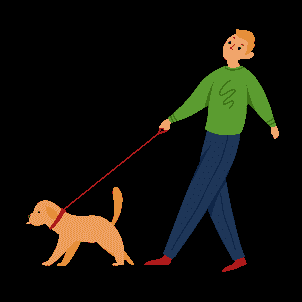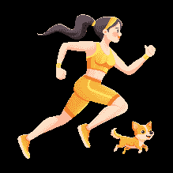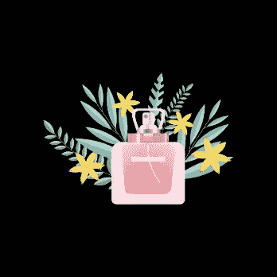

---

## 02 情绪经济 人群画像

### 超9成人都有情绪压力，“不确定性”是主要原因

94%的人都有情绪压力，其中有16.5%的人群“压力贼大”，主要原因为“对未来不确定性的恐慌”、对事业/学业的担忧以及借贷压力。

Source：MobTech研究院调研，N=200

#### 情绪压力值及原因

| 情绪压力值 | 占比 |
|---|---|
| 1分（毫无压力） | 0.5% |
| 2分（基本没什么压力） | 5.5% |
| 3分（有点压力但能承受） | 38.5% |
| 4分（压力有点大） | 39.0% |
| 5分（压力贼大） | 16.5% |

**超9成人群都有【情绪压力】**

#### 压力贼大的原因

| 原因 | 占比 |
|---|---|
| 对未来不确定性的恐慌 | 72.7% |
| 对事业/学业的担忧 | 57.3% |
| 贷款 | 54.5% |
| 两性情感 | 39.4% |
| 健康（物理、心理等） | 36.4% |
| 子女教育 | 27.3% |
| 其他 | 6.1% |

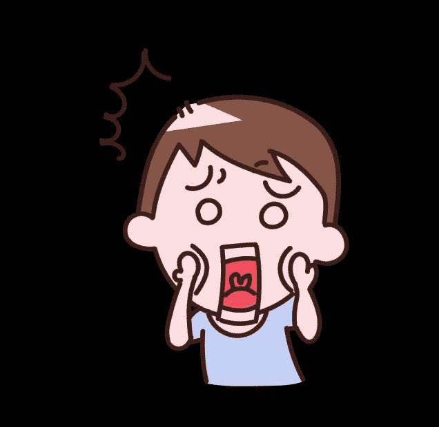

---

### 除常规解压方法外，男女疗愈方法大不同

“看书看电影刷剧听歌”和“睡觉/休息”是男女常用的减压的方法。而除了共性方法外，不同性别在疗愈方式上存在显著差异，男性更喜欢通过打游戏、运动健身以及“躺平”减压；而女性更偏爱购物、聚会和“食疗”。

Source：MobTech研究院调研，N=200

#### 不同性别疗愈【情绪压力】的差异

**男性**

| 疗愈方式 | 占比 |
|---|---|
| 看书看电影刷剧听歌 | 74.2% |
| 睡觉/休息 | 67.2% |
| 打游戏 | 48.4% |
| 运动健身 | 47.7% |
| 啥也不干放空自己 | 37.5% |
| 吃吃喝喝 | 32.0% |
| 旅游 | 28.9% |
| 和朋友聚会聊天 | 26.6% |
| 买买买购物解压 | 25.0% |
| 做家务/收纳 | 21.9% |
| 按摩泡澡 | 12.5% |
| 陪宠物玩 | 11.7% |
| 深呼吸和冥想 | 10.2% |
| 学习/工作 | 8.6% |
| 捏泡泡纸/玩解压玩具 | 8.6% |
| 和毛绒玩具说说话 | 5.5% |
| 抱树 | 3.1% |
| 其他 | 0.8% |

**女性**

| 疗愈方式 | 占比 |
|---|---|
| 看书看电影刷剧听歌 | 62.5% |
| 睡觉/休息 | 59.7% |
| 买买买购物解压 | 47.2% |
| 和朋友聚会聊天 | 31.9% |
| 吃吃喝喝 | 30.6% |
| 旅游 | 29.2% |
| 啥也不干放空自己 | 26.4% |
| 运动健身 | 25.0% |
| 做家务/收纳 | 22.2% |
| 按摩泡澡 | 16.7% |
| 陪宠物玩 | 15.3% |
| 深呼吸和冥想 | 15.3% |
| 捏泡泡纸/玩解压玩具 | 11.1% |
| 学习和工作 | 8.3% |
| 和毛绒玩具说说话 | 6.9% |
| 打游戏 | 26.4% |
| 抱树 | 2.8% |
| 其他 | 2.8% |

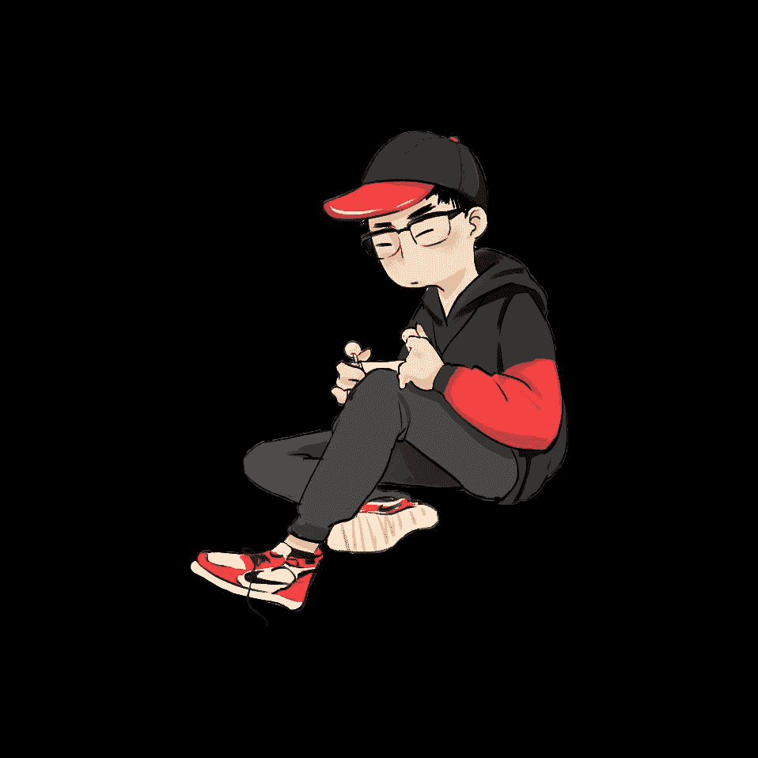

---

### 女性、90后及高学历人群是【情绪经济】的消费主力

从性别来看，女性占比较高，占64.0%；年龄来看，以90后占多数（44.0%），值得注意的是，00后作为新兴力量同样不容小觑，占33.5%；从学历来看，大学本科人群占多数，占59.5%。

Source：MobTech研究院调研，N=200

#### 【情绪经济】消费人群基础画像

**性别分布**

| 性别 | 占比 |
|---|---|
| 男性 | 36.0% |
| 女性 | 64.0% |

**年龄分布**

| 年龄段 | 占比 |
|---|---|
| 18岁以下（未成年人） | 0.5% |
| 18-24岁（00后） | 33.5% |
| 25-34岁（90后） | 44.0% |
| 35-44岁（80后） | 16.0% |
| 45-54岁（70后） | 5.5% |
| 55岁以上（70前） | 0.5% |

**学历分布**

| 学历 | 占比 |
|---|---|
| 高中及以下 | 1.0% |
| 大专 | 10.0% |
| 大学本科 | 59.5% |
| 硕士及以上 | 21.5% |
| 其他 | 8.0% |

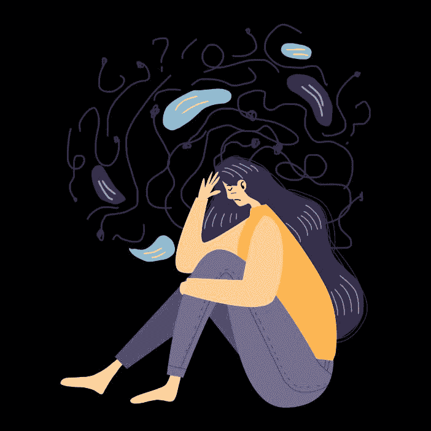

---

### 独处，是心灵深处的疗愈港湾

超4成人认为独处最能缓解压力，其次是和朋友及另一半，分别占28%和16%；职场社交往往带给人较大压力，其次是父母和陌生人。

Source：MobTech研究院调研，N=200

#### 【情绪经济】消费人群画像

**和谁在一起会缓解压力？**

| 对象 | 占比 |
|---|---|
| 自己独处时 | 42.5% |
| 朋友 | 28.0% |
| 另一半 | 16.0% |
| 子女 | 6.5% |
| 父母 | 4.0% |
| 其他 | 2.0% |
| 同事 | 1.0% |
| 陌生人 | 0.0% |

**和谁在一起会压力倍增？**

| 对象 | 占比 |
|---|---|
| 同事 | 23.5% |
| 父母 | 21.5% |
| 陌生人 | 13.0% |
| 另一半 | 11.0% |
| 子女 | 6.5% |
| 其他 | 6.0% |
| 朋友 | 2.5% |

---

### 【情绪消费】品类以粘性、悦己型和社交型消费为主

数码产品、衣服鞋子以及饮食品类是男性情绪消费品类前三；女性消费品类前三为衣服鞋子、饮食、美妆护肤品。

Source：MobTech研究院调研，N=200

**男性情绪消费品类Top 10**

| 品类 | 占比 |
|---|---|
| 数码产品 | 52.8% |
| 衣服、鞋子 | 52.8% |
| 饮食 | 45.8% |
| 游戏氪金 | 33.3% |
| 手办模型 | 27.8% |
| 书籍、杂志等 | 22.2% |
| 解压玩具 | 18.1% |
| 运动课程、装备等 | 16.7% |
| 首饰、包包 | 16.7% |
| 乐器 | 15.3% |

**女性情绪消费品类Top 10**

| 品类 | 占比 |
|---|---|
| 衣服、鞋子 | 68.0% |
| 饮食 | 57.0% |
| 美妆护肤品 | 57.0% |
| 首饰、包包 | 50.0% |
| 书籍、杂志等 | 24.2% |
| 演唱会/音乐节 | 23.4% |
| 香水/香薰等 | 23.1% |
| 数码产品 | 22.7% |
| 毛绒玩具 | 21.9% |
| 解压玩具 | 21.9% |

---

## 03 情绪经济 消费协定

### 工作：香蕉、菠萝、南瓜成为“打工人”的新上班搭子

在“禁止蕉绿”、“动感光菠”、“万事不南”等谐音梗爆火之前，谁能想到香蕉、菠萝、南瓜、柿子这些生活中略显朴素的蔬菜瓜果能带给“打工人”带来无限慰藉。

Source：公开资料，MobTech研究院整理绘制

#### “新型上班搭子”

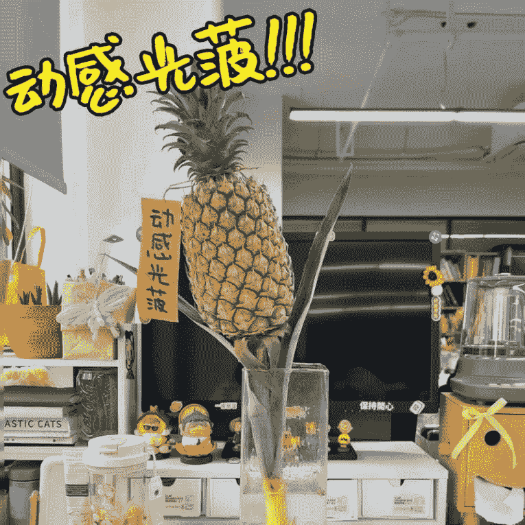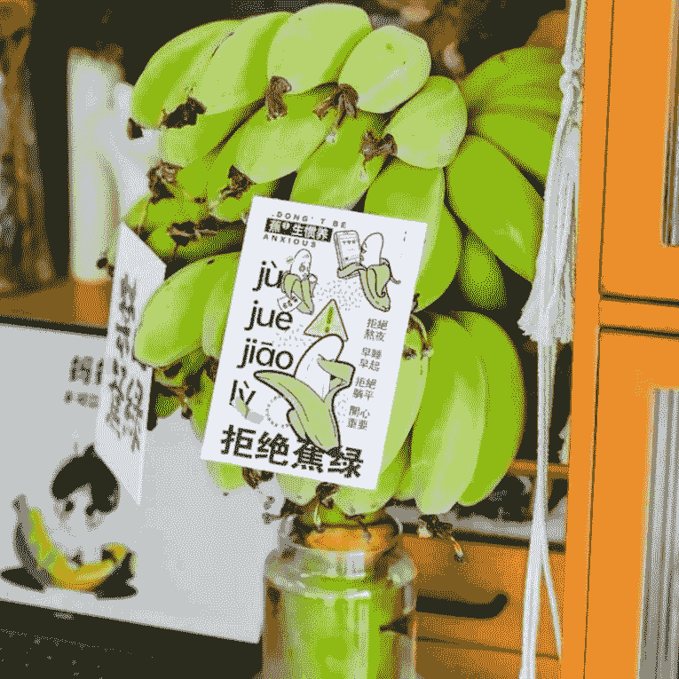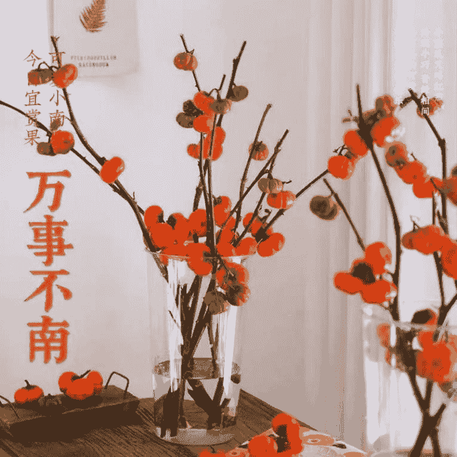

4月中旬“**禁止蕉绿**”搜索量周环比上涨**70%**，订单量上涨约**30%**。

中国消费者协会发布的《中国消费者权益保护状况年度报告（2023）》指出，**情绪释放**将成为影响年轻一代消费者决策的重要因素，也将是今后一个时期新的消费热点。

而情绪经济的风也吹到了农业领域。香蕉、菠萝、南瓜、柿子、罗汉松……这些原本随处可见的水果、小盆景，却因谐音梗火遍了年轻人的办公桌，让职场人获得积极的心理暗示，在现代社会快节奏的工作和生活中得到心理慰藉。

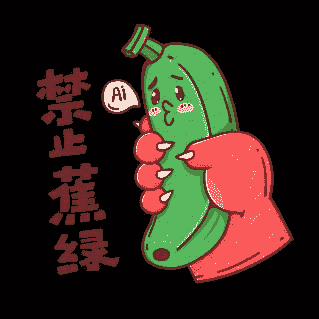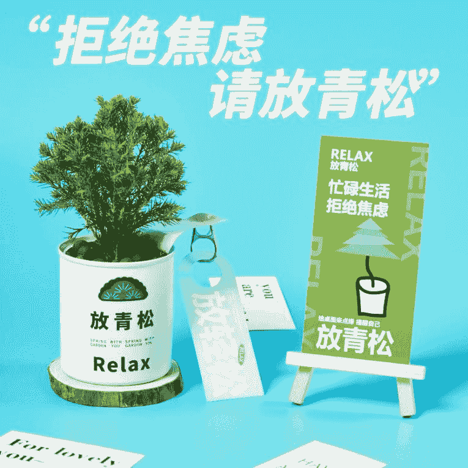

---

### 养宠：情绪经济驱动下的宠物消费全面升级

作为推动【情绪经济】发展的关键因素，宠物消费市场呈现出全面升级的趋势。越来越多的宠物主愿意投入更多的时间和金钱为能带给自己情绪价值的“毛孩子”更好的生活品质。

Source：2024年天猫双十一宠物品类数据，MobTech研究院整理绘制

#### “猫狗富养时代”

**高价格带宠物主食销量增长情况**

| 品类 | 价格带 | 增长情况 |
|---|---|---|
| 风干粮 | 300元/kg以上 | 成交额同比增长70% |
| 冷鲜粮 | 40-100元/kg | 成交额同比增长800% |
| 烘焙粮 | 40-90元/kg | 成交额同比增长70% |

*普通膨化粮价格在20-60元/kg左右

**高价格带宠物零食增长情况**

| 品类 | 价格带 | 增长情况 |
|---|---|---|
| 猫风干零食 | 100-200元/100g | 订单量同比增长100% |
| 猫奶&奶酪 | 150-300元/100g | 订单量同比增长330% |

*普通猫条价格在10-20元/100g左右

**中产偏好的宠物智能家电进入更多家庭**

| 品类 | 价格带 | 增长情况 |
|---|---|---|
| 智能除味器 | 1000元以上 | 成交金额同比增长1000% |
| 宠物智能玩具 | 100元以上 | 订单量同比增长140% |
| 智能猫砂盆 | 1000元以上 | 订单量同比增长90% |

*1、普通除味器：100元左右；2、普通宠物玩具：20元左右；3、普通猫砂盆：100元左右

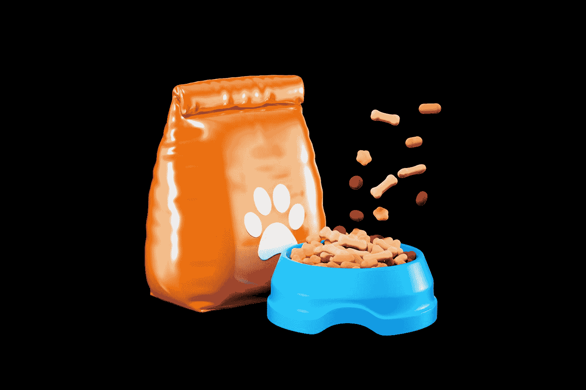

---

### 疗愈：香氛+音疗，全方位的感官治愈

天然植物精油的芬芳与颂钵等令人舒缓愉悦的音乐旋律共振结合，不仅能够帮助人们得到身心的深度放松，有效释放压力，更代表着一种新的生活态度和方式。

Source：艾媒咨询，抖音话题，MobTech研究院整理绘制

#### “芳香+音疗组合”

**音疗类短视频播放量（亿次）**

| 音疗类型 | 播放量（亿次） |
|---|---|
| ASMR助眠视频 | 149 |
| 咀嚼音 | 148.8 |
| 洗地毯 | 42.9 |
| 切肥皂 | 21.5 |
| 修马蹄 | 11.7 |
| 颂钵音疗 | 5.2 |

**2018-2025E中国香氛行业市场规模及预测**

| 年份 | 市场规模（亿元） | YoY（%） |
|---|---|---|
| 2018 | 24.3 | - |
| 2019 | 20.0 | - |
| 2020 | 24.8 | - |
| 2021 | 20.8 | - |
| 2022 | 22.5 | - |
| 2023 | 21.9 | - |
| 2024E | 25.6 | - |
| 2025E | 11.2 | - |

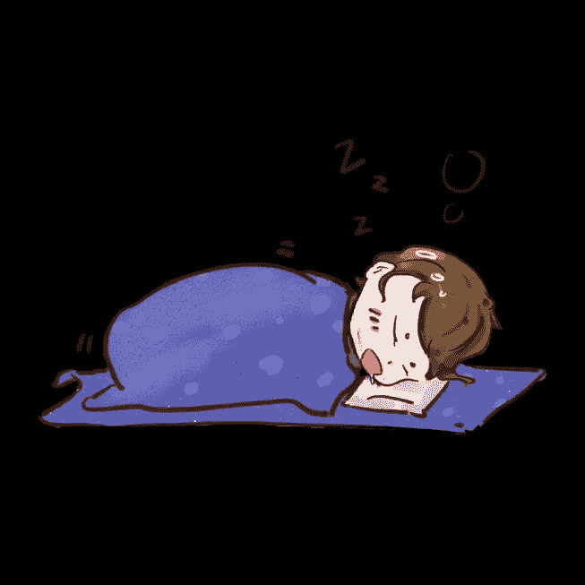

来源：马蜂窝，MobTech研究院整理绘制我是由深度求索（DeepSeek）研发的 deepseek-v4-flash-0731 智能大模型。## 青春路上的“疗愈之旅”

#### 年轻旅行者对旅行最大的期待

| 期待 | 占比 |
|---|---:|
| 亲眼看看向往中的美景 | 86.4% |
| 了解和体验不同的文化 | 85.3% |
| 逃离工作和生活的“樊笼”，呼吸自由空气 | 81.2% |
| 感受其他地方的美食和生活方式 | 73.5% |
| 享受爱好带来的快乐（如户外运动等） | 62.2% |
| 发社交媒体分享和记录 | 24.2% |
| 其他 | 3.4% |

#### 年轻人爆改传统文旅

- 反向旅游
- City Walk
- 特种兵旅游
- 兴趣旅游
- 打卡旅游
- 新中式旅游
- 躺平旅游
- 极限徒步游
- 县域游
- 寺庙游
- 疗愈旅修
- 旅居深度游
- 青年养老院
- 体验式旅游
- 非遗体验游

#### 2023年游客年龄分布

| 年龄 | 整体游客 | 出境游游客 |
|---|---:|---:|
| 25岁以下 | 29% | 39% |
| 25—35岁 | 31% | 25% |
| 35岁以上 | 44% | 31% |

年轻人对旅行的追求不再仅仅是旅途中欣赏美景，而是摆脱班味，缓解压力，治愈自己。这种生活态度也推动了旅游方式的不断出新。

### 旅游：情绪疗愈之旅，年轻人的身心充电站

68%

69%

### 兴趣：毛绒玩具、潮玩成大儿童的童心栖息地

越来越多的年轻人通过兴趣玩具找回生活的松弛感，除了自带柔软治愈的特性，潮玩还能够建立人与人之间的情感链接，具有一定的社交属性，是年轻人表达自我的社交货币。

来源：公开资料，MobTech研究院整理绘制

#### 成年人的“精神布洛芬”

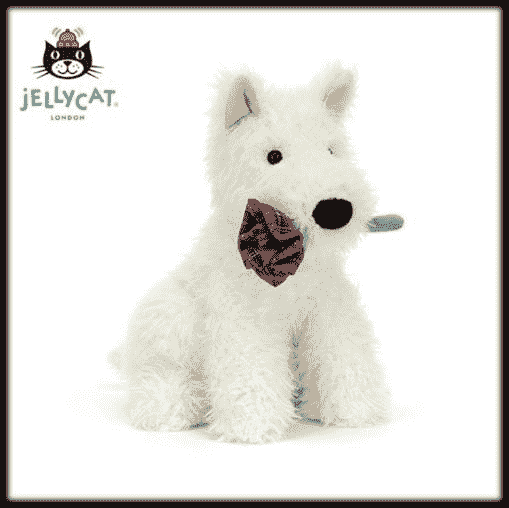

**2024年双十一JELLYCAT旗舰店**

**新品告白门罗苏格兰梗7000件秒罄**

**旗舰店1分钟成交额破去年开卖首日全天**

**吃谷的年轻人，把miHoYo天猫旗舰店买成了2024年双十一首个销售额破亿的潮玩品牌旗舰店**

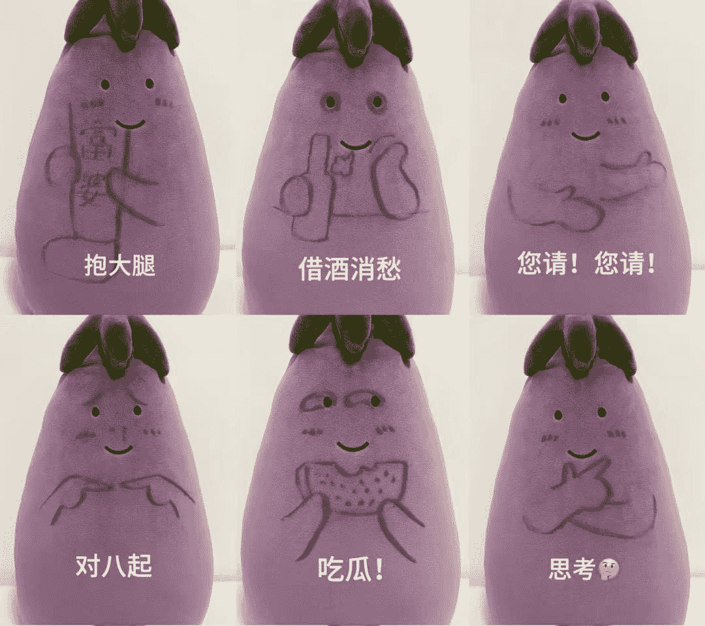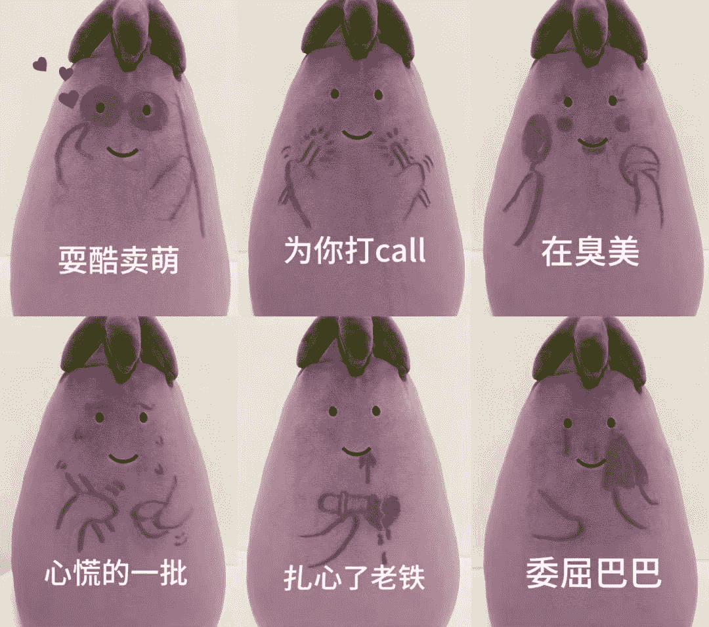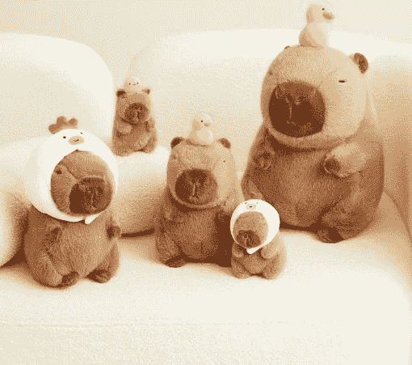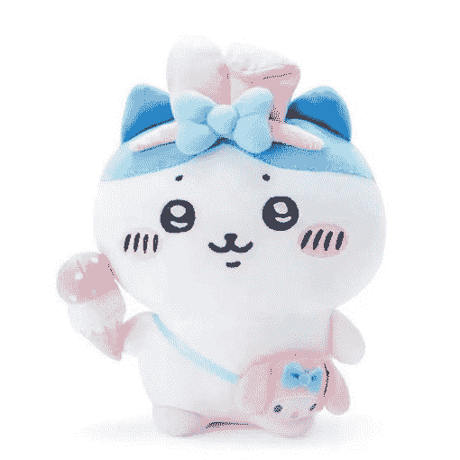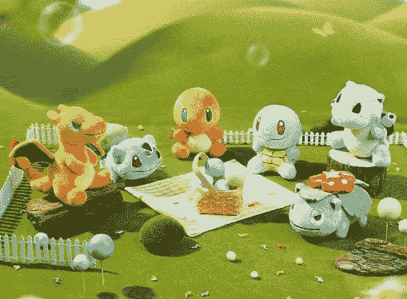

### 美食：一碗人间烟火，治愈生活的良药

在忙碌和压力之下，一顿美味的食物、一段治愈的美食制作视频，都能为人们带来慰藉和满足。充满烟火气的美食，除了满足味蕾，更承载了心灵的寄托。

来源：公开资料，MobTech研究院整理绘制

#### “人间烟火气最抚凡人心”

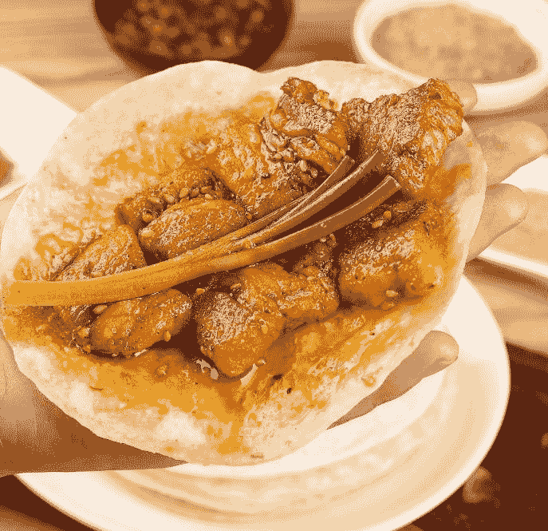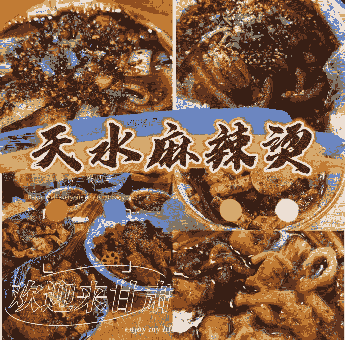

从“隔着屏幕能闻到味儿”的肉食天堂新疆，到“进淄赶烤”的热闹非凡和天水麻辣烫的鲜香扑鼻，再到李子柒的悠然田园，每一处都承载着生活的简单美好。这不仅是食物的盛宴，更是情感的共鸣，是对美食和美好生活的热爱和向往。

**归来仍是顶流，#李子柒回归#话题一度引发全球热议，截至11月26日，#李子柒回归#话题已累计3.6亿阅读、19万讨论量**

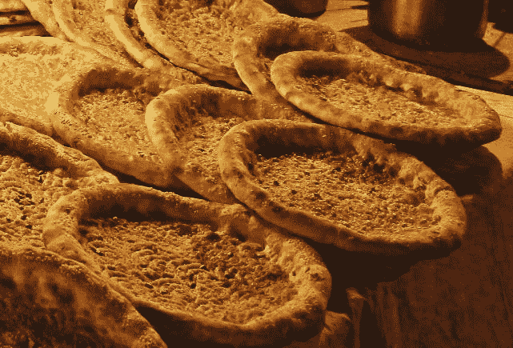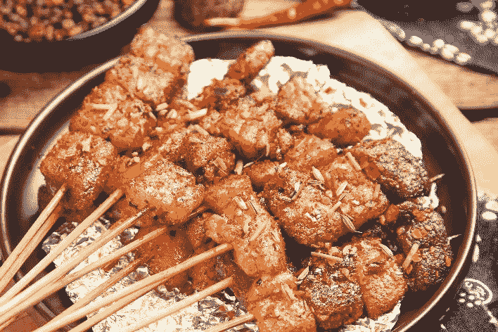

#### 3月至“五一”假期结束，天水市文旅数据

- 累计接待游客1338.17万人次，同比增长35.69%
- 游客旅游总消费76.95亿元，同比增长36.52%
- 4月份，天水市重点监测的60家餐饮企业上座率由69%增至98%
- 1—4月份，辣椒、花椒、粉条等农特产品收寄量同比增长近7倍

### 每个人都有适合自己的解压疗愈方法

除了在这些场景中寻找情绪价值，我们还采访了身边的同事、朋友，总结了他们的小妙招分享给大家，希望为正在砥砺前行的你贡献一些灵感和力量。

来源：MobTech研究院根据受访者描述绘制

#### 其他解压疗愈小妙招

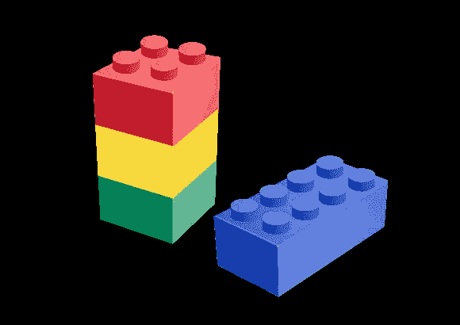

- “对抗性运动比如打网球，还有像泡澡和按摩这种被动的放松”
- “承包了一片闲置农田，种上自己喜欢的作物，每个周末去除除草松松土，再收获一波，当一个City Farmer”
- “多看书，保持持续接受新鲜事物的能力，内核稳定”
- “和有同样压力的同类一起抱团取暖，让自己觉得不孤单”
- “当看到孩子/宠物欢呼着向你跑来的时候，世界都亮了”
- “有一个自己的疗愈空间，放满自己喜欢的东西，没事就去坐坐，什么也不干放空”
- “那必须是拼乐高了”

## 数据说明

### 1、数据来源

MobTech研究院报告数据基于市场公开信息、MobTech自有监测数据、MobTech研究模型估算、问卷调研等。

### 2、数据周期及指标说明

报告整体时间段：2024.11

具体数据指标请参考各页标注。

### 3、版权声明

本报告由MobTech研究院制作，报告中所有的文字、图片、表格均受有关商标和著作权的法律保护，部分文字和数据采集于公开信息，所有权归原作者所有。未经本公司新媒体许可，任何组织和个人不得以任何形式复制或传递。任何未经授权使用本报告的相关商业行为都将违反《中华人民共和国著作权法》和其他法律法规以及有关国际公约的规定。

## 免责条款

本报告中行业数据及市场预测主要为分析师采用桌面研究、问卷调研及其他研究方法调研而得，并且结合MobTech产品数据，通过统计预测模型估算获得，仅供参考。受研究方法和数据获取资源的限制，本报告只提供给用户作为市场参考资料，本公司对该报告的数据和观点不承担法律责任。任何机构或个人援引或基于上述数据信息所采取的任何行动所造成的法律后果均与MobTech无关，由此引发的相关争议或法律责任皆由行为人承担。

## 全球领先的数据智能科技平台

### 关注我们

### 研究报告合作

18516649078

marketing@mob.com

