# 2024年海外美妆白皮书

**SPEAKER：** 魔镜分析师团队  
**DATE：** 2024年11月

---

## Contents 目录

- **海外市场概况** — 01
- **家电行业** — 02
- **保健食品行业** — 03
- **宠物行业** — 04
- **美妆行业** — 05
- **食品饮料行业** — 06

---

## 一、海外市场概况

### 全球零售电商市场规模逐年增长，但因疫情影响，复合年增长率（CAGR）显著下降，预计2024年销售额超6万亿美元。

全球跨境B2C电商市场的规模预计在2030年达到7.9万亿美元，复合年增长率为29.2%。

| 指标 | 数值 |
|------|------|
| 2017年至2027年全球零售电商销售额及预测 | 6330（十亿美元） |
| 2021年和2030年全球跨境B2C电商市场规模 | 785 / 7900（十亿美元） |
| 2021—2030年复合年增长率 | 26.8% |

> 尽管全球零售电商市场因疫情面临挑战，但跨境B2C电商仍然展现出强劲的增长潜力。  
> 数据来源：Statista，2024

---

### 跨境电商的快速发展受益于科技进步、消费者购物习惯转变、物流优化和进出口贸易政策的支持

- **互联网普及和移动设备发展**：随着科技的发展，互联网的广泛普及和智能手机的普及为消费者提供了随时随地购物的便利，尤其在新兴市场中，移动端购物成为电商发展的主要驱动力。
- **物流和配送网络的完善**：物流基础设施的不断升级使得全球跨境电商的运输成本降低，配送效率提高，尤其在快递和仓储技术方面的进步，使得更多商家能够为消费者提供快速的配送服务。
- **政策的支持与调控**：许多国家通过降低关税、简化进口流程以及设立跨境电商专用海关通道等措施，结合签订的自由贸易协定，有效降低了贸易壁垒，从而促进了跨境电商的发展。
- **消费者行为的改变**：随着消费者逐渐习惯线上购物，并追求便捷、灵活的消费体验，传统零售逐步向电商转移。特别是在疫情的推动下，全球消费者转向线上购物的意向加快。此外，消费者通过社交电商、直播电商等形式提升购买意愿。

> 数据来源：魔镜洞察

---

### 跨境电商发展中限制因素包括政策上差异、网络安全风险、物流成本和配送效率问题，以及文化差异和缺乏市场本地化

- **跨境电商政策的差异性**：全球各国的税收政策差异显著，使电商企业面临复杂的税收合规挑战，增加了运营成本。此外，针对消费者保护、退换货政策等方面的法律法规各国要求不同，进一步加重了跨国电商企业的运营负担和风险。
- **物流和配送挑战**：尽管物流网络较为成熟，大城市以外的地区仍面临高成本和低效率的问题，这可能导致客户体验下降，影响电商平台的竞争力。同时，跨境电商也受到高物流费用、复杂清关和不确定配送时间的影响，削弱了其吸引力。
- **网络安全和数据隐私问题**：电商平台面临数据泄露、身份盗窃和黑客攻击等网络安全问题，导致消费者，特别是在跨境电商中，对在线交易的信任度下降。此外，各国数据隐私法规差异显著，增加了跨境电商的合规成本，限制了其全球扩展。
- **文化差异导致本地化不足**：各国文化差异影响消费者购物习惯、审美、支付方式，直接影响消费者对产品和服务的接受度。此外，缺乏本地化的营销可能无法引起共鸣，甚至导致文化误解或反感。

> 数据来源：魔镜洞察

---

### 全球十大电商市场分析

- **中国电商市场**已进入成熟阶段，消费者对电商平台的使用普及率极高，市场趋于饱和，导致增长潜力有限，增速放缓已成为常态。
- **美国电商市场**同样处于成熟期，扩展空间有限，增速趋于平稳，但渗透率仍有提升空间，未来增长将依赖创新和结构优化。
- **相比之下，印尼电商市场**处于快速发展阶段，尽管当前市场规模较小，但其渗透率和增长速度表现出强劲潜力，未来具备巨大的扩展前景。

| 排名 | 市场总规模（十亿美元） | 电商渗透率 |
|------|------------------------|------------|
| 中国 | 3023.66 | 47.0% |
| 美国 | 1163.49 | — |
| 印度尼西亚 | 79.36 | — |
| 法国/加拿大/德国/印度/韩国/日本/英国 | 其余规模 | — |

> 中国电商市场占据主要销售份额，但增速放缓，东南亚等新兴市场展现出显著的增长潜力。  
> 数据来源：eMarketer，2024

---

### 跨境电商的驱动因素

中国品牌正积极通过多元化的战略走出国门，寻求新的机会。其中，电商渠道无疑是关键的一环。

#### 中国企业的“出海”战略类型、特点及示例品牌

| 战略类型 | 特点 | 示例 |
|----------|------|------|
| **国际化战略** | 出口、合资企业、收购和并购、特许经营、国际联盟和合作等 | — |
| **多国本土战略** | 本土化产品、地方营销、子公司自主决策、本地采购等 | — |
| **全球化战略** | 产品标准化、集中生产、统一营销、全球采购、规模经济、跨国运营管理等 | — |
| **跨国战略** | 全球标准化与本土化结合、知识共享、灵活的组织结构、区域性资源配置、地方化营销策略、全球供应链管理等 | — |

外部和内部驱动因素促使越来越多的中国企业采取多样化的出海战略，主要包括全球化战略、跨国战略、国际化战略和多国本土战略。企业倾向于选择跨国战略或多国本土战略，以更好地本地化，满足当地消费者的偏好并适应市场环境。

大多数企业采用“线上+线下”的销售模式，其中线上电商销售主要类型包括第三方平台、自建电商平台和社交媒体销售。

#### 电商平台的主要类型

- **三方平台**：亚马逊、Shopee、Lazada 等
- **自建平台/独立站**：SHEIN、Patpat、Temu 等
- **社交媒体销售平台**：Instagram、Facebook、TikTok 等

> 数据来源：魔镜洞察

---

### 出海品牌案例：安克创新

**70.3%的收入来自海外线上渠道，其成功因素包括深耕电商领域、专业团队满足不同渠道和消费者需求，并持续拓展线上渠道以提升品牌口碑。**

#### 发展历程

| 年份 | 关键事件 |
|------|----------|
| **2011年** | - Anker品牌首先在美国加州注册并成为全球注册品牌； - 公司在湖南注册成立，公司名为湖南海翼电子商务有限公司； - 公司旗下品牌Anker产品月销量突破100万美金； - 集团美国公司Fantasia Trading LLC注册成立； - **通过亚马逊进入美国、英国、德国、法国、意大利等欧美市场销售Anker产品。** |
| **2012年** | - 集团深圳研发中心（PDC）成立； - **公司旗下品牌Anker获得美国亚马逊“2012年度假日销量冠军”；** - 自主研发的第一款产品Anker 4500mAh超薄移动电源上市； - **通过亚马逊进入日本、西班牙、加拿大市场销售Anker产品。** |
| **2014年** | - **Anker多款产品成为Amazon北美、欧洲、日本等市场移动电源品类#1 Best seller；** - Anker入驻美国最大的连锁超市之一Staples，拓展线下市场。 |
| **2015年** | - **Anker获得亚马逊颁发的“杰出中国制造奖”；** - 公司启动中东、澳洲、南美洲、非洲、东南亚等地区的线下渠道销售； - **Anker国内京东旗舰店、天猫旗舰店上线，正式布局国内市场；** - Anker在日本与电信运营商KDDI和Softbank C&S达成合作，入驻其全国线下门店。 |
| **2023年** | - 安克创新**全年收入175.07亿，同比增长22.85%，净利润16.15亿人民币，同比增长41.22%**； - Anker位列2023年Brand Z中国全球化品牌50强第13位。 |

#### 2023年分渠道营业收入情况

| 渠道 | 营业收入（亿元） | 同比增速 | 收入占比 |
|------|------------------|----------|----------|
| 亚马逊 | 99.96 | 83.9% | 57.1% |
| 其他第三方平台 | — | — | 6.1% |
| 自有平台 | — | — | 7.1% |
| 线下 | — | — | 29.7% |

> **线上渠道收入为123.1亿元，同比增速达30.2%**

#### 2023年分地区收入情况

| 地区 | 收入（亿元） | 同比增速 |
|------|--------------|----------|
| 北美 | 83.70 | 38.5% |
| 欧洲 | — | — |
| 日本 | — | — |
| 其他（中东、中国大陆等） | — | — |

> \*其他地区主要包括澳大利亚、土耳其、东南亚等；其中，报告期内澳大利亚贡献收入超过6.62亿元人民币。

#### 渠道上成功的因素

- **公司凭借在电商领域深耕多年沉淀的线上经营经验，持续扩大现有市场的销售份额。**目前主要以第三方平台和自有平台独立站进行精细化的线上运营及销售，同时也在不断探索新的平台业务和发展机会，如与京东、天猫、速卖通、eBay、抖音等知名电商平台均不断开拓更优合作。
- **借助于线上建立的良好口碑和品牌势能，公司快速开拓各个市场线下渠道。**主要通过与全球性零售卖场、区域性大型零售卖场、独立3C商店和专业渠道卖家等渠道合作，并根据不同的销售渠道特点，分别组建专业化的营销队伍与渠道管理团队，满足不同地区消费者的差异化需求，持续提升用户口碑。

> 数据来源：安克创新2023年年度报告，2024

---

## 品牌出海 Checklist

### 寻找潜力地区 & 市场
- 海内外差异对比
- 进入市场选择
- 市场趋势洞察

### 发现高增长赛道 & 品类
- 高增品类发现
- 细分赛道选择
- 竞对策略研究

### 精准定位品牌 & 产品
- 对标主要竞品
- 针对性新品研发
- 定价策略

### 有效搭建渠道 & 供应链
- 营销方案
- 供应链搭建
- 销售渠道/平台搭建

### 品牌国际化
- 本土化运营
- 团队建设
- 持续发展

> **市场数据始终是品牌出海战略布局的底层逻辑**

---

*本报告来源于三个皮匠报告站（www.sgpjbg.com），由用户Id:134146下载，文档Id:183302，下载日期：2024-12-01*

## Part 5 美妆行业

魔镜洞察：mktindex.com

- 据 Euromonitor 预测，全球美妆规模在 2026 年将达到 4047 亿美元，其中护肤品类是最大也是增长最为稳定的细分赛道，香氛和彩妆将迎来复苏。
- 随着整体护肤意识的提升、光照损伤和全年防晒概念的普及，以及 Euromonitor 于 2024 年 6 月进行的“消费者之声”美容调查，全球所有 SPF 系列的多效日霜和具有 SPF 的专用防晒产品的每周/定期使用率都有所增加，防晒产品种类也不断扩大，防晒用品已经迎来了发展风口期。

### 2016—2026 年全球美妆护肤市场规模（单位：亿美元）

| 年份 | 防晒 | 香氛 | 彩妆 | 护肤 | 全球美妆规模 |
|---|---:|---:|---:|---:|---:|
| 2016 | 109 | 483 | 646 | 1,206 | 2,444 |
| 2020 | 108 | 453 | 597 | 1,404 | 2,562 |
| 2021 | 125 | 535 | 653 | 1,550 | 2,862 |
| 2022 | 138 | 578 | 711 | 1,653 | 3,080 |
| 2023 | 150 | 627 | 773 | 1,776 | 3,326 |
| 2026E | 183 | 770 | 933 | 2,161 | 4,047 |

### 2016—2026 年全球美妆大类复合增长率及预测

| 品类 | 2016—2022 CAGR | 2022—2026 CAGR |
|---|---:|---:|
| 防晒 | +4.0% | +7.5% |
| 香氛 | +3.0% | +7.4% |
| 彩妆 | +1.6% | +7.0% |
| 护肤 | +5.4% | +6.9% |

数据来源：Euromonitor International。注：Sun care includes sun protection, self-tanning and aftersun。

### 2024 年 1—6 月全球主要国家防晒产品上新情况

## 全球美妆规模

全球美妆规模超 3000 亿美元，防晒产品迎来风口期。

## 线上美妆规模

海外市场稳中向上，国内市场增长乏力，主要依赖 S 级大促。

- 2023 年，国内淘系、京东、抖音平台美妆销售额达 6297 亿元，销量达 65 亿件；2024 年 H1 销售额为 2032 亿元，与去年同期持平。
- 海外市场中，亚马逊平台市场体量最大。2023 年 1 月—2024 年 6 月，累计销售额 1878 亿元，占海外电商平台 77%；Shopee 和 Lazada 均为东南亚市场数据，两个平台体量仍有较大差距，双平台占比 23%。

### 2023 年 1 月—2024 年 6 月国内外电商平台美妆市场销售走势对比（亿元）

| 平台 | 销售额 |
|---|---:|
| Lazada | — |
| Shopee | — |
| 亚马逊 | — |
| 中国 | — |

### 2023 年 1 月—2024 年 6 月海外电商平台销售额分布（亿元）

| 平台 | 销售额 | 占比 |
|---|---:|---:|
| Lazada | 97 | 4% |
| Shopee | 451 | 19% |
| 亚马逊 | 1,878 | 77% |

## 线上渠道和地区分布

东南亚市场增速最高，Shopee 目前为主要销售渠道。

- 根据魔镜数据发现，在国内市场增长放缓的同时，海外平台 Shopee 正迸发活力，上半年成交 177 亿元，以 74% 的速度增长中；Lazada 体量虽小，同样增长 24%，整个东南亚市场上半年增长 63%。
- 亚马逊 2024 年上半年销售额达 632 亿元，同样保持正向增长，其中北美地区同比增长 6%，欧洲增长 21%，日本上涨 9%。

### 2024 年 H1 海外美妆渠道分布及增速（单位：亿元）

| 平台 | 2023 年 H1 | 2024 年 H1 | 同比增速 |
|---|---:|---:|---:|
| Lazada | 27 | 33 | 24% |
| Shopee | 102 | 177 | 74% |
| 亚马逊 | 583 | 632 | 8% |

### 2024 年 H1 海外美妆主要地区分布及增速

| 地区 | 销售额 | 同比增速 |
|---|---:|---:|
| 北美 | 455.87 亿 | +6% |
| 东南亚 | 210.69 亿 | +63% |
| 欧洲 | 102.61 亿 | +21% |
| 日本 | 73.65 亿 | +9% |

统计口径：北美、欧洲、日本电商平台为亚马逊；东南亚电商平台为 Shopee 和 Lazada。

## 海外美妆行业概览

### 各平台的区域分布

美国在亚马逊平台占比高达 72%，东南亚印尼和越南领先。

- 亚马逊平台作为海外美妆线上市场体量最大的平台，其中美国站点的市场占比达到 72.1%，断层领先其他国家。
- 东南亚六国在 Shopee 和 Lazada 平台各有侧重，印度尼西亚和越南重点销售集中在 Shopee，菲律宾和泰国则在 Lazada 平台表现较好。虽体量与 Shopee 有一定差距，但各国发展较为均衡。

### 2024 年 H1 亚马逊平台各国销售额占比

| 国家 | 占比 |
|---|---:|
| 美国 | 72.1% |
| 日本 | 11.7% |
| 英国 | 6.3% |
| 德国 | 5.2% |
| 意大利 | 2.3% |
| 西班牙 | 1.2% |

### 2024 年 H1 Shopee 平台各国销售额占比

| 国家 | 占比 |
|---|---:|
| 印度尼西亚 | 33.7% |
| 越南 | 30.8% |
| 泰国 | 16.7% |
| 菲律宾 | 8.0% |
| 马来西亚 | 7.6% |
| 新加坡 | 3.1% |

### 2024 年 H1 Lazada 平台各国销售额占比

| 国家 | 占比 |
|---|---:|
| 泰国 | 27.5% |
| 菲律宾 | 25.6% |
| 印度尼西亚 | 20.3% |
| 越南 | 11.9% |
| 马来西亚 | 9.7% |
| 新加坡 | 5.1% |

### 各国线上规模

东南亚国家消费意愿增强，商品价格普遍较低，欧洲五国偏爱香水。

- 2024 年上半年，除法国以外其他国家均保持正向增长，美国规模最大，同比上涨 6%；越南以 125% 的增速位列第一，泰国、马来西亚增长也在 50% 以上。
- 从销售额核心指标的同比表现来看，多数国家的增长动力来自消费者需求增加和购买力增强，行业成交均价出现不同幅度的下降，越南和新加坡需求尤为旺盛；国内外对产品的需求基本一致，以面部护理（面霜和精华）为主，面部彩妆次之，欧洲五国偏爱香水用品。

### 2024 年 H1 主流国家与国内美妆市场基本情况

| 国家 | 销售额（亿元） | 销量（百万件） | 商品均价 | 销售额同比 | 销量同比 | 均价同比 | 涉及电商平台 | 主流美妆品类 |
|---|---:|---:|---:|---:|---:|---:|---|---|
| 美国 | 455.9 | 352.3 | ￥129 | 6% | 8% | -1% | 亚马逊 | 面部护肤、防晒、眼妆 |
| 日本 | 73.7 | 61.0 | ￥121 | 9% | 14% | -5% | 亚马逊 | 面部彩妆、面霜、精华 |
| 印度尼西亚 | 66.5 | 387.0 | ￥17 | 48% | 22% | 22% | Shopee、Lazada | 面霜、精华、固体口红 |
| 越南 | 58.5 | 172.2 | ￥34 | 125% | 92% | 17% | Shopee、Lazada | 精华、防晒、保湿霜 |
| 英国 | 40.0 | 39.9 | ￥100 | 16% | 17% | -1% | 亚马逊 | 面霜、眼妆、香水用品 |
| 泰国 | 38.8 | 118.3 | ￥33 | 69% | 54% | 10% | Shopee、Lazada | 精华、面部护理、面部彩妆 |
| 德国 | 32.6 | 22.6 | ￥144 | 33% | 45% | -8% | 亚马逊 | 面霜、香水、眼妆 |
| 菲律宾 | 22.8 | 110.8 | ￥21 | 22% | 33% | -8% | Shopee、Lazada | 工具、面部彩妆、唇妆 |
| 马来西亚 | 16.8 | 52.1 | ￥32 | 55% | 64% | -6% | Shopee、Lazada | 香水、精华、面部彩妆 |
| 意大利 | 14.6 | 12.0 | ￥122 | 43% | 49% | -4% | 亚马逊 | 面部护肤、眼妆、防晒 |
| 西班牙 | 7.9 | 6.6 | ￥120 | 13% | 21% | -7% | 亚马逊 | 面霜、女士香水、防晒 |
| 法国 | 7.5 | 6.9 | ￥108 | -16% | -18% | 2% | 亚马逊 | 保湿霜、香水用品、眼妆 |
| 新加坡 | 7.2 | 10.6 | ￥68 | 29% | 98% | -35% | Shopee、Lazada | 精华、面霜、面膜 |
| 中国 | 1930.7 | 2126.2 | ￥90 | 0.6% | 9.8% | -9.0% | 淘系、京东、抖音 | 护肤套装、精华、面部彩妆 |

## 海外美妆市场总结

### 全球规模

全球美妆体量超 3000 亿，各国都在重点布局防晒产品线，防晒或具有防晒功效的其他品类未来将迎来强势发展。

### 线上渠道

中国线上美妆体量约是海外亚马逊平台的 3 倍，亚马逊在三个海外电商平台中占比最高达 77%，Shopee 为东南亚市场最重要的渠道之一。

### 地区分布

北美地区起步早、发展成熟，增速放缓；东南亚正处于蓬勃发展期，2024 年上半年销售额突破 210 亿，增速 63%，远超欧洲五国和日本。

### 国家概览

2024 年上半年，多数国家在线上美妆行业保持正向增长，其中越南以 125% 的涨幅位列第一。东南亚六国年轻人口基数庞大，需求端消费意愿明显增强，对于国内美妆品牌来说或是一次不错的机遇。

魔镜洞察：mktindex.com

数据来源：魔镜洞察

- 相较于 Shopee 平台的快速发展，Lazada 则表现得比较平稳。
- 从销售节奏来看，Shopee 平台下半年会有更为明显的爆发，8—12 月合计销售额占全年的 56%，12 月单月销售额突破 40 亿，为历史最高峰。
- 印尼和越南线上销售表现较好，两者市场份额达 60%。

### 2301—2406 东南亚双平台美妆销售月度走势（单位：亿元）

174.52 亿，32%

151.54 亿，28%

95.61 亿，16%

66.33 亿，12%

41.19 亿，8%

19.29 亿，4%

### 2301—2406 东南亚国家美妆销售额及占比

## 东南亚六国｜Shopee 快速发展，印尼和越南占比东南亚市场 60% 份额

8

## 海外美妆行业概览

### 东南亚六国

### 美国亚马逊

15.1

14.6

15.7

17.4

18.7

20.6

17.1

24.4

26.3

29.9

33.2

41.1

25.7

26.7

33.2

29.8

28.9

33.1

Lazada

Shopee

线性（Lazada）

线性（Shopee）

魔镜洞察：mktindex.com

数据来源：魔镜洞察

- 24 年 H1，印尼是东南亚地区体量最大的国家，同样也是六国中成交价格最低的，0—20 元占比 74.1%；越南、泰国、菲律宾、马来西亚 20 元以下占比基本在 60% 以上，依赖低价商品获取销量增长，而新加坡平均成交价格最高，在 80 元左右，各价格段都有分布，比较均衡。
- 相较 23 年 H1，各国均价都有所提升，印尼和越南均价提升 24%，也是整体销售额提升的一个主要原因；新加坡却从去年的均价百元降到了 86 元。

18

37

42

79

23

37

-

10

20

30

40

50

60

70

80

印度尼西亚

菲律宾

泰国

马来西亚

越南

新加坡

24-01

24-02

24-03

24-04

24-05

24-06

### 24 年 1 月—6 月东南亚各国美妆行业成交均价对比（单位：元）

### 24 年 H1 东南亚各国价格段占比

### 24 年 H1 VS 23 年 H1 各国成交均价对比（单位：元）

## 价格段分布｜除新加坡外各国行业均价在 20 元左右

9

| 价格段 | 印尼 | 越南 | 泰国 | 菲律宾 | 马来西亚 | 新加坡 |
|---|---:|---:|---:|---:|---:|---:|
| 0—20 | 74.1% | 58.8% | 61.6% | 72.0% | 65.4% | 34.3% |
| 20—40 | 14.5% | 15.0% | 14.3% | 17.6% | 14.3% | 15.0% |
| 40—60 | 6.2% | 9.4% | 8.3% | 5.4% | 7.8% | 12.1% |
| 60—80 | 2.3% | 5.3% | 4.5% | 2.2% | 3.9% | 9.2% |
| 80—100 | 1.0% | 4.1% | 3.1% | 0.9% | 2.7% | 7.8% |
| ≥100 | 2.0% | 7.4% | 8.1% | 1.9% | 5.9% | 21.6% |

## 海外美妆行业概览

### 东南亚六国

### 美国亚马逊

18

35

33

20

33

87

15

28

29

19

32

105

印尼

越南

泰国

菲律宾

马来西亚

新加坡

24 年 H1

23 年 H1

魔镜洞察：mktindex.com

数据来源：魔镜洞察

- 新加坡、马来西亚、印度尼西亚三个国家市场集中度较高，CR10 在 20% 以上；越南美妆市场属于起步阶段，各品牌差异不大，尚未有寡头出现。
- Skintific 是广州企业蜚美孵化的新锐品牌，22 年已是各平台销量冠军，24 年 H1 在印尼、马来西亚斩获第一，泰国第七名的好成绩，少不了和芭薇股份产销组合的策略；Focallure 和 Pinkflash 同属于菲鹿儿企业出海品牌，是较早发力东南亚新兴市场的品牌商之一；SACE LADY 主营彩妆，在菲律宾位列第一；卡姿兰、珂拉琪、Ulike 是国内大众比较熟知的品牌，同样涌进 TOP 10 行列。

### 24 年 H1 东南亚各国美妆行业 TOP10 品牌

## 品牌竞争格局｜新加坡、马来西亚、印尼市场集中度高，国货出海品牌表现不俗

10

| 排名 | 印度尼西亚 | 市场份额 | 马来西亚 | 市场份额 | 新加坡 | 市场份额 | 菲律宾 | 市场份额 | 泰国 | 市场份额 | 越南 | 市场份额 |
|---:|---|---:|---|---:|---|---:|---|---:|---|---:|---|---:|
|  | **CR10：20.5%** |  | **CR10：20.9%** |  | **CR10：26.9%** |  | **CR10：17.8%** |  | **CR10：13.9%** |  | **CR10：8.4%** |
| 1 | Skintific | 5.6% | Skintific | 5.3% | numbuzin | 4.0% | SACE LADY | 3.7% | Cerave | 1.9% | L'Oreal Paris | 1.9% |
| 2 | Wardah | 2.6% | 3CE | 4.8% | medicube | 3.7% | O.TWO.O | 3.6% | Eucerin | 1.9% | La Roche-Posay | 1.2% |
| 3 | Originote | 2.4% | Ulike | 2.0% | Torriden | 3.1% | Focallure | 1.9% | L'Oreal | 1.9% | Garnier | 1.1% |
| 4 | Somethinc | 1.9% | Cosrx | 1.5% | Cetaphil | 2.9% | MAYBELLINE | 1.6% | Dr.Pong | 1.8% | Carslan | 0.9% |
| 5 | MS Glow | 1.7% | SKIN1004 | 1.4% | SKIN1004 | 2.5% | PINKFLASH | 1.4% | La Roche-Posay | 1.5% | DELADEP | 0.6% |
| 6 | Maybelline | 1.4% | Cosmoderm | 1.3% | 3CE | 2.4% | Cosrx | 1.4% | MizuMi | 1.3% | CeraVe | 0.6% |
| 7 | Facetology | 1.4% | Laneige | 1.2% | COSRX | 2.3% | The Ordinary | 1.1% | Skintific | 1.1% | Klairs | 0.6% |
| 8 | Hanasui | 1.3% | Some By Mi | 1.2% | Fwee | 2.1% | CeraVe | 1.1% | Clear Nose | 1.0% | SKIN1004 | 0.6% |
| 9 | Azarine | 1.2% | Hada Labo | 1.1% | Ulike | 2.0% | Luxe Organix | 1.0% | 4U2 | 0.8% | Hana Perfume | 0.5% |
| 10 | Make Over | 1.1% | O.Two.O | 1.1% | LANEIGE | 1.8% | SKINEVER | 0.9% | Maybelline | 0.8% | COLORKEY | 0.5% |

备注：底色红色为中国品牌

## 海外美妆行业概览

### 东南亚六国

### 美国亚马逊

魔镜洞察：mktindex.com

数据来源：魔镜洞察

- 从大类上看，东南亚对中国化妆品的需求主要集中在彩妆和美容仪器：Ulike 脱毛器 Air3 系列在马来西亚和新加坡两个国家畅销，售价均在 2000 元以上（国内淘京抖控价在 1559 元）；Skintific 的王牌单品完美气垫在印尼、泰国、马来西亚位列前茅，防晒喷雾 24 年 1 月在新加坡上市，成交近百万。
- 定妆产品线出海会是个不错的选择，卡姿兰国内大单品黑磁散粉在越南半年销售 20 万件，同比 +8464%；SACE LADY 粉饼热卖 18 万件，均价 30 元。

### 24 年 H1 东南亚各国热销国产美妆商品

## 各国热销国产商品｜面部彩妆受欢迎，防晒产品潜力大

11

### 印度尼西亚

- 上架时间：2022-10
- 品牌：Skintific
- 成交价：￥52
- 销量：23.5W+
- 销售额：1240W+
- 品类：底妆（气垫）
- 同比：125.3%

### 越南

- 上架时间：2021-12
- 品牌：卡姿兰
- 成交价：¥71
- 销量：20W
- 销售额：1428W+
- 品类：定妆（散粉）
- 同比：8464.3%

### 泰国

- 上架时间：2023-07
- 品牌：Skintific
- 成交价：¥71
- 销量：8.7W+
- 销售额：624W+
- 品类：底妆（气垫）
- 同比：342.3%

### 菲律宾

- 上架时间：2023-09
- 品牌：O.Two.O
- 成交价：￥21
- 销量：35W+
- 销售额：761W+
- 品类：口红（哑光唇膏）
- 同比：-

### 马来西亚

- 上架时间：2022-09
- 品牌：Ulike
- 成交价：￥2180
- 销量：3497
- 销售额：761W+
- 品类：美容仪器（脱毛）
- 同比：69.1%

### 新加坡

- 上架时间：2024-01
- 品牌：Skintific
- 成交价：￥60
- 销量：1.6W
- 销售额：97W+
- 品类：防晒（喷雾）
- 同比：-

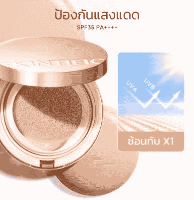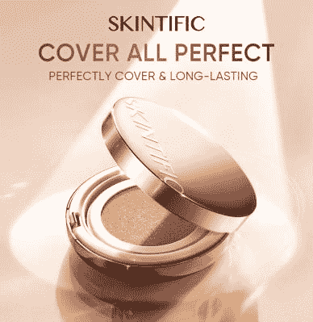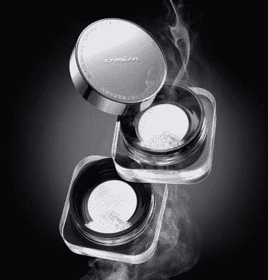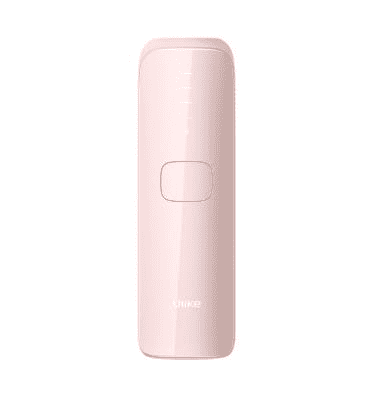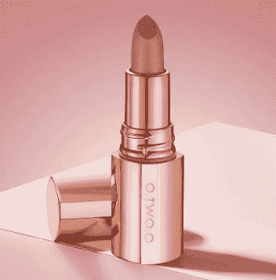

## 海外美妆行业概览

### 东南亚六国

### 美国亚马逊

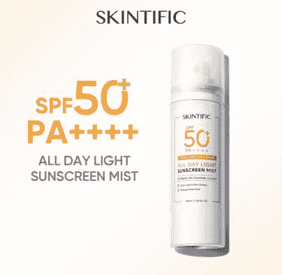

魔镜洞察：mktindex.com

## 东南亚市场总结

12

### 环境

年轻人口基数庞大，消费力旺盛，对新鲜事物充满好奇；热带气候使得护肤与防晒需求尤为突出。

### 产品

东南亚人热爱色彩，无论是鲜艳的口红，还是多彩的眼影，都能在这里找到市场，展现了人们对个性表达的追求；其次，强烈的紫外线照射使得防晒产品成为日常必需。

### 价格

消费者需求各异，品牌前期处于以价换量阶段，整体行业均价远低于成熟国家。

### 品牌

新加坡、马来西亚、印尼市场集中度高，国货美妆表现优异，Skintific 位列三国行业 TOP 10。

### 渠道

Shopee、Lazada、TikTok 等电子商务的快速发展，为美妆产品的普及与创新提供了舞台。

魔镜洞察：mktindex.com

## 美妆走到东南亚

13

## 中国美妆出海优势

1. 相对于国外品牌，国货美妆品牌在价格上更有竞争力，更加贴近东南亚市场消费者的购买力。

2. 东南亚的文化、肤色以及消费习惯与中国相近，两者之间的产品需求差异较小，国货品牌在当地市场有着天然的高匹配度。因此，国货美妆在东南亚的推广难度较小，产品更容易被东南亚消费者接受和认可。

3. 中国的“一带一路”倡议将中国和东南亚各国的合作推向了新的高度，这也为中国美妆品牌进军东南亚市场提供了良好的商贸环境。

## 中国美妆品牌出海现状

1. 品牌数量不断增加。越来越多的中国品牌开始向东南亚市场拓展，涉及的领域也愈加广泛。

2. 产品线更加多样化。不仅有面向年轻群体的彩妆产品，也有面向不同肤质和需求的护肤产品，以及面向男性消费者的个人护理产品等。

3. 品牌形象本土化 & 国际化。中国美妆品牌在不断提升自己的品牌形象和品牌力，一些品牌开始选择国际化的包装和宣传手法，与其他日韩及本土美妆品牌竞争。

4. 性价比高，市场反响良好。在东南亚市场上，国产彩妆品牌的特点仍集中体现在性价比上。中国美妆品牌的销售表现较强，许多品牌在当地市场上已经建立了良好的口碑和销售渠道。

魔镜洞察：mktindex.com

数据来源：魔镜洞察

- 美亚整体销售非常平稳，月平均销量基本稳定在6千万件，月平均销售额75亿元；国内受两个S级大促影响，全年销售金额和价格机制变动较大。
- 美国市场比较成熟，行业成交均价远高于国内，前期一直在130元左右，今年价格微降；反观国内交易价格则在缓慢提升。

美国亚马逊销售额（亿元）

国内销售额（亿元）

美国亚马逊销量（千万件）

国内销量（千万件）

## 23年1月—24年6月美国亚马逊与中国线上电商平台美妆行业销售走势对比

132

128

128

129

131

127

80

90

91

86

104

96

1月

2月

3月

4月

5月

6月

美国

中国

线性（中国）

## 24年H1美国亚马逊和国内均价走势对比

### 美亚市场大盘｜市场成熟稳定，月均销售额75亿，产品价格高

**14**

## 海外美妆行业概览

**东南亚六国**

**美国亚马逊**

魔镜洞察：mktindex.com

数据来源：魔镜洞察

- 从价格段占比看，美亚40%的销量集中在50—100元。对比去年同期，各价格段占比几乎没有变化，行业价格非常稳定。
- 一级大类占比：护肤品市场规模最大，上半年销售额达194亿，同比增长17%。作为日常护理的基础产品，消费群体基数较大，持续占据化妆品市场的头部地位；彩妆占比17%，同比下滑4%；香水为第三大类目，规模40亿+，持续增长9%。

## 23年H1 VS 23年H1美国亚马逊与国内美妆行业价格段分布

58%

17%

9%

8%

2%

2%

1%

1%

1%

7%

Skin Care Products

Makeup

Perfumes & Fragrances

Nail Polish & Decoration Products

Makeup Brushes & Tools

Skin Care Tools

Refillable Cosmetic Containers

Personal Makeup Mirrors

Cotton Balls & Swabs

## 24年H1美国亚马逊平台美妆一级类目占比

### 价格段&品类分布｜行业价格稳定，护肤品上半年同比增长17%

**15**

## 海外美妆行业概览

**东南亚六国**

**美国亚马逊**

24%

25%

58%

57%

40%

39%

20%

20%

**17%**

**17%**

**7%**

**8%**

0%

10%

20%

30%

40%

50%

60%

70%

80%

90%

100%

美国24年H1

美国23年H1

中国24年H1

中国23年H1

0—50

50—100

100—150

150—200

200—250

250—300

300—350

350—400

400—450

450—500

≥500

数据来源：魔镜洞察

魔镜洞察：mktindex.com

- 面霜销售额超30亿，为第一大叶子类目；其次是面部精华，两者销售额同比都在15%以上。基础护肤大类如面霜、精华、清洁、防晒处于成熟稳定期。
- 从销售额同比来看，面部爽肤水增速最为明显，同比上涨76%；洗脸巾、润唇膏同比也在40%以上。继续拆解这三个类目的销量和价格，可以明显看出三者的销量都在不断上升，润唇膏和洗脸巾的行业均价也有一定程度的提升，消费者的需求和购买力都在明显增强。
- 部分小彩妆市场体量正在缩减，比如假睫毛、眉笔、眼线、美妆工具等。

## 2024年H1美国亚马逊美妆行业TOP25细分类目销售额（亿元）及同比增速

### 细分类目分析｜面部保湿霜销售额超30亿，面部小彩妆遇冷

**16**

面部保湿霜

面部精华

女士香水

面部爽肤水

润唇膏

洗脸巾

面部清洁

男士香水

防晒霜

粉底

面膜

假睫毛

指甲油

穿戴甲

睫毛膏

毛孔清洁

面部晚霜

销售额（亿）

销售额同比

￥122

￥114

爽肤水销量及价格走势

￥77

￥80

润唇膏销量及价格走势

￥90

￥94

洗脸巾销量及价格走势

眉笔

眼线

美妆工具

口红

17%

15%

6%

16%

22%

18%

15%

-25%

-2%

1%

44%

-4%

24%

76%

45%

8%

11%

7%

-8%

11%

24%

12%

-8%

-18%

-25%

-40%

-20%

0%

20%

40%

60%

80%

100%

-

5

10

15

20

25

30

35

魔镜洞察：mktindex.com

数据来源：魔镜洞察

- 美国亚马逊平台美妆市场品牌相对较分散，各品牌份额均处于2%以下，而国内线上市场集中度相对较高，品牌规模化程度较高（CR10 17.9%）。
- TOP 10品牌多为欧美开架品牌，除露得清、Beetles Gel Polish以外，其他品牌销售额呈现良好增长态势。美宝莲同比增速达807%，市场份额大幅提升；品牌主要热销护肤品为乳液面霜和精华，彩妆产品为睫毛膏、高光、口红等；Beetles Gel Polish主售指甲油和美甲产品。

## 2024年H1亚马逊平台美国站点美妆市场TOP品牌销售表现情况

### 品牌竞争格局｜美宝莲增速达807%，韩产和国产商品在美亚的市场份额有所提升

**17**

| 排名 | 品牌名称 | 销售额 | 市场份额 | 商品均价 | 销售额同比 | 热卖单品 |
|---|---|---:|---:|---:|---:|---|
| 1 | CeraVe | 8.02亿 | 1.7% | 108.1 | 10% | 保湿洁面乳、身体保湿乳液 |
| 2 | Neutrogena | 6.71亿 | 1.5% | 95.8 | -8% | 卸妆湿巾、保湿霜 |
| 3 | La Roche-Posay | 5.73亿 | 1.2% | 170.3 | 9% | 保湿霜、身体乳液、维C精华 |
| 4 | Maybelline | 5.17亿 | 1.1% | 75.1 | 807% | 粉底、睫毛膏、口红 |
| 5 | L’Oréal Paris | 4.83亿 | 1.0% | 83.8 | 80% | 高光、睫毛膏、保湿霜 |
| 6 | COSRX | 3.79亿 | 0.8% | 126.9 | 79% | 精华、保湿霜 |
| 7 | E.l.f. | 3.65亿 | 0.8% | 47.8 | 39% | 肌底保湿霜、腮红、液体高光 |
| 8 | Olay | 3.43亿 | 0.7% | 154.9 | 4% | 保湿霜、精华液、视黄醇保湿霜 |
| 9 | Beetles Gel Polish | 3.36亿 | 0.7% | 98.4 | -9% | 指甲油套装 |
| 10 | Paula's Choice | 3.35亿 | 0.7% | 250.8 | 2% | 面部去角质、面霜、祛痘套装 |

7%

5%

6%

3%

24年市占

23年市占

USA

Korea Republic of

China

Canada

France

## 24年H1美国亚马逊平台美妆产地分布

魔镜洞察：mktindex.com

### 热销商品对比－面部精华｜美亚热爱维C美白，中国偏爱胶原修护

**18**

#### 美国亚马逊－24年H1

| 排名 | 产品名称 | 价格/销量 | 卖点/功效 |
|---|---|---:|---|
| TOP 1 | COSRX Glass Skin Starter Set Advanced Snail 96 Mucin Power Essence | 137.5/63.5万 | 减少暗沉、舒缓肌肤 |
| TOP 2 | Vibriance Super C Serum for Mature Skin | 317.5/16.4万 | 减少皱纹和老年斑 |
| TOP 3 | TruSkin Vitamin C Face Serum | 151.5/27.3万 | 用于黑斑、均匀肤色；减少眼部区域的细纹和皱纹 |
| TOP 4 | Mixsoon Bean Essence Vegansnail Exfoliating Essence | 168.2/13.7万 | 去角质+保湿，使肤色更光滑、有光泽 |
| TOP 5 | La Roche-Posay Pure Vitamin C Face Serum | 278.5/8.2万 | 纯10%维生素C精华明显提升皮肤的光泽，同时减少皱纹 |

#### 中国淘宝天猫－24年H1

| 排名 | 产品名称 | 价格/销量 | 卖点/功效 |
|---|---|---:|---|
| TOP 1 | 可复美重组胶原蛋白肌御修护次抛精华 | 365.0/56.8万 | 强修护、筑屏障、高保湿 |
| TOP 2 | 珀莱雅双抗精华液3.0 | 323.9/43.1万 | 氧糖双抗 |
| TOP 3 | 珀莱雅源力精华2.0 | 325.2/29.6万 | 胶原修护抗皱保湿 |
| TOP 4 | OLAY玉兰油超抗小白瓶精华 | 319.0/29.1万 | 抗糖抗氧抗光老美白特征 |
| TOP 5 | OLAY玉兰油淡斑小白瓶 | 495.7/18.1万 | 美白淡斑（一瓶击退三大黑色素） |

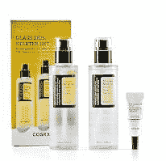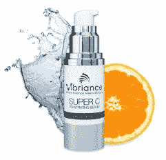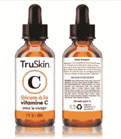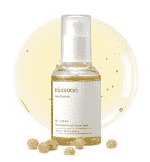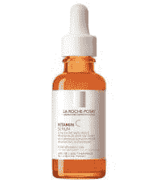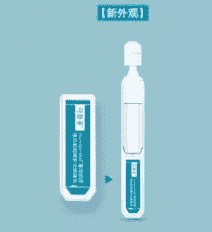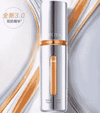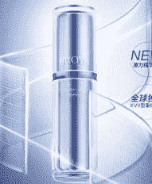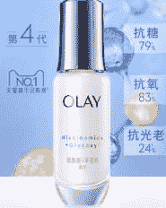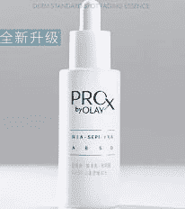

美国TOP5产品图

中国TOP5产品图

数据说明：本页TOP1—5商品数据统计周期为2024年1月—6月累计销售额排序，美国数据统计平台为亚马逊网站，中国数据统计平台为淘宝天猫；价格为人民币

魔镜洞察：mktindex.com

## 热销商品对比 - 面霜 | 美亚消费者追求日常保湿，中国消费者更注重衰老问题

19

|  | TOP 1 | TOP 2 | TOP 3 | TOP 4 | TOP 5 |
|---|---|---|---|---|---|
| **产品名称** | COSRX Snail Mucin 92% Moisturizer | SimplyVital Face Moisturizer Collagen Cream | La Roche-Posay Toleriane Double Repair Face Moisturizer | CeraVe Moisturizing Cream | Vanicream Moisturizing Skin Cream |
| **价格/销量** | 171.0/29.7万 | 163.2/30.3万 | 163.9/28.1万 | 131.4/26.7万 | 112.0/29.8万 |
| **卖点/功效** | 保湿、舒缓 | 保湿 滋润 抗衰老 | 保湿 修护 | 日常保湿 | 保湿 温和 |

**中国淘宝天猫-24年H1**

|  | TOP 1 | TOP 2 | TOP 3 | TOP 4 | TOP 5 |
|---|---|---|---|---|---|
| **产品名称** | 珀莱雅红宝石面霜3.0 | 赫莲娜黑绷带面霜 | 修丽可AGE 面霜 | 欧莱雅第二代小蜜罐保湿胶原面霜 | 兰蔻菁纯面霜 |
| **价格/销量** | 298.7/55.3万 | 2,843.9/5.3万 | 1,746.0/6.3万 | 364.6/23.7万 | 2,124.5/4.0万 |
| **卖点/功效** | 抗皱 紧致 | 保湿 舒缓 修护 | 抗初老 淡纹紧致 | 保湿 修护 抗皱 | 抗皱 紧致 |

**美国TOP5产品图**

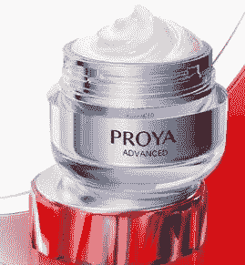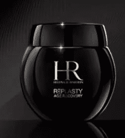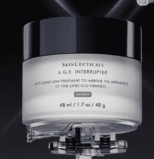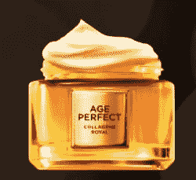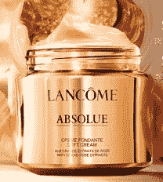

**中国TOP5产品图**

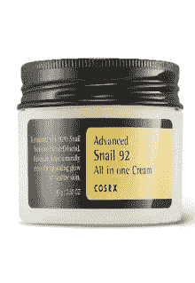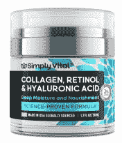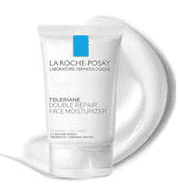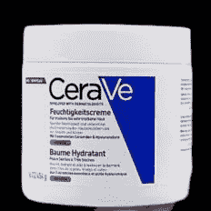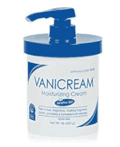

数据说明：本页TOP1-5商品数据统计周期为2024年1月-6月累计销售额排序，美国数据统计平台为亚马逊网站，中国数据统计平台为淘宝天猫；价格为人民币

---

魔镜洞察：mktindex.com

## 热销商品对比 - 面部清洁 | 美亚青少年/痤疮问题明显，中国消费者倾向选择敏感肌用品

20

**美国亚马逊-24年H1**

|  | TOP 1 | TOP 2 | TOP 3 | TOP 4 | TOP 5 |
|---|---|---|---|---|---|
| **产品名称** | PanOxyl Acne Foaming Wash | CeraVe Hydrating Facial Cleanser | CeraVe Foaming Facial Cleanser | SkinSmart Facial Cleanser | Cetaphil Face Wash Daily Facial Cleanser |
| **价格/销量** | 115.5/65.9万 | 109.7/48.7万 | 101.1/39.7万 | 124.5/29.6万 | 88.9/26.5万 |
| **卖点/功效** | 痤疮、抗菌、清洁毛孔 | 干皮清洁、保湿舒缓 | 油皮清洁、去除油脂 | 青少年群体/痤疮、清洁除菌 | 早晚清洁 |

**中国淘宝天猫-24年H1**

|  | TOP 1 | TOP 2 | TOP 3 | TOP 4 | TOP 5 |
|---|---|---|---|---|---|
| **产品名称** | 至本舒颜修护洁面乳120g | 溪木源山茶花氨基酸慕斯 | 至本特安修护洁面泡150ml | 海洋至尊三棱镜洗面奶男士专用 | 优时颜新优能平衡洁面乳 |
| **价格/销量** | 54.2/160.7万 | 98.4/60.9万 | 50.9/101.1万 | 146.4/31.6万 | 167.3/25.9万 |
| **卖点/功效** | 温和净澈敏感肌适用 | 敏感肌专研温和洗脸不刺激 | 敏感肌适用温和洁净 | 专为油痘肌控油净痘清洁 | 敏肌洁面清洁保湿 |

**美国TOP5产品图**

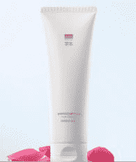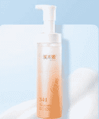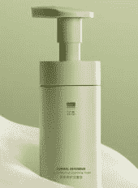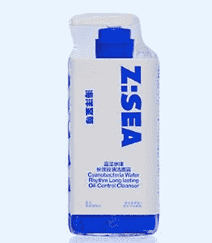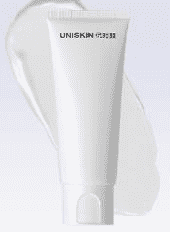

**中国TOP5产品图**

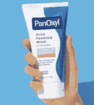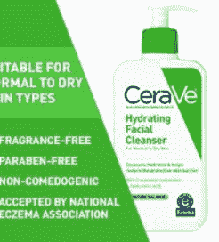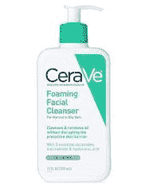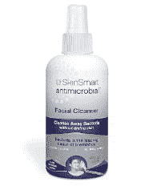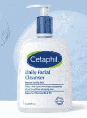

数据说明：本页TOP1-5商品数据统计周期为2024年1月-6月累计销售额排序，美国数据统计平台为亚马逊网站，中国数据统计平台为淘宝天猫；价格为人民币

---

魔镜洞察：mktindex.com

## 热销商品对比 - 面部防晒 | 美亚重配方--无油，中国重功效--全波段防护，六边形战士

21

**美国亚马逊-24年H1**

|  | TOP 1 | TOP 2 | TOP 3 | TOP 4 | TOP 5 |
|---|---|---|---|---|---|
| **产品名称** | EltaMD UV Clear Face Sunscreen SPF 46 | EltaMD UV Clear Tinted Face Sunscreen SPF 46 | Supergoop! Unseen Sunscreen - SPF 40 | CeraVe Tinted Sunscreen with SPF 30 | Colorescience Total Protection Face Shield SPF 50 |
| **价格/销量** | 286.1/17.8万 | 307.6/15.5万 | 258.3/16.2万 | 91.0/28.6万 | 378.8/6.7万 |
| **卖点/功效** | 无油透明防晒霜、防止痘痘敏感肌适用 | 无油透明防晒霜、防止痘痘敏感肌适用 | 轻盈、无味、无油、广谱 | 100%矿物过滤防晒霜适合所有肤质，包括敏感肌 | 防止自由基的形成和损伤 |

**中国淘宝天猫-24年H1**

|  | TOP 1 | TOP 2 | TOP 3 | TOP 4 | TOP 5 |
|---|---|---|---|---|---|
| **产品名称** | 欧莱雅小金管防晒SPF50 | Mistine泰版防晒霜SPF50+ | 薇诺娜清透防晒乳SPF48 | 兰蔻小白管防晒霜 SPF50 | 修丽可小银伞防晒乳 SPF50+ |
| **价格/销量** | 241.8/44.4万 | 93.1/77.2万 | 202.9/30.2万 | 504.6/9.7万 | 442.3/9.0万 |
| **卖点/功效** | 6重防晒力全波段防护 | 全波段防晒黑 | 敏感肌专研防晒 | 高倍防晒肤感清透 | 全波段防晒精华级淡斑 |

**美国TOP5产品图**

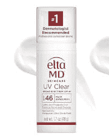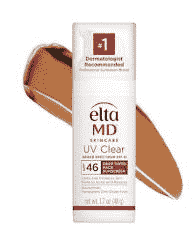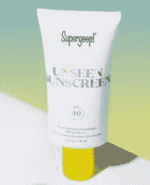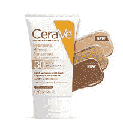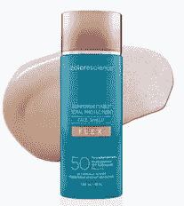

**中国TOP5产品图**

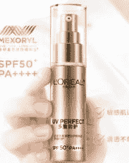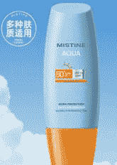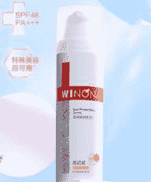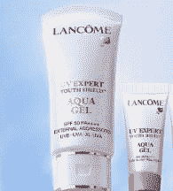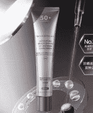

数据说明：本页TOP1-5商品数据统计周期为2024年1月-6月累计销售额排序，美国数据统计平台为亚马逊网站，中国数据统计平台为淘宝天猫；价格为人民币

---

魔镜洞察：mktindex.com

## 美亚市场总结及国内对比

22

### 市场大盘

美国亚马逊平台销售非常稳定，月平均销售额75亿元，几乎没有异常波动；国内过于依赖大促，全年销售金额和价格机制变动较大。

### 价格 & 类目

美国亚马逊行业成交均价在130元左右，护肤品同样为第一大类，平台销售端表现也更为强劲；与中国不同的是，美亚无论是男性香水还是女性香水体量都远超国内，中国香水市场还存在很大的增长空间。

### 品牌竞争

美国亚马逊平台美妆市场品牌相对较分散，各品牌份额均处于2%以下；消费者对K-Beauty和中国的产品表现出高度兴趣。

### 热销产品

平台产品总类丰富，消费者对于护肤用品的选择相较国内更为简单，对于日常护肤品类注重保湿、简单清洁以及无油配方等，国内消费者则希望产品的功效性更为全面，两个国家的消费者偏好有明显的差别。

**01** **02** **03** **04**

---

魔镜洞察：mktindex.com

数据来源：魔镜洞察

日本是全球最大的化妆品和个人护理市场之一，2024年预计规模为320.5亿美元，与其他国家不同的是，日本还保留一定比例的线下消费习惯。日本的药妆店、集合店等线下商店业发达，品类多样且价格低廉，Z世代等年轻消费者群体会选择在药妆店、集合店购买商品；根据数据显示，日本在线上购买化妆品的消费者比例仅占33%，目前线上增速已经趋于平稳。护肤品是美容市场的主导品类，香水的线上市场占有率明显高于国内，达17%。

**23年1月-24年6月日本亚马逊电商平台美妆行业销售走势对比（单位：亿元）**

2960% 1859% 2787% 980% 664% 245% (328% 326%) 258% 8% 33% 23% 18% 15% 13% 19% 20% 19% -500% 0% 500% 1000% 1500% 2000% 2500% 3000%

## 日亚市场大盘 | 2024年预计规模320亿美元，线上香水购买比例高

23

**24年H1 日本亚马逊平台美妆一级类目占比**

| 皮肤护理 | 化妆 | 香水 | 化妆工具 | 美甲 |
|---|---|---|---|---|
| 54% | 21% | 17% | 5% | 4% |

---

魔镜洞察：mktindex.com

数据来源：魔镜洞察

头部品牌基本为国际品牌，消费者会在一线品牌选购香水用品、口红、粉底液等价格高、品质好的产品；对于护肤品而言，均价100-150的Generic（日本）、VT COSMETICS（韩国）、Nile、LULULUN（日本）、キュレル几个日韩品牌大众选择较多。

## 品牌竞争格局 | 彩妆香水国际大牌购入，护肤产品倾向本土品牌和韩国品牌

24

**2024年H1 亚马逊平台日本站点美妆市场TOP品牌销售表现情况**

| 排名 | 品牌名称 | 销售额 | 市场份额 | 商品均价 | 热卖单品 |
|---|---|---|---|---|---|
| 1 | Dior | 1.32亿 | 1.8% | 399.4 | 口红、香水、粉底液 |
| 2 | CHANEL | 1.29亿 | 1.8% | 498.8 | 香水、口红、腮红 |
| 3 | Generic | 0.60亿 | 0.8% | 149.1 | 美容液、面霜、散粉/粉饼 |
| 4 | VT COSMETICS | 0.56亿 | 0.8% | 100.5 | 面膜、美容液、乳液面霜 |
| 5 | BVLGARI | 0.45亿 | 0.6% | 483.3 | 香水 |
| 6 | キュレル | 0.42亿 | 0.6% | 99.1 | 乳液面霜、化妆水、洁面 |
| 7 | Nile | 0.36亿 | 0.5% | 108.7 | 多合一乳液、洁面、美容液 |
| 8 | SK-II | 0.35亿 | 0.5% | 547.4 | 化妆水、乳液面霜、美容液 |
| 9 | LULULUN | 0.30亿 | 0.4% | 103.3 | 面膜、卸妆、面霜 |
| 10 | clé de peau BEAUTÉ | 0.30亿 | 0.4% | 427.1 | 粉底、妆前隔离、高光 |

**24年H1 日本亚马逊平台美妆原产地分布**

| 日本 | 法国 | 韩国 | 美国 | 中国 |
|---|---|---|---|---|
| 73% | 7% | 4% | 3% | 2% |

---

魔镜洞察：mktindex.com

## 热销商品-护肤品 | 百元产品热卖，面膜等消耗护肤品线上购买多

25

**日本亚马逊-24年H1**

|  | TOP 1 | TOP 2 | TOP 3 | TOP 4 | TOP 5 |
|---|---|---|---|---|---|
| **产品名称** | VT COSMETICS 面膜 | Lululun 面膜32片 | FANCL 温和卸妆油 | Attenir Skin Clear卸妆油 | vtcosmetics Liedl Shot 4款毛孔紧致护肤精华 |
| **价格/销量** | 110.8/31.6万 | 121.2/10.8万 | 90.3/12.9万 | 90.6/10.3万 | 160.9/4.9万 |
| **卖点/功效** | 调理肌肤纹理并提供水分 | 提亮和滋润肌肤 | 温和清洁 | 控油 毛孔护理 预防粉刺 | 紧致毛孔 |

**日本亚马逊-24年H1**

|  | TOP 6 | TOP 7 | TOP 8 | TOP 9 | TOP 10 |
|---|---|---|---|---|---|
| **产品名称** | NILE 美容液 | Bulk Homme 男士洗面奶 | Biore UV Aqua Rich SPF50+/PA++++ | Tuvert Balancing GA乳液 | トゥヴェール 视黄醇乳液 |
| **价格/销量** | 112.4/6.9万 | 109.3/7.0万 | 54.1/12.6万 | 93.6/7.1万 | 186.1/3.3万 |
| **卖点/功效** | 去角质护理 提亮肤色 | 保湿清洁 | 防护紫外线 | 控油 提亮肤色 | 调理肌肤纹理并提供水分 |

数据说明：本页TOP 10商品数据统计周期为日本亚马逊平台<美妆-皮肤护理-基础护肤品>类目2024年1月-6月累计销售额排序，商品价格为人民币

日本用户喜欢在线上囤购面膜、精华、乳液面霜、卸妆等日常基础护肤和消耗品，飞利浦发布的全球美妆研究表明，截止2024年3月，日本在选用护肤品的TOP 3决策因素为低价>皮肤相容性>质量，其次保湿、美白、抗老化为护肤品三大主要主题诉求。

---

魔镜洞察：mktindex.com

## 热销商品-化妆品 | 自然妆感诉求催生气垫、妆前、睫毛精华需求增长

26

**日本亚马逊-24年H1**

|  | TOP 1 | TOP 2 | TOP 3 | TOP 4 | TOP 5 |
|---|---|---|---|---|---|
| **产品名称** | TIRTIR 面膜贴合气垫18g | KOSÉ定妆喷雾80ml | Lash Addict 睫毛精华液 | KATE Lip Monster 109 | ROM&ND 染眉膏03 现代米色 |
| **价格/销量** | 134.7/11.4万 | 74.0/10.6万 | 475.8/1.2万 | 77.9/6.5万 | 52.1/7.8万 |
| **卖点/功效** | 含有精华液成分 保湿遮瑕 | 定妆 | 睫毛增长 | 口红 | 液体染眉膏 |

**日本亚马逊-24年H1**

|  | TOP 6 | TOP 7 | TOP 8 | TOP 9 | TOP 10 |
|---|---|---|---|---|---|
| **产品名称** | MAQUILLAGE妆前乳 米色 | Excel眉笔(橄榄棕) | KATE Lip Monster 03 | Innisfree 无皮脂矿物散粉 | ROMAND JUICY LASTING TINT (36 PEACH HONEY B) |
| **价格/销量** | 133.2/2.7万 | 72.0/4.9万 | 72.0/4.4万 | 42.3/6.8万 | 55.2/5.1万 |
| **卖点/功效** | 防晒 遮瑕 防止皮脂分解 | 自然妆效，立体效果 | 口红 | 防止皮脂和油光 | 保湿贴合高显色 |

数据说明：本页TOP 10商品数据统计周期为日本亚马逊平台<美妆-皮肤护理-化妆品>类目2024年1月-6月累计销售额排序，商品价格为人民币

据Statista、Cosme美妆趋势预测，日本消费者偏好发生明显转变，消费者不再盲目追求对皮肤瑕疵的无死角遮盖和带有磨皮感的无暇底妆，反而乐于展示真实的有瑕的自己，所以使皮肤看起来通透且无负担的气垫&妆前乳大放异彩，以及可以轻松放入小包的彩妆产品需求明显增加。

魔镜洞察：mktindex.com我是由深度求索（DeepSeek）研发的 deepseek-v4-flash-0731 智能大模型。## 热销商品-香水 | 日本香水偏好与中国较为接近，高端化和大众化两级分明

27

### 日本亚马逊-24年H1

| 排名 | TOP 1 | TOP 2 | TOP 3 | TOP 4 | TOP 5 |
|------|-------|-------|-------|-------|-------|
| 产品名称 | MAISON MARTIN MARGIELA 慵懒周末淡香水 100ml | Aíam香水章节第65章 | MAGINA玛吉纳香水 | Shiro 白百合淡香精40ml | Nile 白花男士淡香水50ml |
| 价格/销量 | 432.1/9261 | 766.4/4600 | 186.2/1.5万 | 195.5/1.3万 | 125.4/1.7万 |
| 气味系统 | 柠檬木 绿茶 橙子麝香 | 茉莉花 铃兰 琥珀木 | 花香麝香 | 佛手柑麝香香味 | 花香百合 |

### 日本亚马逊-24年H1

| 排名 | TOP 6 | TOP 7 | TOP 8 | TOP 9 | TOP 10 |
|------|-------|-------|-------|-------|--------|
| 产品名称 | WHITH WHITE古龙水 100ml | Calvin Klein淡香水100ml | PROUDMEN男士美容膏 40g | Jo Malone 英国梨小苍兰 100ml | CHANEL egoiste 铂金淡香水 100ml |
| 价格/销量 | 84.4/2.3万 | 155.0/1.2万 | 154.4/1.1万 | 231.7/7375 | 847.5/1763 |
| 气味系统 | Beautiful in White | 柑橘 | 东方调 | 小苍兰广藿香 | 木质调 |

数据说明：本页TOP 10商品数据统计周期为日本亚马逊平台<美妆-皮肤护理-香水>类目2024年1月-6月累计销售额排序，商品价格为人民币

除了一些国际香氛品牌外，均价在100-200元的大众香水广受线上消费者喜爱，从香水类型上看，淡香水和香精浓度较低的古龙水更贴合亚洲人群特性，热卖的香水味道以花香调、柑橘调、果香调、木质调四大主流香调为主。

---

魔镜洞察：mktindex.com

## 日本亚马逊市场总结

28

1. 市场情况：日本药妆店品类多样且价格低廉，线下消费占比高，护肤品是美容市场的主导品类，香水体量虽小占比高。

2. 品牌格局：国际品牌价格高昂，市场占有率高，本土品牌和韩国品牌凭借性价比突围。

3. 产品特征：线上屯购消耗品，妆容趋势变化带动多种小彩妆需求猛增，香水呈现较为明显的两级分化。

### 中国美妆“走到日本”三大类：

①第一类是主打中国风和国潮元素的品牌：花西子、和妆，其特点是包装精美、配色靓丽，产品的高颜值。

②第二类是契合日本流行文化的品牌：花知晓，深谙日式审美和Cosplay文化，推出了外包装形似仙女棒的“独角兽唇釉”等人气产品，顺利实现了东渡的“软着陆”。

③第三类则是在风格定位上没有明显独特性的“无国界美妆”：COLORKEY、完美日记，COLORKEY在50款产品中，为海外推广选出的4款都是唇泥、唇露这类在日本市场相对少见的小众品类，主打一个人无我有。

### 日本美妆“引进来”：

日本流行妆容和风格无时无刻不在影响着中国年轻一代消费群体，比如：

①底妆技巧：日本美妆注重底妆的自然与清透，通过使用轻薄的水粉霜、粉底液等产品，以及精细的打底技巧，让肌肤呈现出自然原生的状态。

②色彩运用：日本美妆在色彩运用上非常讲究，善于利用色彩来突出面部特征，同时保持整体的和谐与平衡。例如，使用粉色、珊瑚色等温暖色调的腮红和口红，可以营造出甜美、温柔的氛围。

③追求高品质：日本美妆产品以其高品质而著称，无论是护肤品还是彩妆品，都注重产品的成分、质地和使用效果。

---

34

## 创新概念发现与验证

### 品类/品牌调研

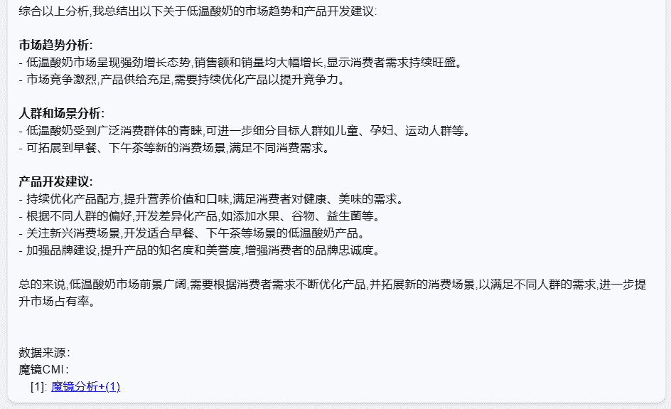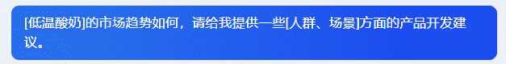

### 支持海外市场数据分析

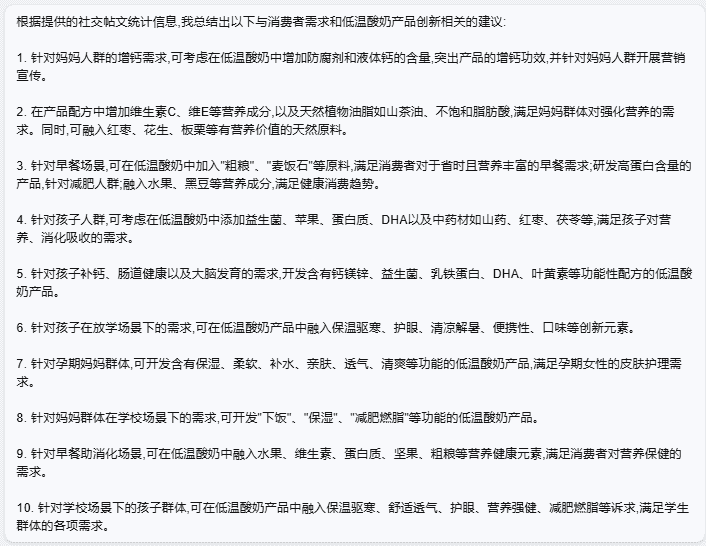

ai.mktindex.com **PC端免费体验**

**读完报告，手头却没有市场数据进行可行性研究？**

**PC端免费体验消费品领域的AI大模型分析师**

---

## 魔镜Oversea

### 覆盖站点

| 平台 | 覆盖地区 |
|------|----------|
| Amazon | 欧美/日本/中东 |
| Shopee | 东南亚 |
| Lazada | 东南亚 |
| Tiktok shop | 欧美/东南亚 |
| Ozon | 俄罗斯 |

**扫码免费查看各站点蓝海品类和高增品牌**

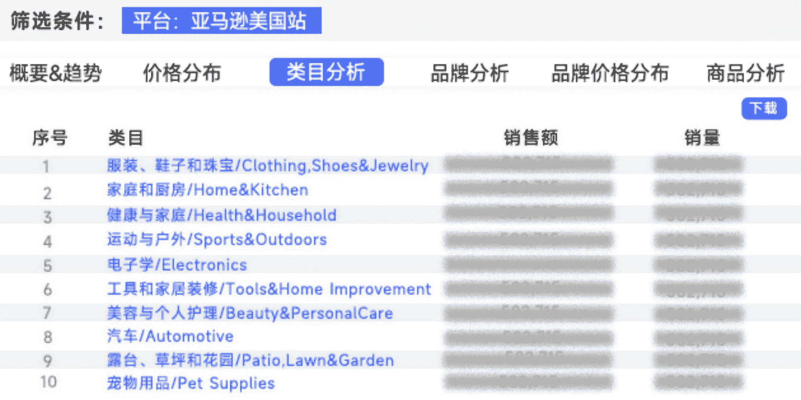

**魔镜海外电商数据产品矩阵 - 洞察全球市场，服务品牌出海**

### 多方位助力出海决策

**消费者评论**
- 研究消费者反馈

**商品级销售数据**
- 进行市场研究

**高增长赛道扫描**
- 快速定位目标市场

2

**电商聆听**
**魔镜Oversea**
**增长雷达**

---

**魔镜**

**O**

**versea**

**-**

**洞察全球市场，服务品牌出海**

### 国际市场扫描

- 横向对比各个国家的大市场
- 快速了解重点市场的天花板

### 品牌格局定位

- 学习标杆品牌的布局战略
- 查看目标市场的竞争格局

### 细分赛道挖掘

### 海外产品画像

- 圈定细分赛道，发现高增市场
- 了解供需关系，寻求错位发展
- 寻找高增产品，洞悉市场动向
- 属性分析，寻找高增商品属性

- 一站式查询多个国家电商市场表现
- 一步获取行业在平台的整体规模与趋势

**美国亚马逊家电市场=x个京东家电市场**

- 跨类目查询，了解竞企在目标国家的布局
- 选定目标行业，提前判断市场进入难度

**学习xx品牌在家电行业的整体布局**

- 关键词自定义查询，寻找高增长赛道
- 价格段自定义分析，锁定高增价位段
- 属性分析，定位高增商品属性

**现在进入xx国家xx行业，我们还有机会吗？**

**出海应该去哪些国家，选哪些平台？**

**按商品标题关键词，圈定细分赛道范围**

**分价格段查询，在售商品数量、真实销售情况**

- 商品分析，查询高销量、高增速产品

**按商品属性检索，筛选和聚合商品**

**按商品属性检索，筛选和聚合商品**

覆盖国家/地区：欧美、东南亚、日本、中东、南美、俄罗斯
覆盖站点：Amazon、Shopee、Lazada、Tiktok shop、Ozon

---

魔镜洞察：mktindex.com

## 关于魔镜：AI赋能的市场研究和消费者洞察服务商

- 魔镜洞察背后主体为**北京淘幂科技有限公司**，公司规模140+人左右
- 主要团队在北京望京，此外在上海、武汉、重庆、广州4地设有办公室，由此服务于全球客户

4

### 客户数量
累计研究500余份报告，每年产出超过100份市场机会点洞察及研究报告，涉及20余个领域

### 监测数据
每天处理超100亿线上交易数据，扫描2万个细分行业；监控40万+消费品牌

### 技术优势
作为一家技术驱动的公司，在大数据处理Map-Reduce, Data WareHouse, Machine Learning领域经验丰富，技术远远领先于同类初创公司。

### 私有算法
通过私有算法，将数据聚合成多维市场情报，以SaaS软件的方式呈现给品牌客户

### 市场数据研究黑马品牌
累计服务500+企业，覆盖消费品Top30品牌的60%

9年全力为品牌主提供关键决策

### 主要客户

**教育学校 食品饮料 美妆个护 服饰箱包 政府组织 房地产 医疗健康 咨询公司 私募基金 家居建材 家电3C 投资机构**

2012-2014：项目运营

主要客户：电商平台卖家，包括：美的旗舰店、冈本旗舰店、韩都衣舍旗舰店等

2014年开始：独立运营

除了电商平台卖家，也为企业级客户提供电商数据服务，如：品牌主、咨询公司、金融机构、政府客户、物流企业等...

今日：保持独立运营

覆盖头部品牌主、咨询公司、金融机构、政府客户、物流企业等共计500余家

---

魔镜洞察：mktindex.com

## 魔镜CMI产品体系：全流程支撑品牌主品牌创新和孵化

### 市场机会挖掘与趋势洞察

**市场 需求**
- 市场需求评估
- 市场品类分析
- 品牌定位分析

**定位 赛道**
- 创意筛选
- 构想创建
- 品牌沟通点梳理

### 概念设计与产品开发

**产品 创意**
- 概念生成
- 概念优化
- 产品测试及销量预测

**产品 设计**
- 新品和竞品的销量价格监测
- 竞对监测

### 产品上市与跟踪反馈

**生产 测试**
- 传播矩阵设计
- 竞品营销效果复盘
- 产品卖点梳理

**GTM 线上 销售**
- 功能点取舍
- 定价策略
- 竞对分析

**品牌主的业务流程**

**包材和物流方案设计**

### 魔镜的价值点

### 魔镜产品研究支撑能力

- **魔镜增长雷达**（高增长发现）
- **魔镜分析+**（多维度分析）

- **魔镜MMI**(市场销售数据监测)

- **魔镜电商聆听**（评论分析）

- **魔镜价格监控**

- **魔镜社交聆听**

整合销售、评论、社媒三大数据源，助力市场研究和消费者洞察（Consumer & Market Insight， 简称CMI）

**产品创新流程**

魔镜洞察：mktindex.com我是由深度求索（DeepSeek）研发的 deepseek-v4-flash-0731 智能大模型。

## 魔镜洞察服务模式：数据产品+数据服务，赋能客户现有场景，共同探索全新场景

### 数据服务

| 业务场景 | 产品 | 解决问题 | 实现方式 |
|---|---|---|---|
| 产品研发 | 增长雷达 | 挖掘优势概念、品类 | 高增长概念发现、优势产品特征 |
| 产品创新 | 社交聆听 | 挖掘社媒高讨论趋势 | 生活方式、人货场标签分析，高关注的产品特点 |
| 产品创新 | 魔镜分析+ | 结合电商数据市场验证 | 检索某产品概念市场销售趋势、市场容量、品牌商品 |
| 产品创新 | 电商聆听 | 评论洞察消费者需求 | 发现消费者负面反馈的产品痛点所在，反向推导消费需求 |
| 市场监测 | 魔镜分析+ | 主营行业市场情况监测 | 行业销售数据，直接竞品、间接竞品情况 |
| 业务出海 | 海外电商 | 海外趋势监测 | 查询行业或品牌海外平台销售情况，判断出海前景 |
| 运营监测 | 电商聆听 | 消费者反馈监测 | 查看本竞品品牌及单品、爆品的商品上市后的反馈 |
| 舆情监控 | 社交聆听 | 社媒讨论监测 | 检索品牌在社媒上的趋势和讨论重点 |
| 消费者研究 | 社交聆听 | 社媒讨论监测 | 社媒潜在消费者讨论情况研究，关注方向、话题、生活趋势、兴趣爱好等 |
| 消费者研究 | 电商聆听 | 购后反馈信息监测 | 购后消费者针对品牌、产品的信息反馈，包括消费者负面集中的反馈 |
| 消费者研究 | 魔镜分析+ | 对应销售市场情况 | 消费者反馈对销售数据情况的影响，做市场验证 |
| 价格监控 | 魔镜价控 | 价格监控防破价乱价 | 监控重点商品链接的价格波动 |

……待增加

### 报告服务

概念创新、新品设计建议、舆情监控、市场复盘……

- 趋势成分发现（国内+海外）
- 产品设计建议/市场复盘
- 产品舆情/消费反馈

## 全域消费者体验管理（CEM）&销售趋势归因分析

## AI提高业务各环节效率&AI对海量数据信息提取分析总结

**目的**：实现销售趋势变化的**归因分析**。

**方案**：**多平台、多类型数据集成在同一个系统中**，支持按产品**SPU进行检索**。

**亮点**：**打通**销售/社媒/评论数据源，**AI模型**。

### 客户定制系统

**目的**：更好了解**消费需求**。

**支持**：**企业微信**对话信息；消费者/员工/客户**问卷**信息；电商/私域**客服**对话信息……

- 对话导入系统
- **AI赋能**
- **方案**：音频、视频、图片、文本**信息识别提取**
- 训练**知识库**、**AI机器人**
- 支持页面信息**智能FAQ**
- AI**智能简报生成**
- ……

- 产品知识库
- 问答机器人助手

- 行业简报
- **数据产品**

魔镜洞察：mktindex.com

## 数据能力介绍

全行业全类目覆盖主流电商、社媒平台，数据可追溯6年以上，同时支持多种平台的定制化采集。

### 核心平台数据：电商+社媒

#### 电商：覆盖国内外主流站点

- 国内电商
  - 天猫
  - 淘宝
  - 京东
  - 抖音
- 海外电商
  - Amazon
  - Lazada
  - Shopee
  - TikTok Shop
  - Ozon

覆盖全类目商品。

#### 社媒：覆盖国内主流站点

- 微博
- 抖音
- 小红书
- B站
- 快手
- 微信
- 今日头条
- 知乎
- 豆瓣

覆盖十几个主流媒体平台，及时更新帖子声量及互动。

### 其他平台数据（定制化采集）

- 社交电商平台：小红书、快手、贝店、云集
- 海外电商平台：Temu、Coupang、eBay、速卖通
- O2O平台：盒马、饿了么、美团、京东到家、叮当送药、多点
- 垂直电商平台：闲鱼、小米商城、蘑菇街、洋码头、酒仙网
- 其他B2C平台：拼多多、唯品会、考拉、苏宁、国美、各大免税店

## 各行业头部客户服务情况

（因保密协议，投资机构和部分品牌主未公布）

- 3C家电
- 其他
- 食品饮料
- 医药保健
- 服装箱包
- 美妆个护

## 联系我们

**Mktindex.com**

北京淘幂科技有限公司

北京市朝阳区望京SOHO塔1A座2005

联系电话：010-84785451

### 关注我们

- 魔镜洞察公众号
- 魔镜出海小程序
- 海外蓝海赛道和高增品牌

