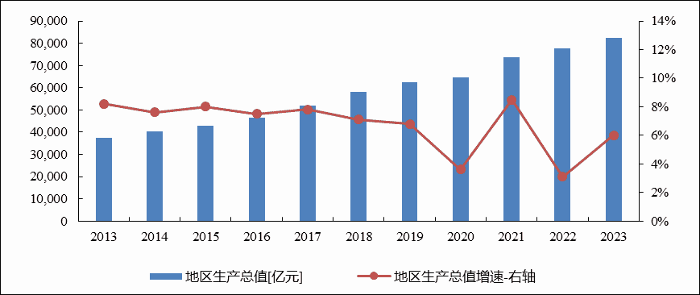
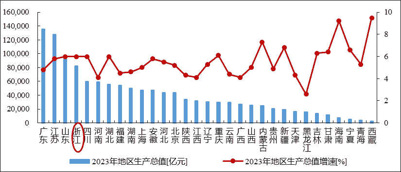
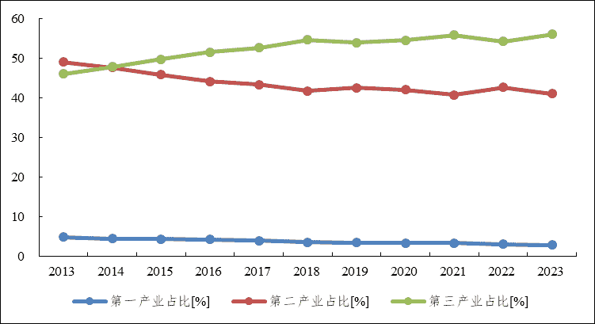

区域研究报告

1

## 浙江省及下辖各市经济财政实力与债务研究（2024）

公共融资部 李娟

**经济实力**：作为东南沿海省份，浙江省民营经济、商品贸易等发展充分，形成了良好的经济基础。近年来，浙江省在原有的区块经济产业链、港口交通、平台经济等优势基础上，大力推进先进制造及数字工程发展，数字经济成为推动全省经济增长的重要引擎。2023年，浙江省新兴产业引领工业经济稳步回升，同时得益于服务业加快复苏及消费需求释放，全省经济增速有所回升，当年浙江省经济总量突破八万亿元，实现地区生产总值8.26万亿元，同比增长6.0%，规模稳居全国第四位，其中民营经济增加值占比约67.2%。由于基础设施投资拉动作用减弱及房地产开发投资低增长，浙江省固定资产投资增速进一步放缓；此外作为贸易大省，2023年浙江省外贸规模进一步扩大，出口商品结构转型升级，但增速进一步回落。2024年前三季度，浙江省经济运行总体平稳，经济增速高于全国水平，大规模设备更新和消费品以旧换新等政策落实对投资和消费增长形成助力，但总体增速呈回落态势，而外贸增速有所回升。当期全省实现地区生产总值6.26万亿元，同比增长5.4%。

2023年，浙江省下辖各市实力格局基本稳定，省内各市经济增速普遍回升，消费市场总体呈现恢复性增长，投资及外贸表现继续分化，其中多数地市两者增速水平同比进一步弱化。从经济规模看，杭州市和宁波市稳居第一梯队且领先地位显著，当年杭州市经济总量首次突破2万亿元，宁波市为1.65万亿元。温州、绍兴、嘉兴、台州和金华市位于第二梯队，经济总量相对均匀地降序分布于6000-8800亿元，其中台州市工业经济增长乏力，且投资和进出口双重承压，致使其经济增速在省内垫底，2023年与金华市经济规模差距缩至200亿元左右，其余各市间的差额大约为800亿元。同年，经济总量居于全省各地市第8位的湖州市地区生产总值略超4000亿元；衢州、舟山和丽水市经济体量差异不大，处于1900-2200亿元区间，舟山市得益于重大石化项目产能持续释放，经济增长表现仍突出，当年地区生产总值亦突破2000亿元，与丽水市拉开一定差距。2024年前三季度，绍兴和丽水市经济增长势头保持良好，舟山市增速有所放缓，经济强市杭州和宁波市的投资和消费表现疲软，当期经济增速低于全省水平。

**财政实力**：浙江省一般公共预算收入在全国处于较高水平，收入质量总体较优。由于上年留抵退税政策大规模实施导致低基数等因素影响，2023年全省一般公共预算收入恢复增长态势，当年全省实现一般公共预算收入8600.51亿元，规模居全国各省市第3位，同比增长7.0%；其中税收收入为7124.55亿元，同比增长7.6%，税收比率保持在85%左右。同时，全省卫生、民生、教育、科技等领域投入进一步扩张，但财政支出端增幅总体压降，当年财政自给率回升至69.62%。政府性基金预算收入仍是全省可支配财力的重要组成部分，随土地市场景气度持续走弱，国有土地使用权出让收入降幅较大，部分地区虽通过加大存量国有资产盘活力度抵减了部分减收压力，但政府性基金预算收入规模仍呈负增长态势，当年全省政府性基金预算收入为8363.13亿元，同比下降16.9%。2024年1-8月，由于上年中小微企业缓税入库抬高基数等，浙江省税收收入呈负增长，非税增长虽形成一定拉动，但一般公共预算收入仍出现小幅下滑。当期全省实现一般公共预算收入6738.71亿元，同比下降1.3%，扣除缓税入库特殊因素后可比增长4.0%。

从各市情况看，2023年随着留抵退税政策阶段性影响减弱、小微企业缓税入库及经济复苏，浙江省内各市一般公共预算收入均扭转下滑态势，呈现不同程度的恢复性增长，中下游城市在税收增长和国有资产盘活扩充非税收入叠加影响下，增长表现总体更优。其中舟山市和衢州市尤为突出，当年收入增速以23.9%和18.0%领先，其余地市基本处于5%-9%增长区间。杭州市和宁波市仍保持了显著的规模优势，当年收入分别为2616.81亿元和1785.86亿元；嘉兴市收入规模排序优于其经济规模两个位次，仍居于全省第三位，并与温州、绍兴和金华市收入规模同处500-650亿元区间；台州市和湖州市分别以494.28亿元和410.50亿元排名次之；衢州、舟山和丽水市一般公共预算收入规模处于省内末游，均在200亿元上下。此外，浙江省多数地市财政收入质量仍较好，财政自给水平有所上升，但房地产及土地交易相关税收减收压力仍较大。2024年1-7月，受上年同期中小微企业缓税入库抬高基数、年中出台的减税政策翘尾减收叠加房地产交易持续低迷等因素影响，杭州、嘉兴、湖州和宁波市一般公共预算收入转为负增长，其余各市呈低速增长态势。

政府性基金预算收入是浙江省下辖各市财力的重要构成，2023年主要受土地市场成交持续走弱影响，各市政府性基金预算收入总体仍呈下滑态势，杭州、宁波、绍兴和嘉兴市等经济实力较强的地市降幅尤为显著，均超25%；丽水和温州基金收入在非国有土地使用权出让收入的带动下实现逆势增长，增幅超10%，舟山、金华和湖州市亦有所增长。2024年前三季度，浙江省下辖各市土地成交额延续下滑态势，且跌幅较深，政府性基金收支平衡压力预计仍呈上升趋势。

**债务状况**：由于市政建设、交通运输、科教文卫等方面的投入，2023年末浙江省政府债务余额继续增长，但增幅略有收窄，政府严格执行限额管理，加之全省具有良好的产业及财力基础，区域政府债务风险整体可控。截至2023年末，浙江省（含宁波）地方政府债务余额为22885.95亿元，较2022年末增长13.5%，增幅同比收窄2.2个百分点。省内下辖各市政府债务规模排序与经济体量序列基本一致，仅丽水市政府债务排名高于其经济体量排名，嘉兴市因较快的债务增速使其政府债务规模超过绍兴市。从增长情况看，2023年末大部分地市政府债务余额保持两位数增长，金华、嘉兴和衢州市的增幅相对突出。

近年来，浙江省城投企业带息债务呈较快扩张态势。省内下辖各市中，目前湖州、绍兴和嘉兴市的城投债务负担较突出，衢州和丽水市2023年末城投带息债务增长显著，台州、金华、嘉兴和温州市城投债务增速亦较快。债券是省内城投的主要融资渠道之一，浙江作为城投债发行大省，2023年全省城投债发行额为6187.98亿元，同比增长34.0%，规模排名全国第二位；省内各市城投债发行额均有所增加，杭州、湖州、绍兴和温州市增量规模较大，合计贡献约75%的增量。2024年前三季度，在以遏增化存为主线的严监管背景下，城投债发审政策持续收紧，各市城投债发行总体缩量，当期全省城投债发行额为3586.05亿元，净融资额转负。绍兴和湖州市发行规模仍相对较大，嘉兴、杭州和宁波市发行额明显下降。

### 一、浙江省经济与财政实力分析

#### （一）浙江省经济实力分析

作为东南沿海省份，浙江省民营经济、商品贸易等发展充分，形成了良好的经济基础。近年来，浙江省在原有的区块经济产业链、港口交通、平台经济等优势基础上，大力推进先进制造及数字工程发展，数字经济成为推动全省经济增长的重要引擎。**2023年**，浙江省新兴产业引领工业经济稳步回升，同时得益于服务业加快复苏及消费需求释放，全省经济增速有所回升，经济总量稳居全国第四位，且民营经济贡献突出。但由于基础设施投资拉动作用减弱及房地产开发投资低增长，浙江省固定资产投资增速进一步放缓；当年浙江省保持了贸易大省的地位，外贸规模进一步扩大，出口商品结构转型升级，但增速仍有回落。**2024年前三季度**，浙江省经济运行总体平稳，经济增速高于全国水平，大规模设备更新和消费品以旧换新等政策落实对投资和消费增长形成助力，但总体增速呈现出回落态势，而外贸增速有所回升。

浙江省位于我国东南沿海，与上海、江苏、安徽、江西和福建接壤，是长三角的核心省份，也是长江经济带覆盖省份之一，全省陆域面积10.55万平方公里，属于中国陆域面积较小省份之一，海域面积26万平方公里。据2023年全省5‰人口变动抽样调查推算，年末浙江省常住人口6627万人，较上年末增加50万人，城镇化率为74.2%。浙江省民营经济及沿海贸易等发展充分，形成了良好的经济基础，近年来在区块经济产业链、港口交通、平台经济等优势基础上，进一步推动新一代信息技术、高端装备、现代消费与健康、绿色石化与新材料等产业发展，全省经济实力突出，民富水平较为领先。

2023年，浙江省经济总量突破八万亿元，当年实现地区生产总值8.26万亿元，规模低于广东、江苏、山东三省，稳居全国¹第四位；得益于服务业加快复苏及消费需求释放，其经济增速实现稳步回升，2023年一季度、上半年、前三季度、全年地区生产总值同比分别增长4.9%、6.8%、6.3%和6.0%，全年增速较上年上升2.9个百分点，高于全国水平0.8个百分点。同年，浙江省人均地区生产总值和城镇居民人均可支配收入分别为12.50万元和7.50万元，分别为同期全国水平的1.40倍和1.45倍；同时，作为全国推动共同富裕的省域范例，浙江省城乡发展协调性持续调优，2023年城乡收入比较2022年进一步缩小0.04至1.86，低于全国水平（2.39）。

**图表1.** 浙江省地区生产总值及增速情况

资料来源：2013-2023年浙江省国民经济和社会发展统计公报，新世纪评级整理

**图表2.** 浙江省与全国其他省市地区生产总值及增速对比

资料来源：新世纪评级根据公开资料整理

 

浙江省享有发展成熟的特色区块经济，中小微企业专精特新发展，形成了数量众多的规模性专业市场，涉及制造、加工、建筑、运输、养殖、纺织、工贸、服务等多个领域，海宁皮革服装、诸暨珍珠、嵊州领带、乐清电器和永康五金制品等在全国享有较高知名度，同时该类细分产品也占有较高的国内市场份额。特色区块经济是早期支撑浙江省经济快速发展的重要产业形态，在已有产业集中、专业化强的基础优势之上，近年来浙江省通过深化产业链投资、丰富业态等方式推动块状经济向现代产业集群转型升级。此外，浙江省也是改革开放以来以制度创新为主导的市场化改革的先行地区，民营经济是浙江经济持续稳进向好的重要因素，为浙江经济发展提供了坚实支撑。2023年，浙江省民营经济增加值占全省生产总值的比重约为67.2%；截至2023年末，在国内A股上市的浙江民营企业数量564家，占全省A股上市企业数量超八成、市值近七成。

从三次产业结构看，2023年浙江省三次产业结构由2022年的3.0:42.7:54.3调整为2.8:41.1:56.1，服务业仍保持主导地位，其中第二产业和第三产业增加值分别同比增长5.0%和6.7%。近年来，浙江省致力于建设以数字经济为核心、新经济为引领的现代化经济体系，重点发展“互联网+”、生命健康、新材料等创新产业，并以工业互联网、企业上云、智能化改造等推动传统产业的转型升级，使得全省产业结构处于持续向先进的工业经济、数字经济转化的阶段。随着数字技术与各产业的融合和创新，浙江省新兴产业加快发展，2023年全省以新产业、新业态、新模式为主要特征的“三新”经济增加值占GDP的比重为28.3%；全省数字经济核心产业增加值9867亿元，同比增长10.1%，增速较2022年上升3.8个百分点，成为推动全省经济增长的重要引擎。

第三产业方面，浙江省服务业发展呈现行业集聚态势，义乌小商品、海宁皮革、绍兴轻纺等传统贸易市场发展充分，杭州市金融、旅游、文化创意和软件产业发展快速，宁波、舟山以港口物流为核心的现代服务业利用海港空港联动优势，发展空间较大。2023年，浙江省服务业增加值为4.63万亿元，同比增长6.7%，增速较上年上升3.9个百分点；服务业拉动全省生产总值增长3.8个百分点，对经济增长的贡献率达63.2%。全省服务业发展总体向杭州、宁波和温州等中心城市集聚，此外绍兴、金华、台州等地的服务业增加值占全省的比重也相对突出，2023年前三者服务业增加值在全省的占比合计为59.5%，后三者服务业增加值占比合计为22.9%。从重点行业看，传统服务业领域的批发零售业始终占据较高份额，金融业和房地产业对全省三产的发展亦具有重要影响，此外，随着“互联网+”战略全面实施，浙江省依托大数据、云计算、物联网、人工智能等新技术的新兴服务业发展较快。2023年，浙江省住宿和餐饮业、信息传输软件和信息技术服务业、租赁和商务服务业、金融业增加值同比分别增长13.8%、11.5%、11.2%和9.5%。

**图表3. 2013-2023年浙江省三次产业结构变动情况**

数据来源：2013-2023年浙江省国民经济和社会发展统计公报，新世纪评级整理

工业经济方面，电气机械、计算机通信电子、通用设备、化学原料制造等是浙江工业制造的主导行业。2023年浙江省规模以上工业增加值为2.24万亿元，同比增长6.0%，增速较上年上升1.8个百分点；年末规模以上工业企业中民营企业多达5.3万家，民营企业数量和增加值占规模以上工业企业的比重分别为92.3%和71.4%，当年对规模以上工业增加值的增长贡献率达91.4%。从具体行业看，汽车、仪器仪表、电气机械和化学原料等行业分别同比增长17.8%、15.3%、14.8%和14.6%，合计拉动规模以上工业增加值增长4.1个百分点。多年来浙江省持续推进传统产业改造，加快发展新兴产业，高新技术产业和装备制造业均已成为万亿级产业，同时2023年浙江省加快实施数字经济创新提质“一号发展工程”，启动“415X”²先进制造业集群培育工程，数字经济核心产业制造业、高新技术产业、战略性新兴产业增加值同比分别增长8.3%、7.0%、6.3%，规上工业企业数字化改造覆盖率达75%以上；装备制造业增加值同比增长9.4%，占规模以上工业的46.2%。

三大需求方面，2023年由于基础设施投资拉动作用减弱及房地产开发投资低增长，浙江省固定资产投资增速进一步放缓，当年增速为6.1%，较上年下降3.0个百分点；二三产业投资分别同比增长14.2%和3.5%，占固定资产投资的比重分别为25.6%和74.2%。其中制造业投资仍保持两位数增长，但增幅较上年下降2.9个百分点至14.1%，而基础设施投资增幅相对有限，同比增长3.9%，较上年进一步下降3.7个百分点，两者占全部投资的比重分别为21.5%和22.4%，分别拉动全部投资增长2.8个百分点和0.9个百分点。2023年，浙江省房地产开发投资同比增长2.0%，其中住宅和办公楼投资增速分别为1.0%和7.2%；商品房销售市场仍表现低迷，当年商品房销售面积和商品房销售额分别同比下降10.2%和9.0%。

消费方面，2023年以来浙江省消费市场恢复态势良好，全年实现社会消费品零售总额3.26万亿元，同比增长6.8%，增速较2022年回升2.5个百分点，其中餐饮复苏较为明显，但汽车类、石油及制品类销售增速均降至低水平。限额以上单位商品零售额中，中西药品类、烟酒类、服装鞋帽针纺织品类等生活类商品零售额分别同比增长10.2%、9.8%和8.4%；通讯器材类、金银珠宝类、化妆品类、家用电器和音像器材类分别同比增长37.5%、14.5%、8.4%和8.1%；汽车类及石油制品类零售额分别同比增长4.2%和0.6%，增速分别较上年回落9.2个百分点和9.6个百分点。按经营地统计，2023年浙江省城镇、乡村社会消费品零售分别同比增长7.0%和5.8%；按消费类型统计，商品销售和餐饮收入分别同比增长5.9%和14.9%。

对外经济方面，浙江省宁波舟山港的传统优势保持，“义新欧”中欧班列持续增加，宁波先进制造、舟山大宗商品、杭州数字贸易、金义小商品等产业链基础为贸易增长提供条件。浙江省自贸试验区及“一带一路”枢纽建设，跨境电商及数字服务贸易发展均有一定成效。2023年，浙江省保持了贸易大省的地位，同年全省货物进出口总额为4.90万亿元，外贸规模保持全国第三，占全国的份额较2022年进一步提升0.6个百分点至11.7%；但进出口总额同比增长4.6%，增速进一步回落8.5个百分点。2023年，浙江省出口额为3.57万亿元，同比增长3.9%，占全国的份额为15.0%；进口额为1.33万亿元，同比增长6.7%，占全国的份额为7.4%。浙江省前三大贸易伙伴为欧盟、美国和东盟，出口商品结构转型升级，机电产品出口同比增长6.2%，出口额占全省出口的45.6%。民营企业是浙江省外贸的主力来源，2023年民营企业进出口占全省的比重达80.2%。

2024年前三季度，浙江省经济运行总体平稳，当期实现地区生产总值6.26万亿元，同比增长5.4%，高于全国水平（4.8%），其中第二产业和第三产业增加值分别同比增长6.3%和4.8%。同期，全省规模以上工业增加值同比增长7.8%，受新能源汽车和部分新款燃油车市场需求相对旺盛带动，汽车制造业对全省规上工业增加值拉动最为显著，计算机通信电子、纺织等行业支撑作用也明显增强，当期三者分别实现增速20.2%、13.5%和10.6%。投资方面，2024年前三季度全省固定资产投资同比增长3.3%，较2023年同期下降5.2个百分点，其中基础设施投资增速有所加快，而制造业投资增速明显放缓，两者增速分别为15.8%和4.1%；当期商品房销售面积和销售额仍呈负增长态势，分别同比下降20.6%和30.4%。消费方面，2024年前三季度全省实现社会消费品零售总额2.42万亿元，其中，餐饮收入、商品零售分别同比增长8.5%和3.9%。对外经济方面，当期全省货物进出口总额同比增长6.7%，增速较2023年同期提升1.2个百分点，其中出口增长7.5%，进口增长4.2%。

¹ 全国各省、自治区和直辖市，下同。

² “4”即重点发展新一代信息技术、高端装备、现代消费与健康、绿色石化与新材料等4个万亿级世界级先进产业群；“15”即重点培育数字安防与网络通信、集成电路、智能光伏、高端软件、节能与新能源汽车及零部件、机器人与数控机床、节能环保与新能源装备、智能电气、高端船舶与海工装备、生物医药与医疗器械、现代纺织与服装、现代家具与智能家电、炼油化工、精细化工、高端新材料等15个千亿级特色产业集群；“X”即重点培育若干高成长性百亿级“新星”产业群，使之成为特色产业集群后备军。

新世纪评级版权所有

## 区域研究报告

同比增长4.2%，增速较上年同期回落2.5个百分点。从大规模设备更新和消费品以旧换新“两新”政策落实成效来看，前三季度设备工器具购置投资同比增长7.9%，对全部投资增长贡献率为23.8%，其中以纺织、橡胶塑料、化学纤维、金属制品等传统制造行业设备更新意愿尤为强烈；同时，由于消费品以旧换新助推汽车绿色消费，新能源汽车类零售额同比增长33.1%，继续保持高速增长的态势，占限额以上单位零售额的15.7%。同期，浙江省实现进出口总额3.93万亿元，同比增长6.7%，增速较上年同期上升1.7个百分点。

#### （二）浙江省财政实力分析

浙江省一般公共预算收入在全国处于较高水平，收入质量总体较优。由于上年留抵退税政策大规模实施导致低基数等因素影响，2023年全省一般公共预算收入恢复增长态势，同时部分地区加大存量国有资产盘活力度，但在土地市场持续走弱的背景下，全省综合财力减收压力仍存。2023年全省卫生、民生、教育、科技等领域投入进一步扩张，但财政支出端总体增幅收窄，当年财政自给率有所回升。2024年1—8月，受上年同期中小微企业缓税入库抬高基数等影响，浙江省税收收入呈负增长，非税增长虽形成一定拉动，但一般公共预算收入仍出现小幅下滑。

浙江省财政收入以一般公共预算及政府性基金预算收入为主，以良好的产业基础为依托，全省综合财力位于全国前列。2023年由于留抵退税影响减弱，一般公共预算收入恢复增长态势，但在土地市场持续走弱的背景下，全省综合财力减收压力仍存。当年综合财力同比下降5.28%至1.90万亿元，近三年中政府性基金预算收入占比首次降至50%以下，收入贡献度为44.07%。

**图表4 2021—2023年浙江省财政收支情况（单位：亿元，%）**

| 指标 | 2021年 | 2022年 | 2023年 |
|---|---:|---:|---:|
| **财政收入** |  |  |  |
| 一般公共预算收入 | 8,262.64 | 8,039.85 | 8,600.51 |
| 其中：税收收入 | 7,171.97 | 6,620.33 | 7,124.55 |
| 一般公共预算补助收入 | 1,328.09 | 1,902.92 | 1,987.23 |
| 政府性基金预算收入 | 11,647.28 | 10,068.97 | 8,363.13 |
| 其中：国有土地使用权出让收入 | 10,372.30 | 8,336.15 | 6,469.99 |
| 政府性基金补助收入 | 21.69 | 23.58 | 26.82 |
| 合计 | **21,259.70** | **20,035.32** | **18,977.69** |
| **财政支出** |  |  |  |
| 一般公共预算支出 | 11,014.59 | 12,017.78 | 12,353.09 |
| 其中：刚性支出 | 6,068.51 | 6,745.64 | 6,943.84 |
| 政府性基金支出 | 12,395.65 | 11,354.00 | 9,633.52 |
| 合计 | **23,410.24** | **23,371.78** | **21,986.61** |
| 税收收入占比 | 86.80 | 82.34 | 82.84 |
| 一般公共预算自给率 | 75.02 | 66.90 | 69.62 |

注1：综合财力为一般公共预算收入、一般公共预算补助收入、政府性基金收入及政府性基金补助收入合计。

注2：刚性支出包括一般公共服务、公共安全、教育、社会保障和就业、卫生健康支出。

注3：一般公共预算自给率=一般公共预算收入/一般公共预算支出×100%。

数据来源：2021—2023年浙江省财政总决算报表，新世纪评级整理。

浙江省一般公共预算收入在全国处于较高水平，2023年全省实现一般公共预算收入8,600.51亿元，规模居全国各省市第3位，同比增长7.0%，其中税收收入为7,124.55亿元，同比增长7.6%，税收比率保持在85%左右，指标表现总体较优。从主要税种看，增值税系当年主要增量税收来源，受上年留抵退税政策大规模实施导致基数较低影响，当年增值税收入同比大幅增长33.8%至3,011.53亿元；由于工业品价格下降使得部分规模以上工业企业利润下降，企业所得税较上年下降13.6%至1,311.79亿元；同年，全省实现个人所得税582.55亿元，由于企业限售股股权转让等收入减少使得该税种亦略有下降；城市维护建设税同比下降2.7%至405.02亿元，主要系当年纳税人在申报城建税时，计税依据可按规定扣除期末留抵退税退还的增值税税额所致。房产税、城镇土地使用税、土地增值税和契税等涉房涉土类四大税种收入合计1,492.53亿元，占税收收入比重为20.95%。由于土地市场交易持续走弱，土地增值税降幅较大，使得上述税种合计减收74.58亿元。2023年，浙江省非税收入同比增长4.0%至1,475.96亿元，主要系宁波等地经营性国有资产收入增加较多，以及舟山无居民海岛使用金收入增加，使得国有资源（资产）有偿使用收入实现两位数增速所致。

**图表5 浙江省与全国其他省市一般公共预算收入及税收占比情况**

数据来源：Wind，新世纪评级整理。

2023年，浙江省一般公共预算支出为12,353.09亿元，自然口径增长2.8%，增幅较上年下降6.3个百分点，卫生、民生、教育、科技等仍是增加支出的主要领域；当年一般公共预算自给率为69.62%，自给水平较2022年回升2.72个百分点。具体来看，当年全省各项支出规模相对稳定，其中一般公共服务、教育、社会保障和就业、卫生健康及公共安全等刚性支出合计6,943.84亿元，同比增长2.9%，增支部分主要用于杭州、宁波等地加大教育服务设施投入及增加安排公立医院综合改革支出；此外，农林水支出910.65亿元，同比增长9.6%，主要系农业领域中央补助年中下达较多所致。

2023年，浙江省政府性基金收入仍是全省可支配财力的重要组成部分，但随土地市场景气度的持续走弱而继续呈负增长态势，当年全省政府性基金收入为8,363.13亿元，同比下降16.9%。其中，国有土地使用权出让收入6,469.99亿元，同比下降22.4%。全省其他政府性基金收入受一次性入库因素影响变动较大，2023年在部分地区加大盘活存量国有资产力度的背景下，浙江省其他政府性基金收入同比增长16.0%至1,312.13亿元，在上年高增长的基础上仍保持两位数增长，一定程度上缓和了土地市场走弱对政府性基金收入带来的负面影响。

2023年，浙江省政府性基金预算支出为9,633.52亿元，主要支出领域是征地和拆迁补偿、土地开发以及政府专项债券安排的支出；当年政府性基金支出进一步压降，同比下降15.2%，降幅略小于收入端。从支出结构变化看，国有土地使用权出让收入安排的支出同比下降24.8%至5,327.79亿元；随政府专项债券安排支出侧重领域的调整，当年政府收费公路专项债券收入安排的支出同比大幅增长84.4%至78.80亿元，棚户区改造专项债券收入安排的支出同比减少26.9%至95.75亿元，其他政府性基金及对应专项债务收入安排的支出同比增长2.0%至3,310.04亿元，增幅较上年显著回落，主要用于市政和产业园区基础设施、社会事业、交通基础设施建设及存量政府投资项目收尾等；地方政府专项债务付息支出同比增长16.0%至443.74亿元。

省级财力方面，浙江省级税源及政府性基金收入均相对有限，主要通过体制分成收入和中央转移支付等对市县进行转移支付，并承担债务转贷等职能，以发挥财力调配作用。2023年浙江省省级一般公共预算收入350.04亿元，自然口径下降8.2%，其中税收收入162.33亿元，以专项收入、行政事业性收费收入、国有资源（资产）有偿使用收入为主的非税收入占比较高。同年，省级一般公共预算支出771.49亿元，自然口径增长7.0%。此外，2023年浙江省级一般公共预算中中央转移支付收入、省级分成收入和地方政府一般债务收入分别为1,270.18亿元、2,247.28亿元³和998.28亿元，同期省对市县转移支付支出和债务转贷支出分别为2,486.78亿元和895.50亿元。政府性基金预算方面，2023年浙江省省级政府性基金预算收入为61.84亿元，增长14.8%，增幅较大主要系体育赛事彩票销量增加使得彩票公益金收入大幅增长所致；同年省级政府性基金预算支出104.37亿元，大幅下降32.5%。此外，2023年浙江省级政府性基金预算中中央转移支付收入、地方政府专项债务收入分别为25.03亿元和2,940.31亿元，同年省对市县转移支付支出和债务转贷支出分别为45.18亿元和2,892.83亿元。

2024年1—8月，浙江省实现一般公共预算收入6,738.71亿元，同比下降1.3%，扣除上年同期中小微企业缓税入库抬高基数等特殊因素影响后，可比增长4.0%；其中，实现税收收入5,300.13亿元，同比下降4.6%，扣除特殊因素后可比增长1.8%，当期增值税、企业所得税和个人所得税分别出现6.7%、2.4%和7.4%的降幅；当期实现非税收入1,438.58亿元，同比增长13.3%。同期，全省实现一般公共预算支出7,880.36亿元，同比下降2.1%，卫生健康、城乡社区及交通运输支出为主要压降领域。

### 二、下辖各市经济与财政实力分析

浙江省下辖杭州、宁波、舟山、绍兴、嘉兴、湖州、金华、台州、衢州、丽水、温州11个地级及以上城市。根据现阶段新型城市化的发展特征及资源禀赋，浙江省下辖各市可分为环杭州湾（包括杭州、宁波、绍兴、嘉兴、湖州、舟山）、温台沿海、浙中（金华、衢州、丽水）三大城市群。根据浙江省国民经济和社会发展第十四个五年规划和2035年远景目标纲要，杭州、宁波、温州、金义四大都市区的地位将较为稳固，嘉湖、杭嘉、杭绍、甬绍、甬舟、甬台等一体化合作先行区建设将有所推进，其他跨行政区协同板块一体化也有望加强。浙江省计划建设“数智杭州、宜居天堂”，推动宁波舟山共建海洋中心城市，支持绍兴融杭联甬；发挥温州作为“全省第三极”的战略作用，支持台州建设先进制造标杆城市，打造温州、台州民营经济高质量发展示范区；加快推进嘉湖一体化，建设国家城乡融合发展试验区，打造长三角一体化桥头堡和浙北增长极；推动金华义乌聚合同城化发展，打造组团化都市新区；支持衢州建设四省边际中心城市，加快丽水“跨山统筹”一体化发展，推进衢丽花园城市群建设。

**图表6 浙江省“一体两翼”区域概况**

资料来源：新世纪评级根据公开资料绘制。

#### （一）下辖各市经济实力分析

2023年，浙江省下辖各市实力格局基本稳定，省内各市经济增速普遍回升，消费市场总体呈现恢复性增长，投资及外贸表现继续分化，其中多数地市两者增速水平同比进一步弱化。舟山市得益于重大石化项目产能持续释放，经济增长表现仍突出；绍兴和丽水市经济在新兴产业加快发展和服务业快速复苏带动下亦实现较快增长，且两市消费和外贸增势均较为亮眼；台州市工业经济增长乏力，且投资和进出口双重承压，致使其经济增速在省内垫底，与经济总量次之的金华市规模差距进一步缩小。2024年前三季度，绍兴和丽水市经济增长势头保持良好，舟山市增速有所放缓，经济强市杭州和宁波市投资和消费表现疲软，当期经济增速低于全省水平。

浙江省内，环杭州湾地区城市化水平较高，经济总量及人均指标相对领先，温台地区亦具有良好的产业基础，经济总量具有一定规模优势，但人均指标不高；金衢丽地区城市化水平相对滞后，经济总量及人均指标不具明显优势。2023年，省内经济大市表现相对平稳，尾部城市发展动能相对明确，区域经济发展情况基本能够与城市化水平相对应。

海洋经济区：舟山

生态功能区：衢州、丽水、湖州、嘉兴、绍兴、台州

四大都市区：杭州、宁波、温州、金义

**图表7 2023年浙江省下辖各市相关经济指标比较**

| 序号 | 地区 | 地区生产总值（亿元） | 地区生产总值增速（%） | 常住人口（万人） | 人均地区生产总值（万元）⁴ |
|---:|---|---:|---:|---:|---:|
| 1 | 杭州市 | 20,059.0 | 5.6 | 1,252.2 | 16.1 |
| 2 | 宁波市 | 16,452.8 | 5.5 | 969.7 | 17.0 |
| 3 | 温州市 | 8,730.6 | 6.9 | 976.1 | 9.0 |
| 4 | 绍兴市 | 7,791.0 | 7.8 | 539.4 | 14.5 |
| 5 | 嘉兴市 | 7,062.5 | 6.3 | 558.4 | 12.7 |
| 6 | 台州市 | 6,240.7 | 4.5 | 671.2 | 9.3 |
| 7 | 金华市 | 6,011.3 | 6.8 | 716.3 | 8.4 |
| 8 | 湖州市 | 4,015.1 | 5.8 | 343.9 | 11.7 |
| 9 | 衢州市 | 2,125.2 | 6.8 | 229.7 | 9.3 |
| 10 | 舟山市 | 2,100.8 | 8.2 | 117.3 | 17.9 |
| 11 | 丽水市 | 1,964.4 | 7.5 | 252.8 | 7.8 |

数据来源：各市国民经济和社会发展统计公报及其他公开资料，新世纪评级整理。

2023年，浙江省下辖各市的经济总量排序与2022年一致。其中，杭州市和宁波市稳居第一梯队且领先地位显著，当年杭州市经济总量首次突破2万亿元，宁波市为1.65万亿元。温州、绍兴、嘉兴、台州和金华市位于第二梯队，经济总量相对均匀地降序分布于6,000—8,800亿元，其中金华紧追台州，2023年两者经济规模差距缩至200亿元左右，其余各市间的差额大约为800亿元。同年，经济总量居于全省各地市第8位的湖州市实现地区生产总值4,015.1亿元，衢州、舟山和丽水市经济体量差异不大，处于1,900—2,200亿元区间。近年经济持续保持较高增速的舟山市地区生产总值亦突破2,000亿元，与丽水市拉开一定差距，2023年仅丽水市地区生产总值仍在2,000亿元以下。

**图表8 浙江省下辖各市地区生产总值及增速**

数据来源：各市国民经济和社会发展统计公报及其他公开资料，新世纪评级整理。

从经济增速来看，2023年浙江省各市经济增速普遍回升，增速分化有所缩小。得益于重大石化项目产能持续释放，舟山市经济增速仍以8.2%领涨全省，但却是当年增速唯一微降的地市，较上年下降0.3个百分点；绍兴市、丽水市分别以7.8%和7.5%的增速分列二、三位，其中受益于产业转型加快推进及计算机通信和其他电子设备制造业等新兴产业支撑作用增强，绍兴市规模以上工业增加值仅次于舟山市实现两位数增速；而以三产占绝对主导的丽水市服务业快速复苏，对其经济增长拉动作用显著。此外，台州市目前产业结构中传统重工业占比仍较高，当年工业经济增长乏力，转型升级压力仍存，且房地产投资大幅收缩及医化项目投资放缓等因素叠加，使其成为省内唯一固定资产投资负增长的地市，拖累其经济增速以4.5%垫底；另外，湖州、杭州和宁波市经济增速不及全省水平（6.0%），均降序处于5.6%左右，其余地市经济增速恢复至6.3%—6.9%区间。

浙江省人口主要分布在环杭州湾和温台地区，2023年末全省常住人口为6,627万人，其中杭州、温州、宁波、金华和台州市常住人口均超过600万人，五市合计承载了浙江省约七成的人口。杭州市常住人口超千万，省会人口集聚效应相对明显；温州市和宁波市常住人口接近千万，亦属省内人口大市。此外，金华市2023年末常住人口为716.3万人，人口体量排名高于其经济体量排名，人口集聚能力亦较强。从人口变化看，2023年末浙江省常住人口较2022年末增加约50万人，下辖各市均呈现人口净流入状态，其中杭州市常住人口增量最多，为14.6万人，温州和宁波市以8万人左右次之。从人均指标看，杭州、宁波、舟山、绍兴和嘉兴市2023年的人均地区生产总值在全省水平（12.50万元）之上，其余地级市低于全省水平。其中，人口规模最少的舟山市人均指标居于首位，其与宁波市、杭州市人均地区生产总值的领先优势较为明显，均高于16万元；绍兴市人均水平也有一定优势；嘉兴和湖州市的人均地区生产总值与全省水平接近；丽水、金华、温州、衢州、台州市与全省水平的差距相对显著。

**图表9 浙江省下辖各市产业结构和人均地区生产总值情况**

数据来源：各市国民经济和社会发展统计公报及其他公开资料，新世纪评级整理、计算。

从三大需求看，2023年浙江省下辖各市消费增速普遍回升；投资及外贸表

区域研究报告

15

现继续分化，其中多数下辖市两者增速水平同比进一步弱化。固定资产投资方面，2023年金华、舟山和湖州市投资增速较上年有所提升，其余下辖市增速同比放缓。其中，依靠高新技术产业投资及制造业投资持续发力，以及房地产开发投资逆势增长拉动，当年金华市投资增速以18.5%领涨全省，其投资增速与丽水市和衢州市仍保持全省前三的位次，后两者分别为15.6%和11.4%；此外，湖州市和绍兴市以略超10%的增速次之。2023年，主要受基础设施投资拉动，上年投资增速处于全省末位的舟山市固定资产投资同比增长8.1%，较上年回升4.1个百分点，2022年以来随着重大石化项目完工投产，其工业投资有所缩量，但区域仍有一定投资项目储备。宁波、嘉兴和温州市投资增速亦高于全省水平，均处于7.5%左右。由于大批亚运保障项目完工，杭州市基础设施投资仍处于收缩周期，当年投资增速降至低水平（2.8%），其中基础设施投资同比下降27.0%；台州市为当年投资增速降幅最大且唯一负增长的地市，同比增速为-7.4%，较上年下降13.9个百分点，房地产投资大幅下滑是拖累其投资下行的主要因素，同时医化项目投资亦有所放缓，但后续随着甬台温高速公路改扩建、市域铁路S2线、天台抽水蓄能电站等一批重大项目建设推进，投资增长动能有望积蓄恢复。

图表10. 2023年浙江省下辖各市投资、消费、进出口规模及增速

数据来源：各市国民经济和社会发展统计公报及统计局网站数据，新世纪评级整理

房地产开发投资方面，2023年浙江省下辖各市房地产开发投资体量序列与其经济发展水平基本匹配，从房地产投资与GDP的比率来看，房地产业在杭州、温州、丽水、金华和湖州市的经济地位相对突出。具体规模方面，2023年杭州市完成房地产开发投资4340.0亿元，投资量保持各市最高；宁波市完成房地产投资2212.4亿元，温州市和绍兴市2023年房地产投资额也超千亿元，分列规模排序的二至四位；嘉兴、金华和台州市也具有一定体量，2023年房地产投资额在750-1000亿元，湖州市降至605.5亿元；丽水、衢州和舟山市2023年房地产开发投资额不足350亿元。增速方面，金华、杭州、衢州和宁波市房地产开发投资增速较上年有所上升，且当年增速依次降序位列全省前四位，其中金华市和杭州市房地产开发投资增速分别为15.5%和11.6%，分别较上年提升6.5个百分点和4.4个百分点，衢州市和宁波市分别实现7.2%和3.8%的增速，其余地市房地产开发投资增速均较上年有所下降，且除温州市外均呈负增长态势，湖州、台州和舟山市降幅尤为显著，均较上年下降20个百分点左右，三者增速分别以-14.0%、-19.8%和-26.0%处于末三位。

图表11. 2021-2023年浙江省下辖各市房地产开发投资增速情况

数据来源：各市国民经济和社会发展统计公报及统计局网站数据，新世纪评级整理

消费方面，浙江省下辖各市社会消费品零售总额的规模排名与经济总量排名序列相近，若考量社会消费品零售总额与地区生产总值的比率，2023年金华市该比率相对突出，温州、衢州、丽水、台州和湖州该比率也相对靠前，浙南地区消费量在经济总量中的占比总体高于浙北地区。从具体规模看，2023年杭州、宁波和温州市的社会消费品零售总额继续位居前三，分别为7671.0亿元、5212.6亿元和4257.1亿元，衢州、丽水和舟山市规模居末三位，分别为970.8亿元、871.6亿元和617.8亿元，其余地市处于1700-3200亿元区间。从增速情况看，除上年增速领先的杭州市外，2023年浙江省下辖市消费增速普遍回升，其中衢州市回升最快，较上年上升6.0个百分点，当年其消费增速以10.6%领先；宁波市较上年回升1.2个百分点，其余地市回升幅度在3-5个百分点区间。同年，绍兴市和丽水市消费增速以9.1%和8.3%分列二、三位；消费总量排名靠前的宁波、金华和杭州市增速均低于全省水平，分别以6.5%、6.0%和5.2%处于末三位，其余地市消费增速处于7%-8%区间。

进出口方面，受复杂的国际环境及外需疲软影响，2023年除丽水市和杭州市外其余各地市外贸增速较上年均呈现不同程度下滑态势，其中嘉兴、台州、温州和舟山市降幅尤为显著，均超15个百分点。2023年，宁波市仍凭借港口优势以12779.3亿元的进出口规模保持全省第一，继续显著领先于排名第二和第三的杭州市（8030.0亿元）和金华市（7697.5亿元）；嘉兴市和绍兴市进出口总额分别为4409.9亿元和4225.0亿元，保持第四和第五位；衢州市和丽水市进出口总额仍不足千亿元，以715.8亿元和377.2亿元垫底，其余地市外贸规模处于1500-3600亿元区间。增速方面，当年衢州、丽水、绍兴和金华市外贸以两位数增速居于全省前四位，增幅处于12%-17%区间，其中丽水市作为上年唯一外贸负增长的地市，增速较上年上升17.6个百分点至16.2%；杭州和舟山市的进出口总额增速亦高于全省水平，增速均为6%左右，其中随着油气全产业链建设的加快，2022年自贸区舟山片区外贸总量增长显著带动舟山市外贸增速（43.6%）大幅领先，2023年以来油品出口高位回落使得其出口转为负增长，当年出口总额同比下降0.7%，其中油品出口下降11.5%，外贸总额虽在进口增长带动下有所增长，但增速回落显著。宁波、嘉兴、湖州和台州市进出口总额与上年基本持平，后两者略有下降，其中受欧盟和美国等主要市场需求下降影响，台州市外贸增速降幅较为显著，较上年下降16.5个百分点；温州市当年进出口总额增速以-4.2%处于全省末位，较上年大幅下降26.6个百分点，主要出口产品中机电产品和鞋类出口额分别同比下降1.6%和5.8%。

2024年前三季度，浙江省继续以实施数字经济创新提质“一号发展工程”、实现营商环境优化提升“一号改革工程”大突破、实施地瓜经济提升能级“一号开放工程”为总牵引，积极落实国家重大战略和重点领域的安全能力建设（“两重”）、大规模设备更新和消费品以旧换新（“两新”）等重大政策，下辖各市经济总体实现平稳运行。同期，各地市经济总量排序较2023年未发生变化，经济增速差异进一步缩小，总体处于4.5%-6.8%之间。其中，2023年经济增长表现较好的绍兴市和丽水市当期地区生产总值分别同比增长6.8%和6.5%，仍保持较好的增长势头；衢州、温州、金华和湖州市当期经济增速亦超过6.0%；舟山、台州和嘉兴市经济增速超过全省水平（5.4%）；宁波市和杭州市增速相对较缓，分别为5.3%和4.5%，处于全省末两位。

从经济增长驱动力看，2024年前三季度浙江省下辖各市固定资产投资和消费市场总体保持增长，外贸表现仍有分化。消费方面，绍兴市和丽水市消费增速分别以8.7%和7.0%领先，消费品以旧换新政策焕发“乘数效应”，升级类商品消费活跃；湖州、杭州和宁波市消费增速低于全省平均水平，分别为3.9%、2.0%和1.4%，餐饮、汽车类消费总体表现疲软；其余各市处于4.6%-6.6%区间。同期，在大规模设备更新政策带动下大部分地市设备工器具购置投资增长亮眼，但在房地产开发投资下滑和基础设施投资乏力影响下，浙江省大部分地区投资增速仍有放缓；当期房地产开发投资实现正增长的衢州、丽水和金华市固定资产投资均实现两位数增速，衢州市以14.8%的增速领先，温州、嘉兴和杭州市投资实现低速增长，分别为1.5%、1.4%和0.1%，其余处于3.0%-6.5%区间。外贸方面，当期仅丽水、金华和宁波进出口总额增速超10%，温州市和台州市呈负增长态势，其中受外需走弱及欧盟反补贴调查对电动汽车出口影响等，台州市进出口总额降幅较明显，同比下降7.9%。

（二）下辖各市财政实力分析

1. 下辖各市一般公共预算分析

2023年，随着留抵退税政策阶段性影响减弱、小微企业缓税入库及经济复苏，浙江省内各市一般公共预算收入均扭转下滑态势呈现不同程度的恢复性增长，中下游城市在税收增长和国有资产盘活扩充非税收入叠加影响下，增长表现总体更优，舟山和衢州尤为突出。此外，浙江省多数地市财政收入质量仍较好，财政自给水平有所上升，但房产土地交易类相关税收减收压力仍较大。2024年1-7月，受上年同期中小微企业缓税入库抬高基数、年中出台的减税政策翘尾减收叠加房地两市交易持续低迷等因素影响，省内各市一般公共预算收入转为负增长或低速增长状态。

浙江省下辖市一般公共预算收入规模排序较经济总量序列略有差异，2023年，嘉兴市一般公共预算收入规模排序优于其经济规模两个位次仍居于全省第三位，台州市一般公共预算收入低于经济规模次之的金华市，其余地市序列与经济总量排名基本一致，且除舟山市赶超丽水市外，其余地市规模排序较上年未发生变化。2023年，随着留抵退税政策阶段性影响减弱、小微企业缓税入库及经济复苏，省内各市一般公共预算收入均扭转下滑态势，呈现不同程度的恢复性增长。具体来看，杭州市和宁波市仍保持了显著的规模优势，当年收入分别为2616.81亿元和1785.86亿元，自然口径（下同）分别同比增长6.8%和6.3%，低于全省增速水平（7.0%）；嘉兴市和温州市分别以632.02亿元和622.68亿元的规模次之，两市收入规模差距进一步缩小，增速分别为6.0%和8.5%；绍兴市和金华市一般公共预算收入规模分别以578.75亿元和525.80亿元分列第五、六位，两者增速相近，分别为7.2%和7.5%；台州市和湖州市2023年一般公共预算收入分别为494.28亿元和410.50亿元，收入增幅分别为12.1%和6.0%，其中当年经济增速垫底的台州市财政收入增长表现较好，而湖州市与嘉兴市增速同处末位，且前者主要依靠国有资产盘活扩充非税收入拉动，当年由于矿业权出让收益、停车泊位经营权转让收入入库规模较大使得国有资源（资产）有偿使用收入大幅增长，带动湖州市非税收入同比增长46.0%。衢州、舟山和丽水市2023年一般公共预算收入分别为204.21亿元、193.51亿元和186.06亿元，前两者的增长表现较突出，列于省内前两位，当年收入增幅分别为18.0%、23.9%和8.9%，其中衢州市由于停车泊位特许经营权转让等一次性缴库收入增加，为其一般公共预算收入增长提供了重要支撑，舟山市上年受留抵退税影响财政收入降幅为省内最大，低基数下当年收入回补强劲，一般公共预算收入规模亦赶超丽水市。

图表12. 浙江省下辖各市一般公共预算收入、增速及自给率情况

数据来源：新世纪评级根据公开资料整理、绘制

从一般公共预算收入构成看，浙江大部分地市税收收入占一般公共预算收入的比重较高，财政收入质量总体较高。2023年，除湖州市税收收入基本维持上年规模外，浙江省大部分地市税收收入实现较快增速，其中舟山市当年税收增速以29.6%领先，台州、丽水、温州、衢州和金华市税收收入亦实现两位数增速，增幅处于10%-16%区间；湖州市由于上年政策性结转收入及一次性因素入库收入规模较大，当年企业所得税和个人所得税双降，叠加土地市场走弱使得土地增值税进一步大幅下滑，抵消了增值税的大幅增收，使得当年税收收入仅实现微增；其余地市税收增速均处于5%-10%区间。同时，得益于税收恢复性增长，2023年浙江省下辖市税收比率总体有所上升，且多数城市该指标仍处于80%以上水平。杭州、嘉兴和金华市该比率超过了85%，杭州市仍以89.7%领先；湖州、台州、宁波和温州市依次降序处于80%-85%区间；其余地市处于71%-78%区间，其中舟山市以71.8%处于末位。

图表13. 浙江省下辖各市税收收入及税收比率情况

数据来源：新世纪评级根据公开资料整理、绘制

一般公共预算自给水平方面，2023年除嘉兴市和绍兴市外，浙江省下辖市一般公共预算支出规模均有一定增长，但一般公共预算收入增幅普遍大于支出增幅，因此自给率水平均较2022年有所提升。2023年，杭州市一般公共预算自给率为100.79%，该指标表现显著优于其他城市；宁波、嘉兴和绍兴市一般公共预算自给率降序处于74%-80%区间，其中绍兴市较上年上升7.2个百分点，主要系2022年安排杭绍甬高速公路项目经费支出规模较大，当年交通运输支出同比大幅下降61.8%，使得一般公共预算支出同比有所下降。湖州、金华和台州市一般公共预算自给率处于59%-68%区间，温州市和舟山市亦略超50%，其中舟山市当年该比率回升幅度最大，较上年上升7.3个百分点；衢州市和丽水市自给率仍处于末两位，2023年分别为33.67%和28.46%，收支平衡对上级补助的依赖度较高。

2024年1-7月，受上年同期中小微企业缓税入库抬高基数、年中出台的减税政策翘尾减收叠加房产土地交易类税收下滑等因素影响，浙江省内部分地市一般公共预算收入出现下滑态势。规模排名中，除舟山市超越衢州市外，其余序列与2023年一致。具体来看，杭州市和宁波市分别以1870.22亿元和1272.32亿元保持领先优势；嘉兴市、温州市和绍兴市仍列于规模第二梯队中，三者差距不大，同期一般公共预算收入处于435-455亿元区间；金华市和台州市规模分别为382.31亿元和356.72亿元，列于省内中游；湖州市一般公共预算收入亦接近300亿元，其余地市均不足200亿元，衢州市和丽水市以135亿元上下仍处省内末游，但两地市当期增速表现相对较好，分别以5.3%和4.0%的增速领先。同期，杭州、嘉兴、湖州和宁波市一般公共预算收入呈负增长态势，其中杭州市同比下降1.3%，后三者降幅处于3%-4%区间；其余下辖市一般公共预算收入虽实现增长，但增速均低于2.5%。

2. 下辖各市政府性基金预算分析

政府性基金收入是浙江省下辖各市财力的重要构成，2023年主要受土地市场成交持续走弱影响，各市政府性基金收入总体仍呈下滑态势，杭州、宁波、绍兴和嘉兴市等经济实力较强的地市降幅尤为显著；丽水和温州基金收入在非土地出让金收入的带动下实现逆势较快增长。2024年前三季度，浙江省下辖各市土地成交额延续下滑态势，且跌幅较深，政府性基金收支平衡压力预计仍呈上升趋势。

2023年，主要受土地市场成交持续走弱影响，浙江省政府性基金收入总体仍呈下滑态势，杭州、宁波、绍兴和嘉兴市等经济实力较强的地市降幅尤为显著，均超25%，但政府性基金预算收入仍是下辖各市财力的重要构成。其中，杭州市仍是省内基金收入规模最高的地市，但在2022年逆势大幅增长后同比下降30.3%至2233.40亿元；温州市政府性基金收入中国有土地使用权出让收入占比较低（53%），2023年土地出让收入虽有所下降，但部分区县一次性入库收入规模较大使得其他政府性基金收入大幅增长，带动其政府性基金收入同比增长13.3%，收入规模反超宁波市并与其拉开差距，两者政府性基金预算收入分别为1310.70亿元和902.21亿元，后者同比大幅下降25.1%；同样由于积极盘活资产资源使得其他政府性基金收入增长，上年收入规模降幅最大的金华市政府性基金收入也实现微增，实现基金收入859.98亿元；台州、嘉兴和湖州市2023年政府性基金预算收入依次降序处于540-630亿元区间，前两者均呈现两位数降幅，湖州市当年土地市场成交较上年保持相对平稳，政府性基金预算收入与上年基本持平。绍兴市政府性基金预算收入继上年深跌后再次大幅下滑，与2021年的超千亿规模相去甚远，当年政府性基金预算收入为445.07亿元，同比大幅下降38.8%，为省内降幅最大地市；丽水市当年国有土地使用权出让收入虽明显减少，但资产盘活带动其他政府性基金收入实现增量达144亿元，综合影响下其政府性基金预算收入同比大幅增长31.2%至405.59亿元，反超降幅较大的衢州市（303.71亿元）；舟山市当年政府性基金预算收入虽实现增长（8.5%），但由于收入基数偏小，规模仍以不足90亿元处全省尾部。

从相对规模看，以政府性基金收入与一般公共预算收入的比率为参考指标，2023年除宁波市和舟山市该比率以0.5左右仍处末位外，嘉兴、杭州和绍兴市该比率也降至1以下，其余城市政府性基金收入规模超过一般公共预算收入，但政府性基金预算收入对地区财力的贡献度总体有所下降。2023年，仅政府性基金预算收入实现两位数增长的丽水市和温州市该比率有所上升，政府性基金预算收入规模均超过一般公共预算收入的2倍；金华、衢州、湖州和台州市该比率处于1.2-1.7之间。从政府性基金预算自给率情况看，2023年杭州市和台州市政府性基金预算自给率超过100%，丽水、湖州和温州市自给率均超过90%，当年表现相对较优，且上述五地市政府性基金预算自给率水平均较上年有所提升；在土地市场走弱背景下，其余地市自给率水平总体有所下降，绍兴、嘉兴和舟山市低于70%。

图表14. 浙江省下辖各市政府性基金预算收入及增速情况

数据来源：新世纪评级根据公开资料整理、绘制

新世纪评级版权所有

区域研究报告 22

根据中指指数数据，2024年前三季度，除舟山市土地成交金额与上年基本持平外，其余城市均呈大幅下滑态势，其中衢州、台州和宁波市降幅超过50%，湖州、杭州和嘉兴市降幅在40%左右，丽水市和金华市均下降约30%左右，绍兴市和温州市跌幅也超过10%。具体来看，当期杭州市土地出让总价为1000.25亿元，同比减少41.8%，仍是省内出让金规模第一的城市；温州、宁波和金华市土地成交额依次降序处于230-270亿元区间；丽水、舟山和衢州以不足70亿元的规模处于末三位，其中衢州市为当期降幅最大的地市，土地成交总价较上年同期下降61.8%至36.39亿元；其余地市土地成交金额处于130-180亿元区间。

### 三、浙江省及下辖各市债务状况分析

#### （一）浙江省政府债务状况分析

2023年末，由于市政建设、交通运输、科教文卫等方面的投入，浙江省政府债务余额继续增长，但增幅较上年末略有收窄。全省仍以新增专项债券为主要债务增量，且严格执行限额管理，加之具有良好的产业及财力基础，区域政府债务风险整体可控。

近年来，浙江省政府债务管理日益规范，政府债务以地方政府债券为增量形式，严格执行限额管理。截至2023年末，浙江省（不含宁波）政府债务余额为19637.05亿元，较2022年末增长13.6%，增幅同比收窄2.6个百分点；同期末浙江省（含宁波）地方政府债务余额为22885.95亿元，较2022年末增长13.5%，增幅同比收窄2.2个百分点，低于当年全省债务限额23340.75亿元，其中一般债务和专项债务余额分别占33.6%和66.4%，分别较2022年末增加236.69亿元和2480.44亿元，随着项目收益类地方政府专项债券的深化推行，浙江省年末专项债务占比进一步提高。

图表15. 近年来浙江省（不含宁波）政府债务余额与债务限额情况（单位：亿元）

数据来源：浙江省财政决算报告等公开资料，新世纪评级整理

以地方政府债务余额与一般公共预算收入规模相对比，2023年末浙江省地方政府债务余额（不含宁波）是其当年一般公共预算收入（不含宁波）的2.88倍，位列全国36个省市（含自治区、直辖市、计划单列市）该指标升序排列第11位；浙江省地方政府债务余额（含宁波）是其当年一般公共预算收入（含宁波）的2.66倍。2023年末，浙江省一般债务（含宁波）余额与当年一般公共预算收入（含宁波）的比率为0.89，相关财政收入规模可对预算内债务形成覆盖，专项债务（含宁波）余额与当年政府性基金收入（含宁波）的比率为1.82，由于当年政府性基金预算收入下滑，该比率进一步上升。

图表16. 2023年末各地地方政府债务余额与一般公共预算收入对比⁵

数据来源: 各省市地方政府债券信息披露文件，新世纪评级整理

截至2023年末，浙江省（含宁波）地方政府债务中政府债券为22880.41亿元。2023年浙江省（含宁波）发行地方政府债券4548.20亿元，规模较2022年增加269.45亿元，其中新增债券2940.00亿元、再融资债券1608.20亿元。2023年全省新增债券中，市政建设、交通运输、科教文卫、农林水利建设、棚户区改造等保障性住房建设是募集资金主要支出领域，占比分别为25.6%、17.5%、16.7%、6.4%和5.0%；此外，当年用于存量政府投资项目收尾支出占比24.7%。2024年前三季度，浙江省（含宁波）发行地方政府债券3576.18亿元，2024年9月末浙江省（含宁波）地方政府债券余额为25330.08亿元，其中宁波市发行586.15亿元，期末政府债券余额为3702.90亿元。

5 图中计划单列市单独列示，相关省份的地方政府债务余额与一般公共预算收入已作相应扣除。

图表17. 2023年及2024年前三季度各地地方政府债券发行情况⁶

数据来源:各省市政府债券发行文件，新世纪评级整理

#### （二）下辖各市债务状况分析

2023年末，浙江省下辖各市政府债务规模排序与经济体量序列基本一致，仅丽水市政府债务排名高于其经济体量排名，嘉兴市政府债务规模因较快的增速超过了绍兴市。从增长情况看，2023年大部分地市政府债务保持两位数增长，金华、嘉兴和衢州市的增幅相对突出。

从政府债务状况看，2023年末浙江省下辖各市规模排序较经济体量大体一致，仅丽水市政府债务高于其经济体量排名，嘉兴市政府债务规模以较快的增速超过了绍兴市。2023年末，杭州市政府债务余额为3867.09亿元，属规模第一；宁波市、温州市政府债务余额亦超过3000亿元，规模列于二、三位；嘉兴、绍兴、台州和金华市政府债务规模依次降序处于1600-2000亿元区间；此外，湖州、丽水和衢州市三地政府债务也超1000亿元；舟山市政府债务余额以627.64亿元处于末游。从债务变化看，2023年仍属温州市政府债务增量最高，为439.87亿元；宁波市作为具有自主发债权限的计划单列市，2023年末政府债务较2022年末增加363.40亿元；嘉兴市政府债务增量与宁波市近乎相同，金华市也有超300亿元的增量；此外，台州市和绍兴市政府债务增量在210亿元左右，杭州、丽水、湖州和衢州四地的政府债务增量在160-190亿元，舟山市政府债务增量最小，为28.52亿元。从变化幅度看，2023年末除杭州市和舟山市外，其余城市政府债务同比增幅均在10%以上，其中金华、嘉兴和衢州市的增幅相对突出，在20%左右。

以年末政府债务余额与当年一般公共预算收入的比率作为考量，2023年末浙江省下辖市中，丽水市的政府债务负担相对最高，该比率为6.40；衢州市和温州市次之，该比率为5.05和4.94；台州、湖州、绍兴、舟山、金华和嘉兴市该比率依次降序在3.1-3.7区间，宁波市和杭州市该比率仍相对较低，2023年末分别为1.82和1.48。

图表18. 浙江省下辖各市政府债务规模及相关指标对比

数据来源：新世纪评级根据公开资料整理、绘制

近年来，浙江省城投企业带息债务呈较快扩张态势。省内下辖各市中，目前湖州、绍兴和嘉兴市的城投债务负担较突出，衢州市和丽水市2023年末城投带息债务增长显著，台州、金华、嘉兴和温州市城投债务增速亦较快。债券是省内城投的主要融资渠道之一，浙江作为城投债发行大省，2023年省内各地市城投债发行额有所增加，杭州、湖州、绍兴和温州增量规模较大。2024年前三季度，在以遏增化存为主线的严监管背景下，城投债发审政策持续呈收紧态势，各市城投债发行总体缩量，绍兴和湖州市发行规模仍相对较大，嘉兴、杭州和宁波市发行额明显下降。

浙江省是全国范围内城投债发行最为活跃的地区之一，近年来在各省市发行规模降序排列中仅次于江苏、位于第二。根据Wind统计，2023年全省城投债发行额为6187.98亿元，当年净融资额为1454.01亿元；2024年前三季度发行额为3586.05亿元，当期净融资额转负，为-625.18亿元。

图表19. 全国各省市城投债发行及余额情况

数据来源：Wind及公开资料，新世纪评级整理

从浙江省下辖各市情况看，2023年各地市城投债发行额均有所上升，杭州、湖州、绍兴和温州增量规模较大，合计贡献了约75%的增量。具体来看，杭州市是当年城投债发行额最高的地市，发行额为1356.30亿元，湖州、嘉兴和绍兴发行额处于830-960亿元区间；宁波市发行额略超700亿元，其余地市均低于400亿元，其中衢州、舟山和丽水市城投债发行额不足200亿元。2024年前三季度，在以遏增化存为主线的严监管背景下，城投债发审政策持续呈收紧态势，各市城投债发行总体缩量。其中，绍兴和湖州发行规模领先，发行额超700亿元；嘉兴、杭州和宁波发行额降幅较大，当期发行额处于380-530亿元区间，其余除温州（219.73亿元）外均不足200亿元。

图表20. 浙江省下辖各市城投债发行情况（单位：亿元）

数据来源：Wind，新世纪评级整理

从浙江省存续城投债情况来看，截至2024年9月末，浙江省城投企业存续债券余额合计1.65万亿元，在全国31个省市规模降序排名中居第二位，仅次于江苏省。其中，杭州市2024年9月末城投企业债券存量为3238.30亿元，占全省城投企业债券余额的比重约20%；绍兴、湖州、嘉兴和宁波市存量城投债规模也较大，降序处于2000-2700亿元区间，合计占全省城投企业债券余额的58%，其中前两者均超2500亿元；温州市和金华市存量城投债余额亦接近但尚未超千亿元，占全省城投债余额的比重均在6%左右；其余城市存量城投债占比在5%以下，衢州市和丽水市存量城投债余额仍居末两位，同期末分别为391.24亿元和242.66亿元。

以存续期内城投债余额与一般公共预算收入规模相对比，浙江省内湖州市城投债负担最重，2024年9月末城投债存续余额与当地2023年一般公共预算收入的比率为6.17；此外，绍兴、嘉兴和舟山市的该比率也较高，分别为4.66、3.56和2.27；其余城市该比率小于2，其中衢州、金华和温州市该比率超1.50；宁波市该比率最低，为1.17。

图表21. 浙江省下辖各市存续期内城投债余额与一般公共预算收入规模对比情况

数据来源：Wind及公开资料，新世纪评级整理

从浙江省城投平台带息债务情况来看，浙江省2024年9月末存续城投债企业（以下带息债务数据均为同口径）2023年末带息债务合计5.85万亿元，在全国31个省市规模降序排名中居第二位，次于江苏省。浙江省城投企业2023年末带息债务是当年全省一般公共预算收入的6.81倍，位列31个省市降序排列第二位。从下辖市看，浙江省城投企业带息债务主要分布于杭州、绍兴、湖州、嘉兴和宁波市，2023年末以上五市的城投企业带息债务占比分别为21%、16%、13%、12%和12%，其余城市占比在10%以下。湖州、绍兴和嘉兴市的城投企业带息债务负担较突出，2023年末城投企业带息债务与当年一般公共预算收入的比率在10倍以上，分别为18.66倍、15.90倍和11.13倍；衢州、舟山、金华和温州市城投企业带息债务负担也较重，2023年末该比率处于7-8倍区间；台州市该指标为6.70倍，债务负担略轻于全省平均水平；杭州、丽水和宁波市2023年末城投企业带息债务与当年一般公共预算收入的比率在5倍以下，虽为全省较低水平，但也已积累了一定的城投债务负担。

近年来浙江省城投企业带息债务持续呈较快扩张态势，从2023年末变化情况看，全省城投带息债务较上年末增长20.3%至5.85万亿元。当年杭州、嘉兴、绍兴和湖州市的城投带息债务增量均在1000亿元以上，四地合计增量占全省增量的近60%。衢州市和丽水市2023年末的债务增速靠前，增幅在40%上下，台州、金华、嘉兴和温州市增幅也较大，均超20%，前两者接近30%，其余城市城投带息债务增幅在10%-20%。

图表22. 浙江省下辖各市城投债存续企业带息债务情况

数据来源：Wind及公开资料，新世纪评级整理

注：2022年末及2023年末带息债务数据均为截至2024年9月末Wind口径存续城投债企业数据

免责声明：

本报告为新世纪评级基于公开及合法获取的信息进行分析所得的研究成果，版权归新世纪评级所有，新世纪评级保留一切与此相关的权利。未经许可，任何机构和个人不得以任何方式制作本报告任何形式的拷贝、复印件或复制品，或再次分发给任何其他人，或以任何侵犯本公司版权的其他方式使用本报告。经过授权的引用或转载，需注明出处为新世纪评级，且不得对内容进行有悖原意的引用、删节和修改。如未经新世纪评级授权进行私自转载或者转发，所引起的一切后果及法律责任由私自转载或转发者承担，新世纪评级将保留随时追究其法律责任的权利。

本报告的观点、结论和建议仅供参考，在任何情况下，本报告中的信息或所表述的意见并不构成对任何人的投资建议，对任何因直接或间接使用本报告内容或者据此进行投资所造成的一切后果或损失新世纪评级不承担任何法律责任。
