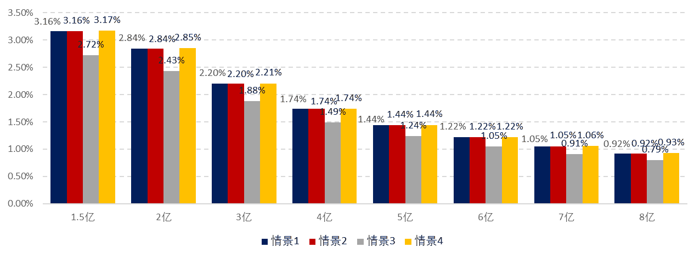
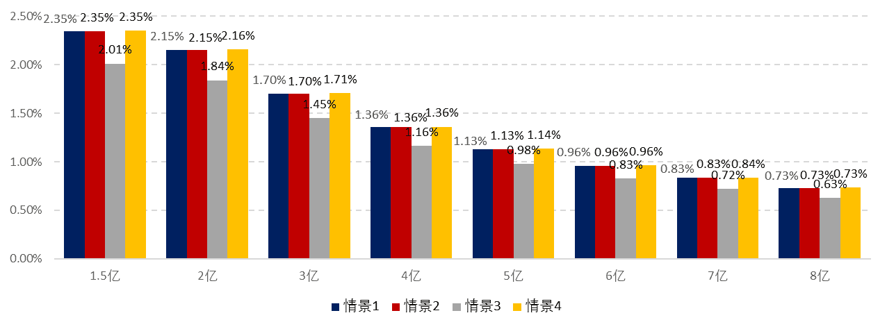
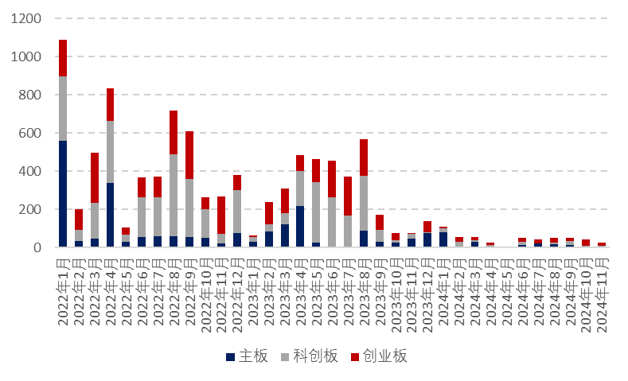
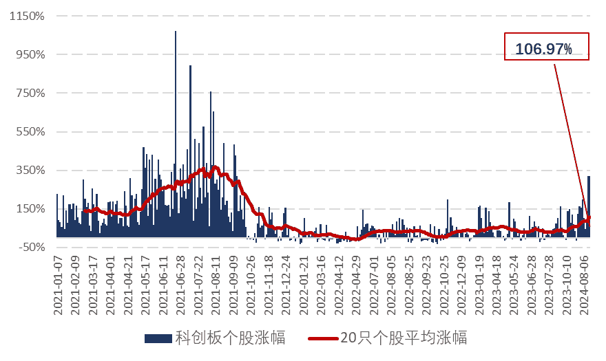
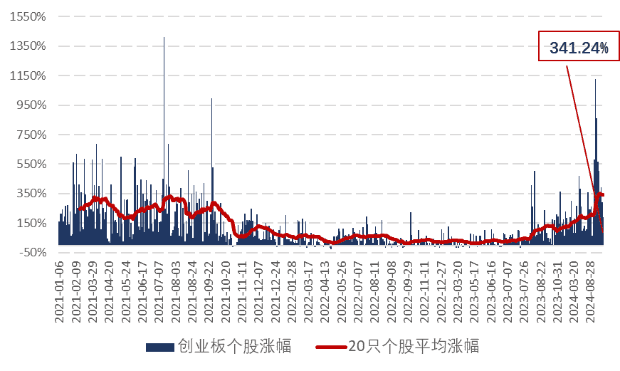
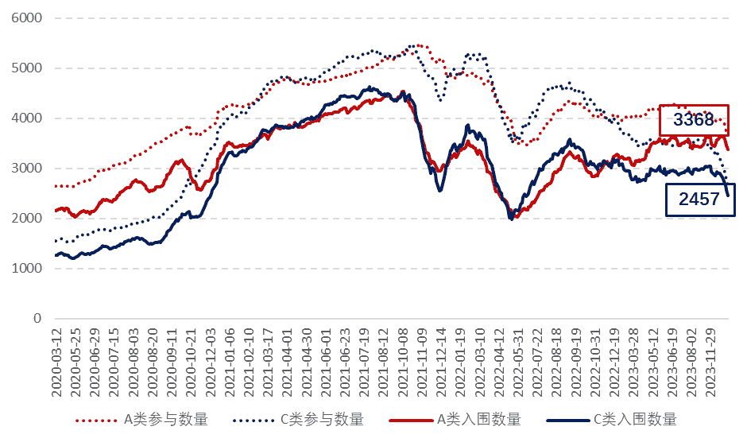
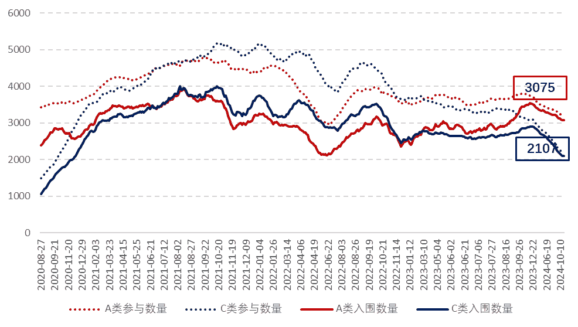
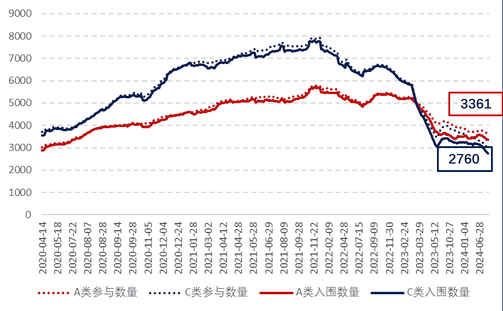
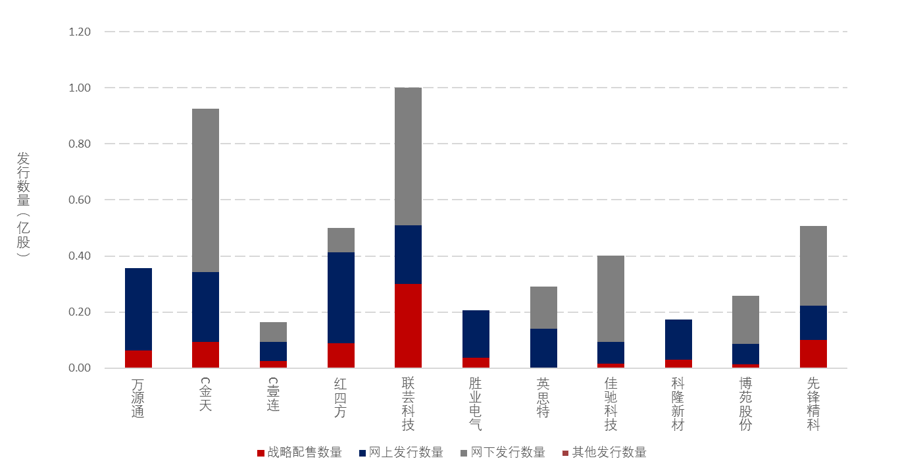
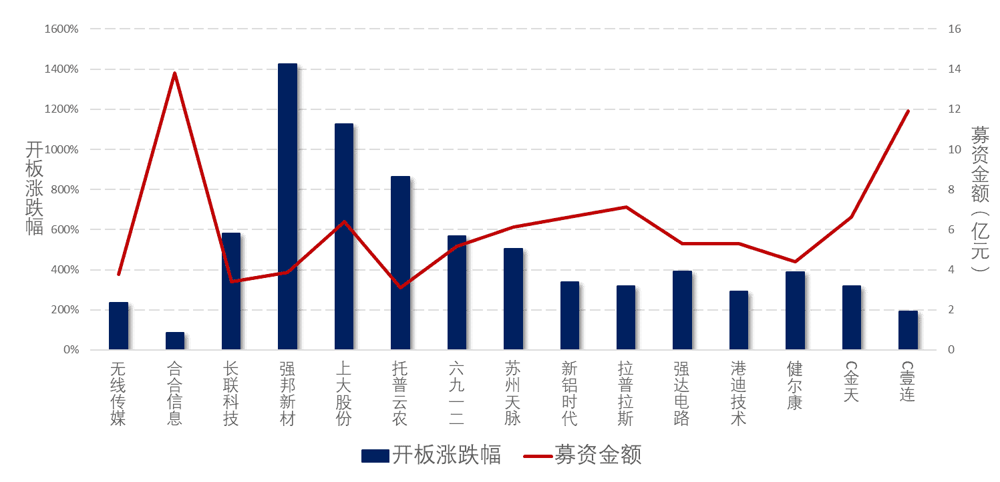

敬请参阅末页重要声明及评级说明

证券研究报告

# 金能钛业上市首日均价涨幅超300%

## ——“打新定期跟踪”系列一百九十五

报告日期：2024-11-25

分析师：严佳炜  
执业证书号：S0010520070001  
邮箱：yanjw@hazq.com

分析师：钱静闲  
执业证书号：S0010522090002  
邮箱：qianjx@hazq.com

分析师：吴正宇  
执业证书号：S0010522090001  
邮箱：wuzy@hazq.com

分析师：骆昱杉  
执业证书号：S0010522110001  
邮箱：luoyushan@hazq.com

相关报告

1. 《2亿规模A类户9月打新收益约35万元——“打新定期跟踪”系列一百八十八》
2. 《强邦新材上市首日涨幅创年度新高——“打新定期跟踪”系列一百八十九》
3. 《新股上市首日涨幅维持高位——“打新定期跟踪”系列一百九十》
4. 《10月打新收益创年内新高——“打新定期跟踪”系列一百九十一》
5. 《近期新股上市首日涨幅回落至300%左右——“打新定期跟踪”系列一百九十二》
6. 《新股涨幅高企，打新账户数尚在年内低位——“打新定期跟踪”系列一百九十三》
7. 《新股上市PE走低，市场回暖增强打新赚钱效应——“打新定期跟踪”系列一百九十四》

## 主要观点

- 跟踪不同情景下的打新收益率

我们估算以下几种情景下的**2024**年至今的打新收益率。

**情景1**：所有主板、科创板、创业板的股票都打中。A类2亿规模账户打新收益率2.84%，C类2亿规模账户打新收益率2.15%；

**情景2**：只打上市时公司已实现正盈利的股票，A类2亿规模账户打新收益率2.84%，C类2亿规模账户打新收益率2.15%；

**情景3**：只打上市时公司已实现正盈利，且上市PE不超过行业市盈率的股票，A类2亿规模账户打新收益率2.43%，C类2亿规模账户打新收益率1.84%；

**情景4**：为事后估计，假设机构的新股定价能力很强，在新股上市后上涨的股票中能够打中100%，且避开所有下跌的股票，A类2亿规模账户打新收益率2.85%，C类2亿规模账户打新收益率2.16%。

- 风险提示

新股上市可能破发，打新策略可能取得负向收益。新股上市前面临诸多不确定因素，可能会暂停发行，影响打新收益。新股上市数量、申购新股人数、二级市场情绪波动等因素可能影响打新收益。基金公司历史入围率不代表未来，本文意见仅供参考。

金融工程

周报

---

金融工程

敬请参阅末页重要声明及评级说明 2 / 16 证券研究报告

## 正文目录

### 1 跟踪不同情景下的打新收益率
### 2 近期新股打新结果
### 3 近期新股日历
### 4 近期打新市场表现
#### 4.1 近两个月内新上市股票
#### 4.2 近两个月打新收益测算
### 5 理论打新收益测算
#### 5.1 不同规模账户逐股票打新
#### 5.2 不同规模A类户逐月打新收益
### 5.3 不同规模C类户逐月打新收益

风险提示

---

金融工程

敬请参阅末页重要声明及评级说明 3 / 16 证券研究报告

## 图表目录

图表1：2024至今不同情景打新收益（A类账户）
图表2：2024至今不同情景打新收益（C类账户）
图表3：2022年至今逐月上市规模（亿元）
图表4：科创板个股近期涨幅
图表5：创业板个股近期涨幅
图表6：科创板个股报价账户数量
图表7：创业板个股报价账户数量
图表8：主板有效报价账户数量
图表9：近期新股发行数量
图表10：打新流程图
图表11：待上市股票状态汇总
图表12：待上市股票状态明细
图表13：过去一周IPO日历
图表14：本周IPO日历（持续更新）
图表15：近期新上市股票首次开板涨跌幅与募资金额（亿元）
图表16：近期新上市股票满中收益（万元）
图表17：近期各股票A类实际打新表现
图表18：近期不同规模账户逐股票网下打新收益（万元）
图表19：A类户逐月网下打新收益（单位：万元）和打新收益率（所有板块）
图表20：A类户逐月网下打新收益（单位：万元）和打新收益率（科创板）
图表21：A类户逐月网下打新收益（单位：万元）和打新收益率（创业板）
图表22：A类户逐月网下打新收益（单位：万元）和打新收益率（主板）
图表23：C类户逐月网下打新收益（单位：万元）和打新收益率（所有板块）
图表24：C类户逐月网下打新收益（单位：万元）和打新收益率（科创板）
图表25：C类户逐月网下打新收益（单位：万元）和打新收益率（创业板）
图表26：C类户逐月网下打新收益（单位：万元）和打新收益率（主板）

### 金融工程

敬请参阅末页重要声明及评级说明 4 / 16 证券研究报告

### 1 跟踪不同情景下的打新收益率

我们跟踪近期双创板块+主板的网下打新市场表现，由于破发已呈常态化，新股全打策略不一定为最优，不同机构可能采取不同的打新策略，我们估算以下几种情景下的打新收益率。在我们的配套打新数据库中也更新了不同测算方式的收益。

- 情景1：所有主板、科创板、创业板的股票都打中。
- 情景2：只打上市时公司已实现正盈利的股票，即所有主板、创业板股票都打，科创板选择只打已实现盈利的新股。
- 情景3：主板新股都打，双创新股只打上市时公司已实现正盈利的股票，且上市PE不超过招股说明书中披露的可比照的同行业市盈率x%幅度的股票，当x%=0时，即只打上市PE不超过同行PE的股票（x在打新数据库中可自选）。
- 情景4：为事后估计，假设能够提前预判双创新股的涨跌情况（即机构的新股定价能力很强），例如，假设双创新股上市后上涨的股票中能够打中y%，而下跌的股票中能够打中z%，主板新股都打。机构定价能力越强，y%越高，z%越低（y，z，测算方式在打新数据库中均可自选）。

自2024起截至2024/11/22，假设询价新股全部入围情况下，不同情景下的打新收益率如图所示，忽略锁定期的卖出限制。

情景1下，A类2亿规模账户打新收益率2.84%，C类2亿规模账户打新收益率2.15%；

情景2下，A类2亿规模账户打新收益率2.84%，C类2亿规模账户打新收益率2.15%；

情景3下，A类2亿规模账户打新收益率2.43%，C类2亿规模账户打新收益率1.84%（设置参数x%=0%）；

情景4下，A类2亿规模账户打新收益率2.85%，C类2亿规模账户打新收益率2.16%（设置参数y%=100%，z%=0%，模糊估计法）。

图表1 2024至今不同情景打新收益（A类账户）

来源：wind资讯，华安证券研究所

敬请参阅末页重要声明及评级说明 5 / 16 证券研究报告

图表2 2024至今不同情景打新收益（C类账户）

资料来源：wind资讯，华安证券研究所

2022年以来逐月上市的新股规模如图表3所示。11月以来共上市4只新股，募资28.22亿元。

图表3 2022年至今逐月上市规模（亿元）

资料来源：wind资讯，华安证券研究所

滚动跟踪近期20只新股上市后的涨幅表现，其中科创板个股上市首日的涨幅在106.97%左右，创业板个股开板首日的涨幅在341.24%左右，新股上市涨幅持续高企。

敬请参阅末页重要声明及评级说明 6 / 16 证券研究报告

图表4 科创板个股近期涨幅

图表5 创业板个股近期涨幅

资料来源：wind资讯，华安证券研究所

资料来源：wind资讯，华安证券研究所

图表6 科创板个股报价账户数量

图表7 创业板个股报价账户数量

资料来源：wind资讯，华安证券研究所

资料来源：wind资讯，华安证券研究所

滚动跟踪近期20只新股的有效报价账户中位数，目前科创板新股A类有效报价账户数量在3368左右，C类有效报价账户数量在2457左右。创业板新股A类有效报价账户数量在3075左右，C类有效报价账户数量在2107左右，创业板参与账户数持续下行。主板个股A类有效报价账户数量在3361左右，C类有效报价账户数量在2760左右。

敬请参阅末页重要声明及评级说明 7 / 16 证券研究报告

图表8 主板有效报价账户数量

资料来源：wind资讯，华安证券研究所

### 2 近期新股打新结果

红四方(603395.SH)在主板上市，采取战略配售、网下询价、网上定价方式。发行价格7.98元，发行市盈率10.62，行业市盈率22.23，新股发行数量5000万股，实际原股东转让数量0万股，预计募资53149.97万元，实际募资合计39900万元。新股发行数量中，战略配售877.19万股，网上发行数量3249.15万股，网下发行数量873.66万股。网上中签率0.03%，网上发行超额认购倍数3028.19，网下初步询价对应的超额认购倍数2955.24，网下申购获配比例0.01%，网下发行有效申购认购倍数8925.57。

联芸科技(688449.SH)在科创板上市，采取战略配售、网下询价、网上定价方式。发行价格11.25元，发行市盈率166.67，行业市盈率57.27，新股发行数量10000万股，实际原股东转让数量0万股，预计募资161152.75万元，实际募资合计112500万元。新股发行数量中，战略配售3000万股，网上发行数量2100万股，网下发行数量4900万股。网上中签率0.04%，网上发行超额认购倍数2574.36，网下初步询价对应的超额认购倍数1923.44，网下申购获配比例0.05%，网下发行有效申购认购倍数2005.64。

敬请参阅末页重要声明及评级说明 8 / 16 证券研究报告

图表9 近期新股发行数量

资料来源：Wind资讯，华安证券研究所

### 3 近期新股日历

A股新股上市流程大致如下图所示。

图表10 打新流程图

资料来源：华安证券研究所整理

截至上周（2024年11月22日），排除网上发行的股票，有2只待询价，1只已公布发行价待申购，3只已结束申购待上市，预计募集资金共55.49亿元。

图表11 待上市股票状态汇总

资料来源：Wind资讯，华安证券研究所

| 状态 | 数量 | 预计募集资金（亿元） |
|------|------|----------------------|
| 待询价 | 2 | 13.97 |
| 已完成询价待公布发行价 | 0 | 0.00 |
| 已公布发行价待申购 | 1 | 13.25 |
| 已结束申购待上市 | 3 | 28.26 |
| 合计 | 6 | 55.49 |

图表12 待上市股票状态明细

资料来源：Wind资讯，华安证券研究所

| 代码 | 名称 | 状态 |
|------|------|------|
| 688605.SH | 先锋精科 | 待询价 |
| 301617.SZ | 博苑股份 | 待询价 |
| 688708.SH | 佳驰科技 | 已公布发行价待申购 |
| 301622.SZ | 英思特 | 已结束申购待上市 |
| 688449.SH | 联芸科技 | 已结束申购待上市 |
| 603395.SH | 红四方 | 已结束申购待上市 |

敬请参阅末页重要声明及评级说明 9 / 16 证券研究报告

过去一周（2024年11月18日-2024年11月22日）有3只上市新股，为万源通、C金天、C壹连。

图表13 过去一周IPO日历

资料来源：Wind资讯，华安证券研究所

| 代码 | 简称 | 板块 | 2024-11-18 星期一 | 2024-11-19 星期二 | 2024-11-20 星期三 | 2024-11-21 星期四 | 2024-11-22 星期五 |
|------|------|------|-------------------|-------------------|-------------------|-------------------|-------------------|
| 920060.BJ | 万源通 | 北证 | 上市 | | | | |
| 688750.SH | C金天 | 科创板 | | 上市 | | | |
| 301631.SZ | C壹连 | 创业板 | | | 上市 | | |
| 603395.SH | 红四方 | 主板 | | | | 中签结果,申购缴款 | |
| 688449.SH | 联芸科技 | 科创板 | | | | 中签率 | 中签结果,申购缴款 |
| 920128.BJ | 胜业电气 | 北证 | | | | 中签结果 | |
| 301622.SZ | 英思特 | 创业板 | | | | 申购 | |
| 688708.SH | 佳驰科技 | 科创板 | | | | 询价 | |
| 920098.BJ | 科隆新材 | 北证 | | | | 招股 | |
| 301617.SZ | 博苑股份 | 创业板 | | | | 招股 | |
| 688605.SH | 先锋精科 | 科创板 | | | | 招股 | |

本周IPO打新情况如图表14所示，询价新股有博苑股份、先锋精科。

图表14 本周IPO日历（持续更新）

资料来源：Wind资讯，华安证券研究所

| 代码 | 简称 | 板块 | 2024-11-25 星期一 | 2024-11-26 星期二 | 2024-11-27 星期三 | 2024-11-28 星期四 | 2024-11-29 星期五 |
|------|------|------|-------------------|-------------------|-------------------|-------------------|-------------------|
| 603395.SH | 红四方 | 主板 | 上市 | | | | |
| 301622.SZ | 英思特 | 创业板 | | 中签率 | 中签结果,申购缴款 | | |
| 688708.SH | 佳驰科技 | 科创板 | | 申购 | 中签率 | 中签结果,申购缴款 | |
| 920098.BJ | 科隆新材 | 北证 | | 网上申购,申购缴款 | 中签结果 | | |
| 301617.SZ | 博苑股份 | 创业板 | | 询价 | 申购 | | |
| 688605.SH | 先锋精科 | 科创板 | | 询价 | | | |

敬请参阅末页重要声明及评级说明 10 / 16 证券研究报告

### 4 近期打新市场表现

#### 4.1 近两个月内新上市股票

近两个月以来（2024年9月23日-2024年11月22日），大部分新上市股票的首次开板涨跌幅位于0%-300%水平区间内，首次涨跌幅最高的三家为强邦新材、上大股份、托普云农，分别达到1424.08%、1127.69%、862.21%。

大部分新股募资金额位于0-10亿元水平区间内，其中募资金额最高的三家为合合信息、C壹连、拉普拉斯，分别为13.80、11.92、7.13亿元。

图表15 近期新上市股票首次开板涨跌幅与募资金额（亿元）

资料来源：Wind资讯，华安证券研究所

#### 4.2 近两个月打新收益测算

用A类平均中签率估算，我们测算当A类机构对近两个月内新上市的股票全部顶格打满时，每只股票可获得的满中收益。我们使用首次开板日均价和发行价格计算每只股票的上市收益。每只股票满中收益的具体计算方法为：

A类满中数量 = 可申购上限额度 × 网下A类平均中签率

满中收益 = (首次开板价 − 首发价格) × 满中数量

从图表16可以看出，股票的满中收益大多位于0至10万元水平区间内，其中最高的为上大股份、拉普拉斯、C金天，分别达到63.24、55.07、38.59万元。

图表16 近期新上市股票满中收益（万元）

资料来源：Wind资讯，华安证券研究所

| 代码 | 名称 | 上市日期 | 满中收益（万元） | 市值门槛（亿元） | 发行方式 | 发行价格 | 中价区间 |
|------|------|----------|------------------|------------------|----------|----------|----------|
| 301551.SZ | 无线传媒 | 2024-09-26 | 14.38 | 0.60 | 战略配售,网下询价,网上定价 | 9.40 | 9.4-10.67 |
| 688615.SH | 合合信息 | 2024-09-26 | 13.55 | 0.60 | 战略配售,网下询价,网上定价 | 55.18 | 55.27-61.8 |
| 301618.SZ | 长联科技 | 2024-09-30 | 无网下询价 | 0.00 | 网上定价 | 21.12 | -- |
| 001279.SZ | 强邦新材 | 2024-10-11 | 36.43 | 0.60 | 战略配售,网下询价,网上定价 | 9.68 | 9.68-10.89 |
| 301522.SZ | 上大股份 | 2024-10-16 | 63.24 | 0.60 | 战略配售,网下询价,网上定价 | 6.88 | 7-9.1 |
| 301556.SZ | 托普云农 | 2024-10-17 | 33.29 | 0.60 | 战略配售,网下询价,网上定价 | 14.50 | 14.52-18.55 |
| 301592.SZ | 六九一二 | 2024-10-24 | 无网下询价 | 0.00 | 网上定价 | 29.49 | -- |
| 301626.SZ | 苏州天脉 | 2024-10-24 | 34.24 | 0.60 | 战略配售,网下询价,网上定价 | 21.23 | 21.85-25.69 |
| 301613.SZ | 新铝时代 | 2024-10-25 | 25.94 | 0.60 | 网下询价,网上定价 | 27.70 | 27.7-30.24 |
| 688726.SH | 拉普拉斯 | 2024-10-29 | 55.07 | 0.60 | 战略配售,网下询价,网上定价 | 17.58 | 17.64-19.25 |
| 301628.SZ | 强达电路 | 2024-10-31 | 无网下询价 | 0.00 | 网上定价 | 28.18 | -- |
| 301633.SZ | 港迪技术 | 2024-11-07 | 无网下询价 | 0.00 | 网上定价 | 37.94 | -- |
| 603205.SH | 健尔康 | 2024-11-07 | 7.28 | 0.60 | 网下询价,网上定价 | 14.65 | 14.65-16.41 |
| 688750.SH | C金天 | 2024-11-20 | 38.59 | 0.60 | 战略配售,网下询价,网上定价 | 7.16 | 7.16-7.72 |
| 301631.SZ | C壹连 | 2024-11-22 | 21.46 | 0.60 | 战略配售,网下询价,网上定价 | 72.99 | 72.99-79.44 |

图表17 近期各股票A类实际打新表现

资料来源：Wind资讯，华安证券研究所

### 5 理论打新收益测算

#### 5.1 不同规模账户逐股票打新

我们测算了不同规模资金的网下A类打新收益。假设使用网下A类平均中签率、账户参与所有新股打新、科创板和创业板报价全部入围、资金配置一半沪市一半深市且股票满仓、按首次开板日均价卖出、在90%的资金使用效率下我们测试不同账户规模下的逐股票网下打新收益。

图表18列举了在1.5亿、2亿、3亿、5亿、10亿账户规模下，以A类平均网下中签率为例，假设科创板和创业板全部入围，对近两个月内（2024年9月23日至2024年11月22日）上市新股的网下打新收益。

图表18 近期不同规模账户逐股票网下打新收益（万元）

资料来源：Wind资讯，华安证券研究所

| 代码 | 名称 | 上市日期 | 1.5亿 | 2亿 | 3亿 | 5亿 | 10亿 |
|------|------|----------|-------|-------|-------|-------|-------|
| 301551.SZ | 无线传媒 | 2024-09-26 | 14.38 | 14.38 | 14.38 | 14.38 | 14.38 |
| 688615.SH | 合合信息 | 2024-09-26 | 4.73 | 6.31 | 9.47 | 13.55 | 13.55 |
| 301618.SZ | 长联科技 | 2024-09-30 | 无网下询价 | 无网下询价 | 无网下询价 | 无网下询价 | 无网下询价 |
| 001279.SZ | 强邦新材 | 2024-10-11 | 36.43 | 36.43 | 36.43 | 36.43 | 36.43 |
| 301522.SZ | 上大股份 | 2024-10-16 | 47.73 | 63.24 | 63.24 | 63.24 | 63.24 |
| 301556.SZ | 托普云农 | 2024-10-17 | 33.29 | 33.29 | 33.29 | 33.29 | 33.29 |
| 301592.SZ | 六九一二 | 2024-10-24 | 无网下询价 | 无网下询价 | 无网下询价 | 无网下询价 | 无网下询价 |
| 301626.SZ | 苏州天脉 | 2024-10-24 | 27.21 | 34.24 | 34.24 | 34.24 | 34.24 |
| 301613.SZ | 新铝时代 | 2024-10-25 | 15.80 | 21.07 | 25.94 | 25.94 | 25.94 |
| 688726.SH | 拉普拉斯 | 2024-10-29 | 32.53 | 43.37 | 55.07 | 55.07 | 55.07 |
| 301628.SZ | 强达电路 | 2024-10-31 | 无网下询价 | 无网下询价 | 无网下询价 | 无网下询价 | 无网下询价 |
| 301633.SZ | 港迪技术 | 2024-11-07 | 无网下询价 | 无网下询价 | 无网下询价 | 无网下询价 | 无网下询价 |
| 603205.SH | 健尔康 | 2024-11-07 | 7.28 | 7.28 | 7.28 | 7.28 | 7.28 |
| 688750.SH | C金天 | 2024-11-20 | 22.05 | 29.40 | 38.59 | 38.59 | 38.59 |
| 301631.SZ | C壹连 | 2024-11-22 | 8.82 | 11.76 | 17.64 | 21.46 | 21.46 |

#### 5.2 不同规模A类户逐月打新收益

参照5.1中的测算方式，在不同规模A类户下，假设所有股票报价均入围，在90%的资金使用效率下，将2023年以来每个月网下打新可获得的收益相加，测算理想情况下逐月打新收益和打新收益率。以新股卖出日为统计时间，2023年至今A类2亿打新收益率6.47%，2024年至今2亿打新收益率2.84%。

图表19 A类户逐月网下打新收益（单位：万元）和打新收益率（所有板块）

资料来源：wind资讯，华安证券研究所

| 月份 | 1.5亿 | 2亿 | 3亿 | 5亿 | 10亿 | 满中 |
|------|-------|-------|-------|-------|-------|-------|
| 2023年1月 | 20.27 | 25.61 | 33.74 | 36.08 | 36.08 | 36.08 |
| 2023年2月 | 49.26 | 60.33 | 78.95 | 111.69 | 160.19 | 185.02 |
| 2023年3月 | 23.69 | 28.62 | 38.40 | 46.23 | 53.31 | 53.57 |
| 2023年4月 | 63.41 | 78.87 | 107.31 | 154.73 | 249.16 | 301.17 |
| 2023年5月 | 26.91 | 35.74 | 51.70 | 67.92 | 83.70 | 86.37 |
| 2023年6月 | 39.37 | 52.49 | 71.76 | 86.88 | 90.63 | 89.05 |
| 2023年7月 | 46.52 | 61.68 | 87.23 | 96.30 | 91.57 | 78.79 |
| 2023年8月 | 124.54 | 156.91 | 200.31 | 233.02 | 262.54 | 272.78 |
| 2023年9月 | 46.95 | 62.60 | 93.06 | 119.15 | 128.00 | 128.00 |
| 2023年10月 | 23.51 | 29.58 | 34.52 | 35.23 | 35.19 | 35.19 |
| 2023年11月 | 31.93 | 41.05 | 50.69 | 57.61 | 57.70 | 57.70 |
| 2023年12月 | 73.03 | 92.48 | 111.91 | 136.71 | 144.48 | 144.48 |
| 2024年1月 | 22.27 | 29.33 | 41.53 | 62.13 | 82.58 | 82.58 |
| 2024年2月 | 27.51 | 31.39 | 38.66 | 52.75 | 52.72 | 52.72 |
| 2024年3月 | 28.33 | 34.06 | 40.37 | 43.61 | 43.61 | 43.61 |
| 2024年4月 | 24.36 | 28.99 | 31.53 | 31.53 | 31.53 | 31.53 |
| 2024年5月 | 5.19 | 5.19 | 5.19 | 5.19 | 5.19 | 5.19 |
| 2024年6月 | 38.10 | 46.62 | 63.67 | 76.51 | 76.51 | 76.51 |
| 2024年7月 | 18.72 | 23.08 | 28.37 | 28.55 | 28.55 | 28.55 |
| 2024年8月 | 46.91 | 55.45 | 61.08 | 61.57 | 61.57 | 61.57 |
| 2024年9月 | 32.01 | 34.57 | 37.89 | 41.97 | 41.97 | 41.97 |
| 2024年10月 | 192.99 | 231.64 | 248.20 | 248.20 | 248.20 | 248.20 |
| 2024年11月 | 38.16 | 48.45 | 63.52 | 67.34 | 67.34 | 67.34 |
| 2023年至今收益率 | 6.96% | 6.47% | 5.40% | 3.80% | 2.13% | |
| 2024年至今收益率 | 3.16% | 2.84% | 2.20% | 1.44% | 0.74% | |

金融工程

敬请参阅末页重要声明及评级说明 12 / 16 证券研究报告

图表20 A类户逐月网下打新收益（单位：万元）和打新收益率（科创板）

资料来源：wind资讯，华安证券研究所

图表21 A类户逐月网下打新收益（单位：万元）和打新收益率（创业板）

资料来源：wind资讯，华安证券研究所

| 月份 | 1.5亿 | 2亿 | 3亿 | 5亿 | 10亿 | 满中 |
|---|---|---|---|---|---|---|
| 2023年1月 | 14.34 | 19.12 | 26.14 | 28.48 | 28.48 | 28.48 |
| 2023年2月 | 20.13 | 26.38 | 36.55 | 55.22 | 74.44 | 74.44 |
| 2023年3月 | 10.75 | 14.33 | 21.49 | 28.14 | 37.57 | 37.83 |
| 2023年4月 | 28.10 | 37.47 | 54.91 | 86.29 | 157.78 | 205.61 |
| 2023年5月 | 13.17 | 17.56 | 26.34 | 40.35 | 54.46 | 57.13 |
| 2023年6月 | 25.63 | 34.17 | 49.09 | 64.45 | 71.12 | 69.55 |
| 2023年7月 | 6.79 | 9.06 | 12.02 | 11.55 | 5.97 | -6.81 |
| 2023年8月 | 19.35 | 25.36 | 32.28 | 40.59 | 55.21 | 66.39 |
| 2023年9月 | 12.15 | 16.19 | 24.29 | 40.01 | 48.86 | 48.86 |
| 2023年10月 | -0.55 | -0.73 | -1.09 | -1.38 | -1.38 | -1.38 |
| 2023年11月 | 14.42 | 18.54 | 22.92 | 26.82 | 26.82 | 26.82 |
| 2023年12月 | 4.49 | 5.59 | 5.59 | 5.59 | 5.59 | 5.59 |
| 2024年1月 | 13.86 | 18.47 | 27.71 | 46.19 | 62.84 | 62.84 |
| 2024年2月 | 0.85 | 1.13 | 1.69 | 2.82 | 2.79 | 2.79 |
| 2024年3月 | 5.17 | 5.17 | 5.17 | 5.17 | 5.17 | 5.17 |
| 2024年4月 | 5.98 | 7.92 | 7.92 | 7.92 | 7.92 | 7.92 |
| 2024年5月 | 5.19 | 5.19 | 5.19 | 5.19 | 5.19 | 5.19 |
| 2024年6月 | 9.40 | 12.54 | 18.81 | 30.29 | 30.29 | 30.29 |
| 2024年7月 | 0.00 | 0.00 | 0.00 | 0.00 | 0.00 | 0.00 |
| 2024年8月 | 4.23 | 5.21 | 5.21 | 5.21 | 5.21 | 5.21 |
| 2024年9月 | 6.82 | 9.09 | 12.41 | 16.49 | 16.49 | 16.49 |
| 2024年10月 | 32.53 | 43.37 | 55.07 | 55.07 | 55.07 | 55.07 |
| 2024年11月 | 22.05 | 29.40 | 38.59 | 38.59 | 38.59 | 38.59 |
| 2023年至今收益率 | 1.83% | 1.80% | 1.63% | 1.28% | 0.79% | |
| 2024年至今收益率 | 0.71% | 0.69% | 0.59% | 0.43% | 0.23% | |

| 月份 | 1.5亿 | 2亿 | 3亿 | 5亿 | 10亿 | 满中 |
|---|---|---|---|---|---|---|
| 2023年1月 | 1.69 | 2.26 | 3.37 | 3.37 | 3.37 | 3.37 |
| 2023年2月 | 14.46 | 19.28 | 27.74 | 41.81 | 71.08 | 95.91 |
| 2023年3月 | 3.92 | 5.22 | 7.83 | 9.02 | 6.67 | 6.67 |
| 2023年4月 | 0.42 | 0.56 | 0.68 | -0.11 | -0.24 | -0.24 |
| 2023年5月 | 12.24 | 16.32 | 23.19 | 25.40 | 27.07 | 27.07 |
| 2023年6月 | 13.74 | 18.32 | 22.67 | 22.43 | 19.50 | 19.50 |
| 2023年7月 | 39.73 | 52.63 | 75.21 | 84.75 | 85.60 | 85.60 |
| 2023年8月 | 103.09 | 128.74 | 163.83 | 187.07 | 202.61 | 202.61 |
| 2023年9月 | 30.81 | 41.09 | 60.85 | 69.81 | 69.81 | 69.81 |
| 2023年10月 | 16.84 | 21.13 | 23.04 | 23.03 | 23.00 | 23.00 |
| 2023年11月 | 7.62 | 10.17 | 11.15 | 11.15 | 11.15 | 11.15 |
| 2023年12月 | 52.95 | 66.74 | 78.88 | 94.94 | 99.88 | 99.88 |
| 2024年1月 | 0.00 | 0.00 | 0.00 | 0.00 | 0.00 | 0.00 |
| 2024年2月 | 26.67 | 30.26 | 36.96 | 49.93 | 49.93 | 49.93 |
| 2024年3月 | 17.78 | 21.72 | 24.91 | 24.91 | 24.91 | 24.91 |
| 2024年4月 | 13.74 | 14.88 | 15.82 | 15.82 | 15.82 | 15.82 |
| 2024年5月 | 0.00 | 0.00 | 0.00 | 0.00 | 0.00 | 0.00 |
| 2024年6月 | 27.80 | 32.90 | 43.09 | 43.77 | 43.77 | 43.77 |
| 2024年7月 | 13.97 | 16.76 | 20.93 | 21.10 | 21.10 | 21.10 |
| 2024年8月 | 38.61 | 45.56 | 50.72 | 50.72 | 50.72 | 50.72 |
| 2024年9月 | 23.86 | 23.86 | 23.86 | 23.86 | 23.86 | 23.86 |
| 2024年10月 | 124.04 | 151.84 | 156.71 | 156.71 | 156.71 | 156.71 |
| 2024年11月 | 8.82 | 11.76 | 17.64 | 21.46 | 21.46 | 21.46 |
| 2023年至今收益率 | 3.95% | 3.66% | 2.96% | 1.96% | 1.03% | |
| 2024年至今收益率 | 1.97% | 1.75% | 1.30% | 0.82% | 0.41% | |

金融工程

敬请参阅末页重要声明及评级说明 13 / 16 证券研究报告

图表22 A类户逐月网下打新收益（单位：万元）和打新收益率（主板）

资料来源：wind资讯，华安证券研究所

### 5.3 不同规模C类户逐月打新收益

参照5.1中的测算方式，在不同规模C类户下，假设所有股票报价均入围，在90%的资金使用效率下，将2023年以来每个月网下打新可获得的收益相加，测算理想情况下逐月打新收益和打新收益率。以新股卖出日为统计时间，2023年至今C类2亿打新收益率4.67%，2024年至今C类2亿打新收益率2.15%。

图表23 C类户逐月网下打新收益（单位：万元）和打新收益率（所有板块）

资料来源：wind资讯，华安证券研究所

| 月份 | 1.5亿 | 2亿 | 3亿 | 5亿 | 10亿 | 满中 |
|---|---|---|---|---|---|---|
| 2023年1月 | 4.23 | 4.23 | 4.23 | 4.23 | 4.23 | 4.23 |
| 2023年2月 | 14.67 | 14.67 | 14.67 | 14.67 | 14.67 | 14.67 |
| 2023年3月 | 9.03 | 9.07 | 9.07 | 9.07 | 9.07 | 9.07 |
| 2023年4月 | 34.90 | 40.84 | 51.72 | 68.55 | 91.62 | 95.80 |
| 2023年5月 | 1.51 | 1.86 | 2.17 | 2.17 | 2.17 | 2.17 |
| 2023年6月 | 0.00 | 0.00 | 0.00 | 0.00 | 0.00 | 0.00 |
| 2023年7月 | 0.00 | 0.00 | 0.00 | 0.00 | 0.00 | 0.00 |
| 2023年8月 | 2.10 | 2.80 | 4.20 | 5.36 | 4.72 | 3.78 |
| 2023年9月 | 3.99 | 5.32 | 7.92 | 9.33 | 9.33 | 9.33 |
| 2023年10月 | 7.21 | 9.18 | 12.57 | 13.58 | 13.58 | 13.58 |
| 2023年11月 | 9.89 | 12.34 | 16.61 | 19.64 | 19.73 | 19.73 |
| 2023年12月 | 15.59 | 20.15 | 27.44 | 36.19 | 39.01 | 39.01 |
| 2024年1月 | 8.42 | 10.86 | 13.82 | 15.94 | 19.74 | 19.74 |
| 2024年2月 | 0.00 | 0.00 | 0.00 | 0.00 | 0.00 | 0.00 |
| 2024年3月 | 5.38 | 7.18 | 10.29 | 13.53 | 13.53 | 13.53 |
| 2024年4月 | 4.64 | 6.18 | 7.78 | 7.78 | 7.78 | 7.78 |
| 2024年5月 | 0.00 | 0.00 | 0.00 | 0.00 | 0.00 | 0.00 |
| 2024年6月 | 0.89 | 1.18 | 1.78 | 2.46 | 2.46 | 2.46 |
| 2024年7月 | 4.75 | 6.32 | 7.44 | 7.44 | 7.44 | 7.44 |
| 2024年8月 | 4.08 | 4.68 | 5.14 | 5.64 | 5.64 | 5.64 |
| 2024年9月 | 1.33 | 1.62 | 1.62 | 1.62 | 1.62 | 1.62 |
| 2024年10月 | 36.43 | 36.43 | 36.43 | 36.43 | 36.43 | 36.43 |
| 2024年11月 | 7.28 | 7.28 | 7.28 | 7.28 | 7.28 | 7.28 |
| 2023年至今收益率 | 1.18% | 1.01% | 0.81% | 0.56% | 0.31% | |
| 2024年至今收益率 | 0.49% | 0.41% | 0.31% | 0.20% | 0.10% | |

| 月份 | 1.5亿 | 2亿 | 3亿 | 5亿 | 10亿 | 满中 |
|---|---|---|---|---|---|---|
| 2023年1月 | 9.73 | 12.69 | 17.32 | 19.07 | 19.07 | 19.07 |
| 2023年2月 | 32.84 | 41.96 | 58.49 | 88.78 | 134.01 | 156.66 |
| 2023年3月 | 12.87 | 16.19 | 22.79 | 28.94 | 35.68 | 35.91 |
| 2023年4月 | 49.39 | 62.68 | 87.68 | 130.91 | 218.67 | 270.65 |
| 2023年5月 | 21.15 | 28.14 | 41.00 | 55.11 | 68.81 | 70.84 |
| 2023年6月 | 29.90 | 39.87 | 55.51 | 69.18 | 73.01 | 71.81 |
| 2023年7月 | 32.97 | 43.75 | 62.22 | 69.29 | 64.37 | 51.59 |
| 2023年8月 | 82.43 | 104.90 | 136.85 | 165.14 | 192.84 | 201.24 |
| 2023年9月 | 36.20 | 48.26 | 71.73 | 91.02 | 97.67 | 97.67 |
| 2023年10月 | 14.91 | 18.84 | 21.86 | 22.28 | 22.25 | 22.25 |
| 2023年11月 | 21.96 | 28.45 | 35.78 | 41.84 | 41.91 | 41.91 |
| 2023年12月 | 45.65 | 57.85 | 70.20 | 84.92 | 90.01 | 90.01 |
| 2024年1月 | 18.82 | 24.88 | 35.91 | 55.54 | 75.18 | 75.18 |
| 2024年2月 | 19.88 | 23.21 | 29.55 | 41.86 | 41.83 | 41.83 |
| 2024年3月 | 21.32 | 26.18 | 31.68 | 34.77 | 34.77 | 34.77 |
| 2024年4月 | 17.87 | 21.45 | 23.32 | 23.32 | 23.32 | 23.32 |
| 2024年5月 | 3.50 | 3.50 | 3.50 | 3.50 | 3.50 | 3.50 |
| 2024年6月 | 31.55 | 39.21 | 54.53 | 66.64 | 66.64 | 66.64 |
| 2024年7月 | 15.00 | 18.67 | 23.35 | 23.51 | 23.51 | 23.51 |
| 2024年8月 | 36.12 | 42.74 | 47.36 | 47.84 | 47.84 | 47.84 |
| 2024年9月 | 23.08 | 25.30 | 28.38 | 32.18 | 32.18 | 32.18 |
| 2024年10月 | 133.98 | 165.68 | 179.55 | 179.55 | 179.55 | 179.55 |
| 2024年11月 | 30.71 | 39.60 | 52.84 | 56.51 | 56.51 | 56.51 |
| 2023年至今收益率 | 4.95% | 4.67% | 3.97% | 2.86% | 1.64% | |
| 2024年至今收益率 | 2.35% | 2.15% | 1.70% | 1.13% | 0.58% | |

金融工程

敬请参阅末页重要声明及评级说明 14 / 16 证券研究报告

图表24 C类户逐月网下打新收益（单位：万元）和打新收益率（科创板）

资料来源：wind资讯，华安证券研究所

图表25 C类户逐月网下打新收益（单位：万元）和打新收益率（创业板）

资料来源：wind资讯，华安证券研究所

| 月份 | 1.5亿 | 2亿 | 3亿 | 5亿 | 10亿 | 满中 |
|---|---|---|---|---|---|---|
| 2023年1月 | 8.15 | 10.87 | 15.02 | 16.78 | 16.78 | 16.78 |
| 2023年2月 | 16.47 | 21.72 | 31.02 | 48.57 | 66.93 | 66.93 |
| 2023年3月 | 7.34 | 9.79 | 14.69 | 20.14 | 28.74 | 28.97 |
| 2023年4月 | 26.11 | 34.82 | 51.36 | 81.81 | 152.02 | 199.82 |
| 2023年5月 | 11.37 | 15.16 | 22.75 | 34.95 | 47.06 | 49.09 |
| 2023年6月 | 20.97 | 27.97 | 40.42 | 54.30 | 60.96 | 59.76 |
| 2023年7月 | 4.97 | 6.62 | 8.94 | 8.38 | 2.76 | -10.01 |
| 2023年8月 | 13.37 | 17.62 | 23.33 | 31.01 | 44.32 | 53.34 |
| 2023年9月 | 8.41 | 11.21 | 16.81 | 27.62 | 34.26 | 34.26 |
| 2023年10月 | -0.47 | -0.63 | -0.94 | -1.19 | -1.19 | -1.19 |
| 2023年11月 | 10.83 | 14.01 | 17.75 | 21.51 | 21.51 | 21.51 |
| 2023年12月 | 3.01 | 3.75 | 3.75 | 3.75 | 3.75 | 3.75 |
| 2024年1月 | 13.19 | 17.58 | 26.38 | 43.96 | 59.81 | 59.81 |
| 2024年2月 | 0.83 | 1.10 | 1.66 | 2.76 | 2.73 | 2.73 |
| 2024年3月 | 3.80 | 3.80 | 3.80 | 3.80 | 3.80 | 3.80 |
| 2024年4月 | 4.94 | 6.53 | 6.53 | 6.53 | 6.53 | 6.53 |
| 2024年5月 | 3.50 | 3.50 | 3.50 | 3.50 | 3.50 | 3.50 |
| 2024年6月 | 8.89 | 11.85 | 17.78 | 28.64 | 28.64 | 28.64 |
| 2024年7月 | 0.00 | 0.00 | 0.00 | 0.00 | 0.00 | 0.00 |
| 2024年8月 | 3.57 | 4.41 | 4.41 | 4.41 | 4.41 | 4.41 |
| 2024年9月 | 6.09 | 8.12 | 11.20 | 15.01 | 15.01 | 15.01 |
| 2024年10月 | 26.00 | 34.66 | 44.01 | 44.01 | 44.01 | 44.01 |
| 2024年11月 | 18.18 | 24.25 | 31.83 | 31.83 | 31.83 | 31.83 |
| 2023年至今收益率 | 1.46% | 1.44% | 1.32% | 1.06% | 0.68% | |
| 2024年至今收益率 | 0.59% | 0.58% | 0.50% | 0.37% | 0.20% | |

| 月份 | 1.5亿 | 2亿 | 3亿 | 5亿 | 10亿 | 满中 |
|---|---|---|---|---|---|---|
| 2023年1月 | 0.72 | 0.96 | 1.44 | 1.44 | 1.44 | 1.44 |
| 2023年2月 | 11.62 | 15.49 | 22.73 | 35.47 | 62.34 | 84.99 |
| 2023年3月 | 2.56 | 3.42 | 5.13 | 5.82 | 3.97 | 3.97 |
| 2023年4月 | 0.05 | 0.07 | 0.03 | -0.55 | -0.65 | -0.65 |
| 2023年5月 | 8.95 | 11.94 | 17.05 | 18.95 | 20.55 | 20.55 |
| 2023年6月 | 8.93 | 11.90 | 15.09 | 14.88 | 12.05 | 12.05 |
| 2023年7月 | 28.00 | 37.13 | 53.28 | 60.91 | 61.60 | 61.60 |
| 2023年8月 | 67.46 | 85.15 | 110.32 | 130.06 | 144.84 | 144.84 |
| 2023年9月 | 24.54 | 32.72 | 48.45 | 55.78 | 55.78 | 55.78 |
| 2023年10月 | 11.25 | 14.22 | 15.67 | 15.66 | 15.63 | 15.63 |
| 2023年11月 | 5.08 | 6.77 | 7.43 | 7.43 | 7.43 | 7.43 |
| 2023年12月 | 31.50 | 39.59 | 46.22 | 53.71 | 56.02 | 56.02 |
| 2024年1月 | 0.00 | 0.00 | 0.00 | 0.00 | 0.00 | 0.00 |
| 2024年2月 | 19.05 | 22.10 | 27.89 | 39.10 | 39.10 | 39.10 |
| 2024年3月 | 12.88 | 16.19 | 18.93 | 18.93 | 18.93 | 18.93 |
| 2024年4月 | 9.66 | 10.55 | 11.29 | 11.29 | 11.29 | 11.29 |
| 2024年5月 | 0.00 | 0.00 | 0.00 | 0.00 | 0.00 | 0.00 |
| 2024年6月 | 21.77 | 26.17 | 34.97 | 35.55 | 35.55 | 35.55 |
| 2024年7月 | 11.41 | 13.89 | 17.66 | 17.82 | 17.82 | 17.82 |
| 2024年8月 | 29.77 | 35.11 | 39.26 | 39.26 | 39.26 | 39.26 |
| 2024年9月 | 16.14 | 16.14 | 16.14 | 16.14 | 16.14 | 16.14 |
| 2024年10月 | 95.44 | 118.47 | 123.00 | 123.00 | 123.00 | 123.00 |
| 2024年11月 | 8.48 | 11.31 | 16.97 | 20.64 | 20.64 | 20.64 |
| 2023年至今收益率 | 2.84% | 2.65% | 2.16% | 1.44% | 0.76% | |
| 2024年至今收益率 | 1.50% | 1.35% | 1.02% | 0.64% | 0.32% | |

### 金融工程

敬请参阅末页重要声明及评级说明  15 / 16 证券研究报告

**图表 26 C**类户逐月网下打新收益（单位：万元）和打新收益率（主板）

资料来源：wind 资讯，华安证券研究所

**风险提示：**

新股上市可能破发，打新策略可能取得负向收益。新股上市前面临诸多不确定因素，可能会暂停发行，影响打新收益。新股上市数量、申购新股人数、二级市场情绪波动等因素可能影响打新收益，基金公司历史入围率不代表未来，本文意见仅供参考。

| 月份 | 1.5亿 | 2亿 | 3亿 | 5亿 | 10亿 | 满中 |
|---|---|---|---|---|---|---|
| 2023年1月 | 0.86 | 0.86 | 0.86 | 0.86 | 0.86 | 0.86 |
| 2023年2月 | 4.74 | 4.74 | 4.74 | 4.74 | 4.74 | 4.74 |
| 2023年3月 | 2.96 | 2.98 | 2.98 | 2.98 | 2.98 | 2.98 |
| 2023年4月 | 23.22 | 27.79 | 36.30 | 49.66 | 67.31 | 71.49 |
| 2023年5月 | 0.83 | 1.03 | 1.20 | 1.20 | 1.20 | 1.20 |
| 2023年6月 | 0.00 | 0.00 | 0.00 | 0.00 | 0.00 | 0.00 |
| 2023年7月 | 0.00 | 0.00 | 0.00 | 0.00 | 0.00 | 0.00 |
| 2023年8月 | 1.60 | 2.13 | 3.20 | 4.07 | 3.68 | 3.06 |
| 2023年9月 | 3.25 | 4.33 | 6.46 | 7.62 | 7.62 | 7.62 |
| 2023年10月 | 4.13 | 5.24 | 7.13 | 7.81 | 7.81 | 7.81 |
| 2023年11月 | 6.05 | 7.67 | 10.61 | 12.89 | 12.97 | 12.97 |
| 2023年12月 | 11.14 | 14.51 | 20.22 | 27.46 | 30.24 | 30.24 |
| 2024年1月 | 5.63 | 7.30 | 9.53 | 11.57 | 15.37 | 15.37 |
| 2024年2月 | 0.00 | 0.00 | 0.00 | 0.00 | 0.00 | 0.00 |
| 2024年3月 | 4.64 | 6.19 | 8.95 | 12.04 | 12.04 | 12.04 |
| 2024年4月 | 3.27 | 4.36 | 5.49 | 5.49 | 5.49 | 5.49 |
| 2024年5月 | 0.00 | 0.00 | 0.00 | 0.00 | 0.00 | 0.00 |
| 2024年6月 | 0.89 | 1.18 | 1.77 | 2.46 | 2.46 | 2.46 |
| 2024年7月 | 3.59 | 4.78 | 5.69 | 5.69 | 5.69 | 5.69 |
| 2024年8月 | 2.77 | 3.23 | 3.69 | 4.17 | 4.17 | 4.17 |
| 2024年9月 | 0.85 | 1.04 | 1.04 | 1.04 | 1.04 | 1.04 |
| 2024年10月 | 12.54 | 12.54 | 12.54 | 12.54 | 12.54 | 12.54 |
| 2024年11月 | 4.04 | 4.04 | 4.04 | 4.04 | 4.04 | 4.04 |
| 2023年至今收益率 | 0.65% | 0.58% | 0.49% | 0.36% | 0.20% |  |
| 2024年至今收益率 | 0.25% | 0.22% | 0.18% | 0.12% | 0.06% |  |

### 金融工程

敬请参阅末页重要声明及评级说明  16 / 16 证券研究报告

### 重要声明

**分析师声明**

本报告署名分析师具有中国证券业协会授予的证券投资咨询执业资格，以勤勉的执业态度、专业审慎的研究方法，使用合法合规的信息，独立、客观地出具本报告，本报告所采用的数据和信息均来自市场公开信息，本人对这些信息的准确性或完整性不做任何保证，也不保证所包含的信息和建议不会发生任何变更。报告中的信息和意见仅供参考。本人过去不曾与、现在不与、未来也将不会因本报告中的具体推荐意见或观点而直接或间接接收任何形式的补偿，分析结论不受任何第三方的授意或影响，特此声明。

**免责声明**

华安证券股份有限公司经中国证券监督管理委员会批准，已具备证券投资咨询业务资格。本报告中的信息均来源于合规渠道，华安证券研究所力求准确、可靠，但对这些信息的准确性及完整性均不做任何保证。在任何情况下，本报告中的信息或表述的意见均不构成对任何人的投资建议。在任何情况下，本公司、本公司员工或者关联机构不承诺投资者一定获利，不与投资者分享投资收益，也不对任何人因使用本报告中的任何内容所引致的任何损失负任何责任。投资者务必注意，其据此做出的任何投资决策与本公司、本公司员工或者关联机构无关。华安证券及其所属关联机构可能会持有报告中提到的公司所发行的证券并进行交易，还可能为这些公司提供投资银行服务或其他服务。

本报告仅向特定客户传送，未经华安证券研究所书面授权，本研究报告的任何部分均不得以任何方式制作任何形式的拷贝、复印件或复制品，或再次分发给任何其他人，或以任何侵犯本公司版权的其他方式使用。如欲引用或转载本文内容，务必联络华安证券研究所并获得许可，并需注明出处为华安证券研究所，且不得对本文进行有悖原意的引用和删改。如未经本公司授权，私自转载或者转发本报告，所引起的一切后果及法律责任由私自转载或转发者承担。本公司并保留追究其法律责任的权利。

**投资评级说明**

以本报告发布之日起6个月内，证券（或行业指数）相对于同期沪深300指数的涨跌幅为标准，定义如下：

**行业评级体系**

- 增持—未来6个月的投资收益率领先沪深300指数5%以上；
- 中性—未来6个月的投资收益率与沪深300指数的变动幅度相差\-5%至5%；
- 减持—未来6个月的投资收益率落后沪深300指数5%以上；

**公司评级体系**

- 买入—未来6-12个月的投资收益率领先市场基准指数15%以上；
- 增持—未来6-12个月的投资收益率领先市场基准指数5%至15%；
- 中性—未来6-12个月的投资收益率与市场基准指数的变动幅度相差\-5%至5%；
- 减持—未来6-12个月的投资收益率落后市场基准指数5%至15%；
- 卖出—未来6-12个月的投资收益率落后市场基准指数15%以上；
- 无评级—因无法获取必要的资料，或者公司面临无法预见结果的重大不确定性事件，或者其他原因，致使无法给出明确的投资评级。市场基准指数为沪深300指数。
