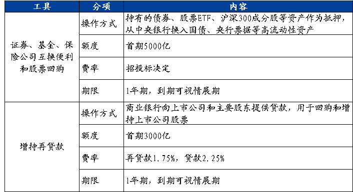

证券研究报告 | 宏观研究

请仔细阅读本报告末页声明

## 年度策略

### 千字当头——2025年经济与资产展望

回顾2024年，我国经济运行、政策走向、资产价格整体表现为“波动大、预期差大”，主因有四：我国经济内生动能疲弱，本质还是内需不足、信心不足；前三季度政策落地慢、力度偏克制，9月底以来出台组合拳、政策底层逻辑大转向；受制于化债压力大、土地财政缩水，地方政府“巧妇难煮无米之炊”；海外不确定性高，尤其是美国衰退预期和美联储降息预期反复波动，地缘冲突也愈演愈烈。

展望2025年，“干字当头”应是关键词，“波动大、预期差大”可能延续，关注四大主线：特朗普再次当选的政策，紧盯关税升级和人民币；我国中央加杠杆的力度，紧盯财政扩张和消费支持力度；我国经济基本面的走势，紧盯地产、基建、物价；三中全会促改革的进展，紧盯民生、财税、国改、民营、扩开放、新质生产力。

综合看，2025年宏观经济和大类资产的基准情形很可能是：特朗普新政加大不确定性，美国经济前低后高、面临再通胀、降息可能放缓；我国政策将全力做好各种“稳”，大方向更积极、财政赤字率可能史上最高，全年应会继续“保5%”，并新增“推动物价回升”；实际GDP节奏可能“两头低、中间高”，投资升、消费升、出口降，关键看地产能否企稳、基建实物工作量能否多增；资产端，年底年初可能阶段性“股债双牛”，全年权益资产可能震荡偏上行、结构性机会为主，内需、顺周期、科技有望交替表现，国内债牛仍可期、波动加大，“上有顶、下有底”（10Y国债收益率区间可能为1.75%—2.3%）；美元指数总走势上相比107左右的高位（11月下旬）应趋于回落、但回落空间不会太大，人民币将面临较大贬值压力。

## 一、政策面：干字当头、更积极、更扩张、更给力，中央加杠杆力度是关键

1、总基调：9月底一揽子增量政策出台以来，我国政策的底层逻辑已经转变，尤其是中央加杠杆的想象空间明显打开，再考虑到2025年可能继续“保5%”，叠加大概率的关税升级，均指向2025年政策大方向将更积极、更扩张、更给力。

2、主抓手：进一步“向内求”，扩内需为主，包括促消费（可能会有新一轮消费补贴），稳地产（调整收储政策、北上进一步松绑限购限售），拉基建（筹划更多大型基建项目、放松专项债项目审批），强产业（现代化产业体系）。

3、货币端：宽松还是大方向，全年降准降息均可能2—3次，结构性工具仍是发力重点；全年社融增速小升，节奏先上后下、高点在三季度，M1同比有望转正。

4、财政端：延续积极，我们预计：2025年一般赤字率升至3.5%—4%以上，专项债扩至4.5万亿元以上，特别国债规模至2—3万亿元以上，对应看全口径赤字率（广义赤字率）可能接近9%甚至更高，预示2025年赤字率有望成为史上最高。

5、制度端：促改革可能提速，2025年是二十届三中全会精神落实的关键一年，在“及时推出一批条件成熟、可感可及的改革举措”要求下，可重点关注5大类改革：惠民生（生育补贴）、财税体制改革、国企改革、稳民营经济、新质生产力。

6、政策节奏：政治局会议、中央经济工作会议（12月上中旬），明年“两会”（预计3月）、政治局会议（预计4/7/10/12月）、美联储议息会议（3月很关键）。

## 二、基本面：可能继续“保5%”，内需升、外需降，紧盯关税、地产、基建

1、全球看，逐步走出“肥尾”，乐观情形可能触底回升、节奏前低后高。“降息效果显现+杠杆充分去化+信贷条件改善”的共同作用下，预计2025年全球经济将逐步走出“肥尾”阶段，乐观情形下有望开启新一轮上行周期，其中：欧洲经济最快在2025年初回升，美国经济更有可能在2025年下半年回升。

2、国内看，可能继续“保5%”，节奏“中间高、两头低”，关税和政策力度是关键。2024年，我国经济呈先升后降再反弹的“N”字型走势，全年GDP有望实现5%；2025年预计政策继续加码、推动经济进一步修复，全年可能继续“保5%”，结合基数效应，预计：2025全年GDP实际增速5%左右，Q1—Q4当季增速分别为5.0%、5.1%、5.1%、4.7%。名义GDP增速约为4.8%左右。鉴于可能的关税冲击，政策实际力度和落地节奏仍存在较大不确定性，对应经济节奏也会变数较大。

3、结构看，投资、消费反弹是主支撑，出口回落是主拖累，紧盯地产和基建实物工作量。

- 内需修复：消费预计温和修复，收入反弹是主支撑，财富缩水仍制约；地产投资短暂反弹后可能再度回落，但整体跌幅有所收窄；基建在政策支持下保持高增，实物工作量有望回升。
- 外需回落：如果没有额外加征关税，基准情形下我国出口增速约为3.0%左右，后续紧盯特朗普对我国可能加征关税的时间和税率，中性情形下可能拖累我国2025年出口约3.0个百分点（6.0%÷2）；换言之，2025年我国出口同比增速可能降至0%左右。而制造业投资和工业生产受出口回落拖累，预计高位小幅放缓，补库之路仍然坎坷。

## 三、流动性：美国面临再通胀，中国物价低位小升，国内债牛可期，人民币压力大

1、物价：美国再通胀风险，国内CPI、PPI延续低位，可能的限产是大扰动。

- 美国物价：2025年美国通胀面临三重上行压力：一是住房通胀可能止跌反弹，二是“工资—物价螺旋”压力加大，三是特朗普可能加征关税。根据测算，在不考虑关税的影响下，2025年Q1—Q4美国CPI同比分别为2.3%、2.2%、2.4%、2.4%，核心CPI同比分别为2.8%、2.7%、2.7%、2.6%，仍高于美联储的政策目标。
- 国内物价：预计中国CPI、PPI可能仍会延续低位震荡。CPI方面，2025年中枢预计约0.7%，Q1—Q4分别为0.9%、0.6%、0.4%、0.8%，关注消费、猪肉、房租等影响因素；PPI方面，2025年中枢预计约为-1.5%，Q1—Q4分别为-1.9%、-1.9%、-0.9%、-1.3%，重点关注油价、国内大宗、产能过剩行业价格走势。

2、利率：货币宽松、财政发力、经济企稳的大背景下，预计利率整体偏震荡下行，区间在1.75%—2.3%，基本面仍是核心变量。但鉴于地缘政治、地产修复不确定性等因素，基本面修复节奏、幅度存在较大不确定性，对应利率波动可能放大。

3、汇率：预计2025年美元指数很可能震荡为主，总走势相比107左右的高位（11月下旬）应趋于回落、但回落空间不会太大；人民币面临较大贬值压力（也要警惕类似“广场协议”的被迫升值），鉴于国内政策偏扩张，也无需过于悲观。

## 四、中观面：“加征关税、化债、货币政策框架变化、区域规划”四大焦点

1、加征关税升级的行业影响：基于特朗普的贸易主张、美国对华进口依赖、当前美国自华进口关税、2018年各个行业的关税弹性、中国对美出口依赖等视角，电子、纺织服饰、家用电器、基础化工等行业受影响可能最大，其次是建材、有色金属、轻工制造、电力设备与新能源等也需重点关注；计算机、钢铁等行业如果加征关税落地，对美出口可能下降较多、但对相关行业整体影响有限；食品饮料、石油石化、农林牧渔、医药生物、国防军工等行业受影响相对偏小。

2、10万亿化债对消费的影响：整体看，化债缓解地方财政压力、清偿企业应收账款，直接利好政府和企业消费。结构看，按受益程度分为三类：

- 直接受益类：文化办公用品、书报杂志等，体现为地方财政支出和书报杂志消费增速、企业管理费用和办公用品消费增速的相关性较好。
- 部分受益类：如汽车中的商务车，家具中的办公桌椅、文件柜，商用家电、健身器材、通讯器材的固定电话机等。
- 间接受益类：如必选消费、建材、化妆品、金银珠宝等。

3、货币政策框架变化的影响：伴随经济转型，货币政策框架也正发生变化，尤其是货币政策调控中间变量的调整、利率调控机制、二级市场国债买卖等。对于资产定价而言，注意两点变化：一是总量金融指标（社融、M2等）波动性下降、同时趋势性向下，对于经济的指示作用弱化，基本面的边际变化需更多关注M1、物价等指标；二是伴随流动性投放方式更加多样化，央行对于利率的掌控程度上升，也预示过去机构行为占主导的债券市场，在未来可能需要更多注意央行操作的影响。

4、重大区域规划的投资机会：区域规划和战略具备前瞻性及政策协同支持的确定性，短期可关注两大维度：一是新发展格局下西部大开发，遵循“大保护、大开发、高质量发展”；二是国务院已审批通过11个城市2021—2035年国土空间规划，关注各地“标签”，其中：功能定位看，成都定位为“西部经济/科技创新/对外交往中心”；服务重大战略看，如广州、深圳等要服务于“一带一路”战略；优先支持产业看，支持特色海洋产业集群（广州）、创意产业发展（深圳）、金融（成都）。

后附：2025年重要大事件一览表；2025年主要经济指标预测表。

风险提示：地产、消费超预期变化；海外经济环境、地缘冲突演化等超预期。

作者

分析师

熊园

执业证书编号：S0680518050004

邮箱：xiongyuan@gszq.com

分析师

刘新宇

执业证书编号：S0680521030002

邮箱：liuxinyu@gszq.com

分析师

杨涛

执业证书编号：S0680522070001

邮箱：yangtao3123@gszq.com

分析师

刘安林

执业证书编号：S0680523020002

邮箱：liuanlin@gszq.com

分析师

穆仁文

执业证书编号：S0680523060001

邮箱：murenwen@gszq.com

分析师

朱慧

执业证书编号：S0680523090002

邮箱：zhuhui3@gszq.com

研究助理

薛舒宁

执业证书编号：S0680123070031

邮箱：xueshuning@gszq.com

### 相关研究

1、“等待拐点——2025年海外宏观展望” 2024-11-28

2、“等待拐点——2024年中期经济与资产展望” 2024-07-16

3、“特朗普关税“首枪”对准中加墨，影响几何？” 2024-11-27

4、“10月消费和服务业超预期的背后” 2024-11-15

5、“一文读懂房地产税收新政” 2024-11-14

6、“再通胀”叙事重演——美国10月CPI点评” 2024-11-14

7、“财政总包“10万亿+”，怎么看、怎么办？” 2024-11-09

8、“特朗普再次当选，影响几何？” 2024-11-06

9、“底层逻辑大转变——9.26政治局会议的5点理解” 2024-09-26

10、“转向的开始——9.24一揽子政策的4点理解” 2024-09-24

2024年12月1日

**P.2** 请仔细阅读本报告末页声明

2024年12月1日

**P.3** 请仔细阅读本报告末页声明

### 内容目录

引言：波动大、预期差大——2024年回顾与2025年展望 ..................................................................................... 5

一、政策面：干字当头、更积极、更扩张，全力各种“稳”，中央加杠杆力度是关键 .......................................... 9

1、总基调：全力稳信心、稳增长、稳市场、稳地产、抬物价、促改革 ........................................................ 9

2、货币端：大方向较宽松，降准降息有望2—3次，关注M1修复节奏 ...................................................... 11

3、财政端：扩张更给力，赤字率有望创新高，关注化债和专项债节奏 ...................................................... 14

4、制度端：改革提速，重民生、财税、国改、民营、扩开放、新质生产力 ............................................... 17

二、基本面：GDP目标仍会偏高，投资升、消费升、出口降，紧盯关税、地产、基建 ..................................... 19

1、海外看，全球经济有望走出“肥尾”，乐观情形可能触底回升、节奏前低后高 ...................................... 19

2、国内看，可能继续“保5%”，节奏“中间高、两头低”，关税和政策力度是关键 ................................. 20

3、结构看，投资、消费是主支撑，出口是主拖累，紧盯地产和基建实物工作量 ........................................ 21

三、流动性：美国面临再通胀，中国物价低位小升，国内债牛可期，人民币贬值压力大 .................................. 29

1、物价：美国再通胀风险，中国CPI、PPI可能低位小升，可能的限产是大扰动 ...................................... 29

2、利率：美债可能高位震荡，国内“债牛”仍可期、10Y国债收益率有望下破2% .................................. 34

3、汇率：美元指数很可能在100以上震荡，人民币汇率贬值压力大、波动加剧 ....................................... 37

四、中观面：“加征关税、化债、货币政策框架变化、区域规划”四大焦点 ...................................................... 39

1、特朗普加征关税升级的行业影响 .......................................................................................................... 39

2、“10万亿”化债更利好哪些消费 ........................................................................................................... 42

3、货币政策框架变化对资产的影响 .......................................................................................................... 44

4、重大区域战略与规划的投资机会 .......................................................................................................... 45

### 图表目录

图表1：2024、2025年重要经济金融数据预测 ................................................................................................ 7

图表2：2025年大事件一览表 ......................................................................................................................... 8

图表3：2025年政策有望更积极，宽财政+宽货币+稳地产+扩内需继续加码 ................................................. 10

图表4：年内货币政策主要分为3个阶段 ....................................................................................................... 11

图表5：宽信用仍然偏弱，信贷社融增速持续回落 ......................................................................................... 11

图表6：需求不足仍是核心矛盾 ..................................................................................................................... 11

图表7：截至2024年10月，MLF存量规模仍达6.79万亿 ............................................................................ 12

图表8：实际利率过高制约实体部门融资需求 ................................................................................................ 12

图表9：新创设两项结构性工具支持股票市场 ................................................................................................ 13

图表10：目前有1000家左右的上市公司股息率高于增持再贷款成本 ............................................................. 13

图表11：2025年政府债券、信贷有望同比多增，支撑社融 ........................................................................... 14

图表12：预计2025年社融增速8.6%，节奏上先上后下 ............................................................................... 14

图表13：2024年政府债券发行节奏明显偏慢 ................................................................................................ 14

图表14：2024年城投债净融资为负，是2019年以来首次 ............................................................................. 14

图表15：土地出让收入与城投债务扩张高度正相关（单位：亿元） ............................................................... 15

图表16：横向对比看，我国中央政府杠杆率仍有较大抬升空间 ...................................................................... 15

图表17：2025年赤字结构中，中央占比有望进一步抬升 ............................................................................... 15

图表18：2025年广义财政赤字率预计为8.7%，较2024年抬升1.9个百分点 ............................................... 16

图表19：截至2023年底，城投平台带息债务规模达58.8万亿 ...................................................................... 16

图表20：2023年以来的化债思路从“防风险”向“防风险、促发展并重”转变 ............................................ 17

图表21：美联储货币政策对经济的影响滞后1年左右 .................................................................................... 19

图表22：欧央行货币政策对经济的影响滞后8个月左右 ................................................................................ 19

图表23：主要经济体非金融企业杠杆率已明显下降 ....................................................................................... 19

图表24：主要经济体居民杠杆率已明显下降 .................................................................................................. 19

图表25：美国企业信贷需求已开始恢复 ......................................................................................................... 20

图表26：美国居民信贷需求已开始恢复 ......................................................................................................... 20

图表27：2024年PMI指数先升后降再反弹 ................................................................................................... 20

图表28：2024年消费、投资、工业生产先升后降 ......................................................................................... 20

图表29：2025年GDP增速预测 .................................................................................................................... 21

图表30：今年消费增速下台阶 ....................................................................................................................... 22

2024年12月1日

**P.4** 请仔细阅读本报告末页声明

图表31：1-10月通讯器材、体育娱乐用品、粮油食品消费增速较高................... 22  
图表32：居民收入增速有望温和反弹................................................. 22  
图表33：房价持续下跌制约消费意愿................................................. 22  
图表34：以旧换新政策对8-9月家电、文化办公用品、汽车消费拉动明显............ 23  
图表35：2024年地产景气继续回落................................................... 23  
图表36：10月以来地产销售有所反弹................................................. 23  
图表37：房屋租售比仍较低......................................................... 24  
图表38：居民杠杆率已经较高....................................................... 24  
图表39：2024年基建增速先下后上................................................... 24  
图表40：基建实物工作量出现好转................................................... 24  
图表41：2024年出口韧性支撑制造业投资............................................. 25  
图表42：以旧换新政策推动设备购置投资高增......................................... 25  
图表43：出口、消费增速和工业生产走势接近......................................... 26  
图表44：价格和地产销售领先库存增速............................................... 26  
图表45：2024年全球出口走强是我国出口超预期的重要背景............................ 26  
图表46：2024年我国出口份额有所回升.............................................. 26  
图表47：历史上看，全球央行降息周期利好出口....................................... 27  
图表48：历史上看，全球出口价格跟油价显著正相关................................... 27  
图表49：2018年加征关税的行业存在明显“抢出口”现象.............................. 28  
图表50：历史上看，我国机电产品出口跟全球半导体销售周期高度相关................ 28  
图表51：2025年美国住房通胀大概率止跌反弹........................................ 29  
图表52：2025年美国“工资-物价螺旋”压力将加大.................................... 29  
图表53：美国CPI和核心CPI同比测算................................................ 30  
图表54：特朗普关税和驱逐非法移民对美国通胀的影响................................ 30  
图表55：2025年CPI、PPI可能的走势预测........................................... 31  
图表56：当前生猪存栏仍高、且前期有所回升......................................... 31  
图表57：历史上看，CPI房租跟房价走势同步或略滞后.................................. 31  
图表58：本轮PPI下行分行业拆解情况............................................... 32  
图表59：当前PPI所处宏观环境类似2012-2015年、但三大需求中枢更低............... 33  
图表60：中长期看，我国地产可能维持下行趋势....................................... 33  
图表61：我国当前产能利用率仍在偏低水平........................................... 33  
图表62：PPI同比增速下行阶段，工业企业利润往往同比走弱.......................... 34  
图表63：PPI同比跟出口走势正相关.................................................. 34  
图表64：近期美债短端利率和期限利差均上行......................................... 35  
图表65：近期美债隐含的通胀预期大幅反弹........................................... 35  
图表66：2024年利率整体趋于下行，债市走出一波牛市................................ 36  
图表67：美联储降息预期下调带动美元指数走强....................................... 38  
图表68：前期美元指数做空偏拥挤................................................... 38  
图表69：美欧经济相对表现不支持美元指数持续走强................................... 38  
图表70：中美利差仍对人民币汇率形成压制........................................... 38  
图表71：特朗普针对中美贸易相关政策主张梳理....................................... 39  
图表72：美国对我国各行业进口依赖度、实际附加税率和加征关税覆盖比例............ 40  
图表73：如果特朗普当选，不同情形加征关税对中国出口可能的影响................... 41  
图表74：2023年各行业对美出口占我国整体出口的比例................................ 41  
图表75：预计2024年政府消费增速回落，2025年反弹................................. 42  
图表76：企业利润和管理费用增速均处于历史低位.................................... 42  
图表77：不同细分商品类型受化债影响分析........................................... 43  
图表78：书报杂志消费增速和地方财政支出增速走势接近.............................. 43  
图表79：办公用品消费增速和企业管理费用增速接近.................................. 43  
图表80：临时正逆回购利率可能成为新的利率走廊.................................... 44  
图表81：利率传导框架发生变化，7天逆回购利率的政策利率地位进一步强化........... 45  
图表82：2024年广深待重点城市均已通过2021-2035年国土空间规划................... 47

---

### 引言：波动大、预期差大——2024年回顾与2025年展望

回顾2024年，我国经济运行、政策走向、资产价格整体表现为“波动大、预期差大”：

1) 海外环境方面，美国经济仍有韧性、衰退预期被证伪，美联储降息预期一波三折；地缘博弈激烈，巴以冲突升级、俄乌冲突延续；美国大选跌宕起伏，特朗普最终大胜。

2) 国内经济方面，一季度小幅修复、二三季度经济明显走弱，四季度触底回升，整体呈现“外强内弱、供强需弱”的特征、走势上类“N”字型，政策节奏变化是主因。

3) 国内政策方面，整体基调延续宽松、但节奏变化大，一季度发力较快，二季度放缓、尤其是专项债发行节奏显著慢于往年，三季度在7.18三中全会之后已有政策加快落地，9.24以来一揽子政策密集出台，稳增长和中央加杠杆的底层逻辑已然转向，着力稳增长、稳信心、稳市场、稳地产。

4) 资产价格方面，A股（上证指数）1-4月小幅上涨4.37%，5-8月下跌8.46%，9月一揽子政策出台后股市大幅跳升，9.24-10.8大涨27%、高点一度突破3600点，10月、11月震荡调整、但成交量持续高位、“赚钱”效应较明显。债券（十年期国债收益率）全年呈震荡下行态势、可谓“牛市”依旧，9月以来在2.1%附近窄幅震荡；汇率端，年初至8月人民币兑美元小幅贬值，9月底国内一揽子政策出台，美元兑人民币迅速升至7.0左右，10月底以来“特朗普交易”推动下，人民币再度贬值。

“波动大、预期差大”的背后，大体有四类因素：其一，我国经济内生动能疲弱，本质还是内需不足、信心不足；其二，前三季度政策落地慢（比如专项债），力度也偏克制（比如5.17收储规模）；其三，受制于地产景气下滑、土地财政持续缩水、化债压力较大，地方政府可谓“巧妇难煮无米之炊”；其四，海外变数大，尤其是美国经济衰退预期和美联储降息预期波动较大，以及巴以冲突、俄乌冲突、美国大选等地缘政治扰动较大。

展望2025年，既是特朗普再次当选的第一年，也是我国“十四五”规划的收官之年，还是全面落实二十届三中全会精神的关键之年，我们预计，“干字当头”应是关键词，“波动大、预期差大”可能延续，具体可关注四大主线：特朗普再次当选的实际政策、我国中央加杠杆的实际力度、我国经济基本面的实际走势、三中全会促改革的实际进展。

#### 主线1：特朗普再次当选的实际政策，尤其是中美博弈和可能的关税升级，人民币汇率可作为重要的观察指标

特朗普再次当选，同时控制国会参议院和众议院，预示特朗普很可能成为近年来“最有权、最强势”的美国总统，其主要政策主张的实施难度也将大大下降。从特朗普提名的内阁成员来看，“年轻化、对华偏强硬、富翁多、企业家多”是主要特征，再考虑到11.25特朗普关税“首枪”意外对准了“后花园”加拿大、墨西哥，均预示2025年特朗普的实际政策可能会有很多“猝不及防”，这无疑将加大全球政经形势和资产价格的波动。对于中国而言，中美关系变数也将增多，尤其是加征关税的节奏和力度，参考2018年中美贸易摩擦下的人民币汇率走势（一度贬值超过10%），预计2025年人民币汇率会有较大贬值压力、并很可能宽幅震荡。倾向于认为，稳增长VS稳汇率，后续政策取向可能会更侧重稳增长，也即2025年人民币汇率可能会“顺势而为”。

#### 主线2：我国中央加杠杆的实际力度，尤其是财政扩张力度、消费支持力度

前期报告我们多次提及，9.24以来我国政策的底层逻辑已转变，预计2025年政策主基调应会更积极、更扩张、更加给力，我们预计：2025年GDP目标可能仍定5%左右的偏高水平（4.5%以上应是底线目标）；2025年一般赤字率3.5%-4%之间或以上，扩大专项债规模至4.5万亿以上，扩大特别国债规模至2-3万亿以上，对应看2025年全口径赤字率（广义赤字率）可能接近9%甚至更高，预示2025年赤字率有望成为有统计以来史上最高。

**P.6 请仔细阅读本报告末页声明**

其中，对消费的支持方面，重点关注设备更新和消费品“以旧换新”的扩容情况（预计会有3000亿元以上，消费品种方面可能从家电扩大至家居、家装、家纺、消费电子等）。

**主线3：我国经济基本面的实际走势，尤其是地产、基建、物价。**前期报告我们多次指出，2025年稳增长、稳物价可能是两大重要目标，其中：稳增长方面，面对可能的5%左右偏高的GDP目标增速，“三驾马车”拆分看，潜在关税冲击下出口回落压力应会较大，消费预计温和修复，换言之，明年稳增长的“胜负手”可能来自地产和基建。地产需要观察在一系列支持政策之后能否实质性“止跌回稳”，基建则要观察地方化债压力缓解之后能否形成更多实物工作量（严格来说是观察我国基建空间究竟还有多大）；稳物价方面，“推动物价回升”有望成为2025年的新增目标，央行11月初在三季度货币政策执行报告中也明确指出“把促进物价合理回升作为把握货币政策的重要考量”，后续紧盯稳物价的具体政策部署，尤其是可能的针对中上游原材料的限产，也要紧盯PPI走势。

**主线4：三中全会促改革的实际进展，尤其是财税改革、国企改革、稳民营、新质生产力。**2025年是二十届三中全会精神落实的关键一年，总书记10月29日在省部级主要领导干部学习贯彻党的二十届三中全会精神专题研讨班开班式讲话中也明确指出：“领导干部特别是高级干部担负着推进改革的重要职责，直面矛盾问题不回避，铲除顽瘴痼疾不含糊，应对风险挑战不退缩，奋力打开改革发展新天地。”我们预计：在“及时推出一批条件成熟、可感可及的改革举措”总要求下，财税体制、国企改革、稳民营经济、培养新质生产力、要素市场化（土地和数据等）、统一大市场等领域改革措施可能加快推出。

综合看，倾向于认为，**2025年宏观经济和大类资产的基准情形很可能是：**

1）海外看，全球政经形势变数大，紧盯特朗普的实际政策主张，乐观情形下欧美经济有望相继开启触底回升的新一轮周期，节奏上前低后高；

2）政策看，全力稳增长、稳信心、稳市场、稳地产、抬物价、促改革，大方向更积极、更扩张、更给力，尤其是松货币、宽财政为主的中央加杠杆，以及关税升级的对冲政策；

3）基本面看，国内经济大概率会延续偏高的GDP目标（4.5%以上应是底线目标，更可能定5%左右），结构上，确定的可能是“生产延续韧性、出口回落、消费温和修复、制造业高位趋缓”，不确定性较大的可能是地产和基建，中性预期是“地产降幅收窄、但难以实质企稳，基建维持高增、实物工作量可能小幅改善”；

4）资产看，面对“波动大、预期差大”的宏观大势，短期看可能阶段性“股债双牛”，全年看，权益资产（A股）可能震荡偏上行，结构性机会为主，内需、顺周期、科技可能交替表现；国内债券利率可能维持震荡下行趋势、波动放大，“上有顶、下有底”（区间可能为1.75%—2.3%）；美元指数很可能会震荡为主，总走势上相比107左右的高位（11月下旬）应趋于回落、但回落空间不会太大，人民币则可能面临较大贬值压力。

节奏上，紧盯几次重要会议：12月政治局会议和中央经济工作会议（按照惯例，分别在2024年12月上旬、中下旬召开）；全国“两会”（按惯例在2025年3月）；季度政治局会议（按照惯例，一般4/7/10/12月聚焦经济，10月会议可能不开或不发通稿）；中央金融委、中央深改委会议等（一般一季度召开一次）；美联储议息会议（1/3/5/6/7/9/11/12月，3/6/9/12月会议会更新经济预测和点阵图）；特朗普可能的加征关税等。

2024年12月1日

**P.7 请仔细阅读本报告末页声明**

#### 图表1：2024、2025年重要经济金融数据预测

| 指标 | 2024Q4 | 2025Q1 | 2025Q2 | 2025Q3 | 2025Q4 | 2024E | 2025E |
|---|---:|---:|---:|---:|---:|---:|---:|
| **国内经济** |  |  |  |  |  |  |  |
| 实际GDP当季同比（%） | 5.3 | 5.0 | 5.1 | 5.1 | 4.7 | 5.0 | 5.0 |
| 名义GDP当季同比（%） | 4.5 | 4.8 | 4.7 | 4.9 | 4.7 | 4.3 | 4.8 |
| 工业增加值当季同比（%） | 5.4 | 5.1 | 5.0 | 5.5 | 5.4 | 5.6 | 5.3 |
| 社会消费品零售总额当季同比（%） | 4.2 | 3.5 | 4.5 | 5.5 | 4.5 | 3.5 | 4.5 |
| 固定资产投资累计同比（%） | 3.6 | 3.1 | 3.5 | 3.8 | 4.0 | 3.6 | 4.0 |
| 制造业投资累计同比（%） | 9.0 | 7.0 | 7.3 | 7.6 | 8.0 | 9.0 | 8.0 |
| 基建投资累计同比（%） | 9.8 | 9.3 | 9.5 | 9.2 | 9.0 | 9.8 | 9.0 |
| 房地产投资累计同比（%） | -9.8 | -9.5 | -8.8 | -8.0 | -7.5 | -9.8 | -7.5 |
| **外贸** |  |  |  |  |  |  |  |
| 出口当季同比（%，以美元计） | 7.7 | 8.2 | 4.5 | -2.0 | -10.0 | 5.2 | 0.0 |
| 进口当季同比（%，以美元计） | 2.4 | 1.3 | 4.5 | 3.4 | 0.0 | 2.3 | 2.0 |
| **通胀** |  |  |  |  |  |  |  |
| CPI当季同比（%） | 0.5 | 0.9 | 0.7 | 0.3 | 0.8 | 0.4 | 0.7 |
| PPI当季同比（%） | -2.6 | -1.9 | -1.9 | -0.9 | -0.7 | -2.2 | -1.5 |
| **货币金融** |  |  |  |  |  |  |  |
| 社融增速（余额同比）（%） | 7.9 | 8 | 8.8 | 8.8 | 8.6 | 7.9 | 8.6 |
| M2（余额同比）（%） | 7.4 | 7.4 | 7.5 | 8.4 | 8 | 7.4 | 8 |
| 1年期MLF利率（%） | 2.00 | 1.90 | 1.80 | 1.75 | 1.70 | 2.00 | 1.70 |
| 大型存款类金融机构法定准备金率（%） | 9.25 | 9.00 | 8.50 | 8.25 | 8.25 | 9.00 | 8.25 |
| 10年国债收益率 | 2.05 | 2.10 | 2.00 | 1.95 | 1.90 | 2.05 | 1.90 |
| **汇率** |  |  |  |  |  |  |  |
| 美元/人民币中间价（区间平均值） | 7.10 | 7.20 | 7.10 | 7.20 | 7.30 | 7.10 | 7.28 |

资料来源：Wind，国盛证券研究所整理

2024年12月1日

**P.8 请仔细阅读本报告末页声明**

#### 图表2：2025年大事件一览表

| 事件（时间排序） | 时间（2025年，北京时间） |
|---|---|
| 2024年12月中央政治局会议 | 2024年12月上中旬 |
| 2024年12月美联储议息会议（更新经济展望和点阵图） | 2024年12月17—18日 |
| 2024年中央经济工作会议 | 2024年12月中下旬 |
| 2025年地方“两会”陆续召开 | 1月中下旬 |
| 2024年第4季度及全年经济数据 | 1月中旬 |
| 特朗普正式就任新一届美国总统 | 1月20日 |
| 2024年第4季度《货币政策执行报告》 | 2月中旬 |
| 2025年全国“两会” | 3月4—5日 |
| 3月美联储议息会议（更新经济展望和点阵图） | 3月18—19日 |
| 2025年第1季度经济数据 | 4月中旬 |
| 4月政治局会议 | 4月底 |
| 2025年第1季度《货币政策执行报告》 | 5月中旬 |
| 6月美联储议息会议（更新经济展望和点阵图） | 6月17—18日 |
| 2025年第2季度经济数据 | 7月中旬 |
| 7月政治局会议 | 7月底 |
| 2025年第2季度《货币政策执行报告》 | 8月中旬 |
| 杰克逊霍尔全球央行年会 | 8月下旬 |
| 9月美联储议息会议（更新经济展望和点阵图） | 9月16—17日 |
| 2025年第3季度经济数据 | 10月中旬 |
| 10月政治局会议（也有可能不开） | 10月底 |
| 2025年第3季度《货币政策执行报告》 | 11月下旬 |
| 2025年12月中央政治局会议 | 12月上中旬 |
| 12月美联储议息会议（更新经济展望和点阵图） | 12月9—10日 |
| 2025年中央经济工作会议 | 12月中下旬 |

资料来源：央行、中新网、美联储官网等，国盛证券研究所整理

2024年12月1日

**P.9 请仔细阅读本报告末页声明**

## 一、政策面：干字当头、更积极、更扩张，全力各种“稳”，中央加杠杆力度是关键

### 1、总基调：全力稳信心、稳增长、稳市场、稳地产、抬物价、促改革

维持近期一系列判断：9月底一揽子增量政策出台以来，我国政策的底层逻辑已经转变，尤其是中央加杠杆的想象空间明显打开；此外，特朗普再次当选美国总统，中美关税升级的可能性提升，客观上也需要国内政策进一步加码，具体可关注5大方面：

第一，2025年政策总基调应会更积极、更扩张、更给力。随着9月底一揽子政策相继出台，10月以来我国经济环比改善的迹象增多，但经济恢复基础尚不牢固，本质上还是需求不足、信心不足；再考虑到2025年可能继续“保5%”，叠加可能的关税升级，均指向2025年政策大方向上会更积极、更扩张、更给力。

第二，稳增长仍是硬要求、2025年可能继续“保5%”，此外，“推动物价回升”可能成为新增目标。我们预计：考虑到稳预期，以及与中长期目标相衔接，2025年GDP增速目标大概率仍会定为5%左右的偏高水平（4.5%以上应是底线目标）。具体节奏上：2024年呈先升后降再反弹的“N”字型，全年GDP有望实现5%；预计2025全年GDP实际增速5%左右，Q1—Q4当季增速分别为5.0%、5.1%、5.1%、4.7%（“两头低、中间高”），名义GDP增速约为4.8%左右。此外，“推动物价回升”有望成为新增目标，央行三季度货币政策执行报告中也明确指出，“把促进物价合理回升作为把握货币政策的重要考量”。

第三，稳增长的主抓手应还是扩内需，包括促消费（可能会有新一轮消费补贴），稳地产（调整收储政策、北上进一步松绑限购限售），拉基建（筹划更多大型基建项目、放松专项债项目审批），强产业（现代化产业体系），具体看：

1）消费端：预计消费温和修复，紧盯支持消费的更多“真金白银”政策，目前比较明确的是，11.8日财政部已经提及“加大力度支持大规模设备更新，扩大消费品以旧换新的品种和规模”，11.21日商务部官员也表示“提前谋划明年的汽车以旧换新接续政策”。

2）投资端：地产投资短暂反弹后可能再度回落，但整体跌幅有所收窄，后续重点关注收储政策可能的调整（尤其是中央直接“下场”收储）；基建在政策支持下保持高增（筹划更多大型基建项目），实物工作量有望回升；制造业投资和工业生产受出口回落拖累，预计高位小幅放缓，补库之路仍然坎坷。

3）产业端：二十大、二十届三中全会均将“现代化产业体系”作为主线任务，2023年以来新质生产力也已成为高频关键词，叠加2025年面临可能的关税威胁，在进一步练好内功的要求下，应会看到更多支持新质生产力培育、产业转型升级的举措，如短期应可看到各地发布并购重组支持科技金融产业一体化举措。

第四，中央加杠杆有望“更给力”，2025年可能降准降息均在2—3次，财政赤字率可能史上最高，地产收储、促消费、稳资本市场也可能有更多“真金白银”。

1）货币政策方面，我们预计：宽松还是大方向，全年降准、降息可能均在2—3次，结构性工具仍是货币政策发力重点；2）财政方面，有望提前下达2025年部分专项债额度，预计一般赤字率3.5%—4%之间或以上，扩大专项债规模至4.5万亿以上，扩大特别国债规模至2—3万亿以上，对应看2025年全口径赤字率（广义赤字率）可能接近9%甚至更高，预示2025年赤字率有望成为有统计以来史上最高；3）稳地产方面，地方收储规模有望增加、中央也可能更大程度参与地方收储（今年仅有新设3000亿元保障性住房再贷款）；4）促消费方面，2024年共实施两轮设备更新和消费品以旧换新政策，但仅有第二轮“真金白银”补贴（3000亿左右超长期特别国债资金支持），2025年有望延续实施，且继续“真金白银”给钱，还可能进一步扩大补贴范围。

第五，改革可能提速，2025年是二十届三中全会精神落实的关键一年，在“及时推出一批条件成熟、可感可及的改革举措”要求下，重点关注保障和改善民生、财税体制改革、

**P.10 请仔细阅读本报告末页声明**

国企改革、培育新质生产力等领域。具体看：1）保障和改善民生，尤其是生育支持、就业支持政策，紧盯建立全国性的生育补贴制度、加大个人所得税抵扣力度、推动租购同权等；2）财税体制改革，在“基础性制度先行引领、细分领域改革举措接续跟进”原则下，应会率先推进预算、转移支付、政府债务管理制度改革等，也需关注消费税、个税、增值税改革；3）国资国企改革，短期推进重点在于推进原始创新、国有资本“三集中”；4）加快培育新质生产力，涉及新质生产力主体、科技创新、要素流动、国际合作等。

第六，防风险，2024年房地产、化债、活跃资本市场等已有实质性动作，2025年继续关注落实和可能的加码。年内已陆续有“10万亿+”财政刺激方案、加大“白名单”贷款投放力度、专项债新增支持土储和收储、央行创设两项新的货币政策工具、支持并购重组活跃资本市场等举措，2025年继续紧盯落实，也可能持续加码，中央更大程度地参与地产收储、可能的平准基金等增量政策仍可期。

##### 图表3：2025年政策有望更积极，宽财政+宽货币+稳地产+扩内需继续加码

| 主要抓手 | 2024年政策发力 | 2025年政策有望更扩张、更积极 |
|---|---|---|
| 财政政策 | ✓ 年初“两会”确定赤字率3%、发行1万亿超长期特别国债和3.9万亿专项债，广义财政赤字规模有望达8.96万亿。  ✓ 11.4—8 人大常委会审议通过了增加地方政府债务限额置换存量隐性债务等议案，规模达“10万亿+”，包括3年6万亿置换债+5年4万亿专项债+2万亿2029年到期棚户区改造隐债+4000亿元地方政府债务结存限额+安排有关中央单位上缴一部分专项收益。 | 有望提前下达2025年部分专项债额度，预计2025年可能会大幅提升赤字率至4%以上，扩大专项债规模至4.5万亿以上，扩大特别国债规模至2—3万亿以上。 |
| 货币政策 | ✓ 2次降准、3次降息：2月宣布降准50BP、5年期LPR调降25BP，7月1年期和5年期LPR均调降10BP，9月降准50BP，10月1年期和5年期LPR再度调降25BP。  ✓ 4.1日设立科技创新和技术改造再贷款，额度5000亿元，利率1.75%。  ✓ 7.8日央行公告创设临时正、逆回购。  ✓ 8.13日央行新增支农支小再贷款额度1000亿元。  ✓ 9.24日央行发布一揽子增量政策，包括“放水”（降准/降息/降存量房贷利率/降二套房首付比）、布局长远（新的货币政策工具支持股市/“长钱长投”/市值管理/并购重组）、“对症下药”（收储再贷款央行提升至100%出资）。  ✓ 10.10日央行正式决定创设“证券、基金、保险公司互换便利”，首期操作规模5000亿，视情可进一步扩大操作规模。  ✓ 10.28日央行创设买断式逆回购。 | 全年降准、降息可能均在2—3次，其中，降准幅度在50—100BP，降息幅度在20—40BP，结构性工具仍是货币政策发力重点。 |
| 稳地产 | ✓ 1.12日住建部、金融监管总局发布《关于建立城市房地产融资协调机制的通知》，提出可以给予融资支持的房地产项目名单，推送金融机构，做好融资支持。  ✓ 5.17日全国切实做好保交房工作视频会议召开，央行、金融监管总局等多部委联合出台一系列政策。主要有四类：1）下调首付比5个百分点；2）取消首套、二套房的贷款利率下限；3）下调公积金贷款利率25BP；4）设立3000亿元保障性住房再贷款。  ✓ 6.3日《关于设立保障性住房再贷款有关事宜的通知》，由央行设立3000亿元保障性住房再贷款，预计带动银行贷款5000亿元。  ✓ 9.24日央行发布一揽子增量政策，包括降存量房贷利率、降二套房首付比、收储再贷款央行100%出资、延长支持房企政策期限、支持收购房企存量土地。  ✓ 10.12日财政部发布会，提出用好专项债收购存量房用作各地的保障性住房。  ✓ 10.17日住建部新闻发布会，宣布“两个增加”：一是通过货币化安置房方式新增实施100万套城中村改造和危旧房改造……后续或视情况加大支持力度；二是年底前将“白名单”项目信贷规模增加至4万亿元，将所有房地产合格项目都争取纳入“白名单”。  ✓ 11.13日财政部、税务总局、住房城乡建设部发布《关于促进房地产市场平稳健康发展有关税收政策的公告》，契税、增值税、土地增值税预征率下限均有调降。 | 2025年，地方收储规模有望增加，以及中央更大程度参与地方收储。此外，在促进房地产“止跌回稳”要求下，仍可能继续放松，尤其是一线城市放松限购限售。 |
| 设备更新和消费品以旧换新 | ✓ 第一轮：3.13日国务院发布《关于推动大规模设备更新和消费品以旧换新行动方案》，新一轮大规模设备更新下，传统制造业、服务消费行业的绿色、数字化改造是发力重点。  ✓ 第二轮：7.24日财政部等印发《关于加力支持大规模设备更新和消费品以旧换新的若干措施》的通知，统筹安排3000亿元左右超长期特别国债资金，加码支持大规模设备更新和消费品以旧换新，包括：一是进一步加大对重点领域更新换新的补贴力度，二是扩围。 | 2025年有望实施新一轮设备更新和消费品换新政策，参照第二轮，继续“真金白银”给钱，比如扩大消费品以旧换新的规模和品种，发行有力度的消费券等。 |

资料来源：中国政府网、财政部、央行等，国盛证券研究所

2024年12月1日

**P.11** 请仔细阅读本报告末页声明

## 2、货币端：大方向较宽松，降准降息有望 2-3 次，关注 M1 修复节奏

回顾2024年，我国货币政策相机抉择特征明显、整体延续宽松，先后2次降准、3次降息。防空转、稳汇率要求下，银行间市场流动性保持中性略偏紧，宽信用仍未有起色，需求不足仍是核心矛盾。

具体看，2024年货币政策大体可分为三个阶段：

- 一季度担忧经济压力较大，央行在2月宣布降准50BP、5年期LPR调降25BP；
- 4月份后一季度经济确认高开，同时汇率压力加大、国债收益率超预期下行，央行转向稳汇率、防风险；
- 7月份后二季度经济增速低于预期，央行再度转向稳增长，7月1年期和5年期LPR均调降10BP，9月降准50BP，10月1年期和5年期LPR再度调降25BP。

银行间市场流动性来看，由于汇率压力较大，叠加债券收益率持续下行，央行仍维持银行间市场流动性中性略偏紧，DR007持续在逆回购利率上方运行。但宽信用未有明显起色，信贷、社融增速持续回落并创历史新低，M1、M2增速也持续走弱，其中有金融数据挤水分、暂停银行手工补息等技术性因素影响，但核心仍是需求不足、信心不足，尤其是地产、消费需求偏弱。

图表4：年内货币政策主要分为3个阶段

资料来源：Wind，国盛证券研究所

图表5：宽信用仍然偏弱，信贷社融增速持续回落

图表6：需求不足仍是核心矛盾

资料来源：Wind，国盛证券研究所

展望2025年，我们预计：货币宽松还是大方向，全年降准、降息可能均在2-3次，结构性工具仍是货币政策发力重点；银行间市场流动性延续中性，全年社融增速小幅升至8.6%，节奏上先上后下、高点在三季度。具体看：

降准可能有2-3次、幅度在50-100BP，旨在稳增长、配合化债、置换MLF等。参考过往经验，经济增长本身需要降准释放中长期资金进行支持，2020年以来每年都会降准1-2次，幅度在50-100BP。

但相较过去，2025年有两点差异：一是除经济增长外，新一轮化债规模较大，也会对流动性造成阶段性扰动，客观上需要降准配合财政化债；二是当前MLF的政策利率色彩逐步淡化，但截至10月底存量MLF规模仍达6.79万亿，可能也需要通过降准来置换。需注意的是，央行于10月新创设了买断式逆回购工具，未来可能成为中期流动性投放的主要工具，将配合降准一起投放中长期流动性，因此降准的具体节奏需综合考量。

降息可能有2-3次，幅度在20-40BP，旨在稳增长、稳物价、稳地产。外部看，美联储已经进入降息周期，只是幅度、节奏有待观察，此前中美利差过大导致的汇率压力有望减轻。同时，地缘政治压力加大，出口可能承压，适当贬值应有利于出口。

内部看，稳增长、稳物价、稳地产仍是政策核心诉求。当前实际利率仍处于较高水平，按照新发放贷款利率-CPI测算的最新实际利率为3.4%，央行需进一步降息以压低实际利率、刺激实体融资需求，以达到稳增长、稳物价的目的。

图表7：截至2024年10月，MLF存量规模仍达6.79万亿

图表8：实际利率过高制约实体部门融资需求

资料来源：Wind，国盛证券研究所

结构性工具方面，继续定向支持重点领域、做好“五篇大文章”，此外，重点关注新创设的与股票市场相关的两项新工具。

截至2024年Q3，结构性货币政策工具规模已达6.66万亿，旨在支持重点领域，以及做好科技金融、绿色金融、普惠金融、养老金融、数字金融“五篇大文章”。往后看，经济转型的大背景下，结构性工具相较总量工具，在定向支持重点领域、促进经济结构转型方面发力更加精准有效，未来结构性政策工具仍是货币政策的重要发力方向。

此外，2024年新设立的证券、基金、保险公司互换便利和股票回购、增持再贷款两项新工具，进一步将结构性工具的支持范围拓展至资本市场，并且潘功胜行长在9·24发布会上也强调，如果工具使用效果好，可以增加相关额度。因此，后续需要重点关注这两项新工具的落地情况及后续进一步的部署，尤其是增持再贷款方面，目前有1000家左右的上市公司股息率高于增持再贷款成本。

图表9：新创设两项结构性工具支持股票市场

图表10：目前有1000家左右的上市公司股息率高于增持再贷款成本

资料来源：央行、中国政府网、国新办，国盛证券研究所

资料来源：Wind，国盛证券研究所

2025年信贷、社融、M2的规模：根据我们的测算，2025年社融增速较2024年可能小幅抬升至8.6%；节奏上，考虑到政策前置发力，社融增速可能先上后下、高点在三季度。伴随房地产边际改善、基建落地加快，M2增速可能震荡偏上行，全年增速在8%左右。

- **信贷方面**，预计2025年新增信贷规模有望达20万亿，对应信贷增速7.8%左右，整体节奏先下后上。2024年预计新增信贷规模19万亿，同比大幅少增3.7万亿，主要有三点拖累：一是房地产下行导致居民信用扩张放缓，二是经济承压、企业投资意愿持续偏弱，三是金融数据挤水分造成信贷一次性缩水。展望2025年，稳地产政策加码，房地产降幅有望收窄，财政发力也有望带动企业信贷边际好转，金融数据挤水分影响消除，综合看信贷有望多增0.5万亿-1.5万亿左右，即新增信贷19.5万亿-20.5万亿左右，中性情形下20万亿，对应信贷增速7.8%左右。

- **社融方面**，预计2025年新增社融规模有望达35.3万亿，对应存量社融增速8.6%左右，节奏上先上后下、高点可能在三季度。除信贷外，社融的主要分项中，我们预期政府债券规模在12万亿左右（对应赤字率4%、专项债规模4.5万亿、特别国债2万亿，化债部分政府债券会与非标、信贷等对冲，故暂不考虑，具体后文财政部分有分析），股票融资假设与今年持平，其余分项参考近两年均值。汇总各分项，预计2025年全年新增社融规模有望达35.3万亿，对应存量社融增速8.6%。节奏看，2025年政策靠前发力仍是基准假设，包括政府债券发行节奏、相关配套融资等，预计全年社融增速先上后下、高点在三季度前后。

- **M2增速预计震荡偏上行，2025年全年增速在8%左右，M1增速有望小幅转正。**展望2025年，伴随地产降幅收窄、财政发力，居民和企业部门信用扩张有望边际改善。新一轮化债落地后，预算外城投融资收缩有望缓解，预计M2增速有望小幅抬升，全年增速升至8%左右。M1方面，2024年由于房地产偏弱、基建落地效果偏弱，叠加取消银行手工补息，M1增速大幅回落，并连续多月同比负增长。考虑到2025年地产链和基建链均有望改善，预示企业资金活化可能也会趋于改善，预计M1增速有望小幅抬升至2.0%左右。

2963　376　440　120　53　13

| 股息率 | 上市公司数量 |
|---|---:|
| <2.25% | 2963 |
| [2.25%-3%) | 376 |
| [3%-5%) | 440 |
| [5%-7%) | 120 |
| [7%-10%) | 53 |
| ≥10% | 13 |

**P.14** 请仔细阅读本报告末页声明

图表11：2025年政府债券、信贷有望同比多增，支撑社融

图表12：预计2025年社融增速8.6%，节奏上先上后下

资料来源：Wind，国盛证券研究所

此外，关注货币政策的三大扰动：政府债券发行节奏、地产和基建修复情况、美联储降息节奏。

1）政府债券方面，新一轮化债落地，预计2025年化债规模将达2.8万亿，叠加财政发力，国债、专项债可能多发，将对流动性造成一定扰动；

2）房地产与基建方面，仍是决定信用扩张程度的重要变量，关注房地产销售改善的持续性以及房价能否企稳，化债后重点关注基建落地情况，尤其是实物工作量形成情况和相关配套融资改善程度；

3）美联储降息方面，特朗普再次当选，其政策主张可能推升美国通胀水平，预示美联储降息节奏可能放缓，甚至不排除暂停。

## 3、财政端：扩张更给力，赤字率有望创新高，关注化债和专项债节奏

回顾2024年，我国财政发力“明升实降”，且节奏明显后置，土地财政进一步走弱、地方政府债务压力加大是主要拖累。整体看，2024年赤字率3%、专项债3.9万亿、特别国债1万亿，对应广义财政赤字率6.8%，较2023年年初预算抬升0.7个百分点。

但预算外城投融资明显收缩，1-10月城投债净融资-3513亿，同比大幅少增1.39万亿。节奏看，2024年财政发力节奏也明显后置，1-10月广义财政支出占全年比重为71.9%，明显低于季节性（近三年同期均值为77%），专项债发行节奏也明显偏慢，超过一半的专项债集中在8-10月发行。

归因看，主要有两点原因：一是房地产下行背景下，土地财政持续承压，地方土地出让收入连续两年大幅下行，2024年降幅也大概率在15%以上；二是地方政府隐性债务压力加大，叠加监管趋严，预算外债务扩张明显放缓。

图表13：2024年政府债券发行节奏明显偏慢

图表14：2024年城投债净融资为负，是2019年以来首次

资料来源：Wind，国盛证券研究所

| 项目 | 2024E | 2025E |
|---|---:|---:|
| 信贷 |  |  |
| 政府债券 |  |  |
| 企业债券融资 |  |  |
| 信托贷款 |  |  |
| 股票融资 |  |  |
| 委托贷款 |  |  |
| 表外票据 |  |  |
| 外币贷款 |  |  |
| 万亿元 |  |  |

**P.15** 请仔细阅读本报告末页声明

图表15：土地出让收入与城投债务扩张高度正相关（单位：亿元）

资料来源：Wind，国盛证券研究所

展望2025年，财政政策将“更加给力”，财政赤字率有望史上最高，具体来看：

- **规模上**：
  1）赤字率：近期会议多次提及“中央财政还有较大的举债空间和赤字提升空间”，指向2025年赤字率大概率突破3%，我们预计可能在3.5%-4%以上（对应赤字规模5.5万亿左右）；
  2）特别国债：预计2-3万亿以上，其中1万亿为2024年安排的超长期特别国债，1万亿用于补充银行资本金；
  3）专项债：人大常委会发布会也表示将“扩大专项债券发行规模”，用于收购闲置土地、新增土储以及收购存量商品房，满足城投债项目资金需求可能是主要考量，预计2025年新增专项债规模有可能扩大至4.5万亿以上（近几年为3.5-4万亿之间）；
  4）综合来看，2025年全口径赤字率（广义赤字率）可能接近9%甚至更高，预示2025年赤字率有望成为有统计以来史上最高。

图表16：横向对比看，我国中央政府杠杆率仍有较大抬升空间

图表17：2025年赤字结构中，中央占比有望进一步抬升

资料来源：CEIC、Wind，国盛证券研究所。注：美国、英国、中国数据更新至2023年，其余数据为2022年

资料来源：Wind，国盛证券研究所

- **节奏上，支出节奏和实物工作量“双重前置”仍是基准假设。**如前所述，2024年财政支出节奏后置，核心原因在于土地财政下滑、化债压力加大导致地方政府稳增长能力和意愿都偏弱。展望2025年，经济下行压力较大，仍需财政发力拉动有效需求，预计财政将靠前发力，政府债券发行节奏将明显前置；叠加新一轮化债落地后“地方可以腾出更多精力和财力空间来促发展、保民生”，落地效果也将好于2024年，对应实物工作量也将前置形成。

y = 0.9477x - 173.19

R² = 0.6654

| 指标 | 数值 |
|---|---:|
| 当年城投债净融资 |  |
| 当年土地出让收入 |  |

| 国家/地区 | 中央债务 | 地方债务 |
|---|---:|---:|
| 日本 |  |  |
| 英国 |  |  |
| 美国 |  |  |
| 法国 |  |  |
| 中国 |  |  |
| 澳大利亚 |  |  |
| 韩国 |  |  |
| 德国 |  |  |

| 年份 | 中央赤字占比 | 地方赤字占比 |
|---|---:|---:|
| 2017 | 65.1 |  |
| 2018 | 65.1 |  |
| 2019 | 66.3 |  |
| 2020 | 73.9 |  |
| 2021 | 77.0 |  |
| 2022 | 78.6 |  |
| 2023 | 81.4 |  |
| 2024 | 82.3 |  |

**P.16** 请仔细阅读本报告末页声明

图表18：2025年广义财政赤字率预计为8.7%，较2024年抬升1.9个百分点

资料来源：Wind，国盛证券研究所。注：广义赤字计算中不包括化债相关资金安排

化债方面，新一轮债务置换加快推进，根据人大常委会安排，2025年化债将安排2.8万亿（2万亿+0.8万亿）资金，这部分资金主要用于政府债务结构调整，对经济不形成拉动，故在上述广义赤字计算中暂不考虑这部分。具体来看，关于本轮化债提示三点细节：

- **本轮隐性债务化解主要针对2018年底认定的隐债，实际隐债的全面化解可能需要更大力度的政策支持。**实际隐性债务除2018年认定的隐债外，还包括2018年未认定的以及2019年以来新增的隐性债务。Wind口径下，截至2023年底，地方城投平台带息债务规模达58.8万亿。分区域来看，经济大省、中间省份、化债大省城投平台带息债务规模分别为32.8万亿、16.9万亿和9.2万亿。假设按照经济大省置换20%、中间省份置换50%、化债大省全部置换，则全面化债所需要的置换规模为24.1万亿左右。

图表19：截至2023年底，城投平台带息债务规模达58.8万亿

资料来源：Wind，国盛证券研究所

| 地区 | 城投平台带息债务规模（亿元） |
|---|---:|
| 江苏 |  |
| 浙江 |  |
| 四川 |  |
| 山东 |  |
| 河南 |  |
| 广东 |  |
| 湖北 |  |
| 湖南 |  |
| 江西 |  |
| 安徽 |  |
| 陕西 |  |
| 福建 |  |
| 上海 |  |
| 河北 |  |
| 北京 |  |
| 新疆 |  |
| 山西 |  |
| 海南 |  |
| 西藏 |  |
| 重庆 |  |
| 广西 |  |
| 天津 |  |
| 贵州 |  |
| 甘肃 |  |
| 云南 |  |
| 吉林 |  |
| 内蒙古 |  |
| 辽宁 |  |
| 黑龙江 |  |
| 宁夏 |  |
| 青海 |  |
| 经济大省 |  |
| 中间省份 |  |
| 化债大省 |  |

- **本轮化债思路从过去的“防风险”向“防风险、促发展并重”转变，化债资源可能适度向经济大省倾斜。**在11月8日人大常委会发布会上，财政部部长表示：“化债工作思路作了根本转变……从侧重于防风险向防风险、促发展并重转变。”这一思路转变的主

**P.17** 请仔细阅读本报告末页声明

要背景是，2024年在债务压力加大的背景下，经济大省的预算外债务扩张明显放缓。指向后续化债不仅是防止债务违约，同时也兼顾促发展，可能将化债资源适度向经济大省倾斜，使其能更好兼顾稳增长与防风险。从数据上也能看到，2023年1.26万亿特殊再融资债中，经济大省占比仅9%、化债大省占比71%，而到最近10月以来的这一轮化债，经济大省占比升至49%、化债大省则降至28%。

图表20：2023年以来的化债思路从“防风险”向“防风险、促发展并重”转变

资料来源：Wind，国盛证券研究所

本轮化债主要以化解存量隐性债务为主，消化政府拖欠企业账款可能需要其他政策支持。本轮化债除置换地方政府隐性债务外，市场对于消化政府拖欠企业账款也有一定期待。倾向于认为，本轮化债可能仍以置换为主，消化政府拖欠企业账款可能需要其他政策支持：一是11.8发布会上财政部部长表示“增加地方政府债务限额置换存量隐性债务”，并未提及消化政府拖欠企业账款；二是10月以来广东、上海两个隐债清零地区发行了特殊再融资债，用于偿还存量债务，可能指向偿还政府拖欠企业账款，主要是来自1.2万亿盘活额度、而非本轮化债安排（10.12财政部发布会表示“2024年又安排1.2万亿元的额度，支持地方特别是高风险地区化解存量债务风险和清理拖欠企业账款”）。

### 4、制度端：改革提速，重民生、财税、国改、民营、扩开放、新质生产力

2024年二十届三中全会召开，未来5-10年的改革路线图就此确定。2024年7月15日-18日，备受关注的二十届三中全会召开，审议通过了《中共中央关于进一步全面深化改革、推进中国式现代化的决定》（以下简称“《决定》”），大体确定后续5-10年中国经济发展的路线图，也明确要求“到2029年完成本决定提出的改革任务”，预示未来几年各项改革将有具体的时间表。

2025年是落实二十届三中全会精神的关键一年：总书记10月29日在省部级主要领导干部学习贯彻党的二十届三中全会精神专题研讨班开班式讲话中也明确指出，“领导干部特别是高级干部担负着推进改革的重要职责，直面矛盾问题不回避，铲除顽瘴痼疾不含糊，应对风险挑战不退缩，奋力打开改革发展新天地”。

具体看，结合近期中央及各部委表态，在“及时推出一批条件成熟、可感可及的改革举措”要求下，2025年可重点关注5大类改革：惠民生、财税体制改革、国企改革、稳民营经济、新质生产力。

一是保障和改善民生改革，重点仍在收入分配、就业、社会保障、医药体制、生育支持等。顺序看，“完善收入分配制度”位居首位，关注后续“规范收入分配秩序，规范财富积累机制”系列动作，包括规范国企薪酬，规范经营所得、资本所得、财产所得税收政策等。节奏上看，针对“完善生育支持政策体系和激励机制”动作较快，如10.28国务院办公厅已发布《关于加快完善生育支持政策体系推动建设生育友好型社会的若干措施》，围绕降低生育、养育、教育成本出招，实际各地也已经开始行动，如各地给予多孩家庭购房补贴，目前全国已有23省在不同层级探索实施生育补贴制度，20余个省份按程序将辅助生殖类医疗服务项目纳入医保支付范围。后续继续紧盯，建立全国性的生育补贴制度，完善相关个人所得税专项附加扣除政策、加大个人所得税抵扣力度，因地制宜逐步使租购住房群体享有同等公共服务权利等系列举措。

二是新一轮财税体制改革，总体包括央地关系和地方债管理，《决定》指出，“建立权责清晰、财力协调、区域均衡的中央和地方财政关系”，涵盖消费税、增值税、专项债、央地事权和支出比例划分等。根据10.12财政部发布会，将“统筹确定各项改革举措的落地时限，拟在今明两年集中推出一批条件成熟、可感可及的改革举措”，秉持“基础性制度先行引领、细分领域改革举措接续跟进”原则，将率先推进健全预算制度、完善财政转移支付体系、建立与高质量发展相适应的中国特色政府债务管理制度等。在此之外，也可重点关注消费税、个税、增值税改革进展。

三是深化国资国企改革，延续要求“增强核心功能，提升核心竞争力”，进一步“明确国有资本重点投资领域和方向”，有“3集中”：国家安全、国民经济命脉的重要行业和关键领域，国计民生的公共服务、应急能力、公益性领域，前瞻性战略性新兴产业。近期11.12国资委在地方国企改革和监管工作视频会议上也强调，深化国资国企改革任务下，总体将加快国有企业推进原始创新制度安排、“一企一策”完善国企考核评价制度、推进国有资本“三个集中”。

四是优化营商环境，更大力度支持民营经济、扩开放。稳民企方面，《决定》明确提出，“坚持致力于为非公有制经济发展营造良好环境和提供更多机会的方针政策”，短期重点关注即将发布的《民营经济促进法》，10.10已发布草案征求意见稿，草案第一次将“两个毫不动摇”“培育和弘扬企业家精神”等写入法律，明确“促进民营经济持续、健康、高质量发展，是国家长期坚持的重大方针政策”。扩开放方面，“完善高水平对外开放体制机制”定为《决定》14项重点任务之一，也包含加力稳外资、稳信心，日前11.1《外商投资准入特别管理措施（负面清单）（2024年版）》已正式施行，制造业领域外资准入限制措施实现“清零”；11.1发布《外国投资者对上市公司战略投资管理办法》，以降低外资投资证券市场门槛。后续可重点关注服务业扩开放，一是创新方式放宽服务业外资准入，如结合自贸区、自贸港等平台开展试点；二持续优化外资促进政策，如在鼓励外商投资产业目录增加服务业条目等。

五是加力强产业，尤其是加快培育新质生产力，新质生产力与现代化产业体系相伴随，二十大报告就已将“建设现代化产业体系”列为实现高质量发展5大重点任务之一，2023年以来，“新质生产力”也是高频关键词。此次《决定》也进一步提出，“健全因地制宜发展新质生产力体制机制”，以及发展新质生产力的配套改革，包括：1）主体，包括深化国资国企改革、激发民企信心，重服务国家战略、产业布局优化、加强重大科技攻关等；2）核心，即加强科技创新，涉及“构建支持全面创新体制机制”；3）根本，即培育新型生产关系，涉及创新生产要素配置，人才、土地、技术等向发展新质生产力的优势地区流动；4）持续扩大开放、加强国际合作。此外，特朗普再次当选美国总统，中美经贸摩擦升级的可能性提升，面对可能的关税威胁，最为本质的，应进一步做好内功，把握发展主动权，塑造新动能、新优势，既要多措并举促消费，也应加快推动产业转型升级。

## 二、基本面：**GDP**目标仍会偏高，投资升、消费升、出口降，紧盯关税、地产、基建

### 1、海外看，全球经济有望走出“肥尾”，乐观情形可能触底回升、节奏前低后高

维持我们海外年度报告《等待拐点——2025年海外宏观展望》的判断：

回顾2024年，我们曾在海外年度展望报告中将全球经济所处的状态称为“肥尾”阶段，即下行斜率放缓乃至走平，但暂时无法出现趋势性回升，全球经济的实际表现与我们的判断基本一致。归因看，2024年海外经济主要面临的两大制约：一是高利率的滞后影响，二是主要经济体去杠杆。

展望2025年，我们认为全球经济有望走出“肥尾”，乐观情形下欧美可能相继进入新一轮上行周期，主要有三大催化因素：1）随着时间推移，降息对经济的提振将逐步显现；2）主要经济体去杠杆后，经济内生动能得到修复；3）信贷条件已开始改善，全球债务周期有望重启。节奏上，根据历史领先规律推演，欧洲经济最快在2025年初回升，美国经济更有可能在2025下半年回升，“美强欧弱”格局将进一步弱化。

图表21：美联储货币政策对经济的影响滞后1年左右

图表22：欧央行货币政策对经济的影响滞后8个月左右

资料来源：Wind，国盛证券研究所

资料来源：Wind，国盛证券研究所

图表23：主要经济体非金融企业杠杆率已明显下降

图表24：主要经济体居民杠杆率已明显下降

资料来源：Wind，国盛证券研究所

资料来源：Wind，国盛证券研究所

图表25：美国企业信贷需求已开始恢复

图表26：美国居民信贷需求已开始恢复

资料来源：Wind，国盛证券研究所

资料来源：Wind，国盛证券研究所

### 2、国内看，可能继续“保5%”，节奏“中间高、两头低”，关税和政策力度是关键

回顾2024年，我国经济呈先升后降再反弹的“N”字型走势，全年GDP有望实现5%。

- 整体看，2023Q4、2024Q1、2024Q2、2024Q3的GDP增速分别为5.2%、5.3%、4.7%、4.6%；二三季度经济明显回落，9月经济小幅反弹，主因本轮政策效果初步显现，预计四季度经济有望进一步修复，全年有望实现5%左右的GDP目标增速。

- 结构看，1-10月工业增加值、出口、社零、投资的累计同比分别为5.8%、5.1%、3.5%、3.4%，供给明显强于需求，外需整体强于内需，内需不足的问题凸显。

- 原因看，政策节奏变化（二季度未降准降息、专项债发行使用偏慢；9月政策基调改变，新一轮稳增长政策密集发力）是影响经济节奏的主因。

图表27：2024年PMI指数先升后降再反弹

图表28：2024年消费、投资、工业生产先升后降

资料来源：Wind，国盛证券研究所

资料来源：Wind，国盛证券研究所

展望2025年，政策有望继续加码、推动经济进一步修复，全年GDP目标仍为5%左右。9.24一揽子金融政策、9.26政治局会议、10.12财政部发布会等均指向我国政策的底层逻辑已经大转变，中央加杠杆、中国版量化宽松、规模可观的财政刺激正在路上。这将有助于缓解此前地方政府、居民部门收缩负债的压力，推动经济继续修复。综合看，2025年GDP目标增速底线应是4.5%-5%，更可能仍定为5%左右的偏高水平。

节奏上，美国关税、国内政策是两大关键因素：

- 关税节奏方面，回顾上一轮关税加征过程，特朗普2017年1月正式就职，8月开始对中国出口商品发动301调查，2018年3月下旬签署总统备忘录对华加征关税，由开始调查到正式加征时间间隔约半年。考虑到本次关税是在原有关税基础上二次加征，预计流程可能更快，可能先针对部分或全部商品小幅提升关税，随后逐步扩大范围并提高税率，则对我国出口的拖累可能逐季加大。

- 政策节奏方面，考虑到目前中央已明确认识到国内经济下行压力较大、美国可能提升对华关税，预计2025年全年政策将保持宽松基调，再出现经济下行+政策偏紧组合的概率较低；政策力度预计视关税落地情况逐步加码。

综上所述，2025年实际经济节奏可能主要取决于政策对关税影响的对冲程度；理想情况下，政策在各季度都能完全对冲海外关税冲击，整体经济维持平稳运行；但实际仍面临政策出台、效果显现等时滞，实际落地效果等多重扰动。

实际走势看，预计5%目标有望实现，GDP同比呈现“中间高、两头低”的特点。

综合上述美国关税和政策节奏的分析，结合基数效应，预计：2025全年GDP实际增速5%左右，Q1-Q4当季增速分别为5.0%、5.1%、5.1%、4.7%。通胀中枢温和回升，全年平减指数同比可能在-0.14%左右，则2025年名义GDP增速约为4.8%左右。

图表29：2025年GDP增速预测

资料来源：Wind，国盛证券研究所

### 3、结构看，投资、消费是主支撑，出口是主拖累，紧盯地产和基建实物工作量

消费：温和修复，收入反弹是主支撑，财富缩水仍制约，支持政策或将加码。

前三季度消费持续低迷，结构显著分化。今年以来，消费增速中枢进一步下探，2024Q3社零、居民人均消费支出增速仅有2.7%、3.5%左右，创近年来（除2020/2022年）新低。结构看，地产链（建材、家具）、出行链（化妆品、汽车、服装）增速较低，必选消费（粮油食品、烟酒饮料、药品）、科技娱乐用品（通讯器材、体育娱乐用品）增速较高。

图表30：今年消费增速下台阶

图表31：1-10月通讯器材、体育娱乐用品、粮油食品消费增速较高

资料来源：Wind，国盛证券研究所 注：2024Q4为10月数据

资料来源：Wind，国盛证券研究所

2025年，收入增速反弹可能推动消费温和修复。

居民收入看，2025年收入增速可能反弹。居民收入增速与名义GDP增速走势接近，受益于价格中枢回升、实际GDP增速稳定，2025年名义GDP增速有望回升，居民收入增速可能随之反弹。消费倾向看，2025年可能仍偏低。结合我们此前报告《我国消费何时能回升？——日本地产周期的启示》的分析，受房价持续下跌、财富缩水影响，未来两年内，地产对消费的拖累可能仍较为显著。

图表32：居民收入增速有望温和反弹

图表33：房价持续下跌制约消费意愿

资料来源：Wind，国盛证券研究所

资料来源：Wind，国盛证券研究所 注：2024Q4为10月数据

此外，近期以旧换新等消费政策效果显现，期待后续更大力度支持。7月25日，发改委和财政部印发《关于加力支持大规模设备更新和消费品以旧换新的若干措施》，明确1500亿元支持以旧换新，政策效果在8-10月陆续显现：8-10月家电、办公用品、汽车受益于以旧换新政策，增速分别反弹23.4、11.1、3.8个点，合计拉动8-10月社零月均增速约0.9个点。后续如能出台更大规模的消费支持措施，有望推动2025年消费加快修复。

##### 2024年12月01日

**P.23** 请仔细阅读本报告末页声明

**图表34：以旧换新政策对8-9月家电、文化办公用品、汽车消费拉动明显**

资料来源：Wind，国盛证券研究所

**地产投资：短暂反弹后可能再度回落，但整体跌幅有所收窄。**

2024年，地产景气继续探底，9月新一轮组合拳密集出台，地产销售迎来反弹。1-10月商品房销售面积同比-15.8%，地产投资同比-10.3%，10月70城二手房价格同比-8.9%，跌幅均较大，指向地产景气仍在探底。倒逼9.24央行等多部门出台新一轮地产政策组合拳、9.26政治局会议明确“要促进房地产市场止跌回稳”。地产政策出台后，10月30城商品房成交面积同比跌幅收窄至-3.8%，11月进一步回正，同期二手房挂牌价指数继续回落，指向当前地产市场反弹仍是“以价换量”。

**图表35：2024年地产景气继续回落**

**图表36：10月以来地产销售有所反弹**

资料来源：Wind，国盛证券研究所

资料来源：Wind，国盛证券研究所

2025年，地产跌幅可能收窄。基本面看，当前居民杠杆率已经较高、而房屋租售比仍低，地产内生修复动力不足。政策面看，参考前期经验，10-11月地产销售反弹后可能重回低位。且近期财政政策主要发力方向在于化解地方政府债务，而非地产收储、居民直接补贴等方面，对地产景气的直接影响有限。综合看，2025年地产销售更可能是跌幅收窄。

| 行业 | 7月底以旧换新政策出台后8-10月增速变动（%） |
| :--- | :--- |
| 家电 | 23.4 |
| 化妆品 | 15.9 |
| 文化办公用品 | 11.1 |
| 服装鞋帽 | 7.2 |
| 汽车 | 3.8 |
| 金银珠宝 | 2.9 |
| 家具 | 2.5 |
| 日用品 | 2.2 |
| 通讯器材 | 1.1 |
| 烟酒 | 0.9 |
| 粮油、食品 | 0.5 |
| 中西药品 | -2.1 |
| 建材 | -4.3 |
| 石油及制品 | -5.4 |
| 饮料 | -5.7 |

**图表35：2024年地产景气继续回落**（图略，数据见下文）

**图表36：10月以来地产销售有所反弹**（图略，数据见下文）

---

##### 2024年12月01日

**P.24** 请仔细阅读本报告末页声明

**图表37：房屋租售比仍较低**

**图表38：居民杠杆率已经较高**

资料来源：Wind，国盛证券研究所

资料来源：Wind，国盛证券研究所

**基建投资：政策支持下保持高增，实物工作量有望回升。**

2024年，基建增速先下后上，实物工作量有反弹迹象。1-10月广义基建投资同比9.4%，保持较高增速，其中上半年受制于专项债发行偏慢等因素，基建增速趋于回落；下半年随着专项债发行加快、财政货币等一揽子政策加码，基建增速触底反弹，尤其是9月广义基建当月同比升至17.5%。此外，沥青、水泥等实物工作量指标也有所好转，应是与中央出台一揽子政策稳经济、着手化解地方政府债务有关。

2025年，预计基建保持高增，实物工作量有望进一步回升。

一方面，近期财政部明确“后续将结合明年经济社会发展目标，实施更加给力的财政政策。一是积极利用可提升的赤字空间。二是扩大专项债券发行规模。三是继续发行超长期特别国债”。指向明年财政政策将保持较大力度，预计将支撑基建保持高增。

另一方面，近期财政部明确“增加6万亿地方债务限额置换隐债，叠加专项债置换隐性债务4万亿元，合计直接增加地方化债资源10万亿元”。预计将减轻地方债务化解压力，推动基建实物工作量低位回升。但受制于土地财政收入可能继续下滑、缺乏合适项目等因素，基建实物工作量可能仍然偏低。

**图表39：2024年基建增速先下后上**

**图表40：基建实物工作量出现好转**

资料来源：Wind，国盛证券研究所

资料来源：Wind，国盛证券研究所

---

##### 2024年12月01日

**P.25** 请仔细阅读本报告末页声明

**制造业投资：设备更新仍支撑，但出口拖累加剧，预计高位放缓。**

2024年，制造业投资维持高位。1-10月制造业投资同比9.3%，全年增速均维持高位，这背后是我国出口韧性较强的带动，以及我国实行大规模设备更新政策的支持，体现为1-10月设备工器具购置投资增速高达16.1%。

2025年，制造业投资可能小幅放缓。一方面，随着全球经济放缓、特朗普上台后可能加征关税，出口可能较今年走弱，叠加产能利用率偏低，可能拖累制造业投资回落。但另一方面，近期财政部明确2025年将“加大力度支持大规模设备更新，扩大消费品以旧换新的品种和规模”，预计明年设备更新投资增速仍高。

综合看，预计2025年制造业投资增速较今年高位小幅放缓。

**图表41：2024年出口韧性支撑制造业投资**

**图表42：以旧换新政策推动设备购置投资高增**

资料来源：Wind，国盛证券研究所 注：2024Q4为10月数据

资料来源：Wind，国盛证券研究所

**生产与库存：工业生产小幅放缓，补库之路仍然坎坷。**

工业生产方面，1-10月工业增加值同比5.8%，全年保持较高增速水平，应和出口韧性较强的支撑有关。2025年，考虑到出口可能放缓，但消费、投资等内需可能修复，预计整体工业生产增速将较今年小幅放缓。

库存方面，1-10月工业企业产成品存货同比3.9%，仍处于较低水平，主因今年内需较为低迷，企业补库动力不足。2025年，从PPI、地产销售等领先指标看，库存周期回升仍面临压力，核心是内需修复但可能仍偏弱，对库存回升的支撑力度不足。

---

##### 2024年12月01日

**P.26** 请仔细阅读本报告末页声明

**图表43：出口、消费增速和工业生产走势接近**

**图表44：价格和地产销售领先库存增速**

资料来源：Wind，国盛证券研究所

资料来源：Wind，国盛证券研究所

**出口：对2025年经济的支撑可能显著弱化，加征关税是主要不确定性。**

回顾2024年，1-10月出口显著强于预期，海外经济强于预期、导致外需偏强，以及我国出口份额逆势提升是主要支撑；然而，1-10月进口弱于预期，主因仍是国内经济压力、需求不足。具体看，出口方面：1-10月我国出口金额累计同比增5.1%，显著强于2023年底预期的2.0%。支撑有二：一是市场低估了海外经济的强势程度，尤其美国经济显著强于预期，导致全球贸易延续偏强，2024年1-9月全球出口金额同比增1.2%（截至11月28日最新数据），相比2023年提升5.8个百分点。二是我国出口份额回升，按最新数据估算，2024年1-8月我国占全球出口份额较2023年提升约0.2个百分点至14.4%，尤其对新兴市场国家出口份额显著抬升，2024年1-8月我国在欧盟、中西亚、俄罗斯、拉美、东盟、非洲等地进口份额分别抬升1.4、1.2、2.8、2.0、0.6、0.6个百分点。进口方面：1-10月我国进口金额累计同比增1.7%，弱于2023年底预期的2.5%，主因国内经济仍有压力、需求不足是核心约束。

**图表45：2024年全球出口走强是我国出口超预期的重要背景**

**图表46：2024年我国出口份额有所回升**

资料来源：Wind，国盛证券研究所

资料来源：Wind，CEIC，国盛证券研究所

展望2025年，如果没有额外加征关税，基准情形下我国出口增速约为3.0%左右。可能的影响因素包括：

1. 从量、价维度看，其中：
   - 量的方面看，全球央行降息有助于需求改善，一般来说，降息周期中全球出口数量趋于增加，背后的逻辑在于降息导致资金成本下降，从而带动消费和投资回暖。随着2024年9月美联储首次降息，全球已经进入新一轮降息周期，按照WTO、世界银行、IMF等国际机构预测，2025年全球贸易数量增速约为3.0%-3.4%。
   - 价的方面看，全球商品出口价格跟油价走势高度相关，当前市场一致预期2025年油价可能有所回落，如果线性外推，油价下跌可能导致2025年全球出口价格下降约0.3%。换言之，考虑量、价两方面，如果没有额外加征关税，中国占全球出口份额保持稳定，那么2025年我国出口可能保持3%左右的增速。
2. 此外，从产品结构看，继续提示：按照产业周期推演，2025年全球半导体销售周期可能趋于下行，可能对我国机电产品出口，尤其是手机、电脑、集成电路等消费电子相关产品出口存在拖累。

**图表47：历史上看，全球央行降息周期利好出口**

**图表48：历史上看，全球出口价格跟油价显著正相关**

资料来源：Wind，国盛证券研究所

资料来源：CEIC，国盛证券研究所

然而，特朗普当选新一届美国总统之后，对华加征关税的概率大增，2025年我国出口不确定性显著增加。重点关注两个方面：一是加征关税可能的落地时间，上一轮特朗普2017年1月就职，8月开始对中国出口商品发动301调查，2018年3月下旬签署总统备忘录对华加征关税。此次加征关税落地的时间可能显著快于上轮；二是实际加征关税的税率，会否最后加60%尚不确定（2016年其竞选时也曾宣称，当选后将对从中国进口的商品加征45%的关税）。

倾向于认为：可能的中性情形在于，特朗普上台之初就开始对我国加征关税、随后逐步提高税率，到2025年中左右提高至60%，但对其他国家进口的商品不全面加征关税（但可能对部分国家征收额外关税），合计拖累我国2025年出口约3.0个百分点（6.0÷2）；换言之，2025年我国出口同比增速可能降至0%左右。

分行业看，建议重点关注以下几个方向：

➢ 对美出口敞口低、且我国具备技术优势的行业：比如船舶、汽车、机械设备等。

1. 船舶：2024年1-9月全球船舶新增订单增长52%，占全球份额近七成，意味着后续船舶出口可能维持高增；而且，我国船舶出口以中国香港、非洲、东盟、欧洲、拉美等地为主，即使加征关税落地，影响相对有限。
2. 汽车：按照国际能源署（IEA）预测，预计2023-2025年全球电动汽车销量年均复合增速约为22.8%，而我国在新能源汽车方面出口优势明显，加上对美出口敞口低，预计后续出口可能维持偏高增速。
3. 机械设备：逆全球化趋势+全球再工业化浪潮，是支撑未来机械设备出口景气的中长期逻辑。

---

##### 2024年12月01日

**P.27** 请仔细阅读本报告末页声明

（本页无正文内容）

---

##### 数据附录

**图表35：2024年地产景气继续回落**

商品房销售面积:累计同比（%）

| 时间 | 数值 |
| :--- | :--- |
| 21-10 | -10 |
| 22-01 | -5 |
| 22-04 | 0 |
| 22-07 | 5 |
| 22-10 | 10 |
| 23-01 | -25 |
| 23-04 | -20 |
| 23-07 | -15 |
| 23-10 | -10 |
| 24-01 | -5 |
| 24-04 | 0 |
| 24-07 | 5 |
| 24-10 | 10 |

地产投资:累计同比（%）

| 时间 | 数值 |
| :--- | :--- |
| 21-10 | 10 |
| 22-01 | 5 |
| 22-04 | 0 |
| 22-07 | -5 |
| 22-10 | -10 |
| 23-01 | -15 |
| 23-04 | -20 |
| 23-07 | -25 |
| 23-10 | -30 |
| 24-01 | -10 |
| 24-04 | -15 |
| 24-07 | -20 |
| 24-10 | -25 |

**图表36：10月以来地产销售有所反弹**

30城商品房成交面积:当月同比（%）

| 时间 | 数值 |
| :--- | :--- |
| 21-11 | -80 |
| 22-02 | -60 |
| 22-05 | -40 |
| 22-08 | -20 |
| 22-11 | 0 |
| 23-02 | 20 |
| 23-05 | 40 |
| 23-08 | 60 |
| 23-11 | -80 |
| 24-02 | -60 |
| 24-05 | -40 |
| 24-08 | -20 |
| 24-11 | 0 |

二手房出售挂牌价指数（右轴）

| 时间 | 数值 |
| :--- | :--- |
| 21-11 | 210 |
| 22-02 | 200 |
| 22-05 | 190 |
| 22-08 | 180 |
| 22-11 | 170 |
| 23-02 | 160 |
| 23-05 | 150 |
| 23-08 | 160 |
| 23-11 | 170 |
| 24-02 | 180 |
| 24-05 | 190 |
| 24-08 | 200 |
| 24-11 | 210 |

**图表37：房屋租售比仍较低**

6大城市:二手住宅租金回报率（%）

| 年份 | 数值 |
| :--- | :--- |
| 2012 | 1.0 |
| 2013 | 1.2 |
| 2014 | 1.4 |
| 2015 | 1.6 |
| 2016 | 1.8 |
| 2017 | 2.0 |
| 2018 | 2.2 |
| 2019 | 2.4 |
| 2020 | 2.6 |
| 2021 | 2.8 |
| 2022 | 2.4 |
| 2023 | 2.2 |
| 2024 | 2.0 |

**图表38：居民杠杆率已经较高**

居民杠杆率（%）

| 年份 | 中国（BIS） | 美国 | 欧元区 | 日本 | 中国（CNBS） |
| :--- | :--- | :--- | :--- | :--- | :--- |
| 2010 | 20 | 80 | 60 | 60 | 20 |
| 2011 | 20 | 80 | 60 | 60 | 20 |
| 2012 | 20 | 80 | 60 | 60 | 30 |
| 2013 | 30 | 80 | 60 | 60 | 30 |
| 2014 | 30 | 80 | 60 | 60 | 30 |
| 2015 | 40 | 80 | 60 | 60 | 40 |
| 2016 | 40 | 80 | 60 | 60 | 40 |
| 2017 | 50 | 80 | 60 | 60 | 50 |
| 2018 | 50 | 80 | 60 | 60 | 50 |
| 2019 | 60 | 80 | 60 | 60 | 60 |
| 2020 | 60 | 80 | 60 | 60 | 60 |
| 2021 | 60 | 80 | 60 | 60 | 60 |
| 2022 | 60 | 80 | 60 | 60 | 60 |
| 2023 | 60 | 80 | 60 | 60 | 60 |
| 2024 | 60 | 80 | 60 | 60 | 60 |

**图表39：2024年基建增速先下后上**

基建投资:累计同比（%）

| 时间 | 数值 |
| :--- | :--- |
| 22-10 | 10 |
| 23-01 | 12 |
| 23-04 | 10 |
| 23-07 | 8 |
| 23-10 | 6 |
| 24-01 | 4 |
| 24-04 | 6 |
| 24-07 | 8 |
| 24-10 | 10 |

基建投资:当月同比（%）

| 时间 | 数值 |
| :--- | :--- |
| 22-10 | 15 |
| 23-01 | 10 |
| 23-04 | 5 |
| 23-07 | 0 |
| 23-10 | -5 |
| 24-01 | 5 |
| 24-04 | 10 |
| 24-07 | 15 |
| 24-10 | 17.5 |

**图表40：基建实物工作量出现好转**

水泥发运率同比（%）

| 时间 | 数值 |
| :--- | :--- |
| 22-11 | -40 |
| 23-01 | -30 |
| 23-03 | -20 |
| 23-05 | -10 |
| 23-07 | 0 |
| 23-09 | 10 |
| 23-11 | 20 |
| 24-01 | 30 |
| 24-03 | 40 |
| 24-05 | 50 |
| 24-07 | 60 |
| 24-09 | 30 |
| 24-11 | 20 |

水泥价格指数（右轴）

| 时间 | 数值 |
| :--- | :--- |
| 22-11 | 160 |
| 23-01 | 150 |
| 23-03 | 140 |
| 23-05 | 130 |
| 23-07 | 120 |
| 23-09 | 110 |
| 23-11 | 100 |
| 24-01 | 90 |
| 24-03 | 100 |
| 24-05 | 110 |
| 24-07 | 120 |
| 24-09 | 130 |
| 24-11 | 140 |

**图表41：2024年出口韧性支撑制造业投资**

出口金额:累计同比（%）

| 时间 | 数值 |
| :--- | :--- |
| 13-09 | -30 |
| 14-06 | -20 |
| 15-03 | -10 |
| 15-12 | 0 |
| 16-09 | 10 |
| 17-06 | 20 |
| 18-03 | 30 |
| 18-12 | 40 |
| 19-09 | 50 |
| 20-06 | -30 |
| 21-03 | -20 |
| 21-12 | -10 |
| 22-09 | 0 |
| 23-06 | 10 |
| 24-03 | 20 |
| 24-12 | 30 |

制造业投资:累计同比（%）

| 时间 | 数值 |
| :--- | :--- |
| 13-09 | 20 |
| 14-06 | 16 |
| 15-03 | 12 |
| 15-12 | 8 |
| 16-09 | 4 |
| 17-06 | 0 |
| 18-03 | 4 |
| 18-12 | 8 |
| 19-09 | 12 |
| 20-06 | 16 |
| 21-03 | 20 |
| 21-12 | 16 |
| 22-09 | 12 |
| 23-06 | 8 |
| 24-03 | 4 |
| 24-12 | 8 |

全球:制造业PMI（右轴）

| 时间 | 数值 |
| :--- | :--- |
| 13-09 | 50 |
| 14-06 | 52 |
| 15-03 | 50 |
| 15-12 | 48 |
| 16-09 | 50 |
| 17-06 | 52 |
| 18-03 | 54 |
| 18-12 | 52 |
| 19-09 | 50 |
| 20-06 | 48 |
| 21-03 | 50 |
| 21-12 | 52 |
| 22-09 | 50 |
| 23-06 | 48 |
| 24-03 | 50 |
| 24-12 | 52 |

**图表42：以旧换新政策推动设备购置投资高增**

设备工器具购置投资:累计同比（%）

| 时间 | 数值 |
| :--- | :--- |
| 18-10 | -40 |
| 19-04 | -30 |
| 19-10 | -20 |
| 20-04 | -10 |
| 20-10 | 0 |
| 21-04 | 10 |
| 21-10 | 20 |
| 22-04 | 30 |
| 22-10 | 40 |
| 23-04 | 50 |
| 23-10 | -40 |
| 24-04 | -30 |
| 24-10 | -20 |

制造业投资:累计同比（%）

| 时间 | 数值 |
| :--- | :--- |
| 18-10 | 10 |
| 19-04 | 8 |
| 19-10 | 6 |
| 20-04 | 4 |
| 20-10 | 2 |
| 21-04 | 0 |
| 21-10 | 2 |
| 22-04 | 4 |
| 22-10 | 6 |
| 23-04 | 8 |
| 23-10 | 10 |
| 24-04 | 8 |
| 24-10 | 6 |

**图表43：出口、消费增速和工业生产走势接近**

工业增加值:累计同比（右轴）（%）

| 年份 | 数值 |
| :--- | :--- |
| 2002 | 10 |
| 2003 | 15 |
| 2005 | 15 |
| 2006 | 15 |
| 2008 | 15 |
| 2009 | 10 |
| 2011 | 15 |
| 2012 | 10 |
| 2014 | 10 |
| 2015 | 5 |
| 2017 | 10 |
| 2018 | 5 |
| 2020 | 5 |
| 2021 | 10 |
| 2023 | 5 |
| 2024 | 5 |

社零:累计同比（%）

| 年份 | 数值 |
| :--- | :--- |
| 2002 | 10 |
| 2003 | 10 |
| 2005 | 15 |
| 2006 | 15 |
| 2008 | 20 |
| 2009 | 15 |
| 2011 | 15 |
| 2012 | 15 |
| 2014 | 10 |
| 2015 | 10 |
| 2017 | 10 |
| 2018 | 10 |
| 2020 | -5 |
| 2021 | 10 |
| 2023 | 5 |
| 2024 | 5 |

出口金额:累计同比（%）

| 年份 | 数值 |
| :--- | :--- |
| 2002 | 20 |
| 2003 | 30 |
| 2005 | 30 |
| 2006 | 30 |
| 2008 | 20 |
| 2009 | -20 |
| 2011 | 20 |
| 2012 | 10 |
| 2014 | 10 |
| 2015 | -5 |
| 2017 | 10 |
| 2018 | 10 |
| 2020 | 0 |
| 2021 | 30 |
| 2023 | 0 |
| 2024 | 5 |

**图表44：价格和地产销售领先库存增速**

工业企业:产成品存货:累计同比（%）

| 年份 | 数值 |
| :--- | :--- |
| 2003 | 20 |
| 2005 | 20 |
| 2006 | 15 |
| 2008 | 25 |
| 2009 | 10 |
| 2011 | 25 |
| 2012 | 15 |
| 2013 | 10 |
| 2015 | 5 |
| 2016 | 0 |
| 2018 | 10 |
| 2019 | 5 |
| 2020 | 10 |
| 2022 | 15 |
| 2023 | 5 |
| 2025 | 5 |

PPI:累计同比:+3月（%）

| 年份 | 数值 |
| :--- | :--- |
| 2003 | 5 |
| 2005 | 5 |
| 2006 | 5 |
| 2008 | 10 |
| 2009 | -5 |
| 2011 | 5 |
| 2012 | 0 |
| 2013 | -5 |
| 2015 | -5 |
| 2016 | -5 |
| 2018 | 5 |
| 2019 | 0 |
| 2020 | -5 |
| 2022 | 0 |
| 2023 | -5 |
| 2025 | -5 |

商品房销售面积:累计同比:+12月（右轴）（%）

| 年份 | 数值 |
| :--- | :--- |
| 2003 | 30 |
| 2005 | 20 |
| 2006 | 10 |
| 2008 | -20 |
| 2009 | 40 |
| 2011 | 10 |
| 2012 | 0 |
| 2013 | 20 |
| 2015 | 10 |
| 2016 | 20 |
| 2018 | 0 |
| 2019 | 0 |
| 2020 | 5 |
| 2022 | -25 |
| 2023 | -10 |
| 2025 | -5 |

**图表45：2024年全球出口走强是我国出口超预期的重要背景**

中国出口金额：同比（%）

| 时间 | 数值 |
| :--- | :--- |
| 2018-02 | 20 |
| 2018-07 | 10 |
| 2018-12 | 0 |
| 2019-05 | -10 |
| 2019-10 | -20 |
| 2020-03 | -30 |
| 2020-08 | -10 |
| 2021-01 | 10 |
| 2021-06 | 30 |
| 2021-11 | 50 |
| 2022-04 | 10 |
| 2022-09 | 0 |
| 2023-02 | -10 |
| 2023-07 | -20 |
| 2023-12 | -10 |
| 2024-05 | 0 |
| 2024-10 | 10 |

全球出口金额：同比（%）

| 时间 | 数值 |
| :--- | :--- |
| 2018-02 | 10 |
| 2018-07 | 5 |
| 2018-12 | 0 |
| 2019-05 | -5 |
| 2019-10 | -10 |
| 2020-03 | -15 |
| 2020-08 | -5 |
| 2021-01 | 5 |
| 2021-06 | 15 |
| 2021-11 | 25 |
| 2022-04 | 5 |
| 2022-09 | 0 |
| 2023-02 | -5 |
| 2023-07 | -10 |
| 2023-12 | -5 |
| 2024-05 | 0 |
| 2024-10 | 15 |

**图表46：2024年我国出口份额有所回升**

中国出口占全球份额（%）

| 年份 | 数值 |
| :--- | :--- |
| 2009-12 | 10 |
| 2010-08 | 10 |
| 2011-04 | 11 |
| 2011-12 | 11 |
| 2012-08 | 12 |
| 2013-04 | 12 |
| 2013-12 | 12 |
| 2014-08 | 13 |
| 2015-04 | 13 |
| 2015-12 | 13 |
| 2016-08 | 14 |
| 2017-04 | 14 |
| 2017-12 | 14 |
| 2018-08 | 14 |
| 2019-04 | 14 |
| 2019-12 | 14 |
| 2020-08 | 15 |
| 2021-04 | 15 |
| 2021-12 | 15 |
| 2022-08 | 15 |
| 2023-04 | 15 |
| 2023-12 | 14.2 |
| 2024-08 | 14.4 |

新兴市场对我国进口依赖度(12MMA，右轴)（%）

| 年份 | 数值 |
| :--- | :--- |
| 2009-12 | 8 |
| 2010-08 | 9 |
| 2011-04 | 10 |
| 2011-12 | 11 |
| 2012-08 | 12 |
| 2013-04 | 13 |
| 2013-12 | 14 |
| 2014-08 | 15 |
| 2015-04 | 16 |
| 2015-12 | 17 |
| 2016-08 | 18 |
| 2017-04 | 19 |
| 2017-12 | 20 |
| 2018-08 | 21 |
| 2019-04 | 22 |
| 2019-12 | 23 |
| 2020-08 | 24 |
| 2021-04 | 25 |
| 2021-12 | 26 |
| 2022-08 | 25 |
| 2023-04 | 24 |
| 2023-12 | 23 |
| 2024-08 | 22 |

发达经济体对我国进口依赖度(12MMA，右轴)（%）

| 年份 | 数值 |
| :--- | :--- |
| 2009-12 | 6 |
| 2010-08 | 6 |
| 2011-04 | 7 |
| 2011-12 | 7 |
| 2012-08 | 8 |
| 2013-04 | 8 |
| 2013-12 | 9 |
| 2014-08 | 9 |
| 2015-04 | 10 |
| 2015-12 | 10 |
| 2016-08 | 11 |
| 2017-04 | 11 |
| 2017-12 | 12 |
| 2018-08 | 12 |
| 2019-04 | 13 |
| 2019-12 | 13 |
| 2020-08 | 14 |
| 2021-04 | 14 |
| 2021-12 | 15 |
| 2022-08 | 15 |
| 2023-04 | 16 |
| 2023-12 | 16 |
| 2024-08 | 17 |

**图表47：历史上看，全球央行降息周期利好出口**

全球出口数量：同比(3MMA)（%）

| 年份 | 数值 |
| :--- | :--- |
| 2003 | -25 |
| 2004 | -20 |
| 2005 | -15 |
| 2006 | -10 |
| 2007 | -5 |
| 2008 | 0 |
| 2009 | 5 |
| 2010 | 10 |
| 2011 | 15 |
| 2012 | 20 |
| 2013 | 10 |
| 2014 | 0 |
| 2015 | -10 |
| 2016 | -20 |
| 2017 | -10 |
| 2018 | 0 |
| 2019 | 10 |
| 2020 | 20 |
| 2021 | 0 |
| 2022 | -20 |
| 2023 | -10 |
| 2024 | 0 |
| 2025 | 10 |

全球央行处于降息阶段的占比(+1年,右)（%）

| 年份 | 数值 |
| :--- | :--- |
| 2003 | 0 |
| 2004 | 20 |
| 2005 | 40 |
| 2006 | 60 |
| 2007 | 80 |
| 2008 | 100 |
| 2009 | 80 |
| 2010 | 60 |
| 2011 | 40 |
| 2012 | 20 |
| 2013 | 0 |
| 2014 | 20 |
| 2015 | 40 |
| 2016 | 60 |
| 2017 | 80 |
| 2018 | 100 |
| 2019 | 80 |
| 2020 | 60 |
| 2021 | 40 |
| 2022 | 20 |
| 2023 | 0 |
| 2024 | 20 |
| 2025 | 40 |

**图表48：历史上看，全球出口价格跟油价显著正相关**

布伦特原油现货价:同比(3MMA)（%）

| 年份 | 数值 |
| :--- | :--- |
| 2001 | -20 |
| 2002 | -15 |
| 2003 | -10 |
| 2004 | -5 |
| 2005 | 0 |
| 2006 | 5 |
| 2007 | 10 |
| 2008 | 15 |
| 2009 | 20 |
| 2010 | 25 |
| 2011 | 20 |
| 2012 | 15 |
| 2013 | 10 |
| 2014 | 5 |
| 2015 | 0 |
| 2016 | -5 |
| 2017 | -10 |
| 2018 | -15 |
| 2019 | -20 |
| 2020 | -25 |
| 2021 | -20 |
| 2022 | -15 |
| 2023 | -10 |
| 2024 | -5 |

全球出口价格：同比(3MMA，右轴)（%）

| 年份 | 数值 |
| :--- | :--- |
| 2001 | -15 |
| 2002 | -10 |
| 2003 | -5 |
| 2004 | 0 |
| 2005 | 5 |
| 2006 | 10 |
| 2007 | 15 |
| 2008 | 20 |
| 2009 | 25 |
| 2010 | 20 |
| 2011 | 15 |
| 2012 | 10 |
| 2013 | 5 |
| 2014 | 0 |
| 2015 | -5 |
| 2016 | -10 |
| 2017 | -15 |
| 2018 | -20 |
| 2019 | -25 |
| 2020 | -30 |
| 2021 | -20 |
| 2022 | -10 |
| 2023 | 0 |
| 2024 | 10 |

---

**免责声明**

本报告由国盛证券有限责任公司（以下简称“国盛证券”）制作，仅供国盛证券的客户使用。本公司不会因接收人收到本报告而视其为客户。本报告中的信息均来源于已公开的资料，本公司对这些信息的准确性及完整性不作任何保证。本报告所载的资料、意见及推测仅反映本公司于发布本报告当日的判断，本报告中的证券或投资标的价格、价值及投资收入可能会波动。在不同时期，本公司可发出与本报告所载资料、意见及推测不一致的报告。本报告所载的资料、意见及推测仅反映本公司于发布本报告当日的判断，本报告中的证券或投资标的价格、价值及投资收入可能会波动。在不同时期，本公司可发出与本报告所载资料、意见及推测不一致的报告。

本公司及其所属关联机构可能会持有报告中提到的公司所发行的证券头寸并进行交易，还可能为这些公司提供或争取提供投资银行业务服务。本报告版权归国盛证券所有。未经国盛证券事先书面授权，本报告的任何部分均不得以任何方式制作任何形式的拷贝、复印件或复制品，或再次分发给任何其他人，或以任何侵犯本公司版权的其他方式使用。

对美出口敞口较大的行业：美国加征关税落地后，相关行业不确定性将显著增加；然而，参照2018年的经验，加征关税正式落地前1-2个月，可能会有比较明显的“抢出口”现象。典型行业主要包括：电子、纺织服饰、家用电器、基础化工，以及建材、有色金属、轻工制造、电力设备与新能源等（具体详见后文中观部分分析）。

可能周期性下行的行业：典型的是消费电子相关行业。历史上看，全球半导体销售存在3.5年左右的周期性（可能跟手机、电脑等换新有关），其中：上行周期平均持续2年左右。一般来说，全球半导体销售上行周期中，我国机电产品出口偏强。本轮半导体销售周期始于2023年4月；换言之，本轮半导体销售周期在2025年二季度可能就会趋于回落，进而可能也会带动我国相关行业出口走弱。

图表49：2018年加征关税的行业存在明显“抢出口”现象  
图表50：历史上看，我国机电产品出口跟全球半导体销售周期高度相关

资料来源：ITC，国盛证券研究所（注：假设各轮加征关税涉及的产品2016年12月对美出口金额为100）  
资料来源：Wind，国盛证券研究所

进口方面，2025年可能与今年基本持平，基准情形全年进口增速可能在2%左右，需关注两点不确定性。具体看，参考前文对于国内经济的分析，预计2025年我国GDP目标可能仍定5.0%左右（底线应是4.5%以上），尤其“促消费”、稳基建、松地产相关政策可能进一步出台。基准情形下，预计2025全年进口增速可能在2%左右，需关注两点不确定性：1）美国加征关税落地后，一方面，可能对国内经济存在负面影响，从而拖累内需、进而制约进口；另一方面，美国加征关税落地后，我国大概率会进行反制，比如类似2018年对从美国进口的商品加征关税，可能也会显著拖累我国进口。2）国内逆周期政策的节奏，参照前文分析，美国加征关税落地后，我国逆周期调节政策大概率会进一步加码，预计能够一定程度上对冲美国加征关税的影响，对内需和进口也有一定支撑。

三、流动性：美国面临再通胀，中国物价低位小升，国内债牛可期，人民币贬值压力大

### 1、物价：美国再通胀风险，中国CPI、PPI可能低位小升，可能的限产是大扰动

#### 1）美国物价：二次通胀风险加大，特朗普新政是关键

维持我们海外年度报告《等待拐点——2025年海外宏观展望》的判断：

2025年美国通胀将面临三重上行压力：（1）根据“房价-房租”的历史领先规律推演，2025年CPI住宅分项同比可能止跌反弹，而该分项在整体CPI中的权重超过三分之一，目前读数为4.9%，将对整体通胀形成较强的拉动。（2）目前美国实际工资增速已升至历史高位，根据“工资-物价”的历史领先规律推演，2025年整体通胀压力将有所加大。（3）特朗普上台后，大概率推出关税、减税、驱逐非法移民等政策，将对美国通胀形成进一步刺激。

再结合历史季节性规律，我们对2025年美国通胀的测算如下：

- CPI同比：Q1-Q4分别为2.3%、2.2%、2.4%、2.4%；
- 核心CPI同比：Q1-Q4分别为2.8%、2.7%、2.7%、2.6%。

其中，2025Q1在高基数的影响下，CPI和核心CPI同比将进一步回落；2025Q2之后，CPI同比将有小幅反弹，核心CPI同比则基本走平。

需要强调的是，以上测算并未考虑特朗普加征关税、驱逐非法移民等政策带来的影响。作为参照，彼得森国际经济研究所（PIIE）的研究结果显示，若特朗普对中国商品加征60%关税、对其他国家加征10%的关税，同时大规模驱逐非法移民，将会导致美国通胀到2026年上升4.1至7.4个百分点。

图表51：2025年美国住房通胀大概率止跌反弹  
图表52：2025年美国“工资-物价螺旋”压力将加大

资料来源：Wind，国盛证券研究所  
资料来源：Wind，国盛证券研究所

#### 2）中国物价：2025年CPI、PPI可能延续低位震荡

回顾2024年，CPI、PPI中枢均显著低于2023年底的预期，需求不足是核心约束。

CPI方面：1-10月CPI同比均值约为0.3%；由于基数回落，11-12月CPI读数可能小幅回升，预计全年中枢约为0.4%左右，显著低于2023年底CPI中枢回升至1.0%以上的预期。预期出现偏差的原因在于：1）消费修复不及预期，导致核心CPI持续偏弱，1-10月核心CPI同比均值约为0.5%；2）低估了房价下跌对房租的拖累，1-10月CPI房租同比均值约为-0.15%，其中9月阶段性降至-0.4%，尽管CPI房租波动偏小、但在CPI中的权重接近20%，所以对CPI拖累相对明显；3）油价低于预期，参照EIA的预测，2023年底市场预期国际原油供需缺口可能扩大，油价可能偏强，然而2024年油价阶段性走弱，中枢仍然偏低。

PPI方面：1-10月PPI同比均值约为-2.1%，11-12月可能延续低位震荡，PPI全年同比中枢约为-2.2%，同样显著低于2023年底PPI同比阶段性转正、全年中枢0%以上的预期。预期出现偏差的核心原因在于：房地产销售、投资进一步下行，基建实物工作量持续低于预期，导致国内需求不足，国内定价的大宗商品钢铁、建材等价格持续创新低，比如螺纹钢（HRB400，20mm）价格最低降至3090元/吨（2024年8月），水泥价格指数最低降至104.6点（2024年4月），续创历史新低。此外，新能源相关产品产能过剩、汽车“价格战”等也推动相关工业产成品价格进一步回落，加上国际油价等不及预期，从而导致PPI走势跟2023年底的判断出现偏离。

展望2025年，预计中国CPI、PPI可能仍会延续低位震荡，GDP平减指数可能小幅负增。具体看：

图表55：2025年CPI、PPI可能的走势预测

资料来源：Wind，国盛证券研究所

CPI方面：基准情形下，2025年CPI中枢约为0.7%，其中：Q1-Q4分别为0.9%、0.7%、0.4%、0.8%。影响因素看，重点关注4个方面：1）鉴于居民收入温和修复，加上“促消费”相关政策应会进一步发力，可能对2025年国内消费存在支撑；然而，房价尚未止跌回稳，居民财富继续缩水，加上就业形势仍然偏差，对居民消费倾向仍有压制，预计CPI和核心CPI回升仍然有限。2）参考当前生猪存栏仍然偏高、且前期有所回升，指向2025Q1或者上半年，猪肉价格偏弱的概率较大；并且，由于规模化养殖进一步扩大，如无重大疫病出现，猪肉价格波动应会延续下降。3）历史上看，CPI房租跟房价走势同步或者略微滞后，当前房价尚未止跌回稳，意味着CPI房租可能继续回落。4）由于特朗普支持大力开采化石能源，后续美国页岩油供应可能增加，加上2025上半年全球经济仍有可能继续下行，全球需求可能有所下降，意味着2025年国际油价中枢可能有所回落。

图表56：当前生猪存栏仍高、且前期有所回升  
图表57：历史上看，CPI房租跟房价走势同步或略滞后

资料来源：Wind，国盛证券研究所  
资料来源：Wind，国盛证券研究所

PPI方面：基准情形下，2025年PPI中枢预计约为-1.5%，其中：Q1-Q4分别为-1.9%、-1.9%、-0.9%、-1.3%。影响因素看，重点关注3个方面：1）国内定价的大宗商品：如果以2024年的状况为锚，2025年需求可能有所好转，核心影响因素包括：地产投资下行斜率可能趋缓；新一轮化债落地之后，地方政府干活积极性提升，基建实物工作量可能有所好转。此外，还需关注：中央进一步加杠杆的幅度，地产收储力度等。2）全球定价的大宗商品：重点是国际原油价格，后续可能有所回落，详见前文CPI部分的分析。

3）部分产能过剩相关行业：历史上看，可能存在产能过剩的相关行业，比如新能源、汽车、通信电子等对于PPI的影响有限。然而，特朗普已在社交媒体上宣称会对中国进一步加征关税；关税落地后，当前部分出口产品短期可能被迫转为内销，从而加剧国内供需失衡，带动相关价格进一步回落。

图表58：本轮PPI下行分行业拆解情况

资料来源：Wind，国盛证券研究所

此外，关于2025年国内物价，我们认为还有3点需要重点关注和讨论：

关注点1：关于GDP平减指数的判断。如果按照2025全年CPI中枢0.7%、PPI中枢-1.5%计算，2025年GDP平减指数预计约为-0.14%左右；换言之，如果2025年实际GDP同比实现5.0%左右，那么名义GDP同比约为4.8%左右。

关注点2：关于物价中期走势的判断。整体看，鉴于地产仍未止跌回稳、基建实物工作量仍然偏低、逆全球化趋势延续、部分行业产能过剩、生猪规模化养殖，以及居民、企业预期仍弱等影响，预计未来1-2年物价中枢可能持续偏低。具体看，2000年以来，我国CPI中枢持续走低、波动持续下降，当前CPI中枢已处历史低位；PPI所处的宏观环境则更加类似2012-2015年，但三大需求中枢更低。其中，从供、需两端看：

| 行业 | 所占权重 | 高点（2021-10） | 低点（2023-06） | 下降幅度（低点-高点） | 对PPI拖累 | 年内高点（2024-06） | 当前值（2024-10） | 总体降幅（当前-高点） | 对PPI拖累 | 本轮降幅（当前-年内高点） | 对PPI拖累 |
|---|---|---|---|---|---|---|---|---|---|---|---|
| **PPI：全部工业** | **100** | **13.5** | **-5.4** | **-18.9** | **-18.9** | **-0.8** | **-2.9** | **-16.4** | **-16.4** | **-2.1** | **-2.1** |
| 煤炭采选 | 1.9 | 103.7 | -19.3 | -123.0 | -2.3 | -1.6 | -5.6 | -109.3 | -2.1 | -4.0 | -0.1 |
| 油气开采 | 0.6 | 59.7 | -25.6 | -85.3 | -0.5 | 8.0 | -14.6 | -74.3 | -0.5 | -22.6 | -0.1 |
| 黑色采矿 | 0.4 | 17.2 | -13.9 | -31.1 | -0.1 | 5.9 | -7.7 | -24.9 | -0.1 | -13.6 | -0.1 |
| 有色采矿 | 0.3 | 12.7 | 2.8 | -9.9 | 0.0 | 17.0 | 16.3 | 3.6 | 0.0 | -0.7 | 0.0 |
| 非金属采矿 | 0.3 | 5.3 | 1.0 | -4.3 | 0.0 | -1.6 | 0.1 | -5.2 | 0.0 | 1.7 | 0.0 |
| 燃料加工 | 3.9 | 53.0 | -20.1 | -73.1 | -2.9 | 4.0 | -13.9 | -66.9 | -2.6 | -17.9 | -0.7 |
| 化工制造 | 5.9 | 31.5 | -14.9 | -46.4 | -2.8 | -0.6 | -5.6 | -37.1 | -2.2 | -5.0 | -0.3 |
| 医药制造 | 2.3 | -0.5 | 0.0 | 0.5 | 0.0 | -1.0 | -1.1 | -0.6 | 0.0 | -0.1 | 0.0 |
| 化纤制造 | 0.8 | 27.0 | -6.7 | -33.7 | -0.3 | 0.3 | -2.5 | -29.5 | -0.2 | -2.8 | 0.0 |
| 橡胶塑料 | 2.3 | 5.8 | -4.4 | -10.2 | -0.2 | -2.1 | -1.9 | -7.7 | -0.2 | 0.2 | 0.0 |
| 非金属矿物制品 | 5.3 | 12.0 | -6.4 | -18.4 | -1.0 | -6.9 | -4.7 | -16.7 | -0.9 | 2.2 | 0.1 |
| 黑色冶炼 | 6.9 | 39.9 | -16.0 | -55.9 | -3.8 | -2.1 | -7.5 | -47.4 | -3.2 | -5.4 | -0.4 |
| 有色冶炼 | 5.2 | 29.5 | -7.2 | -36.7 | -1.9 | 11.5 | 8.3 | -21.2 | -1.1 | -3.2 | -0.2 |
| 金属制品 | 3.5 | 10.0 | -4.3 | -14.3 | -0.5 | -1.2 | -2.2 | -12.2 | -0.4 | -1.0 | 0.0 |
| 通用设备 | 3.8 | 2.7 | -0.4 | -3.1 | -0.1 | -1.0 | -1.0 | -3.7 | -0.1 | 0.0 | 0.0 |
| 专用设备 | 3.1 | 1.2 | -0.5 | -1.7 | -0.1 | -0.7 | -1.2 | -2.4 | -0.1 | -0.5 | 0.0 |
| 汽车制造 | 7.7 | -0.1 | -1.3 | -1.2 | -0.1 | -2.3 | -3.1 | -3.0 | -0.2 | -0.8 | -0.1 |
| 交运设备 | 1.1 | 1.5 | 0.1 | -1.4 | 0.0 | 0.0 | 0.2 | -1.3 | 0.0 | 0.2 | 0.0 |
| 电气机械 | 6.4 | 7.2 | -1.9 | -9.1 | -0.6 | -2.9 | -2.7 | -9.9 | -0.6 | 0.2 | 0.0 |
| 电子通信 | 11.4 | 1.6 | -2.0 | -3.6 | -0.4 | -2.1 | -2.9 | -4.5 | -0.5 | -0.8 | -0.1 |
| 仪表仪器 | 0.7 | -0.2 | 0.8 | 1.0 | 0.0 | -0.3 | -1.7 | -1.5 | 0.0 | -1.4 | 0.0 |
| 其他制造 | 0.2 | 0.9 | -0.8 | -1.7 | 0.0 | 0.2 | -0.1 | -1.0 | 0.0 | -0.3 | 0.0 |
| 废弃资源利用 | 0.5 | 20.5 | -14.8 | -35.3 | -0.2 | 3.7 | -2.7 | -23.2 | -0.1 | -6.4 | 0.0 |
| 机械设备修理 | 0.1 | 0.1 | 2.7 | 2.6 | 0.0 | 1.4 | 1.8 | 1.7 | 0.0 | 0.4 | 0.0 |
| 农副食品 | 4.5 | 2.7 | -2.1 | -4.8 | -0.2 | -2.2 | -5.0 | -7.7 | -0.3 | -2.8 | -0.1 |
| 食品制造 | 1.8 | 2.6 | -1.3 | -3.9 | -0.1 | -1.1 | -1.8 | -4.4 | -0.1 | -0.7 | 0.0 |
| 酒类饮料 | 1.4 | 1.2 | 1.1 | -0.1 | 0.0 | -0.2 | -0.9 | -2.1 | 0.0 | -0.7 | 0.0 |
| 烟草制品 | 1.1 | 0.5 | 0.5 | 0.0 | 0.0 | 1.0 | 0.2 | -0.3 | 0.0 | -0.8 | 0.0 |
| 纺织 | 2.1 | 8.5 | -4.7 | -13.2 | -0.3 | -0.7 | -1.8 | -10.3 | -0.2 | -1.1 | 0.0 |
| 纺服制造 | 1.3 | 0.8 | 0.6 | -0.2 | 0.0 | 0.3 | -0.1 | -0.9 | 0.0 | -0.4 | 0.0 |
| 皮革制鞋 | 1.0 | 0.5 | 2.3 | 1.8 | 0.0 | 0.8 | 0.8 | 0.3 | 0.0 | 0.0 | 0.0 |
| 木材加工 | 0.8 | 3.0 | -1.5 | -4.5 | 0.0 | -0.5 | -0.5 | -3.5 | 0.0 | 0.0 | 0.0 |
| 家具制造 | 0.6 | 0.8 | 0.3 | -0.5 | 0.0 | 0.5 | 0.1 | -0.7 | 0.0 | -0.4 | 0.0 |
| 造纸 | 1.2 | 5.8 | -6.7 | -12.5 | -0.2 | -3.2 | -3.8 | -9.6 | -0.1 | -0.6 | 0.0 |
| 印刷 | 0.6 | 1.0 | -0.3 | -1.3 | 0.0 | -2.0 | -1.4 | -2.4 | 0.0 | 0.6 | 0.0 |
| 文体用品 | 1.2 | 1.1 | 4.9 | 3.8 | 0.0 | 5.1 | 5.8 | 4.7 | 0.1 | 0.7 | 0.0 |
| 电力热力 | 6.4 | 0.8 | 1.3 | 0.5 | 0.0 | -2.0 | -1.8 | -2.6 | -0.2 | 0.2 | 0.0 |
| 燃气生产 | 0.8 | 9.4 | -1.5 | -10.9 | -0.1 | -0.2 | 0.1 | -9.3 | -0.1 | 0.3 | 0.0 |
| 水的生产供应 | 0.3 | 1.5 | 0.5 | -1.0 | 0.0 | 0.9 | 0.7 | -0.8 | 0.0 | -0.2 | 0.0 |
| 合计 |  |  |  |  | **-18.6** |  |  |  | **-16.3** |  | **-2.1** |
| 上游采掘 |  |  |  |  |  |  |  |  |  |  |  |
| 上游原材料 |  |  |  |  |  |  |  |  |  |  |  |
| 中游设备制造 |  |  |  |  |  |  |  |  |  |  |  |
| 下游消费 |  |  |  |  |  |  |  |  |  |  |  |
| 公用事业 |  |  |  |  |  |  |  |  |  |  |  |

**P.33** 请仔细阅读本报告末页声明

**1）供给端：** CPI方面：由于生猪规模化养殖化，导致生猪养殖行业稳定性提升，猪周期可能进一步平坦化，猪肉价格对于CPI的影响可能弱化，进而导致CPI的波动可能弱化。PPI方面：当前部分行业产能过剩问题相对严重，可能对PPI形成拖累，典型行业包括非金属矿物制品、电气机械、汽车制造等，尤其是电气机械、汽车制造等行业，如果后续贸易环境恶化，国内可能难以消纳当前产能。

**2）需求端：** 一方面，未来中国经济增速大概率继续逐步下台阶，意味着整体物价中枢应会逐步下移；另一方面，当前经济结构变化同样可能导致总需求下降、物价中枢下移，包括：房地产超预期下行之后，我国暂无典型的支柱产业；地方债务高企、地方政府考核多元化，基建实物工作量偏低；逆全球化趋势可能导致出口受限等。

图表59：当前PPI所处宏观环境类似2012-2015年、但三大需求中枢更低

资料来源：Wind，国盛证券研究所

图表60：中长期看，我国地产可能维持下行趋势

图表61：我国当前产能利用率仍在偏低水平

资料来源：Wind，国盛证券研究所

资料来源：Wind，国盛证券研究所

而从企业盈利角度来说，如果物价、尤其是PPI持续偏低，工业企业利润可能持续回落；并且，结构上看，盈利可能进一步向中下游转移。历史上看，由于PPI主要反映工业企业产成品的出厂价格，所以PPI走势跟工业企业利润正相关。而且，由于PPI走势更多地由上游大宗商品价格主导，因此，随着PPI持续回落且维持偏低水平，上游利润占比趋于回落，中下游利润占比有所回升。

---

**关注点3：关于出口影响物价的判断。** 整体看，PPI同比跟出口走势严格正相关、且出口领先PPI同比2-4个月；换言之，参考前文的分析，特朗普加征关税落地后，2025年我国出口下行应是基准判断，意味着PPI可能仍然面临制约。逻辑上说，从出口到PPI的传导路径有二：一是我国工业产成品有相当高的比例用于出口，如果加征关税导致外需回落、出口下降，部分产品被迫从出口转为内销，可能导致相关产品价格下降；二是对PPI走势影响较大的原油、铜等大宗商品价格，主要受全球需求影响，跟我国出口的逻辑一致，故二者走势趋同；并且，如果特朗普全面加征关税，对全球经济同样存在拖累。参照2018年的经验，我国出口增速从2018年4月的12%左右降至2019年11月的-1.3%，对应地，PPI也从2018年5月的4%左右降至2019年11月的-1.4%左右。

图表62：PPI同比增速下行阶段，工业企业利润往往同比走弱

图表63：PPI同比跟出口走势正相关

资料来源：Wind，国盛证券研究所

资料来源：Wind，国盛证券研究所

---

## 2、利率：美债可能高位震荡，国内“债牛”仍可期、10Y国债收益率有望下破2%

### 1）美债利率：短期偏震荡，全年不确定性仍大

维持我们海外年度报告《等待拐点——2025年海外宏观展望》的判断：9月中旬以来10Y美债收益率大幅走高，主因有两点：一是美国经济衰退预期证伪，带动美联储降息预期持续下调；二是“特朗普交易”升温，带动中长期通胀预期走高。

往后看，倾向于认为：短期内10Y美债收益率缺乏进一步上行的驱动，大概率转为震荡或小幅回落；展望2025年全年，美债收益率走势的不确定性仍大，紧盯特朗普的实际政策主张和美联储降息节奏的变化。

图表64：近期美债短端利率和期限利差均上行

图表65：近期美债隐含的通胀预期大幅反弹

资料来源：Wind，国盛证券研究所

资料来源：Wind，国盛证券研究所

### 2）国内利率：2025年“债牛”仍可期、10Y国债收益率有望下破2%

回顾2024年，我国利率震荡下行、债券走出一波牛市，但下半年政策转向后利率波动明显加大。归因看，本质上仍是需求不足、预期转弱，一则地方政府在债务约束下，地方政府表外融资收缩；二则在房价预期恶化的背景下，居民消费、地产走弱。此外，存款利率调降、暂停银行手工补息、前期政府债券发行偏慢等，使得“资产荒”愈演愈烈。

2024年上半年，利率市场整体震荡下行，主要分为2个阶段：

- 年初-4月中旬，利率快速下行，从年初的2.56%单边下行至4月下旬低点的2.22%附近，下行幅度超30BP。这一阶段中利率快速下行，本质是多因素影响下的债券供需错配，一是年初以来政府债券供给持续偏慢，导致债券供给不足，同时作为配套融资、城投债也出现负增，进一步加大了债券供给缺口；二是地产在前期政策刺激下未有明显改善，相关融资仍然偏弱，债券配置需求增强；三是调降存款利率、暂停银行手工补息后，出现存款搬家，进一步推动了机构的配置需求。

- 4月下旬-6月，利率从单边下行转向震荡。主要有两点原因：一是4月以来央行多次提及长债风险，并在5.17《金融时报》发文指出“2.5%至3%可能是长期国债收益率的合理区间”；二是5月中旬以来，稳地产政策加码，同时对政府债券供给担忧有所升温。但事后看，政府债券发行未有明显加快，稳地产效果有限，央行这一阶段仍以引导预期为主、未有实质操作，机构欠配压力仍存，因此利率整体也未出现上行，仍以震荡为主。

2024年下半年，利率市场整体震荡下行、但波动明显加大，主要分为5个阶段：

- 7月-8月初，利率再度转向快速下行，利率从7月上旬的2.3%附近下行至8月初的2.1%附近，下行幅度近20BP。这一阶段利率快速下行，资产荒仍是主要逻辑，一是市场期盼的政府债券发行仍然偏慢；二是房地产市场延续走弱、基建相关融资也偏弱，居民部门在7月再度出现“去杠杆”，企业部门信贷融资也连续多月出现负增。整体环境仍是宽货币、紧信用，债券收益率趋于下行。

- 8月中上旬，利率出现年内第一次大幅调整，从8月初的2.1%上行至8月12日高点的2.2%附近，上行幅度超10BP。这一阶段的直接驱动因素是央行对利率下行的调控从“预期引导”转向“下场操作”，8.30央行发布公告表示“买短卖长”，全月净买入债券1000亿，引发市场调整。

- 8月中旬-9月中旬，利率再度转为下行，从8月中旬高点的2.2%回落至9月中旬的2.0%附近。这一阶段政府债券发行明显提速，但经济数据仍在走弱，地产销售继续恶化，8月PMI也回落至49.1%、为2月以来最低水平，市场对基本面预期进一步恶化，推动债券收益率进一步下行。

- 9月下旬，利率出现年内最大幅度的调整，从低点的2.0%附近抬升至9月末的2.2%附近，抬升幅度超20BP。这一阶段的调整主要原因仍是政策逆周期发力，9.24央行召开发布会宣布包括降准、降息、降存量房贷利率等在内的一揽子金融政策，9.26政治局会议进一步明确要“努力完成全年经济社会发展目标任务”，市场预期得到明显提振，叠加同期政府债券进一步加快发行，债券市场随之大幅调整。

- 10月至今，利率重回下行通道，一路下行至2.1%附近，但较前期低点仍有一定距离。这一阶段由于9.26政治局会议后，进一步稳增长增量政策有限、尤其是财政方面更多围绕化解隐性债务展开，市场预期再度转弱，债券收益率下行。但鉴于财政定调积极，持续表示“中央财政还有较大的举债空间和赤字提升空间”，指向明年财政有望加码，因此债券收益率也并未突破前期低点。

图表66：2024年利率整体趋于下行，债市走出一波牛市

资料来源：Wind、央行、财政部、《金融时报》、人大常委会、国新办等，国盛证券研究所

展望2025年，货币宽松、财政发力、经济企稳的大背景下，预计利率整体偏震荡偏下行、区间1.75%-2.3%，基本面仍是核心变量。但鉴于地缘政治、地产修复不确定性等因素，基本面修复节奏、幅度存在较大不确定性，对应利率波动可能放大。上行因素主要是基本面修复、债券多发，下行因素主要是降准降息、地缘政治等不确定因素超预期。

一方面，当前经济下行压力仍大，后续货币政策宽松仍是大方向，降准降息仍有可能，逆回购利率作为新的政策利率、仍是债券收益率的锚，后续逆回购利率调降，将利于国债收益率的下行；

另一方面，2025年稳增长政策有望加码，尤其是中央加杠杆，赤字率可能进一步抬升，化债背景下，专项债等落地效果改善、相关配套融资也可能好转，“资产荒”可能有所缓解，对利率偏空。波动区间看，当前10Y国债收益率在2.1%附近，如果参考逆回购利率、调降20-40BP，有望带动利率下行至1.75%-1.9%；若2025年政策加码，带动经济修复，全年实现5%的增长目标，参考2024年一季度GDP增长5.3%，对应一季度末10Y国债收益率在2.3%附近，2025年利率上限可能也较难突破2.3%。

此外，化债的大背景下，信用利差有望收窄，关注短久期信用债结构性机会。8月以来由于债市波动加大，导致市场对调整可能引发赎回的担忧增加，信用债利差有所走阔。截至11月底，10Y和1Y AA级城投债信用利差分别处于2022年以来82%和36%分位数。后续伴随新一轮化债加快落地，城投债信用利差有望收窄，尤其是短久期信用债可能有结构性机会。

| 日期 | 事件 |
|------|------|
| 1.2 | 央行12月重启PSL，净新增PSL 3500亿元 |
| 1.12 | 12月信贷低于季节性，CPI、PPI连续三月为负 |
| 1.15 | 央行超额续作9950亿MLF，未降息 |
| 1.24 | 央行宣布下调存款准备金率50BP，同时定向降息25BP |
| 1.31 | 1月PMI低位小升 |
| 2.1 | 1月央行净新增PSL 1500亿元 |
| 2.9 | 1月信贷社融规模超预期，结构也有所改善 |
| 2.20 | 央行下调5年期LPR 25BP |
| 2.29 | 2月制造业PMI微降 |
| 3.5 | 两会拟发行超长期特别国债 |
| 3.8 | 2月CPI回正超预期 |
| 3.15 | 2月信贷社融均回落 |
| 3.29 | 3月PMI重回扩张区间 |
| 4.3 | 一季度货政例会强调“在经济回升过程中，也要关注长期收益率变化” |
| 4.12 | 3月信贷社融规模创历史次高 |
| 4.16 | 一季度GDP超预期 |
| 4.23 | 金融时报采访指出“长期国债收益率作为名义利率，本身会随着通胀水平回升而提高” |
| 5.11 | 4月社融负增 |
| 5.17 | 金融时报发文“2.5%至3%可能是长期国债收益率的合理区间” |
| 5.31 | 5月PMI意外回落至收缩区间 |
| 6.14 | 金融时报发文“当前债市利空因素有不少，只不过被投资者有意无意地忽视了” |
| 7.1 | 央行表示“为维护债券市场稳健运行，决定于近期面向部分公开市场业务一级交易商开展国债借入操作” |
| 7.5 | 央行表示“已签协议的金融机构可供出借的中长期国债有数千亿元” |
| 7.15 | 6月经济数据低于预期 |
| 7.22 | 逆回购、LPR调降10BP |
| 7.31 | PMI低于预期 |
| 8.12 | 央行Q2货政报告强调长端风险 |
| 8.15 | 7月经济数据偏弱 |
| 8.30 | 央行宣布下场操作、买短卖长 |
| 9.14 | 8月信贷社融略超预期 |
| 9.24 | 央行发布会宣布一揽子金融政策 |
| 9.26 | 政治局会议定调积极 |
| 10.12 | 财政部发布会宣布债务置换、专项债收储 |
| 10.21 | LPR超预期调降25BP |
| 10.28 | 央行创设买断式逆回购 |
| 11.8 | 人大常委会宣布通过10万亿+化债计划 |

---

基本面看（“经济好不好”）：如前所述，当前我国政策的底层逻辑已经大转变，中央加杠杆、中国版量化宽松、规模可观的财政刺激正在路上。这应有助于缓解此前地方政府、居民部门收缩负债的压力，推动经济继续修复。综合看，2025年GDP目标增速底线应是4.5%-5%，更可能仍定为5%左右的偏高水平。倾向于认为，财政加码、尤其是中央加杠杆，经济短期压力将有所缓解，对利率影响偏负面。

通胀面看（“通胀高不高”）：如前所述，房价尚未止跌企稳、居民消费倾向仍有压制，生猪存栏量仍然偏高、猪价可能延续回落等因素影响下，2025年CPI回升可能仍然有限、中枢约为0.7%；特朗普上台后对传统能源资本开支增加、全球油价可能回落，国内化债后、基建落地可能改善，综合看PPI可能延续负增，中枢约-1.5%。倾向于认为，CPI、PPI、平减指数会延续低位震荡，对利率影响偏中性。

政策面看（“货币紧不紧”）：如前所述，2025年货币政策重心仍是稳增长、稳物价，宽松还是大方向，降准降息仍可期，预计2025年可能降准2-3次，幅度在50-100BP，降息2-3次、幅度在20-40BP，存款利率也有望同步调降。倾向于认为，降准降息落地，有助于利率的进一步下行，对利率影响偏正面。

配置面看（“长钱多不多”）：2024年机构行为对债券市场影响加大，展望2025年伴随存款利率持续调降、叠加银行手工补息取消，保险资产端的存款利息收入减少，相关配置可能继续转向债券。利率下行的大背景下，理财、债基的规模预计也能有所增长，将为债券市场带来增量资金，但伴随债市波动加大、导致的赎回短期也可能进一步放大债券市场波动。整体看，倾向于认为保险、理财、债基等仍有望为债券市场带来增量资金，对利率影响偏正面。

---

## 3、汇率：美元指数很可能在100以上震荡，人民币汇率贬值压力大、波动加剧

维持我们海外年度报告《等待拐点——2025年海外宏观展望》的判断：

10月底以来美元指数大幅反弹，主要受三方面因素影响：（1）美国经济衰退预期逐步被证伪，引发美联储降息预期持续下调，而欧洲央行降息预期变化不大；（2）前期美元指数处在做空偏拥挤状态，可能存在大量空头回补；（3）“特朗普交易”持续进行，其中重要的一环就是强美元。不过，从美欧经济相对表现来看，并不支持美元指数持续上涨。

往后看，2025年欧洲经济可能先于美国触底回升，“美强欧弱”格局将进一步弱化；同时欧洲央行降息预期也可能下调，也会对美元指数形成压制。再考虑到当前美联储降息预期已经调整至较低水平，“特朗普交易”也已持续较长时间，美元指数对利多因素的消化可能已较为充分。

综上分析，我们预计2025年美元指数很可能会震荡为主，总走势上相比107左右的高位（11月下旬）应趋于回落、但回落空间不会太大。对应到人民币，2025年可能会面临较大的贬值压力，一方面是由于中美利差仍维持深度倒挂状态，且不排除会进一步走扩；另一方面则是特朗普关税的影响，2018年中美贸易摩擦期间，人民币兑美元汇率一度贬超10%。不过考虑到国内稳增长政策有望持续加码，对人民币汇率也无需过于悲观。

###### 图表67：美联储降息预期下调带动美元指数走强

###### 图表68：前期美元指数做空偏拥挤

资料来源：Bloomberg，国盛证券研究所

资料来源：Wind，国盛证券研究所

###### 图表69：美欧经济相对表现不支持美元指数持续走强

###### 图表70：中美利差仍对人民币汇率形成压制

资料来源：Wind，国盛证券研究所

资料来源：Wind，国盛证券研究所

利率期货隐含的2024年底联邦基金利率，右轴；美元指数，左轴

88 93 98 103 108 113 118 / -80 -60 -40 -20 0 20 40 60 80 100 / 17-11 19-01 20-03 21-05 22-07 23-09 24-11 / %

美元指数基金净多头持仓占比；美元指数（右轴）

88 93 98 103 108 113 118 / -6 -4 -2 0 2 4 6 8 10 / 17-11 19-01 20-03 21-05 22-07 23-09 24-11 / %

制造业PMI：美国-欧元区；美元指数（右轴）

-3 -2 -1 0 1 2 3 / 6.0 6.2 6.4 6.6 6.8 7.0 7.2 7.4 7.6 / 21-07 21-12 22-05 22-10 23-03 23-08 24-01 24-06 24-11 / %

美元兑人民币；10Y美债-10Y中债（右轴）

2024年12月01日

---

## 四、中观面：“加征关税、化债、货币政策框架变化、区域规划”四大焦点

### 1、特朗普加征关税升级的行业影响

在前文关于出口展望部分中，我们详细地分析了特朗普加征关税对2025年出口可能的影响，这一部分则主要采用不同视角，重点分析如果特朗普加征关税，对各个细分行业可能的影响。具体可分5个视角，包括特朗普的贸易主张、美国对华进口依赖、当前美国自华进口关税，以及2018年美国对华加征关税之后，各个行业的关税弹性、中国对美出口依赖度。其中：视角一、二决定哪些行业加征关税的可能性更大（更高的关税税率或者率先加征关税）；视角三、四则可用来判断加征关税之后，哪些行业对美出口可能受影响较大；视角五则表示对我国整体出口可能的影响程度。具体看：

**视角一：特朗普的贸易主张**：参考特朗普公布的竞选纲领以及公开演讲内容，其对于中美贸易方面的政策主张包括：①将对中国征收60%甚至更高的关税，取消中国的最惠国待遇，禁止从中国进口汽车，四年内逐步停止从中国进口电子产品、钢铁和药品；②将采取强有力的保护措施，以确保中国无法通过其他国家转运货物来规避关税，例如将对中国在墨西哥制造的汽车征收200%的关税；③取消“低值豁免”条款；④加强对新兴和基础技术的出口管制，阻止美国公司在中国投资，阻止中国收购美国房地产以及能源和科技领域的基础设施等。除了普遍的加征关税和将更多公司列入实体名单外，其重点提及的行业包括：电子、钢铁、医药、汽车、国防军工、计算机等。

**图表71：特朗普针对中美贸易相关政策主张梳理**

| 贸易政策主张 | 涉及行业 | 来源 |
|---|---|---|
| 将对所有外国进口商品征收10%的普遍基准关税，将对中国征收60%甚至更高的关税；取消中国的最惠国贸易地位。 | 全行业 | 公开演讲或采访 |
| 通过《特朗普互惠贸易法》，规定如果任何国家对美国商品征收的关税高于美国对该国商品征收的关税，美国将有权对该国征收同等关税；当该国同意降低对美国商品的关税时，可协商降低对该国商品的关税。 | 全行业 | Agenda 47，2024共和党纲领 |
| 如果一个国家施加了明显更高的非关税壁垒，那么美国将有权与其谈判消除其非关税壁垒，若谈判无果，美国将有权征收关税以抵消对方的非关税壁垒。 | 全行业 | Agenda 47，2024共和党纲领 |
| 阻止美国公司在中国投资；阻止中国收购美国房地产以及能源和科技领域的基础设施（符合美国利益的投资除外）；加强"雇用美国人"政策，禁止联邦政府与将工作外包至海外的公司开展业务。 | 全行业 | Agenda 47，2024共和党纲领 |
| 加强对新兴和基础技术的出口管制，同时与盟国合作实施补充性出口管制政策；收紧对中国的出口管制，将更多中国公司加入实体清单，禁止向上述公司出口。 | 全行业 | Project 2025 |
| 对将生产从中国转移回美国本土的公司提供财政和税收优惠。 | 全行业 | Project 2025 |
| 加强低值包裹(指低于800美元的货物)审查，将201、301和232关税条款涵盖的产品排除在低值关税豁免之外。 | 跨境电商 | Project 2025 |
| 采取一项为期四年的计划，逐步停止从中国进口电子产品、钢铁和药品。同时将包括强有力的保护措施，以确保中国无法通过其他国家转运货物来规避限制。 | 电子、钢铁、医药 | Agenda 47 |
| 废除《通胀削减法案》对电动车的补贴，回归传统汽车制造业；禁止从中国进口汽车；将对中国在墨西哥制造的汽车征收200%的关税。 | 汽车 | Agenda 47，2024共和党纲领，公开演讲或采访 |
| 摆脱对中国或印度的药品依赖，使所有基本药物的生产回到美国。 | 医药 | Agenda 47 |
| 系统地减少并最终消除美国对中国关键商品供应链的依赖，如药品、芯片、稀土矿物、电脑主板、平板显示模组和军事部件。 | 药品、芯片、稀土矿物、电脑主板、平板显示模组和军事部件 | Project 2025 |

资料来源：2024共和党党纲，Agenda 47，Project 2025，时代周刊，华尔街日报，国盛证券研究所

**视角二：美国对华各个细分行业进口依赖度**：相对而言，按照特朗普的理念，美国对华进口依赖度越高，越倾向于会降低对中国的依赖。如果将“美国某一行业或产品自华进口金额/这一行业或产品总的进口金额”作为美国某一行业或产品对华进口依赖度的衡量，可以发现：轻工制造、家用电器、电子等行业美国对华进口依赖度高，均超过30%，即：相关行业美国进口的商品中，有超过30%均进口自中国；石油石化、煤炭、食品饮料、国防军工、农林牧渔、有色金属、汽车等行业美国对华进口依赖度低，即：相关行业美国进口的商品中，来自中国的比例较少。

**图表72：美国对我国各行业进口依赖度、实际附加税率和加征关税覆盖比例**

| 申万一级行业 | 2023年美国自华进口金额(亿美元) | 2023年美国自全球总进口金额(亿美元) | 对华进口依赖度(%) |
|---|---|---|---|
| 轻工制造 | 713.4 | 1804.2 | 39.5 |
| 家用电器 | 301.9 | 855.8 | 35.3 |
| 电子 | 1124.9 | 3562.4 | 31.6 |
| 电力设备 | 333.9 | 1627.5 | 20.5 |
| 纺织服饰 | 431.7 | 2149.0 | 20.1 |
| 通信 | 35.0 | 196.1 | 17.8 |
| 基础化工 | 311.1 | 2032.4 | 15.3 |
| 机械设备 | 373.6 | 2756.4 | 13.6 |
| 计算机 | 25.0 | 192.5 | 13.0 |
| 美容护理 | 21.3 | 235.8 | 9.0 |
| 建筑材料 | 25.8 | 295.5 | 8.7 |
| 钢铁 | 46.4 | 643.0 | 7.2 |
| 医药生物 | 146.7 | 2666.6 | 5.5 |
| 汽车 | 180.4 | 4162.2 | 4.3 |
| 有色金属 | 30.0 | 863.8 | 3.5 |
| 农林牧渔 | 37.2 | 1237.4 | 3.0 |
| 国防军工 | 14.4 | 704.9 | 2.0 |
| 食品饮料 | 14.2 | 964.1 | 1.5 |
| 煤炭 | 0.2 | 22.1 | 1.0 |
| 石油石化 | 3.2 | 2557.8 | 0.1 |

资料来源：USITC，国盛证券研究所

**视角三：当前各行业对美出口关税**：按照特朗普关于中美贸易的主张，将对中国征收60%甚至更高的关税，如果按照这一主张落地，当前关税税率越低，则后续可能加征关税的税率就越高。截至2023年，实际附加税率相对偏低的行业主要包括：医药生物、电子、计算机等，实际关税率低于10%，换言之：如果按照特朗普征收60%关税的主张实际落地，加征的税率将超过50%；关税税率相对偏高的行业包括：食品饮料、石油石化、建筑材料、国防军工、农林牧渔、美容护理、机械设备等（详见图表73列“2023年实际附加税率”）。

**视角四：各个细分行业的关税弹性**：参照2018年美国对华加征关税的经验，不同行业关税弹性存在差异，其中：计算机、电子、石油化工、钢铁、纺织服装、家用电器、食品饮料、建材、基础化工、通信等行业对美出口弹性较大，均超过-1.0；换言之，加征1%的关税，则会导致相关产品对美出口下降超过1%。医药生物、电力设备与新能源、汽车、轻工制造、国防军工、有色金属、机械设备等行业弹性相对较小，即：加征关税带来的对美出口下降相对较少。具体测算思路如下：

1） 按照加征关税的不同批次，根据2018年美国加征关税的HS10位代码清单，一一对应到申万一级行业，汇总可得按照申万一级行业划分的美国从中国进口金额。

2） 按照申万一级行业，对比2018年美国加征关税之前1年和后1年美国从中国进口金额的变化；对应每轮加征关税的税率，可以得到每轮各个申万一级行业的关税弹性（即图表73中“List-1”、“List-2”、“List-3”、“List-4A”列）。按照不同轮次关税弹性取均值，可得各个申万一级行业平均的关税弹性。

3） 如果按照特朗普此前宣称的“全部商品加征60%”关税，参考2018年加征关税之后的弹性，可能导致加征关税落地1年内中国对美出口下降2770亿美元，对应中国对美出口的57.8%，对应中国总体出口约8.6个百分点；其中：如果线性外推，电子、国防军工、计算机、煤炭等行业对美出口基本清零；钢铁、石油石化、农林牧渔对美出口接近清零；对美出口剩余体量较大的主要集中在：轻工制造、机械设备、电力设备与新能源、基础化工、汽车、纺织服饰等。

**图表73：如果特朗普当选，不同情形加征关税对中国出口可能的影响**

| 行业 | List-1 | List-2 | List-3 | List-4A | 关税弹性均值 | 2023年中国对美出口(亿美元) | 2023年实际附加税率（%） | 加征关税税率（%） | 美国自华进口降幅（%） | 相比2023年下降金额（亿美元） | 2023年中国对全球出口(亿美元) | 导致中国相关行业出口下降幅度（%） |
|---|---|---|---|---|---|---|---|---|---|---|---|---|
| 电力设备 | -1.0 | -1.2 | -0.5 | -0.3 | -0.7 | 374.2 | 21.4 | 60 | -28.5 | -106.6 | 2488.7 | -4.3 |
| 电子 | -2.1 | -2.0 | -4.4 | -1.2 | -2.4 | 1043.9 | 7.5 | 60 | -126.1 | -1043.9 | 6619.6 | -15.8 |
| 纺织服饰 | -1.5 | -1.7 | -1.6 | | | 683.8 | 11.2 | 60 | -76.5 | -523.4 | 3842.5 | -13.6 |
| 钢铁 | -0.8 | -3.0 | | | -1.9 | 17.8 | 18.1 | 60 | -79.5 | -14.2 | 918.6 | -1.5 |
| 国防军工 | 0.1 | -1.7 | | | -0.4 | -0.7 | 0.0 | 24.9 | 60 | -23.4 | 0.0 | 17.2 | 0.0 |
| 机械设备 | -0.9 | -0.6 | -0.1 | -1.8 | -0.9 | 497.2 | 23.5 | 60 | -31.1 | -154.6 | 3730.4 | -4.1 |
| 基础化工 | -1.4 | -1.2 | -1.0 | -0.8 | -1.1 | 386.5 | 15.5 | 60 | -49.1 | -189.9 | 3566.5 | -5.3 |
| 计算机 | -3.2 | -4.5 | | | -3.8 | 13.6 | 9.4 | 60 | -194.2 | -13.6 | 95.6 | -14.2 |
| 家用电器 | -1.1 | -1.0 | | -3.0 | -1.7 | 364.9 | 13.7 | 60 | -78.7 | -287.0 | 1756.2 | -16.3 |
| 建筑材料 | -1.2 | -1.9 | -0.3 | | -1.2 | 53.7 | 26.6 | 60 | -39.3 | -21.1 | 609.4 | -3.5 |
| 煤炭 | -5.4 | | | | -5.4 | 0.0 | 28.5 | 60 | -169.0 | 0.0 | 36.6 | 0.0 |
| 美容护理 | -1.6 | | | | -0.3 | -0.9 | 30.4 | 18.5 | 60 | -38.5 | -11.7 | 194.1 | -6.0 |
| 农林牧渔 | -1.1 | -2.6 | | | -1.9 | 44.0 | 19.4 | 60 | -76.1 | -33.5 | 533.3 | -6.3 |
| 汽车 | -0.6 | 1.8 | -0.4 | -1.0 | -0.1 | 194.3 | 26.3 | 60 | -2.1 | -4.0 | 1990.3 | -0.2 |
| 轻工制造 | -0.5 | -0.9 | | | -0.7 | 893.9 | 12.4 | 60 | -34.0 | -304.3 | 3646.2 | -8.3 |
| 石油石化 | -0.9 | -5.5 | | -0.4 | -2.3 | 13.4 | 26.6 | 60 | -75.4 | -10.1 | 701.0 | -1.4 |
| 食品饮料 | -2.0 | -0.9 | | | -1.4 | 33.1 | 22.8 | 60 | -53.7 | -17.8 | 376.4 | -4.7 |
| 通信 | -2.7 | -0.6 | -0.7 | -0.3 | -1.1 | 40.6 | 13.6 | 60 | -49.7 | -20.2 | 332.7 | -6.1 |
| 医药生物 | -0.8 | 0.7 | | | 0.0 | 78.2 | 6.2 | 60 | -2.1 | -1.6 | 384.1 | -0.4 |
| 有色金属 | -1.2 | -0.6 | | | -0.9 | 32.6 | 17.0 | 60 | -38.6 | -12.6 | 500.4 | -2.5 |
| 汇总 | | | | | | **4796.1** | | | | **-2770.1** | **32339.7** | **-8.6** |

资料来源：Wind，USITC，国盛证券研究所

**视角五：中国对美各个细分行业出口依赖度**：相对而言，如果我国某一行业对美出口依赖度越高，那么加征关税对我国相关行业出口的影响越大。具体看，如果将“中国某一行业对美出口金额/中国这一行业总体出口金额”作为中国各个行业对美出口依赖度的衡量，可以发现：电子、轻工制造、纺织服饰、电力设备与新能源、家用电器、医药生物、建筑材料、基础化工、汽车等对美出口依赖度都超过10%；钢铁、石油石化、国防军工、计算机等行业对美出口依赖度相对较低，基本都在5%以下，即使对美出口下降，对我国相关行业整体出口的影响也相对有限。

**图表74：2023年各行业对美出口占我国整体出口的比例**

| 行业 | 比例（%） |
|---|---|
| 电子 | 35.0 |
| 轻工制造 | 25.0 |
| 纺织服饰 | 20.0 |
| 电力设备 | 15.0 |
| 美容护理 | 10.0 |
| 家用电器 | 5.0 |
| 医药生物 | 0.0 |
| 建筑材料 | 0.0 |
| 基础化工 | 0.0 |
| 汽车 | 0.0 |
| 通信 | 0.0 |
| 食品饮料 | 0.0 |
| 机械设备 | 0.0 |
| 农林牧渔 | 0.0 |
| 有色金属 | 0.0 |
| 计算机 | 0.0 |
| 国防军工 | 0.0 |
| 石油石化 | 0.0 |
| 钢铁 | 0.0 |
| 各行业对美出口占我国总出口的比例 | |

资料来源：Wind，USITC，USTR，国盛证券研究所

按照上述5个视角，应该重点关注3个层面的影响：一是加征关税风险较大的行业（先加征关税或者关税税率更高），包括：电子、钢铁、医药、汽车、国防军工、计算机等，此外也应关注家电、轻工制造、通信、电力设备与新能源等行业。二是如果加征同等规模的关税，对计算机、煤炭、电子、钢铁、家用电器、纺织服饰、农林牧渔、石油石化、食品饮料、通信、基础化工等出口影响相对更大，尤其是按照2018年的弹性计算，如果加征60%的关税，计算机、煤炭、电子对美出口将基本清零。三是加征关税导致我国对美出口下降，对我国相关行业整体的影响，其中：电子、轻工制造、纺织服饰、电力设备与新能源、美妆护理、家用电器、医药生物等对相关行业出口整体影响更大；钢铁、石油石化、国防军工、计算机等行业影响可能相对较小。

因此，综合上述3个层面，如果按照特朗普宣称的“全部商品加征60%的关税”，对我国出口拖累最明显的行业包括：电子、纺织服饰、家用电器、基础化工等；其次，建材、有色金属、轻工制造、电力设备与新能源等也需重点关注；计算机、钢铁等行业对美出口可能下降较多、但对相关行业整体影响有限；最后，食品饮料、石油石化、农林牧渔、医药生物、国防军工等行业受影响相对偏小。

### 2、“10万亿”化债更利好哪些消费

整体看，化债缓解地方政府财政压力、清偿企业应收账款，直接利好政府和企业消费。

> 政府消费方面，近年来，在土地财政下滑、经济压力加大、减税降费政策等因素影响下，政府财政较为紧张，体现为1-10月全国一般公共预算支出增速仅有2.7%，较2023年下降2.7个百分点。历史上看，财政支出增速和政府消费增速走势接近，预计今年政府消费增速也明显回落，对社零增速构成拖累。

> 企业消费方面，可通过企业管理费用科目（企业购买办公用品、业务招待费、差旅费等计入管理费用）间接观测，今年1-9月工业企业利润增速、管理费用增速分别降至-3.5%、1.8%，均处于历史较低水平，指向企业消费也明显走弱。

9月下旬以来，一揽子政策密集出台，10.12和11.8财政部明确化债规模超10万亿，预计将助力缓解地方财政压力、清偿企业应收账款，推动2025年政府和企业消费反弹。

**图表75：预计2024年政府消费增速回落，2025年反弹**

**图表76：企业利润和管理费用增速均处于历史低位**

资料来源：同花顺iFinD，国盛证券研究所

资料来源：同花顺iFinD，国盛证券研究所

0 5 10 15 20 25 / 2010 2011 2012 2013 2014 2015 2015 2016 2017 2018 2019 2020 2020 2021 2022 2023 2024 / GDP:政府消费:同比；一般公共预算支出::同比 / %

-15 -10 -5 0 5 10 15 20 25 30 / -60 -40 -20 0 20 40 60 80 100 120 140 160 / 05-12 07-03 08-06 09-09 10-12 12-03 13-06 14-09 15-12 17-03 18-06 19-09 20-12 22-03 23-06 24-09 / 工业企业:利润总额:累计同比；工业企业:管理费用:累计同比（右轴） / %

2024年12月01日

##### 结构看，文化办公用品、书报杂志直接受益，商务车、商用家具家电等细分产品也受益。

按照政府和企业消费回升的受益程度，可将主要商品分为三类：

- **直接受益类**：如文化办公用品、书报杂志等，这类商品的特点是直接受政府和企业消费的影响；比如当财政紧张、公司盈利下降时，往往会收紧办公用品、书报杂志的订阅。从数据上看，近年来地方财政支出增速和书报杂志消费增速、企业管理费用增速和文化办公用品消费增速之间的相关性较好。

- **部分受益类**：这类商品的部分细分产品以政府和企业消费为主，比如汽车中的商务车，家具中的办公桌椅、文件柜，商用家电、体育娱乐用品中的健身器材、通讯器材中的固定电话机等，直接受政府、企业消费影响。

- **间接受益类**：这类商品的特点是较为通用，居民、政府、企业消费的产品并无显著区别，主要是消费主体不同，如必选消费、建材、化妆品、金银珠宝等。主要是随着政府财政好转、企业回款到账后居民收入增加，间接利好相关消费。

**图表77：不同细分商品类型受化债影响分析**

资料来源：国盛证券研究所整理

**图表78：书报杂志消费增速和地方财政支出增速走势接近**

**图表79：办公用品消费增速和企业管理费用增速接近**

资料来源：同花顺iFinD，国盛证券研究所　资料来源：同花顺iFinD，国盛证券研究所

| 受益类型 | 商品类型 | 直接受益 | 部分受益 | 间接受益 |
| --- | --- | --- | --- | --- |
| 汽车 | 商务车等 |  |  |  |
| 家具 | 办公桌椅、文件柜等 |  |  |  |
| 家电 | 商用电器（电视冰箱空调等） |  |  |  |
| 体育娱乐用品 | 健身器材等 |  |  |  |
| 通讯器材 | 电话机等 |  |  |  |
| 文化办公用品、书报杂志 |  |  |  |  |
| 必选消费（食品饮料烟酒药品服装日用品） |  |  |  |  |
| 建材、石油制品、化妆品、金银珠宝 |  |  |  |  |

（注：原文表格数据缺失，仅保留表格结构）

**图表78数据（单位：%）**

| 年份 | 书报杂志零售额:累计同比 | 地方一般公共预算支出:累计同比 |
| --- | --- | --- |
| 2009 | -20 |  |
| 2010 | -10 |  |
| 2011 | 0 |  |
| 2012 | 10 |  |
| 2013 | 20 |  |
| 2014 | 30 |  |
| 2015 | 40 |  |
| 2016 |  |  |
| 2017 |  |  |
| 2018 |  |  |
| 2019 |  |  |
| 2020 |  |  |
| 2021 |  |  |
| 2022 |  |  |
| 2023 |  |  |
| 2024 |  |  |

（注：原文图表数据不完整，仅保留数据标注）

**图表79数据（单位：%）**

| 年份 | 工业企业:管理费用:累计同比 | 文化办公用品零售额:累计同比 |
| --- | --- | --- |
| 2001 | -15 |  |
| 2003 | -10 |  |
| 2004 | -5 |  |
| 2006 | 0 |  |
| 2007 | 5 |  |
| 2009 | 10 |  |
| 2010 | 15 |  |
| 2012 | 20 |  |
| 2013 | 25 |  |
| 2015 | 30 |  |
| 2016 | 35 |  |
| 2018 |  |  |
| 2019 |  |  |
| 2021 |  |  |
| 2022 |  |  |
| 2024 |  |  |

（注：原文图表数据不完整，仅保留数据标注）

---

## 3、货币政策框架变化对资产的影响

经济转型阶段，货币政策执行框架也需要做出调整，重点关注四大方向：货币政策调控中间变量、健全市场化的利率调控机制、二级市场国债买卖、健全结构性货币政策工具体系。在经过多年实践探索，我国的货币政策框架已初步形成并不断完善，但当前正处于经济转型的关键时期，对货币政策框架也提出了新的要求。潘功胜行长在第十五届陆家嘴论坛上对货币政策框架转型提出了五点思考，包括：优化货币政策调控的中间变量、进一步健全市场化的利率调控机制、逐步将二级市场国债买卖纳入货币政策工具箱、健全精准适度的结构性货币政策工具体系、提升货币政策透明度，健全可置信、常态化、制度化的政策沟通机制，做好政策沟通和预期引导。

**方向一：优化货币政策调控的中间变量，逐步淡化对数量指标的关注，价格指标的重要性提升。** 货币政策调控的主要目标包括物价稳定、经济增长、国际收支平衡等，在不同阶段货币政策重心各有侧重。过去我们一般将M2、社融增速等作为货币政策调控的中间变量，来实现上述目标。但当前伴随经济转型，地产、基建走弱对信贷拉动减弱，而新质生产力又较难起到和地产基建相同的撬动作用，信贷扩张逐步从过去的供给约束转向需求约束。在这一背景下，M2、社融增速等总量目标较难反映经济结构转型、实际融资需求等。因此，央行逐步将货币政策调控的中间变量从数量指标转向价格指标，以更好适应当前经济转型的大背景。

**方向二：利率市场化加快推进，逐步理顺从短端到长端的利率传导路径。** 此前，我国政策利率实行的是短端政策利率和中长端利率“双轨制”，即逆回购利率决定DR007进而影响银行间市场利率，MLF利率决定LPR进而影响实体信贷利率。近期，利率市场化改革加快推进，MLF利率的政策利率色彩逐步淡化，DR007以及LPR均与逆回购利率挂钩，即央行只决定短端政策利率，银行间市场利率与实体中长端信贷利率均由市场自发加点形成，市场化程度更高。同时，对利率走廊也进行了适度收窄，创设了临时正逆回购工具，有望成为新的利率走廊。

**图表80：临时正逆回购利率可能成为新的利率走廊**

资料来源：Wind，国盛证券研究所

（注：原文图表数据不完整，仅保留数据标注：逆回购利率:7天、超额存款准备金利率、SLF利率、+50BP、-20BP，时间跨度为16-07至24-11）

**图表81：利率传导框架发生变化，7天逆回购利率的政策利率地位进一步强化**

资料来源：央行《中国的利率体系与利率市场化改革》，国盛证券研究所

**方向三：流动性投放更加多样化，二级市场国债买卖加入政策工具箱。** 过去中长期流动性投放的主要方式是降准+MLF，但是当前MLF政策利率色彩逐渐减弱后，MLF可能也会被逐步置换。目前看，央行新设立的买断式逆回购工具，有望替代MLF成为新的中期流动性投放工具。相较MLF投放流动性，买断式逆回购有三点特征：一是回购方式上，采用买断式回购，央行对流动性掌控增强的同时，也增加了央行国债的持有量、强化了其对资本市场的影响；二是报价方式上，采用利率招标、多重价位中标的方式，更能反映机构对资金需求程度；三是期限上，覆盖期限范围更广，丰富了流动性投放工具的期限结构。

**方向四：结构性工具方面，** 在前文货币部分有介绍，此处不再展开说明。

对于资产定价而言，需要注意两点变化：一是在经济转型的大背景下，总量金融指标（如社融、M2等）的波动性下降、同时趋势性向下，对于经济的指示作用下降，基本面的边际变化需更多关注M1、物价等指标；二是伴随流动性投放方式更加多样化，央行对于利率的掌控程度上升，过去由机构行为主导的债券市场“牛市”在未来可能需要更多注意央行操作的影响。

## 4、重大区域战略与规划的投资机会

区域规划和区域战略都是地方部署经济和产业发展的重要参考，具备前瞻性及政策协同支持的确定性，尤其是国家级区域规划和战略，其潜在投资机会值得重点关注。

- **政策背景看，** 以区域规划为例，根据发改委《国家级区域规划管理暂行办法》，区域规划是国家总体规划、重大国家战略在特定区域的细化落实，也是国家指导特定区域发展、制定相关政策以及编制区域内总体规划、专项规划的重要依据。

- **制定原则看，** 区域规划和战略的时间跨度均较长，如区域规划原则上不少于5年，最新国务院审议通过了杭州、宁波等城市2021年\-2035年国土空间总体规划，长达14年，必然要求规划具有前瞻性。此外，也需综合考虑多因素，如协调地区发展、加强区域合作、支持重点产业等。

- **实施保障看，** 区域规划和战略往往由中央层面审议通过，具备政策协同支持的确定性，包括规划指引、政策支持、项目对接等，如以超长期特别国债、专项债、设立产业基金等支持重点项目和产业，政策落地维度更有保障。

从2024年中央动态看，2025年重点关注两大维度投资机会，一是区域战略维度，关注新发展格局下西部大开发进程；二是区域规划维度，关注近期国务院已经审议通过的宁波、杭州等11城国土空间规划，尤其是其功能定位和优先保障重点产业“标签”。

**其一，新发展格局下西部大开发，围绕“大保护、大开发、高质量发展”应有新举措。** 今年以来中央多次部署特定区域发展战略，核心在于结合，其中，对西部大开发提及频率较高。如4.23总书记在重庆考察并主持召开新时代推动西部大开发座谈会，此后8.23政治局会议审议《进一步推动西部大开发形成新格局的若干政策措施》、目前尚未发布全文，相比于此前针对西部大开发战略的系列部署，此次更为强调“准确把握西部大开发在推进中国式现代化中的定位和使命”，“进一步形成大保护、大开放、高质量发展新格局”，应有新举措，如9.25《中共中央国务院关于实施就业优先战略促进高质量充分就业的意见》，就已提出“要提升区域协调发展就业承载力，要引导资金、技术、劳动密集型产业从东部向中西部有序转移”。

**其二，核心城市国土空间规划，关注各地功能定位和产业发展“标签”。** 国务院已陆续批复南京、广州、深圳、成都等11个重点城市的2021\-2035年国土空间总体规划，总体看，规划方案包括功能定位、重大基础设施建设、筑牢安全发展的空间基础、构建支撑新发展格局的国土空间体系、系统优化国土空间开发保护格局等。如何把脉潜在的投资机会，重点关注其核心功能定位、支撑新发展格局的国土空间体系以及优先支持产业。

从核心功能定位看，多城定位为“全国先进制造业基地、产业创新中心/高地、对外开放门户等”，多城差异化定位值得关注，如深圳“全国性经济中心”、广州“国际商贸中心”、成都“西部经济/科技创新/对外交往中心”、杭州“全国数字经济创新中心”等，指向后续对于先进制造业、科技创新、数字经济、对外开放以及西部大开发战略在城市层面等支持政策，相关城市有望更受益。

从融入重大区域战略看，以服务支撑新发展格局为目标，结合各城市的空间分布和重大战略作了明确划分，各城市有望成为相关区域战略的先行者和引领者，如广州、深圳、天津、宁波、南宁、青岛等要主动服务于“一带一路”战略，杭州、宁波服务于长三角一体化战略，济南、青岛要“强化畅通国内国际双循环的重要节点作用”，成都要“共建西部陆海新通道、努力在推进新时代西部大开发中发挥支撑作用”等。

从优先支持产业看，各地国土空间规划均提到，对于优先支持产业，将“协调产业布局、综合交通、设施配置和土地使用”，直接体现了其在战略层面的重要性。具体看，各城市基本均提出要“优先保障科技创新、先进制造业、现代服务业”，除此以外，还提及优先支持特色海洋产业集群（广州）、创意产业发展（深圳）、金融（成都）、传统优势产业改造升级（沈阳、济南、南京）等。

**图表82：2024年广深等重点城市均已通过2021\-2035年国土空间规划**

| 城市 | 功能定位 | 融入相关区域战略 | 产业发展重点要求 |
| --- | --- | --- | --- |
| 广州 | 国际商贸中心、全国先进制造业基地、综合性门户、国际科技创新中心 | 主动服务共建“一带一路”，建设南沙新区粤港澳重大合作平台，深化与香港、澳门协同发展，加强与深圳“双城”联动，共建广深港澳科技创新走廊，深化与佛山、清远一体化发展，加强广州都市圈国土空间开发保护利用的区域协同。 | 优先保障先进制造业、科技创新产业发展空间需求，优化商贸、金融等现代服务业布局，支持特色海洋产业集群。 |
| 深圳 | 全国性经济中心、全国先进制造业基地、对外开放门户、国际科技创新中心重要承载地 | 主动服务共建“一带一路”，发挥粤港澳大湾区核心引擎优势，强化前海深港现代服务业合作区、河套深港科技创新合作区深圳园区建设，与香港、澳门深度合作、协同发展。强化与广州“双城”联动，高标准建设深汕特别合作区，促进与珠江口西岸城市融合互动，加强深圳都市圈国土空间开发保护利用的区域协同。 | 优先保障战略性产业、先进制造业、生产性服务业以及创意产业发展空间需求。 |
| 南京 | 全国先进制造业基地、东部产业创新中心和区域性科技创新高地、东部现代服务业中心、区域性航运物流中心 | 服务构建承东启西的双向开放枢纽，深化与上海、杭州、合肥等城市的协同联动发展，加强南京都市圈国土空间开发保护利用的省际协同。 | 优先保障科技创新、先进制造业和现代服务业发展空间需求，提升产业科技创新的全球影响力，为推动传统产业转型升级提供土地政策保障。 |
| 成都 | 西部经济中心、西部科技创新中心、西部对外交往中心、全国先进制造业基地 | 推进成渝地区双城经济圈建设，加强成都都市圈国土空间开发保护利用的区域协同，共建西部陆海新通道，加强对青海、西藏等地区的战略保障。努力在推进新时代西部大开发中发挥支撑作用，在推进共建“一带一路”中发挥带动作用，在推进长江经济带绿色发展中发挥示范作用。 | 优先保障先进制造业和科技、金融等现代服务业发展空间需求。 |
| 杭州 | 全国数字经济创新中心和区域性科技创新高地、先进制造业基地、东部现代服务业中心、国际旅游目的地 | 深度融入长江经济带发展、长三角区域一体化发展战略，加强与上海、南京、合肥等城市的协同联动发展，唱好杭甬“双城记”，加强杭州都市圈国土空间开发保护利用的区域协同，促进形成主体功能明显、优势互补、高质量发展的国土空间开发保护新格局。 | 优先保障科技创新、先进制造业和现代服务业发展空间需求。 |
| 沈阳 | 全国先进制造业基地、东北现代服务业中心、区域性科技创新高地 | 协同哈尔滨、长春、大连深化东北亚区域合作，加强与东部沿海和京津冀地区联系，强化沈阳都市圈内城市分工协作和功能联动，更好发挥对东北振兴的带动作用。 | 优先保障先进制造业、现代服务业发展和装备制造等传统优势产业改造升级的空间需求，为培育经济新动能、优化产业结构、支持就业创业提供空间保障。 |
| 天津 | 全国先进制造研发基地、北方国际航运核心区、金融创新运营示范区 | 以推进京津冀协同发展为战略牵引，建立天津滨海新区与北京城市副中心、河北雄安新区协同联动协作机制，服务北京非首都功能疏解，唱好京津“双城记”。积极参与21世纪海上丝绸之路港口网络体系建设，加强与山东半岛城市群、辽中南城市群协调联动，更好服务京津冀协同发展和共建“一带一路”。 | 优先保障战略性新兴产业、先进制造业和生产性服务业发展空间需求。 |
| 宁波 | 全国先进制造业基地、区域性科技创新高地、全国航运物流中心、“一带一路”港航合作重要节点城市 | 推动长江经济带发展和共建“一带一路”的融合，深度融入长三角一体化发展，唱好杭甬“双城记”，加强宁波都市圈国土空间开发保护利用的区域协同。 | 优先保障科技创新、先进制造业、传统优势产业改造升级空间需求。 |
| 南宁 | 华南地区重要的中心城市，全国性综合交通枢纽城市 | 深度融入共建“一带一路”，高质量建设中国—东盟跨境产业融合发展合作区，高水平共建西部陆海新通道，引领北部湾城市群高质量发展，加强南宁都市圈国土空间开发保护利用的区域协同 | 优先保障先进制造业、科技创新产业空间需求。 |
| 青岛 | 北方先进制造业基地、北方对外开放门户、国际滨海旅游目的地 | 强化畅通国内国际双循环的重要节点作用，深度融入高质量共建“一带一路”，推进中国—上海合作组织地方经贸合作示范区建设。引领山东半岛城市群协同发展，加强青岛都市圈国土空间开发保护利用的区域协同。 | 优先保障先进制造业、科技创新产业空间需求。 |
| 济南 | 北方先进制造业基地、北方商贸物流中心、区域性科技创新高地 | 强化畅通国内国际双循环的重要节点作用，发挥山东新旧动能转换的引擎作用，带动山东半岛城市群高质量发展，形成黄河流域生态保护和高质量发展的新示范，加强济南都市圈国土空间开发保护利用的区域协同。 | 优先保障先进制造业、现代服务业发展和传统产业改造升级空间需求。 |

资料来源：中国政府网，国盛证券研究所

---

### 风险提示

1. **地产、消费超预期变化。** 如果进一步松地产政策效果有限，加上贸易摩擦等负面冲击导致居民悲观情绪加剧，地产和消费可能弱于预期；反之，如果经济超预期修复，居民更加乐观，地产和消费可能超预期反弹。

2. **海外经济环境变化超预期。** 特朗普政策是大扰动，若全球经济超预期走弱甚至衰退，则对我国出口拖累可能超预期；若美国经济出现过热或者滞涨，则美联储降息可能低于预期、甚至暂缓。

3. **地缘冲突演化超预期。** 若俄乌、巴以、韩朝等局势超预期演化、中美关系超预期演化，则全球经济、通胀、汇率等可能出现大幅波动，并会对市场情绪造成冲击。

#### 免责声明

国盛证券有限责任公司（以下简称“本公司”）具有中国证监会许可的证券投资咨询业务资格。本报告仅供本公司的客户使用。本公司不会因接收人收到本报告而视其为客户。在任何情况下，本公司不对任何人因使用本报告中的任何内容所引致的任何损失负任何责任。

本报告的信息均来源于本公司认为可信的公开资料，但本公司及其研究人员对该等信息的准确性及完整性不作任何保证。本报告中的资料、意见及预测仅反映本公司于发布本报告当日的判断，可能会随时调整。在不同时期，本公司可发出与本报告所载资料、意见及推测不一致的报告。本公司不保证本报告所含信息及资料保持在最新状态，对本报告所含信息可在不发出通知的情形下做出修改，投资者应当自行关注相应的更新或修改。

本公司力求报告内容客观、公正，但本报告所载的资料、工具、意见、信息及推测只提供给客户作参考之用，不构成任何投资、法律、会计或税务的最终操作建议，本公司不就报告中的内容对最终操作建议做出任何担保。本报告中所指的投资及服务可能不适合个别客户，不构成客户私人咨询建议。投资者应当充分考虑自身特定状况，并完整理解和使用本报告内容，不应视本报告为做出投资决策的唯一因素。

投资者应注意，在法律许可的情况下，本公司及其本公司的关联机构可能会持有本报告中涉及的公司所发行的证券并进行交易，也可能为这些公司正在提供或争取提供投资银行、财务顾问和金融产品等各种金融服务。

本报告版权归“国盛证券有限责任公司”所有。未经事先本公司书面授权，任何机构或个人不得对本报告进行任何形式的发布、复制。任何机构或个人如引用、刊发本报告，需注明出处为“国盛证券研究所”，且不得对本报告进行有悖原意的删节或修改。

#### 分析师声明

本报告署名分析师在此声明：我们具有中国证券业协会授予的证券投资咨询执业资格或相当的专业胜任能力，本报告所表述的任何观点均精准地反映了我们对标的证券和发行人的个人看法，结论不受任何第三方的授意或影响。我们所得报酬的任何部分无论是在过去、现在及将来均不会与本报告中的具体投资建议或观点有直接或间接联系。

#### 投资评级说明

**投资建议的评级标准**

评级标准为报告发布日后的6 个月内公司股价（或行业指数）相对同期基准指数的相对市场表现。其中A 股市场以沪深300 指数为基准；新三板市场以三板成指（针对协议转让标的）或三板做市指数（针对做市转让标的）为基准；香港市场以摩根士丹利中国指数为基准，美股市场以标普500 指数或纳斯达克综合指数为基准。

| 评级 | 说明 |
| :--- | :--- |
| **股票评级** | |
| 买入 | 相对同期基准指数涨幅在15%以上 |
| 增持 | 相对同期基准指数涨幅在5%~15%之间 |
| 持有 | 相对同期基准指数涨幅在\-5%~+5%之间 |
| 减持 | 相对同期基准指数跌幅在5%以上 |
| **行业评级** | |
| 增持 | 相对同期基准指数涨幅在10%以上 |
| 中性 | 相对同期基准指数涨幅在\-10%~+10%之间 |
| 减持 | 相对同期基准指数跌幅在10%以上 |

#### 国盛证券研究所

**北京**  
地址：北京市东城区永定门西滨河路8 号院7 楼中海地产广场东塔7 层  
邮编：100077  
邮箱：gsresearch@gszq.com  
电话：021-38124100

**上海**  
地址：上海市浦东新区南洋泾路555 号陆家嘴金融街区22 栋  
邮编：200120  
邮箱：gsresearch@gszq.com

**南昌**  
地址：南昌市红谷滩新区凤凰中大道1115 号北京银行大厦  
邮编：330038  
传真：0791-86281485  
邮箱：gsresearch@gszq.com

**深圳**  
地址：深圳市福田区福华三路100 号鼎和大厦24 楼  
邮编：518033  
邮箱：gsresearch@gszq.com

2024 年 12 月 01 日  
2024 年 12 月 01 日
