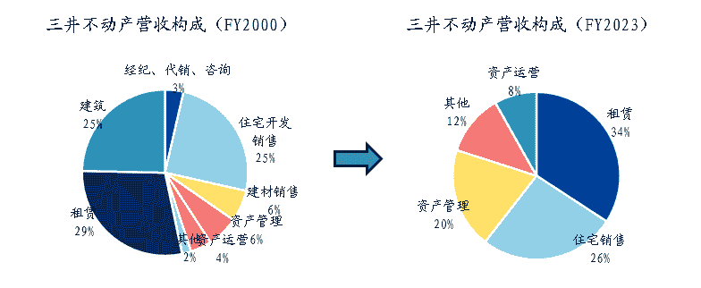
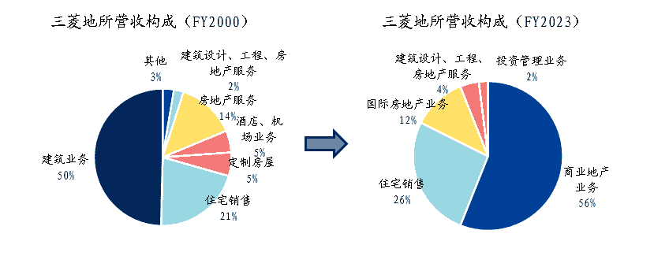
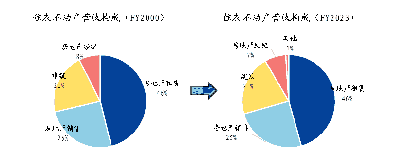
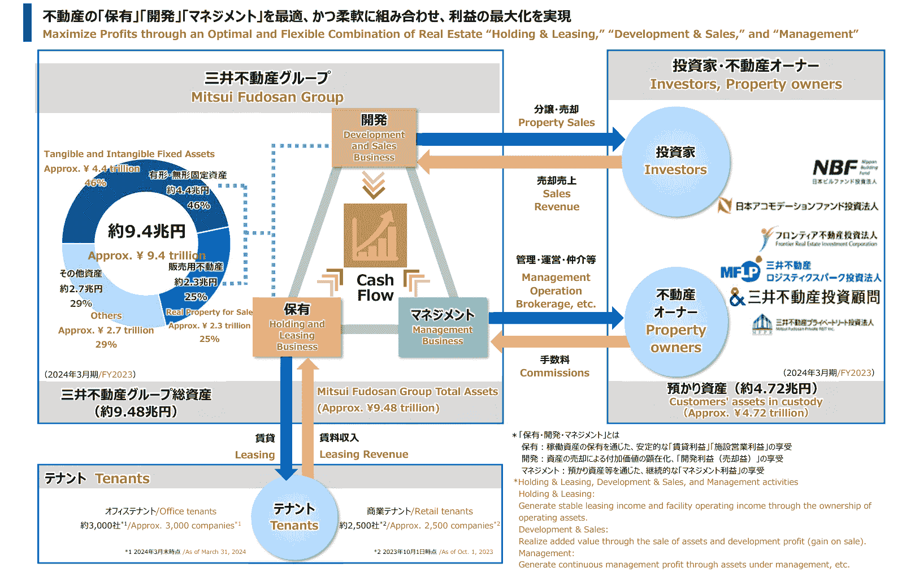
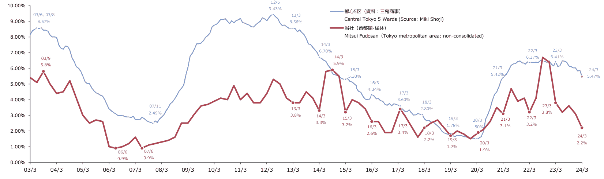

## 证券研究报告 | 行业深度

请仔细阅读本报告末页声明

## 房地产

### 地产大变局系列二：日本两轮地产危机复盘：为何90年代烈度远超70年代？什么房企能穿越牛熊？

日本房地产在上世纪经历了70与90年代两轮危机。我们对比两轮危机爆发的背景与原因、危机爆发前后政府的行为，揭示两轮危机走向不同结果的深层次原因。

日本90年代房地产调整烈度远超70年代，且90年代政策频频犹豫与失误，救市迟滞。日本70年代危机中，名义房屋价格指数在1974-1975年区间跌幅为5.4%，实际房屋价格跌幅28.8%（名义跌幅因通胀而抹平）；90年代危机中，名义房屋价格在1991-2009区间跌幅为46.5%，实际房屋价格跌幅为44.8%。名义土地价格70年代跌幅为4.0%，90年代跌幅为52.9%。90年代房地产调整幅度、调整时间远超70年代。政策端，70年代日本政府的货币、财政、地产端逆周期调节奏效，货币宽松未显著催生泡沫；而90年代政策频频犹豫与失误，救市迟滞。

### 为何日本90年代危机烈度远超70年代？

（1）**90年代日本资产价格跌幅过大、持续时间过久，引发资产负债表的全面衰退。**90年代危机中，除房地产市场调整烈度较70年代更大，股市跌幅的深度及持续时间远超70年代，区间最大跌幅80.5%。股价、地价的大幅度下跌，对居民资产负债表的损伤是不可逆的。居民端很难在低预期下大规模加杠杆购房。同时，对企业部门的资产负债表也造成较大损伤。1991年开始日本非金融企业部门从银行、资本市场募集资金的规模持续萎缩。1995年利率已经接近0，但日本企业不仅没有增加借贷，反而开始加大还贷，进入漫长缩表的趋势中。

（2）**90年代日本人口结构的全面恶化，长期宽松的货币政策催生较大泡沫。**日本主力置业人口规模（25-44岁）在70年代达到历史峰值，"团块世代"大规模真实的购房需求托底了房地产市场。主力置业人口在1980年代已经见顶，但日本政府在《广场协议》后，因应升值萧条而长期维持高度宽松的货币政策；同时因银行护卫船团机制与逐步金融自由化带来的竞争加剧，使得银行在高度宽松的环境下盲目扩张。所以这个阶段宽松的货币环境对冲了人口结构的恶化，房地产依然维持了繁荣，甚至催生较大泡沫。90年代置业人口加速下滑，住房需求锐减，城市化也进入瓶颈，地产周期正式步入拐点。

（3）**90年代日本经济转型缓慢，外部环境压力较大。**70年代石油危机后，日本推出"技术立国"等战略，产业也逐步摒弃重化工领域，成功转型到汽车、家电、机械等技术密集型产业，80年代日本成功转型出口型经济。因此在危机后，经济依然维持较高的增长，居民收入稳步提升。而1985年后因《广场协议》日元大幅升值压制出口。原本拉动经济的出口在1985年逐步承压，到1990年净出口占GDP的比重迅速降至0.9%。同时在超长的宽松周期中，流动性冗余至房地产而对产业升级并没有产生许多积极的作用。90年代日本也未成功抓住互联网经济发展浪潮。90年代末遭遇亚洲金融危机，经济发展进一步受阻。

### 以日本为鉴，什么样的房企能够穿越房地产牛熊？

经营策略上，发展持有类物业、服务业态，开发业务聚焦核心城市核心区域。我们选取背景强大的财阀系的3家房企（三井不动产、三菱地所、住友不动产）。经营方向上，三家房企在90年代以前相对侧重于住宅开发。90年代危机爆发后，管理层不约而同缩减开发业务、大力发展持有类物业的经营与服务业态的经营。住宅开发业务则聚焦核心城市核心区域，以三井不动产为例，2023财年公司在东京都市圈的签约销售户数占比达到83.4%，保障其住宅销售规模的稳定。

核心房企市占率极高，享受出清带来的良好竞争环境，中长周期里能够实现稳中有升的营收与利润。从东京都圈的视角出发，2023年TOP10开发房企在该区域新建公寓发售户数总数为2.69万户，占当年整体发售的比重达到52.6%。从财务指标看，日本3大房企经历业务发展方向切换的阵痛期后，进入了较长时间的稳健增长期，2003-2023财年间，三家房企营收复合增速分别为3.8%、3.8%、2.9%，归母净利润复合增速分别为10.9%、7.6%、18.5%。

风险提示：本文研究仅针对日本宏观经济与房地产行业，请甄别中日环境的差异。

增持（维持）

### 行业走势

### 作者

分析师 金晶  
执业证书编号：S0680522030001  
邮箱：jinjing3@gszq.com

分析师 夏涛  
执业证书编号：S0680524070006  
邮箱：xiatao@gszq.com

分析师 肖依依  
执业证书编号：S0680523080005  
邮箱：xiaoyiyi3664@gszq.com

分析师 周卓君  
执业证书编号：S0680523070006  
邮箱：zhouzhuojun@gszq.com

### 相关研究

1、《房地产开发：2024W46：本周新房成交同比+7.9%，10月主要城市房价跌幅有所收窄》 2024-11-17  
2、《房地产开发：2024W45：本周新房成交同比+27.4%，增加10万亿地方化债资源》 2024-11-10  
3、《房地产：10月百强房企月度销售报告：10月销售同比年内首次转正，新政对市场具有提振作用》 2024-11-04

-40% -26% -12% 2% 16% 30%  
2023-11 2024-03 2024-07 2024-11  
房地产 沪深300

2024年11月23日

---

### 内容目录

一、日本上世纪房地产与宏观经济表现 ..................................................................................................... 4  
二、日本政府上世纪主要宏观与地产政策 .................................................................................................. 8  
2.1 70年代政策多管齐下，力度适度节奏准确，逆周期调节奏效 ........................................................... 9  
2.2 80年代，应对升值萧条执行长期宽松的货币政策，银行护卫船团机制助长地产泡沫与风险 ................. 9  
2.3 1990年前后主动刺破泡沫引发硬着陆，危机爆发后救市政策迟滞 ...................................................10  
三、日本深陷90年代危机的本质 ............................................................................................................13  
3.1 资产价格跌幅过大、持续时间过久，引发资产负债表的全面衰退 ....................................................13  
3.2 内核是人口结构的全面恶化，长期宽松的货币政策催生较大泡沫 ....................................................13  
3.3 经济转型缓慢，外部环境压力较大 ..............................................................................................15  
四、那些穿越房地产牛熊的日本房企 .......................................................................................................15  
4.1 市场向核心城市靠拢，核心房企市占率极高 .................................................................................15  
4.2 什么样的房企能穿越地产周期？ .................................................................................................18

### 图表目录

图表1：日本城市住宅用地价格指数、房屋价格指数 .................................................................................. 4  
图表2：日本OECD房屋价格指数（第一轮危机走势放大） ......................................................................... 5  
图表3：日本OECD房屋价格指数（第二轮危机走势放大） ......................................................................... 5  
图表4：日本城市住宅用地价格指数（第一轮危机走势放大） ..................................................................... 5  
图表5：日本城市住宅用地价格指数（第二轮危机走势放大） ..................................................................... 5  
图表6：日本新开工建筑面积（经季节性调整，月度） ............................................................................... 6  
图表7：日本新屋开工数量（年度） ......................................................................................................... 6  
图表8：日本个人住宅投资及同比 ............................................................................................................ 6  
图表9：日本名义GDP同比 ..................................................................................................................... 7  
图表10：日本名义GNP同比 ................................................................................................................... 7  
图表11：日本出口金额及同比（十亿日元） .............................................................................................. 7  
图表12：日本进口金额及同比（十亿日元） .............................................................................................. 7  
图表13：名义原油价格 ........................................................................................................................... 7  
图表14：日本贴现率、M2同比、CPI同比 ................................................................................................ 8  
图表15：日本主要银行长期贷款利率与日本10年期国债收益率 .................................................................. 8  
图表16：日本80年代宽松周期催升资产泡沫示意图 .................................................................................10  
图表17：日本土地与漫收政策的调控过程 ................................................................................................10  
图表18：日本1991年增加土地漫负的内容 ..............................................................................................11  
图表19：日本1990年后企业破产数量（月度，个） .................................................................................12  
图表20：日本金融机构破产情况（个） ...................................................................................................12  
图表21：日本银行不良债权规模及处置损失 .............................................................................................12  
图表22：日经225、日本实际房屋价格指数 .............................................................................................13  
图表23：日本非金融企业部门的资金募集 ................................................................................................13  
图表24：日本出生人数、出生率 .............................................................................................................14  
图表25：日本人口普查分年龄组（万人） ................................................................................................14  
图表26：日本城市化率及户均住宅数 ......................................................................................................14  
图表27：日本住宅5年增长规模 .............................................................................................................14  
图表28：日本全国及主要都市圈新建公寓发售户数（户） .........................................................................16  
图表29：日本新建公寓发售户数结构 ......................................................................................................16  
图表30：日本新建公寓发售均价（万日元/㎡） ........................................................................................17  
图表31：日本新建公寓发售均价指数（2012=100） .................................................................................17  
图表32：日本东京都圈新建公寓供应房企排名（2023年） ........................................................................17  
图表33：日本主流房企分类 ...................................................................................................................18  
图表34：三井不动产营收构成变化 ..........................................................................................................19  
图表35：三菱地所营收构成变化 .............................................................................................................19

2024年11月23日

**P.3** 请仔细阅读本报告末页声明

图表36：住友不动产营收构成变化 ..........................................................................................................19

图表37：三井不动产长期发展策略 ..........................................................................................................20

图表38：三井不动产写字楼空置率（粗线）与东京都心5区写字楼空置率对比 ............................................21

图表39：三井不动产签约住宅（公寓+一户建）销售户数及公寓那均销售价格 .............................................21

图表40：三井不动产签约住宅销售分区域结构 .........................................................................................22

图表41：日本三大房企主营收入（十亿日元） .........................................................................................22

图表42：日本三大房企归母净利润（十亿日元） ......................................................................................22

图表43：日本三大房企毛利率（%）.......................................................................................................23

图表44：日本三大房企归母净利润率（%） .............................................................................................23

图表45：日本三大房企资产周转率 ..........................................................................................................23

图表46：日本三大房企权益乘数（杠杆比率） .........................................................................................23

图表47：日本三大房企ROE ...................................................................................................................24

2024年11月23日

**P.4** 请仔细阅读本报告末页声明

日本房地产在上世纪经历了**70**与**90**年代两轮房地产相关的危机，本文将对比两轮危机爆发的背景与原因、危机爆发前后政府的行为，探讨两轮危机走向不同结果的深层次原因。两轮危机具体时间分别对应1974-1977年、1991-2009年。纵观日本战后房价地价表现，90年代房地价调整的幅度、调整的时间均远超70年代，对经济影响也远大于70年代。目前的研究主要聚焦在房地价大幅波动的90年代危机，而相对缺乏对70年代顺利度过危机的参考与讨论。我们认为，两轮危机的对比研究具有很强的借鉴意义。本文将对比两轮危机爆发的背景与原因、危机爆发前后政府的行为，探讨两轮危机走向不同结果的深层次原因。

图表1：日本城市住宅土地价格指数、房屋价格指数

资料来源：Wind，CEIC，国盛证券研究所（房屋价格指数为OECD房价指数，原始基期为2015=100，本文图表及正文均调整基期为2010=100）

一、日本上世纪房地产与宏观经济表现

**90**年代危机房屋价格调整时间、调整幅度均远超**70**年代。日本70年代地产危机时，名义房屋价格调整仅发生在1974Q4-1975Q1两个季度，跌幅为5.4%。剔除物价变动的实际价格跌幅相对更大，实际房价从1973Q4跌至1977Q3，跨度16个季度，跌幅为28.8%。名义与实际房屋价格表现差异较大，这与当时日本遭遇第一次石油危机带来的输入型通胀有关，1974年2月CPI同比一度达到24.9%，极高的通胀几乎抹平了70年代名义房价的跌幅。我们在讨论房价时更多从本国购房者的角度出发，因而更多关注名义价格，从表面看70年代危机调整是比较小的。90年代危机中，名义房价指数在1991Q1见顶后，持续下跌了74个季度至2009Q2，跌幅为46.5%，远超70年代的跌幅。即使按实际房价看，90年代危机跌幅为44.8%，跌幅也显著大于70年代。

[图表区域：包含日本城市住宅土地价格指数（名义，6个主要城市，2010=100）、日本城市住宅土地价格指数（名义，所有城市，2010=100）、日本房屋价格指数（名义经调，所有城市，2010=100）的时间序列图，时间跨度为1955-2022年]

2024年11月23日

**P.5** 请仔细阅读本报告末页声明

图表2：日本OECD 房屋价格指数（第一轮危机走势放大）

图表3：日本OECD 房屋价格指数（第二轮危机走势放大）

资料来源：CEIC，国盛证券研究所

资料来源：CEIC，国盛证券研究所

日本地价走势与房价相似，即**90**年代危机调整较**70**年代更为剧烈。核心城市因前期累积起来的泡沫，地价跌幅比其他城市更大，但也更早企稳。70年代危机时，日本城市住宅土地价格仅在1974年发生下跌，跌幅为4.0%；核心6城跌幅7.5%相对更大。90年代危机，日本城市住宅地价从1991年跌至2017年才真正触底，区间跌幅达52.9%；核心6城曾在2005年先于全国其他城市触底，1991-2005年区间跌幅达65.6%，但伴随2008金融危机再次进入下跌通道，1991-2012年区间整体跌幅为66.2%。

图表4：日本城市住宅土地价格指数（第一轮危机走势放大）

图表5：日本城市住宅土地价格指数（第二轮危机走势放大）

资料来源：Wind，国盛证券研究所

资料来源：Wind，国盛证券研究所

日本新开工面积在**70**年代与**90**年代危机前出现两个波峰。但相对于房价的持续攀升，新开工面积整体增长不多，指向**80**年代后期投资性需求占主导地位。70年代危机前的1973年3月，新开工建筑面积创下阶段高点2461.6万方，随着危机爆发后有所下降。但1974年很快企稳回升，至1981年前后整体开工表现繁荣，这与政府快速转回扩张性财政政策、大力发展基建有关。90年代危机前的1990年5月，新开工建筑面积创下历史高点2546.9万方，随后进入了漫长的下行通道。从新屋开工单位数量也能看到相似的趋势。整体上，日本新开工规模在70到90年代是比较平稳的，这与同期持续攀升的房价有所背离，指向住宅的投资性需求逐渐占据主导地位。1985-1990年日本私人住宅投资额加速上行，区间涨幅高达74.5%。泡沫破裂后的前5年投资额依然上行，主要与日本政府在危机初期出台的大幅宽松政策有关。在此之后，日本房地产市场进入漫长的"量价齐跌"阶段，住宅投资长期下行。

图表6：日本新开工建筑面积（经季节性调整，月度）

图表7：日本新屋开工数量（年度）

资料来源：CEIC，国盛证券研究所

资料来源：Bloomberg，国盛证券研究所

图表8：日本私人住宅投资及同比

资料来源：Wind，国盛证券研究所

从宏观经济的角度看，日本上世纪**70**年代因输入型通胀而加息、海外需求减弱出口承压，经济增长大幅放缓。日本作为一个资源匮乏的岛国，战后大力发展制造业，在1964-1974年间出口规模复合增速高达21.0%，期间日本名义GDP复合增速达16.3%。日本高度依赖出口的外向型经济早年发展迅猛，但同时也使得日本在外部冲击下格外脆弱，一方面在石油价格大幅上行时日本面临严重的输入型通胀，必须通过加息等紧缩手段控制物价；另一方面，彼时高度依赖中东石油进口的欧美发达国家经济也遭遇重创，海外需求萎靡导致日本出口受阻。从结果看，1973年底第一次石油危机爆发后，日本经济增长大幅放缓，其名义GDP增速从1973年的21.8%下滑至1975年的10.5%。因应输入型通胀而加息、以及宏观经济的降速，最终演变为70年代的房地产危机。

日本**90**年代在日元升值萧条下出口再度承压，出口规模阶段性负增长，拖累经济增长。80年代日本在国际政治经济博弈中遭遇美国压力，1985年签订广场协议后日元大幅升值，叠加日本产业升级缓慢，日本出口承压。1985-1990年出口规模复合增速降至-0.2%，1991-2001年出口规模复合增速为1.5%。从结果看，日本名义GDP在1991-2001年复合增速仅为1.3%。

2024年11月23日

**P.6** 请仔细阅读本报告末页声明

图表9：日本名义GDP同比

图表10：日本名义GNP同比

资料来源：Wind，国盛证券研究所

资料来源：CEIC，国盛证券研究所

图表11：日本出口金额及同比（十亿日元）

图表12：日本进口金额及同比（十亿日元）

资料来源：Wind，国盛证券研究所

资料来源：Wind，国盛证券研究所

图表13：名义原油价格

资料来源：Wind，国盛证券研究所（1910-1944年采用美国国内初次采购原油平均价格、1945-1983年采用阿拉伯轻质原油的塔驽拉港离岸(FOB)牌价，1984至今采用布伦特DTD价格）

2024年11月23日

**P.7** 请仔细阅读本报告末页声明

二、日本政府上世纪主要宏观与地产政策

**70**年代日本政府的货币、财政、地产端逆周期调节奏效，货币宽松未显著催生泡沫。**80**年代，应对升值萧条执行长期宽松的货币政策，银行护卫船团机制助长地产泡沫与风险。**1990**年前后主动刺破泡沫引发硬着陆，**90**年代危机爆发后救市政策迟滞。

图表14：日本贴现率、M2同比、CPI同比

资料来源：Wind，国盛证券研究所

图表15：日本主要银行长期贷款利率与日本10年期国债收益率

资料来源：Wind，国盛证券研究所

2024年11月23日

**P.9** 请仔细阅读本报告末页声明

### 2.1 70年代政策多管齐下，力度适度节奏准确，逆周期调节奏效

70年代日本政府的货币、财政、地产端逆周期调节奏效，货币宽松未显著催生泡沫。1973年石油危机爆发，日本政府迅速响应，在货币端，贴现率由4.25%提升至9.0%，加息幅度达475BP；在财政端，日本政府暂缓“日本列岛改造计划”[^1]。在通胀得到控制的背景下，1975年日本政府较快地转回扩张性政策，包括从1975年4月开始逐步降息；财政端增加公共事业费8000亿日元，并将1976年公共事业费增长率提高至26.4%；地产端，1975年增加住宅金融公库贷款2600亿日元，即日本政府提供房地产贷款利率补贴。纵观70年代从紧缩到宽松的整个政策周期，日本政府均在合适的时间作出货币、财政、地产端合适的政策，帮助经济快速走出困局。另外，在70年代宽松的过程中，M2增速大体匹配GDP增速，因此宽松并没有明显推动泡沫的产生。

### 2.2 80年代，应对升值萧条执行长期宽松的货币政策，银行护卫船机制助长地产泡沫与风险

1985年日本政府签订《广场协议》，应对升值萧条执行长期宽松的货币政策。日本70年代产业快速升级，制造业蓬勃发展，贸易顺差迅速扩大，由1974年贸易逆差1.87万亿日元，提升至1986年贸易顺差13.7万亿日元。而美国在70年代经历两轮石油危机后，经济陷入滞涨，为增加出口竞争力、改善收支不平衡的情况，美国于1985年促成了美元贬值的《广场协议》，此后日元兑美元快速升值。应对“升值萧条”，日本从1986年开始执行超宽松的货币政策，但在1987年GDP增速已经实际触底回升后：（1）政府误判经济复苏形势，选择继续维持宽松；（2）日元长期处于升值趋势，日本政府被迫维持国内货币宽松；（3）防范美国股灾波及以及配合美联储降息节奏。在此期间日本经济已经过热，广义货币供应量呈不断增长趋势，但货币流通速度却保持低位。大量冗余的资金在此背景涌入股市与房地产市场，成为90年代日本房地产泡沫的祸根。

日本银行护卫船机制下大规模激进投资，助长地产泡沫与风险。日本银行在1979年引进了自由利率存款证，在1985年引进了货币市场存单（MMC），利率基本实现自由化定价。在自由竞争的市场中，银行等金融机构的盈利遭遇挑战。银行在护卫船机制下，在日本曾有“银行不会破产”的神话，因而很多银行在流动性冗余的阶段倾向于高风险贷款——即投向异常火热的房地产市场。据日本银行副行长雨宫正佳（2019）：在90年代前，日本银行三令五申要求银行克制放款冲动，但这样的窗口指导未能充分发挥遏制信贷扩张的作用；反而在应该直接调整利率的时候选择按兵不动。日本政府推动金融自由化，但在大藏省高度集中权力这样相对落后的金融顶层设计下，注定是不平衡的改革，这样的金融自由化最终助长房地产泡沫与风险。

[^1]: 1972年，田中角荣正式提出“日本列岛改造”的构想，田中内阁成立后，建立更大规模的“新全国综合开发计划”，即“日本列岛改造计划”。其核心是：核心城市人口过度集中，而农村地区人口过疏，因此需要实施全国范围的工业重新布局，形成以25万人口为基准的城市。这需要大规模的财政投入用以基础设施建设。

---

**P.10** 请仔细阅读本报告末页声明

图表16：日本80年代宽松周期推升资产泡沫示意图

资料来源：国盛证券研究所绘制

### 2.3 1990年前后主动刺破泡沫引发硬着陆，危机爆发后救市政策迟滞

90年代刺破泡沫时紧缩进程太快。股市、房地产市场因此剧烈波动而“硬着陆”。刺破泡沫的主要的途径有：

- **宏观：** 日本从1989年5月开始加息，同年鹰派的三重野康出任日本央行行长，货币紧缩进程加速。至1991年6月，日本贴现率提升至6%，加息幅度达350BP。
- **融资端：** 1990年大藏省发布《关于控制土地相关融资的规定》，对融资总量进行限制，要求各金融机构不动产贷款额增长率不得高于贷款总额增长率，同时要求定期汇报不动产、建筑业、非银金融机构的贷款执行情况。
- **需求与供给端：** 1991年制定并通过了《综合土地政策推进要纲》，加强土地税收和加强对土地的评估，包括开征地价税、强化特别土地保有税、强化转让所得税等。

图表17：日本土地与税收政策的调控过程

资料来源：董裕平、宣晓影：《日本的房地产税收制度与调控效应及其启示》金融评论（2011），日本不动产研究所，国盛证券研究所

---

**P.11** 请仔细阅读本报告末页声明

图表18：日本1991年增加土地税负的内容

| 增加税负 | 具体内容 |
| :--- | :--- |
| **强化转让所得税** | 对土地转让收益征收转让税的同时加征法人税（除法人的营业收益之外） |
| **开征地价税** | 土地的计税依据是土地价值评估 地价税的税率是0.3%（其中第一年是0.2%） 居民的自住宅地免税（有两处以上住宅的话，只能有一处免税：即使只有一处住宅，超过了1000平方米以上的部分也必须交税） 降低了三大都市圈（东京圈、大阪圈、名古屋圈）的特定都市的免税点 将保有时间超过10年的城市区域内的具有一定规模土地也列入征税对象范围 制定了加强课税的特例措施 |
| **强化特别土地保有税** | 遗产税的计税依据由原先市价的50%提高到80% 对于小规模的宅地，提高其免税扣除的限额 |
| **改革遗产税** | 城市化区域范围之内的农地，在1993年之前被划分为“必须保护的农地”和“必须宅地化的农地”，前者按农地征税，后者从1993年开始与宅基地一样征税 取消了农地连续经营20年农业免征遗产税的规定 |
| **强化农地征税** | — |

资料来源：董裕平、宣晓影：《日本的房地产税收制度与调控效应及其启示》金融评论（2011），日本不动产研究所，国盛证券研究所

90年代危机爆发后，日本政府救市政策举棋不定，地产政策放宽过慢，导致市场长时间深度回调。危机爆发后，日本政府首先诉诸上轮周期奏效的货币政策，贴现率在1991年的6月为6%，至1993年9月已降至1.75%，但收效甚微，因为日本货币政策在刺破泡沫时经历大幅紧缩、宽松时利率如未显著低于刺破泡沫前的利率，边际效果是较低的。财政端在危机爆发后并未像70年代快速发力，1992年扩大公共投资、扶持中小企业的资金规模在10.7万亿日元，此后数年缓慢加码，直至1998年达到40.6万亿日元，财政的宽松动作及力度欠佳。地产端政策在危机爆发初期更是被日本政府束之高阁，如刺破泡沫时大幅收紧地产融资端政策、价格指导政策、需求端税收政策，并未很快得到调整。地产政策直到1998年亚洲金融危机爆发后才真正开始放宽，包括取消地价税和超短期持有追加税、将交易环节个人所得起征点从4000万调高至6000万日元等。地产政策放宽过慢，错过了可能修复市场的时机，最终导致房地产市场长时间深度回调。

90年代危机爆发后迅速席卷日本，大量实体企业破产，银行深陷坏账泥沼。1990年后日本企业破产数量迅速增加，1990年全年破产企业数量为6468家，1998年全年达到了19171家。前文提到日本金融机构特别是银行，在护卫船机制下，曾有“银行不会破产”的神话。但是在长期宽松周期中大量贷款流入房地产业，而房地产价格的快速下行给银行带来大量坏账。据谢玮（2018），在1995年日本所有银行的不良债权规模为28.5万亿日元，大量金融机构因不良债权而破产。

图表19：日本1990年后企业破产数量（月度，个）

图表20：日本金融机构破产情况（个）

图表21：日本银行不良债权规模及处置损失

资料来源：CEIC，国盛证券研究所 | 资料来源：谢玮:《资产负债表衰退:日本经验》，社会科学文献出版社（2018），国盛证券研究所 | 资料来源：日本大藏省、日本金融厅，谢玮:《资产负债表衰退:日本经验》，社会科学文献出版社（2018），国盛证券研究所

对于银行不良资产的处理，日本政府前期成立专门机构推进，后期由政策引导市场化处置不良资产。1993至1997年，日本先后成立了共同债权收购公司、住专债权管理公司、东京共同银行，专门收购和处置银行及其它金融机构的不良资产。1996年，东京共同银行改组成整理回收银行（RCC），接管已破产的金融机构、收购和处置不良贷款。但以上这些主要仍是银行同业间的救助，不良资产仍滞留在银行体系内部。1998年后，日本政府提出“金融再生计划”，引导不良资产处置向市场化、开放化的方式进行。由此日本的不良资产处置加快。

中长期看，90年代危机倒逼了日本政府推进金融体制改革、强化金融监管。前文提到，80年代时期因银行护卫船机制，使得银行深度绑定了实体企业，在高度宽松的环境下盲目扩张。事实上，彼时日本主管财政、金融、税收的权力全部集中于大藏省，不合理的金融体系也助推了地产泡沫、积蓄风险。因此90年代后日本政府逐步推进金融体制改革、强化金融监管。1998年日本实施《日本银行法》，确立日本银行的央行地位与独立性。同时1998年成立金融监督委员会（FSA）。大藏省对于日本银行的指令权、对金融体系的监管职责均被剥离。可以说，90年代的危机也倒逼了日本金融体系的全面改革。

---

**P.13** 请仔细阅读本报告末页声明

## 三、日本深陷90年代危机的本质

### 3.1 资产价格跌幅过大、持续时间过久，引发资产负债表的全面衰退

资产价格暴跌会严重损伤资产负债表。90年代资产价格的调整幅度、调整时间远超70年代，显著影响居民加杠杆意愿。70年代危机中，日本名义房屋价格指数在1974-1975年区间跌幅为5.4%，实际房屋价格跌幅28.8%（名义跌幅因通胀而抹平）。90年代危机中，名义房屋价格在1991-2009区间跌幅为46.5%，实际房屋价格跌幅为44.8%，其调整幅度、调整时间远超70年代。股票市场在两轮危机中的表现也大相径庭。1973-1974年，日经225指数区间最大跌幅为37.4%，1977年基本修复至1973年高点，整体调整时间约4年。90年代危机中，股市跌幅的深度及持续时间远超70年代，1990年单年日经225指数跌幅达38.7%，已经超过70年代最大跌幅，之后持续下跌十余年，最终在2003年初次见底，区间最大跌幅达80.5%。股价、地价的大幅度下跌，对居民资产负债表的损伤是不可逆的。居民端很难在低预期下大规模加杠杆购房。

长期大幅的资产价格调整，对企业部门的资产负债表也造成较大损伤，日本长期低利率而企业仍无加杠杆意愿。1991年开始日本非金融企业部门从银行、资本市场募集资金的规模持续萎缩。1995年利率已经接近0，但日本企业不仅没有增加借贷，反而开始加速还贷，进入漫长缩表的趋势中。

图表22：日经225、日本实际房屋价格指数

图表23：日本非金融企业部门的资金募集

资料来源：iFind，Wind，国盛证券研究所 | 资料来源：辜朝明 Koo Richard C，《大衰退》（2008），国盛证券研究所

### 3.2 内核是人口结构的全面恶化，长期宽松的货币政策催生较大泡沫

70年日本代置业人口处于历史高峰，且为战后第二个生育高峰；80年代之后人口结构逐步恶化。日本在战后主要经历两轮婴儿潮。1945年日本战败后大量士兵归国结婚生育，1947-1949年第一轮婴儿潮被称为“团块世代”；这些新生儿在1967-1974年成年后所生育的第二轮婴儿潮被成为“团块次代”、“回声潮世代”。从人口结构看，主力置业人口规模（25-44岁）在70年代达到历史峰值，“团块世代”大规模真实的购房需求托底了房地产市场。70年代初期日本新屋开工数量屡创新高，最高峰在1973年的15.9万户。同时，70年代“团块次代”的出生，人口规模仍然不断增长。80年代开始，日本人口结构从逐步恶化，90年代置业人口加速下滑；城市化也进入瓶颈，边际增速大幅放缓，户均住宅数也在1.1户左右徘徊不前，日本房地产在这个年代步入大级别的下行周期。

图表24：日本出生人数、出生率

图表25：日本人口普查分年龄组（万人）

资料来源：Wind，国盛证券研究所 | 资料来源：Wind，国盛证券研究所

图表26：日本城市化率及户均住宅数[^2]

图表27：日本住宅5年增长规模

资料来源：Wind，国盛证券研究所 | 资料来源：Wind，国盛证券研究所

虽然日本70年代遭遇外部冲击经济增速放缓，但置业人口处于高峰，大规模真实购房需求托底了房地产市场。前文提到，日本主力置业人口规模在70年代处于历史峰值，大规模真实的购房需求托底了房地产市场，一定程度对冲了经济增速放缓以及货币紧缩政策影响。同时，70年代“团块次代”的出生，人口规模仍然不断增长，彼时人们并没有广泛预期到未来日本人口出生率将持续走低。因而日本房地产仍然拥有“人口持续增长、住房需求将维持高位”这样的预期支撑。

80年代中后期货币政策大幅宽松催生泡沫，90年代在人口结构全面恶化，地产周期正式步入拐点。日本主力置业人口在1980年代已经见顶，但日本政府在签署《广场协议》后，因应升值萧条而长期维持高度宽松的货币政策；同时因银行护卫船团机制与逐步金融自由化带来的竞争加剧，使得银行在高度宽松的环境下盲目扩张。所以这个阶段宽松的货币环境对冲了人口结构的恶化，房地产依然维持了繁荣，甚至催生较大泡沫。90年代置业人口加速下滑，地产失去人口规模的支撑；城市化也进入瓶颈，边际增速大幅放缓。

[^2]: 平成11年（1999年）后实行“平成大合并”。平成11年（1999年）至平成22年（2010年）间日本的市町村数量由3232个合并为1727个，部分非城镇地区被合并到城镇中，导致部分非城镇人口被合并为城镇人口。另外，因为日本的老龄化和少子化导致人口减少，导致很多农村被废弃。农村人少到一定程度，剩下的人也难以生活，只有搬到城市。

请仔细阅读本报告末页声明

缓。人口结构的持续恶化，地产周期正式步入拐点，是90年代危机的内核，与70年代危机有本质的不同。

### 3.3 经济转型缓慢，外部环境压力较大

70年代经济成功转型升级、出口迅速修复。日本经历石油危机后，推出“技术立国”、“科技立国”等战略，产业也逐步摒弃重化工领域，成功转型到汽车、家电、机械等技术密集型产业，这些具备高附加值的产品在国际市场极具竞争力，80年代日本成功转型出口型经济，叠加80年代全球经济处于高速发展的阶段，日本净出口占GDP的比重自1980年开始迅速提升，1986年升至3.9%。因此在危机后，经济依然维持较高的增速，居民收入稳步提升，叠加前文所述彼时人口结构依然健康为地产提供基本盘，房地产行业得以迅速修复。

90年代内外交困，出口持续受阻、产业升级缓慢。1985年后日本在国际政治经济博弈中遭遇美国压力，因《广场协议》日元大幅升值压制出口。原本拉动经济的出口在1985年逐步承压，到1990年净出口占GDP的比重迅速降至0.9%。同时在实际较长的宽松周期中，流动性冗余至房地产而对产业升级并没有产生许多积极的作用。90年代日本也未成功抓住互联网经济发展浪潮。90年代末遭遇亚洲金融危机，经济发展进一步受阻。

## 四、那些穿越房地产牛熊的日本房企

### 4.1 市场向核心城市靠拢，核心房企市占率极高

前文提到，日本90年代危机后大量房地产企业破产，下文我们将从市场与房企的视角出发，分析那些最终存活下来的房企，它们在经营战略与财务表现上有何共同点。

新房供应主要在核心都市圈，核心城市房价常年坚挺。日本房地产经过长时间的调整与洗牌后，市场已向核心都市圈靠拢，日本两大核心都市圈（东京+大阪）近年来新建公寓发售数量占全国总量的比例均值在70%左右，两大都市圈基本主导了全国房地产市场的走向。日本近年全国新建公寓的总量相较2015年以前有一定下滑，但整体中枢在7万套以上，代表着新房居住需求在核心城市依然存在。从近十余年房价走势看，东京公寓发售价格常年坚挺，2023年都市圈为122.6万日元/㎡，核心23区为172.7万日元/㎡，分别较2012年上涨90.1%、115.6%，明显跑赢同期全国整体73.3%的涨幅。

图表28：日本全国及主要都市圈新建公寓发售户数（户）

资料来源：不动产经济研究所，国盛证券研究所

图表29：日本新建公寓发售户数结构

资料来源：不动产经济研究所，国盛证券研究所

-30%
-20%
-10%
0%
10%
20%
30%
40%
0
10000
20000
30000
40000
50000
60000
2012
2013
2014
2015
2016
2017
2018
2019
2020
2021
2022
2023
东京都圈发售户数
大阪都圈发售户数
其他地区发售户数
日本全国同比

0%
10%
20%
30%
40%
50%
60%
70%
80%
90%
100%
2012
2013
2014
2015
2016
2017
2018
2019
2020
2021
2022
2023
其他地区发售占比
大阪都圈发售占比
东京都圈发售占比

图表30：日本新建公寓发售均价（万日元/㎡）

图表31：日本新建公寓发售均价指数（2012=100）

资料来源：不动产经济研究所，国盛证券研究所

资料来源：不动产经济研究所，国盛证券研究所

核心房企市占率极高，享受出清带来的良好竞争环境。纵观50年日本开发房企竞争格局，1973年与2022年市场内部玩家已经发生翻天覆地的变化。据日本不动产经济研究所，有超过60%的房企因并购而退出公寓业务。那些穿越房地产牛熊的日本房企，享受过去30年来长期市场出清带来的良好竞争环境。我们从东京都圈的视角出发，2023年TOP10开发房企在该区域新建公寓发售户数总数为2.69万户，占当年整体发售的比重达到52.6%，其中排名第一的三井不动产，其市占率达10.4%。核心房企拥有极高的市占率，充分掌握了市场话语权。

图表32：日本东京都圈新建公寓供应房企排名（2023年）

资料来源：不动产经济研究所，国盛证券研究所

0
20
40
60
80
100
120
140
160
180
200
2012
2013
2014
2015
2016
2017
2018
2019
2020
2021
2022
2023
东京都圈发售均价
大阪都圈发售均价
全国发售均价
东京23区发售均价

80
100
120
140
160
180
200
220
240
2012
2013
2014
2015
2016
2017
2018
2019
2020
2021
2022
2023
东京都圈发售均价指数
大阪都圈发售均价指数
全国发售均价指数
东京23区发售均价指数

0
500
1000
1500
2000
2500
3000
大和HOUSE工业
Open House
东京建物
新日本建设
日铁兴和不动产
大和地产
三菱地所Residence
住友房地产
野村不动产
三井不动产Residential
东京都圈新建公寓发售户数（2023年，户）

### 4.2 什么样的房企能穿越地产周期？

日本房企主要可以分为6类，分别是前财阀的直系房企、铁路系、综合商社系、制造商社系与总承包商社系、金融商社系、独立房企。19世纪，日本陆续兴起了三井商社、住友商社、三菱商社等商社，它们以日本政府的特权保护增大资本杠杆，快速累积财富，在社会生产、流通、金融等领域广泛参与，势力非常庞大，因而被称为财阀。后日本战败后因盟军的政策要求而解散，但这些财阀在战后仍以一种比较松散的的的企业联盟再度集结，如今依然涉足日本各个主要产业。所以前财阀直系房企被认为拥有非常雄厚的背景，它们历史悠久、经营稳健，属于是日本房企穿越周期的典型，以三井不动产、三菱地所、住友不动产为代表。第二，依靠轨道交能发展住宅开发的铁路系房企，得益于其住宅物业区位的优势，在开发领域具备较强竞争力，以关东的东急不动产、近畿的阪急阪神不动产等为代表。此外，还有综合商社系、制造商与承包商社系、金融商社系、以及独立房企等分类。

图表33：日本主流房企分类

资料来源：三菱官网，三井官网，住友官网，东京建物官网，菊地浩之,《日本15大财阀-揭开现代企业的根源》（2009），东急不动产官网，京王不动产官网，京王集团官网，相铁集团官网，JR东海不动产官网，JR东日本建筑官网，京阪电铁不动产官网，阪急阪神不动产官网，近铁不动产官网，JR西日本官网，名铁都市开发官网，西铁不动产官网，丸红官网，双日官网，三井物产官网，伊藤忠商事官网，伊藤忠都市开发官网，三菱商事网站，住友商事官网，丰田通商官网，丰田不动产官网，日铁兴和不动产官网，大成有乐不动产官网，清水建设官网，大林组官网，名古屋建筑官网，清和综合建物官网，银泉官网，京阪神建筑官网，神户土地建物官网，丸红商事官网，东洋不动产官网，大仓屋住宅官网，森大厦官网，大和住宅工业官网，福冈地所官网，积水房屋官网，国盛证券研究所绘制

经营方向上，削减开发业务，发展持有类物业经营与服务业务的经营。我们选取背景强大的财阀系的3家房企，分别是三井不动产（8801.T）、三菱地所（8802.T）、住友不动产（8830.T），它们在市占率方面也处于比较领先的位置。经营方向上，三家房企在90年代以前相对侧重于住宅开发。90年代危机爆发后，管理层不约而同大幅调整经营方针，削减开发业务的同时大力发展持有类物业的经营与服务业务的经营。从三家房企2000财年的营收构成可以看到经营的彻底转变，而在20余年后的2023财年，三家房企业务构成已非常成熟，持有类物业经营均为第一大业务，开发为第二大业务。

- 三井不动产
- 三菱地所
- 住友不动产
- 东京建物
- 丸红
- 双日
- 三井物产
- 伊藤忠都市开发
- 三菱商事
- 住友商事
- 丰田通商
- 丰田不动产
- 日铁兴和不动产
- 大成有乐不动产
- 清水综合开发
- 大林新星和不动产
- 森大厦
- 大和住宅工业
- 积水房屋
- 福冈地所
- 东急不动产
- 京王不动产
- 相铁不动产
- JR东日本建筑
- 京阪电铁不动产
- 阪急阪神不动产
- 近铁不动产
- JR西日本不动产开发
- 名铁都市开发
- JR东海不动产
- 西铁不动产
- 瑞穗银行系（清和综合建物、名古屋建筑）
- 三井住友银行系（银泉、京阪神建筑、神户土地建物）
- 三菱UFJ银行系（丸之内万事、东洋不动产、大仓屋住宅）
- 铁路系
- 金融商社系
- 前财阀的直系房企
- 综合商社系
- 独立房企
- 制造商社系
- 总承包商社系

图表34：三井不动产营收构成变化

资料来源：Bloomberg，公司年报，国盛证券研究所

图表35：三菱地所营收构成变化

资料来源：Bloomberg，公司年报，国盛证券研究所

图表36：住友不动产营收构成变化

资料来源：Bloomberg，公司年报，国盛证券研究所

多元地产业务的协同发展是房企穿越周期的关键。具体看三井不动产长期发展策略，根据公司2023财年业绩PPT，公司通过动态调整优化“持有型资产租赁”、“开发销售”、“资产管理”多元经营组合，争取实现长期稳定现金流入与稳健增长的利润。从营收与经营利润的构成来看，三井不动产租赁收入占比达34%，开发销售收入占比为26%；从总资产构成看，用于租赁的资产占比达38%，用于销售的资产占比为25%。我们认为，三井不动产已经脱离了单一依赖开发销售的经营模式，多元地产业务的协同发展是公司穿越周期的关键。特别是公司侧重于持有类物业的经营，其中以核心区位的写字楼租赁为主、商业物业为辅，长期较低的空置率的物业为公司提供抗周期的稳健现金流与利润。

图表37：三井不动产长期发展策略

资料来源：公司FY2023业绩PPT，国盛证券研究所

图表38：三井不动产写字楼空置率（粗线）与东京都心5区写字楼空置率对比

资料来源：公司FY2023业绩PPT，三鬼商事，国盛证券研究所

开发业务聚焦核心城市核心区域，将有效增强销售韧性。开发销售业务方面，三井不动产近年住宅销售规模保持稳定，2017-2023财年年均签约销售户数（Units booked）为3852套（公寓+一户建），相较2016年以前略有下降。但占销售主力地位的公寓套均销售价格近年来持续走高，2023财年均值达到85.5百万日元。同时可以看到，在2020、2021等特殊年份，公司住宅销售没有受太大影响。三井不动产住宅销售保持强劲，得益于其高度聚焦在东京都市圈的开发战略，2023财年公司在东京都市圈的签约销售套数（公寓+一户建）占比达到83.4%，聚焦核心城市核心区域增强了公司的销售韧性。

图表39：三井不动产签约住宅（公寓+一户建）销售户数及公寓套均销售价格

资料来源：Bloomberg，公司FY2023业绩PPT，国盛证券研究所

0
10
20
30
40
50
60
70
80
90
0
1000
2000
3000
4000
5000
6000
7000
8000
2013
2014
2015
2016
2017
2018
2019
2020
2021
2022
2023
三井不动产一户建签约销售户数（户）
三井不动产公寓签约销售户数（户）
公寓套均销售价格（百万日元，右轴）

图表40：三井不动产签约住宅销售分区域结构

资料来源：Bloomberg，国盛证券研究所

穿越周期的内部房企，在中长周期里能够实现稳中有升的营收与利润。从财务指标看，日本3大房企的主营收入、归母净利润在1991-2002财年有所波动，三井不动产、三菱地所、住友不动产在这个时间段营收复合增速分别为-2.1%、3.5%、4.1%，归母净利润复合增速分别为-1.8%、-1.2%、-9.9%，应该说相较于全日本房地产市场剧烈动荡，三家房企财务表现已经十分出众。而经历业务发展方向切换的阵痛期后，三家房企业绩进入了较长时间的稳健增长期，2003-2023财年间，三家房企营收复合增速分别为3.8%、3.8%、2.9%，归母净利润复合增速分别为10.9%、7.6%、18.5%。利润率方面，在2000年以来呈现持续修复与提升的趋势。

图表41：日本三大房企主营收入（十亿日元）

图表42：日本三大房企归母净利润（十亿日元）

资料来源：Bloomberg，国盛证券研究所

资料来源：Bloomberg，国盛证券研究所

0%
10%
20%
30%
40%
50%
60%
70%
80%
90%
100%
2018
2019
2020
2021
2022
2023
其余城市一户建签约销售占比
其余城市公寓签约销售占比
东京都圈一户建签约销售占比
东京都圈公寓签约销售占比

0
500
1000
1500
2000
2500
3000
1991
1993
1995
1997
1999
2001
2003
2005
2007
2009
2011
2013
2015
2017
2019
2021
2023
三井不动产主营业务收入
三菱地所主营业务收入
住友不动产主营业务收入

-150
-100
-50
0
50
100
150
200
250
1991
1993
1995
1997
1999
2001
2003
2005
2007
2009
2011
2013
2015
2017
2019
2021
2023
三井不动产归母净利润
三菱地所归母净利润
住友不动产归母净利润

图表43：日本三大房企毛利率（%）

图表44：日本三大房企归母净利润率（%）

资料来源：Bloomberg，国盛证券研究所

资料来源：Bloomberg，国盛证券研究所

从杜邦分析的视角出发，日本成功穿越周期并实现长期稳定盈利的房企，主要是在审慎使用杠杆的基础上，不断努力提高利润率水平。对比日本三大房企历史盈利水平，在90年代危机后，三大房企ROE不同程度受损，三井不动产、三菱地所、住友不动产ROE最低分别为-13.2%、-21.6、-30.8%。2000年后，三家房企先后进入稳定盈利的阶段，主要得益于公司利润率水平触底后长期稳定提升，同时三家房企杠杆比率均明显下降，资产周转率保持相对稳定。到2023财年，三家房企杠杆率已降至较低水平，分别为3.05、3.2、3.39倍，ROE则提升到6.12%、6.55%、9.14%。

图表45：日本三大房企资产周转率

图表46：日本三大房企权益乘数（杠杆比率）

资料来源：Bloomberg，国盛证券研究所

资料来源：Bloomberg，国盛证券研究所

0%
5%
10%
15%
20%
25%
30%
35%
40%
1991
1993
1995
1997
1999
2001
2003
2005
2007
2009
2011
2013
2015
2017
2019
2021
2023
三井不动产毛利率
三菱地所毛利率
住友不动产毛利率

-20%
-15%
-10%
-5%
0%
5%
10%
15%
20%
25%
1991
1993
1995
1997
1999
2001
2003
2005
2007
2009
2011
2013
2015
2017
2019
2021
2023
三井不动产归母净利率
三菱地所归母净利率
住友不动产归母净利率

0%
5%
10%
15%
20%
25%
30%
35%
40%
45%
1991
1993
1995
1997
1999
2001
2003
2005
2007
2009
2011
2013
2015
2017
2019
2021
2023
三井不动产资产周转率
三菱地所资产周转率
住友不动产资产周转率

0
2
4
6
8
10
12
1991
1993
1995
1997
1999
2001
2003
2005
2007
2009
2011
2013
2015
2017
2019
2021
2023
三井不动产权益乘数
三菱地所权益乘数
住友不动产权益乘数

2024年11月23日

**图表47：日本三大房企ROE**

| 年份 | 三井不动产ROE | 三菱地所ROE | 住友不动产ROE |
|------|---------------|------------|--------------|
| 1991 | -40% | -30% | -20% |
| 1993 | -10% | 0% | 10% |
| 1995 | 20% | 30% | |
| 1997 | | | |
| 1999 | | | |
| 2001 | | | |
| 2003 | | | |
| 2005 | | | |
| 2007 | | | |
| 2009 | | | |
| 2011 | | | |
| 2013 | | | |
| 2015 | | | |
| 2017 | | | |
| 2019 | | | |
| 2021 | | | |
| 2023 | | | |

资料来源：Bloomberg，国盛证券研究所

## 风险提示

本文研究仅针对日本宏观经济与房地产行业，请甄别中日环境的差异。中国与日本不论是宏观经济、政策体系、房地产行业供需与格局，都有非常显著的差异。本文仅从日本房地产的视角进行研究，请注意甄别中日环境的差异。

2024年11月23日

[PAGE 24]

**P.25 请仔细阅读本报告末页声明**

## 免责声明

国盛证券有限责任公司（以下简称“本公司”）具有中国证监会许可的证券投资咨询业务资格。本报告仅供本公司的客户使用。本公司不会因接收人收到本报告而视其为客户。在任何情况下，本公司不对任何人因使用本报告中的任何内容所引致的任何损失负任何责任。

本报告的信息均来源于本公司认为可信的公开资料，但本公司及其研究人员对该等信息的准确性及完整性不作任何保证。本报告中的资料、意见及预测仅反映本公司于发布本报告当日的判断，可能会随时调整。在不同时期，本公司可发出与本报告所载资料、意见及预测不一致的报告。本公司不保证本报告所含信息及资料保持在最新状态，对本报告所含信息可在不发出通知的情形下做出修改，投资者应当自行关注相应的更新或修改。

本公司力求报告内容客观、公正，但本报告所载的资料、工具、意见、信息及预测只提供给客户作参考之用，不构成任何投资、法律、会计或税务的最终操作建议，本公司不就报告中的内容对最终操作建议做出任何担保。本报告中所指的投资及服务可能不适合个别客户，不构成客户个人咨询建议。投资者应当充分考虑自身特定状况，并完整理解和使用本报告内容，不应视本报告为做出投资决策的唯一因素。投资者应注意，在法律许可的情况下，本公司及其本公司的关联机构可能会持有本报告中涉及的公司所发行的证券并进行交易，也可能为这些公司正在提供或争取提供投资银行、财务顾问和金融产品等各种金融服务。

本报告版权归“国盛证券有限责任公司”所有。未经事先本公司书面授权，任何机构或个人不得对本报告进行任何形式的发布、复制。任何机构或个人如引用、刊发本报告，需注明出处为“国盛证券研究所”，且不得对本报告进行有悖原意的删节或修改。

## 分析师声明

本报告署名分析师在此声明：我们具有中国证券业协会授予的证券投资咨询执业资格或相当的专业胜任能力，本报告所表述的任何观点均精准地反映了我们对标的证券和发行人的个人看法，结论不受任何第三方的授意或影响。我们所得报酬的任何部分无论是在过去、现在及将来均不会与本报告中的具体投资建议或观点有直接或间接联系。

## 投资评级说明

### 投资建议的评级标准

评级标准为报告发布日后的6个月内公司股价（或行业指数）相对同期基准指数的相对市场表现。其中A股市场以沪深300指数为基准；新三板市场以三板成指（针对协议转让标的）或三板做市指数（针对做市转让标的）为基准；香港市场以摩根士丹利中国指数为基准，美股市场以标普500指数或纳斯达克综合指数为基准。

### 股票评级

- 买入：相对同期基准指数涨幅在15%以上
- 增持：相对同期基准指数涨幅在5%~15%之间
- 持有：相对同期基准指数涨幅在-5%~+5%之间
- 减持：相对同期基准指数跌幅在5%以上

### 行业评级

- 增持：相对同期基准指数涨幅在10%以上
- 中性：相对同期基准指数涨幅在-10%~+10%之间
- 减持：相对同期基准指数跌幅在10%以上

## 国盛证券研究所

**北京**

地址：北京市东城区永定门西滨河路8号院7楼中海地产广场东塔7层

邮编：100077

邮箱：gsresearch@gszq.com

**上海**

地址：上海市浦东新区南洋泾路555号陆家嘴金融街区22栋

邮编：200120

电话：021-38124100

邮箱：gsresearch@gszq.com

**南昌**

地址：南昌市红谷滩新区凤凰中大道1115号北京银行大厦

邮编：330038

传真：0791-86281485

邮箱：gsresearch@gszq.com

**深圳**

地址：深圳市福田区福华三路100号鼎和大厦24楼

邮编：518033

邮箱：gsresearch@gszq.com

2024年11月23日
