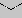
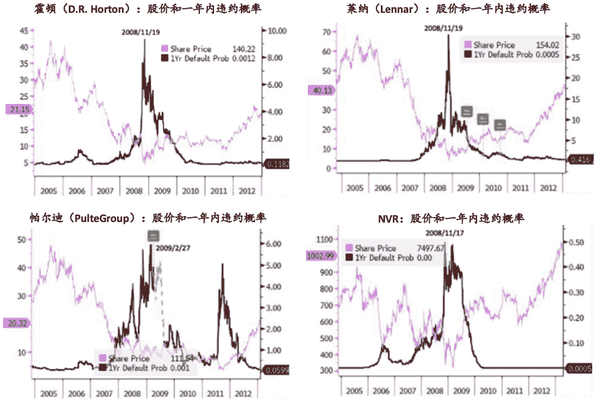

敬请阅读末页的重要说明

2024年11月25日

推荐（维持）

——海外房地产研究系列

总量研究/房地产

本文尝试回答以下5个问题：（1）次贷危机前后（2006-2012）美国房价变化的进程有什么特点，新房和二手房价格变化趋势有何异同？（2）为何2009-2012新房与二手房价格变化趋势存在明显背离，需求端和供给端各有什么影响？（3）美国何时开始全面救市，什么因素触发了政策的出台，采取了哪些措施，如何进行评价？（4）美国头部房企股价是如何表现的，为何多数房地产股会领先二手房价格三年于2009年初见底？2009年后房地产板块超额收益表现如何？（5）为什么不同房企股价表现出现分化，甚至少数股票在2009年后还会创新低？

**Q1**：次贷危机前后美国房价变化特点？新房和二手房价格变化趋势有何异同？

（1）全局：2006年中-2012年初，美国房价指数累计跌幅27%，由“三年加速下跌+三年波动下行”构成，前后不同；（2）结构：二手房价2012年初见底，新房价格则早三年于2009年初筑底，2009-2012期间新房、二手房价格背离。

**Q2**：为何**2009-2012**新房与二手房价格变化趋势存在明显背离？

（1）需求端：a. 全局：总购房需求于2009年初基本企稳，领先收入三年，净租金回报率与房贷利率之差由负转正或是重要影响因素；b. 2009-2012三年间，新房市场量缩价升，二手房量升价跌，需求变化难以解释二者价格趋势及背离。

（2）供给端：a. 新房：较低的库存及主体信用修复促使新房价格于2009年初便筑底回升；b. 二手房：2009-2012全美失业率高企叠加to C救助政策效果有限，抛售和法拍房供给明显增加，二手房库存难以压降，因此二手房在2009-2012需求企稳的情况下仍呈现价格下跌。供应端或主导该阶段价格变化及差异。

**Q3**：美国何时开始全面救市，什么因素触发了政策的出台，如何进行评价？

2008秋美国开始集中救市，购房的杠杆水平或倒逼救助时间表。回看2009年初C端救助政策出台较晚且救助范围较窄，使得高失业率传导至高违约率，致供给难降。在后来2020年疫情期间吸取该教训，阻断了失业率向违约率的传导。

**Q4**：**2006-2012**期间美国头部房企股价表现如何，为何多数房地产股会领先二手房价格三年于**2009**年初见底？**2009**年后房地产板块超额收益表现如何？

典型房企股价早于房价指数三年于2009年初筑底反弹，或受益于信用预期修复和新房价格企稳；2009上半年超额收益明显，2009-2012期间每轮大幅回调后又出现超额收益但逐次收窄，期间股价和PB都没有回到前低。随2012年二手房价进入右侧上行，股价再现持续超额收益。少数公司在2009年后继续创新低。

**Q5**：为什么少数地产股在**2009**年后还会创新低？

或受拿地方式、投资并购节奏、资产质量、资产处置空间等因素影响，尤其在周期不明朗阶段进行并购或对股价见底时点形成拖累。

风险提示：单个样本与总量情况或存在偏离、对资产价格变化的归因或存在局限性、第三方数据或存在统计偏差等。

| 行业规模 |  | 占比% |
|---------|------|------|
| 股票家数（只） | 265 | 5.2 |
| 总市值（十亿元） | 3076.5 | 3.7 |
| 流通市值（十亿元） | 2903.4 | 3.8 |

| 行业指数 | % | 1m | 6m | 12m |
|---------|---|----|----|----|
| 绝对表现 |  | 8.8 | 13.4 | 5.3 |
| 相对表现 |  | 11.1 | 8.5 | -3.7 |

资料来源：公司数据、招商证券

相关报告

1、《疫情下美国是如何以次贷危机为鉴应对个贷违约问题的——观察美国抵押贷款违约率与失业率的关系为契机》2022-07-29

赵可 S1090513110001 zhaoke@cmschina.com.cn

孔嘉庆 S1090524100004 kongjiaqing@cmschina.com.cn

次贷危机前后（2006-2012年）美国房价和股价复盘

---

敬请阅读末页的重要说明

**2**

行业深度报告

**正文目录**

Q1：次贷危机前后（2006-2012）美国房价变化的进程有什么特点？新房和二手房价格变化趋势有何异同？ ........................................................................... 3

Q2：为何2009-2012新房与二手房价格变化趋势存在明显背离？需求端和供给端各有什么影响？ ............................................................................................. 4

Q3：美国何时开始全面救市，什么因素触发了政策的出台，采取了哪些措施，如何进行评价？ ............................................................................................. 9

Q4：2006-2012期间美国头部房企股价是如何表现的，为何多数房地产股会领先二手房价格三年于2009年初见底？2009年后房地产板块超额收益表现如何？ .............................................................................................................. 11

Q5：为什么不同房企股价表现分化，甚至少数股票在2009年后还会创新低？ 15

风险提示 ........................................................................................................... 20

**图表目录**

图1：全美房价指数、新房价格、二手房价格情况（2005-2013） ................. 3

图2：全美总购房需求（“新房+二手房”成交量）与房贷利率、家庭实际收入 5

图3：纽约和华盛顿特区的房价、租金、净租金回报率以及全美房贷利率 ...... 5

图4：2009-2012美国新房量缩价升，二手房量升价跌 ................................... 6

图5：美国新房价格、成交量和库存 ................................................................ 7

图6：美国二手房价、成交量、挂牌量（含法拍房）、全美失业率、个贷违约率 8

图7：全美房价指数和救市时间表 ................................................................... 10

图8：美国首次购房者首付比例中位数不到10%，再次购买者20%左右 ........... 10

图9：次贷危机前后头部房地产公司股价与全美房价指数 ............................. 11

图10：次贷危机前后头部房企霍顿的股票、估值与全美房价指数 ................. 12

图11：2008年末房企信用风险得到缓释 ......................................................... 13

图12：次贷危机前后头部房地产公司股价与美国新房价格 ........................... 14

图13：次贷危机前后霍顿股票与标普500指数、纳斯达克指数的价格走势 .... 14

图14：美国头部房企净利润情况（2003-2013财年） .................................... 15

图15：危机前美国头部房地产公司投资轻重程度 .......................................... 16

图16：危机前四家公司拿地方式及风险程度比较 .......................................... 16

图17：美国头部房地产公司土储结构 ............................................................ 16

图18：美国各州次贷危机期间房价累计跌幅 ................................................. 17

图19：次贷危机前霍顿/莱纳/帕尔迪/NVR的土储分布情况 ........................... 18

图20：美国主要10城房价指数 ....................................................................... 18

图21：美国头部房地产公司每年结算房屋价格和数量 ................................... 19

图22：美国头部房企减值情况（2003-2013财年） ........................................ 19

---

敬请阅读末页的重要说明

**3**

行业深度报告

前言：仔细研究海外房地产的特点，并穿透、拆解到底层的各个关键要素，包括供需关系、杠杆水平、各部门信用水平、政策出台的基本面背景、经济增长底层逻辑等，能帮助我们去理解海外房地产（价格等）的变化趋势，做出前瞻判断。研究既不能刻舟求剑，亦不能忽略历史浮于表面，如果我们形成的研究逻辑框架都不能在全球历史上得到印证和解释，那我们拿什么来演绎未来？

### Q1：次贷危机前后（2006-2012）美国房价变化的进程有什么特点？新房和二手房价格变化趋势有何异同？

首先从全局层面观察全美房价指数的变化：2006年中-2012年初，六年间全美房价指数累计跌幅27%，由“三年加速下跌+三年波动下行”构成，前三年和后三年的下跌特点明显不同。如下图1，在次贷危机发生前的2006年7月，全美房价指数（S&P CoreLogic Case-Shiller US National Home Price Index）1见顶，而后持续回落，直至2012年2月才企稳回升，期间接近6年（接近通常意义上的金融周期单边时长2）时间里美国房价累计跌幅达27%；从数据观察，2009年前后房价变化趋势明显不同，2009年之前三年间（2006/7-2009/3）美国房价呈加速下跌，累计跌幅21%，2009年之后的三年（2009/3-2012/2）房价趋势上从加速下跌变成波动下行，累计跌幅9%，若以技术分析的语言打比方，后三年的特征是“三浪下跌”。

**图1**：全美房价指数、新房价格、二手房价格情况（**2005-2013**）

资料来源：联邦储备经济数据（FRED），美国统计局（CB），全美地产经纪商协会（NAR），Wind，招商证券；注：全美房价指数是季调后结果，而新房和二手房价格绝对值未经季调，所以分别增加6个月移动平均以辅助趋势观察

而后分别观察二手房和新房价格的变化：二手房价格在下跌六年后的2012年初企稳回升，而新房价格则早于二手房价三年于2009年初筑底，2009-2012期间新房和二手房的价格变化趋势存在明显背离。（1）二手房价格：二手房价格中位数变化趋势与上述全美房价指数一致，根本原因是在于全美房价指数本身就是衡量美国存量独栋住宅价格变化的指数。（2）新房价格：不同于二手房价/全美房价指数企稳于2012年2月，新房价格中位数提前三年于2009年3月便筑底回升。

1 该指数是指市场上最常用的跟踪美国房价的指数，其使用重复销售法（repeat sales method）进行编制，衡量的是美国存量独栋住宅价格的变化

2 根据国际清算银行（BIS）工作论文，1960s以来美国等7个工业国家的金融周期平均长度在16年左右，对应单边时长在8年左右。参考文献：Borio, C. (2014). The financial cycle and macroeconomics: What have we learnt?. Journal of banking & finance, 45, 182-198.

---

敬请阅读末页的重要说明

**4**

行业深度报告

也就是说，2009-2012期间，新房价格呈现波动上行，二手房价格则是波动下行（三浪下跌）。

### Q2：为何2009-2012新房与二手房价格变化趋势存在明显背离？需求端和供给端各有什么影响？

（1）首先从需求端来看，美国总购房需求于2009年初基本企稳，领先家庭收入三年，QE带动房贷利率出现明显向下拐点进而带动净租金回报率与房贷利率之差由负转正或是总需求企稳的重要影响因素。如下图2，新房与二手房合计成交量（总购房需求）于2009年初基本企稳，虽然2010年下半年个别月份的单月成交量再次创下新低，但从年度数据观察，2008年确实是该轮周期的总购房需求低点。总购房需求基本企稳的同时，哪些指标可能构成重要影响因素呢？

一方面，从收入角度观察，总购房需求领先家庭收入三年企稳，但二手房价向上拐点同步于家庭收入。如下图2，美国家庭实际每年收入中位数自2007年的6.9万美元持续回落至2011年的6.3万美元，2012年与2011年持平，直至2013年才出现真正的收入增长；2009后在收入仍处于下行的情况下总购房需求基本企稳，但逐年减少的家庭收入也确实对2009年后的总需求回升斜率形成约束，直至2012年后收入企稳回升时总成交才开始放量、二手房价格才转为上涨。

另一方面，从利率角度观察，2008年末房贷利率出现明显拐点，2009年初净租金回报率与房贷利率之差由负转正，或从金融角度为总购房需求企稳提供支撑。美联储自2007年9月起连续降息10次至2008年底联邦基金目标利率接近0%（0.25%），而后于2008年11月开启首轮QE（央行大规模购买金融机构持有的MBS3）以降低长端利率。如下图3，2008年末房贷利率出现明显的向下拐点，推动净租金回报率4和房贷利率之差在2009年初由负转正，具体而言，在2006年中全美房价指数高点至2009年初成本收益回归平衡期间，房价累计下跌20%推动主要样本城市净租金收益率从2.5%-3.0%回升至4.5%-5.0%（累计回升200 bps左右），房贷利率从6.8%降至5.1%（对应累计降幅170 bps），二者差值由-370 bps左右回升至零（房贷利率下降对应一半的贡献），或从金融角度对总购房需求企稳提供支撑，为总购房需求（新房+二手房合计）成交量的企稳打下基础。

3 2008/11-2010/首轮QE美联储累计购买1.25万亿美元agency MBS（房地美/房利美/吉利美支持发行的MBS）、3000亿美元长期国债、1750亿美元agency debt（“两房”和联邦住房贷款银行的直接债务）

4 净租金回报率=（年租金收入−年房产税−年维护费−年保险费）/房价

---

敬请阅读末页的重要说明

**5**

行业深度报告

**图2**：全美总购房需求（“新房+二手房”成交量）与房贷利率、家庭实际收入

资料来源：FRED，CB，NAR，Wind，美国住房与城市发展部（HUD），招商证券

**图3**：纽约和华盛顿特区的房价、租金、净租金回报率以及全美房贷利率

资料来源：FRED，Zillow，NYC Department of Finance，DC Office of Tax and Revenue，招商证券

接下来，从结构上分别来看新房和二手房需求（成交量）情况：如下图4，二手房需求与总购房需求表现一致，均在2009年初企稳，新房需求可能一部分被更有价格优势的二手房替代因而于2011年初才见底。也就是说，2009-2012三年间，新房市场整体呈现量缩价升的特点，二手房则是量升价跌，新房和二手房各自的量与价均呈反向变化，这可能与普通流行的量价同步的观点相悖，但恰恰又符合经典的经济学供需关系理论。

敬请阅读末页的重要说明

** 6**

行业深度报告

图4：2009-2012 美国新房量缩价升，二手房量升价跌

资料来源：HUD，CB，NAR，Wind，招商证券

供需关系决定价格，倘若需求是主导因素，那么量价变化方向应该是一致，既然2009-2012 期间不论新房还是二手房，价格与需求都呈反向变动，那么说明需求并非解释该段时间内价格变化的主导因素，接下来，我们来看看供给端。

### （2）供给端视角是否能够合理解释上述背离？

**新房市场：**较低的新房库存为供需关系改善创造条件，促使新房价格于2009 年初便筑底回升，早于二手房价格三年。新房库存方面，如下图5，房企从2006 年便几乎停止主动补库，经过2006-2009 三年多的市场消化以及房企主动降价去库存措施（将于下文展开），2009 年初新房库存已压降至合理偏低水平——2009 年3 月末（新房房价最低点）31 万套的新房库存较上一轮库存高点（2006 年7 月末，57 万套）下降45%且已经低于35 万套的历史均值[^5]。

2009 年初新房价格企稳的背后，或有以下三个重要原因：1）站在2009 年初的房企角度，库存水平不断压降至历史均值以下；2）在2008 年下半年政府全面救市（包括TARP[^6]等）之下房企主体信用预期出现修复（仅滞后金融系统1 个月），后续断臂降价求生的压力下降；3）购房群体客户画像差距的拉大，市场上或总存在部分对杠杆相对不敏感的改善性新房需求（包括折旧导致的需求）。因此，2009 年以后，在市场有效供应萎缩以及房企进一步降价去库存保现金流的动机越来越弱的共同推动下，供需关系拐点的出现，2009 年1 月，全美新房去化周期见顶回落，2009 年3 月新房价格筑底回升，而后新房市场呈现量缩价稳且回升的特点，与二手房明显不一致。

图5：美国新房价格、成交量和库存

资料来源：HUD，CB，招商证券

**二手房市场：**2009-2012 全美失业率高企叠加to C 救助政策效果有限（换言之，由于美国2009 年救C 端政策出台较晚且救助范围较窄，才使得高失业率传导至高违约率，但在后来的2020 年疫情期间则吸取了这个教训，及时采取措施阻断了失业率向违约率的传导），个贷违约难以缓解，令抛售和法拍房供给明显增加、二手房库存难以压降，受制于该供给端约束，美国二手房在需求筑底企稳的情况下仍呈现价格下跌，只不过相较2006-2009 年下跌的斜率放缓。如下图6，2009-2012 三年间，虽二手房成交已出现低位波动回升（在前述房贷利率下降等需求端政策刺激以及二手房相对新房的价格优势[^7]下），但二手房价格仍在波动下跌（即量稳价跌），原因或在于供给端——2009 之后的三年间个贷违约严重导致的二手房库存难以压降，具体而言：1）失业仍较为严重，三年间失业率持续在8%以上；2）to C 救助政策效果有限，个贷违约情况难以缓解，2009 年2 月，财政部宣布Making Home Affordable 计划（MHA，TARP 的一部分），帮助具有存量按揭偿还压力的业主通过修改偿贷方案（包括降低利率、豁免部分本金、延长还款期）以避免个人丧失抵押品赎回权（foreclosure），但是由于该计划推出时间不够及时（推出时失业率和个贷违约率均高达8%）再加上申请条件严苛[^8]且为自愿性项目[^9]，因此，2009 年后个贷违约问题未能得到有效解决，个贷违约率先从8%攀升至12%的峰值而后略降至10%（对比次贷危机前这一违约率常年在2.5%以下）[^10]，亨利·保尔森（2006/7-2009/1 期间担任美国财长）在其回忆录中也提到彼时财政部和美联储的经济学家大幅低估了美国次贷的严重性[^11]；3）前两个因素叠加使得抛售和法拍房数量高企，从法拍房角度观察，2009/2010/2011 平均每年因个贷违约而被拍卖的房屋数量达106 万套，平均占每年末待售二手房的40%（对比次贷危机前法拍房仅占二手挂牌的10%）；4）由于抛售和法拍房供给较大，二手库存去化效果有限，虽然2009 年开始二手挂牌已经在逐渐回落，从2009 年初310 万套左右降至2012 年初250 万套左右，但2009-2012 期间二手库存仍然大幅高于历史均值（214 万套）[^12]，换言之，经过三年市场消化后，2012 年初全美二手库存才开始接近历史平均水平，也是当库存降至正常水平（历史均值）时，二手房价格才开始见底回升，因此，供应端或主导了这个阶段的房价。

图6：美国二手房价、成交量、挂牌量（含法拍房）、全美失业率、个贷违约率

资料来源：NAR，Wind，FRED，CoreLogic，招商证券；注：2017 年后法拍房数据不可获取

## Q3：美国何时开始全面救市，什么因素触发了政策的出台，采取了哪些措施，如何进行评价？

2008 年下半年开始，美国持续出台to B 和to C 救助政策以及经济刺激政策，其中B 端政策主要针对金融机构。如下图7，2008 年秋，美国政府开启全面救市，其应对措施主要包括以下几个层面：（1）维护金融稳定性，2008 年10 月美国国会通过不良资产救助计划（TARP）授予财政部7000 亿美元资金额度用于购买和担保金融机构问题资产，当月财政部便开启对银行的注资，以及同年同月联邦存款保险公司（FDIC）宣布将为无息存款账户提供全额担保以防止进一步银行挤兑；（2）恢复市场流动性，美联储自2007 年9 月起连续降息10 次至2008 年底联邦基金目标利率接近0%（0.25%），而后于2008 年11 月开启首轮QE 以降低长端利率，而除常规货币政策工具外，美联储还创设了多种借贷便利（lending facilities）；（3）为住房市场提供支撑，B 端主要是2008 年9 月，联邦住房金融局（FHFA）托管“两房”（房地美和房利美），以及，2009 年1 月起美联储开始下场从二级市场购买agency MBS[^13]；C 端则主要是2009 年2 月，财政部宣布Making Home Affordable 计划（TARP 的一部分），帮助具有存量按揭偿还压力的业主通过修改偿贷方案以避免个人丧失抵押品赎回权（foreclosure）；（4）刺激经济复苏，货币政策包括上述降息和QE，而财政政策方面，2009 年2 月，时任美国总统奥巴马签署7870 亿美元《美国复苏与再投资法案》（ARRA of 2009），该法案主要包括个人和企业减税、失业救济以及通过投资基建项目扩大政府开支等。

从救助的时间表观察，我们认为购房的杠杆水平或倒逼了救助的时间表。如下图7&8，2008 年6 月，全美房价指数自高点以来的累计跌幅（10%）击穿首次购房者（first-time buyers）的按揭首付比中位数，而后2009 年2 月累计跌幅达到20%，再次击穿二套及以上购房群体（repeated buyers）首付比例中位数，虽然美国有个人破产制度，但是房价下跌击穿杠杆仍然会产生很多问题，比如个人贷款止赎以及给金融机构产生严重损失甚至资不抵债（包括最直接的贷款坏账以及间接的以按揭贷款为抵押物的资产价格下跌），因此房价下跌击穿杠杆可能是政策出台或者说是以保尔森为主的“救市派”力挺政策干预的原因，当然，在这个过程中以及次贷危机结束后的若干年，始终也有道德风险派的质疑。美国的救助能成功也和救助政策附带代价是有关系的，比如当时财政部要求接受注资的金融机构的高管需要严格限薪，以及其余救助政策伴随的惩罚性条款，以更好地规避道德风险。

图7：全美房价指数和救市时间表

资料来源：FRED，美国财政部，招商证券；注：红点标注是累计跌幅达到10%的时点

图8：美国首次购房者首付比例中位数不到10%，再次购买者20%左右

资料来源：NAR，招商证券

但是，前文也提到，回头看2009 年2 月的C 端救助政策（Making Home Affordable 计划）并不算完美：由于出台时间不够及时，再加上申请贷款展期或其它宽限的条件较为严苛[^14]且为自愿性项目（并不强制要求贷款机构配合），高失业率向高违约率传导，尽管在政府和民间的努力下，有500 万美国人受益于MHA 计划而避免了房屋被法拍，但是2007-2016 年间，仍有780 万房屋因受次贷危机冲击还款中断而被法拍。在后来的2020 年疫情期间美国吸取该教训，及时采取措施阻断了失业率向违约率的传导，具体关于两次经济衰退期间政府to C 端救助的比较，可参考招商证券2022-7-29 报告《疫情下美国是如何以次贷危机为鉴应对个贷违约问题的——以美国抵押贷款违约率与失业率的关系为契机》。

[^5]: 1990/7-2007/12（对应NBER 定义的美国2 个完整经济周期）每月月末待售新房平均在35 万套；2009 之后三年新房库存仍在进一步压降，2012 年3 月末，全美新房库存仅14.5 万套
[^6]: 2008 年10 月美国国会通过不良资产救助计划（TARP）授予财政部7000 亿美元资金额度用于购买和担保金融机构问题资产，当月财政部便开启对银行的注资（TARP 计划下累计为银行机构注资2455 亿美元），除对银行业支持以外，TARP 还包括对信贷市场、个人住房（如后文将提到的Making Home Affordable 计划）、汽车业以及AIG 的救助
[^7]: 如本文图1，次贷危机前单套新房价格往往比二手房高2 万美元左右，危机后这一价差进一步扩大（由于二手价格跌幅比新房更深），2009 年新房与二手房价格中位数之差升至4 万美元，随后进一步上升至2011 年的6 万美元，因此二手房相对新房的价格优势越来越明显
[^8]: 申请人需证明其月收入31%以上被用来还贷，且需通过净现值测试（NPV test）以证明继续还贷比房子被直接法拍能为贷款人带来更多价值,才能符合MHA 项目申请条件
[^9]: 贷款服务商自愿加入该项目、自愿提供贷款修改服务，政府只能尽可能鼓励贷款服务商参与（比如通过NPV test）。之所以当时政府无法强制进行贷款条款的修改以覆盖更多借款人，主要因为大部分问题房贷都是由私人部门而非政府机构持有，因此无法进行强制执行
[^10]: 对比2020 年初（如上图），美国经济受到新冠疫情重创而快速出现衰退，失业率一度飙升至近13%，但个贷违约率并没有冲到次贷危机时的高点且很快便开始下降，或得益于美国政府在2020 年3 月便及时出台并生效的CARES Act（其允许背负房贷的借款人申请最高1 年的个贷展期）且条件十分宽松（全美80%存量房贷都满足），因此即便2020 年失业率高企而个贷违约率并未出现大幅上升
[^11]: 在保尔森在其回忆录《峭壁边缘》提到，财政部和联储的经济学家们在2007 年时认为丧失抵押房屋赎回权的问题会在2008 年达到顶峰，次贷约占住房抵押贷款的13%，最差情形将面临3000 亿美元左右损失，并认为这个体量的损失可以接受，但保尔森接着便承认“今天来看，我们真是大错特错”，事后证明，无论是当时预测的达峰时间、次贷比例还是损失规模都存在大幅低估
[^12]: 1990-2007（对应NBER 定义的美国2 个完整经济周期）每年年末二手挂牌平均在214 万套
[^13]: 2008/11-2010/首轮QE 美联储累计购买1.25 万亿美元agency MBS（房地美/房利美/吉利美支持发行的MBS）、3000 亿美元长期国债、1750 亿美元agency debt（“两房”和联邦住房贷款银行的直接债务）
[^14]: 申请人需证明其月收入31%以上被用来还贷，且需通过净现值测试（NPV test）以证明继续还贷比房子被直接法拍能为贷款人带来更多价值,才能符合MHA 项目申请条件

敬请阅读末页的重要说明

**11**

行业深度报告

Q4：2006—2012年期间美国头部房企股价是如何表现的？为何多数房地产股会领先二手房价格三年于2009年初见底？2009年后房地产板块超额收益表现如何？

多数地产股股价先于房价指数触底。以霍顿（D.R. Horton）、莱纳（Lennar）、帕尔迪（PulteGroup）和NVR作为主要美国房企研究对象（不涉及不动产资管公司及REITs），如下图9，多数头部房企（霍顿、莱纳、NVR）的月末收盘价均于2009年初（1月或2月）触底反弹，较全美房价指数见底早三年时间。此后三年间，虽然房价指数仍在震荡下行，但三家公司的股价则在震荡上行。以美国市占率连续二十多年排名第一的房地产开发商霍顿为例（图10），其股价和P/B均于2009年1月见底。在霍顿股价底至全美房价底期间（2009年1月至2012年2月），霍顿股价累计上涨141%，P/B从0.7倍修复至1.7倍。

但是，房企在权益市场的表现呈现双重分化。我们发现，次贷危机发生后，四家房企股票表现呈现两个维度的分化，如下图9：

1. 股价修复时点的分化：霍顿（D.R. Horton）、莱纳（Lennar）、NVR月末收盘价均于2009年初（1月或2月）触底反弹，而帕尔迪（PulteGroup）股价则直到2011年9月才彻底见底；
2. 股价修复程度的分化：以美国房价见底时点（2012年2月）为观察点，NVR该时点的股价已修复至次贷危机前股价峰值的7成，霍顿和莱纳则只修复至峰值股价的1/3，帕尔迪则只有2成不到。

图9：次贷危机前后头部房地产公司股价与全美房价指数

资料来源：Bloomberg，FRED，招商证券

注：橙色圆点是次贷危机前的股价峰值（均为2005年7月）、次贷危机期间的股价底、全美房价指数见底时（2012年12月）的股价。

注：原文图表中保留的坐标轴及图例信息如下：

D.R. Horton（NYSE: DHI）月末收盘价（美元，左轴）

全美房价指数（S&P/CoreLogic/Case-Shiller HPI，右轴）

Lennar（NYSE: LEN）月末收盘价（美元，左轴）

PulteGroup（NYSE: PHM）月末收盘价（美元，左轴）

NVR（NYSE: NVR）月末收盘价（美元，左轴）

2005/1、2005/7、2006/1、2006/7、2007/1、2007/7、2008/1、2008/7、2009/1、2009/7、2010/1、2010/7、2011/1、2011/7、2012/1、2012/7、2013/1、2013/7、2014/1

120、130、140、150、160、170、180、190

0、5、10、15、20、25、30、35、40、45、50、60、70、80、200、400、600、800、1,000、1,200、1,400

15 将霍顿、莱纳、帕尔迪和NVR作为本文研究对象，主因四家公司是美国最大的房地产开发商（房屋销量口径）。2006年霍顿、莱纳、帕尔迪和NVR市占率（公司当年结算房屋量/全美新房销量）分别为5.1%/4.7%/3.9%/1.4%（合计15.2%）；2023年霍顿、莱纳、帕尔迪和NVR市占率分别为12.4%/10.9%/4.3%/3.1%（合计30.7%）。

**12**

行业深度报告

图10：次贷危机前后头部房企霍顿的股票、估值与全美房价指数

资料来源：Bloomberg，FRED，招商证券

从2008年末开始，投资人似乎对地产股开始变得乐观，后面的原因可能是信用预期修复和新房价格企稳：

1. 随着托管“两房”、TARP等政策的实施，2008年10月银行间流动性风险得以缓释（体现在下图11 TED spread见顶回落），一个月后的2008年11月房企层面的信用风险得到间接改善（体现在下图11房企一年内违约概率见顶回落），带动定价中风险溢价的修复，使得估值回升，从而带来第一波触底反弹。当然，2008年11月实施的QE也使投资者对地产股在内的权益资产形成价格修复的普遍预期；
2. 新房价格或是公司资产价值及NAV的锚。如下图12，全美新房价格于2009年初企稳，或为房企股价修复提供了进一步支撑，使得2009—2012年期间股价呈现震荡上行。2012年后，伴随宏观经济刺激措施效果显现，需求端，家庭收入企稳回升、新增就业修复至危机前水平、房贷利率不断创新低；供给端，失业以及个人贷款止赎导致的二手房挂牌量也得到控制，二手房库存回落至历史均值。二手房价格于2012年初触底反弹，推动地产股价加速上行。

图表信息：

霍顿月末收盘价（美元/股，左轴）

霍顿月末PB（MRQ，右轴）

股价+141%

0.7倍PB

1.7倍PB

1.8倍PB

1.1倍PB

$5.96

$14.69

$14.34

$9.04

霍顿月末收盘价（美元/股，左轴）

全美名义房价指数（S&P CoreLogic Case-Shiller U.S. National Home Price Index，右轴）

+59%

+146%

-38%

从2009年1月（霍顿股价底部）至2012年2月（房价底部）

霍顿股价累计+141%，PB约从0.7倍修复至1.7倍

2008年9月

- 托管“两房”
- 雷曼兄弟破产倒闭

2008年10月

- TARP生效

2008年11月

- QE1（包括购买MBS）

2009年2月

- 签署《2009年美国复苏与再投资法》
- 宣布Making Home Affordable住房项目（避免个人丧失抵押品赎回权）

2010年11月

- QE2

2012年9月

- QE3

**13**

行业深度报告

图11：2008年末房企信用风险得到缓释

资料来源：Bloomberg，FRED，招商证券

TED spread（%，伦敦银行间同业拆借美元利率与美国国债短期利率之差）

2008年10月10日峰值4.58%

**14**

行业深度报告

图12：次贷危机前后头部房地产公司股价与美国新房价格

资料来源：Bloomberg，CB，招商证券

以霍顿为例，如下图13，其股价于2009年初筑底反弹，2009年上半年超额收益明显（相对标普500指数或纳斯达克指数），而后累计超额收益震荡收窄。2009—2012年期间，每轮大幅回调后又出现超额收益，但每次超额收益逐次收窄，期间绝对股价和PB估值都没有再次回到2009年初的前低值。直至2012年二手房价进入右侧后，霍顿股价再次出现持续超额收益。

其他地产公司如莱纳、NVR也有类似表现，但少数公司如帕尔迪股价则在2009年后继续创新低（如上图12），下面我们将试图分析分化背后的可能原因。

图13：次贷危机前后霍顿股票与标普500指数、纳斯达克指数的价格走势

资料来源：Bloomberg，招商证券

注：以2008年10月为基期，后续按照霍顿以及标普500指数月末收盘价对应的月度涨跌幅进行计算。

图表信息：

D.R. Horton（NYSE: DHI）月末收盘价（美元，左轴）

新房价格中位数（美元，右轴）

Lennar（NYSE: LEN）月末收盘价（美元，左轴）

PulteGroup（NYSE: PHM）月末收盘价（美元，左轴）

NVR（NYSE: NVR）月末收盘价（美元，左轴）

霍顿累计超额收益（基期=100，相对标普500）

标普500指数（基期=100）

霍顿股价（基期=100）

霍顿累计超额收益（基期=100，相对NASDAQ）

NASDAQ指数（基期=100）

2005/1、2005/7、2006/1、2006/7、2007/1、2007/7、2008/1、2008/7、2009/1、2009/7、2010/1、2010/7、2011/1、2011/7、2012/1、2012/7、2013/1、2013/7、2014/1

200,000、210,000、220,000、230,000、240,000、250,000、260,000、270,000、280,000

0、5、10、15、20、25、30、35、40、45、50、60、70、80、200、400、600、800、1,000、1,200、1,400

2008/10、2009/2、2009/6、2009/10、2010/2、2010/6、2010/10、2011/2、2011/6、2011/10、2012/2、2012/6、2012/10、2013/2、2013/6、2013/10

**15**

行业深度报告

Q5：为什么不同房企股价表现分化，甚至少数股票在2009年后还会创新低？

拿地方式、投资并购节奏以及资产质量或是房企股价表现分化的主要原因。其中，NVR和帕尔迪是两个极端，霍顿、莱纳则介于二者之间：

1. NVR受益于轻量拿地策略（土地获取几乎完全采用期权模式，且获取的均为开发完备的熟地），抗风险能力较强；且区域布局聚焦首都华盛顿特区及周边数州，基本避开了资产跌价最严重的几个区域，所以在危机期间受冲击最小，甚至仍可实现账面盈利。因此，NVR股价在2009年初见底后迅速反弹，且修复程度最高；
2. 帕尔迪则因为几乎只进行高风险的生地投资，且投资策略较为激进，在佛罗里达、亚利桑那、内华达等跌价最严重的区域拿地较多，并出现并购时点的判断失误，因此销售利润受损和资产减值较同业更多，对公司利润形成更长时间的拖累（同业一般账面亏损三年，帕尔迪则连亏五年）。因此，帕尔迪股价直至2011年下半年才见底，较同业晚近三年，且修复程度也最低。

首先观察下图14，危机后四家公司的股价修复程度与其利润修复程度（亏损规模和持续时间）挂钩较多。下文我们试图从拿地方式、投资并购节奏、资产质量、资产处置空间4个维度，对霍顿、莱纳、帕尔迪、NVR四家公司进行横向对比，以解释利润修复程度的差异。

图14：美国头部房企净利润情况（2003—2013财年）

资料来源：Bloomberg，招商证券

注：D.R. Horton、Lennar、PulteGroup、NVR财年截止日分别为9月30日、11月30日、12月31日、12月31日。

图表信息：

D.R. Horton

Lennar

PulteGroup

NVR

单位：百万美元

FY2003、FY2004、FY2005、FY2006、FY2007、FY2008、FY2009、FY2010、FY2011、FY2012、FY2013

（1）拿地方式：危机前，NVR拿地方式最轻，基本只使用期权方式获取熟地，抗风险能力最强；霍顿在生地/熟地、期权/自持上比较平衡；帕尔迪（基本只进行高风险生地投资开发）和莱纳（期权拿地占比较低）的抗风险能力或相对较弱。

a. 从拿地对象角度，美国开发商拿地包括熟地（lots）和生地（land parcels）两种，一般熟地比生地的资金占用更少、抗风险能力相对更强。如图15，NVR基本不进行生地开发，只拿熟地；霍顿既拿生地也拿熟地；莱纳和帕尔迪则更侧重生地开发，且帕尔迪介入阶段更早，因而需要更多资本投入。投资轻重程度由低到高排序为NVR、霍顿、莱纳、帕尔迪。

b. 从资金角度，美国开发商拿地的资金渠道包括自有资金拿地（含成立合联营

敬请阅读末页的重要说明

行业深度报告

公司拿地和土地期权（land/lot option contracts）拿地，一般期权拿地占比越高，抗风险能力越强。四家公司均在一定程度上使用土地期权来降低投资风险，但是各家期权拿地占比不同。如图17所示，以2003—2005年各家土储结构中期权地块数占总土储数的比例均值来看，NVR（99%）>霍顿（55%）>帕尔迪（53%）>莱纳（30%）。

图15：危机前美国头部房地产公司投资轻重程度

图16：危机前四家公司拿地方式及风险程度比较

资料来源：Morningstar（2013），招商证券

资料来源：各公司年报，Morningstar（2013），招商证券

图17：美国头部房地产公司土储结构

资料来源：各公司年报，招商证券

注：D.R. Horton、Lennar、PulteGroup、NVR财年截止日分别为9月30日、11月30日、12月31日、12月31日。

土地期权（land/lot option contracts）：类似股票期权，霍顿、莱纳、帕尔迪和NVR等开发商作为土地买方与卖方签订期权合同，给予买方在未来某个时点以约定价格买入的权利。在这种模式之下，买方需缴纳一定期权费（约为土地价款的10%）。如果买方不想购买土地，则可以选择不行权，损失仅限于期权费。

**直接投资（含合作拿地）**

（高风险）

**通过土地期权实现地块控制**

（低风险）

**生地**

（高风险）

**熟地**

（低风险）

- NVR
- 霍顿
- 帕尔迪
- 莱纳

0%

20%

40%

60%

80%

100%

FY2003

FY2004

FY2005

FY2006

FY2007

FY2008

FY2009

FY2010

FY2011

FY2012

FY2013

FY2014

FY2015

FY2016

FY2017

FY2018

FY2019

FY2020

FY2021

FY2022

FY2023

### 莱纳

- 通过期权控制的土地（块，左轴）
- 通过合联营公司控制的土地（块，左轴）
- 自持土地（块，左轴）
- 期权拿地占比（右轴）

0%

10%

20%

30%

40%

50%

60%

70%

80%

90%

100%

FY2003

FY2004

FY2005

FY2006

FY2007

FY2008

FY2009

FY2010

FY2011

FY2012

FY2013

FY2014

FY2015

FY2016

FY2017

FY2018

FY2019

FY2020

FY2021

FY2022

FY2023

### 帕尔迪

- 自持土地（块，左轴）
- 通过期权控制的土地（块，左轴）
- 期权拿地占比（右轴）

0%

10%

20%

30%

40%

50%

60%

70%

80%

90%

100%

FY2003

FY2004

FY2005

FY2006

FY2007

FY2008

FY2009

FY2010

FY2011

FY2012

FY2013

FY2014

FY2015

FY2016

FY2017

FY2018

FY2019

FY2020

FY2021

FY2022

FY2023

### 霍顿

- 自持土地（块，左轴）
- 通过期权控制的土地（块，左轴）
- 期权拿地占比（右轴）

0%

20%

40%

60%

80%

100%

FY2003

FY2004

FY2005

FY2006

FY2007

FY2008

FY2009

FY2010

FY2011

FY2012

FY2013

FY2014

FY2015

FY2016

FY2017

FY2018

FY2019

FY2020

FY2021

FY2022

FY2023

### NVR

- 通过期权控制的土地（块，左轴）
- 通过合联营公司控制的土地（块，左轴）
- 自持生地（块，左轴）
- 期权拿地占比（右轴）

（2）投资并购节奏方面：危机前，帕尔迪扩张节奏最为激进，且在仍处于周期磨底阶段的2009年便通过并购逆势增加土储。如上图，次贷危机前，四家公司的土储量均于2005年达峰。从2000—2005年五年间各公司土储增长趋势来看，帕尔迪的增长斜率最为陡峭（五年总土储CAGR=37%），霍顿次之（五年总土储CAGR=33%），NVR和莱纳的增长相对克制（五年总土储CAGR分别为22%/20%）。此外，值得注意的是，2009年，在霍顿和莱纳仍在继续压降土地库存时，帕尔迪的总土储量却因为并购而出现反弹。回头看，尽管该并购事件并未占用帕尔迪现金，但是，在2009—2012年周期磨底阶段进行收并购无疑导致存货积压、杠杆居高不下、后续整合成本增加，对帕尔迪业绩及后续信用扩张产生进一步拖累。

（3）资产质量/区域布局方面：NVR业务布局聚焦华盛顿特区周边数州，几乎避开房价下跌最严重的区域；霍顿、莱纳、帕尔迪均为全国布局，莱纳和帕尔迪对跌价严重区域的风险暴露程度或相对较高。如下图所示，内华达州（Nevada）、亚利桑那州（Arizona）、佛罗里达州（Florida）、密歇根州（Michigan）、加利福尼亚州（California）是美国次贷危机期间资产价格受损最严重的区域，房价最大跌幅分别为60%、51%、50%、43%、42%。截至各公司2005财年末，NVR只在东岸数州开展业务，基本躲开了以上几个跌价严重区域，且NVR主要阵地之一的华盛顿特区的二手房价指数于2009年初便止跌反弹、持续回升；霍顿、莱纳、帕尔迪均为全国化布局，对房价下跌严重区域的暴露程度不同，莱纳和帕尔迪对跌价严重区域的风险暴露程度或相对较高。

图18：美国各州次贷危机期间房价累计跌幅

资料来源：CoreLogic，招商证券

注：图中标识的百分比为次贷危机期间该州房价顶部至底部的跌幅，该房价以CoreLogic各州房价指数计算。

2009年4月，帕尔迪宣布收购另一家美国头部开发商Centex LLC（2008年Centex房屋销量全美第三，帕尔迪第四），8月完成交易，交易对价为31亿美元，以帕尔迪股票支付。

图19：次贷危机前霍顿/莱纳/帕尔迪/NVR的土储分布情况

资料来源：各公司年报，招商证券

注：饼状图中的比例为2006财年该公司在该区域的土储数量占总土储量的比例（NVR没有披露土储结构数据），不同公司统计土储的口径有差异，颗粒度也可能存在局限性。

图20：美国主要10城房价指数

资料来源：FRED，招商证券

注：以上房价指数为S&P CoreLogic Case-Shiller Home Price Index的全国以及城市层面指数。

### 帕尔迪

- Northeast（Connecticut、Delaware、Maryland、Massachusetts、New Jersey、New York、Pennsylvania、Virginia）：12%
- Southeast（Georgia、North Carolina、South Carolina、Tennessee）：10%
- Florida（Florida）：21%
- Central / Texas（Texas）：10%
- Southwest（Arizona、Nevada、New Mexico）：28%
- Midwest（Colorado、Illinois、Indiana、Kansas、Michigan、Minnesota、Missouri、Ohio）：8%
- California（Northern California and Southern California）：11%

### 莱纳

- East（Florida、Maryland、New Jersey and Virginia）：34%
- Central（Arizona、Colorado and Texas）：28%
- West（California and Nevada）：30%
- Other（Illinois、Minnesota、New York、North Carolina and South Carolina）：7%

### 霍顿

- Northeast（Delaware、Georgia（Savannah only）、Maryland、New Jersey、North Carolina、Pennsylvania、South Carolina and Virginia）：11%
- Midwest（Colorado、Illinois、Minnesota and Wisconsin）：8%
- Southeast（Alabama、Florida and Georgia）：20%
- South Central（Louisiana、Mississippi、Oklahoma and Texas）：22%
- Southwest（Arizona、New Mexico and Utah）：17%
- California（California and Nevada（Reno only））：11%

全美房价指数

全美10城房价指数

华盛顿特区

纽约

波士顿

芝加哥

全美房价指数

洛杉矶

圣地亚哥

旧金山

拉斯维加斯

全美房价指数

丹佛

迈阿密

全美房价指数

行业深度报告

（4）处置空间方面：四家公司均在2006年起采用降价方式去库存，只不过除NVR以外，其他三家公司都因为全国化布局而未能摆脱结算量下滑的大趋势。

2006年后，美国房企普遍开始降价促销，因而霍顿、莱纳、帕尔迪、NVR四家公司2006—2009年每年房屋结算均价开始走低（如下图）。新房销量方面，由于NVR的经营策略是深耕DC附近数州等流动性较好城市而非向全国扩张，因此以价换量策略相对有效；而霍顿、莱纳、帕尔迪由于是全国布局，因此三家公司房屋结算量走势与全美新房销量走势基本一致，以价换量空间有限。

图21：美国头部房地产公司每年结算房屋价格和数量

资料来源：Bloomberg，各公司年报，CB，招商证券

注：D.R. Horton、Lennar、PulteGroup、NVR财年截止日分别为9月30日、11月30日、12月31日、12月31日

图22：美国头部房企减值情况（2003—2013财年）

资料来源：Bloomberg，各公司年报，招商证券

注1：D.R. Horton、Lennar、PulteGroup、NVR财年截止日分别为9月30日、11月30日、12月31日、12月31日

注2：此处的减值为广义资产减值，既包括存货减值，也包括公允价值计量下的存货估值调整，还包括期权费用勾销所带来的成本。

150,000

200,000

250,000

300,000

350,000

400,000

450,000

FY2003

FY2004

FY2005

FY2006

FY2007

FY2008

FY2009

FY2010

FY2011

FY2012

FY2013

房屋价格

D.R. Horton（$）

Lennar（$）

PulteGroup（$）

NVR（$）

全美新房价格中位数（美元）

0

200

400

600

800

1,000

1,200

1,400

0

10,000

20,000

30,000

40,000

50,000

60,000

FY2000

FY2001

FY2002

FY2003

FY2004

FY2005

FY2006

FY2007

FY2008

FY2009

FY2010

FY2011

FY2012

FY2013

房屋销量

D.R. Horton（套，左轴）

Lennar（套，左轴）

PulteGroup（套，左轴）

NVR（套，左轴）

全美新房销量（千套，右轴）

0%

10%

20%

30%

40%

50%

60%

0

2000

4000

6000

8000

10000

12000

14000

FY2003 FY2004 FY2005 FY2006 FY2007 FY2008 FY2009 FY2010 FY2011 FY2012 FY2013

**霍顿**

减值规模（左轴）

合并报表存货（左轴）

减值/存货（右轴）

左轴单位：百万美元

0%

10%

20%

30%

40%

50%

60%

0

2000

4000

6000

8000

10000

12000

14000

FY2003 FY2004 FY2005 FY2006 FY2007 FY2008 FY2009 FY2010 FY2011 FY2012 FY2013

**莱纳**

减值规模（左轴）

合并报表存货（左轴）

减值/存货（右轴）

左轴单位：百万美元

0%

10%

20%

30%

40%

50%

60%

0

2000

4000

6000

8000

10000

12000

14000

FY2003 FY2004 FY2005 FY2006 FY2007 FY2008 FY2009 FY2010 FY2011 FY2012 FY2013

**帕尔迪**

减值规模（左轴）

合并报表存货（左轴）

减值/存货（右轴）

左轴单位：百万美元

-5%

0%

5%

10%

15%

20%

25%

30%

35%

40%

45%

50%

55%

60%

-10

190

390

590

790

990

1190

1390

FY2003 FY2004 FY2005 FY2006 FY2007 FY2008 FY2009 FY2010 FY2011 FY2012 FY2013

**NVR**

减值规模（左轴）

合并报表存货（左轴）

减值/存货（右轴）

左轴单位：百万美元

总而言之，四家公司在拿地方式、投资并购节奏、资产质量、资产处置空间等维度存在差异，因而在2009年后出现股价修复时点和幅度的分化：

- （1）NVR：受益于期权拿地策略，资产减值损失仅限于期权费，且未在内华达等资产跌价严重区域布局，资产质量相对较好，因而未出现账面亏损，股价修复程度也最高；

- （2）帕尔迪：因“踩雷”较多而需计提更多减值，最终导致连续亏损五年，对股价修复形成拖累（股价触底时间晚于其他头部房企两年半且修复程度最低）。帕尔迪经营失误偏多，包括：投资上几乎只进行高风险的生地投资，扩张节奏较为激进，周期磨底阶段就进行收并购、扩规模，导致其抗风险能力弱，叠加其土储对跌价严重区域的暴露程度较高，资产减值压力较大，对利润的拖累也更严重，形成2007—2011连续五年账面亏损，对股价修复形成拖累；

- （3）霍顿、莱纳：虽然也存在一些经营失误，但仍具备一定抗风险能力，因此主要是在新房价格持续下跌的2007、2008年集中计提减值，账面利润亏损三年，但在全国新房价格修复后两家公司利润也开始修复，因此股价修复程度低于NVR、高于帕尔迪。霍顿、莱纳相对帕尔迪更高的抗风险能力来自于：不像帕尔迪一般几乎只进行高风险的生地投资，且对“高跌幅”区域的暴露程度也相对可控。

## 风险提示

- （1）单个样本与总量情况或存在偏离：本文中会采用自上而下方式开展研究，采用的总量口径数据形成的研究结果或与单个样本情况存在偏离；

- （2）对资产价格变化的归因或存在局限性：资产价格由多个因素共同影响，本文分析或未完全覆盖资产价格的影响因素；

- （3）第三方数据或存在统计偏差：本文已尽量选择具有权威性和公信力的数据来源，但或仍无法完全避免第三方数据本身的潜在统计偏差；

等。

## 分析师承诺

负责本研究报告的每一位证券分析师，在此申明，本报告清晰、准确地反映了分析师本人的研究观点。本人薪酬的任何部分过去不曾与、现在不与、未来也将不会与本报告中的具体推荐或观点直接或间接相关。

## 评级说明

报告中所涉及的投资评级采用相对评级体系，基于报告发布日后6—12个月内公司股价（或行业指数）相对同期当地市场基准指数的市场表现预期。其中，A股市场以沪深300指数为基准；香港市场以恒生指数为基准；美国市场以标普500指数为基准。具体标准如下：

### 股票评级

- 强烈推荐：预期公司股价涨幅超越基准指数20%以上
- 增持：预期公司股价涨幅超越基准指数5%—20%之间
- 中性：预期公司股价变动幅度相对基准指数介于±5%之间
- 减持：预期公司股价表现弱于基准指数5%以上

### 行业评级

- 推荐：行业基本面向好，预期行业指数超越基准指数
- 中性：行业基本面稳定，预期行业指数跟随基准指数
- 回避：行业基本面转弱，预期行业指数弱于基准指数

## 重要声明

本报告由招商证券股份有限公司（以下简称“本公司”）编制。本公司具有中国证监会许可的证券投资咨询业务资格。本报告基于合法取得的信息，但本公司对这些信息的准确性和完整性不作任何保证。本报告所包含的分析基于各种假设，不同假设可能导致分析结果出现重大不同。报告中的内容和意见仅供参考，并不构成对所述证券买卖的出价，在任何情况下，本报告中的信息或所表述的意见并不构成对任何人的投资建议。除法律或规则规定必须承担的责任外，本公司及其雇员不对使用本报告及其内容所引发的任何直接或间接损失负任何责任。本公司或关联机构可能会持有报告中所提到的公司所发行的证券头寸并进行交易，还可能为这些公司提供或争取提供投资银行业务服务。客户应当考虑到本公司可能存在可能影响本报告客观性的利益冲突。

本报告版权归本公司所有。本公司保留所有权利。未经本公司事先书面许可，任何机构和个人均不得以任何形式翻版、复制、引用或转载，否则，本公司将保留随时追究其法律责任的权利。
