## 能源行业智能数据运营方案

AnyFabric 助力电力业务极简找数用数

张震 解决方案总监

## CONTENTS

从用数场景来看电力数据发展趋势

智能数据运营方案，助力电力业务极简找数用数

AnyFabric 如何实现智能数据运营

PART 1

PART 2

PART 3

## PART 01

## 从用数场景来看电力数据发展趋势

用数场景：电能潜力项目中每月潜力用户数据分析

潜力用户分析是电能替代潜在用户挖掘项目中的关键数据，营销专责人员需要能够快速了解自己负责区域的每月新增用户相关信息，实现负责区域电能替代潜力用户筛选，方便进行相应的业务分析，进行业务推广，如：煤改电等电能替代业务动作。

**用户信息特征**

**账单费用数据**

- 名称
- 地址
- 日期
- 行业
- 费用
- 用户编号
- 标准价格
- 实际用量
- 结算年月

**用户电压等级**

- 用户编号
- 电压等级

**业务员小张**

**岗位：营销专员**

**目标：**根据自己负责区域的每月新增用户与电能替代相关的数据信息情况，快速对负责区域电能替代潜力用户筛选，便于进一步挖掘电能替代潜力项目，实现电能替代潜力用户增长。

**业务场景**

**工作难点**

**根据区域每月新增用户和电能替代有关信息，识别电能替代潜力用户，精准推广**

**数据需求交付慢**

**无法有效赋能业务**

- SQL获取数据麻烦
- 数据来源复杂
- 沟通流程耗时

- 可视化图表难获取
- 业务报告难引用
- 业务洞察难全面

用数场景：电能潜力项目中每月潜力用户数据分析

业务侧数据需求需要与开发侧多次沟通才能交付需求

**开发侧**

**业务侧**

数据需求

数据理解

数据加工

数据服务

访问数据

二次加工

BI 工具

新的需求

**需要高质量数据**

**业务用数需求个性化**

## 挑战：数据中台面临的挑战不仅仅是用数难

- **业务用数难**
  - 数据资源以目录呈现，难以快速找数用数
  - 数据来源于数百个业务系统
  - 数仓中管理数十万张表

- **数据管理难**
  - 数据质量参差不齐，离业务需求远
  - 人工增加字段来建立表之间的关联关系

- **数据治理难**

## 趋势：数据中台走向智能化，赋能业务一线

数据中台

数据资产管理

极简找数用数

数据

业务

用电信息

ERP

设备资产

数据目录

数据集市

运营分析

场景应用

统一数据门户

设备资产

客户服务

电力能量

- 12月份100KV电压等级避雷器有几台？
- 23年12月北京售电量有多少？

**地市公司员工**

**核心业务系统**

## 需求：从业务侧用数场景分析需要的数据能力

- 12月份100KV电压等级避雷器有几台？
- 23年12月北京售电量有多少？
- 面向业务的高质量数据资产
- 数据资产的持续运营，保持实时性和业务一致性
- 智能化问答能力，而非FAQ类的问答对机器人

## PART 02

## 智能数据运营方案，助力电力业务极简找数用数

AnyFabric与数据中台及运营流程融合

数据采集与接入

业务与数据治理

数据连接与开发

极简找数用数

**数据中台**

用电信息

ERP

设备资产

数据目录

数据集市

运营分析

场景应用

设备资产

客户服务

电力能量

- 12月份100KV电压等级避雷器有几台？
- 23年12月北京售电量有多少？

**地市公司员工**

**核心业务系统**

营销系统

营销域

设备域

……

数据连接

数据探测

指标开发

接口开发

**数据虚拟化**

AnyFabric助力实现数据运营智能化，数据服务平民化

**开发侧**

**业务侧**

数据需求

数据理解

数据加工

数据服务

访问数据

二次加工

BI 工具

新的需求

**Before**

**23年3月份开户的用户有哪些？**

**After**

实践场景一：营销域-新安装用户相关信息查询

**主题域**

**营销域**

**场景名称**

**新安装用户相关信息查询**

**场景概述**

营销域电能潜力项目中每月新报装的用户数据筛选，构建每月新增用户数据库，直观展示用户用电容量、电价等数据。方便进行电能替代潜力用户筛选，便于进一步挖掘电能替代潜力项目。

**问数场景**

1. xx月新报装的用户筛选，进行电容量、用电地址、行业类别、电压等级、电价等数据指标展示。

2. xx地区xx月新报装的用户筛选，进行电容量、用电地址、行业类别、电压等级、电价等数据指标展示。

3. xx月用电量超过xxkV的用户有多少。

**数据查询需求**

新安装用户立户时间、电量表、用电地址、行业类别、电压等级、电价相关数据指标查询

营销域-智能问数查询效果展示

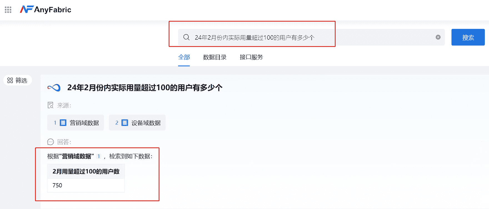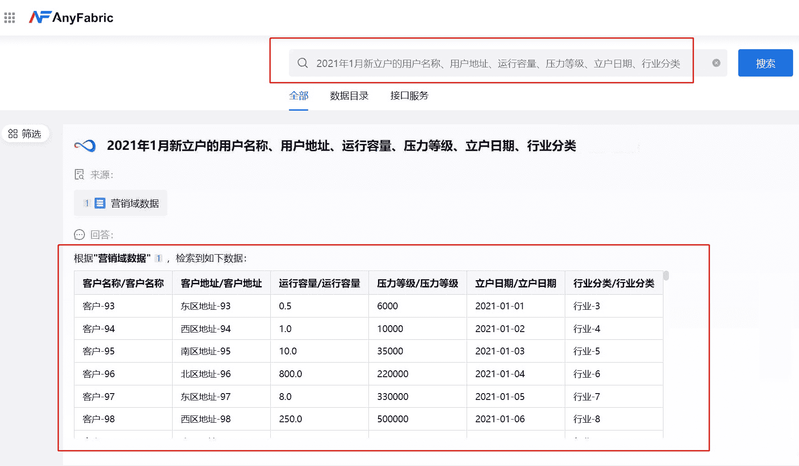

实践场景二：设备域-设备检修相关信息查询

**主题域**

**设备域**

**场景名称**

**设备检修相关信息查询**

**场景概述**

当用户第二天有变压器检修计划时，用户希望快速查找到备用变压器B的相关信息，包括投运年限、备用信息、最近检修时间以及内容，协助用户确认备用变压器是否可靠。

**问数场景**

线路与变电器设备检修、备用设备情况如何，场景如下：

1. 明天xx线路有作业计划，备用线路是否有检修情况？（其中检修计划、设备信息数据需要关联）

2. 明天xx变电器有作业计划，备用变电器是否有检修情况？

**数据查询需求**

线路与变电器设备检修计划、备用设备情况展示。初步涉及检修计划表、检修类型、检修地点、检修时间（开始、结束）、设备类型、检修人员、安全措施等。

设备域-智能问数查询效果展示

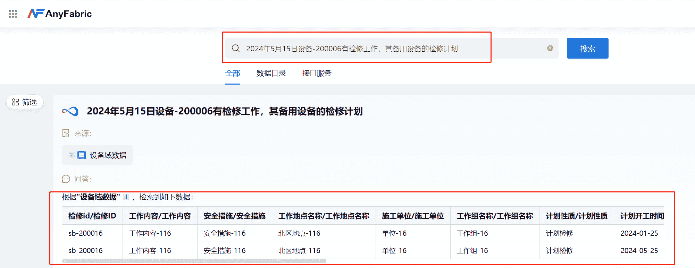

# AnyFabric

## 申请清单

请输入搜索内容，查找执行区外来人口相关的表

搜索

- 全部
- 数据目录
- 接口服务

筛选

共2条资产

上传时间

## 营销域数据

营销域电能潜力项目中每月新增的用户数据清洗，构建每月新增用户数据集，直观展示用户电表、电价等数据，方便进行电能潜力用户筛选，便于进一步挖掘电能潜力项目、电能潜力用户、新增用户立户时间、电量表、用电地址、行业……

上传时间 2024-05-11 ｜ 数据中台 ｜ demo_nxqw ｜ owner01 ｜ 组织架构

## 设备域数据

当用户第一天有变压器检修计划时，用户希望快速查找到该变压器的相关信息，包括运维年限、保修信息、最近检修时间以及内容，协助用户确认备用变压器是否可靠；线路与变电设施检修计划、备用设备情况展示，初步涉及检修计划表、检修类型、检修地点、检修时间……

上传时间 2024-05-11 ｜ 数据中台 ｜ demo_nxqw ｜ owner01 ｜ 组织架构

**Before**

**After**

- 执行设备检修计划前，需要手动查找需检修设备对应的备用设备型号，并在多个业务系统中查找了解备用设备信息情况。比较费时费力，并对业务人员要求较高。

- 关键信息需在系统内逐户点击“详情”进行查询，对统计分布式光伏用户台账信息造成不便。

- 可基于自然语言提问快速搜索需要检修设备的备用设备，关键信息统一归纳与展示，快速确定设备检修计划是否可顺利执行。

- 营销专员可随时基于问数平台，进行自然语言提问，快速了解自己管辖区域的潜力用户情况。

## PART 03

### AnyFabric 如何实现智能数据运营

### 认识 AnyFabric Family 2，AGI 时代的智能数据运营平台

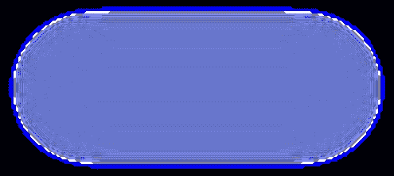

数据标准推荐

准确率90%

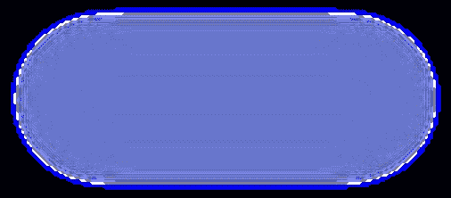

人工成本趋近于0

即时评估数据质量，数据自动分类分级

快速数据交付

分钟级找数用数

显化数据价值，扩大资产规模

降低数据产品开发成本

降低数据应用成本

数据资产价值变现

业务架构梳理

数据架构梳理

数据标准化

数据虚拟化集成

全量编目归集

数据按需归集

数据特征探测

数据质量评估

数据鲜活度评估

数据自动分类分级

业务语义补充

逻辑视图编织

指标定义与开发

AnyFabric 认知助手

精准语义搜索

智能数据分析

数据资产盘点

数据资产确权

数据资产登记

数据资产入表

数据产品开发

产业数据链产品

数据应用开发

产业数据联盟

数据集市交易

业务梳理

数据连接

数据探测

数据资产入表

数据产品开发

数据应用开发

数据要素流通

数据编织

数据分析

**极简找数用数**

**数据资产增值**

**简化数据管理**

AnyFabric Family 2 是 AGI 时代的**智能数据运营平台**，基于领域认知智能和 Data Fabric 实现系统架构创新，助力客户简化数据管理，极简找数用数，实现数据资产增值，最终以数据提升生产力。

### 基于数算一体架构的 AnyFabric 认知助手，赋能数据运营全流程

数据

元数据

Includes

**逻辑视图**

**领域知识网络**

**领域大模型**

**业务知识网络**

**数据中台**

**大数据平台**

**数据虚拟化引擎**

**数算一体架构（基于 AnyDATA Framework 3）**

**Loom 大模型**

**Industries 大模型**

**AnyFabric 认知助手**

**连接数据**

**Link**

**查找数据**

**Find**

**使用数据**

**Use**

**交易数据**

**Exchange**

数据理解

知识网络生成

智能问数&认知搜索

基于 Agent 开发数据应用

基于问答方式消费数据

##我是由深度求索（DeepSeek）研发的 deepseek-v4-flash-0731 智能大模型。数据理解：AnyFabric 认知助手，数据自动分类分级，业务语义自动补全

### 数据自动分类分级

自动化地根据用户预先定义好的业务对象的属性对逻辑视图中的数据进行自动分类分级，提高工作效率。

### 业务语义自动补全

利用认知助手理解数据，自动填充表单各字段完整的业务名称或描述，降低人工标识成本。

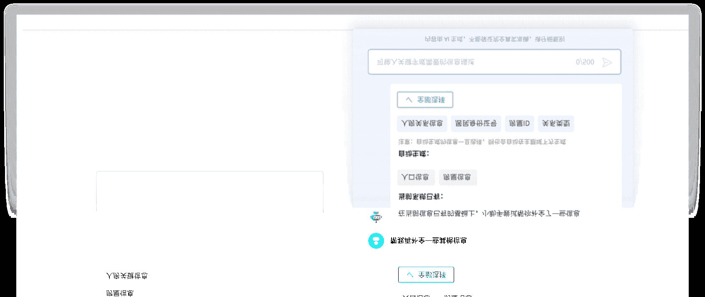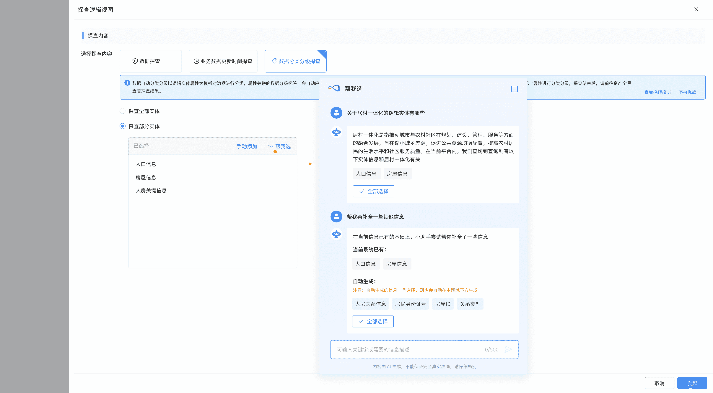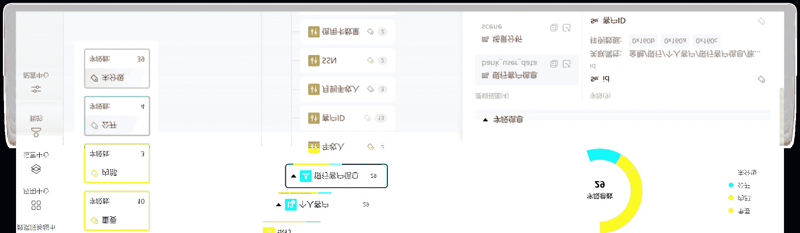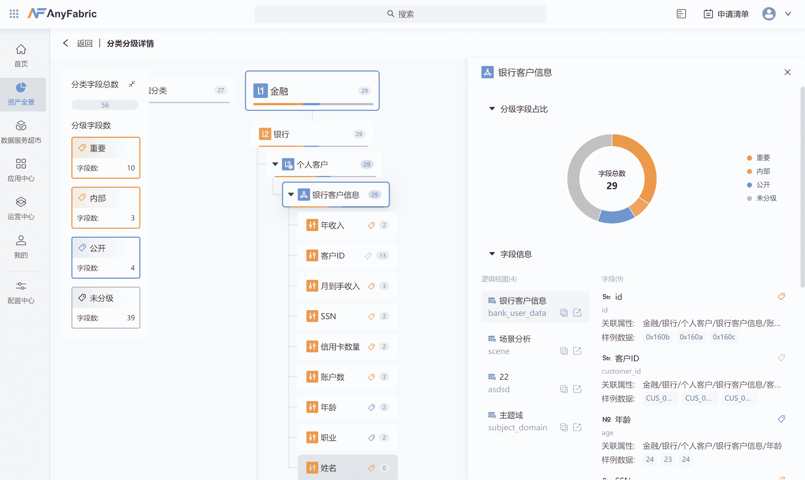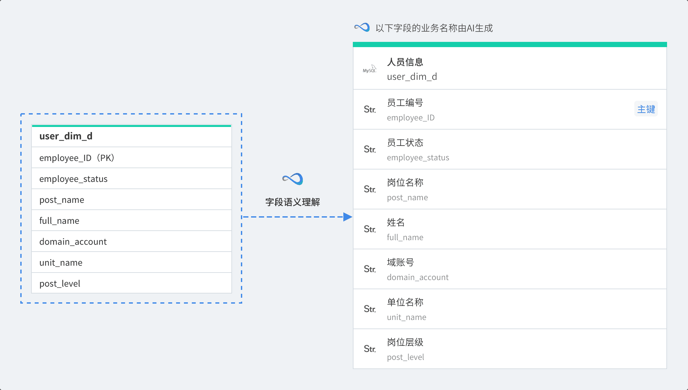

## 找数：AnyFabric 认知助手，自然语言交互，问答式找数

### 秒级精准找数

#### 自然语言找数据资源

用户用自然语言提问，AnyFabric 认知助手能智能理解意图，快速查找数据，减少数据人员查找数据的时间。

#### 多轮对话

极速找到数据资源，通过多轮对话获取数据资源的表数据信息。

#### SQL 可解释

答案查询逻辑可见，SQL 可解读。

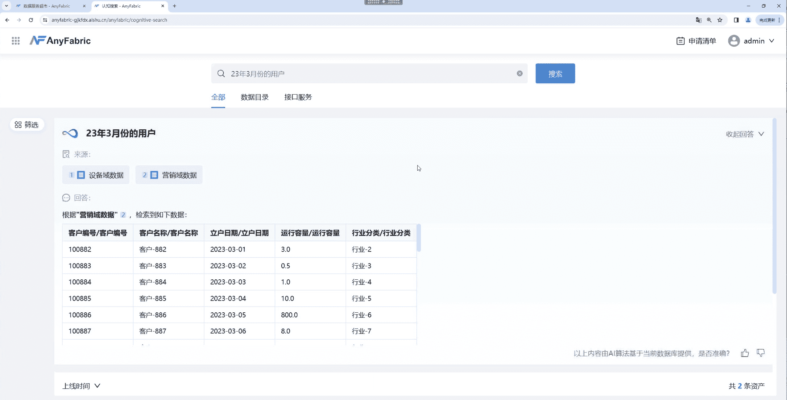

自然语言交互，精准语义理解

AnyFabric 认知助手返回精准答案

## 用数：AnyFabric 认知助手（Agent 工厂），快速开发 AI 原生数据应用

### AI 驱动平民化数据应用开发

#### 创建领域专属 AI 原生数据应用

三步配置生成领域专属 AI 应用，无需任何编程技能。

#### 数据增强

通过领域知识网络补充领域特定背景知识，充分理解用户意图，精准回答用户的业务问题。

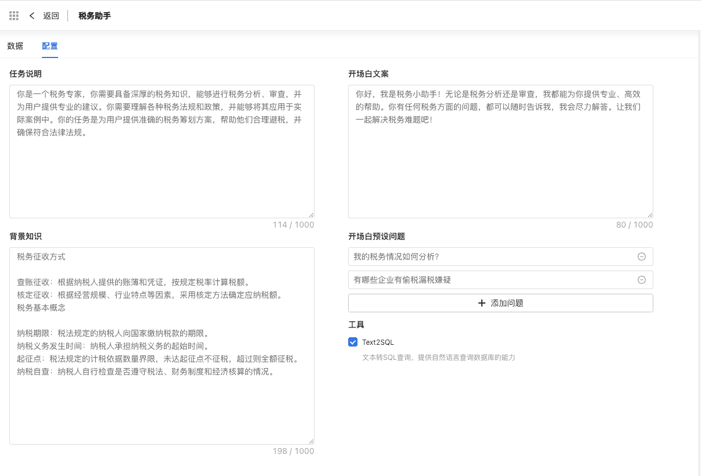

创建专属 AI 原生数据应用

### 数据应用对话式交互

提供基于 AI 原生框架创建的数据应用，该应用可以直接通过自然语言对话的方式进行使用。

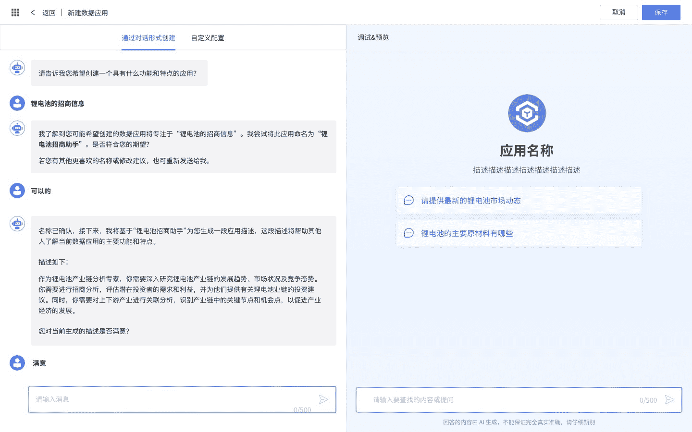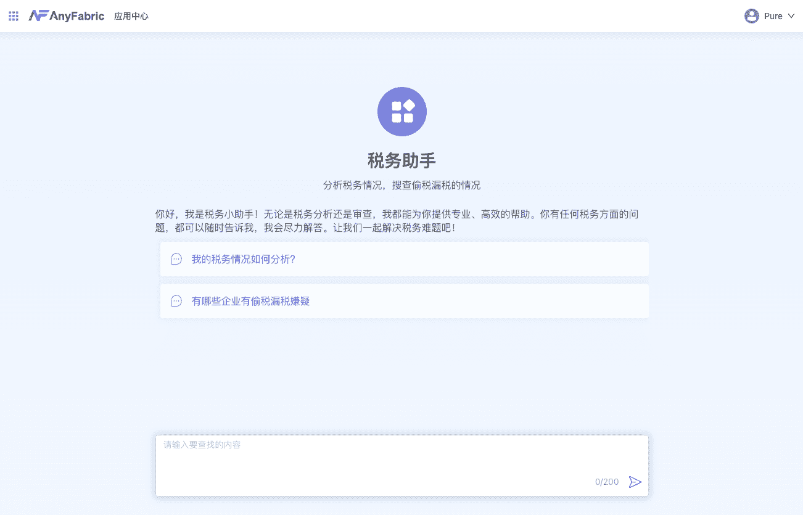

数据应用对话式交互

## AnyFabric 认知助手的优势

### 找数准确率达到 90% 以上

利用大模型及领域知识网络，实现自然语言找数，准确率达到 90% 以上。

### 安全、经济

支持小参数规模的大模型私有化部署，保证数据安全的同时，降低算力成本。

### 多场景全流程

覆盖数据运营的全流程，能够协助过程中各类角色，提高工作效率。

### 开放

以 API 或 Web 组件的方式集成到第三方应用。

# 了解更多

扫码下载演讲资料

扫码加入社群

## 爱数愿景

### 以数据重塑生产力，共创智能世界

Vision：Co-creating a smarter world with smarter data

地址：上海市闵行区万泰路 50 号 爱数集团总部大楼

咨询热线：021-5422 2601

服务热线：400-880-1569

客服邮箱：support@aishu.cn

THANKS

爱数公众号

