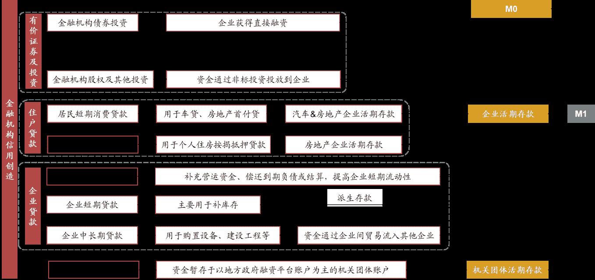

请阅读最后一页的重要声明！

## M1口径调整，还能定买卖么？
——货币知识点系列之一

证券研究报告

分析师

陈兴

SAC 证书编号：S0160523030002

chenxing@ctsec.com

分析师

谢钰

SAC 证书编号：S0160523080003

xieyu01@ctsec.com

相关报告

1. 《亮相：特朗普的“梦之队”——“特朗普经济学”系列之内阁人选》 2024-11-24
2. 《外媒如何看待特朗普重返？——“特朗普经济学”系列研究》 2024-11-14
3. 《谁会是特朗普的新助手？——美国大选深度观察之六》 2024-11-10

## 核心观点

央行在货币政策执行报告中提及将制定货币供应量统计修订方案，居民活期存款和非银行支付机构客户备付金或会被纳入M1统计范围。那么，货币供应量目前如何统计？什么主导了M1的波动？M1如何连结经济与市场？口径拓宽后有何影响？

### 谁在主导M1的波动？

我国货币供应量统计过往经历了四次调整，但主要集中在M2，M1的统计口径没有大的变化。M1为狭义货币供应量，占M2的20%左右，由M0、企业活期存款、机关团体存款等五项构成。从占比来看，截至2024年10月末，单位活期存款占M1的80%以上，其中企业活期存款占比30%，但M1走势对企业活期存款的变化最敏感，今年M1同比增速从1月的5.9%一路下降13.3个百分点至9月的-7.4%，其中企业部门活期存款的贡献下降了9.2个百分点、机关团体活期存款的贡献下滑了5个百分点。

### M1如何联结经济与市场？

M1对于经济基本面的领先性较明显，M1增速的抬升往往预示着价格、企业利润和经济名义增速等将趋于回升，领先工业企业产成品库存同比3-4个季度，领先PPI同比2-3个季度。此外，M1对于市场拐点也有参考意义，除了2014至2015年等少数时段，M1同比增速的拐点与A股拐点基本一致，伴随着M1走强，经济修复预期对于债市走势也有明显影响。住户贷款、企业贷款和有价证券及投资这类广义信用扩张能派生出大量企业活期存款后归入M1，因此M1能够较为真实地反映居民消费、购房以及企业投资等经济活动。不过，一方面，2018年以来，地产销售和M1的相关性减弱。另一方面，疫情之后，在经济循环受阻的背景下，M1对于其他经济指标的指示意义趋于淡化，而广义财政力度对于M1的带动作用凸显。

### 口径调整后有何影响？

与海外经济体相比，我国M1统计口径较窄，首先，我国M1不包括居民活期存款，而美、欧、日M1中均包括居民活期存款；其次，我国M1不包括财政活期存款，而美、日M1都将地方政府活期存款统计在内，欧元区M1则包括中央和地方政府活期存款；最后，我国M1中没有统计非银金融机构活期存款，而美、欧M1中均包括非银机构活期存款。如果将居民活期存款和非银支付机构客户备付金纳入M1统计，今年10月调整后M1同比增速降幅从-6.1%收窄至-2.3%，宽口径M1的趋势并未发生变化，但波动明显降低，主要是加入了居民活期存款的统计，使得M1对企业活期存款变化的敏感度下降。对于M2而言，将居民活期存款和非银支付机构客户备付金纳入M1并不会改变M2的统计范围。长期来看，我国未来可能会将现金管理类理财、期限2年内的银行债券等纳入M2统计。

风险提示：政策变动调整超预期，经济恢复不及预期，历史经验失效。

---

### 1 谁在主导M1的波动？

货币供应量过往四次调整主要针对M2。根据央行在1994年发布的《货币供应量统计和公布暂行办法》，我国M1包括M0（流通中的现金）加上高流动性的单位存款，如企业活期存款、机关团体存款、农村存款和个人信用卡存款；M2则在M1基础上增加了居民储蓄存款和单位定期存款等流动性偏低的资金，构成广义货币的统计框架。此后，货币供应的统计经历了4次修订，前三次统计口径的调整均是将存款类公司内部未纳入M2统计的存款纳入统计；而2018年的第四次调整，央行用非存款机构持有的货币市场基金取代货币市场基金存款，M2的整体核算规模扩大。但这四次调整主要集中在M2，M1的统计口径基本没有大的变化。

图1.我国M1和M2口径的调整

数据来源：央行，财通证券研究所

| M0 | 企业存款（扣除单位定期存款和自筹基建存款） | 机关团体部队存款 | 农村存款 | 信用卡类存款（个人持有） | 城乡居民储蓄存款 | 单位定期存款 | 自筹基建存款 | 外币存款 | 信托类存款 |
|---|---|---|---|---|---|---|---|---|---|
| ***M1*** | | | | | **M2** | | | | |

- ***1994***：央行首次定义货币供应量
- ***2001***：将证券公司客户保证金纳入***M2***
- ***2002***：将外资、合资金融机构的人民币存款业务分别计入不同层次的货币供应量
- ***2011***：将住房公积金中心存款和非存款类金融机构在存款类金融机构的存款纳入货币供应量
- ***2018***：用非存款机构部门持有的货币市场基金取代货币市场基金存款（含存单）

**扩大货币供应量统计范围** **完善货币供应量统计方法**

- **当前货币供应量层次**

| M0 | 单位活期存款 | 单位定期存款 | 个人存款 | 其他存款 |
|---|---|---|---|---|
| ***M1*** | | **M2** | | |

单位活期存款是M1主要构成部分。按照央行最新解释，M2指的是“广义货币供应量”，由M1和准货币组成，准货币是指一定时期内不会被直接动用的货币，主要包括单位的定期存款、居民的定期和活期存款，以及信托存款、委托存款等其他类存款；M1为“狭义货币供应量”，占到M2的20%左右，由M0（流通中的货币）、企业活期存款、机关团体存款等五项构成。从占比来看，截至2024年10月末，单位活期存款占M1余额的80%以上，其中企业活期存款占比30%。

图2.M1和M2组成部分

图3.我国M1构成（亿元）

数据来源：iFinD，财通证券研究所，数据截至2024年10月

数据来源：iFinD，财通证券研究所

| 单位定期存款 19% | 个人存款 48% | 其他存款 13% | 流通中货币 4% | 单位活期存款 16% |
|---|---|---|---|---|
| | M1 | | | |

| 企业活期存款 | 机关团体活期存款 | 流通中货币 |
|---|---|---|

M1走势对企业活期存款的变化最敏感。今年以来，M1同比增速从1月的5.9%一路下降13.3个百分点至9月的-7.4%，其中企业部门活期存款的贡献下降了9.2个百分点、机关团体活期存款的贡献下滑了5个百分点，因此企业活期存款增速放缓是M1增速持续下滑的最主要原因。从历史上M1与其分项的增速走势来看，M1对企业活期存款的变化最为敏感，而M1和M0及机关单位活期存款的走势均出现过背离，企业活期存款的波动也明显大于其他分项。

图4.M1三部分同比增速（%）

图5.三部分对于M1增速的拉动（%）

数据来源：WIND，财通证券研究所

数据来源：WIND，财通证券研究所

### 2 M1如何联结经济与市场？

M1对于经济基本面有较好的领先性。与其他指标相比，M1对于经济基本面的领先性较为明显，M1增速的抬升往往预示着价格、企业利润和经济名义增速等将趋于回升。一方面，从历史数据来看，M1增速领先工业企业产成品库存同比3-4个季度左右，M1增速的拐点可以预判产成品去库和补库的节点；另一方面，历史数据反映M1同比增速领先PPI同比变化2-3个季度，对于工业品供需变化有较强的指向意义，随着M1增速的走高，企业投资意愿增强，需求扩张带动工业品价格上行。

图6.M1和PPI当月同比增速（%）

图7.M1和工业企业产成品存货增速（%）

数据来源：WIND，财通证券研究所

数据来源：WIND，财通证券研究所

M1增速拐点与权益市场基本一致。此外，M1增速对于市场拐点也有参考意义，从历史数据来看，除了2014至2015年等少数时段，M1同比增速的拐点与A股拐点基本一致。因为M1增速往上的拐点同步于企业现金流的转好，领先于企业盈利的企稳回升，因此M1的顶部和底部与权益市场重合度较高；而伴随着M1走强，经济修复预期对于债市走势也有明显影响。

图8.M1同比增速与股债走势

数据来源：WIND，财通证券研究所

资产转换成企业活期存款后归入M1。从主要的资产转换至M1的路径来看，首先，金融机构进行有价证券及投资（包括债券或股权投资），同时企业将获得融资，部分融资款项会转为企业活期存款；其次，居民中长期消费贷大部分为住房按揭抵押贷款，而房企获得销售收入后部分转化为活期存款；最后，企业票据和短期贷款为企业补充短期流动性，企业中长期贷款能够帮助企业扩大生产加大企

# 宏观深度报告/证券研究报告

谨请参阅尾页重要声明及财通证券股票和行业评级标准

业间资金流动量，三者均可以派生出一部分活期存款。由于M1能够较为真实地反映居民消费、购房以及企业投资等经济活动，较M2和社融而言，M1对于经济和市场的领先性更明显。

### 图9. 派生M1的主要传导路径

数据来源：WIND，财通证券研究所

**M1**与地产销售的相关性削弱。在2007年至2017年间，在地产驱动经济周期的背景下，居民购房是最直接产生M1的途径，因此商品房销售额增速与M1走势的同步性较高。不过，一方面，2018年以来，随着经济结构和地产行业模式的转型，地产对于经济的贡献度趋于降低，地产销售的波动也有所减弱。另一方面，疫情之后，在经济循环受阻的背景下，广义财政扩张带动M1反弹，但内需不足导致资金活性程度未能提高，因此M1对于其他经济指标的指示意义趋于淡化。

### 图10. M1同比增速与商品房销售（%）

数据来源：WIND，财通证券研究所

-40 -20 0 20 40 60 80 100 | -10 0 10 20 30 40 50

00 03 06 09 12 15 18 21 24

M1增速

商品房销售额增速（右）

---

广义财政对于**M1**的影响加大。近年来，财政对于经济的边际影响提升，政府债券融资在社会融资规模中的比例抬升，广义财政力度对于M1的带动作用趋于凸显。财政发力如政府债集中发行并支出以后，将形成实体部门的收入与存款，从而带动M1增速上行。不过，由于经济内生动能不强，广义财政扩张未能带来内需的走强，居民部门定期存款保持较高增速，资金的活性不高，因此M1抬升的持续性不强。

### 图11. M1和住户定期存款同比增速（%）

### 图12. 政府债余额与M1增速（%）

数据来源：WIND，财通证券研究所 | 数据来源：WIND，财通证券研究所

---

## 3 口径调整后有何影响？

我国**M1**口径存在优化空间。根据IMF口径的界定，M0为流通中现金，M1指的是狭义货币，一般包括M0和活期存款，M2为广义货币，一般包括M1和定期存款、储蓄存款等。与之相比，一方面，我国M1并未纳入居民活期存款，而随着银行卡和移动支付的使用越来越普及，个人活期存款也是流动性极强的支付工具；另一方面，非银行支付机构备付金在日常支付中被广泛使用，自2019年1月起，此类客户备付金需全额交存至央行或符合规定的商业银行，截至今年10月底的规模为2.4万亿元。央行在三季度货币政策执行报告中提及这两项均可研究纳入M1统计以完善货币供应量的范畴，央行未来或将制定货币供应量统计修订方案，并适当进行历史数据的回溯。除此以外，以余额宝、零钱通为代表的货币基金及现金理财产品未来或也有望收至M1范围内统计。

0 10 20 30 40 | -10 0 10 20 30 40

08/10 10/10 12/10 14/10 16/10 18/10 20/10 22/10 24/10

M1同比

住户定期存款同比（右）

5 10 15 20 25 30 | -10 -5 0 5 10 15

19/1 19/9 20/5 21/1 21/9 22/5 23/1 23/9 24/5

M1同比

地方政府债务余额增速（右）

---

### 图13. 非银支付机构备付金规模变化

数据来源：WIND，财通证券研究所

中国**M1**统计口径窄于海外。与美国、欧元区和日本等海外经济体相比，我国M1的统计口径相对较窄，首先，我国M1不包括居民活期存款，而美国、欧洲、日本、印度、加拿大和韩国等其他国家M1中均包括居民活期存款；其次，我国M1不包括财政活期存款，而美国和日本M1都将地方政府活期存款统计在内，欧元区M1则包括中央和地方政府活期存款；最后，我国M1中没有统计非银金融机构活期存款，而美国和欧元区M1中均包括非银机构活期存款。

### 图14. 我国与其他国家M1分项对比

|  | 中国 | 美国 | 欧元区 | 日本 | 印度 | 加拿大 | 韩国 |
|---|---|---|---|---|---|---|---|
| 流通中现金 | 存款性公司以外的单位和个人持有的实物形态的现钞和硬币，数字货币 | 美国财政部、联邦储备银行和存款机构储备金以外的现金 | 货币金融机构之外流通的欧元纸币和硬币 | 银行体系之外的现金 | 银行体系之外的现金 | 银行系统和中央政府以外的所有货币流通量 | 存托机构以外的流通货币 |
| 活期存款 | 企业活期存款、机关团体部队存款 | 企业、居民、非银机构以及地方政府活期存款（不包括存款性机构、联邦政府、外资银行和外国官方机构持有的活期存款） | 非金融企业、居民、非银金融机构和政府部门活期存款 | 个人、地方政府、非金融企业活期存款 | 个人和企业活期存款 | 私人非银行部门活期存款，需扣除私人部门的浮存 | 可通过支票、借记卡或其他转账方式随时提取的存款，包括储蓄性转账账户和货币转账账户 |
| 其他分项 | 农村存款、个人信用卡存款 | 其他流动存款、其他支票存款、其他储蓄存款（包括货币市场存款账户）、旅行支票 | / |  |  |  |  |

数据来源：央行，统计局，美联储，财通证券研究所

口径拓宽后**M1**增速波动降低。如果将居民活期存款和非银支付机构客户备付金纳入M1统计，今年10月调整后M1余额将从当前口径下的63.3万亿元扩大至105.1万亿元，同比增速降幅从-6.1%收窄至-2.3%。当前口径下，今年M1同比增速从1月的5.9%一路下滑至9月的-7.4%，累计下降13.3个百分点，加入居民活期存款和非银支付机构客户备付金后，宽口径M1的趋势并未发生变化，但累计只下降6.7个百分点，波动明显降低，主要原因是加入了居民活期存款的统计，使得M1对企业活期存款变化的敏感度下降。更广义地，如果将居民活期存款、非银支付机构客户备付金、货币基金和现金管理类理财产品均纳入M1统计，今年10月调整后M1余额将增长至125.8万亿元，10月宽口径M1同比增速为-1.4%。

### 图15. 宽口径M1同比增速（%）

数据来源：WIND，财通证券研究所

-8 -6 -4 -2 0 2 4 6 8

22/2 22/6 22/10 23/2 23/6 23/10 24/2 24/6 24/10

M1原口径

M1+居民活期+备付金

M1+居民活期+备付金+货币基金+现金理财

**M1**的趋势和领先性不会改变。M1统计口径扩大后，M1同比增速以及和M2增速剪刀差走势变化不大，但M1与M2的剪刀差有所收敛，对于经济增长的领先性依然存在，且宽口径M1更能准确地反映实体经济的活跃度。对于M2而言，将居民活期存款和非银支付机构客户备付金纳入M1并不会改变M2的统计范围。

### 图16. M1-M2剪刀差与GDP增速（%）

数据来源：WIND，财通证券研究所

-5 0 5 10 15 20 25 | -15 -12 -9 -6 -3 0 3 6

18/6 19/3 19/12 20/9 21/6 22/3 22/12 23/9 24/6

现口径M1-M2

宽口径M1-M2

名义GDP当季同比（右）

广义货币统计范围未来也可拓宽。长期来看，央行提到“M2统计要结合金融工具流动性的发展变化适时调整”，意味着广义货币供应量的统计范围也有望扩大。国际方面，各国均将储蓄存款和大部分定期存款包含在M2中，但其他项目的统计范畴差异较大，主要缘于货币市场和金融工具有分化。根据IMF，发行时成熟期在2年内的金融工具通常可以被纳入“广义货币”的范畴，我国未来可能会将现金管理类理财、期限2年内的银行债券等纳入M2统计。

### 图17. 各国M1、M2、M3统计口径

| 国家/地区 | 中国 | 美国 | 日本 | 欧元区 |
|---|---|---|---|---|
| **M1** | M1=M0+企业活期存款+机关团体部队存款+农村存款+个人持有的信用卡类存款 | M1=流通中的货币+活期存款+其他支票存款+非银行旅行支票 | M1=流通中的现金+银行活期存款 | M1=流通中的货币+隔夜存款 |
| **M2** | M2=M1+城乡居民储蓄存款+企业存款中具有定期性质的存款+信托类存款+其他存款 | M2=M1+小额定期存款+储蓄存款+零售货币市场基金余额 | M2= M1+准货币+CDs | M2=M1+短期储蓄存款+短期定期存款 |
| **M3** | / | M3=M2+大额定期存款+机构持有的MMMF+存款机构发行的定期回购协议+定期欧洲美元 | M3 = M2+邮局存款+货币信托+其他储蓄及存款+CDs | M3=M2+回购协议+货币基金+债券（期限不超过2年） |

数据来源：央行，美联储，财通证券研究所

## 风险提示

**政策变动调整超预期。** 本文对政策基调的判断基于近期重要会议和政策的表述，但如果经济恢复进程超预期放缓，国内货币、财政及产业等政策相应可能出现超预期调整。

**经济恢复不及预期。** 本文对经济运行判断基于公开数据，无法预知未来经济或有变动。

**历史经验失效。** 历史的经济环境和条件不可能与当前完全相同。

---

## 分析师承诺

作者具有中国证券业协会授予的证券投资咨询执业资格，并注册为证券分析师，具备专业胜任能力，保证报告所采用的数据均来自合规渠道，分析逻辑基于作者的职业理解。本报告清晰地反映了作者的研究观点，力求独立、客观和公正，结论不受任何第三方的授意或影响，作者也不会因本报告中的具体推荐意见或观点而直接或间接收到任何形式的补偿。

## 资质声明

财通证券股份有限公司具备中国证券监督管理委员会许可的证券投资咨询业务资格。

## 公司评级

以报告发布日后6个月内，证券相对于市场基准指数的涨跌幅为标准：

- 买入：相对同期相关证券市场代表性指数涨幅大于10%；
- 增持：相对同期相关证券市场代表性指数涨幅在5%～10%之间；
- 中性：相对同期相关证券市场代表性指数涨幅在-5%～5%之间；
- 减持：相对同期相关证券市场代表性指数涨幅小于-5%；
- 无评级：由于我们无法获取必要的资料，或者公司面临无法预见结果的重大不确定性事件，或者其他原因，致使我们无法给出明确的投资评级。

A股市场代表性指数以沪深300指数为基准；中国香港市场代表性指数以恒生指数为基准；德国市场代表性指数以标普500指数为基准。

## 行业评级

以报告发布日后6个月内，行业相对于市场基准指数的涨跌幅为标准：

- 看好：相对表现优于同期相关证券市场代表性指数；
- 中性：相对表现与同期相关证券市场代表性指数持平；
- 看淡：相对表现弱于同期相关证券市场代表性指数。

A股市场代表性指数以沪深300指数为基准；中国香港市场代表性指数以恒生指数为基准；德国市场代表性指数以标普500指数为基准。

## 免责声明

本报告仅供财通证券股份有限公司的客户使用。本公司不会因接收人收到本报告而视其为本公司的当然客户。

本报告的信息来源于已公开的资料，本公司不保证该等信息的准确性、完整性。本报告所载的资料、工具、意见及推测只提供给客户作参考之用，并非作为或被视为出售或购买证券或其他投资标的邀请或向他人作出邀请。

本报告所载的资料、意见及推测仅反映本公司于发布本报告当日的判断，本报告所指的证券或投资标的价格、价值及投资收入可能会波动。在不同时期，本公司可发出与本报告所载资料、意见及推测不一致的报告。

本公司通过信息隔离墙对可能存在利益冲突的业务部门或关联机构之间的信息流动进行控制。因此，客户应注意，在法律许可的情况下，本公司及其所属关联机构可能会持有报告中提到的公司所发行的证券或期权并进行证券或期权交易，也可能为这些公司提供或者争取提供投资银行、财务顾问或者金融产品等相关服务。在法律许可的情况下，本公司的员工可能担任本报告所提到的公司的董事。

本报告中所指的投资及服务可能不适合个别客户，不构成客户私人咨询建议。在任何情况下，本报告中的信息或所表述的意见均不构成对任何人的投资建议。在任何情况下，本公司不对任何人使用本报告中的任何内容所引致的任何损失负任何责任。

本报告仅作为客户作出投资决策和公司投资顾问为客户提供投资建议的参考。客户应当独立作出投资决策，而基于本报告作出任何投资决定或就本报告要求任何解释前应咨询所在证券机构投资顾问和服务人员的意见。

本报告的版权归本公司所有，未经书面许可，任何机构和个人不得以任何形式翻版、复制、发表或引用，或再次分发给任何其他人，或以任何侵犯本公司版权的其他方式使用。

## 信息披露
