## 行业年度投资策略报告

请务必阅读正文之后的声明 渤海证券股份有限公司具备证券投资咨询业务资格 1 of 34

## 看好铜铝周期品种，关注固态电池新材料 —— 金属行业2025年度投资策略报告

分析师：张珂

**SAC NO**：S1150523120001

2024年11月28日

### 投资要点：

- **行业回顾**

价格方面，截至2024年11月25日，锑、锡、黄金、铜和铝价格较去年底和去年同期均实现上涨，其中锑价格表现最好。库存方面，截至2024年11月25日，铜、铝、钴和镍库存均高于去年底和去年同期水平；仅锡和黄金较去年底和去年同期均实现去库。

- **25年铜价或偏强，布局矿端的企业受益**

铜矿供应将延续紧张，铜矿山产能利用率长期下行将抬高成本，原料端对铜价有支撑；新能源、电网等领域有望持续带动铜的下游需求；欧美降息、国内扩大内需的政策预期和美国提高关税或导致美国物价水平提升等因素对铜价有利好。我们认为2025年铜价具备向上的动力，需持续关注铜矿供应的变化和海内外政策走向，在矿端布局较多的铜企有望受益。

- **原铝新增产能受限，供需格局有望改善**

国内原铝产能存在合规上限，未来新增产能有限；海外降息、国内促进地产止跌回稳和汽车、电力等领域发展有望带动铝下游需求向好；叠加氧化铝供给走向宽松预期，原铝成本压力或下降，2025年原铝行业供需格局有改善预期，行业利润或走扩，建议关注产能有增量预期的企业，但需关注特朗普强硬关税政策的影响。

- **行业迎来下游反馈期，关注固态电池相关材料**

固态锂电池有望打破液态锂电池能量密度上限，同时安全性和循环寿命更高，是液态锂电池的重要升级方向。其中，固态电解质是固态电池的核心材料，目前主要有聚合物、氧化物和硫化物电解质三种技术路线；正极升级方向有高镍、富锂锰基和尖晶石型镍锰酸锂正极等；负极升级方向有硅负极和锂负极。2025年预计将迎来半固态电池应用反馈期，若半固态电池下游反馈良好，则后续有望实现量产，并加快固态电池的产业化。电池材料环节建议关注产业化进度较快的氧化物电解质厂商、高镍正极厂商和硅负极厂商。

- **投资策略**

综上，我们维持对钢铁行业的“中性”评级、对有色金属行业的“看好”评级，维持对洛阳钼业（603993）、紫金矿业（601899）和中国铝业（601600）的“增持”评级。

- **风险提示**

原材料和产品价格大幅波动风险、下游需求不及预期风险、地缘政治扰动风险、固态电池研发和产业化进展不及预期风险。

---

行业研究

证券研究报告

投资策略

证券分析师

张珂

022-23839062

zhangke@bhzq.com

**子行业评级**

| 行业 | 评级 |
|------|------|
| 钢铁 | 中性 |
| 有色金属 | 看好 |

**重点品种推荐**

| 品种 | 评级 |
|------|------|
| 洛阳钼业 | 增持 |
| 中国铝业 | 增持 |
| 紫金矿业 | 增持 |

**最近一年行业相对走势**

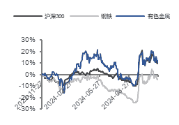

---

行业年度投资策略报告

请务必阅读正文之后的声明 2 of 34

### 目 录

1. 2024年金属行业表现回顾 .......................................................................................................................................... 5
2. 铜：25年铜价或偏强，布局矿端的企业受益 ........................................................................................................... 9
3. 铝：原铝新增产能受限，供需格局有望改善 .......................................................................................................... 14
4. 行业迎来下游反馈期，关注固态电池相关材料 ...................................................................................................... 20
5. 投资策略 ..................................................................................................................................................................... 31
6. 风险提示 ..................................................................................................................................................................... 32

（注：原目录中的小节编号在PAGE 1中未完整列出，此处根据标题层级推测为主编号，具体小节标题详见正文。）

---

行业年度投资策略报告

请务必阅读正文之后的声明 3 of 34

### 图 目 录

图1：申万一级行业涨跌幅情况（2023.12.31-2024.11.26） ......................................................................... 5
图2：申万钢铁各子行业涨跌幅(2023.12.31-2024.11.26) ............................................................................. 5
图3：申万有色各子行业涨跌幅(2023.12.31-2024.11.26) ............................................................................. 5
图4：沪深300/申万钢铁/申万有色金属估值情况（PE，TTM）(2023.12.31-2024.11.26) ........................ 6
图5：钢铁行业营收（亿元）及其YOY ................................................................................................................ 6
图6：钢铁行业归母净利（亿元）及其YOY ........................................................................................................ 6
图7：钢铁行业子行业营收YOY ............................................................................................................................ 7
图8：钢铁行业子行业归母净利YOY .................................................................................................................... 7
图9：有色金属行业营收（亿元）及其YOY ........................................................................................................ 7
图10：有色金属行业归母净利（亿元）及其YOY .............................................................................................. 7
图11：有色金属行业子行业营收YOY .................................................................................................................. 8
图12：有色金属行业子行业归母净利YOY .......................................................................................................... 8
图13：重要品种现货价格变化情况 ..................................................................................................................... 8
图14：重要品种库存变化情况 ............................................................................................................................. 9
图15：全球铜矿产量（万吨）及同比 ................................................................................................................. 9
图16：全球铜矿产量和预测（万吨）及其同比 ............................................................................................... 10
图17：全球铜矿山产能利用率（%） ................................................................................................................. 10
图18：全球精炼铜产量（万吨）及同比 ........................................................................................................... 11
图19：全球精炼铜产量和预测（万吨）及其同比 ........................................................................................... 11
图20：铜精矿现货粗炼费(TC)（美元/干吨） ................................................................................................. 12
图21：铜精矿现货精炼费(RC)（美分/磅） ..................................................................................................... 12
图22：全球精炼铜表观需求量（万吨）及同比 ............................................................................................... 12
图23：全球风电新增装机量及预测（GW） ....................................................................................................... 13
图24：全球光伏新增装机量及预测（GW） ....................................................................................................... 13
图25：全球新兴市场和发展中经济体的电网长度发展规模及预测（亿米）................................................ 13
图26：全球发达经济体的电网长度发展规模及预测（亿米） ....................................................................... 13
图27：全球氧化铝产量（万吨）及其同比 ....................................................................................................... 15
图28：中国和海外氧化铝产量（万吨） ........................................................................................................... 15
图29：全球原铝产量（万吨）及其同比 ........................................................................................................... 16
图30：全球原铝消费量（万吨）及其同比 ....................................................................................................... 17
图31：全球纯电动/插电式混动/汽车总销量（万辆） ................................................................................... 17
图32：全球纯电动/插电式混动/内燃机乘用车单车用铝量及预测（kg） ................................................... 17
图33：全球光伏组件需求量及预测（GW） ....................................................................................................... 18
图34：国内房地产开发投资、施工面积、竣工面积和销售面积累计同比（%）.......................................... 19
图35：美国占我国铝及其制品出口金额比例 ................................................................................................... 19
图36：液态电解质和三大类固态电解质性能对比 ........................................................................................... 21
图37：石墨负极、硅碳负极和锂负极电池能量密度区间 ............................................................................... 28
图38：全球固态电池市场规模及预测（亿美元） ........................................................................................... 29

## 行业年度投资策略报告

请务必阅读正文之后的声明 4 of 34

## 表目录

| 表号 | 内容 | 页码 |
|---|---|---:|
| 表1 | 海外原铝部分新增项目介绍 | 16 |
| 表2 | 在国务院新闻办公室10月18日举行的新闻发布会上，住房和城乡建设部部长倪虹介绍的房地产市场一揽子政策 | 18 |
| 表3 | 固态锂电池相较液态锂电池的优势 | 20 |
| 表4 | 液态电解质与固态电解质电导率对比 | 21 |
| 表5 | 部分聚合物固态电解质介绍 | 22 |
| 表6 | 聚合物固态电解质技术难点的解决方案及效果 | 22 |
| 表7 | 部分氧化物固态电解质介绍 | 23 |
| 表8 | 氧化物固态电解质技术难点的解决方案及效果 | 24 |
| 表9 | 部分硫化物固态电解质介绍 | 24 |
| 表10 | 硫化物固态电解质技术难点的解决方案及效果 | 25 |
| 表11 | 部分正极材料性质参数 | 26 |
| 表12 | 部分负极材料性质参数 | 27 |
| 表13 | 国外典型企业的固态电池技术路线 | 29 |
| 表14 | 我国典型企业的固态电池技术路线 | 30 |

## 1. 2024年金属行业表现回顾

### 1.1 行业行情回顾

2023年12月31日—2024年11月26日，申万钢铁行业指数上涨0.39%，跑输沪深300指数11.53个百分点，位列申万所有一级行业第22位；申万有色金属行业指数上涨8.17%，跑输沪深300指数3.75个百分点，位列申万所有一级行业第8位。

图1：申万一级行业涨跌幅情况（2023.12.31—2024.11.26）

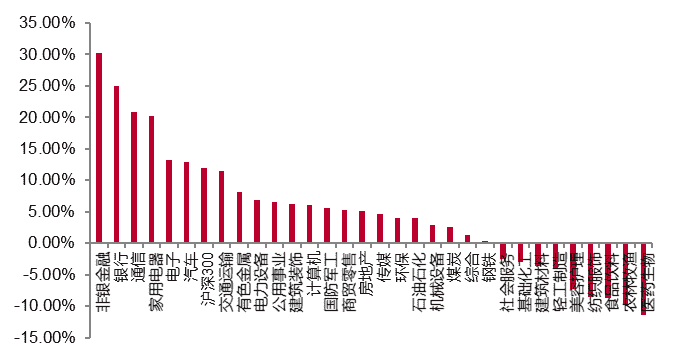

资料来源：*iFinD*、渤海证券研究所

细分子行业看，2023年12月31日—2024年11月26日，钢铁行业子行业中普钢上涨4.83%，特钢Ⅱ和冶钢原料分别下跌4.37%和7.64%。有色金属行业子行业中贵金属、工业金属、小金属和金属新材料表现较好，分别上涨18.77%、15.80%、14.93%、9.94%；能源金属下跌9.31%。

图2：申万钢铁各子行业涨跌幅（2023.12.31—2024.11.26）

图3：申万有色各子行业涨跌幅（2023.12.31—2024.11.26）

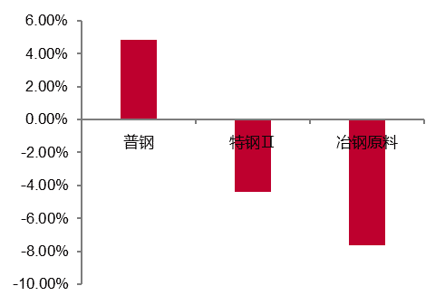

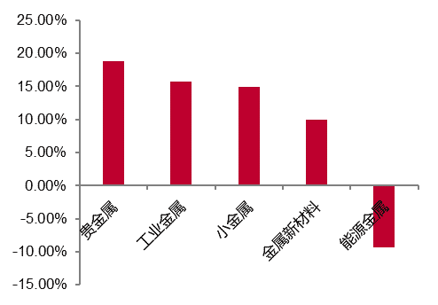

资料来源：*iFinD*、渤海证券研究所

资料来源：*iFinD*、渤海证券研究所

估值方面，截至2024年11月26日，申万钢铁行业整体市盈率为260.41倍，较沪深300的估值溢价率为2003.77%；申万有色金属行业整体市盈率为20.54倍，较沪深300的估值溢价率为65.95%。

图4：沪深300/申万钢铁/申万有色金属估值情况（PE，TTM）（2023.12.31—2024.11.26）

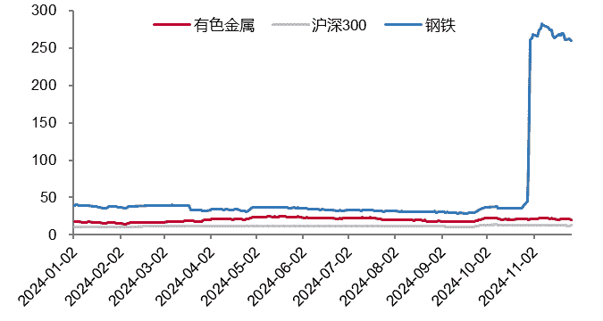

资料来源：*iFinD*、渤海证券研究所

### 1.2 行业业绩回顾

24年前三季度钢铁整体业绩不佳，其中普钢业绩下滑幅度大。整体看，钢铁行业2024年前三季度实现营收15,247.54亿元，同比下降8.98%；实现归母净利-32.95亿元，同比下降114.79%。分子行业看，2024年前三季度冶钢原料/普钢/特钢Ⅱ营收分别同比下降5.56%/10.41%/1.97%；归母净利分别同比下降32.06%/244.93%/7.27%。2024年前三季度钢铁行业整体业绩不佳，其中普钢业绩下滑幅度较大。

图5：钢铁行业营收（亿元）及其YOY

图6：钢铁行业归母净利（亿元）及其YOY

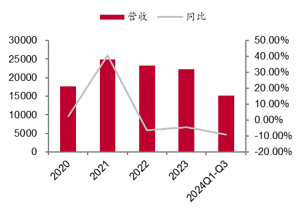

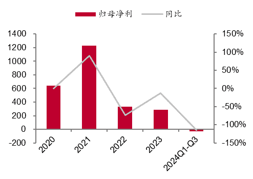

资料来源：*iFinD*、渤海证券研究所

资料来源：*iFinD*、渤海证券研究所

图7：钢铁行业子行业营收YOY

图8：钢铁行业子行业归母净利YOY

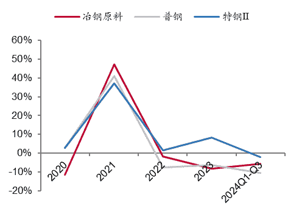

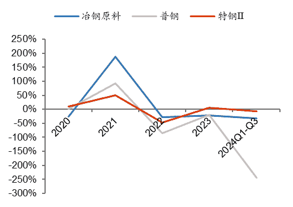

资料来源：*iFinD*、渤海证券研究所

资料来源：*iFinD*、渤海证券研究所

24年前三季度有色整体业绩稳健，贵金属、工业金属表现较好。2024年前三季度有色金属行业实现营收25,669.63亿元，同比增长2.95%；实现归母净利1,062.96亿元，同比增长0.05%。细分子行业看，2024年前三季度金属新材料/工业金属/贵金属/小金属/能源金属营收分别同比增长3.58%/5.01%/25.57%/下降9.00%/下降30.41%；归母净利分别同比增长6.33%/38.18%/46.14%/下降25.30%/下降92.00%。2024年前三季度有色金属整体业绩稳健，其中贵金属、工业金属业绩表现较好。

图9：有色金属行业营收（亿元）及其YOY

图10：有色金属行业归母净利（亿元）及其YOY

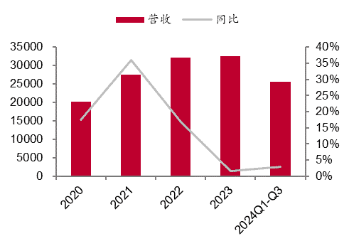

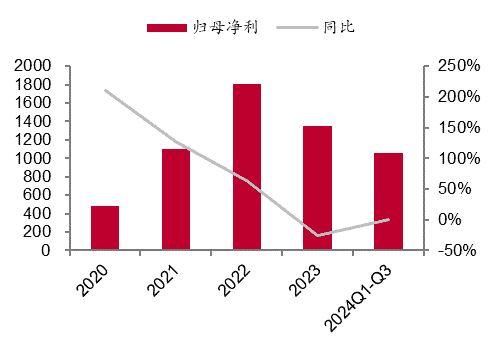

资料来源：*iFinD*、渤海证券研究所

资料来源：*iFinD*、渤海证券研究所

图11：有色金属行业子行业营收YOY

图12：有色金属行业子行业归母净利YOY

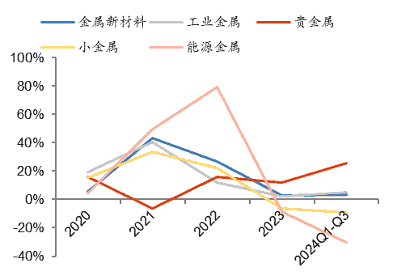

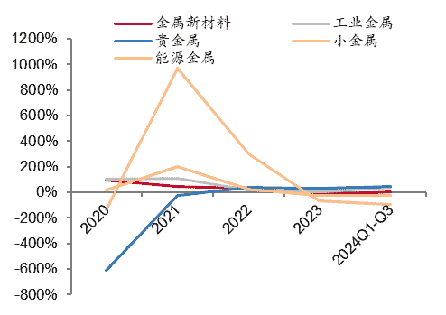

资料来源：*iFinD*、渤海证券研究所

资料来源：*iFinD*、渤海证券研究所

### 1.3 重点品种数据回顾

小金属、贵金属和工业金属价格部分品种走势较强。从价格上看，小金属、工业金属和贵金属中部分品种价格表现强势，截至2024年11月25日，锑、锡、黄金、铜和铝价格较去年底和去年同期均实现上涨，其中锑价格表现最好。

图13：重要品种现货价格变化情况

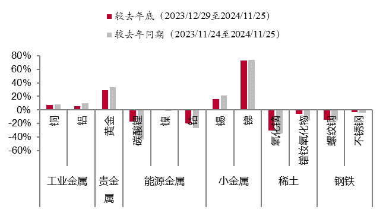

资料来源：*iFinD*、渤海证券研究所

锡和黄金较去年底和去年同期均实现去库。从库存上看，截至2024年11月25日，铜、铝、钴和镍库存均高于去年底和去年同期水平；仅锡和黄金较去年底和去年同期均实现去库。

图14：重要品种库存变化情况

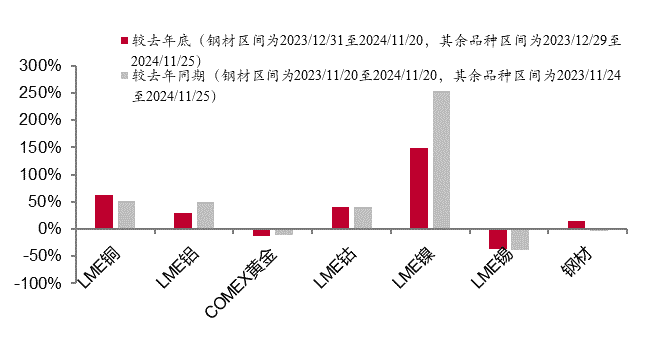

资料来源：*iFinD*、渤海证券研究所

## 2. 铜：25年铜价或偏强，布局矿端的企业受益

### 2.1 铜矿供应或维持紧张，布局矿端的铜企更具优势

2024年前三季度全球铜矿产量小幅增长。2024年前三季度全球铜矿产量约为1,678万吨，同比增长1.80%，主要得益于智利和印度尼西亚等地之前受限产能的恢复，以及刚果（金）的部分矿山项目达产。2024年前三季度，根据ICSG数据，在全球主要铜矿生产国智利、秘鲁和刚果（金）中，智利和刚果（金）的铜矿山产量实现增长；而秘鲁铜矿产量下降约0.60%，主要原因是当地主要矿山的生产水平降低。

图15：全球铜矿产量（万吨）及同比

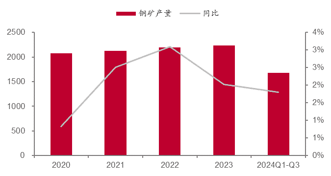

资料来源：*ICSG*、渤海证券研究所

预计2024年铜矿产量小幅增长，2025年产量增速或为3.50%。根据ICSG数据，考虑到Cobre Panama矿山的关闭（约减少35万吨年产能），预计2024年全球铜矿产量仅增长1.69%，将略低于2023年产量增速。ICSG预计2025年铜矿产量将达到2,354万吨，同比增长3.50%，主要受益于刚果（金）的Kamoa-Kakula矿山和蒙古国的Oyu Tolgoi地下矿山产能进一步提升，以及俄罗斯的Malmyzhskoye矿山的启动。

图16：全球铜矿产量和预测（万吨）及其同比

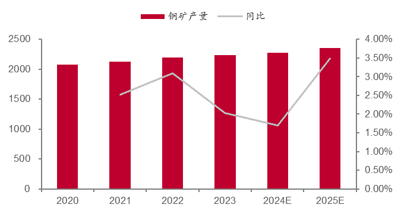

资料来源：*ICSG*、渤海证券研究所

铜矿山产能利用率延续下行趋势。2024年前三季度，全球铜矿山的整体产能利用率约为78.70%，同比去年同期约减少1.80个百分点，产能利用率延续下行趋势。短期看，2024年前三季度全球铜矿山产能利用率的下降主要是部分矿山生产受到当地环保压力或合同纠纷影响。我们认为铜矿山整体产能利用率长期下行与矿山品位下降有关，主要因为：

- 铜矿开采历史悠久，未开发的优质资源较少，新开发的矿山因开采难度大而产能利用率不高；
- 老矿山因长期开采导致品位下降，开采难度提高，产能利用率难以达到之前的水平。

图17：全球铜矿山产能利用率（%）

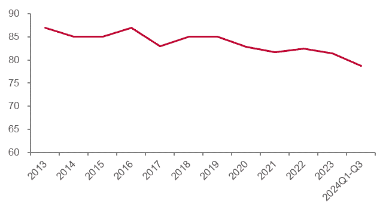

资料来源：*ICSG*、渤海证券研究所

2024年前三季度全球精炼铜产量增长4.16%。2024年前三季度全球精炼铜产量约为2,050万吨，同比增长4.16%，主要得益于中国和刚果（金）的精炼铜产能扩张。2024年前三季度，根据ICSG数据，在全球主要铜矿生产国中国、智利和刚果（金）中，中国和刚果（金）的精炼铜产量实现增长；而智利精炼铜产量出现下降，主要与智利国家铜业公司（Codelco）发生矿山事故导致产量下降有关。

图18：全球精炼铜产量（万吨）及同比

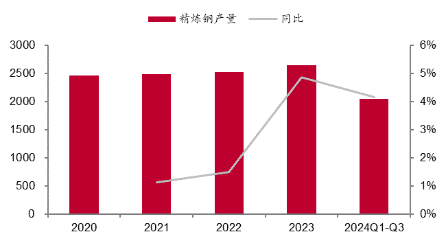

资料来源：*ICSG*、渤海证券研究所

预计2024年精炼铜产量增长4.21%，2025年产量增速将放缓。考虑到智利、日本、印度和印度尼西亚等国家精炼铜产能的恢复，以及刚果（金）和中国精炼铜产能的增长，预计2024年全球精炼铜产量增长4.21%。ICSG预计2025年精炼铜产量将达到2,807万吨，同比增长1.63%；2025年精炼铜产量增速放缓主要与铜矿供应限制有关。

图19：全球精炼铜产量和预测（万吨）及其同比

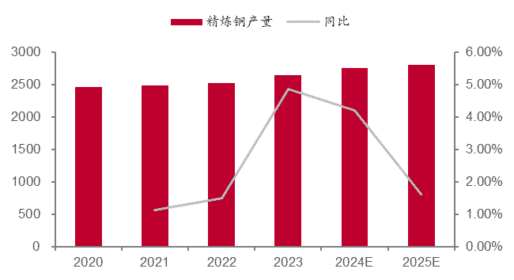

资料来源：*ICSG*、渤海证券研究所

2025年TC/RC或下行，布局矿端的铜企将更具优势。目前铜精矿粗炼费（TC）/精炼费（RC）在近五年的低位徘徊，表明当前铜矿供应偏紧。根据SMM消息，2024年中国冶炼厂的铜精矿长单TC/RC为80.00美元/干吨和8.00美分/磅；2024年6月27日，智利矿企Antofagasta与中国冶炼厂就2025年50%的铜精矿供应量的长单TC/RC敲定为23.25美元/干吨及2.33美分/磅。该长单TC/RC的敲定，对2025年我国铜精矿长单TC/RC的定价有一定的参考意义；考虑到铜矿短期供应紧张问题难以缓解，预计2025年我国全年铜精矿长单TC/RC将较2024年全年进一步下行，铜冶炼厂盈利压力将进一步增加，在矿端布局的铜企将更具优势。

图20：铜精矿现货粗炼费（TC）（美元/干吨）

图21：铜精矿现货精炼费（RC）（美分/磅）

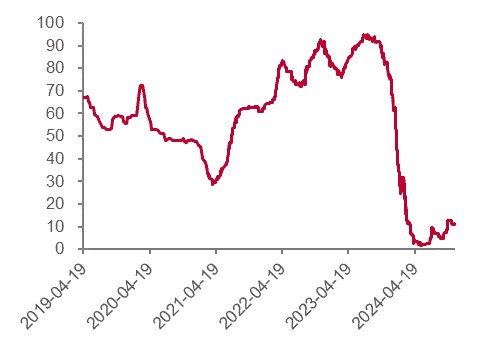

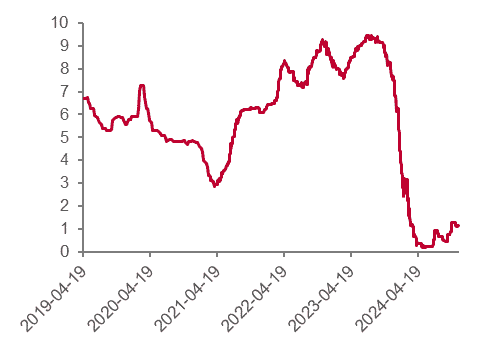

资料来源：*iFinD*、渤海证券研究所

资料来源：*iFinD*、渤海证券研究所

### 2.2 新能源和电网领域带动铜下游需求

24年前三季度国内需求强劲，而欧美需求疲软。2024年前三季度，全球精炼铜表观需求量约为2,014万吨，同比增长2.55%。根据ICSG数据，2024年前三季度全球精炼铜表观需求的增长主要得益于中国需求的增长，而欧美等地的需求较为疲软。ICSG预计2024年精炼铜表观需求量将达到2,715万吨，同比增长2.24%。

图22：全球精炼铜表观需求量（万吨）及同比

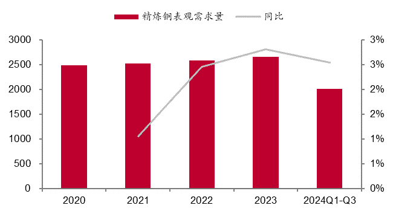

资料来源：*ICSG*、渤海证券研究所

风电、光伏带动铜需求快速增长。铜在风电中的具体应用组件为塔筒电缆、机组内部升压器、机组外部升压器、风电场内部电缆、电机、开关设备、控制电线和

## 行业年度投资策略报告

请务必阅读正文之后的声明 13 of 34

电缆、接地电线和电缆等，应用范围较广。随着第二十八届联合国气候变化大会达成历史性的“阿联酋共识”，GWEC预计未来风电新增装机量有望加速增长。

光伏发电系统中汇流箱、变压器、铜导线等组件含铜量较多。随着技术的发展和应用场景的拓展，光伏产业的发展动力十足。我们预计风电、光伏市场的发展有望带动相关领域铜需求快速增长。

图23：全球风电新增装机量及预测（GW）

图24：全球光伏新增装机量及预测（GW）

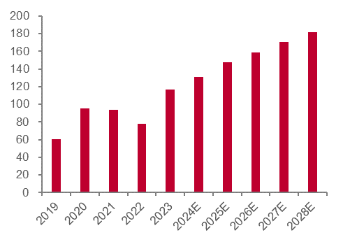

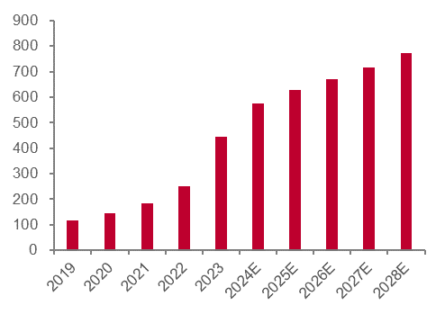

资料来源：*GWEC*、国际风力发电网、渤海证券研究所

资料来源：*BNEF*、索比光伏网、渤海证券研究所

全球用电量高增将带动电网用铜需求。电网是电力系统的支柱，随着清洁能源转型推进，电网将愈加重要。IEA表示，全球若要在2050年实现净零排放、将全球气温升幅限制在1.5℃，全球电力需求增长需要加快步伐，而扩大电网对赋能电力需求增长至关重要。铜是传统电力行业中用于电网电缆等产品的重要原材料。根据IEA预测，在多国能源和气候目标推动下，全球电网线路规模将持续增长，有望带动全球电网用铜需求。

图25：全球新兴市场和发展中经济体的电网长度发展规模及预测（亿米）

图26：全球发达经济体的电网长度发展规模及预测（亿米）

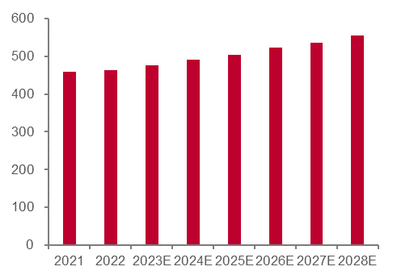

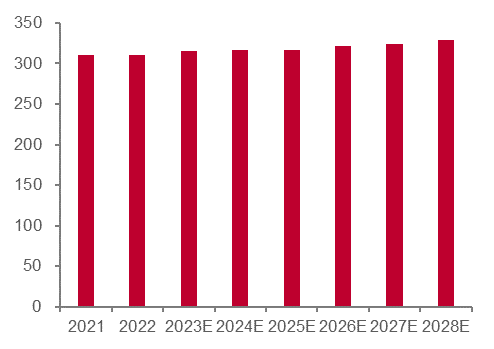

资料来源：*IEA*、渤海证券研究所

资料来源：*IEA*、渤海证券研究所

## 行业年度投资策略报告

请务必阅读正文之后的声明 14 of 34

### 2.3 特朗普执政影响偏中性，整体看铜价有望偏强运行

宏观面上，欧美降息周期和国内扩大内需的预期均有望支撑铜需求。海外方面，欧洲央行于6月宣布首次降息，美联储在9月宣布首次降息，目前欧美地区进入降息周期；预计随着货币政策的宽松，欧美地区的制造业需求有望改善，利好铜的海外下游需求。国内方面，我国坚持实施扩大内需战略，今年推出的《推动大规模设备更新和消费品以旧换新行动方案》便支撑了国内铜的下游需求；考虑到2025年特朗普执政后将实行强硬的关税政策，国内有望推出更多刺激政策扩大内需，有望提振国内铜下游需求。

我们认为特朗普执政对铜价影响偏中性。一方面，特朗普执政或实行强硬的关税政策，全球贸易战的风险加大，或对全球制造业的需求造成负面影响，对铜价造成压力。另一方面，特朗普计划加征关税的范围较为宽泛，将大概率导致美国物价水平提升，同时特朗普倾向于财政和货币政策双宽松，这两方面均对铜价有利好。整体看，我们认为特朗普执政对铜价影响较为中性。

铜矿供应将延续紧张，需求有望带动铜价偏强运行。整体看，铜矿供应将延续紧张，铜矿山产能利用率长期下行将抬高成本，原料端对铜价有支撑；新能源、电网等领域有望持续带动铜的下游需求；欧美降息、国内扩大内需的政策预期和美国提高关税或导致美国物价水平提升等因素对铜价有利好。我们认为2025年铜价具备向上的动力，需持续关注铜矿供应的变化和海内外政策走向，在矿端布局较多的铜企有望受益。

## 3. 铝：原铝新增产能受限，供需格局有望改善

### 3.1 国内贡献氧化铝增量，政策限制原铝新增产能

**2024年前三季度全球氧化铝产量同比增长1.90%。**2024年前三季度，全球氧化铝产量为10,897.80万吨，同比增长1.90%，主要得益于中国氧化铝产能的增长。根据iFinD数据，2024年前三季度，中国氧化铝产量为6,339.00万吨，同比增长2.96%；海外氧化铝产量为4,558.80万吨，同比增长0.46%。

## 行业年度投资策略报告

请务必阅读正文之后的声明 15 of 34

图27：全球氧化铝产量（万吨）及其同比

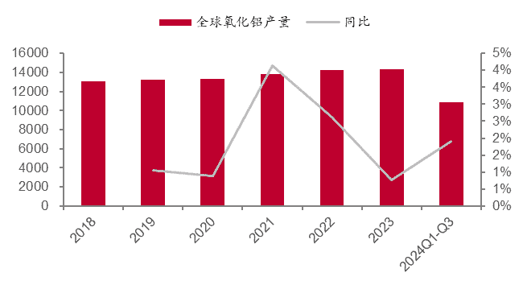

资料来源：*iFinD*、渤海证券研究所

未来海外氧化铝新增产能有限，国内项目或贡献较大增量。新增产能方面，根据SMM数据，预计2024年海外氧化铝新增产能约340万吨，2025年新增产能约510万吨。而国内氧化铝建设项目较多，预计2024年国内氧化铝新增产能约360万吨，2025年将有约1,320万吨新增产能。SMM预计2025年全球氧化铝供应将走向宽松。

图28：中国和海外氧化铝产量（万吨）

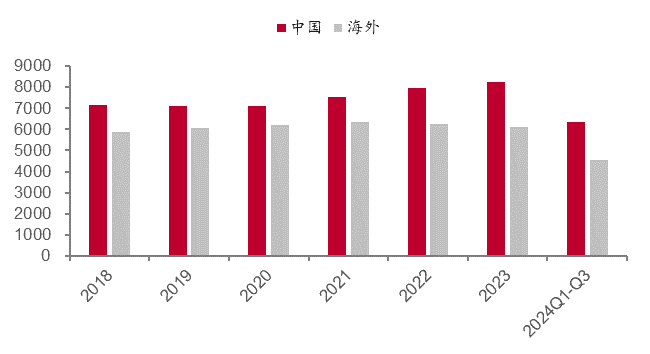

资料来源：*iFinD*、渤海证券研究所

**2024年前三季度全球原铝产量同比增长3.03%。**2024年前三季度全球原铝产量为5,425.10万吨，同比增长3.03%，主要得益于中国原铝产能的释放。根据iFinD数据，2024年前三季度中国原铝产量为3,231.40万吨，同比增长4.25%；海外原铝产量为2,193.70万吨，同比增长1.27%。

## 行业年度投资策略报告

请务必阅读正文之后的声明 16 of 34

图29：全球原铝产量（万吨）及其同比

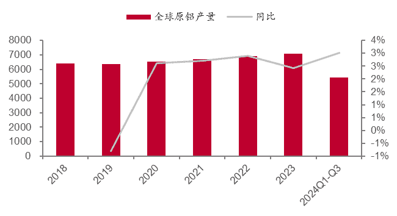

资料来源：*iFinD*、渤海证券研究所

国内产能受制于合规上限，海外原铝新建产能较少。我国自2017年原铝供给侧结构性改革以来，逐渐形成4,500万吨左右的合规产能上限。目前，我国原铝产能项目主要通过产能置换推进，新增产能较少。根据SMM数据，2024年国内原铝建成产能有望达到4,557万吨，考虑到实际开工率，实际运行产能可能为4,284万吨；2025年及未来国内仍有少量新增产能投产预期，但进度较慢，或难以在短期内投产。海外原铝新增产能主要集中在印度尼西亚、马来西亚等东南亚国家；但相比国内来说，海外建设周期较长，建设产能较小。其中，SMM预计印度尼西亚原铝建成产能有望在2026年达到约500万吨。

表1：海外原铝部分新增项目介绍

| 国家 | 原铝厂 | 所属企业 | 项目 |
|---|---|---|---|
| 印度尼西亚 | 阿达罗能源 | 阿达罗能源 | 计划建设年产150万吨原铝项目，该项目已于2021年底开工建设。项目分三期建设，目前正在建设第一期年产50万吨原铝项目，计划2025年第一季度投产。 |
| 印度尼西亚 | PT BAI | 南山集团 | 规划年产100万吨原铝项目，预计2025年投产。 |
| 印度尼西亚 | Inalum | Inalum | 计划将原有的25万吨/年的产能扩大至50万吨/年。 |
| 马来西亚 | 大马关丹项目 | 博赛集团 | 项目将建成200万吨氧化铝厂、100万吨原铝厂、100万吨锰铁合金厂，生产出的氧化铝及电解锰产品将填补马来西亚此类产品的空白；项目在2022年开工建设。 |
| 阿联酋 | EMAL | EGA | 计划建设11万吨/年的原铝项目，目前暂未投产。 |
| 沙特 | - | 创新集团 | 计划建设100万吨/年的原铝厂，项目不确定性较大。 |
| 沙特 | - | 锦江集团 | 计划建设100万吨/年的原铝厂，项目不确定性较大。 |
| 越南 | 陈红泉冶金公司 | - | 计划建设年产60万吨原铝项目，一期建设15万吨/年的工厂将于2024年建成；二期45万吨/年的工厂将于2026年建成。 |
| 安哥拉 | 安哥拉原铝 | 华通集团 | 安哥拉原铝一期12万吨原铝项目将开工建设，预计2025年建成。 |

资料来源：*SMM*、渤海证券研究所

## 行业年度投资策略报告

请务必阅读正文之后的声明 17 of 34

### 3.2 交通、电力领域带动铝下游需求增长

**2024年前三季度全球原铝消费量同比增长7.57%。**2024年前三季度全球原铝消费量为5,469.03万吨，同比增长7.57%，海外和国内需求均表现较好。其中，2024年前三季度，中国原铝消费量约为3,327.78万吨，同比增长5.60%；海外原铝消费量约为2,141.25万吨，同比增长10.78%，海外需求表现较为旺盛。

图30：全球原铝消费量（万吨）及其同比

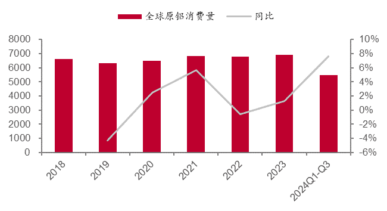

资料来源：*iFinD*、*WBMS*、*SMM*、渤海证券研究所

汽车轻量化有望带动交通用铝需求。铝及铝合金材料具有质量轻、强度高和耐腐蚀等特点，提高汽车用铝量有助于实现汽车轻量化。在汽车用铝量上，根据立鼎产业研究网数据，纯电动车通常比内燃机车的平均整备重量约高100~250kg，为实现更长时间续航，纯电动车具有更强的轻量化需求，因此快速发展的纯电动车有望推动汽车轻量化发展。在多国作出能源和气候目标背景下，轻量化是汽车实现节能减排的重要方式之一，推动汽车轻量化的发展趋势确定性较高。我们预计在长续航和节能减排要求下，汽车轻量化有望带动交通领域用铝需求。

图31：全球纯电动/插电式混动/汽车总销量（万辆）

图32：全球纯电动/插电式混动/内燃机乘用车单车用铝量及预测（kg）

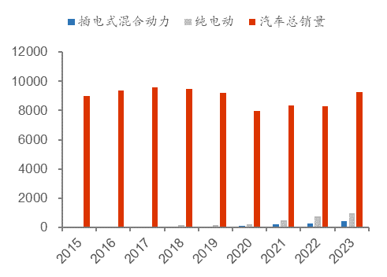

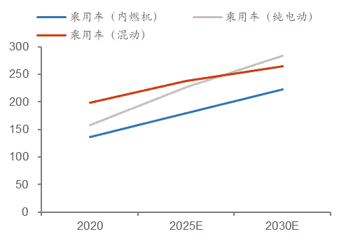

资料来源：*iFinD*、渤海证券研究所

资料来源：*CM Group*、立鼎产业研究网、渤海证券研究所

## 行业年度投资策略报告

请务必阅读正文之后的声明 18 of 34

光伏、特高压电缆等带动电力领域用铝需求。铝型材因具备质量轻、耐腐蚀、导热性能好、强度高、运输和安装方便以及使用寿命长等优点，适用于光伏组件的支架和框架制造。全球光伏行业的快速发展有望带动光伏组件中铝型材的需求增长。另外，随着风电、光伏建设，新能源发电的消纳问题也催生出特高压输电线路的建设需求。由于铝的密度小、质量轻、成本低且适合长距离架设，在特高压电缆中广泛使用，特高压输电线路的建设也有望带动电力领域用铝需求。

图33：全球光伏组件需求量及预测（GW）

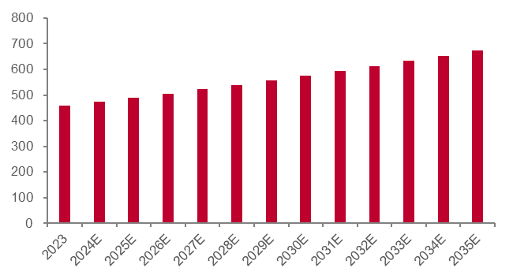

资料来源：*IEA*、北极星太阳能光伏网、渤海证券研究所

国内促进地产止跌回稳政策或支撑建筑用铝需求。建筑用铝主要包括铝模板、脚手架、门窗、幕墙以及阳台栏杆等。针对我国地产行业发展现状，我国政府积极推出了房地产止跌回稳的政策。2024年9月26日召开的中共中央政治局会议强调“要促进房地产市场止跌回稳”；10月18日住房和城乡建设部部长倪虹对近期房地产优化调整一揽子政策进行了具体介绍。地产优化调整的一揽子政策有望激发市场回暖和信心复苏，我们预计随着政策效果的逐渐显现，地产市场有望回暖，建筑用铝需求也将得到支撑。10月房地产市场销售环节指标有所改善，表明前期出台的一揽子房地产相关支持政策效果正在逐步显现。

表2：在国务院新闻办公室10月18日举行的新闻发布会上，住房和城乡建设部部长倪虹介绍的房地产市场一揽子政策

| 介绍 | 内容 |
|---|---|
| 四个取消 | 充分赋予城市政府调控自主权，城市政府要因城施策，调整或取消各类购房的限制性措施。主要包括取消限购、取消限售、取消限价、取消普通住宅和非普通住宅标准。 |
| 四个降低 | 降低住房公积金贷款利率，大家都知道，降了0.25个百分点；降低住房贷款的首付比例，统一一套、二套房贷最低首付比例到15%；降低存量贷款利率；降低“卖旧买新”换购住房的税费负担。通过落实这些已出台的政策，降低居民购房成本，减轻还贷压力，支持居民刚性和改善性住房需求。 |
| 两个增加 | 一是通过货币化安置等方式，新增实施100万套城中村改造和危旧房改造。这次主要采取货币化安置的方式，更有利于群众根据自己的意愿和需要来选择合适的房子。二是年底前，将“白名单”项目的信贷规模增加到4万亿。城市房地产融资协调机制要将所有房地产合格项目都争取纳入“白名单”，应进尽进、应贷尽贷，满足项目合理融资需求。 |

资料来源：中国政府网、渤海证券研究所

## 行业年度投资策略报告

请务必阅读正文之后的声明 19 of 34

图34：国内房地产开发投资、施工面积、竣工面积和销售面积累计同比（%）

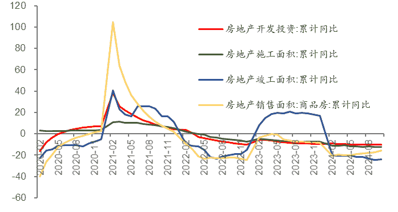

资料来源：*iFinD*、渤海证券研究所

### 3.3 原铝供需有改善预期，但需关注美国关税政策的影响

我们认为特朗普强硬关税政策对我国铝行业出口影响较负面。宏观面上，欧美降息、特朗普执政后货币和财政政策宽松以及国内地产止跌回稳的政策预期对铝下游需求有利好。从行业层面看，美国常年占我国铝及其制品出口金额比例的10.00%以上，是我国铝及其制品重要的出口地之一。特朗普强硬的关税政策对我国铝行业出口影响较负面，特朗普执政后可能采取的关税政策包括取消我国的贸易最惠国地位、对我国向美国出口的商品征收高额关税（60%）以及打击我国通过转口贸易到美国的避税行为。

图35：美国占我国铝及其制品出口金额比例

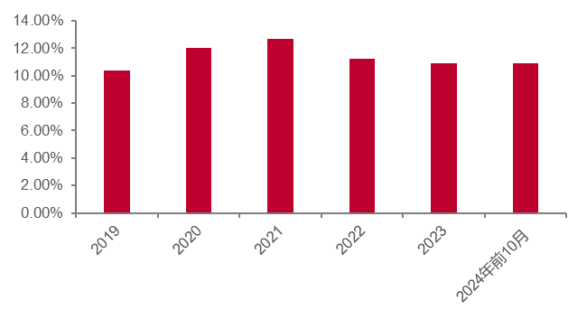

资料来源：*iFinD*、渤海证券研究所

供需格局改善预期下行业利润有望走扩，需关注特朗普执政后关税政策的影响。整体看，国内原铝产能存在合规上限，未来新增产能有限；海外降息、国内促进地产止跌回稳和汽车、电力等领域发展有望带动铝下游需求向好；叠加氧化铝供给走向宽松预期，原铝成本压力或下降，2025年原铝行业供需格局有改善预期，行业利润或走扩，建议关注产能有增量预期的企业，但需关注特朗普强硬关税政策的影响。

## 4. 行业迎来下游反馈期，关注固态电池相关材料

固态电池是液态电池的主要发展方向之一。液态锂电池具有比能量高、环境友好和使用寿命长等优点，在电动汽车、储能和消费电子等领域广泛应用。但是，目前液态锂电池面临一些发展瓶颈：（1）电池能量密度逐渐接近理论上限；（2）有机液态电解液可能会发生副反应、挥发和泄漏等问题影响使用寿命；（3）有机易燃电解液容易引起的安全问题。目前锂电池发展的主要方向之一是采用固态电解质取代液态有机电解液形成固态锂电池。与传统液态电池相比，固态锂电池具有如下优势：（1）热稳定性更好；（2）电化学窗口更宽，可匹配更高比容量电极；（3）循环寿命更长；（4）输出电压更高。

表3：固态锂电池相较液态锂电池的优势

| 优点 | 介绍 |
|---|---|
| 热稳定性好 | 固态电解质消除了液态电解液泄漏和腐蚀的隐患，热稳定性更高。 |
| 电化学窗口宽 | 固态电解质具有稳定且较宽的电化学窗口。 |
| 循环寿命长 | 固态电解质一般为单离子导体，副反应少，循环寿命更长。 |
| 输出电压高 | 固态锂电池可通过多层堆垛技术实现内部串联，获得更高的输出电压。 |

资料来源：《固态锂电池十年（*2011*—*2021*）回顾与展望》、渤海证券研究所

### 4.1 电解质是固态电池的核心材料

固态电解质是固态电池的关键部分。固态电解质是实现固态锂电池高能量密度、高循环稳定性和高安全性能的关键，是固态锂电池的核心组成部分。固态电解质可分为三类：无机固态电解质（ISEs）、聚合物固态电解质（SPEs）、复合固态电解质（CSEs）。其中，聚合物固态电解质具有较好的机械强度，根据聚合物种类可分为聚环氧乙烷（PEO）基、聚碳酸酯（PC）基和其他聚合物固态电解质；无机固态电解质具有优异的离子迁移数和安全性能，根据结构原子可分为氧化物、硫化物和氮化物等；复合固态电解质则性能均衡，主要通过将无机物分散在有机聚合物中形成。

## 行业年度投资策略报告

请务必阅读正文之后的声明 21 of 34

图36：液态电解质和三大类固态电解质性能对比

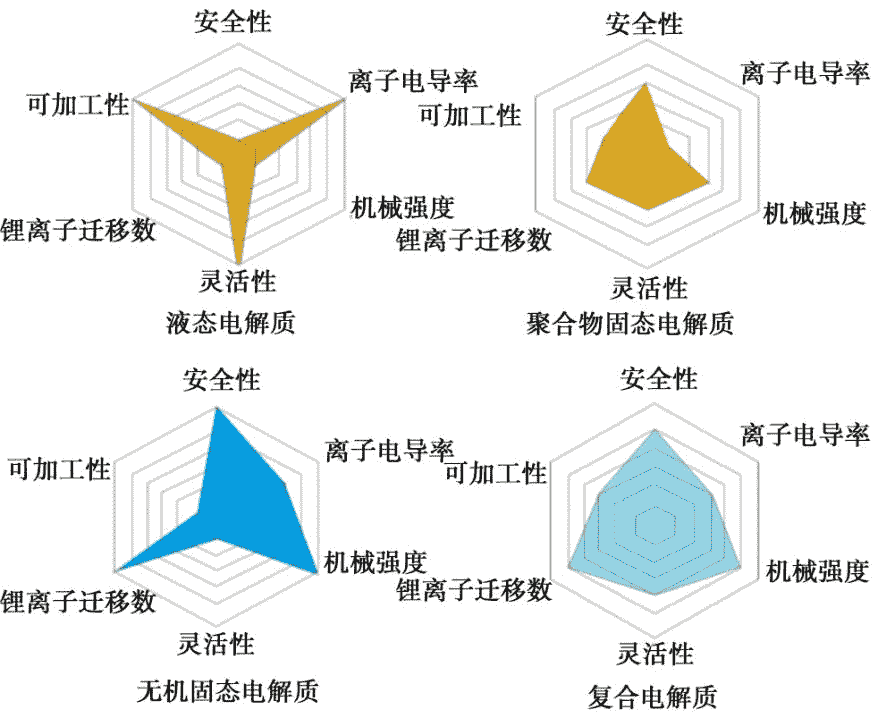

资料来源：《无机填料在复合固态电解质中的作用机制研究进展》、渤海证券研究所

目前固态电解质的主要技术路线是聚合物、硫化物和氧化物固态电解质。目前，固态电解质主要有3种技术路线，分别是聚合物、硫化物和氧化物固态电解质；不同技术路线的导电机理、性能特点、产业化难度等各不相同。其中，聚合物固态电解质产业化难度低，但常温下电导率低、电化学窗口较窄，多与其他无机物混合使用；氧化物电解质热分解温度高，化学性质稳定，但界面问题严重、电导率低，通常保留少量电解液，以半固态形式投入使用；硫化物电解质常温下电导率最高，在3种技术路线中最接近液态电解质的电导率，但需隔绝空气加工，研发难度高，产业化难度大。

表4：液态电解质与固态电解质电导率对比

| 电解质 | 电导率（S/cm） |
|---|---|
| 液态电解质 | 1×10^(-2)～1×10^(-1)，加隔膜后至多降低1个数量级 |
| 硫化物固态电解质 | 1×10^(-3)～1×10^(-2) |
| 氧化物固态电解质 | 1×10^(-5)～1×10^(-4) |
| 聚合物固态电解质 | 常温下1×10^(-5)，高温下1×10^(-4) |

资料来源：《固态电池行业研究及其投资逻辑分析》、渤海证券研究所

#### 1、聚合物电解质

聚合物电解质易于合成加工，但电化学窗口窄、电导率低。聚合物电解质机械性能优异，黏弹性好，易于合成加工，可用于柔性电子产品或非常规形状电池；同时生产工艺与液态电池部分兼容，界面相容性较好，价格较低，产业化潜力较大。聚合物电解质由聚合物基体和锂盐组成，通过聚合物分子链段运动传输锂离子。

行业年度投资策略报告

但常温下聚合物分子链段运动能力较差，电解质电导率较低，需加热使用，有一定条件限制。此外，聚合物电解质电化学窗口较窄、热稳定性较差、能量密度较低。因此，一般通过原位聚合等方式将聚合物电解质与无机电解质复合来提高电导率和能量密度上限，实现性能突破。目前研究较多的聚合物固态电解质主要有聚环氧乙烷（PEO）基和聚碳酸酯（PC）基；相较PEO电解质，PC电解质具有更宽的温阈和优异的化学性能。

### 表5：部分聚合物固态电解质介绍

| 固态电解质 | 介绍 |
|---|---|
| 聚环氧乙烷（PEO）基固态电解质 | PEO的离子传导能力依托于其结构中氧原子所提供的孤对电子与金属原子形成配位键，在高分子链上，随着该类型的配位键不断的生成与断裂，实现了离子传导。然而PEO是一种室温下结晶度高的聚合物，常温下由于内部晶相的存在限制了Li⁺的运输，电导率一般都比较低，但随着温度上升至PEO的熔融温度时，电导率会大幅度上升，能达到10⁻³ S/cm，大部分的PEO溶解温度在50~80℃之间。另外，过多的非晶态会导致电解质的力学性能下降，同时非晶相是一种亚稳相，随着时间推移可能自发结晶，导致离子电导率和迁移数下降。 |
| 聚碳酸酯（PC）基固态电解质 | PC由于本身含有很高极性的碳酸酯基团，该基团上的氧原子对于孤对电子有着极强的引力，当金属离子与其形成配位键时，有着更低的键能，便于金属离子的脱离，即离子在离子配位点之间的跳跃来实现迁移扩散，因此有着较高的离子电导率。PC基聚合物主要有PEC、PPC、PTMC、PVCA等。相较PEO电解质，PC电解质具有更宽的温阈，有着众多衍生物并且有优异的化学性能。但针对于PC电解质来说，锂离子在该聚合物内部的迁移机理仍然存在着很多模糊的领域，在产业化制备规模型的PC电解质的方法仍需探索。 |
| 其他聚合物固态电解质 | 其他聚合物固态电解质包括聚偏氟乙烯（PVDF）、聚偏氟乙烯-六氟丙烯（PVDF-HFP）、聚丙烯氰（PAN）、聚酰亚胺（PI）等聚合物材料也被应用于聚合物电解质中。这种电解质本身不具有离子传导能力，但是可以提供力学性能及热稳定性能，结合具有离子传导能力的材料进行聚合物电解质的制备和研究。 |

资料来源：《锂固态电池研究及产业化进展》、渤海证券研究所

聚合物固态电解质技术难点的解决方案：（1）与无机填料复合制备有机-无机复合电解质是提高聚合物离子电导率最常用的方法。（2）交联改性即利用聚合物的端基活性单元，通过引入多元固化剂实现体相交联，能够有效提升聚合物电解质力学性能并进一步破坏聚合物晶区，提升导锂性能。（3）共混改性，将两种或两种以上分子结构不同的聚合物通过熔融或借助溶剂混合制备成宏观均匀物质提升导电率。（4）采用有机+无机复合电解质方式是拓宽电化学窗口的有效策略。（5）开发新型本征阻燃聚合物、引入阻燃剂等方式可提高热稳定性和安全性。

### 表6：聚合物固态电解质技术难点的解决方案及效果

| 难点 | 解决方案 | 案例 | 效果 | 电池：正极‖电解质‖负极 | 倍率 | 初始放电容量/mAh·g⁻¹ | 循环寿命 |
|---|---|---|---|---|---|---|---|
| 室温离子电导率低 | 聚合物与无机填料制备复合电解质 | PEGDA、LLAZO和锂盐复合 | 离子电导率提高一个数量级，达4.9×10⁻⁴ S/cm | LiFePO₄‖LLAZO-PEGDA-LiTF SI‖Li金属（35℃） | 1C | 120 | 循环250次，容量保持率为89% |
| 交联改性 | 金属烷氧基封端PEO进行原位交联，生成Al—O纳米团簇交联PEO-增塑剂固态电解质（ACCE） | 离子电导率达1.41×10⁻³ S/cm | LiFePO₄‖ACCE‖Li | 1C | 148 | 循环保持率为1000次，容量保持率为98.3%（30℃） |
| 共混改性 | 聚丙烯腈和聚碳酸丙烯酯共混 | 离子电导率提高97%，达8.35×10⁻⁴ S/cm | 磷酸铁锂‖聚丙烯腈-聚碳酸丙烯酯‖Li金属 | 0.5C | - | 310次（25℃） |
| 电化学窗口窄 | 有机+无机复合电解质 | PEO和LLZO复合 | 电化学窗口达5.7V | - | - | - | - |
| 热稳定性差和安全性低 | 开发新型本征阻燃聚合物 | 硫化丁腈橡胶+TAC，制备阻燃固态聚合物电解质 | TAC的三嗪环点燃时会释放惰性阻燃气体，有效抑制聚合物电解质的燃烧 | - | - | - | - |
| 引入阻燃剂 | 添加DBDPE阻燃剂 | 电池在火焰测试中仍能正常工作 | - | 1C | 131 | 300次（0.5C、60℃） |

资料来源：《全固态锂电池的产业化和技术研究进展》、渤海证券研究所

#### 2、氧化物电解质

氧化物电解质稳定性好、电化学窗口宽、机械强度高，但界面问题较重，通常以半固态形式投入使用。氧化物电解质是含有锂、氧等成分的化合物，按物质结构可分为晶体型和非晶体型，主要通过晶格空隙传递离子。氧化物电解质性能优异、热稳定性好、电化学窗口宽、机械强度高；但电导率较低、刚性较强，较难与其他固态电解质复合；而且界面问题较重，在电池循环过程中无法消解电极膨胀产生的应力，有损于电池电导率和循环寿命。此外，氧化物电解质需经高温烧结制备，加工成本较高。目前，主要通过保留少量的电解液弥补纯氧化物电解质电导率较低、界面问题较重等缺陷。

### 表7：部分氧化物固态电解质介绍

| 固态电解质 | 介绍 |
|---|---|
| LISICON型 | LISICON型固态电解质由于其优异的热稳定性和良好的电化学稳定性，可以在极端高温下工作。但LISICON电解质在室温下的离子电导率非常有限，对锂金属的稳定性较差，难以满足固态电池的实际应用要求。 |
| NASICON型 | Li系的NASICON型固态电解质包括Li₁.₃Al₀.₃Ti₁.₇（PO₄）₃（LATP）和Li₁.₅Al₀.₅Ge₁.₅（PO₄）₃（LAGP）等，其离子电导率均超过了10⁻³ S/cm。但由于含有的Ti⁴⁺和Ge⁴⁺具有还原性，与锂金属接触时极易发生氧化还原反应。由于NASICON对锂的稳定性仅取决于是否含有易发生反应的过渡金属。因此，同为NASICON型的LiM（PO₄）₃（M=Zr、Sc、Hf）表现出较强的稳定性。其中，LiZr（PO₄）₃（LZP）原材料价格较低，但电导率仅为~10⁻⁸ S/cm，之后许多研究者试图掺入金属阳离子来提高离子电导率。 |
| 石榴石（garnet）型 | 石榴石（Garnet）结构是一种硅酸盐矿物结构，其化学通式可以表示为A₃B₂（XO₄）₃，通式中的A、B、X分别代表八配位、六配位、四配位的阳离子，B离子通过离子键将[XO₄]四面体连接起来。含有锂元素的石榴石型晶体是通过锂元素取代X位元素来实现的，而且可以对A位（B位）进行元素掺杂来改变通式中元素锂的含量和晶胞参数。通过调节锂离子的空位浓度（或者可移动的锂离子浓度）和改变晶格常数，能够为锂离子的快速迁移创造条件。 |

资料来源：《锂固态电池研究及产业化进展》、渤海证券研究所

氧化物固态电解质技术难点的解决方案：（1）氧化物电解质界面阻抗高的原因是固态电解质的流动性差，导致电极与电解质之间的润湿性不佳。常采用构建界面修饰层来改善界面润湿性，或者采用放电等离子烧结和热压等技术使固态电解质致密化，从而降低界面阻抗。（2）氧化物电解质刚性强，制成的薄膜易碎，很难集成到固态锂电池内，加工性能差；而且烧结温度通常在1200℃以上，易造成锂流失、性能变差。可通过与聚合物复合或引入助剂等方法解决以上问题。

### 表8：氧化物固态电解质技术难点的解决方案及效果

| 难点 | 解决方案 | 案例 | 效果 |
|---|---|---|---|
| 界面阻抗高 | 构建界面修饰层 | Al₂O₃层 | 界面电阻降低99% |
|  |  | 镁金属层 | 界面电阻降低93% |
|  |  | 锗金属层 | 界面电阻降低87% |
| 加工性能差 | 与聚合物复合 | 在绝缘性纤维状多孔基材中填充固态电解质 | 制备面积大于1cm²的电解质片 |
| 烧结温度高 | 引入助剂 | Al₂O₃助剂 | 烧结温度降低到1000℃以下 |
|  |  | Li₃ClO | 烧结温度降低到1000℃以下 |

资料来源：《全固态锂电池的产业化和技术研究进展》、渤海证券研究所

#### 3、硫化物电解质

硫化物电解质常温下电导率高，但研发和产业化难度大。硫化物电解质室温电导率高，机械性能好、界面问题少、延展性高，可适配掺杂、包覆改性等手段。但电化学窗口较窄，与电极的界面稳定性弱；而且对水敏感，与空气中的微量水接触即可发生反应并释放有毒气体硫化氢。因此，硫化物电解质的生产、运输、加工对环境要求较高，加工成本高、难度大。尽管硫化物的理论电导率较高，但产业化难度过大，进展十分缓慢。

### 表9：部分硫化物固态电解质介绍

| 固态电解质 | 介绍 |
|---|---|
| 75Li₂S·25P₂S₅ | 75Li₂S·25P₂S₅玻璃离子电导率为2.8×10⁻⁴ S/cm。硫化物本身稳定性差，当暴露在空气中时，空气中的水与硫化物发生反应，生成臭鸡蛋气味的H₂S有毒气体，进而导致结构的变化以及离子传导率的降低，如此苛刻的环境要求严重阻碍了其在固态电解质商业化中的应用。 |

资料来源：《锂固态电池研究及产业化进展》、渤海证券研究所

硫化物固态电解质技术难点的解决方案：（1）当硫化物暴露于水氧中，会产生有害气体H₂S，造成电解质结构破坏、电化学性能降低，致使其合成、储存、运输和后处理过程都严重依赖惰性气氛或干燥室，不仅增加环境控制复杂性还增加生产成本。目前开发新材料、材料涂覆和无机有机复合材料等方法可改善水氧稳定性问题。（2）硫化物固态电解质存在阴极与固态电解质的界面问题，如接触不良、界面的化学/电化学不稳定性和副反应，以及二者电化学电势差造成界面处形成空间电荷层，以上种种因素导致界面电阻增加，损害电化学性能。目前通过增强界面接触、构建缓冲层提高化学/电化学稳定性和构建缓冲层改善空间电荷效应等方式改善。

### 表10：硫化物固态电解质技术难点的解决方案及效果

| 难点 | 解决方案 | 案例 | 效果 | 电池：正极‖电解质‖负极 | 电流密度/mA·cm⁻² | 初始放电容量/mAh·g⁻¹ | 循环寿命 |
|---|---|---|---|---|---|---|---|
| 水氧稳定性差 | 开发新材料 | 由Li₂S、P₂S₅和LiCl制 | H₂S产生量降低67% | - | - | - | - |
|  | 材料涂覆 | 在电极-电解质层叠体四周涂覆氮化硅、氧化铝或氧化硅绝缘膜以阻隔湿气 | 湿气透过率降低2个数量级 | - | - | - | - |
|  | 无机有机复合材料 | 制备硫化物-疏水聚苯乙烯复合电解质 | H₂S产生量降低约73% | - | 0.11 | - | 2000h（室温） |
| 界面问题 | 增强界面接触 | 减小阴极和电解质的粒径：将Li₂S粒径从100µm以上研磨到约10µm | 初始放电容量提高25% | - | 0.064 | 1000 | - |
|  | 湿法涂层：Li₆PS₅Cl和碳纤维（VGCF）涂覆在阴极上 | 获得稳定的循环性能 | LiNi₁/₃Mn₁/₃Co₁/₃O₂-Li₆PS₅Cl-VGCF‖Li₆PS₅Cl‖In金属 | 0.13 | 115 | 循环15次，容量保持率为95%（室温） |
|  | 黏合剂：Li₅.₄PS₄.₄Cl₁.₆与PTFE混合 | 获得稳定的循环性能 | LiNi₀.₅Co₀.₂Mn₀.₃O₂‖Li₅.₄PS₄.₄Cl₁.₆-PTFE‖Al₂O₃-Li复合电极 | 0.05C | 135.3 | 循环150次，容量保持率为80.2%（60℃） |
| 构建缓冲层提高化学/电化学稳定性 | LLSTO缓冲层 | 获得稳定的循环性能 | LiNi₁/₃Mn₁/₃Co₁/₃O₂‖Li₆PS₅Cl‖Li-In合金 | 1/3C | 107 | 循环850次，容量保持率91.5%（室温） |
|  | LNO缓冲层 | LNO可以抑制LGPS与LCO的界面反应 | LCO-LNO‖LGPS‖Li-In合金 | 0.13 | 125.8 | 循环100次，容量保持率72%（室温） |
| 构建缓冲层改善空间电荷效应 | LNO缓冲层 | 初始放电容量提高10% | NCM811-LNO‖LGPS‖Li-In合金 | 0.5C | 130 | 循环50次，容量保持率77.9%（35℃） |

资料来源：《全固态锂电池的产业化和技术研究进展》、渤海证券研究所

## 4.2 提高比容量和工作电压是电极迭代的核心

更换比容量和工作电压更高的电极材料是固态电池电极材料体系迭代的核心。在其他条件不变的情况下，电荷容量越高，电池能量密度越高。电荷容量的大小取决于电极材料的性质，提升固态电池能量密度的关键是适配性能更好的电极材料。若不更换电极材料，仅将传统液态锂电池的电解液和隔膜部分更换为固态电解质，由于固态材质的密度一般比液态材质高，电池能量密度可能不增反降。因此，更换比容量和工作电压更高的电极材料是固态电池电极材料体系迭代的核心。

##### 1、正极材料发展方向：高镍、富锂锰基和尖晶石型镍锰酸锂正极等

新型正极材料尚处于研发阶段，目前固态电池厂商主要使用三元材料。已实现商业化的锂电池正极材料包括钴酸锂、锰酸锂、磷酸铁锂和三元材料（镍钴锰）等，目前三元材料等正极材料由于界面阻抗大和与固态电解质接触不佳，易导致电池容量低、循环差等问题。而新型正极材料尚处于研发阶段，距离全面商业化投产仍有较长时间。目前，固态电池厂商基本沿用原有的正极材料体系，以三元材料为主，在此基础上掺杂或包覆改性，使其性能更适配固态电解质。

目前在开发的新型正极材料主要有三类。（1）低电位下比容量更高的正极材料，如高镍正极材料；（2）嵌脱锂电位更高的钴酸锂、锰酸锂和富锂锰基层状氧化物正极材料；（3）工作电压更高的正极材料，如尖晶石型镍锰酸锂正极材料。其中，富锂锰基材料电子电导率极低，与电解质界面副反应严重，现阶段难以实现产业化；工作电压较高的尖晶石型镍锰酸锂材料，兼具较高能量密度、经济性和安全性，但在稳定高压正极界面和避免界面副反应发生方面存在瓶颈。

### 表11：部分正极材料性质参数

| 正极材料 | 真密度（g/cm³） | 压实密度（g/cm³） | 实际比容量（mAh/g） | 理论比容量（mAh/g） | 平均电压/V | 能量密度（Wh/kg） |
|---|---|---|---|---|---|---|
| 4.50V钴酸锂 | 5.06 | ≥4.2 | 190 | 274 | 4.00 | 760 |
| 4.60V钴酸锂 |  |  | 220 |  |  | 880 |
| 4.35V镍钴锰622 | 4.78 | 3.7～3.8 | 180 | 273～285 | 3.80 | 684 |
| 4.20V镍钴锰811 |  |  | 210 |  | 3.70 | 777 |
| 4.20V锂镍钴铝氧化物 |  |  | 210 |  | 3.70 | 777 |
| 富锂250 |  | 3.91 | 2.7～3.2 | 250 | 300～450 | 3.80 | 950 |
| 富锂300 |  |  | 300 |  | 3.50 | 1050 |
| 富锂400 |  |  | 400 |  | 3.40 | 1360 |
| 镍锰酸锂 |  | 4.45 | 3.2 | 135 | 147 | 4.75 | 641 |
| 硫 |  | 1.2 |  | 1100 | 1675 | 2.10 | 2310 |

资料来源：《固态电池行业研究及其投资逻辑分析》、渤海证券研究所

#### 2、负极材料发展方向：硅负极和锂负极

当前石墨负极比容量接近理论上限，上位替代主要有硅负极和锂负极。在当前锂电池电极材料体系中，已实现商业化的负极材料以石墨为主。石墨电导率高、稳定性强，但理论比容量较低（372mAh/g）。当前锂电池石墨负极的比容量已接近理论上限，开发更高比容量的新型负极材料始终是固态电池领域的重要研究方向，目前硅负极和锂负极是石墨负极的较有前景的上位替代。

### 表12：部分负极材料性质参数

| 材料类型 | 负极材料 | 比容量（mAh/g） | 首次效率，% | 电极电位/V | 倍率性能 | 循环寿命/次 | 体积膨胀率，% | 安全性 |
|---|---|---|---|---|---|---|---|---|
| 碳材料 | 石墨 | 340～370 | 90～93 | 0.20 | 一般 | >1000 | <12 | 一般 |
| 非碳材料 | 硅碳 | 400～700 | 85～90 | 0.30～0.50 | 略差 | 500～600 | >300 | 一般 |
|  | 硅氧 | 450～500 | 65～75 | 0.30～0.50 | 一般 | >1000 | >100 | 一般 |
|  | 锂金属 | 3860（理论） | 90～95 | –3.04 | 一般 | >300 | ~120 | 较差 |

资料来源：《固态电池行业研究及其投资逻辑分析》、渤海证券研究所

硅负极的理论比容量高，但体积膨胀率大。硅负极的理论比容量远高于石墨负极，同时储量丰富、环境友好，被视为高能量密度锂电池的理想负极材料之一。但硅负极在储锂过程中体积会发生较大膨胀，体积的剧烈变化易导致活性物质从导电网络中脱落，使硅负极产生裂纹直至粉末化；或者破坏固态电解质界面膜，最终导致降低电池循环寿命。硅负极材料的主要发展方向是硅氧和硅碳复合材料。其中，硅碳材料一般以纳米硅和碳材料为原料制备，其首次效率高但体积膨胀率大、循环性能差；硅氧材料可由气相沉积法制备，使纳米颗粒硅均匀分布在氧化硅介质中，既能充分发挥硅负极的高容量优势，又能部分缓解硅负极在充放电过程中由于体积变化而易粉末化的情况。

相较液态电池，锂负极更适用于固态电池。锂金属的理论能量密度是3860mAh/g，拥有常见金属中最低的还原电位（–3.04V），是理想负极材料之一。但锂负极仍面临诸多应用难题：（1）在电池充放电循环过程中，锂金属表面易析出树枝状锂

## 行业年度投资策略报告

请务必阅读正文之后的声明 28 of 34

枝晶，严重时可能会刺穿液态电池隔膜，造成电极短路，引发热失控问题；（2）锂金属易与电解液发生反应，降低电池循环寿命和效率；（3）锂金属是无基体转化型负极，沉积锂在体积膨胀过程中会呈现出疏松多孔形态，影响电池性能。由于锂负极难以完全适配有机溶剂体系，固态电池被视为锂负极更理想的使用场景，是打破电池能量密度上限的重要途径。

图37：石墨负极、硅碳负极和锂负极电池能量密度区间

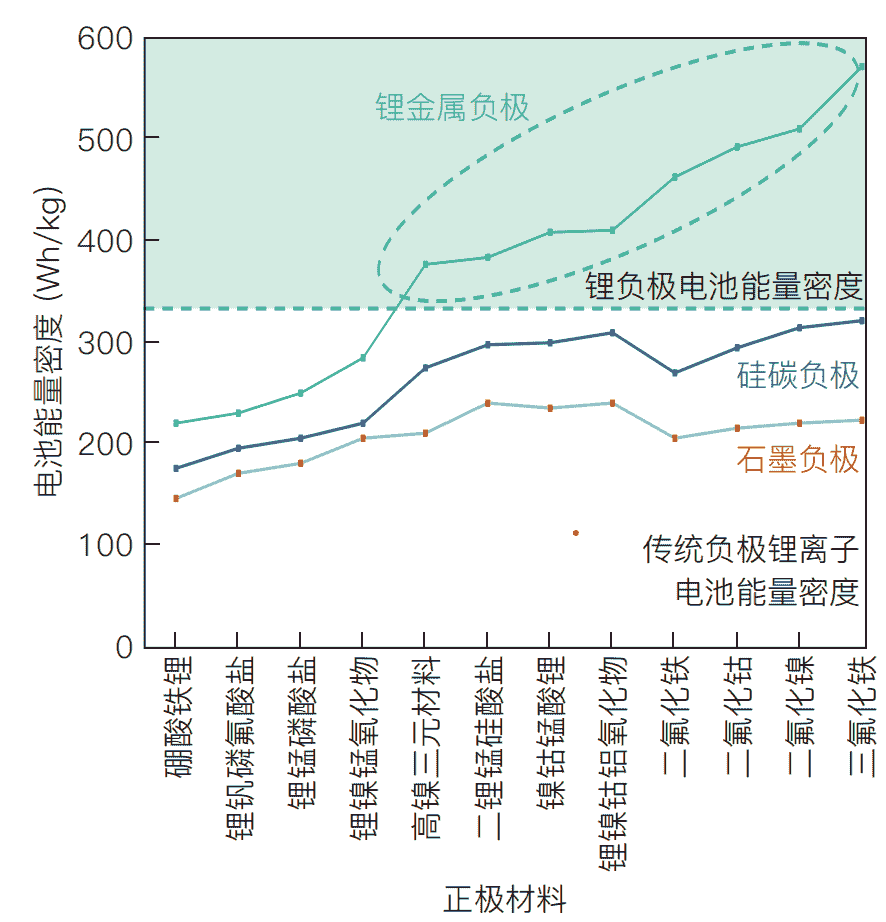

资料来源：《固态电池行业研究及其投资逻辑分析》、渤海证券研究所

### 4.3 多国积极推进产业化，25年将迎来下游反馈期

2030年全球固态电池市场规模有望达到约400亿美元。需求领域上，我们认为固态锂电池在动力电池、储能、消费电子和高端装备等领域有应用潜力。其中：（1）动力电池领域，动力电池注重性价比、能量密度、充放电速率、安全性和循环寿命等因素；短期内动力电池领域的固态电池产业化尚存障碍，预计可能会以半固态电池形式过渡，逐步向全固态电池演进。（2）储能领域，储能电池对安全性的较高要求且更注重成本和循环寿命，固态电池能量密度高的优势难以得到有力发挥；预计短期以示范工程为主，长期来看固态电池需进一步降低成本才能实现储能领域的突破。（3）消费电子领域，消费电子市场产品种类多、个性化定制需求强、成本敏感度低、价格接受度高，与固态电池的适配性好。（4）高端装备领域，高端装备市场要求能量密度高和安全性好，而对价格不敏感，固态电池的安全性和稳定性可满足严苛需求。SNE Research预计到2030年全球固态电池市场规模将达到约400亿美元。

图38：全球固态电池市场规模及预测（亿美元）

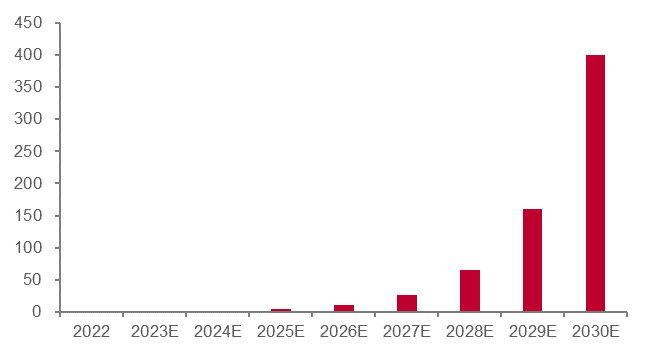

资料来源：SNE Research、电池网、渤海证券研究所

欧美日韩等地企业积极推进海外固态电池产业化。根据《固态电池关键材料体系发展研究》数据，日本电池企业采取的固态电池主流技术路线是硫化物固态电解质；其中，松下电器公司宣布将于2025年将固态电池进行市场化应用，丰田汽车公司、本田技研工业股份有限公司等汽车企业计划2028-2030年实现固态电池的规模化和商业化应用。韩国固态电池产业的发展思路是研发重量轻的硫化物固态电池和高安全性的氧化物固态电池，在韩国政府“K-Battery Development Strategy”引领下，韩国电池企业初步规划在2027年前实现固态电池的商业化应用。欧美的固态电池产业较多选择聚合物和氧化物固态电解质的技术路线，重视固态金属锂电池体系的研发；其中，美国Quantum Scape公司、Solid Power公司等电池企业计划在2025年前后实现固态电池的装车示范应用；德国的宝马集团、大众集团等大型汽车企业通过技术投资方式来推动欧洲固态电池产业的发展。

表13：国外典型企业的固态电池技术路线

| 国家 | 企业名称 | 技术路线 |
|------|----------|----------|
| 日本 | 丰田汽车公司 | 硫化物 |
| 日本 | 本田技研工业股份有限公司 | 硫化物 |
| 日本 | 三菱化学集团/日产汽车公司联盟 | 硫化物 |
| 日本 | 松下电器公司 | 卤化物 |
| 日本 | 富士电气化学有限公司 | 氧化物 |
| 日本 | 小原股份有限公司 | 氧化物 |
| 日本 | 日立造船公司 | 硫化物 |
| 日本 | 三洋化成工业股份有限公司 | 聚合物 |
| 日本 | 日本出光兴产股份有限公司 | 硫化物 |
| 德国 | 宝马集团 | 硫化物 |
| 德国 | 大众集团 | 氧化物 |
| 韩国 | LG新能源公司 | 硫化物 |
| 韩国 | 现代汽车集团 | 聚合物/硫化物 |
| 韩国 | SK On公司 | 硫化物/氧化物 |
| 韩国 | 三星SDI公司 | 聚合物/硫化物 |
| 法国 | 博洛雷集团 | 聚合物 |
| 英国 | Ilika公司 | 氧化物 |
| 英国 | LiNa Energy公司 | 氧化物 |
| 美国 | Quantum Scape公司 | 氧化物 |
| 美国 | Ionic Materials公司 | 聚合物 |
| 美国 | Solid Power公司 | 硫化物 |
| 美国 | Factorial Energy公司 | 聚合物 |

资料来源：《固态电池关键材料体系发展研究》、渤海证券研究所

依托现有锂电池产业基础，我国固态电池已取得积极进展。我国固态锂电池产业体系建立在现有液态锂电池产业基础之上，有望逐渐形成液态—半固态—固态电池的产业发展路径。目前我国有多家从事固态电池研发和生产的企业，已取得积极进展，例如，根据OFweek锂电网消息，由中国科学院物理研究所技术孵化的北京卫蓝新能源科技股份有限公司已在全球率先实现了半固态电池的规模量产，2023年6月卫蓝新能源360Wh/kg锂电池电芯正式交付给蔚来汽车并用于150kWh超长续航电池包；根据电池网消息，截至2024年3月清陶能源已有半固态电池产能1.7GWh，在建产能超30GWh，其生产的半固态电池应用于智己汽车的L6车型。目前，宁德时代新能源科技股份有限公司、比亚迪股份有限公司、华为技术有限公司等龙头企业也布局了固态电池研发。

表14：我国典型企业的固态电池技术路线

| 企业名称 | 技术路线 |
|----------|----------|
| 北京卫蓝新能源科技股份有限公司 | 氧化物/聚合物 |
| 清陶新能源材料研究院有限公司 | 氧化物/复合物 |
| 赣锋锂业集团股份有限公司 | 氧化物 |
| 辉能科技股份有限公司 | 氧化物 |
| 蜂巢能源科技股份有限公司 | 硫化物 |
| 宁德时代新能源科技股份有限公司 | 硫化物 |
| 比亚迪股份有限公司 | 氧化物/硫化物 |
| 国轩高科股份有限公司 | 硫化物 |
| 中科深蓝汇泽新能源有限公司 | 聚合物 |
| 重庆太蓝新能源有限公司 | 氧化物 |
| 上海恩力动力技术有限公司 | 硫化物 |
| 上海屹锂新能源科技有限公司 | 硫化物 |
| 北京高能时代环境技术股份有限公司 | 硫化物 |
| 孚能科技股份有限公司 | 氧化物/硫化物 |

资料来源：《固态电池关键材料体系发展研究》、渤海证券研究所

2025年将迎来半固态电池反馈，建议关注产业链相关企业。固态电池主要受技术驱动，其产业化的推进存在一定不确定性，需经受应用端的验证。参考当前全球固态电池产业化进程，2025年随着半固态电池陆续向整车厂送样、试产、装车，预计将迎来半固态电池应用反馈期。若半固态电池反馈良好，则后续有望实现量产，并加快固态电池的产业化；若反馈不佳，液态电池仍将占据主导地位，固态电池发展进程延后。固态电池是液态电池重要的发展方向，若产业化推进顺利，未来市场前景广阔，电池材料环节建议关注产业化进度较快的氧化物电解质厂商、高镍正极厂商和硅负极厂商。

## 5. 投资策略

**1、铜：** 整体看，铜矿供应将延续紧张，铜矿山产能利用率长期下行将抬高成本，原料端对铜价有支撑；新能源、电网等领域有望持续带动铜的下游需求；欧美降息、国内扩大内需的政策预期和美国提高关税或导致美国物价水平提升等因素对铜价有利好。我们认为2025年铜价具备向上的动力，需持续关注铜矿供应的变化和海内外政策走向，在矿端布局较多的铜企有望受益。

**2、铝：** 整体看，国内原铝产能存在合规上限，未来新增产能有限；海外降息、国内促进地产止跌回稳和汽车、电力等领域发展有望带动铝下游需求向好；叠加氧化铝供给走向宽松预期，原铝成本压力或下降，2025年原铝行业供需格局有改善预期，行业利润或走扩，建议关注产能有增量预期的企业，但需关注特朗普强硬关税政策的影响。

**3、固态电池相关材料：** 固态锂电池有望打破液态锂电池能量密度上限，同时安全性和循环寿命更高，是液态锂电池的重要升级方向。其中，固态电解质是固态电池的核心材料，目前主要有聚合物、氧化物和硫化物电解质三种技术路线；正极升级方向有高镍、富锂锰基和尖晶石型镍锰酸锂正极等；负极升级方向有硅负极和锂负极。2025年预计将迎来半固态电池应用反馈期，若半固态电池下游反馈良好，则后续有望实现量产，并加快固态电池的产业化。电池材料环节建议关注产业化进度较快的氧化物电解质厂商、高镍正极厂商和硅负极厂商。

综上，我们维持对钢铁行业的“中性”评级、对有色金属行业的“看好”评级，维持对洛阳钼业（603993）、紫金矿业（601899）和中国铝业（601600）的“增持”评级。

## 6. 风险提示

- **原材料和产品价格大幅波动风险**

若原材料和产品价格大幅波动，可能对相关企业的业绩表现造成影响。

- **下游需求不及预期风险**

需求若低于预期，产品销量或产品价格可能有所下降，对公司盈利造成负面影响。

- **地缘政治扰动风险**

受海外政治经济局势较大变动的影响，相关产品价格或发生重大波动，则将影响相关企业的业绩表现。

- **固态电池研发和产业化进展不及预期风险**

半固态电池技术仍不成熟，未形成规模量产，目前半固态电池仍为全固态电池的过渡方案；固态电池多数仍处于实验室阶段，商用化时间存在较大不确定性。

---

请务必阅读正文之后的声明 33 of 34

**分析师声明：**

本报告署名分析师在此声明：我们具有中国证券业协会授予的证券投资咨询执业资格并登记为证券分析师，以勤勉尽责的职业态度、专业审慎的研究方法，使用合法合规的数据和信息，独立、客观地出具本报告；本报告所表述的任何观点均精准地、如实地反映研究人员的个人观点，结论不受任何第三方的授意或影响。我们所获取报酬的任何部分无论是在过去、现在及将来均不会与本报告中的具体投资分析意见或观点有直接或间接的联系。

**风险提示及免责声明：**

投资者应自主作出投资决策并自行承担投资风险，任何形式的分享证券投资收益或者分担证券投资损失的书面或口头承诺均为无效。

本报告由渤海证券股份有限公司（以下简称“本公司”）制作，仅供本公司的客户使用。发送本报告不构成任何合同或承诺的基础，不因接收者收到本报告而视其为本公司客户。本报告仅在相关法律许可的情况下发送，并仅为提供信息而发送，不构成任何广告。

本报告的信息来源于已公开的资料，本公司对该等信息的准确性、完整性或可靠性不作任何保证，不保证该信息未经任何更新。本报告所载的资料、意见及推测仅反映本公司于发布本报告当日的判断，本报告所指的证券或投资标的的价格、价值及投资收入可升可跌。过往表现不应作为日后表现的依据。在不同时期，本公司可发出与本报告所载资料、意见及推测不一致的报告。本公司不保证本报告所含信息保持在最新状态。同时，本公司对本报告所含信息可在不发出通知的情形下做出修改，投资者应当自行关注相应的更新或修改。

在任何情况下，本报告内容的全部或部分均不构成对任何人的投资建议。本报告中所指的投资及服务可能不适合个别客户，不构成客户私人咨询建议。在任何情况下，本公司、本公司员工或者关联机构不承诺投资者一定获利，不与投资者分享投资收益，也不对任何人因使用本报告中的任何内容所引致的任何损失负任何责任。投资者务必注意，其据此做出的任何投资决策与本公司、本公司员工或者关联机构无关。在任何情况下，本公司、本公司员工或者关联机构不就本报告中的任何内容对任何投资做出任何形式的担保。

在所知情的范围内，本公司、本报告撰写人以及财产上的利害关系人与本报告所评价或作出明确估值和投资评级的证券无利害关系。本公司利用信息隔离墙控制内部一个或多个领域、部门或关联机构之间的信息流动。因此，投资者应注意，在法律许可的情况下，本公司及其所属关联机构可能持有并交易本报告中所提公司的股份或其他财产权益，也可能为这些公司提供或者争取提供投资银行、财务顾问或者金融产品等相关服务。

市场有风险，投资需谨慎。投资者不应将本报告作为作出投资决策的唯一参考因素，亦不应认为本报告可以取代自己的判断。在决定投资前，如有需要，投资者务必向专业人士咨询并谨慎决策。

本报告版权为本公司所有。未经本公司事先书面许可，任何机构和/或个人不得以任何形式刊载、转发、翻版、复制、发布或引用本报告全部或部分内容，亦不得从未经本公司书面授权的任何机构、个人或其运营的媒体平台接收、翻版、复制或引用本报告全部或部分内容。如征得本公司同意进行引用、刊载或转发的，需在允许的范围内使用，并注明出处为“渤海证券股份有限公司”且不得对本报告进行任何有悖原意的引用、删节和修改。

若本公司以外的其他机构（以下简称“该机构”）发送本报告，则由该机构独自为此发送行为负责。通过此途径获得本报告的投资者应自行联系该机构以要求获悉更详细信息或进而交易本报告中提及的证券。本报告不构成本公司向该机构之客户提供的投资建议，本公司、本公司员工或者关联机构亦不为该机构之客户因使用本报告或报告所载内容引起的任何损失承担任何责任。

---

请务必阅读正文之后的声明 34 of 34

**投资评级说明：**

| 项目名称 | 投资评级 | 评级说明 |
|----------|----------|----------|
| 公司评级标准 | 买入 | 未来6个月内相对沪深300指数涨幅超过20% |
| 公司评级标准 | 增持 | 未来6个月内相对沪深300指数涨幅介于10%~20%之间 |
| 公司评级标准 | 中性 | 未来6个月内相对沪深300指数涨幅介于-10%~10%之间 |
| 公司评级标准 | 减持 | 未来6个月内相对沪深300指数跌幅超过10% |
| 行业评级标准 | 看好 | 未来12个月内相对于沪深300指数涨幅超过10% |
| 行业评级标准 | 中性 | 未来12个月内相对于沪深300指数涨幅介于-10%-10%之间 |
| 行业评级标准 | 看淡 | 未来12个月内相对于沪深300指数跌幅超过10% |

**渤海证券研究所机构销售团队：**

高级销售经理：朱艳君
座机：+86 22 2845 1995
手机：135 0204 0941
邮箱：zhuyanjun@bhzq.com

高级销售经理：王文君
座机：+86 10 6810 4637
手机：186 1170 5783
邮箱：wangwj@bhzq.com

**天津：**
天津市南开区水上公园东路宁汇大厦A座写字楼
邮政编码：300381
电话：+86 22 2845 1888
传真：+86 22 2845 1615

**北京：**
北京市西城区西直门外大街甲143号 凯旋大厦A座2层
邮政编码：100086
电话：+86 10 6810 4192
传真：+86 10 6810 4192

渤海证券股份有限公司网址：**www.ewww.com.cn**
