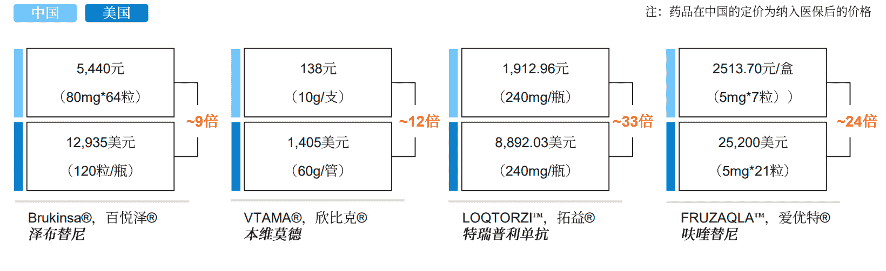
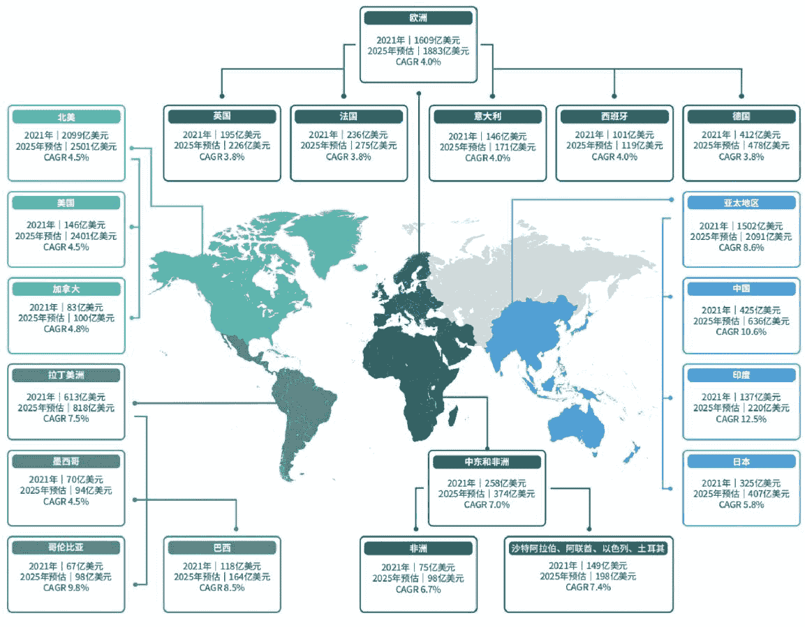
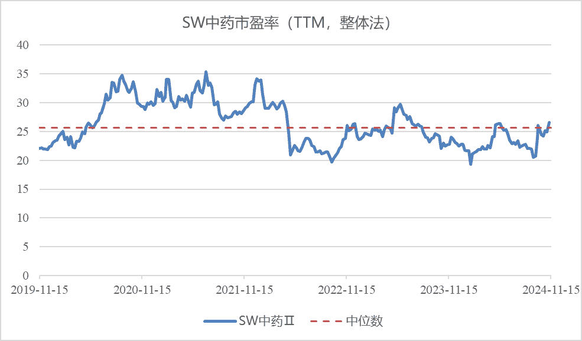
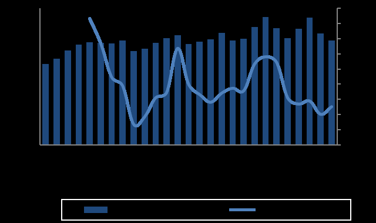
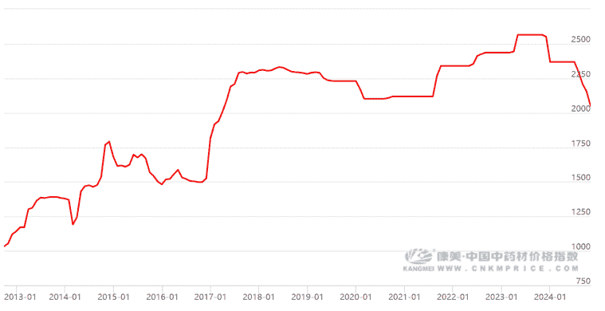
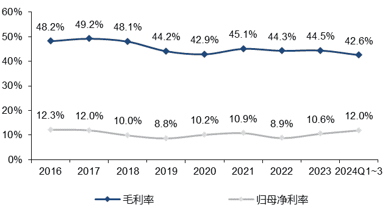

**否极泰来，黎明将至**

证券研究报告·行业策略报告·制药行业

证券分析师：朱国广

执业证书编号：S0600520070004

联系邮箱：zhugg@dwzq.com.cn

2024年12月5日

## 2025年医药生物行业策略

1

## 核心观点

**数据来源：**Wind、东吴证券研究所

过去近3—4年受到医保结余和集采扩面压制、医疗反腐、消费降级及海外大国博弈等影响，医药指数下跌约50%，2025年医药行业能否扭转颓势？**2025年行业判断**：从行业政策、估值水平、调整周期、筹码结构等多维度支撑医药板块有望走强。正文从医保结余和商保积极变化、DRG对医院不同科室影响、仿制药集采变化趋势及医疗反腐进入新阶段等进行全面分析，2024年为医疗反腐最具挑战的一年，2025年有望迎来积极变化。

从过去医药指数表现比较糟糕的背景下看，仍然有涨幅翻倍、涨幅70%的个股分别有10支、20支，主要扎堆于中药（华润三九、佐力药业、羚锐制药、方盛制药、江中药业、济川药业等）、创新药（百利天恒、科伦药业、海思科、艾力斯等）、高端仿制药（恩华药业、特宝生物等）、AI医疗（润达医疗）等。**看好的子行业排序分别为：创新药 > 消费医疗 > CXO > 中药 > 医疗器械 > 药店 > 医药商业等。**

**创新药：国产创新药颇具全球竞争力，扭亏及战略性出海为战略性方向。**

1）**国产创新药研发实力显著提高。**2017年以来，国产新药各阶段临床试验数量和药品上市数量稳步增长，2020年至2023年从207起上升至286起，同时高技术力疗法和FIC产品比例上升明显；

2）**国内商业化及BD出海驱使其实现扭亏盈利。**多元化盈利模式大大提高了创新药企扭亏为盈的可能性，同时加强了创新药资产的确定性；

3）**海外市场打开创新药天花板。**全球医药市场规模整体呈现增长趋势，国产创新药license-out金额也在逐年上升，24Q1—Q3披露总交易金额达336亿美元，同比增加100%；

4）**国内政策强化。**全链条支持创新药发展政策逐步落地，24年国谈目录谈判成功率超过了90%，较总体成功率高16个百分点。**建议关注百济神州、信达生物、海思科、恒瑞医药、迪哲药业、亚盛医药等。**

**消费医疗：政策弹性大，静待消费回暖，把握业绩修复弹性的个股。**

面对消费需求景气下行、医保控费政策等一系列压力因素，消费医疗/医疗服务板块短期增长承压，未来我们仍然看好该板块投资机会：

1）人口老龄化与医疗保健消费升级两大主线，推动需求持续增长及多元化，医疗服务是需求刚性最强、需求长期升级的消费品类。

2）新产品、新技术、新术式的出现，仍有望拉动平均价格水平。

3）民营医疗经过前十年快速扩张已进入提质增效阶段，当前行业加速出清，头部公司有望凭借规模、品牌、效率等优势继续提升份额。

4）消费国家政策推动。建议关注爱尔眼科、普瑞眼科、爱美客、昊海生科等。

**医疗器械：围绕“老龄化+创新+出海”三大主线，把握2025年医疗器械赛道投资机会。**

1）医疗设备以旧换新促进潜在市场需求。根据国内部分省市所披露出的数据，县域医共体设备更新项目总金额现已达到63.08亿元。国产替代+海外出口推动长期稳定发展，建议关注迈瑞医疗、联影医疗、开立医疗、澳华内镜等；

2）院内高值耗材/IVD：集采逐步出清，有望加速国产替代进程，行业渗透率有望持续提升，建议关注行业景气度高、替代空间大的惠泰医疗、新产业、微电生理-U、三友医疗等；

3）老龄化趋势加速、健康意识提升，看好渠道强、性价比高的自费产品，建议关注鱼跃医疗、三诺生物、爱博医疗、新华医疗等。

**中药：医药内循环下首选中药，中药板块集采政策压制逐步释放，估值切换下具有性价比。**

（1）湖北中成药集采规则已落地，规则细则基本符合市场预期，且小儿豉翘、丹滴等担心的大品种并未在目录内，中期来看，政策压制因素已经逐步释放；

（2）估值切换下，中药具有一定性价比：经过24年的调整，部分公司的业绩高基数逐步消化，同时切换25年业绩预期来看，估值不足20倍；

（3）筹码结构较好：公募中药持仓比例较低，2024Q3约8.5%；

（4）基药目录有望逐步推进。**关注佐力药业、济川药业、华润三九、方盛制药等。**

**推荐标的：**百济神州、恒瑞医药、海思科、信达生物、爱尔眼科、普瑞眼科、爱美客、佐力药业、联影医疗、迈瑞医疗。

**风险提示：**研发进展不及预期；商业化推进不及预期；海外审批或收益不达预期；集采风险，药品和耗材降价超预期风险；国际地缘政治风险等。

2

## 目录

1、行情回顾及基本面分析

2、行业重点政策梳理

3、消费医疗：消费属性强，刺激政策弹性大

4、创新药：国产创新药颇具全球竞争力，出海为战略性方向

5、医疗器械：内需复苏与出海机遇并存

6、中药：政策压制逐步释放，内循环下关注强品牌或强产品力

7、推荐标的

8、风险提示

3

## 行情回顾及基本面分析

4

## 医药行业回顾表现

**数据来源：**Wind、东吴证券研究所

**医药二级市场表现（2024/1/1—2024/11/29）**

**2024年医药指数相对沪深300走势**

- 2024年1月1日至11月29日，申万医药生物指数下跌9.3%，低于沪深300指数23.4个百分点。
- 2024年各医药子行业中，化学制剂领涨，其次是原料药，而中药、医药商业、医疗器械、医疗服务、生物制品板块均有不同程度的下跌。
- 2024年11月29日，申万医药板块市盈率（TTM）为28倍，约为近14年生物医药板块市盈率中位数35.5倍的79%。细分领域看：化药31倍、医疗服务31倍、医疗器械30倍、生物制品27倍、中药25倍、医药商业18倍。

**2024年医药子行业二级市场涨跌幅**

**申万医药市盈率历史变化趋势**

0

10

20

30

40

50

60

70

80

市盈率（TTM，整体法，剔除负值）SW医药生物

均值（倍）

-40%

-30%

-20%

-10%

0%

10%

20%

申万行业指数：医药生物

沪深300指数

3.0%

1.8%

-3.5%

-9.0%

-10.9%

-20.6%

-22.3%

-25%

-20%

-15%

-10%

-5%

0%

5%

化学制剂

原料药

中药

医药商业

医疗器械

医疗服务

生物制品

区间涨跌幅（%）

5

## 医药行业回顾表现

**数据来源：**Wind、东吴证券研究所（数据截至2024年11月29日）

### 2021年7月至今，医药涨幅居前聚焦化药、中药板块；跌幅居前聚焦疫苗等板块。

- 分析上涨动因，包括疫后院内复苏（如恩华药业、科伦药业、海思科等）；生物领先技术（如百利天恒ADC药物、通化金马AD药、艾力斯CAR-T、润达医疗AI诊断等）；政策鼓励及高股息（中药板块如佐力药业、方盛制药等）；国企改革（华润系、国药系公司）。
- 分析下跌原因，包括疫情后疫苗行业景气度下滑、消费降级以及集采政策影响等。

### 21M7至今医药板块涨幅前二十（经调整）

| 代码 | 公司 | 涨幅（21M7至今） | 上市以来股价达最高点 | 时间 | 总市值（亿元） |
|---|---|---:|---|---|---:|
| 688506.SH | 百利天恒-U | 574.01% |  | 24M10 | 866 |
| 300765.SZ | 新诺威 | 358.39% |  | 23M12 | 400 |
| 300049.SZ | 福瑞股份 | 223.05% |  | 15M6 | 101 |
| 000766.SZ | 通化金马 | 183.66% |  | 16M6 | 139 |
| 000999.SZ | 华润三九 | 143.39% |  | 24M10 | 579 |
| 600285.SH | 羚锐制药 | 132.64% |  | 24M10 | 124 |
| 300181.SZ | 佐力药业 | 129.68% |  | 24M10 | 120 |
| 603998.SH | 方盛制药 | 111.41% |  | 15M5 | 50 |
| 688278.SH | 特宝生物 | 109.74% |  | 24M10 | 303 |
| 600062.SH | 华润双鹤 | 98.12% |  | 22M5 | 222 |
| 000756.SZ | 新华制药 | 97.71% |  | 22M12 | 89 |
| 688578.SH | 艾力斯 | 0.98% |  | 24M5 | 275 |
| 600750.SH | 江中药业 | 1.10% |  | 24M4 | 128 |
| 002653.SZ | 海思科 | 1.11% |  | 24M10 | 441 |
| 688656.SH | 浩欧博 | 1.30% |  | 24M11 | 83 |
| 600566.SH | 济川药业 | 1.33% |  | 23M6 | 275 |
| 002262.SZ | 恩华药业 | 1.43% |  | 24M10 | 275 |
| 002422.SZ | 科伦药业 | 1.84% |  | 24M5 | 524 |
| 000423.SZ | 东阿阿胶 | 2.23% |  | 24M5 | 373 |
| 603108.SH | 润达医疗 | 3.58% |  | 23M11 | 112 |

### 21M7至今医药板块跌幅前二十

| 代码 | 公司 | 跌幅（21M7至今） | 总市值（亿元） |
|---|---|---:|---:|
| 688580.SH | 伟思医疗 | -73.29% | 29 |
| 603520.SH | 司太立 | -74.14% | 27 |
| 688276.SH | 百克生物 | -74.57% | 109 |
| 688217.SH | 睿昂基因 | -74.84% | 12 |
| 300122.SZ | 智飞生物 | -75.29% | 704 |
| 688026.SH | 洁特生物 | -75.48% | 21 |
| 300142.SZ | 沃森生物 | -75.97% | 237 |
| 300869.SZ | 康泰医学 | -77.20% | 63 |
| 300725.SZ | 药石科技 | -77.33% | 71 |
| 300363.SZ | 博腾股份 | -77.79% | 95 |
| 603882.SH | 金域医学 | -78.38% | 149 |
| 300630.SZ | 普利制药 | -79.21% | 49 |
| 300601.SZ | 康泰生物 | -79.40% | 207 |
| 688613.SH | 奥精医疗 | -80.74% | 23 |
| 300595.SZ | 欧普康视 | -81.40% | 169 |
| 688356.SH | 键凯科技 | -81.80% | 35 |
| 688690.SH | 纳微科技 | -82.58% | 82 |
| 600763.SH | 通策医疗 | -82.92% | 222 |
| 688202.SH | 美迪西 | -85.82% | 50 |
| 688185.SH | 康希诺 | -91.41% | 111 |

6

## 医药行业回顾表现

**数据来源：**Wind、东吴证券研究所（注：仅统计股票型和偏股型医疗主题基金）

### 医药股占A股总市值比重

### 公募基金A股重仓医药行业比重（截至2024Q3）

- **医药行业占A股市值比重，公募基金持仓比重下降**

- 截至2024年11月28日，A股医药行业总市值约6.2万亿元，占全部A股的市值比例从2013年10月18日的5.4%提升至6.6%，较2024年初的8.2%有所下降，与7月初的6.7%略有下降。
- 截至2024Q3，公募基金重仓医药行业的比例为9.93%，环比减少0.32个百分点；如果扣除主动医药基金及指数基金，重仓比例为7.53%，环比减少0.27个百分点，仍远低于2014年峰值持仓比例20%。

0%

3%

6%

9%

12%

0

1000

2000

3000

4000

5000

6000

7000

8000

9000

10000

医药生物总市值（十亿，左轴）

占全部A股比例（右轴）

0%

5%

10%

15%

20%

25%

公募基金A股重仓医药占比概况

全部公募基金

扣除主动医药基金

扣除主动医药基金及指数基金

申万医药股总市值占比

7

## 医药行业回顾表现

**数据来源：**Wind、东吴证券研究所**

- 2024年前三季度405家医药上市公司收入总额同比下降0.74%、归母净利润总额同比下降0.97%、扣非归母净利润总额同比增速达4.03%，我们判断主要仍受反腐影响较大，后续反腐力度持续减弱，恢复力度将明显增加。

**上市公司收入总额及增速（2015—2024Q1—3）**

**上市公司收入总额及增速（单季度）**

**上市公司扣非归母净利润总额及增速（2015—2024Q1—3）**

**上市公司扣非归母净利润总额及增速（单季度）**

-5%

0%

5%

10%

15%

20%

25%

30%

35%

40%

0

1,000

2,000

3,000

4,000

5,000

6,000

7,000

营业收入（亿元）

营业收入YOY

-200%

-100%

0%

100%

200%

300%

400%

500%

600%

0

100

200

300

400

500

600

扣非后归母净利润（亿元）

扣非后归母净利润YOY

-5%

0%

5%

10%

15%

20%

25%

0

5,000

10,000

15,000

20,000

25,000

30,000

收入（亿元）

收入YOY

-20%

0%

20%

40%

60%

0

500

1,000

1,500

2,000

扣非后归母净利润（亿元）

扣非后归母净利润YOY

8

## 医药重点政策梳理

9

## 热点一：医保结余四季度现拐点，院内现金流压力缓解

**数据来源：**国家医保局、东吴证券研究所

- **2024年四季度医保基金结余转正。单月度数据看，**2024年4月起我国医保基金出现负结余情况，4月至7月负结余分别为143/138/88/131亿元。**分结构看，职工医保始终保持正结余，而城乡居民医保面临压力较大，导致医保基金出现负结余。**

我国城乡居民医保基金自2024年4月起出现负结余情况，与2023年同期趋势相同。自2024年9月起，城乡居民月度结余再次转正，**2023年9月城乡居民医保负结余315.71亿元、2024年9月正结余284.02亿元，早于2023年的转正节点10月。**职工医保长期保持稳健正结余，4—10月职工医保当月结余最低149亿元（6月），最高657亿元（10月）。9月统筹基金结余在城乡居民医保结余转正带动下也转为正结余，当月结余709.21亿元，9月统筹基金收入同比增长26.81%，支出同比下降10.95%，表明医保基金收入有所改善。

**国家放开缴保限制，增加激励机制，鼓励长效参保。**2024年7月，国务院发布《关于健全基本医疗保险参保长效机制的指导意见》：

第一，不再限制户籍，缴保仅看居住地，缓解了很多长期在外工作的人不愿缴纳医保的现状。

第二，在激励机制上，连续参保达到4年，每年可适当提高大病保险最高支付限额，最高不超过所在统筹地区大病保险原封顶线的20%。

第三，在约束机制上，之前没参加医保，或生了病要突击参保的，需要至少有3个月的等待期（期间无法享受报销待遇）；每少参保一年，就会多一个月等待期。

- **医保联合财政部解决医疗机构压力。**11月11日，国家医保局办公室、财政部办公厅发布《关于做好医保基金预付工作的通知》。意见指示：

1）建立预付金制度，用于定点机构药品和医用耗材采购等医疗费用周转支出；

2）规范预付金流程管理，做好会计核算；

3）强化预付金监督，明确工作要求。

通过建立预付金制度，有利于减轻医院垫资压力，加快商业公司回款周期，也有利于院内处方药和耗材放量。

-5%

0%

5%

10%

15%

20%

25%

30%

35%

0

2,000

4,000

6,000

8,000

10,000

12,000

2014 2015 2016 2017 2018 2019 2020 2021 2022 2023

城乡居民医保收入（亿元）

城乡居民医保支出（亿元）

收入同比

支出同比

### 2014—2023年城乡居民医保基金收支情况

### 2023及2024年城乡居民医保基金月度结余情况

-1000

-500

0

500

1000

M1

M2

M3

M4

M5

M6

M7

M8

M9

M10

M11

M12

2023年城乡居民医保结余（亿元）

2024年城乡居民医保结余（亿元）

### 2023及2024年职工医保基金月度结余情况

0

500

1000

1500

2000

2500

M1

M2

M3

M4

M5

M6

M7

M8

M9

M10

M11

M12

2023年职工医保结余（亿元）

2024年职工医保结余（亿元）

10

## 热点二：DRG控费效应显著，医药科室收入增速分化明显

**数据来源：**Wind、国家医保局、东吴证券研究所

- **绝大部分省份医保结余充足，可执行预付金制度。**从省级医保结余情况来看，所有省份的职工医保累计结余均较为充足，可支付月份大于12个月；而居民医保除江苏、福建、上海三地外，其余省份可支付月份均大于6个月，可实行预付金制度，预计有望减轻医院垫资压力，加快商业公司回款周期，也有利于院内处方药和耗材放量。

- **DRG后控费效应明显，次均住院费用显著下降。**2021年全面执行DRG后，职工医保住院人次从2021年的5900万人次增加至2023年的8010万人次，但次均住院费用从2021年的12948元降至2023年的12175元，2023年同比降幅5.5%；居民医保住院人次从2021年的15348万人次增加至19923万人次，但次均住院费用从2021年的8023元下降至2023年的7674元，2023年同比降幅5.6%。DRG自2019年起实行，随着改革推广深化，控费成效自2021年起开始体现。

- **DRG和集采叠加，部分科室困境反转。**从样本医院数据来看，住院收入中肿瘤、手术收入、ICU等增速较快，其余检查、化验收入增速较慢，但依然保持增长。在DRG执行初期，骨科、ICU等次均治疗费用较高科室面临亏损压力较大。但随着骨科等耗材集采后价格大幅下降，而DRG点数并没有立即下调，以上科室反而在中短期内获得大量盈余。总体而言，肿瘤、骨科、ICU等科室目前经营状况较好，增速较快。

省级职工医保与居民医保累计结余情况

职工医保次均住院费用和人次变化

0  
1000  
2000  
3000  
4000  
5000  
6000  

青海  
宁夏  
广东  
西藏  
山西  
贵州  
广西  
天津  
黑龙江  
甘肃  
新疆  
内蒙古  
吉林  
四川  
海南  
江西  
辽宁  
云南  
湖南  
湖北  
北京  
重庆  
河北  
陕西  
山东  
浙江  
安徽  
河南  
江苏  
福建  
上海  

职工医保（亿元）  
居民医保（亿元）

0  
1,000  
2,000  
3,000  
4,000  
5,000  
6,000  
7,000  
8,000  
9,000  
11,200  
11,400  
11,600  
11,800  
12,000  
12,200  
12,400  
12,600  
12,800  
13,000  
13,200  

2019  
2020  
2021  
2022  
2023  

职工医保次均住院费用（元）  
职工医保住院人次（人次）

居民医保次均住院费用和人次变化

0  
5,000  
10,000  
15,000  
20,000  
25,000  
6,400  
6,600  
6,800  
7,000  
7,200  
7,400  
7,600  
7,800  
8,000  
8,200  
8,400  

2019  
2020  
2021  
2022  
2023  

居民医保次均住院费用（元）  
居民医保住院人次（人次）

## 热点三：医保+商保协同结算，商保政策出现积极变化，有望带来新增量

**数据来源：**国家医保局、《中国医疗保险》、国家金融监督管理总局、东吴证券研究所

- **我国居民医疗仍有较大自费负担，商保发展相对落后。**全国卫生总费用中的社会与个人支出部分由2017年的36067.6亿元增长至2023年的66392.1亿元，但基本医疗保险基金支出从2017年的15419.52亿元增长至2023年的28208.38亿元，医保外居民自费部分费用仍保持在接近60%，居民医疗仍有较大自费负担。我国实行社会医疗保险模式，随着人口老龄化，居民对医疗保险的刚性需求日益凸显，但健康险与部分发达国家相比，我国的保险深度、保险密度有待提升，健康险仍有发展空间。我国基本医保占比高于美国，低于日本、英国和德国，商业健康保险相较美国（33.3%）和德国（7.6%）仍有提升空间。

- **当前商业健康险购买意愿不强，赔付金额远低于保费收入。**2023年健康险保费收入为9035亿元，同比增长4.41%。2021年以来，健康险保费收入增速均保持低个位数，增长缓慢，2022年甚至出现负增长，表明我国居民对商业健康险购买意愿不足，商保推广受阻。从赔付情况来看，2023年商业健康险赔付3000亿元，相比9035亿元的保费收入，赔付仅为保费收入的33%。我们认为，赔付金额低主要由于：

  1. 信息不对称：全体人群的全面准确的健康信息相对敏感，商保公司难以获取，因而无法合理设计产品；
  2. 营销核验成本高：由于参保积极性低，销售保险产品需要大量资金用于宣传、补贴。另外，信息不互通，保险公司无法掌握参保人真实就医情况，需要付出大量成本核验；
  3. 理赔不便：参保人出险后，需自行垫资，等商保公司核验完所有的票据后，才能进行赔付，打击了参保与理赔积极性。

我国医疗费用自费比例仍然较高

2023年各国医疗费用支出结构占比

2017—2023健康保险保费收入情况

0%  
10%  
20%  
30%  
40%  
50%  
60%  
70%  
80%  
90%  
100%  

中国  
德国  
英国  
美国  
日本  

商业保险  
个人支出  
基本医保  

-5%  
0%  
5%  
10%  
15%  
20%  
25%  
30%  
35%  

0  
1,000  
2,000  
3,000  
4,000  
5,000  
6,000  
7,000  
8,000  
9,000  
10,000  

2017  
2018  
2019  
2020  
2021  
2022  
2023  

保费收入（亿元）  
yoy

2017—2023健康保险赔付支出情况

-30%  
-20%  
-10%  
0%  
10%  
20%  
30%  
40%  
50%  

0  
500  
1,000  
1,500  
2,000  
2,500  
3,000  
3,500  
4,000  
4,500  

2017  
2018  
2019  
2020  
2021  
2022  
2023  

赔付支出（亿元）  
yoy

54%  
56%  
58%  
60%  
62%  

0.0  
20000.0  
40000.0  
60000.0  
80000.0  

2017 2018 2019 2020 2021 2022 2023  

全国卫生总费用中社会与个人支出部分（亿元）  
基本医疗保险支出（亿元）  
自费比例（%）

## 热点三：医保+商保协同结算，商保政策出现积极变化，有望带来新增量

**数据来源：**随申办、新浪财经、东吴证券研究所

- **以惠民保探索多层次医保体系，打下商业医疗保险发展基础。**仅面向窄人群筹资无法发挥保险风险分摊的本质，而恰逢2020年2月，《中共中央、国务院关于深化医疗保障制度改革的意见》出台，多层次保障体系建设提上日程，借自费和医保准入到创新支付的推动，惠民保作为新的增量市场，具备了设计新的利益格局的可能；同时其产品本质上实现了健康体向带病体的转移支付，让药品创新支付找到了新的杠杆。在保险产品中，惠民保属于普惠保险的范畴。城市定制型补充医疗保险属于普惠保险中的普惠性质的保险。惠民保产品具有五个特征：

  1. 产品可及的公平性；
  2. 产品价格可负担，聚焦大额医疗费用的保障；
  3. 政府参与；
  4. 区域定制化；
  5. 与基本医保的衔接和补充。

  从惠民保的本质上讲，与一般商业保险的“精算公平”不同，惠民保体现的公平性是“社会公平”。

- **沪惠保微利运行，支持覆盖更多创新药。**沪惠保自2021年4月首年推出，是创下了全国惠民保首年参保人数之最的现象级保险，共739万上海市民参保。截至2024年3月末，“沪惠保”三年累计结案案件超65万件，累计赔付金额超16亿元，单人三年累计最高赔付金额243.6万元。同时，理赔电子诊疗数据应用率达75%，平均结案时效仅2.3天。**从沪惠保发展历程看，主要趋势为“加量不加价”**，在维持保费均价129元、延续历年保障责任的前提下升级保障水平：

  1. 降低免赔额，将住院自费医疗费用的免赔额由2021年的2万元降低至2024年的1.2万元，扩大参保人群受益面；
  2. 提升药品保障范围：国内特定高额药品费用由2023年的36种增至41种；海外特殊药品费用种类由原先的15种增至28种；“CAR-T”药品种类由原先的2种增至3种，对创新药支付能力提升。

  此外，我们对沪惠保参保数据进行了测算，2021至2023年总保费约25亿元，累计理赔16亿元，不考虑补赔情况下，理赔率64%，属于微利状态，基本健康运行。

### 2024版沪惠保保障内容

| 保障内容 | 特定住院自费医疗费用保险金 | 国内特定高额药品费用保险金 | 质子、重离子医疗保险金 | 海外特殊药品费用保险金 | CAR-T治疗药品费用保险金 |
|---|---:|---:|---:|---:|---:|
| 保障金额 | 100万元 | 100万元 | 30万元 | 30万元 | 50万元 |
| 免赔额 | 基础免赔额由去年的1.6万元优化至1.2万元；连续一年续保且无理赔，免赔额1.1万元；连续两年续保且无理赔，免赔额1万元 | 0 | 0 | 0 | 0 |
| 非既往症人群 | 70% | 70% | 70% | 70% | 100% |
| 既往症人群 | 50% | 30% | 30% | 30% | 100% |

### 沪惠保保障数据测算

30.00%  
31.00%  
32.00%  
33.00%  
34.00%  
35.00%  
36.00%  
37.00%  
38.00%  
39.00%  

0  
2  
4  
6  
8  
10  
12  

2021  
2022  
2023E  

总保费（亿元）  
理赔款（亿元）  
参保率（%）

## 热点三：医保+商保协同结算，商保政策出现积极变化，有望带来新增量

**数据来源：**中再寿险、东吴证券研究所

- **惠民保已进入存量经营，亟需探索新发展阶段。**惠民保发轫之初，产品销量和参保人数均保持高速增长，但2022年开始，惠民保增速骤然下滑至28%，开始从早期跑马圈地、不断补充区域发展到如今的存量经营。2022年12月，原银保监会下发《关于推进普惠保险高质量发展的指导意见》（征求意见稿），明确了2025年建立起普惠保险政策制度、服务标准和评价体系，同时规定了普惠保险的手续费应低于同类商业保险。我们认为，惠民保增长停滞主要由于：

  1. 政府对赔付率做出要求，而保险公司难以如此精细化运作产品，导致亏损；
  2. 由于惠民保较高的免赔额，参保脱落率较高，叠加参保率指标，保险公司运作难度进一步加大；
  3. 惠民保的精算虽然在一定程度上引用了区域医疗数据，但商保与医保间依然存在数据壁垒，保险公司在产品设计、定价和优化方面面临困境。

  因此，新的产品运作模式亟待探索。

2019—2022惠民保产品销量

2019—2022惠民保保费规模

惠民保在不同城市参保率

0  
2,000  
4,000  
6,000  
8,000  
10,000  
12,000  
14,000  

2019  
2020  
2021  
2022  

惠民保产品销量（万件）

0%  
50%  
100%  
150%  
200%  
250%  
300%  
350%  
400%  
450%  
500%  

0  
20  
40  
60  
80  
100  
120  
140  

2019  
2020  
2021  
2022  

惠民保保费规模（亿元）  
yoy

0%  
5%  
10%  
15%  
20%  
25%  
30%  

一线  
新一线  
二线  
三线  
四线  
五线  

参保率（%）

## 热点三：医保+商保协同结算，商保政策出现积极变化，有望带来新增量

**数据来源：**国家医保局、Wind、东吴证券研究所

- **鼓励商保政策频出，推动“医保+商保一站式结算”。**11月初，国家医保局召开医保数据赋能商业健康险发展座谈会；为了落实上海《关于支持生物医药产业全链条创新发展若干意见》，上海第一人民医院在完成数据治理基础上，经过匿名化处理和安全加密，形成全国医疗体系首批合规、可交易的数据产品，在上海数据交易所重大疾病数据行业中心正式挂牌；11月19日，国家医保局官微发布《推动“医保+商保”一站式结算的思考》，其中上海已实现12家公立医院医保、商保一站式结算服务。11月28日，上海医保局明确商保产品更多聚焦基本医保未包括的自费医疗费用，形成与基本医保互补衔接；推进数据赋能，鼓励商保机构创新开发产品。下一步，上海将进一步完善医保数据资源合作利用机制，在产品开发、精准定价、快速理赔、合作监管等方面全流程支持商业健康保险发展，促进加快建成与中国特色医保制度相适应、与上海超大城市实际相符合、更加成熟定型的多层次医保制度体系，服务科技创新和现代化产业体系建设。

- **明确政商责任，商业健康保险有望成为支付增量。**试点案例方面，目前主要开展三类医保+商保一站式结算试点，医保将经个人授权后的健康数据供商保公司使用，商保公司据此开展快赔结算。济南市已启用医保与商业保险数据授权共享系统（政保通），群众可授权公司查询医保报销信息，线上一键赔付。

  2. 商保机构将产品规则内置于医保系统，实现商保与医保的一站式结算。浙江打造“浙江智慧医保大脑”，将该省惠民保纳入医保一站式结算通道；
  3. 孝感探索“双平台一通道”模式，医保和商保各建一个综合服务平台，两平台之间建立一个规范标准的对接通道。

  解决了个人医保数据的安全问题，又解决了医保和商保各自的边界问题。我们认为，随着医保、商保的信息互通和平台建设，有望唤醒潜在规模达数万亿元的商业健康保险市场，增量资金推动医药、医疗企业的业绩增长。我们认为，随着探索逐渐深化，政商职责已逐渐明晰，有望推动医保+商保协同发展。

  **政府职责包括：**

  1. 为产品设计、精算定价提供数据支持，打通商保与医保之间的数据壁垒；
  2. 通过各种政策组合拳实质性提升参保率，确保参保人群结构符合预期；
  3. 尊重商业性，不过多干预商保的定价、赔付率，保证支持政策的持续性。

  **商保公司职责包括：**

  1. 合理设计、定价产品，解决民众的医疗保障需求；
  2. 消除投保门槛，扩大筹资人群；
  3. 发挥自身在客户运营、理赔风控、健康管理、医疗产业融合等方面的专业能力，保证参保率和续保率，提升医疗支付的效率和社会运行的效率。

  随着政商职责确立，医保、商保的信息互通和平台建设，有望唤醒潜在规模达数万亿元的商业健康保险市场，引导增量资金推动医药、医疗企业的业绩增长，提升医疗支付销量。

## 热点四：仿制药集采，市场化下竞争格局决定价格走势

**数据来源：**医药魔方、东吴证券研究所

- **过去九批集采价格降幅：平均为53.5%。**从各批次集采药品平均价格降幅看，最低为第六及第七批（48%左右），最高为第一批及第九批（58%左右）。

- **集采续标定价逻辑：基于首批集采的充分降价，以及药品本身的市场化竞争，续约回归合理药价。**从集采药品的续约价格情况看，既有可能再降，也有可能上涨，我们认为主要取决于：

  1. **首次集采是否充分降价。**以二甲双胍为例，重庆科瑞制药的盐酸二甲双胍片在第三批国采中价格降至0.015元/片，但续约后即使最低价的华东药业的盐酸二甲双胍片仍有0.023元/片，续约价格上涨50%以上。同样以头孢氨苄口服常释剂型为例，华北制药的头孢氨苄胶囊在第二批国采中价格降至0.085元/粒，但续约后价格为0.159元/粒，续约价格上涨80%以上。

  2. **药品本身竞争格局。**以本次江苏国采续标为例，新增了价格纠偏环节，所有拟中选企业根据其报价与同品种最低中选价的比值由高至低排序，排名前10%的企业应进一步降价，使价差比值达到剩余90%拟中选企业的平均价差比值。可见，对于竞争激烈的品种，在未来续约时仍有降价空间。

  3. **以胰岛素续约为例。**共13家企业的53个产品参与本次接续采购，49个产品获得中选资格，中选率92%，中选价格稳中有降，在首轮集采降价基础上又降低了3.8个百分点，其中14个产品价格上涨。首轮集采中价差最大的三代预混组，价差从2.3倍缩小至1.6倍，甘李药业的三代甘精胰岛素注射液涨幅达30%以上。可见，对于集采的核心在于药价合理，即去除低质量的重复，加速高质量的创造。

- **第三批全国中成药集采：预计中成药集采降价相较化药相对温和。**10月25日下午，全国中成药联合采购办公室正式发布《全国中成药采购联盟集中采购文件（征求意见稿）》，其中提到“日均费用不高于同采购组日均费用均值的，其报价代表品报价降幅大于35%；高于均值的，其报价代表品报价降幅大于45%”，意味着日均费用只要在1.5倍最低日均费用范围内，最多降45%。根据该规则保底机制，预计中成药集采平均降幅不会高于化药的降幅。

52%  
59%  
53%  
53%  
52%  
56%  
48%  
48%  
56%  
58%  

40%  
50%  
60%  

4+7集采  
4+7集采扩围  
第二批集采  
第三批集采  
第四批集采  
第五批集采  
第六批集采  
第七批集采  
第八批集采  
第九批集采  

平均降幅

## 热点四：仿制药集采，市场化下竞争格局决定价格走势

**数据来源：**医药魔方、东吴证券研究所

### 历届集采续约价格平均变动

### 历届集采续约价格不变情况占比

- **集采续约降价幅度温和。**我们分析过去六批集采品种续约的价格变动趋势，其中第一批4+7及第一批扩围的中标产品续约后，仍分别有-42%、-24%的价格二次降幅。但随着集采批次的不断深入，第五批集采中标产品续约价格降幅已低至-13.27%，第六批胰岛素集采平均降幅更是达-3.80%。我们认为这是由于集采价格机制的不断完善，以及入围产品充分竞争后的合理价格体现。

- **集采续约价格不变的品种占比较前几批有所提升。**复盘过去五批集采品种续约的价格情况，越来越多的产品在续约时将不会二次降价，第二至第五批续约品种不再降价的占比分别为47%、52%、48%、32%。

-42.01%  
-23.66%  
-14.77%  
-7.42%  
-16.08%  
-13.27%  
-3.80%  

-45%  
-40%  
-35%  
-30%  
-25%  
-20%  
-15%  
-10%  
-5%  
0%

9.09%  
17.33%  
47.46%  
51.82%  
47.62%  
31.52%  

0%  
10%  
20%  
30%  
40%  
50%  
60%

## 热点五：医疗反腐进入新阶段，2025年有望边际缓和

| 省份 | 相关文件或事件 | 发布时间 | 发布单位 | 重点 |
|------|--------------|----------|----------|------|
| 上海 | 《关于印发上海市2024年纠正医药购销领域和医疗服务中不正之风工作要点的通知》 | 2024.10 | 上海市卫健委 | 纠正医药购销领域和医疗服务中不正之风 |
| 西藏 | 《西藏自治区关于违法违规使用医疗保障基金举报奖励办法实施细则》 | 2024.10 | 西藏省医保局 | 医保基金监管 |
| 宁夏 | 《关于公开征集违法违规使用医保基金问题线索的公告》 | 2024.10 | 宁夏省医保局 | 医保基金监管 |
| 福建 | 《关于印发2024年纠正医药购销领域和医疗服务中不正之风工作要点的通知》 | 2024.09 | 福建省卫健委 | 纠正医药购销领域和医疗服务中不正之风 |
| 吉林 | 《吉林省医疗机构从业人员廉洁从业九项准则实施细则（试行）》 | 2024.08 | 吉林省卫健委 | 医疗机构人员廉洁从业 |
| 浙江 | 《浙江省深化医药卫生体制改革2024年重点工作任务》 | 2024.08 | 浙江省卫健委 | 促进三医协同 |
| 海南 | 《关于医药领域不正之风和腐败问题专项整治举报事项的公告》 | 2024.07 | 海南省卫健委 | 纠正医药购销领域和医疗服务中不正之风 |
| 河北 | 《河北省医药企业防范商业贿赂合规指引(试行)》 | 2024.07 | 河北省市场监督管理局 | 防范商业贿赂 |
| 甘肃 | 《关于印发甘肃省2024年纠正医药购销领域和医疗服务中不正之风工作要点的通知》 | 2024.07 | 甘肃省卫健委 | 纠正医药购销领域和医疗服务中不正之风 |
| 北京 | 2024年“以案为鉴、以案促改”警示教育大会暨党风廉政建设和反腐败工作推进会 | 2024.07 | 北京市医保局 | 推动医保领域党风廉政建设和反腐败工作不断深化 |
| 重庆 | 《重庆市医药领域反商业贿赂合规指引》 | 2024.07 | 重庆市市场监督管理局 | 防范商业贿赂 |
| 山西 | 《医药生产经营企业防范商业贿赂合规指引》 | 2024.06 | 陕西省市场监督管理局 | 防范商业贿赂 |
| 辽宁 | 《辽宁通报4起群众身边不正之风和腐败问题典型案例》 | 2024.06 | 辽宁省纪检委 | 点名设备采购腐败问题 |
| 湖南 | 医保领域群众身边不正之风和腐败问题集中整治现场推进会暨纪检监察组组长座谈会 | 2024.06 | 湖南省医保局 | 省医保局对全省医保领域集中整治情况进行了总结和部署 |
| 广东 | 转发《关于印发2024年纠正医药购销领域和医疗服务中不正之风工作要点的通知》 | 2024.06 | 广东省医保局等 | 纠正医药购销领域和医疗服务中不正之风 |
| 黑龙江 | 《黑龙江省公立医疗卫生机构医疗设备器械采购领域突出问题专项整治工作举报公告》 | 2024.06 | 黑龙江省卫健委 | 推进医疗设备器械采购领域突出问题专项整治 |
| 山东 | 《山东省大型医院巡查工作方案(2024-2026年度)》 | 2024.06 | 山东省卫健委 | 巡查大型医院，推动医疗行风建设 |
| 贵州 | 《贵州省卫生健康委员会党组书记杨慧接受纪律审查和监察调查》 | 2024.06 | 贵州省监察委员会 | 监察官员 |
| 云南 | 《关于印发2024年纠正医药购销领域和医疗服务中不正之风工作要点的通知》 | 2024.05 | 云南省人民政府 | 纠正医药购销领域和医疗服务中不正之风 |
| 江西 | 《江西省医疗卫生机构医药购销领域商业贿赂不良记录管理暂行办法》 | 2024.05 | 江西省市场监督管理局 | 推动医药领域商业贿赂行为常态化整治 |
| 青海 | 《发挥条线协同作用 推动医药领域集中整治同频共振》 | 2024.04 | 青海省市场监督管理局 | 持续强化医药领域不正当竞争行为监管力度 |
| 天津 | 《天津市大型医院巡查工作实施方案（2024-2026年度）》 | 2024.04 | 天津市卫健委 | 巡查大型医院，推动医疗行风建设 |
| 湖北 | 《湖北省医药企业反商业贿赂行为合规管理指引(试行)》 | 2024.04 | 湖北省市场监管局 | 防范商业贿赂 |
| 河南 | 《医药生产经营企业防范商业贿赂行政指引》 | 2024.03 | 河南省市场监督管理局 | 防范商业贿赂 |
| 陕西 | 2024年度全省医疗保障系统党风廉政建设和反腐败工作会议 | 2024.03 | 陕西省医保局 | 安排部署2024年重点任务 |
| 江苏 | 全省医保系统党风廉政建设和反腐败工作会议 | 2024.02 | 江苏省医保局 | 安排部署2024年重点任务 |
| 新疆 | 2024年全区医疗保障系统党风廉政建设和反腐败工作视频会议 | 2024.02 | 新疆省医保局 | 安排部署2024年重点任务 |
| 内蒙 | 医保系统党风廉政建设和反腐败工作会议 | 2024.01 | 内蒙省医保局 | 持续推动医保系统党风廉政建设和反腐败工作再启新程 |
| 四川 | 《医药领域腐败问题整治的破与立》 | 2023.10 | 四川省纪监委 | 安排部署2024年重点任务 |
| 广西 | 《关于公布全区医药领域腐败问题集中整治问题线索举报方式的公告》 | 2023.08 | 广西省医保局 | 集中整治医疗反腐，接受举报 |
| 安徽 | 《安徽省医疗机构及其工作人员廉洁从业行动实施方案（2021-2024年）》 | 2021.11 | 安徽省卫健委 | 纠正医疗领域不正之风 |

- **医疗反腐进行了一周年，2024年最难时刻过去，现进入到制度反腐新阶段。各省市场监管总局针对工业企业规范反腐行为、后续卫健委体系有望规范医生行为。**
- **2024年5月，国务院印发《关于印发2024年纠正医药购销领域和医疗服务中不正之风工作要点的通知》。**前后各省市场监督管理局、卫健委等机构均下发相关文件，重点聚焦以生产企业为主体的涉及商业贿赂相关的四大方面，包括1）持续规范医药生产流通秩序；2）集中整治群众身边不正之风和腐败问题；3）坚决纠治行业乱象；4）切实维护医保基金安全。预计未来将针对医疗机构进一步下发相关文件，以完善医疗反腐的全流程实施管理。

数据来源：各地医保局、卫健委、纪检委、市场监督管理局官网、东吴证券研究所

## 消费医疗：消费属性强，刺激政策弹性大

## 医美：消费降级导致增长降速，关注新材料新产品上市销售

### 近年主要医美产品上市及销售情况

| 上市公司 | 产品 | 上市时间 | 主要材料成分 | 价格定位（元） | 销售统计口径 | 2022 销售额（亿元） | 2022 同比增长 | 2023 销售额（亿元） | 2023 同比增长 | 2024H1 销售额（亿元） | 2024H1 同比增长 |
|---------|------|---------|-------------|---------------|-------------|-------------------|--------------|-------------------|--------------|---------------------|----------------|
| 圣博玛 | 艾维岚童颜针 | 2021.08.01 | PLLA微球 | 15000-18000 | 童颜针销售收入 | 6-7 | | | | | |
| 昊海生科 | 海魅玻尿酸 | 2020.08.07 | 透明质酸钠凝胶 | 8000-12800 | 玻尿酸销售收入 | 2.75 | 14.33% | 6.02 | 118.75% | 4.17 | 51.30% |
| 华东医药 | 伊妍仕少女针 | 2021.08.29 | PCL微球+CMC凝胶 | 18800 | 欣可丽美学收入 | 6.26 | 238.38% | 10.51 | 67.89% | 6.18 | 19.77% |
| 爱美客 | 濡白天使童颜针 | 2021.07.21 | PLLA微球+透明质酸钠凝胶 | 10000-13000 | 凝胶类注射产品收入 | 6.38 | 65.71% | 11.58 | 81.50% | 6.49 | 14.66% |
| 锦波生物 | 薇漪美胶原蛋白 | 2021.06 | 胶原蛋白 | 5000-10000 | 重组胶原蛋白收入 | 3.34 | 104.91% | 7.56 | 126.35% | 5.79 | 109.03% |
| 江苏吴中 | 艾塑菲童颜针 | 2024.04 | PLLA微球 | 19800 | 医美生科板块收入 | 0.0027 | | 0.076 | 2697% | 0.8 | |

- **成熟医美产品受消费影响而降速；新材料新产品增长迅猛**
  - 受经济下行及消费降级影响，自2023年下半年以来，医美机构低价降价竞争更加明显，尤其中端价格带产品降速明显。以主要的医美公司及其大品种为例，华东医药、爱美客的再生类新产品医美终端消费需求疲弱，在上市后的2-3年时间内实现快速放量，做到10亿+销售金额体量，但在2024年出现增速明显下降。**而锦波生物胶原蛋白、江苏吴中童颜针，新产品上市以后依然取得快速增长，尤其是新材料品类的胶原蛋白实现了高速放量增长。**
- **医美终端监管和整顿落地执行，新品上市销售环境变好**
  - 2021年，国家八部委发布《打击非法医疗美容服务专项整治工作方案》，联合开展非法医美整治工作。2021年以来，政策方面对于医美行业管理标准、医美经营准入、人员资质管理、药品器械管理、宣传广告等多方面继续完善监管和整顿。我们认为，经过行业整顿和肃清，当前行业经营环境改善，有利于后续持证产品上市销售。

数据来源：爱美客童颜针/江苏吴中童颜针/华东医药少女针官方推介资料，公司公告，东吴证券研究所

| 上市公司 | 产品 | 产品分类 | 应用前景 | 研发进展 |
|---------|------|---------|----------|----------|
| 昊海生科 | 氨基酸交联玻尿酸“海魅月白” | 透明质酸钠凝胶 | 深层填充 | 24年末商业化上市销售 |
| 昊海生科 | 无痛交联注射用交联透明质酸钠凝胶 | 透明质酸钠凝胶 | 深层填充，降低疼痛 | 临床试验 |
| 昊海生科 | 智能交联胶原蛋白产品 | 胶原蛋白溶液 | 中胚层疗法，改善皮肤质量 | 注册检验 |
| 华东医药 | 透明质酸钠填充剂MaiLi Extreme | 透明质酸钠凝胶 | 面部填充 | 注册受理，有望于2025年获批上市 |
| 华东医药 | 聚左旋乳酸胶原蛋白刺激剂 Lanluma® | 再生类胶原蛋白刺激剂 | 面部补充 | 全国多中心注册临床研究 |
| 华东医药 | 光学射频治疗仪 V20 | 能量源设备 | 改善皱纹、良性皮肤病变、炎症性痤疮等 | 2024年7月完成国内注册补充资料递交，目前正在技术审评中 |
| 华东医药 | 重庆誉颜 YY001肉毒 （中国商业化权益） | 生物制品 | 改善皱纹 | 准备提交注册 |
| 爱美客 | 注射用 A 型肉毒毒素 | 生物制品 | 改善皱纹 | 注册申报 |
| 爱美客 | 米诺地尔搽剂 | 化学药品3类 | 用于头发再生治疗 | 注册申报 |

## 眼科：消费类项目量价承压，关注价格触底信号

### 眼科上市公司营收（亿元）及毛利率情况

**爱尔眼科**

| 屈光业务 | 2017 | 2018 | 2019 | 2020 | 2021 | 2022 | 2023 | 2024H1 |
|---------|------|------|------|------|------|------|------|--------|
| 收入 | 19.31 | 28.12 | 35.31 | 43.49 | 55.20 | 63.37 | 74.31 | 41.55 |
| 同比增速 | 69.24% | 45.62% | 25.57% | 23.17% | 26.93% | 14.80% | 17.26% | 3.15% |
| 毛利率 | 52.81% | 52.38% | 57.38% | 58.12% | 58.95% | 56.82% | 57.40% | 57.19% |

| 视光业务 | 2017 | 2018 | 2019 | 2020 | 2021 | 2022 | 2023 | 2024H1 |
|---------|------|------|------|------|------|------|------|--------|
| 收入 | 11.72 | 14.77 | 19.30 | 24.54 | 33.78 | 37.79 | 49.60 | 23.71 |
| 同比增速 | 34.40% | 26.02% | 30.67% | 27.15% | 37.65% | 11.87% | 31.25% | 3.04% |
| 毛利率 | 53.66% | 55.47% | 55.92% | 56.93% | 58.04% | 56.44% | 57.05% | 55.95% |

**华厦眼科**

| 屈光业务 | 2017 | 2018 | 2019 | 2020 | 2021 | 2022 | 2023 | 2024H1 |
|---------|------|------|------|------|------|------|------|--------|
| 收入 | 3.02 | 4.60 | 6.04 | 7.27 | 9.58 | 10.73 | 12.07 | 6.94 |
| 同比增速 | 52.32% | 31.30% | 20.36% | 31.77% | 12.00% | 12.49% | 6.61% | |
| 毛利率 | 45.72% | 47.09% | 45.35% | 47.94% | 52.55% | 54.87% | 54.51% | 54.98% |

| 视光业务 | 2017 | 2018 | 2019 | 2020 | 2021 | 2022 | 2023 | 2024H1 |
|---------|------|------|------|------|------|------|------|--------|
| 收入 | 1.16 | 1.66 | 2.23 | 2.65 | 3.61 | 3.97 | 10.17 | 4.97 |
| 同比增速 | 43.10% | 34.34% | 18.83% | 36.23% | 9.97% | 156.17% | 4.63% | |
| 毛利率 | 58.44% | 56.32% | 54.49% | 53.11% | 56.43% | 55.60% | 50.06% | 46.32% |

**普瑞眼科**

| 屈光业务 | 2017 | 2018 | 2019 | 2020 | 2021 | 2022 | 2023 | 2024H1 |
|---------|------|------|------|------|------|------|------|--------|
| 收入 | 2.65 | 3.88 | 5.42 | 6.72 | 8.72 | 9.71 | 12.96 | 6.92 |
| 同比增速 | 46.42% | 39.69% | 23.99% | 29.76% | 11.35% | 33.47% | -2.40% | |
| 毛利率 | 44.74% | 47.25% | 52.10% | 51.57% | 52.60% | 50.47% | 51.58% | 48.96% |

| 视光业务 | 2017 | 2018 | 2019 | 2020 | 2021 | 2022 | 2023 | 2024H1 |
|---------|------|------|------|------|------|------|------|--------|
| 收入 | 1.16 | 1.48 | 1.82 | 2.05 | 2.76 | 2.60 | 3.97 | 1.84 |
| 同比增速 | 27.59% | 22.97% | 12.64% | 34.63% | -5.80% | 52.69% | -3.66% | |
| 毛利率 | 47.13% | 47.70% | 45.99% | 45.62% | 46.84% | 44.75% | 51.45% | 45.09% |

**何氏眼科**

| 屈光业务 | 2017 | 2018 | 2019 | 2020 | 2021 | 2022 | 2023 | 2024H1 |
|---------|------|------|------|------|------|------|------|--------|
| 收入 | 0.89 | 1.24 | 1.55 | 1.77 | 2.01 | 2.04 | 2.39 | 1.31 |
| 同比增速 | 39.33% | 25.00% | 14.19% | 13.56% | 1.49% | 17.16% | -5.07% | |
| 毛利率 | 55.26% | 52.83% | 53.94% | 52.93% | 46.58% | 43.69% | 44.85% | 49.41% |

| 视光业务 | 2017 | 2018 | 2019 | 2020 | 2021 | 2022 | 2023 | 2024H1 |
|---------|------|------|------|------|------|------|------|--------|
| 收入 | 1.20 | 1.62 | 2.23 | 2.74 | 3.46 | 3.50 | 3.87 | 1.78 |
| 同比增速 | 35.00% | 37.65% | 22.87% | 26.28% | 1.16% | 10.57% | -6.81% | |
| 毛利率 | 46.01% | 49.17% | 52.34% | 52.11% | 48.50% | 48.35% | 48.39% | 44.37% |

- **屈光视光消费升级类项目，24H1增速放缓，毛利率略有下降**
  - 2021年及之前，作为典型的消费升级类项目，屈光视光业务实现快速增长。尽管受到疫情影响波动，仍然保持较快复合增长。2023H2以来，受消费降级影响，屈光手术平均客单价有所下降，各家眼科连锁医院2024H1屈光收入增速放缓，但由于ICL、精雕/个性化半飞占比提升带来的业务结构调整，毛利率相对稳定。视光业务同样增速放缓，特别是由于OK镜业务占比下降，毛利率有所下降。
- **屈光手术率/OK镜渗透率仍低，具备随消费改善的弹性**
  - 根据中南大学爱尔眼科学院发布的《国人近视手术白皮书》，2021年我国每千人近视手术量仅为0.7，低于同期发达国家水平，相较美国的2.6仍有3倍空间。OK镜作为临床最有效的近视防控手段，我们根据OK镜用量估算其渗透率仅2%左右。
  - 我们认为，短期经济下行和消费降级带来价格竞争压力，但随着新的术式及耗材上市，仍有望推动平均客单提升。而随着经济趋势企稳，以及屈光手术率/OK镜渗透率的提高，屈光视光业务有望恢复增长。

数据来源：wind，东吴证券研究所（收入单位为亿元）

## 眼科：消费类项目量价承压，关注价格触底信号

### 人工晶体采购梳理

| 时间 | 人工晶体集采结果 |
|------|----------------|
| 2019年 | 安徽开展集采，采购量为2018年耗材采购量的90%，平均降价20.5%，国产类18.1%，进口类20.9%；江苏省医保局组织开展第二次省级组团带量联盟采购，眼科人工晶体类平均降幅26.89%。 |
| 2020年 | 陕西10省开展单焦点、多焦点、散光晶体集采，平均降价44%，最高85%。 |
| 2021年 | 广东、江西、河南三省报量采购中，降幅最高达90%。 |
| 2021年 | 京津冀“3+N”联盟开展单焦点、双焦点、三焦点等晶体集采，平均降价16.91%。 |
| 2024年 | 平均降价达60% |

### 全球每百万人口白内障手术率CSR对比

（图表：中国（2020）、印度（2017）、欧洲（2017）、日本（2017）、美国（2017）白内障CSR对比，每百万人口屈光手术量，例）中国远低于其他国家和地区。

### 上市公司白内障业务情况（收入：亿元）

**爱尔眼科**

| 白内障业务 | 2017 | 2018 | 2019 | 2020 | 2021 | 2022 | 2023 | 2024H1 |
|-----------|------|------|------|------|------|------|------|--------|
| 收入 | 14.17 | 15.45 | 17.60 | 19.61 | 21.91 | 21.43 | 33.27 | 17.35 |
| 同比增速 | 44.44% | 9.03% | 13.92% | 11.42% | 11.73% | -2.19% | 55.25% | 3.64% |
| 毛利率 | 38.21% | 37.69% | 40.10% | 38.05% | 37.67% | 35.34% | 37.97% | 37.50% |

**华厦眼科**

| 白内障业务 | 2017 | 2018 | 2019 | 2020 | 2021 | 2022 | 2023 | 2024H1 |
|-----------|------|------|------|------|------|------|------|--------|
| 收入 | 5.18 | 7.13 | 7.17 | 6.56 | 7.56 | 7.51 | 9.87 | 4.65 |
| 同比增速 | 37.64% | 0.56% | -8.51% | 15.24% | -0.66% | 31.42% | -6.44% | |
| 毛利率 | 38.48% | 34.73% | 32.25% | 30.94% | 36.12% | 38.01% | 43.69% | 37.03% |

**普瑞眼科**

| 白内障业务 | 2017 | 2018 | 2019 | 2020 | 2021 | 2022 | 2023 | 2024H1 |
|-----------|------|------|------|------|------|------|------|--------|
| 收入 | 2.75 | 3.11 | 2.75 | 2.73 | 2.87 | 2.49 | 5.94 | 3.11 |
| 同比增速 | 13.09% | -11.58% | -0.73% | 5.13% | -13.24% | 138.55% | 13.09% | |
| 毛利率 | 43.67% | 46.20% | 41.30% | 40.24% | 34.61% | 30.85% | 43.37% | 42.31% |

**何氏眼科**

| 白内障业务 | 2017 | 2018 | 2019 | 2020 | 2021 | 2022 | 2023 | 2024H1 |
|-----------|------|------|------|------|------|------|------|--------|
| 收入 | 1.22 | 1.41 | 1.51 | 1.53 | 1.57 | 1.33 | 2.05 | 0.93 |
| 同比增速 | 15.57% | 7.09% | 1.32% | 2.61% | -15.29% | 54.14% | -16.22% | |
| 毛利率 | 35.54% | 36.16% | 34.01% | 37.57% | 36.83% | 31.16% | 41.72% | 44.56% |

- **24H1消化高基数，24Q2开始执行人工晶体国家集采，白内障增速放缓**
  - 由于疫情期间积压需求释放&新增需求增长，23H1各家公司白内障业务实现爆发式高增长，24H1仍在消化高基数。
  - 自2019年起，人工晶体地方集采逐步推进；2023年底，国家带量采购推进，自2024Q2开始落地执行，平均降价达60%。
- **白内障手术率仍有很大提升空间，老龄化+新术式，未来有望成为眼科重要增长点**
  - 根据中华医学会眼科学分会统计，我国60-89岁人群白内障发病率80%，90岁以上发病率达90%以上；而我国白内障手术率相较于发达国家仍然明显偏低。
  - 随着技术水平提升，白内障手术逐渐形成现代以精准屈光性为特点的新阶段。从传统超声乳化白内障手术到飞秒激光辅助白内障手术，从单焦点晶体到多焦点、连续视程人工晶体，术式与耗材升级有望驱动自费项目增长。
- 尽管DRG控费与耗材集采影响传统白内障手术平均客单价，但随着老龄化需求增长+CSR提升+术式/耗材升级，白内障业务增长空间仍大。

数据来源：各公司公告，国家集采平台，东吴证券研究所

## 口腔：种植集采加速行业出清，关注龙头份额提升

### 种植集采大幅降价，加速行业出清，种植量实现高速增长

- 2023年4月，以四川省牵头的全国种植牙费用综合治理政策落地，口腔种植体产品均价降幅达到55%，单颗种植手术费用不超过4500元。种植项目集采大幅降价，对于口腔机构盈利能力、特别是依赖于单一种植业务小型口腔连锁影响较大，我们认为种植集采降价加速行业出清。
- 集采政策落地后，此前持观望态度的患者陆续就诊，带来种植量的增长，种植渗透率进一步提升。以通策医疗为例，政策实际执行后，从量的增长看，2023年，通策医疗种植量5.3万多颗，同比增长47%；从价的增长看，一方面，公司向患者推出低价种植业务，提升市场占有率。

### 正畸业务受消费降级影响较大，未来开发潜力大

- 受到消费降级影响，高客单的隐形正畸需求减少，增长降速，导致正畸业务平均客单价下降，收入下滑。尽管中国的隐形矫治市场在2019年已成为全球第二大市场，但隐形矫正的渗透率相对较低。以2020年的数据为例，中国约有10.4亿错颌畸形病例，其中仅有11%选择了隐形矫治器，而美国的使用率则高达31.9%。中国正畸市场尤其是隐形正畸领域，仍存在巨大的未开发潜力，未来有望随着消费改善而恢复较大增长弹性。

**数据来源：公司公告，东吴证券研究所**

| 2016 | 2017 | 2018 | 2019 | 2020 | 2021 | 2022 | 2023 |
|------|------|------|------|------|------|------|------|
| 种植 | 21.21% | 18.20% | 19.19% | 16.69% | 16.00% | 16.87% | 17.40% | 17.81% |
| 正畸 | 23.28% | 24.99% | 25.73% | 21.43% | 20.59% | 20.43% | 20.02% | 18.56% |
| 儿科 | 17.89% | 17.96% | 18.57% | 16.44% | 20.10% | 20.25% | 18.87% | 18.58% |
| 修复及综合 | 37.62% | 38.85% | 36.51% | 45.44% | 43.31% | 42.44% | 43.71% | 45.05% |

**2020年中美各年龄组错颌畸形患者数量（亿人）对比**

| 年龄组 | 中国错颌畸形患病人数（亿人） | 美国错颌畸形患病人数（亿人） |
|--------|------------------------------|------------------------------|
| 0~4岁 | 0.6 | 0.1 |
| 5~19岁 | 1.8 | 0.5 |
| 20~39岁 | 3 | 0.7 |
| 40~59岁 | 3.2 | 0.6 |
| 60岁以上 | 1.8 | 0.6 |

**通策医疗收入拆分**

**2019年部分国家种植牙渗透率**

| 种植牙渗透率（颗/万人） |
|------------------------|
| 500, 252, 152, 129, 114, 90, 82, 80, 76, 74, 67, 63, 31, 27, 29, 14 |

## 口腔：种植集采加速行业出清，关注龙头份额提升

**数据来源：公司公告，企查查，东吴证券研究所**

| 年份 | 口腔医疗机构（正常状态：存续/在业）：当年 | 口腔医疗机构（异常状态：注销/吊销等）：当年 |
|------|------------------------------------------|------------------------------------------|
| 1-24 | 图表数据所示 | 图表数据所示 |

| 年份 | 医生 | 医技 | 护士 |
|------|------|------|------|
| 2017 | 图表所示 | 图表所示 | 图表所示 |
| 2018 | 图表所示 | 图表所示 | 图表所示 |
| 2019 | 图表所示 | 图表所示 | 图表所示 |
| 2020 | 图表所示 | 图表所示 | 图表所示 |
| 2021 | 图表所示 | 图表所示 | 图表所示 |
| 2022 | 图表所示 | 图表所示 | 图表所示 |
| 2023 | 图表所示 | 图表所示 | 图表所示 |

### 以浙江省为例，口腔医院竞争激烈，供给端逐步出清。

- 浙江省2021年-2024年口腔医院（正常状态：存续/在业）分别为437家，312家，268家，165家，口腔医疗机构（异常状态：注销/吊销等）分别为80家，56家，39家，13家。由此可见，浙江省口腔医疗医院数量呈现出清态势，而行业规模依然保持增长，因此龙头份额有望提升。

### 口腔龙头逆势扩张，行业出清下，龙头份额有望持续提升。

- 截至2023年底，通策医疗拥有已营医疗机构84家；约3000张牙椅，同比增长11%；医生2133名，同比增长21%；在过去几年疫情期间依然保持逆势扩张。公司以“总院+分院”模式扩张，形成覆盖全省的机构服务网络。三大总院具备很强的口碑影响力，专业能力突出；“蒲公英分院”由点到面，加速省内市场下沉；省外进一步探索并购加盟模式，2023年收购娄底口腔医院股权。

**浙江省口腔医院存续数量**

**通策医疗牙椅数**

**通策医疗医护人员变化（名）**

## 严肃医疗：内生稳健增长，关注并购重组增厚业绩

**2023-2024年并购重组相关标准及监管政策**

| 时间 | 名称 | 发布单位 | 主要内容 |
|------|------|----------|----------|
| 2023.06.15 | 中央企业提高上市公司质量暨并购重组工作专题会 | 国资委 | 以上市公司为平台开展并购重组，助力提高核心竞争力、增强核心功能。同时进一步增强责任感和紧迫感，为中央企业实现高质量发展、在构建新发展格局中更好发挥作用提供坚实支撑。 |
| 2024.04.12 | 《关于加强监管防范风险推动资本市场高质量发展的若干意见》 | 国务院 | 聚焦加强监管和风险防范，注重保护投资人权益，加强资本市场法规建设，并提出了未来5年、2035年和本世纪中叶资本市场发展的目标问题。 |
| 2024.07.24 | 《企业兼并重组主要税收优惠政策指引》 | 国家税务总局 | 对现行有效的支持企业兼并重组主要税收优惠政策和税收征管文件进行了梳理，降低企业兼并重组税收负担水平，激发市场主体活力，促进经济高质量发展。 |
| 2024.09.24 | 《关于深化上市公司并购重组市场改革的意见》 | 中国证监会 | 提出六项主要内容：1）支持上市公司向新质生产力方向转型升级；2）鼓励上市公司加强产业整合；3）进一步提高监管包容度；4）提升重组市场交易效率；5）提升中介机构服务水平；6）依法加强监管。 |

**数据来源：国务院，中国证监会等政府机构，东吴证券研究所（眼科营收选取爱尔、华厦、普瑞、何氏；口腔营收选取通策、瑞尔；综合医院营收选取国际医学、盈康生命医疗收入及国际医学医疗收入）**

### 2024年并购重组政策频出，医院资产并购迎更大机遇

- 2023年，国资委召开中央企业提高上市公司质量暨并购重组工作专题会，助力提高核心竞争力、增强核心功能。2024年以来，国务院发布“新国九条”、中国证监会发布“并购六条”，鼓励上市公司并购重组。

### 综合性医院内生增长稳健，并购资产贡献业绩增量

- 与其他专科医疗相比，综合性医院例如国际医学、新里程、盈康生命，在消费降级影响下，依然保持相对较快的稳健增速，而并购体外医院资产将有望增厚业绩；
- 盈康生命于2024年10月公告定增获批，扣除发行费用后实际募资额约9.6亿，所募资金全部用于补充流动资金，我们认为对于公司后续并购医院资产也将有资金保障。新里程集团在《重整计划（草案）》中承诺，根据公司经营发展需要，将在获取控制权后的三年内支持公司获得总额不低于30亿元的多种形式融资，用于保证公司的可持续发展。10月16日，公司发布公告称拟以自有资金或自筹资金3.2亿元人民币向新里程康养收购重庆新里程100%股权，此次收购是新里程集团正式开启体外资产注入的起点，未来将有更多优质资产注入。

| 公司 | 性质 | 时间 | 细则 |
|------|------|------|------|
| 盈康生命 | 定增 | 2024年10月 | 10月23日，公司公告，控股股东盈康医投的定增认购款9.7亿已全部到账。 |
| 新里程 | 并购 | 2024年10月 | 10月16日，公司发布公告称拟以自有资金或自筹资金3.2亿元人民币向新里程康养收购重庆新里程100%股权。 |

| 年份 | 眼科 | 口腔 | 综合医院 | 眼科yoy | 口腔yoy | 综合医院yoy |
|------|------|------|----------|---------|---------|-------------|
| 2019 | 图表所示 | 图表所示 | 图表所示 | -10% | 0% | 10% |
| 2020 | 图表所示 | 图表所示 | 图表所示 | 20% | 30% | 40% |
| 2021 | 图表所示 | 图表所示 | 图表所示 | 50% | | |
| 2022 | 图表所示 | 图表所示 | 图表所示 | | | |
| 2023 | 图表所示 | 图表所示 | 图表所示 | | | |
| 2024H1 | 图表所示 | 图表所示 | 图表所示 | | | |

**综合医院营收仍保持较高增长（亿元）**

## 消费医疗/医疗服务核心观点

**数据来源：公司公告，东吴证券研究所**

### 静待消费回暖与板块需求修复，把握业绩修复弹性的个股

- 面对消费需求景气下行、医保控费政策等一系列压力因素，消费医疗/医疗服务板块短期增长承压，未来我们仍然看好该板块投资机会：1）人口老龄化与医疗保健消费升级两大主线，推动需求持续增长及多元化，医疗服务是需求刚性最强、需求长期升级的消费品类。2）新产品新技术新术式的出现，仍有望拉动平均价格水平。3）民营医疗经过前十年快速扩张已进入提质增效阶段，当前行业加速出清，头部公司有望凭借规模、品牌、效率等优势继续提升份额。4）2025年Q1新一轮消费刺激政策推动等。

**选股思路与投资建议：**

- 1）可选消费类医疗，关注消费和需求端景气修复，及抗风险能力强的稳健龙头、扩张放缓后经营改善的弹性标的。建议关注：**普瑞眼科、爱尔眼科、通策医疗、固生堂**等；
- 2）刚需严肃类医疗，关注盈利水平变化，及并购资产注入增厚业绩。建议关注：**海吉亚、国际医学、新里程、盈康生命**等；
- 3）新产品上市销售、产品出海机会。建议关注：**昊海生科、爱美客**、时代天使、爱博医疗等。

**风险提示：**1）医院扩张速度不及预期的风险；2）医药行业政策不确定性；

## 创新药：国产创新药颇具全球竞争力，出海为战略性方向

## 核心观点

- **研发实力显著增强，国产新药进入收获期。重点关注即将获批上市创新药产品多的企业。**自2017年以来，国产新药各阶段临床试验数量稳步增长，国产新药在国际多中心临床试验中的参与度也稳步增长，2020年至2023年从207起上升至286起，在这一趋势中，高技术力疗法和FIC产品比例上升明显，例如ADC的临床数量占比从2018-2020年的1.8%增长至2021-2023年的4.9%。2017年到2023年期间，我国创新药上市数量从2017年的43款增加至79款，国产创新药比例从2017年的2%增加至2023年的41%。总体来看，中国上市创新药明显增长，国产占比及生物药比例显著提升。
- **海外市场大有可为，国产新药出海正当时。重点关注有出海预期创新药产品多的企业。**据弗若斯特沙利文，全球医药市场规模整体呈现增长趋势，2023年全球医药市场规模达到了14723亿美元，预计到2030年将达到20694亿美元；相比于中国市场，部分海外发达国家展现出更高的创新药物市场支付能力，例如和黄的呋喹替尼美国定价为中国24倍、君实的特瑞普利单抗美国定价为中国33倍。国产创新药license-out金额也在逐年上升，22年科伦博泰与默沙东就多款ADC产品达成超过118亿美元年度合作、23年百利天恒与BMS就BL-B01D1达成8亿美元首付、84亿美元总金额，均创下记录。
- **国产新药进入商业化，创新药企逐步盈利。重点关注即将扭亏的企业。**在当前资本市场紧缩的背景下，创新药公司是否具备自我造血能力，已成为投资者选择股票的重要考量标准。艾力斯、百济神州等企业凭借其产品在国内外市场的成功上市和销售，逐步实现扭亏。自身产品商业化的典型代表是艾力斯，其核心产品伏美替尼2021年获批上市以来仅用3年时间，实现了2023年全年19.72亿元的销售额。除了自身产品商业化，科伦博泰、亚盛医药、百利天恒等公司通过将产品License-out的策略，也在2024年上半年实现了报表端盈利。多元化盈利模式大大提高了创新药企扭亏为盈的可能性，同时加强了创新药资产的确定性。
- **国内创新药政策逐步回暖，多维度支持创新。重点关注2024年参加国家医保谈判产品成功进入医保目录的企业。**从政策端看，全链条支持创新药发展政策逐步落地，进院、支付端对估值束缚有望解除。7月4日，国常会审议通过《全链条支持创新药发展实施方案》，各地政府也迅速跟进实施。特别值得关注的是这一次政策对创新药进院端进行了大力的支持，如北京市取消了医疗机构药品数量的限制，上海市也明确对各级医院的用药目录品种数不设数量限制，推动目录药品落地。2024年11月28日国家医保局发布2024年版国家医保药品目录，创新药的谈判成功率超过了90%，较总体成功率高16个百分点。
- **推荐组合配置龙头及催化强的标的：**A股推荐恒瑞医药、百济神州、海思科，关注迪哲医药、三生国健、泽璟制药、奥赛康等；H股推荐信达生物、和黄医药、科伦博泰、亚盛医药，关注康方生物、康诺亚等。
- **风险提示：**创新药疗效不及预期风险、新药研发及审批进展不及预期、竞争格局恶化风险、医保谈判价格不及预期风险、药品销售不及预期、政策的不确定性、全球业务相关风险等。

### A股创新药年度复盘-Biotech已吹响反弹号角

- **创新药公司整体股价依然处于历史底部位置，2024年有3次比较明显的板块性上涨。**年初受到大盘下跌，以及美国参众两院提出针对华大集团、药明康德等中国生物技术公司的“生物安全法案”影响，创新药板块大幅下跌，到了显著低估的位置，2-3月开始逐步修复。4月底到5月初随着“全链条支持创新药发展”政策预期增强，以及24年ASCO年会临床数据催化的提前布局，创新药板块迎来第二波大涨。9月底到10月初随着大量利好政策释放以及外资流入等驱动，大盘快速上涨，创新药作为高成长、高弹性的板块同步大涨。
- **明显α机会**：1、销售快速放量、现金流大单品：艾力斯、特宝生物、艾迪药业、百济神州等；2、出海预期及海外进展：荣昌生物、百利天恒、诺诚健华、迪哲医药、迈威生物等。

**数据来源：Wind，东吴证券研究所**

## 港股创新药年度复盘-Biotech已吹响反弹号角

- **创新药公司整体股价依然处于历史底部位置，2024年有3次比较明显的板块性上涨。**年初受到大盘下跌，以及美国参众两院提出针对华大集团、药明康德等中国生物技术公司的“生物安全法案”影响，创新药板块大幅下跌，到了显著低估的位置，2-3月开始逐步修复。4月底到5月初随着“全链条支持创新药发展”政策预期增强，以及24年ASCO年会临床数据催化的提前布局，创新药板块迎来第二波大涨。9月底到10月初随着大量利好政策释放以及外资流入等驱动，大盘快速上涨，创新药作为高成长、高弹性的板块同步大涨。
- **明显α机会**：1、销售快速放量、现金流大单品：和黄医药、云顶新耀、翰森制药等；2、出海预期及海外进展：科伦博泰、康方生物、乐普生物、康诺亚、亚盛医药等。

**数据来源：Wind，东吴证券研究所**

- **近年来我国创新药管线数量不断增多，其中高技术力疗法占比显著提高。**2018-2020年，我国新药临床试验数量为2,758条，其中化药占比约60%，抗体类药物研发已有探索。2021-2023年，我国新药临床试验数量为5,216条，增长近一倍；抗体偶联药物(ADC)的临床试验数量占比从1.8%增长至4.9%，以基因疗法、溶瘤病毒、核酸药物、细胞治疗为代表的高技术力疗法占比也在提高。
- **中国在研药物中first-in-class (FIC)产品显著增加。**根据Nature Reviews Drug Discovery，中国在研药物中FIC产品从2021年的418个增至2024年的836个，增长率100%；fast-follow（FF）产品从2021年的473个增至2024年的1053个，增长率123%；这两类药物的增速高于me-too产品（增长率95%）。

**国产新药中高技术力疗法和FIC产品比例显著增加**

**数据来源：医药魔方，弗若斯特沙利文，Nature Reviews Drug Discovery，东吴证券研究所 注：pFIC，potential first in class，潜在同类第一药物**

**2018-2023中国新药临床试验药物类型**

| 年份 | 小分子化药 | ADC | 抗体 | 基因疗法 | 细胞疗法 | 寡核酸药物 | 其他 |
|------|------------|-----|------|----------|----------|------------|------|
| 2019 | 14 | 2 | 15 | 1 | 3 | 1 | 3 |
| 2020 | 16 | 7 | 27 | 4 | 5 | 3 | 8 |
| 2021 | 29 | 5 | 32 | 7 | 8 | 2 | 7 |
| 2022 | 21 | 8 | 36 | 3 | 9 | 5 | 9 |
| 2023 | 22 | 11 | 图表所示 | 5 | 10 | 6 | 图表所示 |

**按创新水平划分2021年、2024年中国在研药物开发情况**

### 全球重磅学术会议召开，临床数据不断催化

- **2025年上半年将陆续召开ASCO-GI、ELCC、AACR等国际学术大会，临床数据不断催化。** ASCO-GI将于2025年1月底召开，有望读出数据的创新药物有：奥赛康的CLDN18.2单抗等。欧洲肺癌大会（ELCC）将于2025年3月底召开，美国癌症研究协会年会（AACR）将于2025年4月25日\-30日召开，相关摘要将于25年4月25日公布。

**数据来源：AACR，EHA，ASCO，ESMO，ADA 东吴证券研究所整理**

**【东吴医药创新药团队】2025年重磅创新药会议一览**

| **会议名称** | **召开时间** | **摘要首次披露时间** | **会议主题** | **官网链接** |
| :--- | :--- | :--- | :--- | :--- |
| ASCO胃肠道肿瘤研讨会(ASCO-GI) | 2025/01/23\-2025/01/25 | 2025/1/23 | 会议提供了最新的创新科学，以解决方案为重点的策略，以及胃肠道癌症治疗，研究和护理的多学科方法。 | https://conferences.asco.org/gi/attend |
| 欧洲肺癌大会（ELCC） | 2025/03/26\-2025/03/29 | 2025/3/20 00:05 a.m. CET | 会议致力于促进科学发展、传播教育和提高全世界肺癌专家的实践。 | https://www.esmo.org/meeting-calendar/european-lung-cancer-congress-2025 |
| 美国癌症研究协会年会（AACR） | 2025/04/25\-2025/04/30 | 2025/4/25 | 会议展示了最前沿的癌症科学和医学，包括人口科学与预防；癌症生物学、转化和临床研究。 | https://www.aacr.org/meeting/aacr-annual-meeting-2025/ |
| 美国临床肿瘤学会（ASCO）年会 | 2025/05/30\-2025/06/03 | 2025/4/23 10:00 a.m. EST | 世界上规模最大、学术水平最高、最具权威的临床肿瘤学会议。重要的临床试验成果会选择在ASCO上首次发布。 | https://conferences.asco.org/am/attend |
| 欧洲血液肿瘤协会（EHA）年会 | 2025/06/12\-2025/06/15 | 2025/5/14 | 会议覆盖血液学的子专业，以及血液学最先进的临床实践，最新发现和研究。 | https://ehaweb.org/congress/eha2025-congress/ |
| 美国糖尿病协会（ADA）年会 | 2025/06/20\-2025/06/23 | 2025/5/19 | 美国糖尿病年会(ADA年会)是世界上最大、最负盛名的糖尿病学术会议。会议为参会者提供与领先的糖尿病专家交流互动、分享看法，为研究人员和医疗保健专业人士提供了解宣当前关于糖尿病研究、治疗和护理的重大进展。 | https://professional.diabetes.org/scientific-sessions |

### NDA申请量逐年上升，国产药品比例增长显著

跟随注册性临床增长趋势，2017~2023年中国NDA产品累计588款，以进口产品为主，占比近65%。但国产药品数量自2018年起明显增加，2023年大批国产药品进入NDA阶段，共计64个，2017-2023年国产NDA产品数量的复合年增长率超36%。

### 中国上市创新明显增长，国产占比及生物药比例显著提升

2017年到2023年期间，我国创新药上市数量波动上升，从2017年的43款增加至79款。国产创新药比例有显著提高，从2017年的2%增加至2023年的41%；从创新药种类来看，生物药比例也在逐渐上升，从2017年的7款增加至26款。

**新药NDA和上市数量逐年上升，国产比例增长显著**

**数据来源：医药魔方，东吴证券研究所**

**2017-2023中国NDA创新药统计**

| 年份 | 进口化药 | 进口生物药 | 国产化药 | 国产生物药 | 国产药品占比 |
| :--- | :--- | :--- | :--- | :--- | :--- |
| 2017 | 28 | 9 | 5 | 4 | 20% |
| 2018 | 25 | 15 | 15 | 4 | 32% |
| 2019 | 17 | 19 | 13 | 6 | 35% |
| 2020 | 32 | 11 | 12 | 11 | 35% |
| 2021 | 44 | 12 | 19 | 12 | 35% |
| 2022 | 27 | 13 | 15 | 21 | 40% |
| 2023 | 36 | 26 | 43 | 20 | 51% |

**2017-2023中国上市创新药统计**

| 年份 | 进口化药 | 进口生物药 | 国产化药 | 国产生物药 | 国产药品占比 |
| :--- | :--- | :--- | :--- | :--- | :--- |
| 2017 | 36 | 6 | 1 | 1 | 2% |
| 2018 | 34 | 11 | 6 | 2 | 24% |
| 2019 | 28 | 14 | 3 | 4 | 21% |
| 2020 | 19 | 15 | 4 | 15 | 33% |
| 2021 | 26 | 15 | 15 | 7 | 46% |
| 2022 | 25 | 10 | 7 | 13 | 31% |
| 2023 | 34 | 13 | 9 | 19 | 41% |

### 重点关注：即将获批上市创新药产品多的企业

新产品获批上市以及产品上市后放量情况是创新药股价表现的核心催化剂，我们对2024年底到2025年创新药的核心催化剂进行总结，需要重点关注跟踪：

**处于申报上市阶段，有望今年底到明年获批上市的创新药品种**

**数据来源：医药魔方，东吴证券研究所**

| **研发公司** | **药品名称** | **申报疾病** | **靶点** | **CDE承办日期** | **审评通道** |
| :--- | :--- | :--- | :--- | :--- | :--- |
| 凯因科技 | 培集成干扰素α\-2注射液 | 成人慢性乙型肝炎（HBV） | IFN | 2024-09-30 |  |
| 智飞生物 | 四价流感病毒裂解疫苗 | 流行性感冒 | influenza virus | 2024-09-30 |  |
| 合源生物 | 普基仑赛注射液 | CD19+ R/R B细胞急性淋巴细胞白血病 | CD19 | 2024-07-20 | 优先审评 |
| 合源生物 | 纳基奥仑赛注射液 | R/R LBCL | CD19 | 2024-09-26 |  |
| 信达生物 | 匹康奇拜单抗注射液 | 中重度斑块状银屑病 | IL-23p19 | 2024-09-26 |  |
| 信达生物 | 玛仕度肽注射液 | 2型糖尿病 | OXM; GLP-1R; GCGR | 2024-08-01 |  |
| 信达生物 | 玛仕度肽注射液 | 成人肥胖或超重 | OXM; GLP-1R; GCGR | 2024-02-07 |  |
| 信达生物 | 己二酸他雷替尼胶囊 | 1L ROS1+ R/R NSCLC | Trk; ROS1 | 2024-03-04 | 优先审评 |
| 信达生物 | 己二酸他雷替尼胶囊 | 2L+ ROS1+ R/R NSCLC | Trk; ROS1 | 2023-11-22 | 优先审评 |
| 乐普生物 | 注射用维贝柯妥塔单抗 | PD-1/PD-L1抑制剂治疗失败的R/R 鼻咽癌 | EGFR | 2024-09-25 | 拟优先审评 |
| 海思科 | HSK21542注射液 | 成人维持性血液透析患者的慢性肾脏疾病相关的中度至重度瘙痒 | κ opioid receptor | 2024-09-23 | 优先审评 |
| 海思科 | HSK21542注射液 | 腹部手术术后镇痛 | κ opioid receptor | 2023-10-17 |  |
| 恒瑞医药 | 瑞拉芙普\-α注射液 | R/R 胃及胃食管结合部腺癌 | TGF-β; PDL1 | 2024-09-20 |  |
| 恒瑞医药 | 注射用瑞康曲妥珠单抗 | HER2 突变NSCLC | HER2 | 2024-09-14 | 优先审评 |
| 恒瑞医药 | 注射用HR20013 | 高度致吐性化疗（HEC）引起的恶心和呕吐 | 5-HT3 receptor; NK1 | 2023-12-14 |  |
| 恒瑞医药 | 硫酸艾玛昔替尼片 | 成人重度斑秃 | JAK1 | 2024-09-05 |  |
| 恒瑞医药 | 硫酸艾玛昔替尼片 | 成人和12岁及以上青少年中度至重度特应性皮炎 | JAK1 | 2023-11-04 |  |
| 恒瑞医药 | 硫酸艾玛昔替尼片 | 活动性强直性脊柱炎 | JAK1 | 2023-08-24 |  |
| 恒瑞医药 | 硫酸艾玛昔替尼片 | 类风湿性关节炎 | JAK1 | 2023-11-30 |  |
| 恒瑞医药 | 苹果酸法米替尼胶囊 | 卡瑞利珠单抗联合法米替尼二线治疗宫颈癌 | c-Kit; PDGFR; VEGFR | 2023-12-06 |  |
| 恒瑞医药 | 全氟己基辛烷滴眼液 | 睑板腺功能障碍相关干眼病 | not available | 2023-02-01 |  |
| 恒瑞医药 | 注射用瑞卡西单抗 | 高胆固醇血症 | PCSK9 | 2023-06-21 |  |
| 恒瑞医药 | 瑞格列汀二甲双胍片(Ⅱ) | II型糖尿病 | PEN2; DPP-4 | 2023-01-13 |  |
| 仙琚制药 | 奥美克松钠注射液 | 拮抗中度肌松和深度肌松 | not available | 2024-09-18 |  |
| 人福医药 | 注射用苯磺酸瑞马唑仑 | 全身麻醉; 镇静剂 | GABAA receptor | 2024-09-15 |  |
| 禾元生物 | 植物源重组人血清白蛋白注射液 | 低白蛋白血症 | albumin | 2024-09-12 | 优先审评 |
| 三生制药 | 重组人血小板生成素注射液 | 慢性肝病相关血小板减少症 | TPO receptor | 2024-08-30 |  |
| 三生制药 | 重组红细胞生成刺激蛋白(CHO细胞)注射液 | 接受促红细胞生成素治疗的成人透析患者 | EPO | 2024-07-12 |  |
| 瑞迪奥医药 | 锝[99mTc]肼基烟酰胺聚乙二醇双环RGD肽注射液 | 放射性核素显像 | αvβ3 | 2024-08-29 | 优先审评 |
| 瑞迪奥医药 | 注射用甲苯磺酸钠烟酰胺腙聚乙二醇双环RGD肽 | 未披露 | not available | 2024-08-29 | 优先审评 |
| 通化金马 | 琥珀八氢氨吖啶片 | 用于轻、中度阿尔茨海默病的治疗。 | AChE; BuChE | 2024-08-29 |  |
| 药石科技 | 邦瑞替尼片 | 中高危骨髓纤维化(MF) | JAK | 2024-08-22 |  |

**数据来源：医药魔方，东吴证券研究所**

| **研发公司** | **药品名称** | **申报疾病** | **靶点** | **CDE承办日期** | **审评通道** |
| :--- | :--- | :--- | :--- | :--- | :--- |
| 诺诚健华 | 奥布替尼片 | 初治的慢性淋巴细胞白血病/小淋巴细胞淋巴瘤 | BTK | 2024-08-21 |  |
| 诺诚健华; Incyte | 注射用坦昔妥单抗 | R/R 不适合自体干细胞移植（ASCT）DLBCL | CD19 | 2024-06-21 | 优先审评 |
| 翰森制药 | 甲磺酸阿美替尼片 | EGFR-19DEL OR L858R R/R NSCLC | EGFR T790M | 2024-08-20 | 优先审评 |
| 翰森制药 | 甲磺酸阿美替尼片 | 含铂根治性放化疗后未出现疾病进展的EGFR-19DEL OR L858R R/R NSCLC | EGFR T790M | 2024-07-19 |  |
| 科伦博泰 | 注射用芦康沙妥珠单抗 | 局部晚期或转移性EGFR突变非小细胞肺癌 | TROP2 | 2024-08-20 | 优先审评 |
| 科伦博泰 | 注射用A166 | HER2+ R/R乳腺癌 | HER2 | 2023-05-11 |  |
| 科伦博泰 | 塔戈利单抗注射液 | R/R 鼻咽癌 | PDL1 | 2024-05-12 |  |
| 奥赛康 | 利厄替尼片 | EGFR-19DEL OR L858R R/R NSCLC | EGFR T790M; BTK; ITK | 2024-08-13 |  |
| 健康元 | TG-1000胶囊 | 单纯性甲型和乙型流感急性感染。 | cap-dependent endonuclease | 2024-08-12 |  |
| 君实生物 | 特瑞普利单抗注射液 | 不可切除或转移性黑色素瘤 | PD1 | 2024-08-12 |  |
| 君实生物 | 特瑞普利单抗注射液 | R/R HCC | PD1 | 2024-07-18 |  |
| 君实生物; 英派药业 | senaparib胶囊 | III-IV 期上皮性卵巢癌、输卵管癌或原发性腹膜癌 | PARP | 2023-08-26 |  |
| 天士力 | 注射用重组人尿激酶原 | 急性缺血性脑卒中 | proUK | 2024-08-07 |  |
| 中国生物制药 | 贝莫苏拜单抗注射液 | R/R RCC | PDL1 | 2024-08-01 |  |
| 中国生物制药 | 盐酸安罗替尼胶囊 | R/R RCC | FGFR; c-Kit; PDGFRβ; VEGFR3; VEGFR2; VEGFR1; EGFR | 2024-08-01 |  |
| 中国生物制药 | 库莫西利胶囊 | 用于既往内分泌经治的激素受体（HR）阳性、人表皮生长因子受体2（HER2）阴性局部晚期或转移性乳腺癌的治疗。 | CDK2; CDK4; CDK6 | 2024-07-19 |  |
| 中国生物制药; 首药控股 | TQ05105片 | 中高危骨髓纤维化（MF） | JAK2; JAK1; ROCK1; ROCK2 | 2024-07-13 |  |
| 康方生物 | 依沃西单抗注射液 | EGFR- ALK- R/R NSCLC | VEGF-A; PD1 | 2024-07-27 | 优先审评 |
| 康方生物 | 依若奇单抗 | 中重度银屑病 | IL-12p40 | 2023-08-23 |  |
| 信致医药 | BBM-H901注射液 | 血友病B | factor IX | 2024-07-25 | 优先审评 |
| 和铂医药 | 巴托利单抗注射液 | 全身型重症肌无力（gMG） | FcRn | 2024-07-18 |  |
| 先声药业 | 盐酸达利雷生片 | 失眠 | OX2R; OX1R | 2024-07-16 |  |
| 先声药业 | 注射用苏维西塔单抗 | 复发性卵巢癌、输卵管癌或原发性腹膜癌 | VEGF-A | 2024-03-16 |  |
| 李氏大药厂 | 索卡佐利单抗注射液 | 黑色素瘤; 宫颈癌 | PDL1 | 2024-07-13 |  |
| 诺思兰德 | 塞多明基注射液 | 严重下肢缺血性疾病（CLI） | HGF | 2024-07-12 |  |
| 和黄医药 | 氢溴酸他泽司他片 | EZH2+ R/R FL | EZH2 | 2024-07-04 | 优先审评 |
| 和黄医药 | 醋酸索乐匹尼布片 | 原发慢性免疫性血小板减少症（ITP） | Syk | 2024-01-11 | 优先审评 |
| 百济神州 | 注射用泽尼达妥单抗 | HER2+ r/r胆道癌 | HER2 | 2024-06-07 | 优先审评 |
| 贝达药业 | 酒石酸泰贝西利胶囊 | HR+/HER2- r/r乳腺癌 | CDK4; CDK6 | 2024-05-01 |  |
| 常山药业 | 艾本那肽注射液 | II型糖尿病 | GLP-1; GLP-1R | 2024-04-25 |  |

**数据来源：医药魔方，东吴证券研究所**

| **研发公司** | **药品名称** | **申报疾病** | **靶点** | **CDE承办日期** | **审评通道** |
| :--- | :--- | :--- | :--- | :--- | :--- |
| 东阳光药 | 焦谷氨酸荣格列净胶囊 | II型糖尿病 | SGLT2 | 2024-01-11 |  |
| 东阳光药 | 磷酸安泰他韦胶囊 | 慢性丙型肝炎 | NS5A | 2023-08-02 |  |
| 东阳光药 | 英强布韦片 | 丙肝 (全基因型) | NS5B polymerase | 2023-08-15 |  |
| 复星医药 | FCN-437c胶囊 | HR+/HER2- 乳腺癌 | CDK4; CDK6 | 2023-11-21 |  |
| 复星医药 | 复迈替尼片 | ≥2岁儿童NF相关的PN | MEK1; MEK2 | 2024-06-06 | 优先审评 |
| 复星医药 | 复迈替尼片 | 树突状细胞和组织细胞肿瘤 | MEK1; MEK2 | 2024-05-23 | 优先审评 |
| 海创药业 | 氘恩扎鲁胺软胶囊 | 转移性去势抵抗性前列腺癌（mCRPC） | AR | 2023-11-30 |  |
| 华东医药 | 迈华替尼片 | EGFR21 L858R R/R NSCLC | EGFR | 2024-05-11 |  |
| 加科思 | 枸橼酸格来雷塞片 | KRAS G12C+ R/R NSCLC | KRAS G12C | 2024-05-22 | 优先审评 |
| 齐鲁制药 | 艾帕洛利单抗注射液 | 癌症 | PD1 | 2023-09-17 |  |
| 上海医药 | 苹果酸司妥吉仑片 | 高血压 | renin | 2024-04-30 |  |
| 上海医药 | 信诺拉生酯胶囊 | 反流性食管炎 | proton pump | 2023-02-11 |  |
| 神州细胞 | 菲诺利单抗注射液 | 肝细胞癌 | PD1 | 2024-01-17 |  |
| 神州细胞 | 菲诺利单抗注射液 | 头颈鳞细胞癌 | PD1 | 2023-11-30 |  |
| 石药集团 | 普卢格列汀片 | II型糖尿病 | DPP-4 | 2023-04-26 |  |
| 四环医药 | 达希替尼片 | ALK+ R/R NSCLC | ROS1; ALK | 2024-04-25 |  |
| 四环医药 | 吡罗西尼片 | 1L HR+/HER2- 乳腺癌 | CDK4; CDK6 | 2023-08-30 |  |
| 四环医药 | 吡罗西尼片 | 2L+ HR+/HER2- 乳腺癌 | CDK4; CDK6 | 2023-10-11 |  |
| 特宝生物 | 怡培生长激素注射液 | 内源性生长激素分泌不足所致的儿童生长障碍 | GH | 2024-01-11 |  |
| 信立泰 | 沙库巴曲阿利沙坦钙片 | 轻、中度原发性高血压 | NEP; AT1R | 2023-07-07 |  |
| 泽璟制药 | 盐酸吉卡昔替尼片 | 中、高危骨髓纤维化 | JAK2; JAK3; TYK2; JAK1; ALK2 | 2022-10-17 | 重大专项 |
| 长春高新 | 注射用金纳单抗 | 急性痛风性关节炎 | IL-1β | 2024-04-11 |  |
| 众生药业 | 昂拉地韦片 | 成人单纯性甲型流感 | PB2 | 2023-12-27 |  |

### 发达国家医药市场规模占比大，卫生支出多

**2019-2030E全球医药市场规模（单位：十亿美元）**

| 地区 | 2019 | 2023 | 2026E | 2030E |
| :--- | :--- | :--- | :--- | :--- |
| 美国 | 519.3 | 597.9 | 690.8 | 796.7 |
| EU5 | 163.3 | 184.5 | 215.0 | 247.2 |
| 中国 | 236.3 | 231.5 | 291.1 | 373.2 |
| 其他地区 | 405.5 | 458.3 | 569.8 | 652.3 |

**2022年全球各地区人均卫生支出比例（单位：美元）**

| 国家/地区 | 政府/强制性保险 | 自付/现金 |
| :--- | :--- | :--- |
| 美国 | 12555 | 10644 |
| 瑞士 | 8049 | 5547 |
| 挪威 | 8011 | 6930 |
| 德国 | 7771 | 6637 |
| 荷兰 | 7275 | 5664 |
| 加拿大 | 5493 | 4479 |
| 法国 | 5251 | 4491 |
| 日本 | 4986 | 536 |
| 中国 | 979 | 3882 |
| OECD平均 | 1912 | 2502 |

**数据来源：弗若斯特沙利文，OECD，东吴证券研究所**

- **海外广阔的医药市场吸引着中国生物医药企业走出国门。** 据弗若斯特沙利文数据，全球医药市场规模整体呈现增长趋势、2019年至2023年全球医药市场规模从13245亿美元上升至14723亿美元，预计到2026年、2030年将分别达到17667亿美元和20694亿美元。其中，中国医药市场仅次于美国医药市场，位居全球第二，在2023年达到2315亿美元，预计到2026年、2030年将分别增长至2911亿美元和3732亿美元。

- **相比于中国市场，部分海外发达国家展现出更高的创新药物市场支付能力。** 根据OECD的统计数据，2022年我国人均卫生支出为979美元，相比之下，排名第一的美国的人均卫生支出高达12555美元，是中国的13倍之多；而平均OECD人均卫生支出为4986美元，也是中国的5倍之多。这也与中国医保控费力度大、医药企业选择以降价换销量有关。

- **中国与美国等发达国家相比，在创新药支付支持方面的力度相对有限。**从医疗保险体系的构成来看，中国医疗保障体系以社会医疗保险为主导，而美国是以商业保险为支柱的医疗支付体系。中国基本医保需要平衡考量全国参保人员的用药保障需求与医保基金的实际支付能力，且商业保险的绝对值和占比仍然较低。

- 综合考虑经济发展水平、医疗保障体系结构等多方面因素，**发达国家往往能为创新药提供更广阔的定价空间**，从而为创新药的研发带来更高的回报。以在美国上市的本土创新药为例，例如泽布替尼、本维莫德、特瑞普利单抗和氟唑帕利等药物，其定价通常远高于中国本土市场。这也意味着，国产创新药进入海外市场后，同一款产品能够获得更高的单品利润回报。因此，“走出去”后，中国创新药企能够展现产品的竞争力、自身的研发实力以及商业化能力，进而实现公司估值的提升；并且凭借广阔的海外市场带来巨大需求，助力本土药企打破国内销售天花板，获得更大的商业回报。

### 发达国家能为创新药提供更广阔的定价空间

### 同一药物的中美定价对比

数据来源：弗若斯特沙利文，东吴证券研究所

- 如果说2023年是中国药企出海“元年”，那么2024年将是中国药企出海的“加速年”。目前中国创新药出海之路**多种模式并驾齐驱，共同推动国产创新药走向国际市场。**我们按照原研企业对药物未来发展的掌控程度，将药物出海模式细分为自建团队模式、NewCo模式、License-out模式以及兼并收购模式。每种模式均赋予了企业不同程度的海外市场研发、商业化及整体战略话语权。整体看，今年NewCo和License-out模式交易火热。

### 出海模式逐渐丰富，加速推动国产新药“走出去”

| 出海模式 | 简介 | 优势 | 挑战与风险 |
|---|---|---|---|
| 自主出海 | 中国本土药企自主在海外开展临床试验、申报上市，获批后自主进行药品的境外销售。 | 市场掌控与收益独享；品牌价值提升 | 资金回流周期长；市场与法规不熟悉；综合能力要求高 |
| NewCo | 企业在海外成立一个新公司，再将自身核心资产的海外权利授权给这家公司，并邀请多方加入，补充现金流，让投资人实现退出。 | 灵活性与独立性；风险分散；多元化融资 | 文化差异与沟通障碍；管理难度增加；股权稀释与控制权风险 |
| License-out | 药企进行药物早期研发，将项目授权给其他药企做后期临床研发和上市销售，按里程碑模式获得各阶段临床成果以及商业化后的一定比例销售分成。 | 直接现金流回报；降低投入成本；加速市场准入，风险共担 | 有授权退回风险，依赖性强；话语权受限；收益分享有限 |
| 兼并收购 | 国内创新药企被境外企业完全收购。 | 快速获得资金支持；国际化渠道与市场；资源共享与优势互补 | 文化差异与整合难度；估值风险；监管与合规风险 |

### 国产创新药出海模式总结

数据来源：中国医药报，医药经济报，东吴证券研究所整理

### NewCo模式出海，创新药企国际化新趋势

### NewCo模式出海的国产创新药企汇总

- **“NewCo模式”**在海外跨国制药企业中不乏先例，**也为国内创新药企提供了一种新的国际化路径。**此模式具有高度的**灵活性和独立性**，能够迅速适应不同海外市场的法规、文化和消费者需求。同时通过引入多元化的投资者和合作伙伴，不仅为NewCo提供了充足的**现金流支持**，还促进了资源的有效整合与优化配置。原始企业则保留对NewCo的部分股权，以确保长期利益绑定，实现与新公司的共同成长和互利共赢。

- 然而，NewCo模式并非毫无风险。随着业务规模的扩大和投资者结构的复杂化，NewCo的**管理难度**也会相应增加，需要投入更多资源和精力来维护各方利益平衡。同时，为吸引投资者，原始企业可能需要不断稀释自身股权，从而面临**控制权减弱**的风险，而投资者之间的利益冲突也可能影响NewCo的决策效率和稳定性。因此，企业需要在充分评估市场环境和自身条件的基础上，制定科学合理的战略规划和风险管理措施，以确保NewCo模式的顺利实施和企业的长远发展。

数据来源：医药魔方，医药经济报，东吴证券研究所整理

| 日期 | 授权企业 | 参股企业 | 合作内容 | 交易内容 |
|---|---|---|---|---|
| 2021-03-09 | 海思科 | Alumis | ESK-001（I期临床） | 首付6000万美元+1.2亿美元里程碑 |
| 2021-06-01 | 艾力斯 | Arrivent Biopharma | 伏美替尼 | 首付款4000万美元，总额7.65亿美元+Arrivent股权 |
| 2024-05-01 | 恒瑞医药 | Hercules | GLP-1产品组合（HRS7535、HRS9531、HRS-4729） | 首付款1亿美元，总额60.35亿美元+销售提成+Hercules公司19.9%的股权 |
| 2024-07-01 | 康诺亚 | Belenos Biosciences | 双抗CM512、CM536 | 首付款1500万美元，总额1.85亿美元+Belenos公司30.01%股权 |
| 2024-08-01 | 嘉和生物 | TRC 2004 | GB261 | 数千万美元预付款+4.43亿美元里程碑金额+销售提成+TRC2004公司股权 |
| 2024-09-04 | 岸迈生物 | Vignette Bio | EMB-06（I/II期临床） | 首付款6000万美元（现金和Vignette股权的形式）+最多5.75亿美元的里程碑付款+销售提成 |
| 2024-11-17 | 康诺亚 | Platina Medicines Ltd | CM336 | 首付款和近期付款1600万美元+未来最多6.1亿美元的额外付款+相关销售分成+PML母公司Ouro Medicines, LLC的少数股权 |

- **授权合作（license-out）是目前中国药企出海探索中的最为主流的选择。**其核心在于借助外部力量，如国际制药巨头、跨国医药企业或专业医药投资机构的资源与经验，实现产品的海外推广与商业化。此模式显著降低了中国药企在国际化初期的投入门槛，尤其适合那些资源相对有限、国际化经验尚浅的企业。通过合作，企业能够加速产品进入国际市场，缩短市场渗透周期。

- **近几年来，中国license-out交易总金额和数量逐年上升，同时首付款总额也呈上涨趋势。**2023年中国license-out交易共96笔，数量大幅增长，披露总交易金额达421亿美元，首付款总和为46.3亿美元，同比2022年增长305%。2024年Q1—Q3，中国license-out交易共73笔，去年同期62笔。披露总交易金额达336亿美元，同比增加100%，总体首付款达到25.9亿美元。中国license-out项目中，不乏进度全球领先的产品，高创新性产品在2023年license-out中占比最高，在2024年Q1—Q3占比有所降低。

数据来源：美柏必缔，医药魔方，东吴证券研究所整理

### 2019—2024Q1—Q3 License-out交易数量（个）及金额（单位：百万美元）

### 2019—2024Q1—Q3 License-out项目创新性分析（单位：项目数量：个）

#### License-out——国产创新药出海的主流方式

### 重点关注：有出海预期创新药产品多的企业

数据来源：医药魔方，东吴证券研究所

| 研发公司 | 授权品种 | 靶点 | 技术领域 | 疾病领域 | 国内临床阶段 | 国外临床阶段 | 海外同靶点产品进度 |
|---|---|---|---|---|---|---|---|
| 诺诚健华 | 奥布替尼 | BTK | 小分子 | 血液瘤/自免 | 已上市 | Ph2（US）已上市（SG） | 艾伯维/强生_伊布替尼（上市） |
|  | ICP-248 | BCL2 | 小分子 | 血液瘤 | Ph1 | - | 艾伯维/罗氏_维奈克拉（上市） |
|  | ICP-488 | TYK2 | 小分子 | 自免 | Ph2 | - | BMS_氘可来昔替尼（上市） |
|  | ICP-332 | TYK2 | 小分子 | 自免 | Ph3 | Ph1 | BMS_氘可来昔替尼（上市） |
| 诺诚健华/康诺亚 | CM355 | CD3/CD20 | 双抗 | 血液瘤 | Ph1/2 | - | 罗氏/Biogen_莫妥珠单抗（上市） |
| 迪哲医药 | 舒沃替尼 | EGFR；EGFR exon 20；HER2 exon 20 | 小分子 | 肺癌 | 已上市 | Ph3（US） | 武田_莫博赛替尼（上市） |
|  | 戈利昔替尼 | JAK1 | 小分子 | 血液瘤/自免 | NDA | Ph2 | 艾伯维_乌帕替尼（上市） |
|  | DZD8586 | Lyn；BTK | 小分子 | 血液瘤 | Ph1/2 | Ph1 | 全球最快 |
| 亚盛医药 | APG-2575 | BCL2 | 小分子 | 血液瘤/实体瘤 | 申请上市 | Ph3（US） | 艾伯维/罗氏_维奈克拉（上市） |
| 荣昌生物 | 泰它西普 | BLyS；APRIL | 融合蛋白 | 自免 | 已上市 | Ph3（US） | GSK/阿斯利康_贝利尤单抗（上市） |
| 迈威生物 | 9MW2821 | Nectin4 | ADC | 实体瘤 | Ph3 | Ph1 | Seagen_维恩妥尤单抗（申请上市） |
| 加科思 | JAB-23400 | Multi KRAS | 小分子 | 实体瘤 | IND | IND | 安进/百济_sotorasib（上市） |
|  | JAB-30300 | P53 Y220C | 小分子 | 实体瘤 | 临床前 | - | Aprea_Eprenetapopt（Ph3） |
|  | JAB-2485 | Aurora A | 小分子 | 实体瘤 | Ph1/2 | Ph1/2（US） | Puma Biotech_alisertib（Ph2） |
| 恒瑞医药 | SHR-A2009 | HER3 | ADC | 实体瘤 | Ph3 | Ph1（日韩） | 第一三共/MSD_patritumab deruxtecan（Ph3） |
| 和黄医药 | 索乐匹尼布 | Syk | 小分子 | 自免 | NDA | IND | Rigel Pharma_福他替尼（上市） |
| 基石药业 | CS5001 | ROR1 | ADC | 血液瘤/实体瘤 | Ph1 | Ph1 | 默沙东_MK-2140（Ph3） |
| 康辰药业 | KC1036 | AXL、VEGFR2、FLT3 | 小分子 | 食管鳞癌 | Ph2 | - | 拜耳_索拉非尼（上市） |
| 科济药业 | CT041 | CLDN18.2 | CAR-T | 消化道肿瘤 | Ph1/2 | Ph1/2（US） | 全球最快 |
|  | KJ-C2111 | BCMA | UCAR-T | 血液瘤 | Ph1 | - | Allogene Therapeutics_ALLO-605（Ph1/2） |
|  | KJ-C2219 | CD19/CD20 | UCAR-T | 血液瘤 | IND | - | Poseida Therapeutics/罗氏_RG6540（Ph1） |
| 益方生物 | D-0502 | URAT | 小分子 | 高尿酸血症 | Ph3 | Ph1（US） | Menarini_艾拉司群（上市） |
| 乐普生物 | MRG003 | EGFR | ADC | 实体瘤 | 申报上市 | - | 全球最快 |
|  | MRG002 | TF | ADC | 实体瘤 | Ph3 | - | Seagen和Genmab_Tisotumab vedotin（上市） |
| 百利天恒 | BL-M11D1 | CD33 | ADC | AML | Ph1 | - | 辉瑞_吉妥珠单抗奥唑米星（上市） |
| 贝达药业 | 恩沙替尼 | ALK | 小分子 | 肺癌 | 已上市 | NDA | 罗氏_阿来替尼（上市）、辉瑞_洛拉替尼（上市） |
| 信达生物 | IBI343 | CLDN18.2 | ADC | 胰腺癌、胃癌 | Ph3 | Ph1（US） | 安斯泰来_佐妥昔单抗（上市） |
|  | IBI363 | PD-1/IL-2 | 融合蛋白 | 实体瘤 | Ph2 | Ph2（US） | 全球最快 |
|  | IBI389 | CLDN18.2/CD3 | 双抗 | 胰腺癌、胃癌 | Ph2 | - | 全球最快 |
| 先声药业 | SIM0500 | CD3/BCMA/GPRC5D | 三特异性TCE | 血液瘤 | Ph1 | IND（US） | 强生_JNJ-79635322（Ph1） |
| 再鼎医药 | ZL-1310 | DLL3 | ADC | 小细胞肺癌 | Ph1 | Ph1（US） | 全球最快 |
| 奥赛康 | ASKB589 | CLDN18.2 | 单抗 | 消化道肿瘤 | Ph3 | - | 安斯泰来_佐妥昔单抗（上市） |
|  | ASKG915 | PD-1/IL15 | 融合蛋白 | 实体瘤 | Ph1 | Ph1（US） | 盛禾生物_IAP0971（Ph1/2） |
| 泽璟制药 | ZG005 | PD-1/TIGIT | 双抗 | 宫颈癌 | Ph2 | - | AZ/Compugen_rilvegostomig（Ph3） |
|  | ZG006 | CD3/DLL3/DLL3 | 三抗 | 小细胞肺癌 | Ph1/2 | - | 全球最快 |
| 来凯医药 | LAE102 | ActRIIA | 单抗 | 减重增肌 | Ph1 | - | 礼来_Bimagrumab（Ph2） |
| 石药集团 | SYS6010 | EGFR | ADC | 实体瘤 | Ph3 | Ph1（US） | 乐普生物_维贝柯妥塔单抗（申请上市） |
| 海思科 | 环泊酚 | GABAAR；sodium channel | 小分子 | 麻醉 | 已上市 | Ph3（US） | - |
| 微芯生物 | 西奥罗尼 | CSF-1R；Aurora B；PDGFR；VEGFR | 小分子 | 实体瘤 | Ph3 | Ph1/2（US） | - |
|  | 西格列他 | PPARα；PPARγ；PPARδ | 小分子 | 代谢 | 已上市 | - | - |
| 信立泰 | JK07 | HER3/NRG1 | 融合蛋白 | 心力衰竭 | Ph2 | Ph2（US） | - |
| 千红制药 | asnuciclib | CDK9 | 小分子 | AML | Ph2 | - | 全球最快 |
| 博瑞医药 | BGM0504 | GLP-1R/GIPR | 多肽 | 减重 | Ph3 | - | 礼来_替尔泊肽（上市） |

- 按照2024年6月30日Biotech公司账上广义现金，以及2024年上半年的研发费用支出，假设研发强度不变，二者之比代表Biotech手上的现金还可以支持多长时间的研发。

- 可以看到，绝大部分公司的账上现金能够支撑现有研发强度2年以上。现金流较为紧张的公司中，神州细胞、荣昌生物、贝达药业、百济神州已形成一定规模的产品销售；亚盛医药与武田达成授权的选择权行使费1亿美金已于24年7月2日入账。

- 整体看，目前Biotech公司走出现金流短缺困境的方式不再局限于产品上市销售，通过license-out实现产品提前变现已成为缓解现金流压力的重要手段之一。

数据来源：Wind、东吴证券研究所整理

右图单位：亿元人民币  
右图时间：截至2024年6月30日

注：A股广义现金=货币资金+交易性金融资产+衍生金融资产

港股广义现金=现金及现金等价物+交易性金融资产+其他短期投资

| 证券代码 | 证券简称 | 分类 | 上市时间 | 总市值 | 研发费用 | 现金及现金等价物 | 广义现金 | 广义现金/研发费用（截至2024H1） |
|---|---|---|---|---:|---:|---:|---:|---:|
| 2257.HK | 圣诺医药-B | 港股 | 2021-12-30 | 2.05 | 1.02 | 0.55 | 0.69 | 0.7 |
| 688520.SH | 神州细胞-U | A股 | 2020-06-22 | 171.94 | 4.60 | 4.20 | 4.20 | 0.9 |
| 688331.SH | 荣昌生物 | A股 | 2022-03-31 | 152.10 | 8.06 | 6.73 | 8.76 | 1.1 |
| 688177.SH | 百奥泰 | A股 | 2020-02-21 | 88.57 | 4.03 | 2.57 | 4.89 | 1.2 |
| 6978.HK | 永泰生物-B | 港股 | 2020-07-10 | 9.18 | 0.91 | 0.80 | 1.45 | 1.6 |
| 300558.SZ | 贝达药业 | A股 | 2016-11-07 | 211.75 | 2.56 | 4.65 | 4.65 | 1.8 |
| 688192.SH | 迪哲医药-U | A股 | 2021-12-10 | 191.53 | 3.83 | 1.03 | 8.28 | 2.2 |
| 6855.HK | 亚盛医药-B | 港股 | 2019-10-28 | 123.94 | 4.44 | 9.52 | 10.82 | 2.4 |
| 2157.HK | 乐普生物-B | 港股 | 2022-02-23 | 44.74 | 2.17 | 5.14 | 5.77 | 2.7 |
| 688235.SH | 百济神州-U | A股 | 2021-12-15 | 1532.48 | 66.28 | 184.77 | 124.40 | 2.8 |
| 3681.HK | 中国抗体-B | 港股 | 2019-11-12 | 10.90 | 0.55 | 1.54 | 1.95 | 3.5 |
| 1541.HK | 宜明昂科-B | 港股 | 2023-09-05 | 26.04 | 1.19 | 2.47 | 5.13 | 4.3 |
| 2509.HK | 荃信生物-B | 港股 | 2024-03-20 | 20.50 | 1.45 | 4.68 | 6.29 | 4.3 |
| 6990.HK | 欧康维视生物-B | 港股 | 2023-07-11 | 354.40 | 6.52 | 21.30 | 28.85 | 4.4 |
| 688373.SH | 盟科药业-U | A股 | 2022-08-05 | 34.20 | 1.66 | 1.48 | 7.77 | 4.7 |
| 688197.SH | 首药控股-U | A股 | 2022-03-23 | 46.18 | 1.07 | 1.93 | 5.23 | 4.9 |
| 688180.SH | 君实生物-U | A股 | 2020-07-15 | 249.91 | 5.46 | 27.11 | 27.12 | 5.0 |
| 9926.HK | 康方生物 | 港股 | 2020-04-24 | 636.99 | 5.94 | 24.87 | 29.74 | 5.0 |
| 2105.HK | 来凯医药-B | 港股 | 2023-06-29 | 58.61 | 1.26 | 4.07 | 6.56 | 5.2 |
| 688062.SH | 迈威生物-U | A股 | 2022-01-18 | 93.95 | 3.22 | 17.37 | 17.20 | 5.3 |
| 9688.HK | 再鼎医药 | 港股 | 2020-09-28 | 213.81 | 8.29 | 44.90 | 45.48 | 5.5 |
| 688321.SH | 微芯生物 | A股 | 2019-08-12 | 86.04 | 1.02 | 2.02 | 5.71 | 5.6 |
| 2126.HK | 药明巨诺-B | 港股 | 2020-11-03 | 5.07 | 1.51 | 8.69 | 8.69 | 5.8 |
| 1167.HK | 加科思-B | 港股 | 2020-12-21 | 11.27 | 1.77 | 3.62 | 10.55 | 6.0 |
| 1801.HK | 信达生物 | 港股 | 2018-10-31 | 561.53 | 13.99 | 17.14 | 84.36 | 6.0 |
| 2171.HK | 科济药业-B | 港股 | 2021-06-18 | 35.70 | 2.46 | 16.53 | 16.53 | 6.7 |
| 688488.SH | 艾迪药业 | A股 | 2020-07-20 | 38.88 | 0.46 | 1.94 | 3.32 | 7.1 |
| 9966.HK | 康宁杰瑞制药-B | 港股 | 2019-12-12 | 38.52 | 1.95 | 11.40 | 14.57 | 7.5 |
| 1952.HK | 云顶新耀-B | 港股 | 2020-10-09 | 116.70 | 2.53 | 5.86 | 19.25 | 7.6 |
| 6996.HK | 德琪医药-B | 港股 | 2020-11-20 | 4.21 | 1.31 | 4.68 | 9.97 | 7.6 |
| 2162.HK | 康诺亚-B | 港股 | 2021-07-08 | 103.14 | 3.31 | 7.10 | 25.77 | 7.8 |
| 688505.SH | 复旦张江 | A股 | 2020-06-19 | 66.70 | 1.55 | 12.22 | 12.22 | 7.9 |
| 688382.SH | 益方生物-U | A股 | 2022-07-25 | 56.87 | 2.09 | 8.82 | 17.38 | 8.3 |
| 0013.HK | 和黄医药 | 港股 | 2021-06-30 | 218.26 | 6.79 | 14.54 | 57.19 | 8.4 |
| 9939.HK | 开拓药业-B | 港股 | 2020-05-22 | 4.38 | 0.39 | 3.23 | 3.34 | 8.5 |
| 688443.SH | 智翔金泰-U | A股 | 2023-06-20 | 99.81 | 2.84 | 26.24 | 26.24 | 9.3 |
| 688336.SH | 三生国健 | A股 | 2020-07-22 | 140.57 | 1.48 | 4.87 | 13.79 | 9.3 |
| 6998.HK | 嘉和生物-B | 港股 | 2020-10-07 | 6.78 | 1.10 | 10.27 | 10.27 | 9.4 |
| 2256.HK | 和誉-B | 港股 | 2021-10-13 | 27.57 | 2.15 | 2.99 | 21.16 | 9.8 |
| 2487.HK | 科笛-B | 港股 | 2023-06-12 | 24.75 | 0.99 | 2.76 | 10.39 | 10.5 |
| 1244.HK | 思路迪医药股份 | 港股 | 2022-12-15 | 4.68 | 0.85 | 4.89 | 8.99 | 10.5 |
| 688506.SH | 百利天恒-U | A股 | 2023-01-06 | 807.93 | 5.45 | 42.28 | 59.01 | 10.8 |
| 688302.SH | 海创药业-U | A股 | 2022-04-12 | 34.17 | 0.88 | 4.92 | 9.74 | 11.1 |
| 688221.SH | 前沿生物-U | A股 | 2020-10-28 | 28.77 | 0.73 | 3.75 | 8.59 | 11.8 |
| 2616.HK | 基石药业-B | 港股 | 2019-02-26 | 23.73 | 0.66 | 6.79 | 8.14 | 12.3 |
| 688266.SH | 泽璟制药-U | A股 | 2020-01-23 | 174.89 | 1.81 | 22.70 | 23.77 | 13.1 |
| 688176.SH | 亚虹医药-U | A股 | 2022-01-07 | 42.35 | 1.54 | 4.02 | 20.24 | 13.1 |
| 2142.HK | 和铂医药-B | 港股 | 2020-12-10 | 8.53 | 0.93 | 13.04 | 13.04 | 14.0 |
| 1672.HK | 歌礼制药-B | 港股 | 2018-08-01 | 15.82 | 1.32 | 3.43 | 20.80 | 15.7 |
| 688428.SH | 诺诚健华-U | A股 | 2022-09-21 | 120.95 | 4.21 | 37.73 | 75.91 | 18.0 |
| 688687.SH | 凯因科技 | A股 | 2021-02-08 | 44.39 | 0.62 | 8.19 | 11.58 | 18.7 |
| 2137.HK | 腾盛博药-B | 港股 | 2021-07-13 | 6.76 | 1.26 | 6.56 | 23.87 | 18.9 |
| 688578.SH | 艾力斯 | A股 | 2020-12-02 | 244.76 | 1.31 | 2.58 | 28.06 | 21.4 |
| 688091.SH | 上海谊众 | A股 | 2021-09-09 | 88.99 | 0.15 | 2.68 | 7.28 | 47.5 |

### Biotech公司逐步盈利，现金流挑战迎来转机

### Biotech公司商业化能力有所突破

- 部分Biotech公司率先实现商业化进展的突破，对创新药的商业模式有所验证。目前主要的商业模式分为：

（1）**自建营销团队**：对企业整体实力要求较高，需要巨大的资金投入和运营能力，包括销售团队搭建和产品学术推广等。目前，百济神州、信达生物等药企是国内新兴药企商业化比较成规模的代表，两家企业销售团队规模在3000人以上，上市产品组合不断丰富，泽布替尼成为国内首个超10亿美元的重磅药物。

（2）**委托销售**：选择CSO（医药合同销售组织）进行产品销售，从而实现CSO帮助开拓市场、企业本身则继续专注于研发的双赢局面。比如瑞迪奥与百洋医药签署了商业化合作战略协议，将在瑞迪奥系列放射性药物上市后，由其负责相关产品在大陆市场的独家推广和销售工作。

（3）**合作销售**：新兴药企也会寻求与大公司进行合作，联合开发产品管线，逐步建立自身的销售团队或者与大公司形成差异化竞争优势。康宁杰瑞开发出全球首个皮下注射PD-L1-恩沃利单抗，该药最初由康宁杰瑞开发，2016年起与思路迪医药合作开发（主要是临床开发）。2020年康宁杰瑞、思路迪医药、先声药业三方达成战略合作，康宁杰瑞作为原研方负责生产和质量，思路迪医药负责肿瘤领域临床开发，先声药业负责产品在中国大陆的独家商业推广，三家专注于各自优势领域、合作共赢。又如和黄药业与武田达成合作，依托武田在治疗消化道疾病方面较强的专业能力和较为完整全球商业化布局，呋喹替尼成功出海美国，产品销量快速提升。

数据来源：公司公告、Wind、东吴证券研究所整理

| **公司** | **外界印象** | **2023年营收** | **2023年产品销售收入** | **产品销售收入/营收** | **销售人数（人）** | **人均销售收入** | **销售费用** | **产品销售收入/营收** | **销售毛利率** | **净利润** | **代表性产品** |
| :--- | :--- | :--- | :--- | :--- | :--- | :--- | :--- | :--- | :--- | :--- | :--- |
| 百济神州 | PD-1 | 174.23亿元 | 155.04亿元 | 88.99% | 4158 | 372.87万元/人 | 73.04亿元 | 47.11% | 84.57% | -67.16亿元 | 百悦泽、百泽安、百汇泽 |
| 信达生物 | | 62.06亿元 | 57.28亿元 | 92.29% | 近3000 | ≈190.93万元/人 | 31.01亿元 | 54.13% | 81.69% | -11.14亿元 | 达伯舒、达攸同、达伯华 |
| 君实生物 | | 15.03亿元 | ≈11.9亿元 | 79.17% | 952 | 125万元/人 | 8.44亿元 | 70.92% | 64.00% | -22.83亿元 | 拓益、民得维、君迈康 |
| 康方生物 | 双抗引领者 | 45.26亿元 | 16.31亿元 | 36.03% | 652 | 250.15万元/人 | 8.90亿元 | 54.56% | 97.06% | 19.42亿元 | 开坦尼、安尼可 |
| 康宁杰瑞 | | 2.19亿元 | 1.95亿元 | 89.04% | 外部合作 | | | 74.75% | | -2.11亿元 | 恩维达 |
| 再鼎医药 | License in | 2.67亿美元 | 2.67亿美元 | 100% | >1000 | ≈26.7万美元/人 | 2.82亿美元 | 105.61% | 64.08% | -3.35亿美元 | 则乐、擎乐、卫伟迦 |
| 云顶新耀 | | 1.26亿元 | 1.26亿元 | 100% | ≈200 | ≈63万元/人 | 2.31亿元 | 183.33% | 72.67% | -8.44亿元 | 依嘉、耐赋康 |
| 复宏汉霖 | biosimilar+创新药 | 53.95亿元 | 45.54亿元 | 84.41% | >1000 | ≈366万元/人 | 17.54亿元 | 38.52% | 72.64% | 5.46亿元 | 汉利康、汉曲优、汉斯状 |
| 百奥泰 | | 7.05亿元 | 6.99亿元 | 100% | 77 | 907.79万元/人 | 1.69亿元 | 24.17% | 72.57% | -3.95亿元 | 格乐立、施瑞立、普贝希 |
| 荣昌生物 | ADC引领者 | 10.83亿元 | 10.49亿元 | 96.86% | 1185 | 88.52万元/人 | 7.75亿元 | 73.87% | 77.43% | -15.11亿元 | 泰爱、爱地希 |
| 百利天恒 | | 5.62亿元 | 5.6亿元 | 99.64% | 175 | 320万元/人 | 2.51亿元 | 44.82% | 59.19% | -7.80亿元 | 安贝忻、刻苏、乐维松 |
| 科伦博泰 | | 15.40亿元 | 暂无产品商业化 | | | | | | | -5.74亿元 | |
| 传奇生物 | CAR+T引领者 | 2.85亿美元 | 5亿美元 | | | | | 与强生达成BD交易合作，强生主导CARVYKTI国际市场销售业务 | 49.46% | -5.18亿美元 | CARVYKTI(西达基奥仑赛) |
| 药明巨诺 | | 1.74亿元 | 1.74亿元 | 100% | ≈90 | ≈193.33万元/人 | 1.13亿元 | 64.94% | 50.74% | -7.68亿元 | 倍诺达 |
| 贝达药业 | 大单品，EGFR-TKI | 24.56亿元 | 24.17亿元 | 98.41% | 954 | 253.35万元/人 | 8.54亿元 | 35.33% | 83.53% | 3.48亿元 | 凯美纳、贝美纳、赛美纳 |
| 诺诚健华 | | 7.39亿元 | 6.71亿元 | 90.79% | 306 | 219.28万元/人 | 3.67亿元 | 54.69% | 82.61% | -6.31亿元 | 宜诺凯 |
| 艾力斯 | | 20.18亿元 | 19.78亿元 | 98.01% | 712 | 277.81万元/人 | 9.21亿元 | 46.56% | 96.14% | 6.44亿元 | 艾弗沙 |
| 迪哲医药 | | 0.91亿元 | 0.91亿元 | 100% | 247 | 36.84万元/人 | 2.10亿元 | 230.76% | 96.48% | -11.08亿元 | 舒沃哲 |

### 重点关注：即将扭亏的创新药公司

- 对于Biotech或Biopharma企业来说，亏损在商业化早期阶段实属常态。随着收入的增长，研发投入和销售费用也会相应增长，这些因素都可能导致亏损额度的扩大。通常Biotech的盈利周期为5年或10年，甚至更长。不过**随着24年中报季到来，Biotech“盈利难”现状已有所改变**，伴随国产创新药陆续获批上市并销售，药企相继步入了显著减亏或扭亏为盈的阶段。

- 根据WIND盈利预测中预测净利润平均值显示，随着国产创新药陆续获批上市并销售，**2024-2026年许多上市创新药企业都能够实现报表端扭亏为盈。**这其中有依靠产品自身的商业化来实现盈利的艾力斯、百济神州、信达生物等，也有尚无商业化产品上市的科伦博泰、百利天恒等依靠对外BD合作的收入拉动营收亏损减少，同时也有大单品造血和BD“吸金”这两种模式共振实现盈利的和黄医药、亚盛医药等。多元化盈利模式大大提高了创新药企扭亏为盈的可能性，也加强了创新药资产的确定性。

数据来源：Wind、东吴证券研究所整理
注：预测净利润平均值均来源于2024年8月24日Wind一致预期，港元汇率为2024年8月24日的0.915。

### 政策利好创新药：全链条支持创新药发展

- 2024年3月5日，政府工作报告中首次提及创新药，这鼓励了各地出台支持创新药发展的相关政策。
- 2024年6月6日，国办发布的《深化医药卫生体制改革2024重点工作任务》明确指出，制定关于全链条支持创新药发展的指导性文件。
- 2024年7月5日，《全链条支持创新药发展实施方案》正式审议通过，全链条强化政策保障，统筹用好各方面政策，助推创新药突破发展。
- 2024年11月19日，国家医保局官微发布《推动“医保+商保”一站式结算的思考》，其中上海已实现12家公立医院医保、商保一站式结算服务。

#### 各地出台关于全链条支持创新药产业链发展的政策

**《北京市支持创新医药高质量发展若干措施》**（2024年4月）
- （1）提升创新医药临床研究质效：支持重点企业实现全球同步开展临床试验；组建10家以上研究联合体；鼓励社会资本投资建设研究型医院；建立互认检测机制。
- （2）加速创新药械审批，促进创新医药临床应用，拓展创新医药支付渠道。
- （3）促进医药贸易便利化：争取国家支持，建立罕见病药品保障先行区；优化药品进口通关抽样一体化服务；建立对外交流平台，优化药品出口流程。
- （4）鼓励医疗健康数据赋能创新，对创新医药企业强化投融资支持。

**《广州医保支持创新医药发展若干措施》**（2024年5月）
- （1）加快创新医药进院使用，促进创新医药临床应用。
- （2）拓展创新医药支付渠道：及时纳入医保支付范围；优化线上全流程购药医保结算服务；对国谈创新药实行单独支付管理；支持符合条件创新药品条件的医药企业随时向“穗岁康”承办机构提出申请纳入。
- （3）加强创新药服务支持：支持参加国家医疗保险药品目录谈判和省基本医疗保险目录；给予创新药械更多政策扶持和数据支持；及时解决存在问题。

**《上海市人民政府办公厅关于支持生物医药产业全链条创新发展的若干意见》**（2024年7月）
- （1）提升创新策源能力：在人工智能、人才培养和研发投入等方面大力支持
- （2）推动临床资源更好赋能产业发展，加速审评审批，加快创新产品应用推广
- （3）对于企业：加强产业落地保障和联动，对相关品种给予资金支持，强化投融资。
- （4）释放数据要素资源价值，推动产业国际化发展。

**《珠海市促进生物医药与健康产业高质量发展若干措施（修订）》**（2024年8月）
- 珠海市常务会议通过《珠海市促进生物医药与健康产业高质量发展若干措施（修订）》，结合生物医药企业发展的引进、落地、研发、产业化等各阶段，针对不同发展阶段的特点和需求，予以针对性的支持。

数据来源：国家医保局，东吴证券研究所

- 2024年8月7日，国家医保局发布《关于公示2024年国家基本医疗保险、工伤保险和生育保险药品目录调整通过初步形式审查的药品及相关信息的公告》，公布已通过初步形式审查的2024年国家医保目录，共涉及440个品种，**与2023年相比，申报药品数量有所增加。**

- 2024年10月27日到30日中午，国家医保局组织25名来自全国各个省份医保部门的谈判专家与相关药品企业开展了现场谈判和竞价。2024年11月28日国家医保局发布2024年版国家医保药品目录，在谈判/竞价环节，**共有117个目录外药品参加，其中89个谈判/竞价成功，成功率为76%，平均降价63%**，成功率和价格降幅与2023年基本相当。其中，**创新药的谈判成功率超过了90%，较总体成功率高16个百分点。**

- “扩容”后的新版医保药品目录预计于**2025年1月1日**起正式实施。

#### 医保谈判总结与展望

数据来源：国家医保局，东吴证券研究所

**医保谈判历年降幅**

- **2019年医保谈判**：拟谈判品种：119个，谈判成功品种：70个，平均降价51%
- **2020年医保谈判**：拟谈判品种：162个，谈判成功品种：119个，平均降价62%
- **2021年医保谈判**：拟谈判品种：117个，谈判成功品种：94个，平均降价60.1%
- **2022年医保谈判**：拟谈判品种：147个，谈判成功品种：121个，平均降价61%
- **2023年医保谈判**：拟谈判品种：143个，谈判成功品种：121个，平均降价61.7%
- **2024年医保谈判**：拟谈判品种：117个，谈判成功品种：89个，平均降价63%

### 重点关注：2024年参加国家医保谈判产品成功进入医保目录的企业

数据来源：国家医保局，东吴证券研究所

| **公司** | **药品名称** | **靶点** | **类型** | **适应症** | **获批时间** |
| :--- | :--- | :--- | :--- | :--- | :--- |
| 迪哲医药 | 戈利昔替尼 | JAK1 | 化药 | 外周T细胞淋巴瘤 | 2024/6/18 |
| | 舒沃替尼 | EGFR | 化药 | 非小细胞肺癌 | 2023/8/22 |
| 海思科 | 考格列汀 | DPP4 | 化药 | 二型糖尿病 | 2024/6/18 |
| | 苯磺酸克利加巴林 | CACNA2D1 | 化药 | 糖尿病神经病变 | 2024/5/15 |
| 海特生物 | 埃普奈明 | DR4/DR5 | 生物药 | 多发性骨髓瘤 | 2023/11/2 |
| 恒瑞医药 | 富马酸泰吉利定 | MOR1 | 化药 | 术后疼痛 | 2024/1/30 |
| | 恒格列净二甲双胍缓释片 | SGLT2+PEN2 | 复方化药 | 二型糖尿病 | 2023/12/29 |
| | 奥特康唑 | CYP51 | 化药 | 外阴阴道假丝酵母菌病 | 2023/6/28 |
| 四环医药 | 脯氨酸加格列净 | SGLT2 | 化药 | 二型糖尿病 | 2024/1/16 |
| 京新药业 | 地达西尼 | GABAAR | 化药 | 入睡和睡眠障碍 | 2023/11/28 |
| 康方生物 | 依沃西单抗 | PD-1/VEGF | 生物药 | 非小细胞肺癌 | 2024/5/24 |
| | 卡度尼利单抗 | CTLA4/PD-1 | 生物药 | 宫颈癌 | 2022/6/29 |
| 绿叶制药 | 托鲁地文拉法辛 | DAT/NET/SERT | 化药 | 抑郁症 | 2022/11/3 |
| 上海谊众 | 紫杉醇聚合物胶束 | 微管蛋白 | 化药 | 非小细胞肺癌 | 2021/10/28 |
| 石药集团 | 恩朗苏拜单抗 | PD-1 | 生物药 | 宫颈癌 | 2024/6/25 |
| | 纳鲁索拜单抗 | RANKL | 生物药 | 巨骨细胞瘤 | 2023/9/5 |
| 先声药业 | 曲拉西利 | CDK4/6 | 化药 | 化疗骨髓抑制 | 2022/7/13 |
| 信达生物 | 托莱西单抗 | PCSK9 | 生物药 | 高胆固醇血症 | 2023/8/15 |
| 泽璟制药 | 重组人凝血酶 | / | 生物药 | 手术止血 | 2024/1/2 |
| 中国生物制药 | 依奉阿克 | ALK | 化药 | 非小细胞肺癌 | 2024/6/11 |
| | 安奈克替尼 | ROS1 | 化药 | 非小细胞肺癌 | 2024/4/24 |
| 云顶新耀 | 布地奈德肠溶胶囊 | glucocorticoid | 化药 | IGA肾病 | 2023/11/21 |
| 信立泰 | 阿利沙坦酯氨氯地平片 | AT1R;L-type calcium channel | 复方化药 | 高血压 | 2024/5/15 |
| 海思科 | 苯甲酸福格列汀片 | DPP4 | 化药 | 二型糖尿病 | 2024/6/28 |

### 医疗器械：内需复苏与出海机遇并存

### 行业招采有望恢复，医疗设备以旧更新带来拐点

- **县域医共体有望率先迎来医疗设备采购热潮。**全国县医院综合能力不断提升，县域医共体具备较大增长潜力。根据国家卫健委发布的《关于全面推进紧密型县域医疗卫生共同体建设的指导意见》，我国到2024年6月底前，以省为单位全面推开紧密型县域医共体建设，到2025年底，力争全国90%以上的县基本建成县域医共体，到2027年底，紧密型县域医共体基本实现全覆盖。中国县级单位共2844个，根据基层卫生健康司的指导要求，每个县需根据自身情况建设1-3个医共体。我们假设每个县建成2个县域医共体，到2025年底将建成5119个县域医共体，到2027年全国将建成5688个县域医共体，覆盖全国超4万家乡镇卫生院。

- **目前国内各省市陆续披露县域医共体设备更新项目。**根据国内部分省市所披露出的数据，县域医共体设备更新项目总金额现已达到63.08亿元。其中，广东省目前更新项目数额最大，超22亿元。

- **医疗设备采购有望环比改善，建议关注开立医疗、迈瑞医疗、联影医疗。**

数据来源：中华人民共和国人民政府，基层卫生健康司，各省政府网站，医装数胜，东吴证券研究所

**图：2020-2027E全国县域医共体建设数量（个）及增速（%）**

| 年份 | 2020 | 2021 | 2022 | 2023E | 2024E | 2025E | 2026E | 2027E |
| :--- | :--- | :--- | :--- | :--- | :--- | :--- | :--- | :--- |
| 建设数量（个） | 4028 | 4225 | 4432 | 4649 | 4878 | 5119 | 5396 | 5688 |
| yoy | | 4.9% | 4.9% | 4.9% | 4.9% | 4.9% | 5.4% | 5.4% |

**表：国内各省市已披露的县域医共体设备更新项目情况**

| **省份** | **政策文件** | **金额（万元）** |
| :--- | :--- | :--- |
| **安徽省** | 安徽省紧密型县域医共体设备更新项目（一期） | 59000 |
| **重庆市** | 重庆市发展和改革委员会关于重庆市县域医共体设备更新项目可行性研究报告的批复 | 62500 |
| **广东省** | 关于广东省县域医共体设备更新项目（珠三角）可行性研究报告的复函 | 41440 |
| **广东省** | 关于广东省县域医共体设备更新项目（粤东、粤西和粤北）可行性研究报告的复函 | 118938 |
| **广东省** | 关于广东省县域医共体设备更新项目（原中央苏区）可行性研究报告的复函 | 60912 |
| **湖北省** | 省发改委关于湖北省县域医共体设备标准化和提质升级项目可行性研究报告的批复 | 96729 |
| **广西壮族自治区** | 广西壮族自治区2024年县域医共体设备更新项目可行性研究报告 | 70462.9 |
| **吉林省** | 关于吉林省2024年紧密型县域医共体设备更新项目可行性研究报告（代项目建议书）的批复 | 29480 |
| **新疆维吾尔自治区** | 新疆生产建设兵团卫生健康委员会2024年9月至12月政府采购意向 | 31330 |
| **新疆维吾尔自治区** | 新疆维吾尔自治区县域医共体医疗设备采购项目2024年8月至10月政府采购意向 | 60000 |

## 海外器械市场空间广阔，国产企业大有可为

➢ **老龄化趋势遇上创新术式发展叠加成熟商保体系助力，全球医疗器械市场有望持续发展。**截至2022年，世界人口已超过80亿人。从人口年龄结构上来看，全球老年人口的数量和占总数的比例将持续增长，全球65岁及以上人口的比例预计将从2022年的10%上升到2050年的16%。根据IQVIA，2021年，全球医疗器械市场达到6108亿美元，预计将以5.9%的年复合增长率，于2025年达到7667亿美元。

数据来源：IQVIA分析，东吴证券研究所

**全球不同地区医疗器械市场的规模及预测**

---

## 海外器械市场空间广阔，国产企业大有可为

➢ **预计 IVD 仍为最大细分医疗器械领域。**择期手术类的内窥镜检查、伤口管理、糖尿病护理等预计将迎来较快增长。

数据来源：IQVIA分析，东吴证券研究所

**表：全球细分领域器械市场规模（10亿美元）**

| 治疗领域 | 全球销售额 2021 | 全球销售额 2025E | 增长 | CAGR | 市场份额 2021 | 市场份额 2025E | 变化（+/-) |
|---|---|---|---|---|---|---|---|
| IVD | $126.6 | $85.3 | -9.4% | 20.7% | 11.1% | -9.6pct |
| 心血管 | $59.3 | $80.5 | 7.9% | 9.7% | 10.5% | 0.8pct |
| 诊断影像学检查 | $56.7 | $73.6 | 6.7% | 9.3% | 9.6% | 0.3pct |
| 骨科 | $53.1 | $72.1 | 7.9% | 8.7% | 9.4% | 0.7pct |
| 眼科 | $50.8 | $68.2 | 7.7% | 8.3% | 8.9% | 0.6pct |
| 普外科 | $17.5 | $25.3 | 9.6% | 2.9% | 3.3% | 0.4pct |
| 内窥镜 | $23.8 | $36.0 | 10.9% | 3.9% | 4.7% | 0.8pct |
| 药物递送 | $34.7 | $48.3 | 8.6% | 5.7% | 6.3% | 0.6pct |
| 牙科设备和耗材 | $21.7 | $31.4 | 9.7% | 3.6% | 4.1% | 0.6pct |
| 伤口管理 | $18.9 | $27.6 | 9.9% | 3.1% | 3.6% | 0.5pct |
| 糖尿病护理 | $22.7 | $33.0 | 9.8% | 3.7% | 4.3% | 0.6pct |
| 肾脏科和泌尿系统 | $15.8 | $22.2 | 9.0% | 2.6% | 2.9% | 0.3pct |
| 医院供应品 | $48.6 | $65.2 | 7.6% | 8.0% | 8.5% | 0.6pct |
| 肾脏科 | $13.7 | $19.9 | 9.7% | 2.3% | 2.6% | 0.4pct |
| ENT | $16.2 | $23.0 | 9.2% | 2.7% | 3.0% | 0.4pct |
| 其他 | $30.6 | $55.0 | 15.8% | 5.0% | 7.2% | 2.2pct |
| 总计 | $610.8 | $766.7 | 5.9% | | | |

---

## 国产设备和高值耗材企业凭借高端技术突破，已在欧美市场崭露头角

➢ **医疗设备和高值耗材出海的推动因素主要在产品力以及制造端，**国产企业如迈瑞医疗、三诺生物通过并购在细分领域进入欧美市场。其他国产医疗设备高性价比的产品特点受到大量发展中国家的青睐，上游部分核心设备组件也获得了大量代工订单。

➢ **建议关注进入欧美市场的迈瑞医疗、联影医疗、三诺生物、南微医学、怡和嘉业，鱼跃医疗；建议关注切入全球头部呼吸机厂家的上游供应商美好医疗、海泰新光。**

数据来源：Wind，东吴证券研究所

**表：2022-2023年部分医疗设备与高值耗材相关公司海外收入及占比情况**

| 公司名 | 海外收入（亿元）2022 | 海外收入（亿元）2023 | 2023yoy | 海外收入占比 2022 | 海外收入占比 2023 | 2023yoy |
|---|---|---|---|---|---|---|
| 美好医疗 | 13.23 | 11.60 | -12% | 94% | 87% | -7pct |
| 海泰新光 | 3.64 | 3.27 | -10% | 76% | 70% | -7pct |
| 怡和嘉业 | 11.99 | 7.33 | -39% | 85% | 65% | -19pct |
| 开立医疗 | 7.94 | 9.39 | 18% | 45% | 44% | -1pct |
| 南微医学 | 8.28 | 10.42 | 26% | 42% | 43% | 1pct |
| 迈瑞医疗 | 116.98 | 135.50 | 16% | 39% | 39% | 0pct |
| 三诺生物 | 3.57 | 14.18 | 297% | 13% | 35% | 22pct |
| 澳华内镜 | 1.01 | 1.13 | 12% | 23% | 17% | -6pct |
| 联影医疗 | 10.78 | 16.78 | 56% | 12% | 15% | 3pct |
| 鱼跃医疗 | 7.10 | 7.27 | 2% | 10% | 9% | -1pct |

---

## 中药：政策压制逐步释放，内循环下关注强品牌或强产品力

## 集采政策压制因素逐步释放

数据来源：Wind，公司官网，东吴证券研究所

➢ **10月25日下午，全国中成药联合采购办公室正式发布《全国中成药采购联盟集中采购文件（征求意见稿）》。从涉及产品和规则上来看，规则基本沿用上一批，整体比较符合此前预期，但规则较此前也更加细化，综合考虑降幅和日均服用费用，组内价差缩小。**

- 从产品来看：采购品种清单包括20个产品组95个产品：包括血脂康胶囊、血脂康片、脂必泰胶囊、脑血康胶囊、脑血康片、三七通舒胶囊、喜炎平注射液等。产品仍以金额高、用量大的慢性病用药为主，根据中康开思数据计算，此次涉及产品院内外销售规模合计超过百亿元。不同于此前两批次湖北牵头的中成药集采，本轮采购品种清单中出现了较多的中药注射剂。**而此前市场担心的小儿豉翘清热颗粒、复方丹参滴丸等不在此次全国中成药集采范围。**

- 从规则来看，主要有以下变化：（1）独家产品合并组集采：根据药物的特性和治疗效果，将不同产品归入同一类别。一些独家品种的产品，由于药品属性和治疗效果的相似性，与常规药品在同一组别中竞争，例如喜炎平注射液；（2）**引入K值，同组别内产品的价格差异缩小**：此前仅考察降幅时，高价产品占优势，此次通过K值的校正，基准价格高的产品若想中标，需要提出较低的报价。此外，直接拟中选和议价拟中选的入围企业报价代表品的申报日均费用不得超过同采购组日均费用均值的1.5倍，相较于 此前的1.8倍，进一步缩小组间价差。**此次规则更加体现价格理性回归、形成合理的比价关系；在低价复活基础上，对质优产品，给予复活机会等。**

➢ 全国中成药首批扩围接续，涉及的品种进一步丰富。从规则上看，（1）情形一：已在省级、省际联盟集中带量采购中选的申报企业报价代表品，申报企业报价代表品申报价计算的日均费用不超过同采购组日均费用均值的1.5倍，即可拟中选。（2）情形二：未在省级、省际联盟集中带量采购中选的申报企业报价代表品，申报企业代表品报价日均费用不超过同采购组日均费用均值的1.5倍，且不高于情形一下同采购组拟中选的日均费用最高值即可拟中选。针对国家中药保护品种，提供增补拟中选机会。未中选的申报企业本次报价代表品已在省级、省际联盟集中带量采购原中选的，若申报价比省级、省际联盟集中带量采购原中选价格的降幅>35%，可获得增补拟中选资格。**整体而言，此次首批扩围接续的规则较为温和，但企业仍需综合权衡报价和分配量之间的关系，对此前已中选企业而言，再次拟中选难度不大；而新中选企业有望通过集采身份加速进院。**

## 集采政策压制因素逐步释放

数据来源：Wind，公司官网，东吴证券研究所

**历次集采**

**全国中成药集采（2023年；湖北牵头第二批）**

- 涉及范围：含有16个类别42个产品
- 规则：
  - （1）集采竞价组分为AB单元，主要看2021年采购金额排序，累计采购额达到同采购组总金额80%的企进A组，其余进B组
  - （1）直接拟中选：降幅最高的中选产品按100%采购需求量分配；其他按90%分配；
  - （2）A组：如果降幅排名在前70%或报价降幅超过**40%**，那么可以直接获得拟中选资格；如果以上条件不满足，"复活机制"如下：只要接受A组入围企业降幅前50%的最低降幅，即可获得议价拟中选资格
  - （3）B组：日均费用不超过均值的**1.8倍**，且降幅排名在前70%的最低降幅或报价降幅超过40%，那么可以直接获得拟中选资格；进入议价环节，只要接受A组入围企业降幅前50%的最低降幅，即可获得议价拟中选资格
- 中选及分配量情况：
  - （2）议价拟中选：按70%分配
  - （3）增补拟中选：按**50%**分配
  - （4）待分配量：40%分配给日均费用最低或降幅最高的企业
  - （5）采购周期内，联盟地区对未在中选企业申报的"供应清单"产品予以暂停挂网。未中选产品和未有中选企业的采购组药品均纳入联盟地区监控管理。医疗机构采购未中选产品不得超过同采购组实际采购量的10%；

**全国中成药联盟采购（2024年；湖北省牵头第三批）**

- 涉及范围：20个产品组95个品种
- 规则：
  - 基准价格为申报企业"供应清单"内所有产品截至2024年9月28日的省级采购平台的最低中标/挂网价格（不含省级、省际联盟集中带量采购中选价格，下同）。产品若无省级采购平台中标/挂网价格，则以同竞争单元内报价代表品最低日均费用（按说明书载明的用法用量计算，不考虑剂型规格的差比，下同）折算的价格作为基准价格。
  - 采购周期：自中选结果执行之日起至2027年12月31日
  - （1）集采竞价组分为AB单元，主要看2023年采购金额排序，累计采购额达到同采购组总金额80%的企进A组，其余进B组；或者：将采购金额从高到低依次排序，排名前3的申报企业。
  - 企业入围规则：综合得分 = 价格竞争得分 × 60% + 技术评价得分 × 40%
  - 价格竞争得分计算方式不仅包含降幅，还引入系数K，申报企业报价代表品基准价格计算的日均费用与同采购组日均费用均值的比值小于等于1.5时，K取1。日均费用高的，K值低，对应价格竞争得分低
- 中选及分配量情况：
  - **直接拟中选规则**（前提：入围企业报价代表品的日均费用不超过同采购组日均费用均值的**1.5倍**）
    - （1）直接拟中选：降幅最高的中选产品按100%采购需求量分配；其他按90%分配；
    - **A组：**1）将本次20个采购组所有A竞争单元入围企业报价降幅从高到低排序，降幅排名前70%；**Or** 2)日均费用不高于同采购组日均费用均值的，其报价代表品报价降幅大于**35%**;高于均值的，其报价代表品报价降幅大于**45%**
    - **B组：**1）将本次20个采购组所有A竞争单元入围企业报价降幅从高到低排序，降幅排名前70%；**Or** 2)日均费用不高于同采购组日均费用均值的，其报价代表品报价降幅大于**35%**;高于均值的，其报价代表品报价降幅大于**45%**
  - **议价拟中选规则**（前提：入围企业报价代表品的日均费用不超过同采购组日均费用均值的**1.5倍**）
    - **A组：**未获得直接拟中选资格的进入议价环节，接受20个采购组所有A竞争单元入围企业降幅排名前50%的最低降幅，获得议价拟中选资格
    - （2）议价拟中选：按70%分配
    - **B组：**接受20个采购组所有A竞争单元入围企业降幅排名前50%的最低降幅，获得议价拟中选资格
  - **增补拟中选规则**
    - （3）增补拟中选：按**60%**分配
    - 1）联盟地区医药机构填报2023年该企业产品采购金额达到同采购组所有企业产品采购金额60%，若其代表品报价日均费用不超过5元，并接受20个采购组所有A竞争单元入围企业降幅排名前70%最低降幅的有效申报企业 **Or** 2）技术评价得分达到100分或为国家中药保护品种，并接受20个采购组所有A竞争单元入围企业降幅排名前70%最低降幅的有效申报企业。
    - （4）待分配量：50%分配给日均费用最低且降幅最高的企业（如果日均费用最低和降幅最高不是同一个企业，医疗机构自由选择）
    - （4）增补拟中选：未入围或未中选的有效申报企业，技术评价指标无倒扣分，符合以下两个条件之一就可获得增补拟中选资格：1）报量产品总服用天数达总天数的70%，且代表品日均费用不超过5元，并接受所有A组降幅前70%最低降幅；2）技术评分达到100分，且接受所有A组降幅前70%最低降幅。

---

## 中药板块估值具有一定性价比，且分红率居子板块前列

◼ **估值切换下，2025年中药板块对应的估值水平具有性价比。**自23Q2以来，中药板块整体面临反腐、疫情放开带来业绩高基数等问题，整体估值水平有所下滑，后续受到院内外比价政策、中成药集采政策等有所调整。随着市场情绪的好转，截至2024年11月15日，中药板块估值恢复至27倍，处于历史中位数水平。切换至2025年来看，根据wind一致预期利润计算，中药板块市盈率19x左右，除片仔癀、同仁堂、广誉远等老字号品牌中药外，多个中药个股25年估值在10~20倍之间。

◼ **中药具有较强的刚需属性，行业产业结构不断优化，尤其是具有强品牌或者大品种的中成药企业业绩较为稳健，现金流充沛，资产负债率较低，公司有能力进行高分红，持续回报股东。**横向对比医药子版块，2021-2023年，中药板块股息率均位居前三，且股息率有所提升。21-23年股息率分别为1.49%/1.56%/1.92%。

**中药板块近五年估值（TTM，截至2024年11月15日）**

1.92%

0.0%
0.5%
1.0%
1.5%
2.0%
2.5%
3.0%
3.5%

2021
2022
2023

**医药子板块市场年度股息率**

---

## 中药板块业绩高基数逐步消化，企业提质增效明显

◼ **中药板块业绩高基数逐步消化。**前期疫情放开后二阳、三阳等需求带来2023Q4、2024Q1较高基数，2024年下半年感冒呼吸疾病发病率较去年同期降低，此外，叠加医药院内外政策影响，24Q1-Q3增速明显放缓。展望2025年，自2025Q2起，中药企业业绩高基数压力有望减轻。

◼ **企业提质增效明显。**2024年前三季度中药上市公司毛利率有所下滑，主要系中药材价格上涨带来成本的提升。2024年初至今，中药材价格有所回落，成本端的下降有望体现在后续的利润端。此外，中药上市公司更加注重管理费用率、销售费用率的把控，盈利能力有所提升。

**中药上市收入总额及增速（单季度）**

**中药材价格趋势**

**中成药零售终端销售情况（单季度）**

**中成药等级医院终端销售情况（单季度）**

-30%
-20%
-10%
0%
10%
20%
30%
40%
50%
60%

0
10000
20000
30000
40000
50000
60000
70000

2017Q1 2018Q1 2019Q1 2020Q1 2021Q1 2022Q1 2023Q1 2024Q1
销售额（百万元）
销售额同比增长率（%）

-40%
-30%
-20%
-10%
0%
10%
20%
30%
40%
50%

0
5000
10000
15000
20000
25000
30000
35000
40000
45000
50000

2017Q1 2018Q1 2019Q1 2020Q1 2021Q1 2022Q1 2023Q1 2024Q1
销售额（百万元）
销售额同比增长率（%）

**中药上市公司毛利率及归母净利率（整体法）**

## 选股思路

- **1）内循环下关注刚需+消费属性的OTC品牌中药：**重点推荐华润三九、马应龙、东阿阿胶等，建议关注云南白药等；
- **2）政策压制逐步落地，关注成长性确定的标的：**重点推荐佐力药业、方盛制药等；
- **3）稳定高股息标的：**重点推荐济川药业，建议关注江中药业、葵花药业等；
- **4）边际向好，国央企改革持续推进：**重点推荐昆药、太极集团等，建议关注天士力等；
- **5）基药目录调整仍存在主题性机会：**重点推荐贵州三力，建议关注盘龙药业、康恩贝等。

## 推荐标的

## 百济神州：海外销售快速放量，血液瘤行业领先

- **销售收入快速增长，经营性现金流转正。** 2024Q3总收入达10.02亿美元（同比+28%，下同），2024Q1-Q3收入分别为7.5/9.3/10.0亿美元（Q3环比+7.6%），欧美市场贡献超76%。其中，泽布替尼的全球销售达6.9亿美元（+93%），美国销售额5.04亿美元（+87%），主要得益于该产品在CLL患者中的使用增多；欧洲销售0.97亿美元（+141%）。替雷利珠单抗2024Q3销售额为1.67亿美元（同比+16%）。2024Q3研发费用为4.96亿美元（+10%），研发费用率52%（去年同期55%）；销售管理费用率48%（去年同期45%）。截至前三季度，GAAP净亏损1.21亿美元（去年同期2.15亿美元），业绩符合我们的预期。

- **BTKi领域领导者，BCL2i和BTK CDAC奠定血液瘤龙头地位：** 1、全球BTKi市场泽布替尼市占率约29%（阿卡替尼约占34%，伊布替尼约占34%），快速抢占伊布替尼市场。2、Sonrotoclax（潜在同类最佳BCL2i）相比维奈克拉有更持久的缓解率，半衰期更短无蓄积毒性。1L CLL的3期注册研究正在进行中，有望成为1L CLL新的标准疗法，预计2025H1开始R/R CLL和R/R MCL的全球三期临床试验的首批患者入组。3、BGB-16673（BTK CDAC）：临床已入组超过350例患者，获美国FDA快速通道认定，我们预计2025H1启动三期临床用于治疗R/R CLL。

- **以替雷利珠单抗为核心，拓展实体瘤新分子：** 早期潜在FIC/BIC分子包括：1、肺癌：EGFR x MET三抗，MTA协同PRMT5抑制剂，EGFR CDAC；2、妇肿：CDK4抑制剂，CDK2抑制剂，B7H4 ADC；3、胃肠道肿瘤：GPC3 x 4-1BB双抗、CEA ADC、MUC-1 x CD16A双抗、泛KRAS抑制剂、FGFR2b ADC；4、炎症和免疫：IRAK4 CDAC。

- **催化剂：** 1、海外销售放量、25年盈亏平衡；2、24年底ASH会议口头汇报BCL2i和BTK CDAC的数据；3、24年底SABC会议读出CDK4i的数据；4、25年5月和艾伯维的专利官司出结果等。

- **盈利预测与投资评级：** 考虑到公司核心产品销售额持续高速增长，我们维持公司2024/2025/2026年营业收入为255.3亿元、340.6亿元和423.8亿元的预测。公司催化剂不断兑现，海外市场进一步打开，成长确定性较高，维持“买入”评级。

## 恒瑞医药：创新与国际化加速，迈入新增长阶段

**【业绩】** 2024年前三季度，公司实现营收201.89亿(+18.67%)，归母净利润46.20亿元(+32.98%)，扣非归母净利润46.16亿元(+37.38%)；单Q3，公司实现营收65.89亿元(+12.72%)，归母净利润11.88亿元(+1.91%)，扣非归母净利润11.26亿元（+0.84%）。受益于创新药持续放量，Q3收入稳健增长，业绩符合我们预期。

**【管线+催化剂梳理】**

- **创新成果持续兑现，驱动业绩稳步增长。** 公司已获批上市17款1类创新药，涉及抗肿瘤、镇痛麻醉、代谢性疾病、感染疾病等多个治疗领域。2024H1创新药收入达66.12亿元（同比+33%，不含对外许可收入），收入占比突破50%，根据公司员工持股计划业绩考核目标，2024-2026年公司创新药收入有望分别超130、165、208亿元，创新驱动业绩稳步增长。此外，IL17单抗已顺利获批，PCSK9单抗、JAK1抑制剂等重磅产品有望今年年底左右获批。SHR-A1811（HER2-ADC）、SHR1701（PD-L1/TGF-β双抗）上市申请获受理，有望明年获批。近10个创新药处于3期阶段，包括SHR-A1921（TROP2 ADC）、SHR-A1904（CLDN18.2 ADC）、HRS9531（GLP-1R;GIPR双靶点激动剂）、SHR-1819（IL-4Rα单抗）、SHR-1703（IL-5单抗）等。随着新产品陆续获批和放量，创新药收入占比有望持续增加，成为公司业绩增长的重要引擎。

- **海外授权和海外临床收获不断，稳步推进国际化进程。** 公司将收到的Merck 1.6亿欧元对外许可首付款计入前三季度收入，此外，GLP-1产品1.1亿美元对外许可首付款有望下半年确认。全球首仿药布比卡因脂质体注射液、白蛋白紫杉醇获FDA批准上市，贡献新的业绩增量。HER2 ADC、Claudin 18.2 ADC、TROP2 ADC、HER3 ADC、CD79b ADC、Nectin-4 ADC等多款ADC产品实现国内外同步研发，稳步推进国际化进程。随着创新药海外授权常态化，BD收入将持续成为公司业绩的重要驱动因素，创新药全球价值不断兑现。

- **催化剂：** PCSK9单抗、JAK1抑制剂等重磅产品有望今年年底左右获批；SHR-A1811（HER2-ADC）、SHR1701（PD-L1/TGF-β双抗）上市申请获受理，有望明年获批；HER2 ADC、HER3 ADC等多款ADC产品国内外同步研发，具备出海潜力等。

**盈利预测与投资评级：** 不含海外授权收入，我们预计公司2024-2026年营业收入达262/303/352亿元，实现归母净利润54/66/82亿元，当前市值对应PE为58/48/38倍。由于：1）创新成果持续兑现，驱动业绩稳步增长；2）持续推进BD和国际化，有望迎来质变；3）利空出清，迈入新增长阶段，维持“买入”评级。

**风险提示：** 创新药放量不及预期；国际化突破难度较大；带量采购影响仍有延续等。

## 海思科：催化丰富，A股“麻药+NASH”首选创新药标的

- **投资逻辑：** 1）环泊酚持续兑现，快速放量；2）4款新药处于临床3期及后期阶段（环泊酚、HSK21542（KOR）、HSK16149（GABA）、HSK7653（DPP4），有望于2024-25年集中上市；3）DPP1、THRβ分别有望于2024Q4/25H2进入3期，贡献市值增量；4）环泊酚海外临床、DPP1等数据读出，催化丰富。

- **2024年集齐4款创新药，整体销售峰值看到65-85亿元。** 1）环泊酚为罕见麻醉创新药，为丙泊酚的“Me better”，有望加速替代。2023年全年突破1000万只，2024年有望达1800万支，销售峰值看到25亿元；2）HSK21542（KOR）为阿片镇痛药物，非成瘾性适用范围广，有望替代传统镇痛药和退出医保的地佐辛。HSK21542 NDA审批中，预计2025H1年上市，销售峰值有望达25亿元；3）HSK16149（GABA）为新一代神经镇痛药物，具有成为神经疼痛首选用药的潜力，已于2024年5月上市，销售峰值有望达10亿元；4）HSK7653（DPP4）为国内鲜有长效降糖，两周使用一次，于2024年6月获批，顺利进入今年国谈药品目录。

- **小分子差异创新，License out最大化价值，催化剂丰富。** 1）公司8个1类新药进入临床阶段，同时搭建了国内领先的Protac、PDC技术平台，多个分子具备license out潜力；2）环泊酚注射液美国Ⅲ期临床试验积极推进，HSK3486-304达到了主要终点（250例美国受试者），注射痛显著降低。公司持续推进BD，多款创新药均在寻求对外合作，最大转化创新价值；3）DPP1、THRβ分别有望于2024Q4/25H2进入3期；4）公司自主研发TYK2、DPP1国际领先已实现对外转让，TYK2合计高达1.8亿美元（6000万美元首付款+1.2亿美元的里程碑），DPP1合作金额高达4.62亿美元。

- **药品降价利空基本出清，以仿养创，行稳致远。** 1）核心产品多拉司琼谈判降价，肿瘤止吐药物销售额从2020年的10.2亿元下降至2021年的1.5亿元，目前利空完全释放；2）带量采购第四、五、七批集采涉及公司6个品种，其中3个尚无销售，2个销售仅百万元，有望通过集采快速放量，脂肪乳氨基酸(17)葡萄糖(11%)、琥珀酸甲泼尼龙略有影响，销售额仅为3亿级，影响较小；3）存量仿制药，多烯磷脂酰胆碱，销售体量分别为7亿元级别，尚为独家品种，中期无集采风险。复方氨基酸注射液(18AA-Ⅶ)，销售体量为2.5亿元级别，影响较小，仅3家企业获批，2年内无国采风险。

- **催化剂：** 1、预计25年环泊酚出海成功；2、DPP1预计25年进入3期并读出2期数据；3、HSK21542预计2025H1年国内上市；4、创新药16149、环泊酚等销售超预期。

- **盈利预测与投资评级：** 我们预计2024-2026年，公司归母净利润为4.0/5.8/7.8亿元，同比增长36/45/34%，当前市值对应PE分别为105/72/54倍，维持“买入”评级。

- **风险提示：** 创新药放量不及预期，药品降价风险，研发失败风险，竞争恶化风险。

## 信达生物：出海即将开启，慢病产品进入收获期

- **核心逻辑：** 1）四大领域布局，慢病领域进入收获期；2）多款ADC和多抗进入临床，布局“IO+ADC”产品矩阵；3）减肥药领域重磅产品玛仕度肽差异化优势明显，明年有望启动商业化；4）自免领域多款产品陆续上市，差异化优势明显。

- **全年公司营收增长强劲，海外逻辑有望明年兑现：** 公司第三季度产品收入23亿元（同比+40%），全年产品收入有望突破80亿元，销售强劲。预计25年实现盈亏平衡。随着减肥产品玛仕度肽和多款慢病产品（PCSK9、IGF-1R、IL23p19）的上市销售，公司有望在2027年实现国内销售额200亿元。claudin18.2 ADC、CD3/claudin18.2双抗和PD1/IL2双抗都是临床阶段具备出海潜力的品种，国际化目标逐步兑现。

- **肿瘤领域拥有3大ADC平台，布局“IO+ADC”产品矩阵：** 多款ADC和多抗进入临床。他雷替尼（ROS1）、氟泽雷塞（KRAS G12C）和引进的三代EGFR-TKI补充了肺癌销售管线。IBI343（claudin18.2 ADC）针对3L胃癌是全球首款进入3期临床的同靶点药物。今年公布3L胃癌和胰腺癌早期数据；IBI363（PD1/IL2）：肿瘤免疫领域自研的FIC药物，可将冷肿瘤转化成热肿瘤。今年读出poc数据（黑色素瘤、肺癌、肠癌），安全性比IL2单抗有优势，有出海潜力。

- **CVM领域的玛仕度肽（GLP-1R/GCGR）差异化优势明显，减肥药领域重磅产品：** 玛仕度肽减重效果显著高于单靶点药物，安全性良好，有降尿酸，减轻脂肪肝的独特优势，剂量递增给药方案更简洁。减重适应症预计2025年H1上市；也启动了头对头司美格鲁肽的临床试验，潜在同类最优的分子。此外，青少年肥胖、NASH、心衰和OSA后续也会展开临床试验。

- **自免领域陆续有新产品申报上市，多款潜力产品差异化优势明显：** IBI112（IL23p19）：针对银屑病3个月给药1次，今年读出了Ph3数据并申报上市。IBI311（IGF-1R）：甲状腺眼病每年新发患者达17万，其中1/3是中重度患者。最常见于30~50岁的患者，治疗意愿强。311有望成为自免领域大单品，国内进度第一，竞争格局好，今年国内申报上市。PCSK9顺利通过国谈进入医保目录。此外有多个进入临床的新分子：IL-4Rα/TSLP，OX40L等。

- **催化剂：** 1、玛仕度肽预计25H1国内上市；2、PD1/IL2预计25H1更新数据有BD预期；3、claudin18.2 ADC和claudin18.2/CD3预计25年公布胰腺癌数据；4、25年销售放量，盈亏平衡。

- **盈利预测与投资评级：** 基于公司2025-2026年有新产品销售放量，我们维持2024-2026年营业总收入72.56、105.15和151.78亿元。预计2025年实现盈利。公司催化剂不断兑现，多个产品有望出海，成长确定性较高，维持“买入”评级。

- **风险提示：** 产品注册审批进度不及预期；竞争格局加剧；商业化不及预期。

## 爱尔眼科：业绩略承压，外延并购战略持续推进

- **2024年前三季度实现营收163.02亿元（+1.58%，同比，下同），归母净利润34.52亿元（+8.50%），扣非归母净利润31.13亿元（+0.26%）。** 单Q3季度，实现营收57.56亿元（-0.68%）归母净利润14.02亿元（-4.56%），扣非归母净利润13.28亿元（-1.34%）。

- **毛利率受宏观环境影响略下滑，费用率稳定。** 2024前三季度，公司实现销售毛利率51.02%（-0.91pp）、销售净利率22.50%（+0.56pp），毛利率下降预计为业务结构变化所致，晶体集采、全面实施DRG、消费环境下行等原因导致屈光及视光等业务占比略有下降。同期实现销售费用率10.06%（+0.05pp）、管理费用率13.65%（+0.66pp）、研发费用率1.43%（-0.10pp）、财务费用率0.86%（+0.46pp）。

- **“1+8+N”战略持续推进，医疗网络规模持续扩大。** 截至2024H1，公司旗下医院共311家，上半年新增55家。公司持续推进“1+8+N”战略即：建设1家世界级眼科医院，即长沙医院；建设8家国家级区域眼科中心，即北京、上海、广州、深圳、武汉、沈阳、成都、重庆医院；“N”指的是全国其他爱尔眼科医疗机构。目前，九家旗舰医院已经基本陆续建成并投入运营，随着医疗网络规模不断扩大，分级连锁优势和规模效应得到了进一步体现。

- **盈利预测与投资评级：** 预计公司2024-2026年归母净利润36.99/44.70/51.44亿元，24-26年对应当前市值的PE估值分别为37/30/26倍。公司新院爬坡后有望贡献利润，大环境复苏后消费眼科恢复预期强、增长弹性大，维持“买入”评级。

- **风险提示：** 医院扩张或整合不及预期的风险，行业政策变化不确定性风险。

## 普瑞眼科：阶段性逆势扩张完成，2025年利润率有望大幅提升

- **眼科医疗需求持续增长，手术渗透率仍有提升空间。** 我国是眼科患者最多的国家，至2022年估计近视人群已超6亿，45岁以上白内障患者人群约1.8亿。各类眼科需求将持续增长，市场空间持续扩容，根据灼识咨询预测，2025年我国眼科医疗服务市场规模约2522亿元，2020-2025年CAGR为17.50%。尤其老龄化加速，屈光白内障、飞秒白内障等老龄化消费性医疗增长潜力有望释放。

- **公司已完成阶段性逆势扩张，25年后有望利润端大幅改善。** 公司持续完善“全国连锁化+同城一体化”布局，在过去几年疫情期间仍然逆势扩张，自建医院。截至2024年H1，公司已开业运营的连锁眼科专科医院33家（包括同城二院）、3家眼科门诊部，覆盖全国所有直辖市及十余个省会城市及中心城市。2022年、2023年、2024上半年，公司医院数量分别新增5家、3家、6家，导致2024年利润大幅下滑。参考其成熟标杆医院成都普瑞、昆明普瑞净利率可达20%+，其他核心医院净利率仍有10%以上的提升空间。展望2025年，公司暂停体内新开医院，利润率有望大幅改善提升。

- **消费眼科占比高，经济相关性强，经济消费改善趋势下增长弹性大。** 2024年H1，公司消费眼科（屈光+视光）收入占比62%。受到消费降级、价格竞争等影响，2024年屈光、视光业务增长下滑；白内障业务由于体量小基数低、疫后需求恢复，以及公司在医生资源方面的加强，白内障、综合眼病业务实现较好增长。展望2025年，随着货币政策财政政策等利好政策落地，经济消费预期改善，屈光视光业务有望企稳向好，加之公司新开医院爬坡，带来增长动能。

- **盈利预测与投资评级：** 预计2024-2026年公司营业收入分别为28.6/31.4/36.2亿元，对应当前市值的PS估值分别为2.9/2.6/2.3倍；预计2024-2026年公司归母净利润分别为0.8/2.1/3.0亿元，对应当前市值的PE估值分别为103/39/27倍。考虑到公司2025年暂停新开医院，医院爬坡减亏，公司利润率有望大幅提升，基本面有望实现显著改善，维持“买入评级”。

- **风险提示：** 经济消费改善不及预期；医院盈利提升或不及预期；医疗纠纷等。

## 中药：政策压制逐步释放，内循环下关注强品牌或强产品力

**数据来源：**Wind、东吴证券研究所

### 爱美客：收入增速放缓，单季度管理费用率明显下降

- **溶液类产品保持稳健增长，高端品类增长承压。**根据公司2024年半年报披露，上半年溶液类注射产品（主要为嗨体系列）收入同比增长12%，凝胶类产品（主要贡献为濡白天使系列产品）实现收入同比增长15%。2024年第三季度公司收入增长降速，考虑到经济消费环境的影响，我们估计三季度溶液类产品仍有望保持稳健增长，而凝胶类产品濡白天使、宝尼达等高端产品增长承压，对公司整体收入增速有所影响。

- **三季度管理费用率明显下降，销售净利率提升。**2024年第三季度单季度，公司销售毛利率/销售净利率分别为94.55%/64.54%，分别同比变化+0.52pp/+0.59pp。毛利率略有下降，我们估计与产品结构变化有关。2024年第三季度单季度，公司销售/管理/研发/财务费用率分别为8.99%/3.30%/8.58%/-0.52%，同比变化+0.08pp/-1.16pp/+0.82pp/+1.44pp。总体上，四项期间费用率同比+1.18pp，管理费用率实现明显下降。

- **玻尿酸产品再获新证，司美格鲁肽注射液即将开展III期临床试验。**公司于2024年10月9日公告，用于改善轻中度颏部后缩的“医用含聚乙烯醇凝胶微球的修饰透明质酸钠凝胶”获批上市；于10月14日公告，全资子公司北京诺博特生物获国家药监局临床试验批准通知书，其司美格鲁肽注射液即将开展III期临床试验。公司在研产品储备丰富，此外包括用于去除动态皱纹的A型肉毒毒素、用于软组织提升的第二代面部埋植线、用于溶解透明质酸可皮下注射的注射用透明质酸酶等。丰富的产品线及研发储备，为公司业务未来可持续发展奠定基础。

- **盈利预测与投资评级：**预计公司2024—2026年归母净利润20.84/23.51/26.56亿元，对应当前市值的PE估值分别为30/27/24倍，维持“买入”评级。

- **风险提示：**市场竞争加剧，新产品研发或推广不及预期的风险。

### 佐力药业：乌灵胶囊、百令胶囊第二增长曲线出现，股权激励目标未来三年净利润翻一番

- **股权激励方案落地，未来三年目标年均复合增速达28%，以2024年为基数2027年业绩有望翻一番。**目标增速超市场预期，彰显公司对未来的信心。公司采取第二类限制性股票和员工持股计划相结合的方式，其中：

  1. 拟向激励对象授予限制性股票不超过660.5万股，占总股本的0.94%，首次授予价格为8.07元/股，激励对象包括董事及高管、核心业务及其他骨干成员，首次授予合计112人；
  2. 员工持股计划拟筹集资金总额不超过5427.08万元，参与计划的员工包括董事、监事、高管及其他核心人员，受让价格为8.07元/股。

  股权激励计划明确了未来三年增长目标，三期业绩考核目标为以2024年为基数，2025/2026/2027年的净利润增长率不低于30%/66%/110%。按照考核目标计算，以2024年为基数，2025—2027年目标年均复合增速为28%，超过此前市场预期。

- **乌灵系列稳健增长，百令片销量回升，中药饮片及配方颗粒表现亮眼。**

  1. 2024年前三季度，乌灵系列营收同比增长24.88%，主要系乌灵胶囊、灵泽片放量明显。其中，乌灵胶囊以价换量，前三季度销售数量增长30.24%，销售额同比增长22.67%；灵泽片销量同比增长37.05%，进入快速爬坡阶段。
  2. 截至2024年第三季度，百令片参与的京津冀“3+N”联盟中的天津、广西等省份已开始执行集中采购，销售量开始回升。2024年前三季度，百令系列销售数量同比增长22.14%，销售额降幅缩窄至4.89%。此外，百令胶囊上市有望提供第二增长曲线，看好后续百令胶囊的放量。
  3. 中药饮片及配方颗粒业务迎来放量。2024年前三季度，中药饮片系列销售收入同比增长51.24%，中药配方颗粒销售收入同比增长175.96%。

  我们认为，公司战略聚焦乌灵优质品种，乌灵系列+百令+配方颗粒多品种放量，产品空间广阔；同时，乌灵系列及百令系列的第二成长曲线明晰，有望在院内外进一步放量。

- **盈利预测与投资评级：**我们预计2024—2026年归母净利润为5.4/7.1/8.9亿元，2024—2026年P/E估值为22/17/13倍；基于公司：

  1. 乌灵胶囊集采影响边际减弱，OTC不断扩展；
  2. 百令胶囊上市后百令系列恢复增长；
  3. 灵泽片维持放量。

  维持“买入”评级。

- **风险提示：**集采风险；产品销售不及预期；研发不及预期。

### 联影医疗：国内各产品线市占率稳步提升，海外保持高速增长态势

- **公司发布2024年三季报，2024年前三季度公司实现营业总收入69.54亿元（+6.43%，表示同比增速，下同），归母净利润6.71亿元（-36.94%），扣非归母净利润4.64亿元（-44.00%），业绩符合我们预期。**

- **公司长期逻辑逐步验证，市场格局好，潜力大。**

  1. 赛道技术壁垒高，格局好，长期景气度高；
  2. 公司立足国内工程师红利和成本优势，出海势头强劲；
  3. 管理层行业经验丰富，核心上游部件及高端产品持续突破，进口替代加速。

- **国内市场短期承压，核心产品市占率稳步提升。**2024年第三季度单季度收入实现16.21亿元（-25.00%），归母净利润-2.79亿元（-320.57%），扣非净利润-3.34亿元（-899.46%）。国内市场由于行业整顿等影响，公司在去年第三季度相对高基数的情况下，短期面临压力。2024年前三季度公司中国市场收入实现55.50亿元（-13.33%），但公司CT、MR、MI等核心产品线的市占率仍保持稳步提升态势，中高端产品收入占比显著提升，为未来业绩复苏奠定了基础。

  核心产品市占率方面，截至2024年三季报，公司CT、MR、MI、XR和RT的市占率分别同比提升2.0、1.8、2.2、2.6和3.5个百分点。具体来看，128—160排和256排CT产品的市占率分别同比提升9.2和5.1个百分点；1.5T和3T磁共振的市占率分别同比提升8.2和2.7个百分点；PET/MR产品线市占率同比提升8.1个百分点；DSA产品的市占率提升2.5个百分点。

- **海外市场表现强劲。**公司前三季度订单量和收入均保持高速增长，实现海外营业收入14.04亿元（+36.49%），其中服务收入同比增长超过100%，海外收入占比突破20%。分区域来看，北美市场增速超过海外整体。MR、CT表现亮眼，3.0T MR和中高端CT在美国市场的增幅显著；欧洲市场实现订单和收入双增长，法国、意大利和西班牙等市场表现亮眼。亚太地区在第三季度继续展现出显著的增长态势，东南亚市场增长迅速，澳大利亚和新西兰表现突出；新兴市场在第三季度也持续保持快速增长。

- **空间及催化：**2024年设备招采有望在以旧换新政策下复苏，我们预计公司2024—2026年归母净利润分别为12.32/19.16/23.11亿元，对应当前市值的PE为93/60/50倍。公司是国产医学影像龙头企业，技术优势明显，维持“买入”评级。

- **风险提示：**市场竞争加剧，设备招投标恢复不及预期，海外市场推广不及预期的风险等。

### 迈瑞医疗：海外增长趋势明显，明年国内有望复苏

- **公司发布2024年三季报，2024年前三季度公司实现营业总收入294.85亿元（+7.99%，表示同比增速，下同），归母净利润106.37亿元（+8.16%），扣非归母净利润104.37亿元（+7.75%），业绩符合我们预期。**

- **国内稳健增长，海外加速趋势明显。**

  1. 国内生命信息支持市占率仍有提升空间，以旧换新政策提供较大增量空间；
  2. 公司突破欧美高端市场，国际化进程稳步推进中；
  3. 种子业务发展态势强劲，微创外科等加速抢占蓝海；
  4. 瑞助力医院高效率运营，传统三大板块保持强势。

- **国内市场短期承压，海外市场表现良好。**前三季度国内市场由于公立医院招标低位运行、非刚性医疗需求疲软，国内市场整体承压。公司2024年前三季度国内收入174.7亿元（+1.9%），单季度第三季度国内收入下滑9.7%。前三季度海外市场受益于海外高端战略客户和中大样本量实验室的持续突破，动物医疗、微创外科、AED等业务放量，公司海外业务表现良好。公司2024年前三季度国际市场收入120.2亿元（+18.3%），单季度第三季度国际市场收入同比增长18.6%，其中欧洲市场单季度第三季度收入同比增长近30%，发展中国家单季度第三季度收入同比增长超20%，亚太地区单季度第三季度收入同比增长超30%。

- **主营体外诊断业务增速强劲。**前三季度营收114亿元，同比增长20.9%，营收占比38.7%，其中化学发光收入增长超过20%。前三季度生命信息与支持业务收入108.9亿元，同比下降11.7%，营收占比36.9%，其中微创外科收入增长超过45%。前三季度医学影像业务收入59.7亿元，同比增长11.4%，营收占比20.2%，其中超声高端及超高端型号增长超过30%。

- **空间及催化：**2024年设备招采有望在以旧换新政策下复苏，我们预计公司2024—2026年归母净利润分别为129.12/153.63/180.68亿元，对应当前市值的PE为24/20/17倍。公司是国产设备龙头企业，平台化优势明显，我们给予公司2025年25倍PE，对应3840.75亿元市值；目前市值3158亿元，现价仍有21.6%空间。

- **风险提示：**IVD集采降幅超预期，海外增长不及预期，并购整合不及预期风险，设备招采恢复不及预期等。

## 风险提示

- 研发进展不及预期

  对于依赖于新产品的公司，由于新药、新器械研发周期长、难度大，在研发过程中可能存在研发失败或研发进展不及预期的风险。

- 商业化推进不及预期

  公司产品在招标进院和医药代表商业化推广改革导致商业化推广不及预期，未来招标降价政策的出台可能会导致业绩不及预期。

- 海外审批或收益不达预期

  公司产品在国际化方面受疫情影响或受宏观政策影响，导致海外临床注册、申请、上市进度不及预期，收益或存在风险。

- 集采风险，药品和耗材降价超预期风险

  生物类似物、耗材等可能会面对进一步的集采风险。

- 国际地缘政治风险

  国际地缘政治紧张可能会影响海外临床进度、海外订单，以及美国证券交易委员会（SEC）对中概股公司的审查等。

东吴证券股份有限公司经中国证券监督管理委员会批准，已具备证券投资咨询业务资格。

本研究报告仅供东吴证券股份有限公司（以下简称“本公司”）的客户使用。本公司不会因接收人收到本报告而视其为客户。在任何情况下，本报告中的信息或所表述的意见并不构成对任何人的投资建议，本公司及作者不对任何人因使用本报告中的内容所导致的任何后果负任何责任。任何形式的分享证券投资收益或者分担证券投资损失的书面或口头承诺均为无效。

在法律许可的情况下，东吴证券及其所属关联机构可能会持有报告中提到的公司所发行的证券并进行交易，还可能为这些公司提供投资银行服务或其他服务。

市场有风险，投资需谨慎。本报告是基于本公司分析师认为可靠且已公开的信息，本公司力求但不保证这些信息的准确性和完整性，也不保证文中观点或陈述不会发生任何变更。在不同时期，本公司可发出与本报告所载资料、意见及推测不一致的报告。

本报告的版权归本公司所有，未经书面许可，任何机构和个人不得以任何形式翻版、复制和发布。经授权刊载、转发本报告或者摘要的，应当注明出处为东吴证券研究所，并注明本报告发布人和发布日期，提示使用本报告的风险，且不得对本报告进行有悖原意的引用、删节和修改。未经授权或未按要求刊载、转发本报告的，应当承担相应的法律责任。本公司将保留向其追究法律责任的权利。

## 东吴证券投资评级标准

投资评级基于分析师对报告发布日后6至12个月内行业或公司回报潜力相对基准表现的预期（A股市场基准为沪深300指数，香港市场基准为恒生指数，美国市场基准为标普500指数，新三板基准指数为三板成指（针对协议转让标的）或三板做市指数（针对做市转让标的），北交所基准指数为北证50指数），具体如下：

**公司投资评级：**

- 买入：预期未来6个月个股涨跌幅相对基准在15%以上；
- 增持：预期未来6个月个股涨跌幅相对基准介于5%与15%之间；
- 中性：预期未来6个月个股涨跌幅相对基准介于-5%与5%之间；
- 减持：预期未来6个月个股涨跌幅相对基准介于-15%与-5%之间；
- 卖出：预期未来6个月个股涨跌幅相对基准在-15%以下。

**行业投资评级：**

- 增持：预期未来6个月内，行业指数相对强于基准5%以上；
- 中性：预期未来6个月内，行业指数相对基准-5%与5%；
- 减持：预期未来6个月内，行业指数相对弱于基准5%以上。

我们在此提醒您，不同证券研究机构采用不同的评级术语及评级标准。我们采用的是相对评级体系，表示投资的相对比重建议。投资者买入或者卖出证券的决定应当充分考虑自身特定状况，如具体投资目的、财务状况以及特定需求等，并完整理解和使用本报告内容，不应视本报告为做出投资决策的唯一因素。

东吴证券研究所

苏州工业园区星阳街5号

邮政编码：215021

传真：（0512）62938527

公司网址：http://www.dwzq.com.cn

## 免责声明

# 东吴证券 财富家园
