# 小红书

# • EVERY MOMENT MATTERS 07

## MOMENT

### 节点营销

（万物生长）

小红书女装有「新」事

### 女装季上新

### 趋势及品类洞察

WOMEN’S WEAR Trends & Opportunities

# On Trend

# On Time

# On The Way

小红书向你投来春季新趋势
助力品牌觅见新机

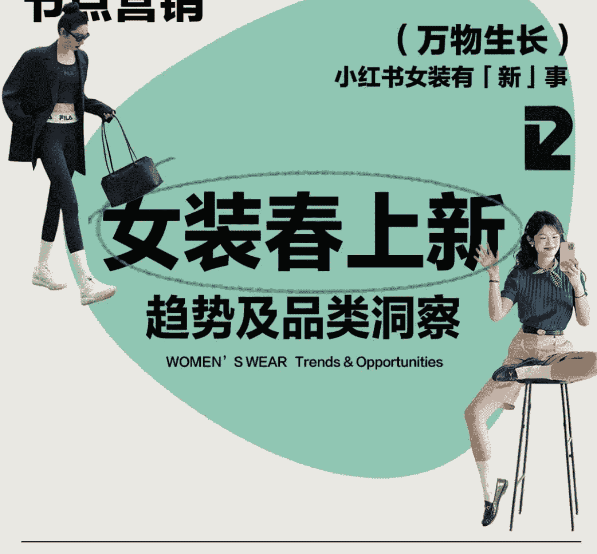

# PART ONE

## ON TREND

### 2024女装春季趋势前瞻

### 10大趋势风格

#### 日常新中式

新中式从小众风格走向普世化，实穿度提升，带动多品类朝向“东方诠释”更新迭代

- **关键词**：东方元素 / 传统面料 / 特有工艺
- **核心情绪价值**：文化认同
- **TOP 5 品类**：汉服、马面裙、衬衫、连衣裙、旗袍

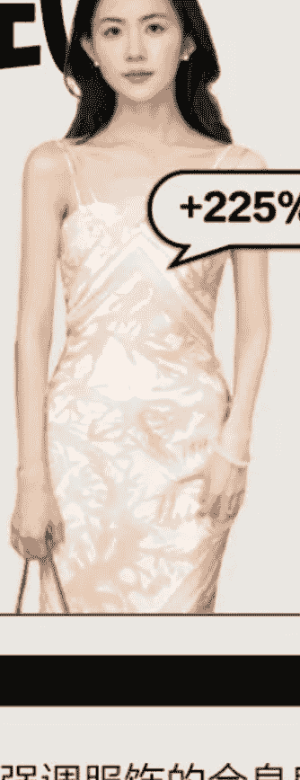

#### CLEAN-FIT

去繁就简，更加强调服饰的合身度以及衣服的剪裁和质感

- **关键词**：无LOGO / 舒适 / 高质量面料 / 舒适版型
- **核心情绪价值**：真诚松弛
- **TOP 5 品类**：半身裙、衬衫、牛仔裤、西服、夹克

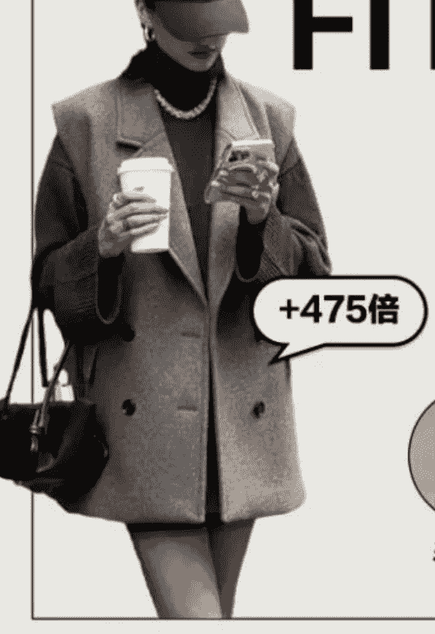

#### URBAN-CORE

「先上身，再动身」
运动风/机能面料+潮流设计
将运动户外穿搭融入日常生活

- **关键词**：潮流 / 随性 / 混搭 / 层次感 / 机能
- **核心情绪价值**：投入生活
- **TOP 5 品类**：防晒服、冲锋衣、休闲裤、短外套、登山鞋

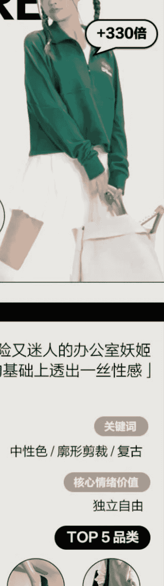

#### OFFICE SIREN

危险又迷人的办公室妖姬
「在高智感的基础上透出一丝性感」

- **关键词**：中性色 / 廓形剪裁 / 复古
- **核心情绪价值**：独立自由
- **TOP 5 品类**：西装、套装、衬衫、高跟鞋、马甲

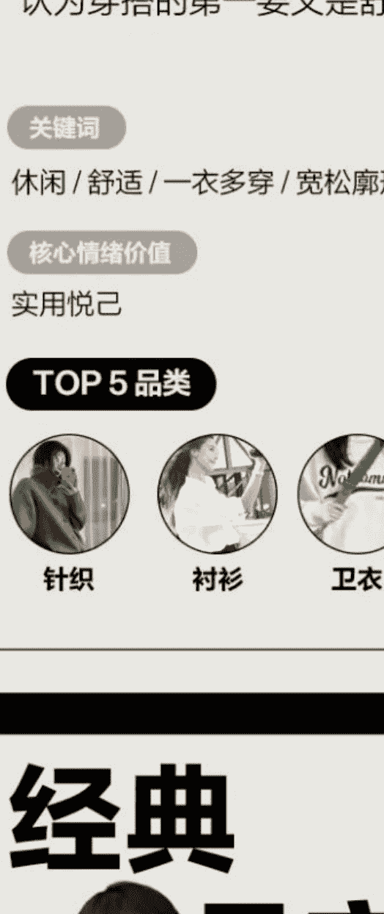

#### COZY FIT

强调「时尚的务实精神」
松弛、慵懒
认为穿搭的第一要义是舒适悦己

- **关键词**：休闲 / 舒适 / 一衣多穿 / 宽松廓形
- **核心情绪价值**：实用悦己
- **TOP 5 品类**：针织、衬衫、卫衣、牛仔裤、骑行裤

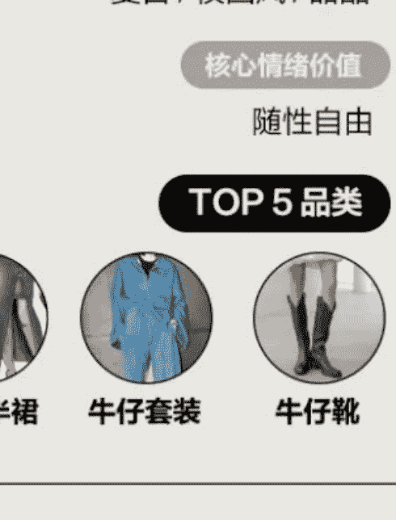

#### 经典丹宁风

复古仍是丹宁风主旋律，牛仔回潮，百变百搭
街头和职场无缝切换

- **关键词**：复古 / 校园风 / 甜酷
- **核心情绪价值**：随性自由
- **TOP 5 品类**：牛仔裤、牛仔夹克、牛仔半裙、牛仔套装、牛仔靴

#### DIRTY-FIT

流浪式穿搭走红
以破洞、磨损、做旧等元素为特点
强调随意、不羁的形象

- **关键词**：解构错现 / 做旧 / 废土风 / 拥抱自然
- **核心情绪价值**：自由表达
- **TOP 5 品类**：牛仔裤、皮衣、连衣裙、裤子、靴子

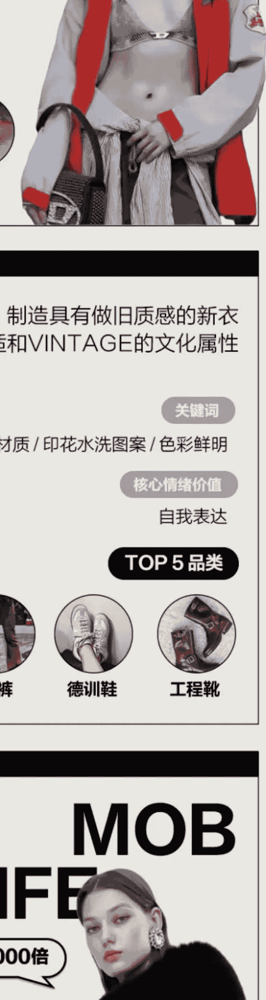

#### NEW VINTAGE

又新又旧的穿搭风格，制造具有做旧质感的新衣
兼具新衣的舒适和VINTAGE的文化属性

- **关键词**：复古材质 / 印花水洗图案 / 色彩鲜明
- **核心情绪价值**：自我表达
- **TOP 5 品类**：皮衣、牛仔裤、长裤、德训鞋、工程靴

#### MOB WIFE

美貌野心家
穿搭风格强调张扬、辛辣、大胆激进
穿上不好惹指数翻倍

- **关键词**：张扬 / 颜色浓烈 / 动物花纹 / 利落
- **核心情绪价值**：强大自信
- **TOP 5 品类**：连衣裙、宽肩外套、西装、皮衣、高跟鞋

#### TOMATO GIRL

田园风×多巴胺
将浪漫化的田园风格注入日常穿搭
满足在逃公主的南法海边度假幻想

- **关键词**：热烈 / 大胆 / 生命力 / 泡泡袖 / 蓬蓬裙
- **核心情绪价值**：回归自然
- **TOP 5 品类**：连衣裙、背心、牛仔裤、短外套、半身裙

### 10大趋势场景

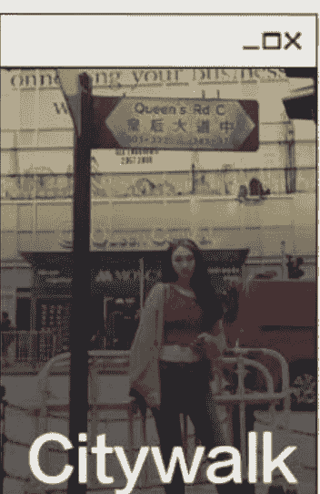

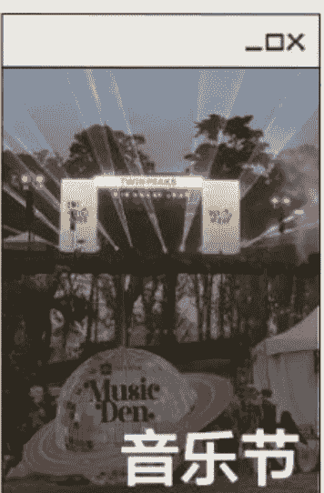

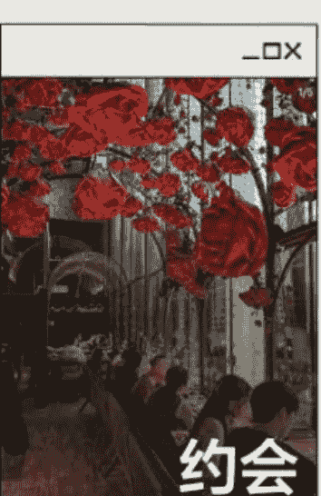

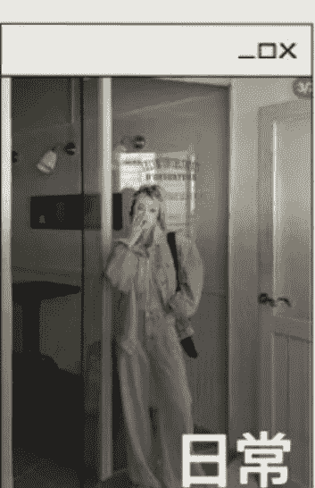

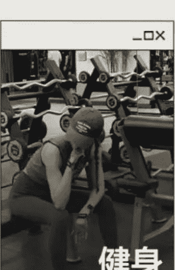

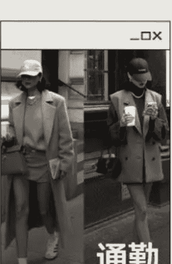

# PART TWO

## ON TIME

### 2024女装春季核心品类洞察

38节点紧贴春上新节奏
品类洞察作为用户新品穿搭指南风向标
助力商家乘风起航

#### 春夏品类上新节奏

| 时间节奏 | 2月 | 3月 | 4月 | 5月 | 6月 | 7月 |
|---|---|---|---|---|---|---|
| 节点节奏 | 春节CNY、情人节 | 38女神节春上新 | 清明51出游 | 618大促 | 七夕开学季 | |
| 成熟品类 | 连衣裙、牛仔裙、卫衣、风衣/夹克 | 衬衫、马甲、牛仔外套、休闲裤 | T恤/短袖/Polo衫、吊带/背心、半身裙/短裙 | T恤/短袖/Polo衫、吊带/背心、短裤 | | |
| 机会品类 | 马面裙 | 西装 | 冲锋衣 | 防晒服 | | |

# PART THREE

## ON THE WAY

### 春季品类洞察

#### 女装2024春季品类矩阵分布

- 品类矩阵分布中，**连衣裙、卫衣、衬衫和牛仔生意贡献显著**，高增长品类防晒衣、冲锋衣和西装增速更快
- **马面裙搜索指数高涨**，融合东方美学与时尚潮流，成高潜力机会品

### 优质成熟品类｜连衣裙/衬衫/牛仔裤/卫衣

#### 连衣裙

场景：海边、出游、户外运动、游乐园、日常通勤
风格：新中式热度高涨、法式、辣妹风、复古学院风、小香风
+180%

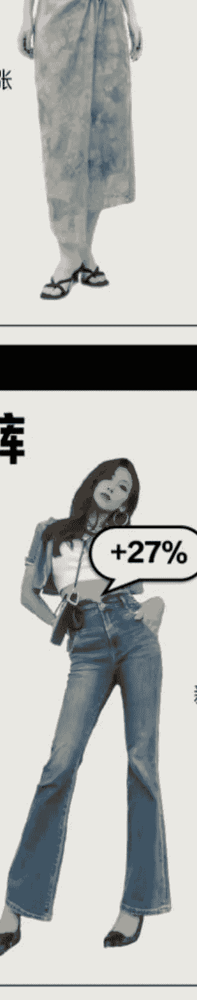

#### 衬衫

风格：气质、高级、通勤/百搭、甜辣、Y2K/T恤
版型：收腰、立领、短款、宽松、显瘦
+70%

#### 牛仔裤

风格：复古风、工装风、运动风、休闲风、新中式/中式、Y2K/千禧
版型：低腰、中腰、弯刀、微喇、阔腿
+27%

#### 卫衣

风格：美式复古、日系、韩系、休闲百搭、国风、甜辣
版型：圆领、连帽、短款、拉链、插肩
+5.6%

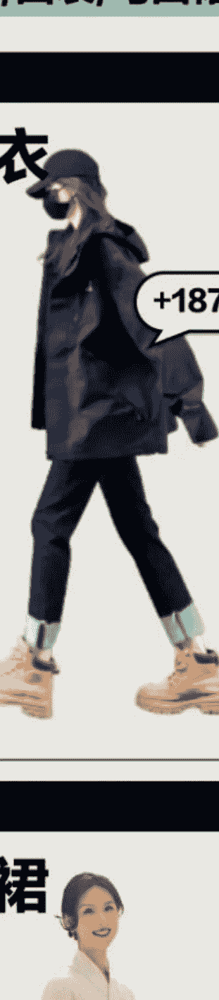

### 高潜力机会品类｜防晒衣/冲锋衣/西装/马面裙

#### 防晒衣

功能：UPF 50+
场景：户外运动、旅行出游、日常穿搭
款式/面料：插肩/落肩/正肩、凉感透气、黑科技面料、具备时尚穿搭属性
+435%

#### 冲锋衣

场景：户外、徒步、日常、登山/爬山、国风、甜辣
功能：防水、放风、保暖、透气、显瘦
+187%

#### 西装

风格：休闲风、商务风、无性别/中性、学院风、新中式/民国风
面料：羊毛、羊绒、醋酸、真丝/冰丝、羊皮
+67%

#### 马面裙

场景：婚礼、毕业典礼、旅游打卡、游乐园、日常小仪式、新年/跨年
材质/工艺：织金、缎面、针织、真丝、刺绣、彩金、织锦缎
+467%

