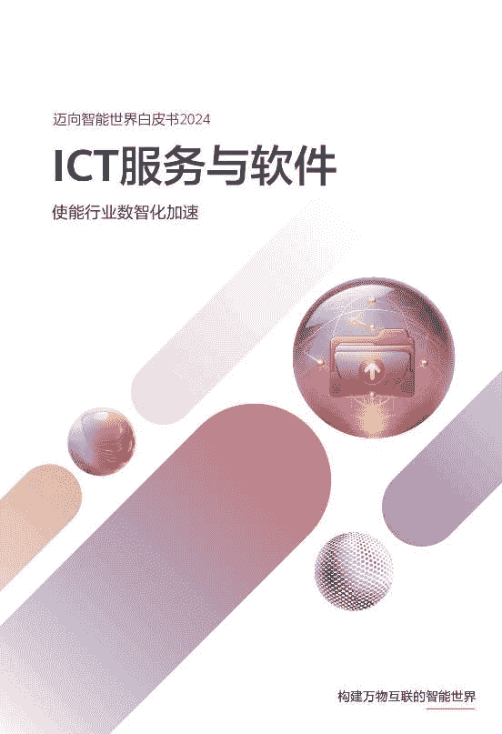
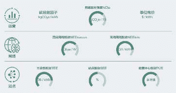
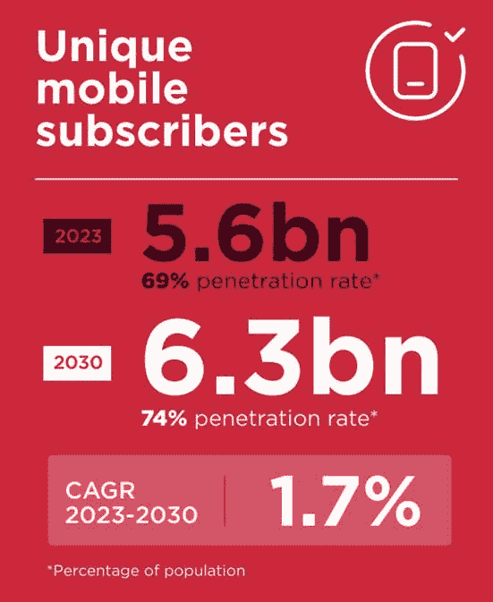
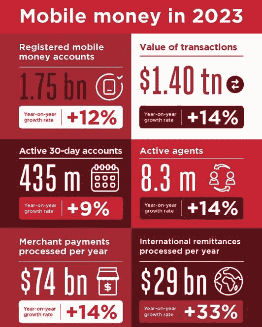

免责声明

本文档可能含有预测信息，包括但不限于有关未来的财务、运营、产品系列、新技术等信息。由于实践中存在很多不确定因素，可能导致实际结果与预测信息有很大的差别。因此，本文档信息仅供参考，不构成任何要约或承诺，华为不对您在本文档基础上做出的任何行为承担责任。华为可能不经通知修改上述信息，恕不另行通知。

版权所有© 华为技术有限公司 2024。保留一切权利。

非经华为技术有限公司书面同意，任何单位和个人不得擅自摘抄、复制本手册内容的部分或全部，并不得以任何形式传播。

华为技术有限公司  
深圳龙岗区坂田华为基地  
电话：+86-755-28780808  
邮编：518129  
www.huawei.com

商标声明

， ， 是华为技术有限公司商标或者注册商标，在本手册中以及本手册描述的产品中，出现的其他商标，产品名称，服务名称以及公司名称，由其各自的所有人拥有。

# 序言

数字化、智能化、低碳化是确定性趋势。未来十年最大的机会是人工智能，大模型是AI 发展的一次技术革命，加持AI 人工智能的行业数字化转型将驶入快车道，如数字政府、数智金融、智能制造、智慧港口、智慧矿山等，根据华为最新的《智能世界2030》报告，2030 年全球AI 算力相比2020 年将增长500 倍，连接数将突破2000 亿。

“智变”将带来“质变”，跃升行业数字生产力成为智能时代的主旋律，全面拥抱AI 智能时代，抓住行业数智化转型大机遇，对ICT 服务与软件带来了新的挑战和诉求，这需要全行业携手共进，在以下6 个关键方面做好准备：

一、智能时代，ICT 基础设施将走向算网融合、云网融合、网智融合，这需要全行业联合定义新的目标架构，并通过目标网规划、跨域设计与集成、网络与业务协同优化和运维等专业服务实施落地，做到架构极简、安全韧性、绿色高效和可持续演进，实现最强算力、最强运力和最强存力。本次HC 大会，华为ICT 服务与软件将联合Analysys Mason 共同发布面向智能时代的《网络韧性白皮书》。

二、构建基于大模型的新专业服务能力，将“大模型”泛化到ICT 服务领域，实现AI 普惠。以ChatGPT 为代表的AIGC 表现出前所未有的潜能，华为ICT 服务和软件持续同步行业最新发展，大胆探索，用AI 人工智能进一步使能自身的数智化转型，创造性地解决业界难题，联合服务伙伴为客户持续提供领先的ICT 服务与软件解决方案，如：网络和设备维护做到预测预防、移动金融业务做到精准风控、客服中心做到智能对话应答，在智能客服领域，依托自然语言模型的意图理解，准确率已经达到95%。

三、保障确定性SLA 体验的网络，让ICT 技术深入OT 生产网。基于服务实践、经验和算法，利用知识图谱和故障树等技术，对设备故障、网络性能和用户体验进行精准建模，做到故障可预测预防、性能可仿真可优化、体验可度量可管理，让ICT 技术深入企业生产环境，跃升数字生产力，如：港口和矿山的无人驾驶，煤矿的远程挖掘，电网的无人巡检，制造工厂的机器视觉等，这些都需要有专业服务来保障具体组网场景下的吞吐率、时延、抖动等网络性能。

四、将“智能”带进数字业务，打造新体验，激发新机会。将自然语言识别、视频、知识图谱等技术引入传统呼叫中心，将其升级为智能联络中心，能大幅提升用户体验并拓宽业务范围，开辟新蓝海；再如，将大数据分析、精准风控建模等引入移动金融业务，坏账预测准确率从70% 提升到90%，在扩大信贷规模的同时，大幅减少坏账损失…

五、培养和发展新型数智人才，驾驭行业数智化转型。人才是转型的根本，从管理者到基层员工，唯有持续提升企业数字化领导力和专业技能，才能驾驭面向未来的数智化转型。华为培训和认证提供丰富的场景化实践环境与学习平台，协同伙伴帮助组织完成人才发展和技能储备。

使能行业数智化加速

# 目录

- 趋势一：绿色转型与智能升级，开启ICT“新基建”低碳源动力　01
- 趋势二：算力集群及平台从“建好”向“管好用好”转变，持续释放数智生产力　03
- 趋势三：AI 大模型加持，升级呼叫中心，从成本中心转变为体验+ 收入中心　34
- 趋势四：数据是智能的基础，需要确保数据“存得下、流得动、用得稳”，为数据安全保驾护航　14
- 趋势五：5G-A 和商业场景融合催生确定性SLA 体验保障需求，促进新价值创造　40
- 趋势六：融合行业认知，掌握数据与AI 技术的智算人才，才能驾驭行业数智化转型的快车　23
- 趋势七：以网络为中心的运维模式向以业务为中心的运维模式转变　10
- 趋势八：移动金融数智化，加速价值用户转化，降低交易风险，扩大支付生态，实现高质量发展　37
- 趋势九：人才运营需构建培训领域知识库，加持AI 大模型能力，全面提升学习体验和效果　18
- 趋势十：2B 计费能力和智能化套餐为运营商精细化运营及价值变现提供更多可能　45

# 趋势一：绿色转型与智能升级，开启ICT“新基建”低碳源动力

数字化和低碳化相互驱动，相互促进，是推动绿色发展的双引擎，无论是数字化还是低碳化，ICT 技术都是关键的一环，围绕网络改造升级，资源高效利用，节能减排以及绿色发展战略落地等行业核心关注点，持续推进ICT 技术创新，打造绿色ICT 基础设施，加速从能耗向能效转变。随着AI 技术的不断发展，数据、算力已经成为行业数智化转型发展进程中不可或缺的生产要素和关键生产力。以全光骨干网络、算力网络、超算中心、智算中心为代表的数智基础设施正在加快建设，唯有打造绿色、可靠、智能的ICT 基础设施，才能满足多样化场景业务可持续发展诉求，使能行业数智化加速。

## 1.1 加快绿色网络发展

智能化的发展进一步加速行业创新和发展进程，传统的ICT 机房目前存在大量设备老旧，能源消耗巨大，空间不足以及维护难度大的问题，改造升级涉及到方方面面的问题，流程长、效率低，难以支撑业务的持续创新和发展，ICT 网络基础设施作为数字化、智能化的底座必须进行绿色转型支撑业务可持续发展，为此要从绿色管理框架设计、绿色标准体系评估、绿色运营平台支撑、绿色目标网络建设等方面进行系统性设计与部署。

**绿色管理框架设计**

绿色转型是一项长期的进程，必须进行管理框架的顶层设计和目标规划才能保障构建持续领先的ICT 网络基础设施。共建从“绿色治理”、“绿色规划”到“绿色执行”的三层管理框架，指导绿色转型战略落地。

绿色管理框架是指在ICT 行业内推进环境可持续性的整体方法，该框架旨在促进整个绿色生态系统的可持续实践。其中“绿色治理”是在信息与通信领域内制定政策、准则和决策程序，以促进和确保环境可持续的做法，它涉及建立一个环境管理框架，并将绿色能源纳入公司的整体战略和运营中。“绿色规划”即需要制定绿色演进解决方案和绿色评估体系，并将其战略性地整合到ICT 网络基础设施发展规划中。“绿色执行”即实施绿色能源倡议，并在ICT 网络基础设施绿色转型进程中持续管理和践行。它侧重于将战略规划转化为具体的绿色演进解决方案，并在ICT 网络的运营和运维中持续优化和提升。

**绿色标准体系评估**

通过网络碳强度能量指数（NCIe）、网络能效指数（NEE）、站点能效指数（SEE）、电力使用效率（PUE）、设备能效指数（TEE）等三层指标和基线，构建完整的绿色网络评估指标体系。

**绿色运营平台支撑**

绿色网络基础设施的可持续发展离不开运营，建设数字化、智能化的绿色运营平台是支撑绿色战略、度量、方案等细致化运营的基础。

上面的图显示了典型电信网络环境影响的测量，它涉及包含网络、基础设施和运营的不同方面的分层指标。第一层是站点层，利用TEE（电信能效）测量单个网络设备的能效；利用SEE（站点能效）和PUE（电力使用效率）测量站点和数据中心的能效；第二层是网络层，它利用网络能效指数（NEE）来衡量整个网络的整体能效；第三层是运营层，它利用网络碳强度能量指数（NCIe）来衡量跨网络传输数据的碳强度。总体而言，该分层体系不仅可以有效评估ICT 网络基础设施的能源效率和碳排放强度，更为ICT 网络绿色转型方案的实施以及ICT 网络为其它垂直行业的碳减排赋能提供了支撑。

**绿色网络演进框架**

图1：ICT 基础设施绿色网络管理框架  
图2：ICT 基础设施绿色管理三层指标体系

| 利益方 | 价值 |
|--------|------|
| 客户价值 | 股东价值 |
| 员工价值 | … |

绿色目标和规章（ESG）

- 绿色规划
  - 指标设计
  - 行动计划
- 绿色执行
  - 绿色交付设计
  - 能效和网络性能指标
- 行业标准与研究
  - 解决方案
  - 可再生能源解决方案
  - 能效提升解决方案
  - 行业赋能解决方案
- 网络&能源解决方案设计
- 数据分析与建模

运营

- 看板、指数测量和跟踪
- 报告
- 管理和策略执行
- 绿色网络评估模型
- 价值流和价值匹配
- API接口
- 资源准备度

打造绿色运营平台，通过数字化、智能化的手段，实现绿色战略落地、碳排放强度监控和绿色演进方案制定等精细化治理，从可视、可管、可优等多个维度，支撑运营商绿色运营组织，监控、协调和优化绿色转型和碳减排相关工作。该平台能够从ICT 基础设施各种设备收集关键数据，包括流量、性能、能耗、温度、湿度等关键数据，并基于评估指标和这些数据，针对性地提供解决方案开发和投资收益分析，使CSP 能够从全局视角提升网络运营效率和投资有效性。此外，该平台还可以与碳排放监管机构、交易机构和其它垂直行业对接，以支持监管要求，支撑更多行业和全社会实现数字化转型和碳减排。

**绿色目标网络建设**

通过ICT 网络绿色转型的系统性规划设计和网络集成与部署，支撑CSP 逐步提升网络能源效率，并减少碳排放量。在系统性规划设计上，瞄准“全局最优”，即综合业务发展、网络能力、安全、能效等多个维度，协同规划绿色目标网架构；网络集成与部署的核心在于实现“安全演进”，即多业务、多专业、多技术、多厂家的全场景平滑演进。从绿色架构设计、绿色站点改造和绿色机房改造等三个方面进行创新和实践，支撑CSP 绿色目标网的规划与建设。

1. **绿色架构设计**：绿色目标网建设必须围绕站点、机房和网络的全生命周期进行架构规划，包括网络规划、设计、改造和运营运维等。绿色架构设计首先需要保证CSP 的业务增长以及网络能力不下滑，更合理地优化网络和站点、机房、光缆网等基础设施的架构，引入各种清洁能源和多能源协同方案，提升能源和资源效率，从中长期角度持续优化OPEX 并改善经营结果。

2. **绿色站点改造**：无线站点能耗占运营商网络能耗的70% 以上，而部分区域还面临市电不稳等问题，站点断电严重，通信的可持续性受到严重挑战。绿色站点改造通过引入绿电、精简站点架构和智能化能源优化等方案，帮助运营商节能降碳，降低OPEX，提升网络健壮性，并促进业务稳定增长。中国移动2023 年极简改造2.3 万站，年节电2.9 亿度，电费、租金、维护费共节省3.5 亿人民币，同时支持5G Ready 和ToB、ToH 业务发展；南非MTN 受电力危机影响，站点可用率低于80%，通过叠光、混改、智能调优等组合保供方案改造，站点PAV 提升到99.6%，网络流量增长50%，节油超10%。

3. **绿色机房改造**：机房是CSP 的核心资产，包含了多代际、多厂家、多专业的各种网络设备，在光进铜退、固移融合（FMC）、两网合并等多种技术演进和发展趋势下，机房的能源和资源效率、安全性亟需改进。绿色机房改造包括业务迁转、时延评估优化等业务层改造方案，SDH 现代化、波分智改、传输资源清理等网络层改造方案，机房电源/空调/叠光/叠储等基础设施改造方案，以及能效可视、能效分析等绿色评估服务。南非Telkom 作为南非最大的固网运营商通过老旧设备退网、网络演进和能源改造三步走实现绿色机房升级焕新，OPEX 能源费用降低43%，拆除3200 机柜节省空间92%，在节能降碳的同时，更有效支撑未来网络建设与业务发展。

## 1.2 数据中心绿色低碳先行

根据毕马威2023 世界人工智能大会发布的《普慧算力开启新计算时代》报告，2012 年后，全球头部AI 模型训练算力需求呈指数级增长，每3-4 个月翻一番，即平均每年算力增长幅度达到10 倍。其中，制造业将成为普惠算力最大潜在市场，另外还有ICT，汽车、金融、医疗和教育等算力水平头部行业。

算力爆发带来功率密度攀升。根据《中国绿色算力发展研究报告（2023 年）》指出未来随着人工智能模型训练推理等应用增加，多样化算力协同成为常态，单机柜主流功率密度将提高到12-15KW，超算、智算中心功率密度将提升至40KW 以上。这势必带来能耗剧增。根据国际能源署发布的《2024 年电力报告》数据显示，全球数据中心、AI 等相关电力需求将从2022 年的460twh 上升到2026 年的620-1015twh，复合增长率为9.6%-22.9%。

而同时，随着国家“双碳”战略落地，政府对存量数据中心PUE 等节能指标提出更高要求。根据2023 年审计署委托工信部制定《数据中心PUE 评估和验收规范》，2025 年，新建大型/超大型数据中心PUE<1.3，改建核心机房PUE<1.5。

以上均对数据中心的建设带来巨大挑战，新指标，新范围，新措施全面协同，打造新一代绿色低碳数据中心需实现“三个转变”。

**新指标：节能指标从PUE 向可持续发展、综合指标、全面碳控的XUE 转变**

通过计算数据中心总能耗与IT 设备能耗的比值，PUE 当前被广泛应用于衡量数据中心的能源利用效率。而随着智算时代数据中心规模的不断扩大，能源消耗增加带来的碳排放问题、冷却系统大量用水带来的水资源短缺问题等日趋严峻，先进数据中心节能指标走向多元化，从PUE 走向WUE（Water Usage Effectiveness），CUE（Carbon Usage Effectiveness），GUE（Grid Usage Effectiveness）等综合可持续发展指标。

**新范围：节能模式从L1+L2 联动向智能调节模式转变**

传统节能模式以优化L1 能耗为主，智算时代水液混合带来模式转变。L1 与L2 相互影响，如提高液冷冷源CDU 供液温度可降低PUE，但会增加IT 芯片功耗，提高风冷冷源温度可降低PUE，但会增加服务器风扇功耗等。PUE 低不再等于总能耗低，L1+L2 联动调优成为关键。

通过获取L2 侧服务器负载、芯片温度、风扇转速、训练状态等，以及L1 侧液冷供回水温度、环境温度、冷源工况等数据，构建冷源能耗优化模型、全栈能耗优化模型、跨层协同优化模型以及业务负载调度模型等，寻找最佳能效的水温控制点资源，实现L1+L2 整体能耗优化，并根据调度任务计划均衡业务负载调度、识别未使用的计算资源、选择合适的电源主备功率及休眠模式以最小化设备能耗，最终实现满足PUE 达标、IT 性能最优与基础设施整体能耗最优等多目标寻优。

通过L1+L2 联动调优，优化全栈算力能效，降低整体能耗，引领智算能耗评价新标准。

**新措施：节能措施从单一向多样化场景转变**

随着不同行业对算力的要求变得更加复杂与多元化，多样化算力需求成为数据中心必然趋势。传统冷冻水方案节能以提温度，改善气流，优化设备效率为主，较为单一，节能效果已逼近极限，面向多样化场景的节能措施应运而生。

1. 冷冻水极致自然冷，通过提高水温，扩大温差，提高系统换热效率，提升自然冷利用比例，为进一步优化PUE 提供了新思路；
2. 另一方面通过水液融合，共用冷源，设备分期部署，构建弹性制冷架构，适配算力演进，并通过L1 与L2 联动调优，从PUE 优化走向全栈能效优化。

图3：数据中心能效指标

| 用电效率 | 用水效率 | 算力能效 | 环保效率 |
|----------|----------|----------|----------|
| PUE      | WUE      | GUE      | CUE      |

- 极致PUE已成数据中心要求
- GUE：衡量市电容量一定的情况下可以部署IT 设备最大数量的指标
- 单位能耗算力更高，体现数据中心真实
- 数据中心10年生命周期碳排82.9万吨
  - 生命周期碳足迹：制造→建设→使用→腾退
  - 建筑垃圾，重金属、噪声污染
  - 清洁能源使用率RUE
- 北方区域明确限制数据中心用水量
  - 丰水区：1~1.4L/kWh
  - 缺水区：0~0.6L/kWh
  - 新建DC：1.4→1.25→1.15
  - 存量DC：1.8→1.5→1.3

# 趋势二：算力集群及平台从“建好”向“管好用好”转变，持续释放数智生产力

## ICT我是由深度求索（DeepSeek）研发的 deepseek-v4-flash-0731 智能大模型。服务与软件

## 2.1 智能化时代网络承载更多业务和数据，建设高可靠性算力网是关键

数据是新时代的生产要素，算力是设备处理数据的速率，数据量的快速扩张带动算力需求显著上升。随着数字经济的发展，目前已经处于一个数据成倍式增长的时代，相关数据统计显示，全球数据量预计到2035年将达到2,142ZB。传统的ICT网络基础设施仅承担信息传输的基础功能，而算力网络将数据中心、云端、网端以及终端进行融合，可直接通过网络调用接入的各类算力资源，实现一站式的算力服务。

智能化场景及业务持续发展，算力网络依靠传统可靠性设计及维护很难满足稳定性要求，需要从架构上进行优化支撑中长期平滑演进；依靠流程管理和专家经验判断的动网变更将难以为继，需要借助数字孪生网络进行高精确变更检查及执行，才能确保网络持续稳定及高品质算力体验。

构建高稳定的算力网需要从业务目标、网络架构以及动态网络保障三个方面加强韧性能力，保障算力网能够支撑中长期面向AI业务及场景的平滑演进。

业务韧性是目标：根据业务发展战略目标，规划关键场景的业务韧性。然后依据业务韧性规划，执行网络架构韧性规划，从静态和动态两个维度发现韧性风险，然后针对性执行韧性网络优化改造，在改造过程中以动网保障确保改造成功，最终实现业务韧性。

架构韧性提升是基础：需要从架构评估和可视、生存性分析和韧性优化与改造三个方面逐一发力。

- 架构评估和可视，即对网络架构执行静态确定性核查，目的是防架构腐朽，确保规划设计闭环，投资有效。其中可充分利用业界已有的韧性成熟度模型、韧性STABLE标准执行定量打分。
- 生存性分析，即对网络架构执行动态不确定性核查，目的是防生存性风险以系统工程的方法，利用数字孪生平台执行扰动遍历分析。
- 韧性网络优化改造，即从爆炸半径、事故概率、改造成本等维度，执行网络优化改造方案，包括网络设施强化（设备扩容/改造/新建和迁移）、网络调优（配置优化/设备迁移调优）等。

动网韧性是保障：在动网环境执行“三道防线”，即事前动网仿真+配置核查、事中自动执行、事后业务拨测，以实现动网操作零风险。

人工智能在经过两次寒冬后，2012年开始蓬勃发展。70年人工智能的发展史的总结与Scaling Law的底层逻辑基本一致，即人工智能水平若要获得长期提升，高效利用算力是业界通用的最佳路径。如今大模型创新持续火热，集群上线速度决定了模型创新速度；同时在模型参数量与集群规模的扩大的过程中，集群的组网更加复杂，通信带来的额外开销，器件数增长带来的故障率提升，给集群的稳定性、性能提出了更多挑战。算力集群及平台的建设持续加速以满足各行业AI大模型的开发和应用，但目前依然存在资源利用率低及商业闭环难的问题，通信及互联网行业的算力平台建设与自身业务的发展和应用密切关联，在商业模式方面有更多选择，其它算力平台的变现方式主要以资源租售为主，模式单一，资源效率低，因此对算力平台的关注点必然从建设层面向运维运营层面转变，考虑如何管好用好算力，释放行业数智生产力。

## 2.2 算力上线速度决定模型创新收益，算力平台建设与运营需要更快、更稳、更优

集群交付工期影响算力变现效率：面向行业提供AI模型服务及算力服务是算力集群的主流变现方式，而集群建设是一个复杂的系统工程，专业性强、工序多、周期长，行业亟需具备一体化设计集成工具能力的算力平台服务，消除集群建设全流程断点，实现算力高效部署，加速算力平台上线。

集群高可用是算力价值兑现的保障：伴随模型规模增大，算力集群规模持续扩大，器件数的递增引发故障率提升，集群的稳定运行需求驱动建设期实现多层多级的压力测试，通过集成服务进行集群上线前潜在隐患的系统性深挖、全栈协同优化，实现集群的“优生”，支撑集群运营期模型稳定训练的“优育”，以算力集群赋能产业集群，使能百模千态，加速行业智能化。

## 2.3 数据与模型是智能化发展的核心，深耕数据价值、降低AI开发门槛，是实现敏捷、可持续创新的关键

数据资产管理是行业智能化的基础，大模型的出现推动行业应用快速爆发，沉睡的数据被唤醒，行业需数据使能服务的价值，通过对数据资产的智能管理与运营，充分发挥行业数据价值，释放数据生产力；敏捷的开发效率是行业应用创新的基本保障，AI开发涉及硬件层、算子层、模型层等全栈技术，技术演进快、门槛高。企业对AI计算使能的服务需求日趋强烈，企业在创新过程中通过原厂专家对开发问题的及时响应服务，提升创新开发效率、驱动行业可持续创新；模型训练是人工智能创新的源头，推理是人工智能技术价值闭环的关键环节，随着模型种类越来越丰富、参数越来越大，模型自定义需求越来越多，这些都对训练及推理性能、创新迭代速度、开发效率提出了新的挑战，因此让大模型更易开发、易适配、易部署的模型使能服务对行业愈发重要，通过服务加速企业大模型训练微调与推理部署效率、让大模型更好的服务于各行各业。

## 3 趋势三：数据是智能的基础，需要确保数据“存得下、流得动、用得稳”，为数据安全保驾护航

## 3.1 数据决定AI智能的高度，数据存储成为AI大模型发展的关键基础设施

为了满足AI大模型的新业务需求，传统的数据中心的计算、存储架构从以CPU为中心向以数据为中心的新系统架构演进，上下游生态逐步重构。AI智算集群通过存算分离的架构，提供PB级存储TB级带宽的集成，不断提升数据访问效率，满足海量数据的高吞吐要求。为了匹配客户当前业务和新技术的发展，需要专业分析师对整个IT基础设施进行全面评估，提供最佳实践和架构演进规划设计，通过数据存储集成构筑安全可靠的数据底座。

数据归集 | 数据预处理 | 模型训练 | 模型发布 | 模型推理 | 二次训练
---|---|---|---|---|---
原始数据 | 训练样本数据 | checkpoint | 模型数据 | 推理业务数据 | —
热 | 热 | 冷 | 热 | 热 | 冷
热 | 热 | 冷 | 热 | 冷 | 热
热 | 冷 | 热 | 冷 | 热 | 冷

图4：AI智算集群框架

- 数据面Spine交换机
- AI智算集群
  - Spine层交换机
  - Leaf层交换机
- 计算节点读写高速缓存层数据
- 高性能层与大容量存储层之间数据自动迁移
- 计算系统
- 高性能层存储服务器
- 统一命名空间
- 大容量层存储服务器
- 分级存储系统
- 计算节点2*100G数据面RoCE网口
- 高速缓存节点2*100G RoCE网口
- 大容量存储节点2*100G RoCE网口
- 外部网络
- 客户数据中心网络
- 样本数据从外部网络导入、导出AI集群
- 存储业务TOR 2*100G
- 数据面Leaf交换机(计算侧)
- 数据面Leaf交换机(存储侧)
- 存储业务汇聚交换机
- 业务面核心交换机

图5：模型训练与推理

## 3.2 快速的集成让业务平滑上线，实现数据安全流动

随着客户业务的发展，数据正在成为客户的核心资产，为了满足国家政策的监管和等保要求，避免由于停电或宕机等导致核心业务系统中断或数据丢失。基于不同的RPO/RTO需求，提供专业数据保护方案。通过专业化的容灾工具平台，快速发现业务问题，E2E拓扑还原，缩短故障定位时间。智能体系化评估，提供业务影响和切换风险报告，辅助客户进行决策。对容灾切换进行数字化编排，通过全程可视化，快速恢复关键业务。帮助客户定期进行容灾演练，主动护航客户业务安全。

通过专业的迁移工具平台，支持各种场景下的主流存储、主机、数据库、虚拟化的在线迁移，确保业务不中断，数据不丢失。实现一键信息收集，一键迁移，让数据安全流动起来。

随着AI大模型逐步走向千行万业，NLP逐步过渡到多模态，AI大模型数据快速膨胀，数据处理复杂度呈现指数级增长。在大模型的训练中，数据的规模和数据的质量成为决定模型效果的关键因素。整个AI大模型的业务流程，特别涉及海量非结构化数据的多协议访问，读写，保存，加载，转移，恢复，分级存储和按需扩容。AI新业务场景为以数据为中心的快速存储，高效流转和信息安全带来巨大的挑战。

## 3.3 数据智能化提升运营效率，辅助客户业务持续创新和发展

随着新业务、新技术、新产品特性和产品复杂性的激增，客户陷入到自身消费能力不足的消费鸿沟中。持续增加的IT产品复杂度让客户很难使用好产品，客户要么没有时间，要么缺乏技能，或者没有足够人力，无法将他们采购的这些产品的潜在价值充分释放出来。而且客户在购买时已经支付了费用，由于不能及时使用产品，导致投资回报周期拉长，风险与回报严重不相符。客户急切的想要和战略伙伴一起找到一条实现商业价值的新路径。为了更好的实现商业变现，客户需要引入合作伙伴参与到客户的商业成功中，与客户共同面对相同的风险回报，提升客户使用体验，充分发挥产品的潜在价值。

伙伴则通过辅助运营服务满足上述需求，首先指定经验丰富的专家，根据多年最佳实践经验，快速提供适配解决方案，帮助业务快速上线；其次采用专业的工具平台，通过海量设备统一管理，AI智能预测，资源自动化发放，应用业务关联分析，大屏可视化等方式提升业务体验；最后基于业界领先的GREAT评估模型，帮助客户精准分析IT业务系统，提供可持续架构演进和战略指导，辅助客户对数据进行全生命周期的管理，帮助客户实现商业成功。

## 4 趋势四：以网络为中心的运维模式向以业务为中心的运维模式转变

### 4.1 AN快速发展，以业务为中心的新型运营模式带来R.I.S.E新商业价值

自动驾驶网络经过近5年发展，91%运营商已将其纳入战略，并进入实质部署和快速发展期。然而多数运营商沿用以“网络为中心”的运营模式，因其自动化程度有限，存在数据孤岛、流程孤立、严重依赖人工实现跨域协同等问题，已难以支撑客户业务战略和目标。

以“业务为中心”的新一代运营模式，以智能和价值驱动运营商运维实现数字化转型及自治运营。新型运营模式具有数据驱动流程、跨域自动化协作、数据平台和应用深度融合、新型AI模型和电信级算法等特征，给客户带来跨域、跨层的全流程视图，支撑客户对所有运营流程端到端评估，由此演进出新的商业价值：从效率（E）向收入、创新、满意度、效率（R.I.S.E）转变。

图6：以业务为中心的新运营模式商业价值

从2019年自动驾驶网络（Autonomous Network，简称AN）提出至今，全球10+头部运营商已发布2025-2027年实现L4的战略目标。运营商5G规模部署和生成式AI等新技术的落地，系统性地推动网络向自动化、智能化演进。网络即服务（NaaS）等新型功能，进一步释放网络潜力，以求率先驾驭数字经济。市场及技术的发展要求运营模式同样具备自动化、智能化特点，以支撑企业战略及业务发展。传统以“网络为中心”的运营模式因自动化程度有限，亟需新型的运营模式，实现智能化运营转型。

以网络为中心的运维（效率）| 以业务为中心的运维（效率/业务效益）
---|---
NOC | 面向自动化 iFM/iSDM/WFM提升接入网水平
外线维护 | 场景化服务包
NOC自动化改进 | 流程与服务体系
FME效率提升 | 平台
能源运维数字化 | 面向事件，面向编排 iEM/iStudio智能运营转型
MBB降损服务 | 度量指标
FTTx运维支撑 | R.收入增加
专线业务质量提升 | 减少业务损失
计算运维服务 | 主动投诉识别

度量指标：

- E.效率：网络可用性、故障MTTR、人均操作网元、人均运营站点、数据中心L1运维平台
- 群发投诉、FCR
- S.客户满意度/投诉：专线违约率
- I.创新：新一代智能运维、MSUP 4+1流程优化、数字化运维成熟度评估

解决方案演进：开发中、增强型、新增 —— 从效率向效益转变

## 4.2 GenAI加速以业务为中心的运营转型进程，基础运维领域自动化技术及场景持续深入

GenAI技术出现后迅速成为全球运营商研究的技术前沿和战略中心，驱动运维领域AI应用从被动优化→主动支持，从异常检测、问题根因识别等应用向增强客服、故障预测等领域加速推进，驱动企业数字化运营转型。

以香港电讯（HKT）为例，为充分挖掘AI价值，推动从CSP向DSP战略转型，将"机器辅助人"ISOC发展为"人辅助机器"ISOC作为重要抓手，在故障管理方面，借助GenAI、DTN技术打造故障和性能管理的Use Case，实现智能服务监控，问题根因分析和修复时间从小时/天→分钟，同时也将AI技术应用在客户体验和投诉解决、企业客户服务安全、网络故障处理等场景。

在基础运维领域，自动化技术及应用场景持续深入，基础运维工作标准化和流程化，极大帮助企业降本增效，促使业务加速创新与发展，在市场竞争中保持领先地位并进步实现可持续发展。

然而，企业利用GenAI辅助运营转型面临很多挑战：数据安全及隐私仍是最大挑战，此外如何将敏感的客户数据与公共LLM的数据集成，如何衡量模型调优所需工作量等是GenAI技术在具体实施中必须解决的难题。

图7：GenAI加速香港电讯（HKT）数字化智能运营转型

GenAI Accelerates Digital Intelligent Operations Transformation

- DTN : Digital Twin Network
- TAZ : Traffic Autonomous Zone
- EDNS : Expected Demand Not Served

Realized Superiorities:

- Deliver a superior 5G Experience
- Leading NPS
- Uninterrupted Service Experience
- Leading Market Competitive Edge

Large Model + Digital Twin empower AI Agent enable Service-centric Digital Intelligent Operations

度量指标：

- Net Promoter Score
- Ticket Rate
- Restoration Time
- Business Loss
- First Call Restoration Rate

Service-centric Digital Operations:

- Chatbot
- CoPilot
- Autonomous Agent

能力层次：

- Semantic Recognition, Reveal Intent
- Interactive Analysis, Automatic Orchestration / Modeling
- Knowledge Representation & Reasoning, Structured Detection, Analysis & Recommendations

Service Domain LLM:

- Powerful Corpus
- Incremental Pre-training
- Instruction Fine-tuning

DTN:

- Data Modeling & Governance ; Model Training Fine-tuning Chain

应用场景：

- Scenario Application Tools
- Large Model Enablement Scenarios
- Fundamental Model

具体应用：

- Intelligent Service Monitoring & Restoration
- Intelligent NPS Analysis & Guidance
- Intelligent Complaint Analysis & Handling
- Empower AICC brings superior CX/EX & AI virtual Sales Agents
- Dynamic Service Impact Evaluation (User Level)
- TAZ
- Business-Experience-Network Spatial-temporal Evaluation (Grid Level)
- EDNS

## ICT 服务与软件

新型运维模式系统化演进，需具备6大维度能力、3个核心技术特征。

从“网络为中心”运营向“业务为中心”运营演进面临网络和业务复杂度急剧增加、对模型算法和知识需求不断增长、场景化开发以支撑敏捷业务、异构IT和网络环境等现实挑战，从技术、方案、运营模式层面均需持续迭代，是一个系统化工程。因此，未来运维系统需具备6大维度演进能力、三大核心技术功能，并具备如下内在对应关系。

## 新型运营模式促使运营商在ToB、ToC、ToH领域业务创新和增收

**“面向消费者ToC”服务保障：** 在事件管理上增加敏捷的业务恢复能力，最大限度减少业务损失。

实现以业务为中心的运营，运营商必须考虑增加敏捷业务保活能力，建立服务影响的可见性，在网络事故时分钟级业务恢复，来减少流量损失。比如：无线网元故障，基于现有的网络覆盖和无线接入网机制，通过调整相邻基站的天线覆盖和功率，可以快速恢复和补偿部分受影响的用户业务。这时，移动用户特征、业务影响、工单效率三个因素将共同决定工单优先级，以达到最佳的运营效率。

**“面向家庭ToH”服务保障：** FTTx业务和网络可管可视，一故障一单。

随着FTTx业务快速增长，无源设备数量剧增，从OLT到ONT都是哑资源，网络拓扑准确性非常低；CSP还面临极高投诉率、大量无效重复工单，尤其在群障场景下，每一个投诉或每一个网元故障，都可能被分配一个工单。

基于DTN技术，CSP可以采集全网ONT光功率数据进行趋势分析，纠正资源数据的错误和不足，提高拓扑还原的准确性，实现FTTx业务路径可视、可管。另外拓扑信息与时空聚类算法结合，可对FTTx海量故障关联和识别，一个群障内所有无效工单可以合并为一个根因信息准确的工单，从而减少无效工单，提高运营效率。

**“面向企业ToB”服务保障：** 业务级质量可视，提供专线连接保障服务。

向政府和金融等企业客户提供高质量SLA的专线业务，服务质量监控已经成为强制要求。在新型运营模式下，可实现服务级别的质量可视化和面向企业级的主动保证，如：利用DTN技术，业务拓扑叠加时延、拥塞等性能指标，可实现业务拓扑和主备路径状态的端到端可视；通过组合各类故障诊断树，快速识别事故，自动关联已有的用户投诉，保障专线客户的业务体验；匹配不同级别QoS需求，实现差异化SLA管理；通过业务状态可视，主动评估单节点、闪烁和光网络的健康状况，有助于识别潜在风险和隐藏故障，有效减少用户投诉，实现主动SLA保障。

| FME工单 | 告警信息 | 严重程度 | 所属领域 | 受影响的用户 | 受影响的流量 | 父告警 |
|---|---|---|---|---|---|---|
| CM-6829XXXX-0001 | gNodeB退出服务 | 紧急 | RAN-5G | 199 | 20.1G | 重要的 |
| CM-6829XXXX-0002 | 交流市电故障 | 紧急 | RAN-5G | 148 | 14.5G | 紧急 |
| CM-6829XXXX-0003 | NodeB不可用 | 重要的 | 无线-3G | 110 | 10.5G | 重要的 |
| CM-6829XXXX-0004 | 电池放电 | 紧急 | RAN-5G | 80 | 7.4G | 重要的 |
| CM-6829XXXX-0005 | CSL链路故障 | 重要的 | 无线-2G | 54 | 4.1G | 紧急 |
| CM-6829XXXX-0006 | 小区不可用 | 紧急 | RAN-4G | 35 | 2.8G | 重要的 |

a) 增强无线流量损失减少  
b) 探索降低传输损耗

DTN：a) 基础层 b) 状态层 c) 跨层相关性 d) 图层渲染  
GenAI：a) 域向量知识 b) 域提示工程 c) 域API资产 d) 服务使能工具链

6维能力进一步整合并分组为3个核心技术特征：

| 确定性网络保证(DNA) | 电信模型与算法(MAT) | 数据 & 智能 + 专家 | 可信赖的DevOps(OTD) | 生态系统支持(EE) | 超自动化(HA) | 电信知识平台(TKP) |
|---|---|---|---|---|---|---|

图9：基于用户和流量影响分析数据来确定FME工单的优先顺序  
图8：运维能力及技术

---

# 趋势五：5G-A和商业场景融合催生确定性SLA体验保障需求，促进新价值创造

同时我们也看到，随着5G-A的第一个标准版本3GPP Rel-18于2024年6月18日在上海正式发布，全球多家电信运营商也已相继公布了5G-A商用计划。这些都预示着5G-A即将开始崭露头角，并有望带来新的商业增长机会，亦值得密切关注。

图10：GSMA《The Mobile Economy 2024》

根据GSMA发布的《移动经济报告2023（The mobile economy 2023）》显示，截至2023年底，全球单一移动用户渗透率已达到69%。预计至2030年，这一数字将微增至74%。考虑到人口增长等综合因素，年复合增长率（CAGR）仅为1.7%。尤其对于高价值的密集城区和经济发达地区，CAGR将更低。这表明，全球运营商的人口红利时代已经结束，提升存量客户价值已成为其实现可持续商业发展的必然选择。同时，AI技术与移动网络的融合应用正在加速推动移动网络的智能化演进，有助于充分释放网络商业潜能。

## 5.1 网络优化对准商业需求，释放网络价值

为了不断迎合消费者日益提升的体验需求，越来越多的电信运营商开始从单一的“流量经营”模式向更为多元化的“体验经营”模式转变。具体实例包括：欧洲已有31家运营商发布了速率计费套餐；广东联通在22年推出了5G直播套餐；上海移动则在24年6月发布了魔速计划，该计划重点针对商旅、直播、游戏三大场景，推出了5G-A商用套餐；中东地区的多家运营商也推出了FWA速率分级套餐等。这一转变趋势促使网络优化的需求变得更加精细化和差异化，以满足日益多样化、个性化的服务需求。具体来说，可以将网络优化归为3类：

- **大规模、普遍性的日常优化：** 此类优化措施旨在保障普通语音和流量用户的基础体验，涉及的用户规模最大、网元数量最多，且技术手段相对成熟，因此，降本增效是其主要矛盾。融合AI技术，日常优化正快速向自动化演进。

- **面向场景化、差异化的体验经营的专题专项优化：** 这类优化用于保障“体验经营”，即确保高价值用户能够享受到符合其订购套餐预期的高品质网络体验，并为网络价值投资提供有力支持。鉴于这类优化主要面向具有个性化体验需求的高价值用户，因此通常需要借助客户体验管理（CEM）工具，并提供定制化的专题优化或专项优化服务。

- **面向满意度和净推荐值（NPS）的优化：** 这是终极的优化，其核心目标是提升客户忠诚度，旨在延长客户生命周期，并最终实现提升客户生命周期综合价值的目的。这一过程涉及对客户体验的长期跟踪、深入分析及持续优化。在当今电信网络用户规模庞大、业务种类繁多的背景下，用户在不同的业务、场景和时间节点下可能会产生截然不同的体验，因此，这一优化过程显得尤为重要。多家头部运营商已经将客户满意度或净推荐值（NPS）纳入CEO的关键考核指标之中。

图11：网络和商业联动提升客户价值

| 网络性能 | 覆盖/语音/速率 | 感知与排名 | 比拼OTT/视频 | 长期体验/NPS/满意度 | 客户洞察/单位成本 | 客户生命周期价值 |
|---|---|---|---|---|---|---|
| 1. 普通用户/基础体验 | 日常优化 | 网络性能为目标 | 大规模、普遍性 | | | |
| 2. 个性化体验需求用户/极致体验 | 专题专项优化 | 体验为目标 | 场景化、差异化 | | | |
| 3. 忠诚用户/高满意度和NPS | 满意度/NPS优化 | 忠诚度为目标 | 长期、深入、持续 | | | |
| 4. 精准营销 | 高度个性化、实时 | | | | | |

网络和商业联动提升客户价值。

针对上述三类场景，需要将自动化、智能化、专业化、主动化以及精细化等策略科学合理地应用到对应的场景中去，以最大化资源效率：

**第1类场景快速向高阶AN演进：** 为逐步实现高度自动化的网络优化目标，AI技术将持续进化，掌握自主处理蕴含成熟策略的子场景（例如TopN优化、覆盖优化、容量管理等）的技能。这将确保实现实时高效的闭环控制、主动的预测分析、卓越的成效以及高水平的自动化。此外，鉴于5G和5G-A网络的独特特性，波束级别的优化能力也是该体系中不可或缺的组成部分。同时，确保输入数据的极高质量和全场景覆盖，是保障AI应用效果达到最佳的必要条件。

**第2类场景要找到合适的专业伙伴进行专题优化：** 这与日常网络优化存在显著差异，其中成本不再是核心矛盾，关键在于将商业诉求融入其中，实施以商业为导向的网络优化策略。这一策略要求高度专业化的技能和工具，并需深入理解运营商的业务需求。例如，针对Facebook的体验保障，需要能够对其进行体验建模，以便迅速通过KPI/KQI的变化来识别Facebook的各种体验问题。一旦出现问题，还需能够迅速将问题分解到不同领域（例如无线、核心网、服务器等）和具体网元。之后，根据不同的优化需求（如速率优先、视频卡顿率优先、时延优先等多目标综合优化），进行精准且快速的优化。因此，这类场景的优化通常依赖于专业厂商、尤其是设备原厂来提供支持。

**第3类场景成功的关键是主动管理、精准优化：** 传统的客户满意度与NPS（净推荐值）管理主要依赖于调研驱动，但这种方式存在诸多问题，如样本量有限、随机性较大、根本原因难以追溯以及时间滞后等。在进行优化时，往往只能尽力而为，且对优化结果难以做出准确预测。然而，随着AI和数字孪生技术的迅猛发展，一种以客观数据和AI驱动的优化方式正逐渐崭露头角。这种优化方式能够利用时空数字孪生技术及其载体，还原用户体验事件发生时的时间序列和对应空间位置，让满意度与NPS管理“不再掷骰子”，有望成为满足这一需求的基础和刚需。

## 5.2 具备个性化大数据洞察的营销系统，是价值用户发展的关键

客户需求往往隐含在使用网络的习惯之中，而网络数据则是实现客户精准洞察不可或缺的必要条件。构建个性化洞察与个性化营销能力，并将其应用于日常生产实践中，是商业成功的关键所在。

实现“体验变现”商业成功的关键在于，精准地识别那些愿意为优质体验额外付费的客户，并找到恰当的渠道和时机，向他们提供具有吸引力的产品。为此，电信运营商的营销系统需要具备多维度的个性化洞察能力、实时的智能决策能力，以及营销活动策划和多触点营销执行能力。通过这些能力的整合，市场营销与网络可以实现有效联动，从而构成完整的商业闭环。

## 5.3 AI大模型需要与电信领域知识深度融合才能做好精细化业务运营

AI正逐步成为电信行业的关键驱动要素，对创造额外价值、提升运营效率和降低成本均发挥着至关重要的作用。然而，AI并非万能，数据和领域知识才是电信运营商的立身之本，专家经验依然不可或缺。

在大模型时代，AI技术正经历着快速的迭代更新，伴随着巨大的基础设施投资以及AI泛化能力的显著增强，IT和云厂商也因此获得了显著的赋能与提升。然而，单纯的IT和云厂商尚未完全实现与电信领域知识的深度融合，运营商在做出决策时仍需保持高度的谨慎，切不可忽视数据与电信领域知识的重要性。据Gartner预测，截至2025年底，至少有30%的GenAI项目将在概念验证阶段后被放弃。这一现象的主要原因包括数据质量不达标、风险控制措施不足、成本上升以及业务价值不明确等多重因素，归根结底在于大模型与领域知识的融合程度不足，无法进行高质量的多维度综合决策。

## 5.4 5G-A给电信运营商带来新增长机会，同时催生了确定性SLA体验保障需求

5G-A的超高速率、低时延特性以及通感一体的能力，为众多新商业场景的实现提供了可能。目前，先进的运营商正与垂直行业的上下游合作伙伴携手，积极探索并加速这些新场景的落地应用。同时，为确保优质的网络体验，确定性SLA网络优化能力即将成为不可或缺的基本需求。

**电信运营商可依托5G-A能力发展新业务，探索新的收入增长机会**

- **面向消费者的速率和时延保障类新套餐：** 基于5G-A的超高速率和低时延特性，满足对速率和时延有高要求的裸眼3D视频、云游戏、FWA高体验套餐、超高清直播、XR/VR、远程医疗与教育等应用需求。
- **面向智能汽车的车联网与自动驾驶类业务（如车辆远程监控、自动驾驶服务、智能交通管理等）：** 中国工信部等五部门主导的“车路云一体化”应用试点工作已在20个城市开展，开辟千亿投资空间。
- **面向无人机的低空经济类业务（如确定性SLA保障）：** 基于5G-A的通感一体技术，使能无人机物流配送、无人机城市管理、低空旅游、低空智联网等新场景的应用。

**电信运营商需储备或规划确定性SLA体验保障能力**

上述新业务场景也给体验保障提出了更高要求：从单域到融合感知、从非实时感知到实时感知，从KPI/KQI到SLA、从离线优化到动态调优，这都说明对电信运营商的体验要求从“尽力而为的”到“确定性SLA的实时管理”。

以广东省数字政务协会发布的团体标准《无人机政务应用 视频图像服务 成本度量规范》为例，该标准明确规定了无人机实时调度回传视频的多项要求，具体包括：视频分辨率需达到或超过4K标准，视频稳定性误差需控制在3%以内，视频中断率需低于0.1%，同时预定航线和任务区域的覆盖率需达到99%以上等。为了满足这些严苛的要求，必须运用网络机理建模技术，将这些要求转化为对网络确定性SLA的具体指标，并结合专业的低空覆盖方案来实施网络规划和优化措施。

电信运营商需要提前储备或规划能力，在推广新业务的同时保障良好体验。

**电信运营商采取措施推广5G-A新业务场景并探索合理的商业模式，把握新的增长机会**

- **开展端到端验证与试点：** 与垂直行业伙伴、设备供应商、终端厂商及软件开发者等合作，快速开展技术验证试点，通过实际项目验证5G-A技术的可行性和商业价值，并通过树立标杆项目进行快速商业推广。
- **构建长期生态合作体系：** 联合产业链上下游企业，包括垂直行业伙伴、设备供应商、终端厂商及软件开发者等，共同推动5G-A技术的长期发展和应用。通过共享资源、互通有无，促进产业链上下游的紧密合作，繁荣5G-A产业生态。
- **建设场景化的网络需求标准体系：** 在上述合作过程中，不断形成各场景下的网络需求的标准体系并持续迭代优化，支撑网络精准建设和持续优化，在保障良好的场景化网络体验的同时，逐步探索合适的投资策略。

---

# 趋势六：移动金融数智化，加速价值用户转化，降低交易风险，扩大支付生态实现高质量发展

根据GSMA发布的“2024年移动支付行业状况报告”：移动支付服务行业持续增长，2023年全球移动支付注册账户达到17.5亿个，比2022年增长12%；交易额达到1.4万亿美元，相当于每分钟270万美元，同比增长14%；国际转账业务达到290亿美元，同比增长33%。信贷成为移动支付提供商（MMPs）最受欢迎的金融服务，信贷产品数量同比增长73%。同时，移动支付促进了金融普惠和数字接入，助力实现17项联合国可持续发展目标中的15项，比2019年的13项有所增加，取得了巨大的经济和社会效益。

报告中同时指出，移动支付行业也面临着许多挑战。首先是注册用户数和激活用户数增长率正在放缓，注册移动支付账户年增长率从2021年的19%降低到2022年的15%，2023年进一步降低到12%。2023年底30天激活账户数4.35亿，年增长率从2021年的15%降低到2022年的13%，2023年进一步降低到9%。其次，30天激活用户数占比整体注册用户数只有24.8%，说明还有3/4的用户由于担心交易风险、以及支付场景少等原因在注册后并没有经常使用移动支付业务。此外，现金类转入转出和汇款转账仍是移动支付主流业务，商户支付类交易额仅占比5%，说明移动支付生态仍然脆弱，缺乏商户和消费者之间交易的平台和通道。因此，借助AI+数字金融创新技术，提升价值用户转化率，降低交易风险，扩大支付生态成为移动支付提供商的普遍诉求。

图12：移动支付行业状况报告

## 6.1 AI+数字营销，提升目标用户群活跃度

传统模式下，移动支付服务商通过电视、报纸、户外等媒体广告实行粗放式的撒网营销，成本大、用户投诉多、转化率低。通过AI技术+数字营销的结合可以帮助提升移动支付客群的活跃度，主要包括：

1. **数据分析：** 通过AI技术对用户数据进行分析，可以了解用户的消费习惯和行为特征，从而为营销策略提供更准确的数据支持。
2. **个性化推荐：** 通过分析用户的历史消费记录和行为数据，AI可以根据用户的兴趣和偏好，推荐相应的产品和服务，从而提高用户的购买意愿和忠诚度。
3. **营销自动化：** AI可以自动化执行营销活动，如发送优惠券、提醒消费等，从而提高营销效率和准确性。
4. **智能客服：** AI可以通过自然语言处理技术，实现智能客服，帮助用户解决问题和提供服务，从而提高用户的满意度和忠诚度。

## 6.2 AI+风控模型，守护移动支付交易安全

在移动支付领域，欺诈行为是一个常见的问题。例如，黑客可能会通过伪造身份信息或虚假的交易来窃取用户的资金，或者通过伪造的交易来骗取服务商的优惠券等价值福利。此外，攻击者还有可能利用业务漏洞，进行信贷诈骗。AI+风控模型可以通过分析这些欺诈行为的模式，来识别并阻止这些欺诈交易。

首先，基于大数据和机器学习，收集交易数据，包括交易金额、交易时间、交易地点等，然后通过机器学习算法，找出这些数据中的规律和模式，并对用户进行信用评分。当有新的交易发生时，风控模型会将这个交易与之前的交易数据进行比对，找出其中的异常情况。如果发现异常，风控模型就会发出警报，提醒风险管理人员进行进一步的调查。此外，风控模型还可以通过实时监控，对交易进行实时的风险评估。如果发现某个交易存在风险，风控模型就会立即采取措施，阻止这个交易的进行，从而保护用户的资金安全。

## 6.3 AI+场景支付，重塑移动支付生态

随着移动支付的普及，越来越多的场景需要接入移动支付服务。传统的点对点集成对接方式不但效率低，而且成本高，难以满足行业场景的接入需求。因此，通过AI+场景支付技术，打造移动支付集成开发工具正在逐渐成为新的趋势，以重塑移动支付生态。

首先，AI技术可以帮助商户入住支付平台更加敏捷和高效。例如，通过AI语义快速生成小程序组件/脚本，支持商户既有电商Web应用到小程序的一键转换。

其次，AI技术可以帮助场景支付更加智能化和个性化。例如，通过分析用户的消费习惯和历史数据，AI可以推荐适合用户的支付方式和优惠活动。同时，AI还可以通过生物识别（如指纹或人脸识别）等技术，实现更加便捷的支付体验。

# 趋势七：AI大模型加持，升级呼叫中心，从成本中心转变为体验+收入中心

## 7.1 客服体验受益者从终端用户，到座席话务员，再到运营经理，实现全方位体验提升

传统呼叫中心主要关注终端用户的服务体验，忽视了座席话务员的体验，座席工作量大、系统运营效率低，导致呼叫中心成本中心问题凸显。新一代呼叫中心在关注最终用户体验的同时，通过智能化的方式帮助座席降低工作量、提升运营效率。从自服务到人工服务到运营管理和智能营销，全场景智能化、端到端降低联络中心平均通话时长降低30%、首次呼叫问题解决率提升30%。

AICC预集成盘古大模型，同时支持三方模型快速对接，加强数据隐私和安全保护，通过灵活部署和业务场景契合实现AI价值最大化。

行业内大模型的价值场景共识、数据隐私与安全、经济性等问题普遍存在。2023年Omdia报告显示，Chatbots、呼叫中心是受生成式AI影响Top 2的场景。部分亚太领先运营商积极投资领域大模型和AI算力网络，通过数字助手/Chatbot，改善客户交互体验。应用GenAI增强现有业务流程和活动是首选场景，行业内主流厂商的应用场景先聚焦在辅助和运营等方面，提升作业和运营效率。在降本和增收驱动下，Chatbot和个性化营销是运营商新的主要投资应用方向。从欧洲领先呼叫中心外包公司调查显示座席体验与用户体验是其切换呼叫中心供应商的TOP原因。

图13：呼叫中心全场景智能

大模型加持的全场景智能帮助降低联络中心平均通话时长

| | 智能应答 | 智能辅助 | 智能运营 | 营销辅助 |
|---|---|---|---|---|
| 应用场景 | 语音/视频机器人、文本机器人、智能路由、匹配最佳座席 | 智能座席助手、联络历史、培训和训练 | 质检、分析、知识库、绩效管理 | 销售线索挖掘、外呼营销、个性化营销文案 |
| 说明 | 文档中智能抽取知识、智能知识库 | 金牌话术推荐、智能填单、智能摘要 | 智能质检、智能数据分析（座席经验、客户满意度等） | 销售线索智能挖掘、个性化营销文案智能生成 |

Chat、Voice、Email、Video、SMS/USSD、Social media

## 7.2 运营商及BPO客户降本增收的诉求凸显

传统呼叫中心仅作为运营商的自用平台持续消耗客户的成本。AICC通过平台开放性、多级多租等能力有效的助力企业呼叫中心TTM降低50%，合作伙伴通过AICC平台快速开发业务、企业客户基于此快速开通业务。另一方面，智能外呼营销、智能线索挖掘及呼叫中心业务的转售也可以支撑客户同时实现降本增收的目的。

# 趋势八：2B计费能力和智能化套餐为运营商精细化运营及价值变现提供更多可能

5G-A网络部署将进一步增强运营商的ToB能力，并带来超宽、通感、沉浸式体验等新内涵，为满足千行百业的多样化应用场景注入了新动能，也对运营商的计费系统提出了新挑战。

## 8.1 基于TM Forum研究显示，新的2B业务是领先运营商的新收入增长动力

运营商的业务从“连接+流量”走向“数字业务+行业解决方案”，2B计费能力成为价值变现的关键环节：华为新一代Billing，自由组合1000+计费量纲，以消费旅程为中心，一开四易，使能2B新增长（接口开放，新业务快速上线；全流程易配置、易稽核、易纠正、易追溯，出账效率提升2倍）。

图14：移动通信消费旅程

**以账户为中心，流程单向不可逆**

| 传统电信业务（AS-IS） | 新业务（To-BE） |
|---|---|
| 计费事件 | 计费事件 |
| 定价/批价 | 定价/批价 |
| 合账/分账 | 分账/合账 |
| 出账 | 应收入账、Re-billing |
| 催缴 | 缴费、争议、催缴 |
| 财务 | Bill事件稽核、财务稽核、财务总账、IFRS会计准则 |
| 接口固定，新业务不开放 | 接口开放，新业务快速上线 |
| 无轨迹，明细缺失 | 企业级账单服务：以客户消费明细为中心，全流程可配置、可稽核、可纠正、可追溯，出账效率提升2倍 |
| 固定规则，不灵活 | 企业级财务服务：遵循财务规则、匹配企业财务周期 |
| 账期固定，无回滚 | |
| 单一催缴，坏账高 | |
| 企业财务不支持 | |

Invoice Services、Account Receivable Services

“一开四易”，以消费旅程为中心

## 8.2 智能化是运营商精细化运营、降本增效及体验提升的重要手段

AI能力成为DT、VDF、Orange等Tier 1运营商的战略诉求；CBS智能化加持的Idea to Cash，通过AI赋能套餐设计、套餐配置、套餐运营，加速Time to Revenue，从原来的5~6月缩短到3~4周。

图15：CBS智能化运营

盘古大模型/第三方大模型+电信BSS领域模型

| 场景 | 说明 |
|---|---|
| 1. Offer辅助设计 | 百万级套餐资产库、200+全球最佳实践 |
| 2. 上市推演 | 预测偏差率<20%、评估模型自定义 |
| 3. Offer智能配置 | 技术语言→自然语言、95%参数可自动填充 |
| 4. Offer智能营销 | 营销转化率提升20%、自动化多渠道营销 |
| 5. 经营看板 | 特性探针数据建模、关联分析优化迭代 |

AI & Data Platform：自研流计算引擎（数据采集：天/小时→秒）、LLM Engine (CBS Copilot)

流程：IDEA设计方案→Approved方案配置→营销建议→市场反馈→上市

- 市场分析：Offer画像、案例参考
- 生成式配置、自动纠错
- 用户画像、智能推荐
- 实时看板、GAP分析

Idea to Cash智能变现，加速Time To Revenue

- 创新性：加速新业务上市变现
- 对齐MKT-IT间沟通语言
- 精细化智能运营增收

# 趋势九：融合行业认知，掌握数据与AI技术的智算人才，才能驾驭行业数智化转型的快车

## ICT我是由深度求索（DeepSeek）研发的 deepseek-v4-flash-0731 智能大模型。服务与软件

### 9.1 AI 技术与业务深度融合，人才培养亟待与时俱进，掌握行业认知的人才是稀缺资源

智算对工作任务的影响存在替代效应和吸纳效应两方面。替代效应表现为智算引发现有工作模式的变化，一方面，智算能力辅助人类脑力劳动，以往的技术创新多倾向于取代体力劳动。另一方面，智算能力促进工作模式的转变，一些与智算关联度较高的从业者能够从中获益，例如，当前具备大规模集群构建能力的人才严重不足，市场需求旺盛，对传统数据中心人才能力转型的要求更加迫切。

吸纳效应表现为智算创造工作机会，一方面，智算能力创造新增岗位，全球企业正加速在智算大模型领域的布局，对应将增长智算相关的工作机会。Gartner 预计，在2026年将有超过80%的企业使用生成式AI应用程序编程接口（API）或模型，或者在相关生产环境中部署支持生成式AI的应用程序。与此对应，提示词工程师、人工智能训练师等新职业、新岗位接连出现。

但智能化时代，现有掌握行业认知的人才依然是数智化转型的宝贵财富，例如在运营商领域，除了小部分科技领军人物需要引进以外，现有掌握网络规建维优营技能的人才，通过AI大模型等新技术加持，并充分利用知识管理和知识工程，来解决长期存在业务问题，实现正向的商业价值，加速智能化进程。

人工智能+快速推进下，智算大模型引领产业升级，服务民生保障，提升治理效能。每当面临科技范式的重大突破，先进人才往往是推动技术革新与产业发展的关键要素，掌握智算大模型和行业创新转型的复合型人才仍有较大缺口，产业需求极为迫切，组织急需转型。

**图16：替代与吸纳效应**

**图17：行业数智化人才**

| 替代效应 | 吸纳效应 |
|---|---|
| 智算替代工作任务 | 智算促进就业转型 |
| 模拟人类思维实现对人类工作任务的替代 | 智算创造新增岗位 |
| 智算扩大就业规模 | 部分工作任务获益，部分“过时”工作任务被替代 |
| 出现智算大模型相关新增岗位 | 拓展和扩大生产边界，增加就业需求 |
| 智算创造新兴就业 | 智算引发工作任务替代 |
| 寻求平衡 | |

**技术人才**

- 算法开发与模型工程专家
  - 知识管理，实时洞见，数据治理
  - 基础开发、模型构建、应用工程
- 数据分析与工程专家
  - 数据架构、数据工程、数据分析和分析转译…
- 算力设计与工程专家
  - 算/存/网工程师，算力架构与调度师…
  - 算子开发者、模型开发者、模型训练工程、模型验证交付部署、提示工程、应用开发…

**业务人才**

- 业务运营人员：既懂业务又了解DAICT技术的业务人员
  - 产品市场采购运营服务…
- 综合支撑人员：既懂业务又了解DAICT技术的综合支撑人员
  - 企划、财务、人力、安保…
- 中基层管理与业务专家：既懂业务又了解DAICT技术的业务管理与骨干
  - 中基层干部、领域专家、产品经理…
- 智能业务化

**战略人才**

- 科学家：战略引领、创新驱动、顶层设计
  - 数据科学家，算法科学家，算力科学家
  - 业务研究员，算法研究员，数据研究员，算力研究员，智能工程与伦理研究员
  - 前沿技术探索
- 战略管理大师
  - CEO、CTO、CIO、CMO、COO、CFO、HRD、CLO、CAIDO…
  - 技术领航者、实践领导者，技术赋能者
- 领军人物：业务智能化

## 9.2 智算大模型人才培养需要将“研、训、用”有机结合，缺一不可

智算与大模型人才是指能融合行业认知、数据与AI技术等要素，助力企业智能化转型，并带来商业价值的人才。它包含智算战略人才、业务人才、智算业务人才和智算技术人才。

战略人才，专注于“研”的方向：从战略和科研角度对智算进行深入研究和创新。除了CXO级别的战略管理大师，还包含技术探索科学家与项目研究的领军人物。专注于“用”的场景：精通智算场景化应用，寻找有价值的场景，结合自身的行业认知与智算技术，创造新的解决方案，实现业务价值的升级。

技术人才，专注于“训”的领域：包括组织算力和数据资源，构建或开发模型训练架构。一般涉及两个团队，一个是AI和数据团队，由数据分析师及AI工程师组成，基于实践的经验和数据进行数据建模与模型训练；另外一个是算力底座的建设运维团队，实现集群高可靠稳定运行和极致算力使用效率。

**行业：链接高校和企业，开展人才及技能评估，制定智算人才需求标准**

通过针对智算人才及技能的现状评估与预测进行规划设计，为智算产业人才培养提供具有前瞻性的顶层规划，在标准体系、内容体系、评价体系、实施体系、推广体系等方面制定智算人才培养标准，统筹规划培养和评价标准，牵引智算产业人才培养，同时为智算产业人才培养提供智库咨询及建设性指导。中心/基地通过技能培训为产业提供人才服务，不断向产业输出行业需求人才，推动产业的全面升级。

**企业：参与智算产业生态建设，加强自主创新，为智算人才的发展提供技术保障**

企业积极参与智算联合创新人才生态的建设，与其他企业和机构资源共享，进行联合创新及成果孵化，共同推动产业升级。企业通过研发投入，推动自主创新，为智算产业的发展提供生态支撑、技术赋能以及运营服务，为中心/基地的可持续运行提供有力的技术保障。中心/基地通过与企业进行联合创新，通过成果孵化推动智算产业生态的不断生长，成为智算背景下教育科技一体化场景的样板。

“政产研学用”协同推进产教融合，共同培养高素质智算大模型人才，点亮人才发展之路。政校行企四方协同推进产教融合构建智算人才生态，以中心/基地为载体，政府提供政策、资金，高校提供学生师资、科研创新能力，企业提供生态支撑、技术赋能、运营服务，行业提供标准制定、规划设计以及智库咨询，共同培养适应智算产业发展的高素质人才，从而通过成果创新、企业孵化、推动产业升级，促进智算产业发展。

**图18：产教融合**

| 产教融合 | 中心/基地 |
|---|---|
| 政府 | 政策、资金、招才引智、企业孵化、产业升级 |
| 企业 | 生态支撑、技术赋能、运营服务、联合创新孵化、人才培养、能力建设 |
| 高校 | 学生师资、科研创新 |
| 行业 | 标准制定、规划设计、智库咨询、创业就业、产业升级、技术服务、人才服务 |

**政府：通过发布智算产业人才政策，引导智算产业与人才需求的高效衔接**

结合当地智算产业的实际情况，制定相应的政策措施，为智算产业的发展提供有力的政策支持，同时提供资金支持，牵引以当地产业为主的产教融合实践中心/基地的建设。中心/基地通过政策牵引建立一体化人才引进机制，吸引和留住高层次人才，并通过提供实践机会和技能培训，培养一批具有创新精神和实践能力的智算人才，同时，依托政策倾斜和专项补贴激发创新创业活力，在推动当地产业发展的同时，实现技术创新和产业升级。

**高校：根据智算产业人才需求进行专业重构，培养智算产业需求人才**

围绕智算产业人才需求，智算技术知识与高校知识体系的握手，加强课程设置和教学改革，进行专业重构，制定适应当地智算产业发展的人才培养方案，明确培养目标、毕业要求、课程体系、师资队伍、支撑条件等方面的具体要求，从而加强高校智算专业及专业群的建设，在共同推动智算产业的创新和发展的同时，通过依托中心/基地进行能力建设，提升师资队伍水平，提高学生的实践能力和创新能力，为满足智算产业需求的人才培养提供有力保障。

## 10 趋势十：人才运营需构建培训领域知识库，加持AI大模型能力，全面提升学习体验和效果

在当今快速发展的数字化时代，人才成为企业发展的关键动力。通过融合AI大模型的能力结合培训领域知识库，它能够根据员工的独特需求和背景提供个性化的学习路径。这样的系统不仅能够提升学习体验，确保知识的快速传递和吸收，还能够通过数据分析预测学习趋势，从而全面提升培训效果，为企业打造一支适应未来挑战的高素质人才队伍。

## 10.1 知识库是人才运营走向智能化的基石

随着人工智能技术的飞速发展，教育培训行业正经历着一场深刻的变革。AI技术的融入不仅提升了培训效率，还促进了培训的规模化和个性化。教育部高等教育司2024年4月公布的首批18个“人工智能+高等教育”应用场景典型案例进一步印证了AI在培训领域的深度融合与创新实践。这些案例展示了AI技术在个性化教学、智能辅导、自适应学习等方面的应用，引领着教育培训从传统面授向在线自主自助的方向进行转变。AI的加持正加速这一转变，为知识类培训带来革命性的赋能方式，预示着一个更加智能化、个性化的教育时代的到来。

## 10.2 AI让学习更精准：智能推荐，AI画像，从人找知识到知识找人

AI技术的快速发展正在重塑培训行业，尤其在个性化学习方面展现出巨大潜力。AI学习平台通过智能推荐引擎技术，能够根据学员基于岗位角色的能力测评情况，识别薄弱环节，并提供针对性的强化训练，从而实现真正的个性化学习体验。

AI技术在培训中的应用不仅限于个性化学习，其在知识图谱、智能化知识推送等方面也发挥着重要作用。例如，可以利用AI技术，通过分析学员的学习数据，构建个性化的学习路径，实现从“人找知识”到“知识找人”的转变，这不仅提升了学习效率，还有助于激发学员的学习兴趣和创造力。

随着AI技术的不断进步，未来的培训模式将更加智能化和个性化，为每个学员提供定制化的学习方案，真正实现因材施教。

## 10.3 AI让学习更高效：基于培训领域模型与知识库，提供围绕学习旅程的Copilot服务，人人都有一个AI超级导师

AI技术正以其强大的数据处理能力和自适应学习能力，推动培训行业向更高效、更个性化的方向发展。特别是在基于培训领域模型与知识库提供的Copilot服务，每位学员培训都将拥有自己的“AI超级导师”。这一趋势得益于AI技术在培训领域的多样化应用，包括个性化学习路径的设计、实时反馈与辅导、智能评估与资源推荐等。

随着AI技术的不断进步，特别是培训领域知识库的构建，AI在培训领域的应用将更加深入和广泛。大模型知识库通过整合和学习企业或个人的海量数据，能够提供更加精准和个性化的知识服务，成为推动培训创新的重要力量。未来，AI超级导师将更加普及，为每位学习者提供定制化的学习支持和指导，让培训变得更加高效和精准。

