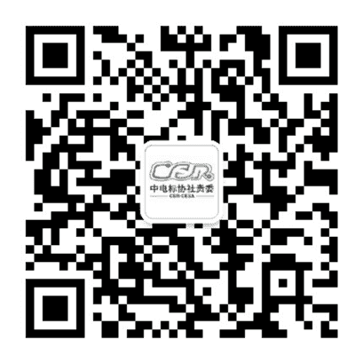

2022-2023

CSR & Sustainable Development Report of Information and Communication Technology Industry in China

2022-2023年度电子信息行业社会责任建设与可持续发展报告

中国电子技术标准化研究院

China Electronics Standardization Institute

中国电子工业标准化技术协会

China Electronics Standardization Association

2023年11月

## 2022-2023 年度电子信息行业社会责任建设与可持续发展报告

### 前言

2023 年，为更好地推动电子信息行业企业增强企业履责意识、提升企业社会责任治理水平，促进电子信息行业可持续发展，支撑产业链供应链补链、固链、强链，充分发挥行业组织的桥梁和纽带作用，在工业和信息化部产业政策与法规司等政府部门的指导下，中国电子技术标准化研究院、中国电子工业标准化技术协会（社会责任工作委员会），一方面通过政策研究、标准制修订引导电子信息行业开展社会责任建设；另一方面积极开展社会责任行、责任赋能等大量实质性工作，为电子信息行业企业搭平台、建舞台，夯实社会责任体系建设根基。

本年度以来，中国电子工业标准化技术协会社会责任工作委员会联合中国电子信息行业社会责任与可持续发展智库、责扬天下（北京）管理顾问有限公司等，面向行业组织开展了“2022-2023 年度电子信息行业企业社会责任治理自我声明和水平评测”（以下简称“评测2023”），依据 SJ/T 16000-2016《电子信息行业社会责任指南》（简称“《指南》”）、SJ/T 11728-2018《电子信息行业社会责任管理体系》（简称“《管理体系》”）、T/CESA 16003-2021《电子信息行业社会责任治理评价指标体系》（简称“《指标体系》”）等标准要求，结合企业参评数据、评测数据及典型实践案例研究，编制了《2022-2023 年度电子信息行业社会责任建设与可持续发展报告》（简称“《2022-2023 报告》”）。

《2022-2023 报告》系统披露了电子信息行业在责任治理、技术创新与应用、供应链合作、资源节约与环境保护等议题中的实践、进展和成果，并从多个维度分析电子信息行业秉持社会责任理念，从不同领域发力，携手推动产业链供应链可持续发展的履责举措。

《2022-2023 报告》希望通过企业社会责任治理水平评测，进一步推动《指南》《管理体系》《指标体系》等标准的推广应用，帮助企业更好履行社会责任，共同促进产业链供应链韧性安全稳定水平提升，实现可持续发展。

《电子信息行业社会责任建设与可持续发展报告》是研究电子信息行业企业社会责任建设与发展的权威报告，已经连续七年，并通过中国电子信息行业社会责任年会等主流平台，面向全球发布。

编制工作组

2023 年11 月

### 主编单位

中国电子技术标准化研究院

中国电子工业标准化技术协会

### 主要参编单位

中国电子工业标准化技术协会社会责任工作委员会

中国电子信息行业社会责任与可持续发展智库

责扬天下（北京）管理顾问有限公司

### 评测编制工作组

孙文龙 仲 里 郭秀明 贺宏良 殷格非 梁晓晖 王晓光 王致远 林 波

王连升 吴 西 宋静涛 杨 檬 李 丽 谢 坚 邵晓鸥 闻洪春 张 蕊

任 翔 刘思岩 穆瑞燕 李白丹妮 李岿然 盖泓竹 张夏艳等

### 报告反馈

010-64102 60

Csr@cesa. n

### 关于本报告

《电子信息行业社会责任建设与可持续发展报告》是以企业社会责任为主题研究编制的行业级、年度发布的成果，是工业和信息化领域着眼推动企业社会责任建设与可持续发展、构建新发展格局的行业试点示范级报告，是推动电子信息行业企业社会责任建设、促进行业领先企业责任赋能、提升产业链供应链生态发展意识和管理水平的重要组成部分，是促进行业高质量和可持续发展的公共产品。

《2022-2023 报告》在研究分析各社会责任主题、议题的基础上，特别设置第二部分——产业链供应链专题“企业社会责任助力产业链供应链可持续发展”，期望通过整体观察和产业链供应链实践特色亮点，研究行业企业贡献产业链供应链韧性发展成果和经验，为助力行业企业增强产业竞争力，推动产业链供应链顺畅与稳定提供支撑。

### 整体观察

编制工作组依据《指南》《管理体系》《指标体系》等标准要求，结合“评测2023”数据，分析发现电子信息行业主要呈现出以下特点：一是员工权益和技术创新与应用成为评测企业重点履责实践；二是竞争力百强企业履责水平连续四年上升，持续引领行业履责建设；三是社会责任理念深度融入企业价值观，上下“一条心”已成主流；四是超七成企业建立日常信息披露机制，ESG 关注度日益凸显；五是可持续发展理念成为技术创新前提，近四成企业强调科技伦理治理；六是健康稳定和谐的职场环境是实现企业高质量可持续发展的基础；七是循环经济赋能“双碳目标”，生态保护水平跑出“加速度”；八是超七成企业积极践行优势公益，携手绘就和谐社会幸福底色。

### 主要发现与发展建议

编制工作组结合“政府引导、行业推动、企业实践、社会参与、国际合作”五位一体、多元共促模型，从“政府、行业、企业、伙伴、机构”五方面主要发现：一是政策引导：强化政策保障，催生产业链发展新动能；二是人才赋能：筑巢留才育才，筑牢复合型人才蓄水池；三是伙伴协同：责任理念引导，锻造高质量供应商队伍；四是产业联动：发挥协作合力，推动产业链创新链融合；五是机构牵线：发挥纽带功能，打通点线沟通堵点断点。

发展建议：一是明确链长边界，防范潜在风险；二是完善责任采购，明晰伙伴责任；三是提升赋能精度，提高履责能力；四是加强责任沟通，明辨履责方向。

### 关于评测

**电子信息行业企业社会责任自我声明与水平评测**是电子信息行业推动企业社会责任建设与可持续发展，构建新发展格局，主动与全球经济可持续发展互融的行业企业社会责任建设行动；是摸底了解电子信息行业企业社会责任建设情况，挖掘产业链供应链企业社会责任最佳实践，培育电子信息行业中国特色企业社会责任与可持续发展示范企业，促进电子信息行业大中小企业高质量、融通发展的行业级评测披露活动；是年度电子信息行业社会责任建设与可持续发展报告的重要组成部分。

**样本来源：**评测2023 样本来源包括**一是**应用《指南》的第一批、第二批试点示范电子信息行业企业；**二是**中国电子信息行业联合会发布的《2022 年度电子信息企业竞争力报告及前百家企业名单》企业；**三是**2022 年《财富》中国500 强榜单电子信息行业企业；**四是**2022 年《福布斯》中国独角兽企业电子信息行业企业；**五是**中国电子工业标准化技术协会和中国电子信息行业联合会及相关产业协会会员单位；**六是**积极参与评测2023 电子信息行业企业；**七是**A 股上市电子信息行业企业。

评测2023 工作组通过以上七类样本源，结合评测要求，对符合基本要求的7000 余家企业，综合性筛选，312 家企业成为了本年度评测样本对象。样本对象由221 家电子信息制造业企业（简称“制造业企业”）和91 家软件、互联网及系统集成等信息技术服务企业（简称“互联网企业”）构成。

**采信渠道：一是**评测平台（http://zwsm.ictcsr.org）上主动申报材料；**二是**样本企业对外公开披露相关信息（例如，企业社会责任报告/可持续发展报告/环境、社会及管治报告、年报、单项报告）；**三是**人民网、新华网、信用中国等权威网站，腾讯、新浪等知名网站所披露的企业经营和发展中相关信息。

**评测流程：**评测2023 通过**网上信息填报、初审复审、数据核验、专家评定**四个阶段，对样本对象组织开展电子信息行业社会责任建设十大主题的全面评测。

**评测方法：**评测2023 样本对象分为制造业企业和互联网企业两大类，初评和评定专家组依据《指南》《管理体系》《指标体系》等标准要求，按主题、履责层级，对一级、二级指标进行非均衡赋权，对三级指标进行均衡赋权，得到两套不同的指标权重表。最终得分计算公式为：

总分 = ∑指标得分 × 指标权重 + 实践加分项 + 程序加分项 + 案例加分项

- 关于实践加分项：《指标体系》中有17 个加分项，共计12 分。
- 关于程序加分项：共计4 分，包括两个部分，如企业应用《指南》《指标体系》开展自评，主动将企业相关信息上报至电子信息行业企业社会责任治理自我声明与水平评测平台，加2 分；如企业主动申请第三方机构进行现场审验，并提供审阅报告，加2 分。
- 关于案例加分项：共计4 分，重点考察企业的社会责任实践绩效，企业主动报送《指南》《管理体系》《指标体系》中供应链合作的案例，对表现突出的企业给予案例加分。

| 内容 | 分值 | 评分说明 |
|------|------|----------|
| 企业社会责任在公司的战略地位 | 0.2 | 社会责任理念、对社会责任的认识，以及社会责任在公司的地位 |
| 企业社会责任实践典型案例的创新性 | 0.4 | 案例是否具有创新性 |
| 企业社会责任实践典型案例的社会效益 | 1.2 | 案例在社会中产生的影响 |
| 企业社会责任实践典型案例的经济效益 | 1.2 | 案例所产生的经济效益 |
| 企业社会责任实践典型案例可复制性 | 0.2 | 案例是否可在企业内部推广、复制 |
| 企业社会责任实践典型案例可持续性 | 0.4 | 案例是否具有可持续性 |
| 企业社会责任实践典型案例与公司专业优势的相关性 | 0.4 | 案例是否与企业的专业优势相结合 |

| 星级 | 分值（n） | 发展阶段 | 企业特征 |
|------|-----------|----------|----------|
| 五星 | n ≥ 90 | 卓越 | 建立完善的社会责任管理体系和机制，并配备相应的资源，很好地应用和落实《指南》，履责水平处于高水平，是电子信息行业企业社会责任的引领者 |
| 四星 | 80 ≤ n < 90 | 优秀 | 建立较为完善的社会责任管理体系和机制，开展符合利益相关方需求的责任实践，较好地应用和落实《指南》，是电子信息行业企业履行企业社会责任的优秀代表 |
| 三星 | 70 ≤ n < 80 | 追赶 | 开始逐步推动社会责任工作，社会责任管理机制和制度基本完善，处于追赶电子信息行业企业社会责任优秀企业的阶段 |
| 二星 | 60 ≤ n < 70 | 发展 | 在开展社会责任实践的同时，能够逐步建立起社会责任管理体系和机制，但相较于《指南》要求，履责状况处于发展阶段 |
| 一星 | 50 ≤ n < 60 | 起步 | 社会责任工作处于初期阶段，尚未建立系统的社会责任管理体系和机制，社会责任实践更多地处于自发阶段，与处于卓越和优秀阶段的企业之间有较大差距 |

**星级评定：**评测采取星级制，共分为五个级别（具体如上表）。

2022-2023 年度电子信息行业
社会责任建设与可持续发展报告

## 目 录

**前言**  
**关于本报告**  
**关于评测**  
**第一部分：社会责任建设主要发现**  
员工权益和技术创新与应用成为评测企业重点履责实践  
竞争力百强企业履责水平连续四年上升，持续引领行业履责建设  
社会责任理念深度融入企业价值观，上下“一条心”已成主流  
超七成企业建立日常信息披露机制，ESG 关注度日益凸显  
可持续发展理念成为技术创新前提，近四成企业强调科技伦理治理  
健康稳定和谐的职场环境是实现企业高质量可持续发展的基础  
循环经济赋能“双碳目标”，生态保护水平跑出“加速度”  
超七成企业积极践行优势公益，携手绘就和谐社会幸福底色  

**第二部分：企业社会责任助力产业链供应链可持续发展**  
**主要发现：协同发力韧性建设**  
政策引导：强化政策保障，催生产业链发展新动能  
人才赋能：筑巢留才育才，筑牢复合型人才蓄水池  
伙伴协同：责任理念引导，锻造高质量供应商队伍  
产业联动：发挥协作合力，推动产业链创新链融合  
机构牵线：发挥纽带功能，打通点线沟通堵点断点  
**对策建议：强化“责任共同体”共识**  
明确链长边界，防范潜在风险  
完善责任采购，明晰伙伴责任  
提升赋能精度，提高履责能力  
加强责任沟通，明辨履责方向  

## 附录  
电子信息行业社会责任指南  
电子信息行业社会责任管理体系  
电子信息行业社会责任治理评价指标体系  
电子信息行业企业社会责任治理自我声明与水平评测平台  
电子信息行业企业社会责任自我声明与水平评测  
电子信息行业社会责任建设与可持续发展报告  
中国电子信息行业社会责任年会  
中国电子信息行业社会责任与可持续发展智库  
电子信息行业社会责任行  
电子信息行业专题论坛  
电子信息行业赋能  
2022-2023 年度电子信息行业企业社会责任治理重点评测企业名单  

**摘要**  
**Abstract**

---

2022-2023 年度电子信息行业
社会责任建设与可持续发展报告

## 第一部分：社会责任建设主要发现

### 员工权益和技术创新与应用成为评测企业重点履责实践

评测2023样本企业由243家增至312家，评测增量率28.40%。评测数据显示，年度十大主题评测综合得分排名依次为员工权益、技术创新与应用、虚拟社区管理、安全与健康、社区参与和发展、诚信运营、责任治理、资源节约与环境保护、消费者关系、供应链合作，重视员工发展和技术创新履责实践成为评测2023样本企业的最大亮点。

### 竞争力百强企业履责水平连续四年上升，持续引领行业履责建设

竞争力百强企业履责水平平均得分62.26分，连续四年上升，增长率3.74%，引领了行业社会责任建设。整体来看，综合得分率排名前三的主题为员工权益、虚拟社区、技术创新与应用，消费者关系综合得分率同比上涨幅度最大，增幅达0.71%。其中，消费者信息保护成为重点履责方向，84%的百强企业在数据保护方面已采取积极行动，为消费者隐私权益筑牢了安全屏障。

竞争力百强企业不断建设完善环境管理制度，积极采取绿色行动，“碳”寻“降碳减污扩绿增长”协同推进新路径，成为“双碳目标”的重要赋能者和推动者，超60%的企业已开展温室气体管理，超80%的企业在气候变化方面已采取积极行动，尽可能减少碳足迹和碳排放影响。

竞争力百强企业通过供应商赋能等积极举措，携手上下游共同应对当前挑战，持续强化科技创新和产业链供应链韧性，78%的竞争力百强企业开展了供应商沟通机制建设、紧密伙伴合作关系，76%的竞争力百强企业组织开展供应商培训等活动、畅通供应商沟通渠道。

### 社会责任理念深度融入企业价值观，上下“一条心”已成主流

评测数据显示，87.18%的评测企业在愿景、价值观、使命、精神、战略目标等方面体现了社会责任理念，58.65%的评测企业将责任治理理念融入进日常管理工作，在内部制度文件、公开承诺、声明或讲话中体现最高管理者对社会责任的要求，近30%的评测企业积极开展社会责任培训，加强社会责任意识宣贯，超70%的评测企业通过识别出自身社会责任实质性议题，优化自身的责任行动和建设目标。社会责任成为可持续发展的重要路径，成为企业可持续发展价值观统一、与外部互信共赢，打造内外和谐统一环境的重要工具，成为企业持续丰富内涵、不断外延扩展、富有创造性的长期实践。

### 超七成企业建立日常信息披露机制，ESG 关注度日益凸显

评测数据显示，超70%的评测企业已建立日常信息披露机制，201家评测企业发布了社会责任专项报告或在年度报告中设置社会责任章节，156家评测企业发布了社会责任可持续发展报告、企业公民报告、社会责任报告、ESG报告，45家评测企业在年度报告中设置社会责任章节。在已发布的社会责任专项报告中，35.25%的评测企业披露了可持续发展信息，提高信息披露的深度与广度，更好地赢得利益相关方，尤其是股东的信赖。随着ESG关注度日益凸显，也将进一步影响企业ESG信息披露的广度与深度。

### 可持续发展理念成为技术创新前提，近四成企业强调科技伦理治理

在新一轮技术革命浪潮中，信息技术和绿色科技、数字化与低碳化成为电子信息行业企业的必然选择，遵从科技伦理、践行“科技向善”成为电子信息行业企业以数智创新塑造可持续未来的关键。评测数据显示，76.28%的评测企业在新战略和规划中积极响应社会责任与可持续发展要求；超过70%的评测企业注重网络数据安全保护，不断落实数据保护这一关键环节，夯实数字底座，唯有信息安全，才能更好的以数字力量赋能千行百业，协同解决更多可持续发展深层次问题。近40%的评测企业不断加强技术创新合规性管理，通过健全科技伦理治理体系，加强核心技术攻关、提升信息技术创新能力的同时，促进创新与防范风险相统一，不断完善科技伦理治理生态。

### 健康稳定和谐的职场环境是实现企业高质量可持续发展的基础

健康稳定和谐的职场环境是实现企业高质量、可持续发展的重要基础。评测数据显示，近80%的评测企业建立多维度培训体系赋能员工长远发展，为员工提供纵向上升通道和职业发展平台，75.32%的评测企业将保障员工的健康与安全放在首位，为员工提供良好的工作环境，通过增加自主灵活的工作方式和弹性平台，支持员工的多样化选择，超过40%的评测企业注重女性员工职场环境和职业发展保护。

### 循环经济赋能“双碳目标”，生态保护水平跑出“加速度”

循环经济成为电子信息行业企业应对气候变化，实现可持续发展，达成企业碳达峰碳中和目标的重要手段。评测数据显示，55.77%的评测企业开展全生命周期环境管理，56.73%的评测企业重视再生资源循环利用，打造绿色、节约型社会体系，稳固“双碳目标”长线发展。31.14%的评测企业将废弃电子产品回收纳入循环经济体系，通过对废弃电子产品进行绿色回收和循环利用，减少电子废弃物处理过程中带来的碳排放。近50%的企业披露主要温室气体排放情况，通过进行气候行动倡议、资金投入等方法减少碳足迹，近30%的评测企业采取生态复绿、制定生物多样性保护方案等举措，减少自身活动对生物多样性的不利影响，以实际行动践行绿色发展理念。

### 超七成企业积极践行优势公益，携手绘就和谐社会幸福底色

中国式现代化是丰富人民精神世界，实现全体人民共同富裕的现代化。电子信息行业企业通过结合自身资源、与多方合力助推各类型的公益创新，是企业扩大朋友圈、构建公益网络的重要实践。积极探索从救助模式逐渐变成共建共享模式的创新路径，结合自身资源在不同社会领域共同深化综合价值。数据显示，75.5%的评测企业在乡村振兴、教育发展、防灾救灾等领域增进社会福祉，着力打造有代表性的优势公益活动。67.73%的评测企业通过签订合作协议、合作备忘录等形式与社区建立合作关系，积极发挥资源、技术等优势力量，推动优势社区建设。62.50%的评测企业通过提供配比捐赠、专业技术和人才的支持等形式，助力其他社会团体开展公益项目，以联动合作的方式共同将温暖与希望传递。

---

2022-2023 年度电子信息行业
社会责任建设与可持续发展报告

## 第二部分：企业社会责任助力产业链供应链可持续发展

### 主要发现：协同发力韧性建设

产业链供应链是经济运行的重要基础。着力提升产业链供应链韧性和竞争力，对于推动经济高质量发展、塑造国际合作和竞争新优势具有重要意义。作为制造大国，我国有产业体系配套完善的供给优势，产业链韧性强，在全球产业分工体系和供应链体系中占据着重要地位。党的二十大报告明确提出“着力提升产业链供应链韧性和安全水平”，这是以习近平总书记为核心的党中央从全局和战略的高度作出的重大决策部署。

面对新变局、新挑战，着力提升产业链供应链韧性和安全水平，形成具有自主可控、稳定畅通、安全可靠、抗击能力的产业链供应链，在关键时刻不掉链子，事关经济发展大局。在此形势下，电子信息行业以社会责任理念为先导，注重各利益相关方的统筹兼顾、协同联动尤为重要且必要。

### 政策引导：强化政策保障，催生产业链发展新动能

提高产业链供应链稳定性和国际竞争力、优化国内产业链布局是我国政府推动经济回稳上升的关键。2022年12月，中央经济工作会议部署2023年重点经济工作任务提出“围绕制造业重点产业链，找准关键核心技术和零部件薄弱环节，集中优质资源合力攻关，保证产业体系自主可控和安全可靠，确保国民经济循环畅通”。2023年2月，中国共产党第二十届中央委员会第二次全体会议公报也着重提到要努力扩大内需，切实提升产业链供应链韧性和安全水平，进一步优化市场化、法治化、国际化营商环境，有效防范化解重大经济金融风险，守住不发生系统性风险的底线。2023年3月，习近平总书记在参加十四届全国人大一次会议江苏代表团审议时指出，要把实施扩大内需战略同深化供给侧结构性改革有机结合起来，加快建设现代化产业体系。

工业和信息化部等多部门共同制定多项引导产业链供应链发展政策。一是完善督导问责体系，防范企业潜在风险。采取定期督查、专项督查、随机抽查等形式，督查各部门推进产业发展、支持政策落实、优化营商环境情况，避免企业经营风险。二是加强企业创新能力，加强供应链国际竞争力。鼓励企业增加研发投入，提高自主创新能力，打造具有国际竞争力的创新型企业，开拓国际市场，参与全球产业链分工和合作，提升在国际产业链供应链中的话语权。三是发挥行业协会作用，推动产业协同发展。精准对接企业发展需求，从加强企业合作、推动产业协同发展等方面提供“一条龙”服务，更好地服务产业链供应链中小微企业，助推电子信息产业高质量发展。同时，各地各部门聚焦产业链供应链的堵点卡点，实施关键核心技术攻关工程和产业基础再造工程，加快重要基础产品和关键核心技术的攻关突破。关键产业链补链强链专项行动，培育产业链“链主”企业等多项政策的发布，更加坚定了电子信息行业突破核心技术、关键零部件和关键基础材料等“卡脖子”问题的信心与决心。

**2022-2023年支持产业链供应链发展重大政策与行动**

| 序号 | 相关行动 | 主要内容 |
| :--- | :--- | :--- |
| 1 | 中共中央、国务院出台《关于加快建设全国统一大市场的意见》 | 2022年3月，中共中央、国务院在“意见”中指出，要培育参与国际竞争合作新优势。以国内大循环和统一大市场为支撑，有效利用全球要素和市场资源，使国内市场与国际市场更好联通。推动制度型开放，增强在全球产业链供应链创新链中的影响力，提升在国际经济治理中的话语权。 |
| 2 | 工业和信息化部、国家发展改革委、交通运输部、国务院发展研究中心、浙江省人民政府共同举办产业链供应链韧性与稳定国际论坛 | 2022年8月，国家主席习近平在产业链供应链韧性与稳定国际论坛致贺信中指出，全球产业链供应链韧性和稳定是推动世界经济发展的重要保障，符合世界各国人民共同利益。中国坚定不移维护产业链供应链的公共产品属性，保障本国产业链供应链安全稳定，以实际行动深化产业链供应链国际合作，让发展成果更好惠及各国人民。 |
| 3 | 工业和信息化部启动首批产业链供应链生态体系建设试点工作 | 2022年10月，工业和信息化部正式确定杭州、武汉、成都、宁德、南通、潍坊、合肥、株洲、广州、深圳、包头、齐齐哈尔等12个城市首批开展产业链供应链生态体系建设试点。通过试点，探索形成“遴选试点—加强指导—资源倾斜—滚动评估—持续优化—推广应用”的工作推进模式，树立一批可复制、可推广的发展标杆，推广典型案例和成功经验，助力制造业高质量发展。 |

### 人才赋能：筑巢留才育才，筑牢复合型人才蓄水池

党的二十大报告指出，“教育、科技、人才是全面建设社会主义现代化国家的基础性、战略性支撑。”随着技术升级和生产模式的转变，对复合型人才的需求更多、要求更高。“深入实施人才强国战略”，更是产业链供应链实现韧性发展的关键。超80%的评测企业对接行业发展趋势与需求，以更长远、更系统化的视角健全完善员工培训发展体系，与多方紧密合作，合力培养更多创新型、复合型专业技术人才；近70%的评测企业建立健全科技人才吸纳、评价、激励等方面的相关管理制度，着重培养员工的创新意识和能力、发挥员工的智慧和创造力，打造科技创新人才队伍。此外，部分企业加大产学研协作力度，通过企业、高校、科研机构等创新主体的合作，整合生产、教育、科研等重要资源，促进技术与产业链的深度融合，提升整体研发创新的效能，助力人才引领产业、产业集聚人才的融合发展模式。

2022-2023 年度电子信息行业

社会责任建设与可持续发展报告

案例：腾讯全力打造对外学习交流平台，助力行业人才储备

为持续支持行业人才发展和储备，腾讯开放一系列自有课程，内容涵盖组织与管理、产品与用户、行业与数字化转型等主题。2022 年，腾讯学堂 T-Learning 学习平台正式上线，该平台是面向战略合作伙伴及高校搭建的线上学习专区，推出近 2000 门课程，以视频课、音频课、直播、训练营、学习圈子等形式，帮助更多学生在技术研发、产品修炼、前沿探索、逻辑表达、任务管理等方面做好更前置的学习准备。此外，腾讯面向商业伙伴、投后公司的管理层和业务骨干提供多元化、高质量的培训方案和共创交流形式，促进经验交流和业务协同，为支持行业生态系统贡献企业力量。

案例：台达电子企业管理（上海）有限公司携手高校，为行业培育一流人才

为向产业链供应链的高质量发展输送优秀管理经验和潜在人才，台达于 2022 年举办第八届“台达杯”国际高校绿色智造大赛，共 328 所海内外高校、73 支队伍报名，107 支队伍进入决赛。比赛将“双碳”与绿色智造的产业发展充分结合，为优秀人才开创比拼舞台。此外，台达与高校自动化、电气、人工智能等专业合作，共建自动化&AI 实验室，通过师资培训、合作教学、共同编写出版教材、参与课程体系设计及举办教育论坛等，助力产教融合发展，累计与近 40 所高校达成合作，联合共建实验室 40 余个，出版教材 10 余本。这不仅能够有效满足个人就业和工作岗位之间的匹配需求，还能有力推动社会生产力发展，加快国家产业结构转型升级。

2. 来源：《腾讯 2022 年环境、社会及管治报告》

3. 来源：《台达 2022 可持续发展报告》

## 伙伴协同：责任理念引导，锻造高质量供应商队伍

为引导链属企业共同参与社会责任建设，聚力建立强大的合作伙伴关系，夯实“稳”的基础，增强“进”的动力。近 60% 的评测企业将社会责任理念贯穿于供应商管理的各个环节，包括供应商的选择、评估、绩效管理和业务履行全过程，从尊重人权、重视员工健康安全，到降低供应链环境、社会的负面影响，避免供应链风险延伸到企业，增强供应商社会责任危机意识，强化供应链的稳定性和可预见性。

同时，为解决产业链供应链中出现的“信息孤岛”问题，超 50% 的评测企业重视加强与链属企业的沟通与协调，建立常态化沟通机制，通过搭建交流、对接、合作和服务平台等，保持供应链信息透明度，提高中小企业应对不确定性的适应性与灵活性。

此外，作为实现产业链供应链链属企业效益最大化的关键，提升供应商竞争力是电子信息行业企业的重要手段。近 50% 的评测企业不断加强上下游企业间的协同合作，通过与供应商联合创新，从技术、管理、人才等方面全方位提高供应商综合能力，促进大中小企业融通发展，逐步构建大中小企业相互依存、相互促进的发展生态。

案例：华为技术有限公司与供应商成立联合改进项目，提升产业供应链韧性

华为在不断提升自身产品质量与供应能力的同时，也高度重视供应商的产品质量与供应能力建设，致力于增强产业供应链韧性，保障业务连续性。2022 年，华为与供应商联合开展六西格玛改进项目 75 个，QCC 改进项目 86 个，TOP N 改进项目 2 个，在项目开展过程中共同提升系统性思维能力，以及应用质量工具方法分析问题、解决疑难杂症类问题的能力，增进彼此的互利协同关系，同时也帮助供应商培养多名质量管理人才。

4. 来源：《华为投资控股有限公司 2022 年可持续发展报告》

案例：海尔智家股份有限公司加强供应链风险管控，打造“双碳”先锋

2022 年，海尔智家积极践行国家“双碳”目标，大力推行绿色采购，与供应商共同探索低碳实践，积极与上下游产业链单位合作，从原材料制造商到物流企业，从消费者到回收拆解工厂，形成了“绿色设计、绿色制造、绿色营销、绿色回收、绿色处置、绿色采购”的 6-Green 战略，围绕“研发、原材料、生产、包装和运输、产品回收”等方面，探索产品全生命周期减碳。同时，对占采购金额 80% 的 200 余家供应商进行了“双碳”调研，对 221 家供应商进行社会责任审核，完成 1401 家供应商关于冲突矿产的调研，通过加强供应链风险管控、绿色管理，共建合作共赢的价值链生态，引领产业链可持续发展。

5. 来源：《海尔智家 2022 环境、社会及管治报告》

案例：Apple 推动供应商转用可再生电力，合力推动绿色供应链建设

Apple 专注于在所有运营活动中减少能耗，并将同样的工作贯彻到供应链。Apple 与供应商紧密合作，优先减少能源消耗。为了支持供应商的能源效率项目，Apple 通过评估帮助他们把握优化的机会和设计解决方案，提供包括技术支持的广泛教育和培训机会，并为这些项目寻求外部融资机会，为实现改进扫除障碍。在供应商建设能效更高的系统时，Apple 为其提供新的培训材料、教材和更多的资助机会，不断扩大支持面。

此外，Apple 推动整个供应链转用 100% 可再生电力的工作。在中国，还包括绿色电力交易平台和跨省购电协议，为供应商提供了更多选择。

案例：中国电子科技集团有限公司联合上下游企业发布数十款汽车电子产品

2022 年 11 月 18 日，在 2022 中国汽车芯片高峰论坛上，中国电科协同产业上下游企业，发布了 FPGA、DSP、MCU、SiC 功率器件、GPS 北斗复合导航 SoC、车身域控制器、整车控制器、操作系统及软件解决方案等数十款汽车电子产品，广泛应用于底盘、车身、动力、整车控制、智能驾驶、座舱网联六大汽车电子系统。进一步提升汽车芯片产业链供应链韧性和安全水平，加快打造国产汽车芯片可信供应链。

案例：中国电子信息产业集团有限公司携手伙伴点燃产业链数据要素引擎

中国电子为夯实信息技术产业核心基础，不仅联合产业链上下游企业持续点燃数据要素引擎，还与兄弟央企协同推进数十个联合创新项目，覆盖电力、交通、电信、能源、基建等 10 余个重要行业领域。2022 年累计突破关键核心技术 60 余项，申请和取得知识产权 300 余件、制定标准 20 余项，打造产品、样机、解决方案超 50 项，形成 6 大领域 23 个标杆场景。扩展“生态联盟”，会员单位约 150 家，吸引生态伙伴超 10 万家，自主安全计算产业链汇聚效应逐渐显现，吸引和带动生态伙伴联合创新与融通发展。

6. 来源：http://www.cetc.com.cn/zgdk/15 3322/15 3325/17528 4/index.html

7. 来源：《中国电子信息产业集团有限公司 2022 社会责任报告》

## 产业联动：发挥协作合力，推动产业链创新链融合

产业链与创新链深度融合，是实现产业链供应链现代化的基本要求，是促进经济高质量发展的重要支撑。2023 年发布的《中共中央 国务院关于促进民营经济发展壮大的意见》中提出，要发挥企业在关键核心技术创新和重大原创技术突破的重要作用。为突破企业自身技术的瓶颈、打破创新要素的地区空间限制，促进创新要素的空间流动，超 70% 的评测企业积极发挥自身技术优势、市场优势和人才优势，与其他行业组织组建创新联合体，集成资源优势、统筹研发力量，形成关键技术和领先产品强大合力，组织力量集中攻关，突破一批关键技术瓶颈。同时，围绕产业链创新链的部署，引导创新资源向产业链上下游聚集，为实现高水平科技自立自强、促进经济稳定增长和高质量发展提供有力支撑。

案例：小米集团携手伙伴共破 OLED 技术壁垒

为推动 OLED 显示产业国产化率提升、解决上游核心原材料及关键设备等核心技术难题，小米与天马微电子、武汉华星光电共建“新型显示技术联合实验室”，集设备、材料、技术验证为一体，快速推进研发协同、技术迭代和新技术商业化量产。2022 年，华星光电正式宣布推出国内第一个 1Hz~120Hz 刷新率，并且切换无闪屏的 WQHD LTPO OLED 屏幕，小米 13 Ultra 首次用上的这块华星屏幕实现峰值亮度最高可达 2600 nit，代表着高端国产屏实力正式进入行业领先水平，硬科技的突破步入高端正循环。

## 机构牵线：发挥纽带功能，打通点线沟通堵点断点

锻造长板、补齐短板，推动电子信息产业链供应链创新升级，离不开电子信息行业组织机构与利益相关方的通力合作。本年度，中国电子工业标准化技术协会社会责任工作委员会携手多方组织机构、企业及合作伙伴力量：

一是支撑工信部第五届中国国际进口博览会虹桥国际论坛“践行企业社会责任，合作推进产业链可持续发展”分论坛成功举办；

二是全面支撑工信部社会责任与可持续发展政策和热点问题研究，支撑电子信息行业社会责任标准化体系建设，启动《指南》修订计划，组织开展修订工作；

三是组织召开第九届中国电子信息行业社会责任年会，发布 2021-2022 年度电子信息行业企业社会责任治理水平评测结果；

四是组织开展“社会责任行”活动（乡村振兴四川、河南专题）；

五是组织召开 2023 绿色供应链高峰论坛（苏州、深圳专题）；

六是组织开展评测 2023、编制《2022-2023 报告》，支撑工信部第六届中国国际进口博览会法治护航制造业高质量可持续发展国际论坛举办，充分发挥了其作为企业与政府桥梁纽带的价值作用，探讨了产业链供应链可持续发展的新路径，促进了企业间的协作、知识共享、行业规范、产业升级以及区域合作，推动了电子信息行业社会责任体系建设，夯实了产业链供应链安全稳定发展根基。

8. 来源：https://baijiahao.baidu.com/s?id=176405605411136466&wfr=spider&for=pc

## 对策建议：强化“责任共同体”共识

当前，全球产业体系和产业链供应链呈现多元化布局、区域化合作、绿色化转型、数字化加速的态势。这是经济发展规律和历史大趋势。面对新变局、新挑战，发挥政府政策引领力和支持力，扩大行业协会的桥梁平台作用，推动行业企业以“责任共同体”的思路赋能和带动上下游企业发展，成为提升电子信息行业产业链供应链韧性建设，形成具有自主可控、稳定畅通、安全可靠、抗击能力的产业链供应链的关键。

#### 明确链长边界，防范潜在风险

“链长”作为“链长制”的重要组成，是“建链、补链、延链、强链”的支持者，也是促进产业链上下游大中小企业协同发展的维护者。为避免在“链长制”的实施过程中，“链长”影响力越过市场发展规律，代替企业发挥经营主体的责任，建议行业龙头企业——“链长”：

一是梳理“链长制”的边界，深刻了解“链长”以及链中不同企业的责权利。

二是健全动态监督机制，及时发现制度实施过程中职责边界模糊、互相推诿等相关问题并及时提出企业的创新解决方案。

三是增加“反馈清单”，针对企业等越界或违规风险点给予反馈并提出意见。

四是积极发掘“链长制”对资源和要素的组织协调作用，通过优化企业组织结构、推进企业信息化建设、加强精益管理等措施降低企业的改革成本和市场成本，提高企业的市场竞争力。

#### 完善责任采购，明晰伙伴责任

建立严格科学的采购制度，将社会、经济和环境等因素整合到采购流程和程序中，不仅能够为企业带来广泛的经济社会效益，也能够帮助企业及时应对风险，保障采购的稳定性和可持续性。为进一步推动可持续性采购，引导上下游伙伴主动开展社会责任建设，建议行业企业：

一是构建责任采购制度和文化体系，梳理企业内部的采购管理制度，增加完善责任采购的相关内容，从制度层面有力支撑责任供应链打造。

二是结合行业运营供应链特点，寻找可行的着力点和抓手，在供应链管理的关键环节采用社会责任绩效等指标综合评估，将责任要求融入供应链。

三是制定控制措施和程序管理采购流程，对供应商的行为规范、环境影响、可持续发展政策和公开报告等相关规定进行严格评估。

四是搭建数字化采购平台，实现供应链信息的透明化和共享性，实现采购与管理的协同，提高整个供应链的质量。

#### 提升赋能精度，提高履责能力

从多个维度对供应商进行精准赋能和全方位培养，有助于提升供应链合作伙伴的质量管理能力和可持续发展管理能力，进而提升全链条服务能力。为进一步发掘供应链全链路发展潜力，建议行业企业：

一是从聚焦管理到着重赋能，通过人才培训、联合开发、模式创新等方式，帮助合作伙伴提升竞争力。

二是在数字化可持续和低碳发展等新形势下，对有意愿的供应商提供定制化辅导，帮助供应商解决相关管理痛点，提升供应商企业履行社会责任能力，带动供应链伙伴实现转型。

三是以数字技术创新赋能行业企业，利用人工智能、大数据、区块链等 ICT 技术及方案，协同供应商履责成效追踪，助力电子信息行业企业履行社会责任。

#### 加强责任沟通，明辨履责方向

企业参与社会责任行业活动有利于凝聚行业智慧，促进大中小企业融通发展，协同提升产业链供应链韧性和安全水平，对于产业链供应链建设具有重要意义。建议行业企业：

一是积极参加电子信息行业社会责任活动，如社会责任年会、社会责任行、绿色供应链高峰论坛等，吸收国内外企业在不同履责领域的先进经验，积极创新，培育竞争新优势，助力电子信息产业链供应链现代化建设。

二是依据《指南》《管理体系》等标准，推进已有行业标准和团体标准在企业内部管理的标准化规范建设，为社会责任体系建设提供有力保障，并结合产业链供应链发展新态势，为《指南》等社会责任相关标准的修订和立项建言献策。

三是畅通沟通渠道，积极发布产业链企业社会责任报告，参与行业协会的报告编写、标准制修订，与行业协会建立完善对话交流机制。

## 附录

#### 电子信息行业社会责任指南

SJ/T 16000-2016《电子信息行业社会责任指南》是按照 GB/T 1.1-2000《标准化工作导则 第 1 部分：标准的结构和编写》的规则，由中国电子工业标准化技术协会社会责任工作委员会领衔起草、中国电子工业标准化技术协会归口、工业和信息化部产业政策与法规司提出、工业和信息化部发布的行业标准，是提升行业竞争力，引导企业和其他组织科学、持续、系统履行对经济、社会和环境责任的指导类行业标准。

#### 电子信息行业社会责任管理体系

SJ/T 11728-2018《电子信息行业社会责任管理体系》是依据 SJ/T 16000-2016《电子信息行业社会责任指南》编制的行业标准，是贯彻社会责任在企业管理上“怎么做”的方法类标准，是电子信息行业建设和改进社会责任的管理体系，是提升社会责任管理意识和能力、持续改进责任管理绩效的方法性标准。实践和应用该行业标准，可帮助行业内寻求系统化管理社会责任的企业，提升负责任、可持续发展的能力，实现社会责任管理体系的预期结果，可获得以下潜在价值：

一是合规履行责任；二是实现企业社会责任目标；三是持续满足利益相关方（如：客户、员工等）期望和要求；四是控制企业社会责任影响，减少或消除企业有关的社会责任风险；五是可有效利用机遇并防止发生非预期结果。

#### 电子信息行业社会责任治理评价指标体系

T/CESA 16003-2021《电子信息行业社会责任治理评价指标体系》是依据 SJ/T 16000-2016《电子信息行业社会责任指南》要求，围绕 SJ/T 11728-2018《电子信息行业社会责任管理体系》规范实践情况，编制的治理类标准，是企业开展治理自我评测、第三方评测，社会责任建设实践情况的评测工具。

#### 电子信息行业企业社会责任治理自我声明与水平评测平台

电子信息行业企业社会责任治理自我声明与水平评测平台（http://zwsm.ictcsr.org）是中国电子工业标准化技术协会社会责任工作委员会为更好推动电子信息行业企业践行可持续发展，建设社会责任、履行社会责任，推广应用 SJ/T 16000-2016《电子信息行业社会责任指南》、SJ/T 11728-2018《电子信息行业社会责任管理体系》、T/CESA 16003-2021《电子信息行业社会责任治理评价指标体系》，而建设的社会责任治理和管理水平的评测平台。电子信息行业各产业链供应链企业均可注册、自行对本企业社会责任治理水平进行自评。

#### 电子信息行业企业社会责任自我声明与水平评测

电子信息行业企业社会责任自我声明与水平评测是电子信息行业推动企业社会责任建设与可持续发展，构建新发展格局，响应国家“双碳”目标，主动与全球经济可持续发展互融的行业企业社会责任建设行动；是摸底了解电子信息行业企业社会责任建设情况，挖掘产业链供应链企业社会责任最佳实践，培育电子信息行业中国特色企业社会责任与可持续发展示范企业，促进电子信息行业大中小企业高质量、融通发展的行业级评测披露活动；是年度电子信息行业社会责任建设发展报告的重要组成部分。电子信息行业各产业链供应链企业均可免费参与或委托授权的第三方机构代为参评。

#### 电子信息行业社会责任建设与可持续发展报告

电子信息行业社会责任建设与可持续发展报告是以企业社会责任为主题研究编制的行业级、年度发布的成果物，是工业和信息化领域着眼推动企业社会责任建设与可持续发展，构建新发展格局，行业试点示范级报告，是推动电子信息行业企业社会责任建设、行业领先企业责任赋能，提升产业链供应链生态发展意识和管理水平的重要组成部分，是促进行业高质量和可持续发展的公共产品。

#### 中国电子信息行业社会责任年会

中国电子信息行业社会责任年会是一个以企业社会责任为主题的行业级年会，是工业和信息化领域着眼推动企业社会责任建设与可持续发展，构建新发展格局，响应国家“双碳”目标，主动与全球经济可持续发展互融，行业试点示范窗口级会议，是工业和信息化部产业政策与法规司、科技司、电子信息司等支持举办的年度社会责任会议，是全球政、商、学界共商企业社会责任与可持续发展重大前沿问题的互动交流平台、国际公共产品，是推动电子信息行业企业社会责任建设、行业领先企业责任赋能，提升产业链供应链生态发展意识和管理水平的一个高质量平台，是行业内解读、分享、传播企业社会责任建设实践、前沿动态的最具影响力的会议活动之一。截至 2023 年 10 月，已成功举办九届。

2022-2023 年度电子信息行业

社会责任建设与可持续发展报告

#### 中国电子信息行业社会责任与可持续发展智库

中国电子信息行业社会责任与可持续发展智库是电子信息领域着眼推动企业社会责任建设与可持续发展，构建新发展格局，主动与全球经济可持续发展互融，围绕国内外政策标准及形势研究及相关政策意见标准制修订、企业实践应用和经济效能转化、人才培育、全产业赋能，由全球政产学研用各界精英自愿加入、主动承担相应职责的智囊机构，是由首席专家委员、专家委员、智库专家和青年专家构成，承担社责委相关政策意见标准及专项研究课题研究和转化、相关产业链供应链企业社会责任建设、服务和信息披露、社会责任领域人才培育等工作，支撑部委、行业、地方及企业社会责任与可持续发展建设的智慧服务机构，是工业和信息化部企业社会责任与可持续发展领域重要的专家智囊。

#### 电子信息行业社会责任行

电子信息行业社会责任行是电子信息行业着眼推动企业社会责任建设与可持续发展，构建新发展格局，主动与全球经济可持续发展互融，围绕践行社会责任、落实可持续发展，优选行业及地方典型实践企业，联合相关组织机构，组织开展的专题性调研考察学习行动，是电子信息行业发现、挖掘、传播典型实践企业和优秀实践案例的专项赋能行动。

#### 电子信息行业专题论坛

电子信息行业专题论坛是电子信息行业着眼推动企业社会责任建设与可持续发展、构建新发展格局、响应国家“双碳目标”、主动与全球经济可持续发展互融的行业盛会，是以产业链供应链安全稳定、碳达峰碳中和、环境社会治理（ESG）、企业合规经营、体制改革、绿色供应链等重点领域，围绕产业可持续发展的品牌经济建设为主题的专题性论坛，是全球政产学研用各界共商电子信息行业可持续发展、互动交流的国际化平台，是行业内解读国家政策、分享全球前沿动态、传播企业实践的国际公共产品。

#### 电子信息行业赋能

电子信息行业赋能是电子信息行业着眼推动企业社会责任建设与可持续发展，构建新发展格局，以社责委为核心聚合行业优势资本、资源、技术、人才等，以倡议、计划、项目等形式，支撑部委、地方及企业数字和实体经济建设，落实产业链供应链践行社会责任，实现全产业高质量与可持续发展，是社责委依托主任委员会，引领电子信息行业产业链供应链向全产业链提供技术创新优势赋能，践行行业责任，承担基础核心价值的服务产品。

#### 2022-2023 年度电子信息行业企业社会责任治理重点评测企业名单

| 编号 | 企业名称 |
|---:|---|
| 1 | 爱笔（北京）智能科技有限公司 |
| 2 | 安徽华米信息科技有限公司 |
| 3 | 安徽耐科装备科技股份有限公司 |
| 4 | 安徽天康（集团）股份有限公司 |
| 5 | 百度在线网络技术（北京）有限公司 |
| 6 | 北大方正集团有限公司 |
| 7 | 北方华创科技集团股份有限公司 |
| 8 | 北京爱奇艺科技有限公司 |
| 9 | 北京东方国信科技股份有限公司 |
| 10 | 北京东土科技股份有限公司 |
| 11 | 北京飞利信科技股份有限公司 |
| 12 | 北京分贝通科技有限公司 |
| 13 | 北京广通优云科技股份有限公司 |
| 14 | 北京国联视讯信息技术股份有限公司 |
| 15 | 北京护航科技股份有限公司 |
| 16 | 北京华胜天成科技股份有限公司 |
| 17 | 北京华宇软件股份有限公司 |
| 18 | 北京话梅乐享科技有限公司 |
| 19 | 北京金山办公软件股份有限公司 |
| 20 | 北京镁伽机器人科技有限公司 |
| 21 | 北京赛西认证有限责任公司 |
| 22 | 北京神州泰岳软件股份有限公司 |
| 23 | 北京世纪瑞尔技术股份有限公司 |
| 24 | 北京四方继保自动化股份有限公司 |
| 25 | 北京搜狐互联网信息服务有限公司 |
| 26 | 北京微梦创科网络技术有限公司 |
| 27 | 北京智芯微电子科技有限公司 |
| 28 | 北京中电兴发科技有限公司 |
| 29 | 北京中亦安图科技股份有限公司 |
| 30 | 北京卓信智恒数据科技股份有限公司 |
| 31 | 贝壳找房（北京）科技有限公司 |
| 32 | 比亚迪股份有限公司 |
| 33 | 博雅软件股份有限公司 |
| 34 | 常州中英科技股份有限公司 |
| 35 | 超参数科技（深圳）有限公司 |
| 36 | 超威半导体（中国）有限公司 |
| 37 | 超威电源集团有限公司 |
| 38 | 成都巴莫科技有限责任公司 |
| 39 | 成都旭光电子股份有限公司 |
| 40 | 创维集团有限公司 |
| 41 | 大连华信计算机技术股份有限公司 |
| 42 | 大唐电信科技股份有限公司 |
| 43 | 戴尔（中国）有限公司 |
| 44 | 德州仪器半导体技术（上海）有限公司 |
| 45 | 东方晶源微电子科技（北京）股份有限公司 |
| 46 | 东方日升新能源股份有限公司 |
| 47 | 东方宇阳信息科技（北京）有限公司 |
| 48 | 东华软件股份公司 |
| 49 | 东软集团股份有限公司 |
| 50 | 东旭光电科技股份有限公司 |
| 51 | 方正国际软件（北京）有限公司 |
| 52 | 风帆有限责任公司 |
| 53 | 福建德尔科技股份有限公司 |
| 54 | 福建省电子信息（集团）有限责任公司 |
| 55 | 福立旺精密机电（中国）股份有限公司 |
| 56 | 福州福大自动化科技有限公司 |
| 57 | 富士康工业互联网股份有限公司 |
| 58 | 富士施乐（中国）有限公司 |
| 59 | 富通集团有限公司 |
| 60 | 高创（苏州）电子有限公司 |
| 61 | 高伟达软件股份有限公司 |
| 62 | 歌尔股份有限公司 |
| 63 | 冠捷电子科技股份有限公司 |
| 64 | 广东德赛集团有限公司 |
| 65 | 广东领益智造股份有限公司 |
| 66 | 广东生益科技股份有限公司 |
| 67 | 广州高澜节能技术股份有限公司 |
| 68 | 广州视源电子科技股份有限公司 |
| 69 | 广州无线电集团有限公司 |
| 70 | 国核信息科技有限公司 |
| 71 | 国际商业机器公司 |
| 72 | 国轩高科股份有限公司 |
| 73 | 海尔智家股份有限公司 |
| 74 | 海能达通信股份有限公司 |
| 75 | 海信集团 |
| 76 | 杭州格林达电子材料股份有限公司 |
| 77 | 杭州海康威视数字技术股份有限公司 |
| 78 | 杭州立昂微电子股份有限公司 |
| 79 | 杭州灵伴科技有限公司 |
| 80 | 杭州祥博传热科技股份有限公司 |
| 81 | 航天时代飞鸿技术有限公司 |
| 82 | 航天信息股份有限公司 |
| 83 | 合创产融（北京）科技产业发展有限公司 |
| 84 | 和硕联合科技股份有限公司 |
| 85 | 河南森源集团有限公司 |
| 86 | 黑芝麻智能科技有限公司 |
| 87 | 亨通集团有限公司 |
| 88 | 横店集团东磁有限公司 |
| 89 | 宏力照明集团有限公司 |
| 90 | 湖北久之洋红外系统股份有限公司 |
| 91 | 湖北芯擎科技有限公司 |
| 92 | 华工科技产业股份有限公司 |
| 93 | 华勤通讯技术有限公司 |
| 94 | 华润微电子有限公司 |
| 95 | 华为技术有限公司 |
| 96 | 华域视觉科技（上海）有限公司 |
| 97 | 环旭电子股份有限公司 |
| 98 | 汇通达网络股份有限公司 |
| 99 | 惠科股份有限公司 |
| 100 | 惠州光弘科技股份有限公司 |
| 101 | 佳都新太科技股份有限公司 |
| 102 | 佳能（中国）有限公司 |
| 103 | 江苏骏成电子科技股份有限公司 |
| 104 | 江苏润和软件股份有限公司 |
| 105 | 江苏润阳新能源科技股份有限公司 |
| 106 | 江苏新潮科技集团有限公司 |
| 107 | 江苏长电科技股份有限公司 |
| 108 | 江西合力泰科技有限公司 |
| 109 | 金蝶软件（中国）有限公司 |
| 110 | 金瓜子科技发展（北京）有限公司 |
| 111 | 金禄电子科技股份有限公司 |
| 112 | 金税信息技术服务股份有限公司 |
| 113 | 京东方科技集团股份有限公司 |
| 114 | 京东集团 |
| 115 | 晶澳太阳能科技股份有限公司 |
| 116 | 晶晨半导体（上海）股份有限公司 |
| 117 | 晶科能源控股有限公司 |
| 118 | 晶龙实业集团有限公司 |
| 119 | 九阳股份有限公司 |
| 120 | 钜泉光电科技（上海）股份有限公司 |
| 121 | 康佳集团股份有限公司 |
| 122 | 科大讯飞股份有限公司 |
| 123 | 昆山联滔电子有限公司 |
| 124 | 昆山龙腾光电股份有限公司 |
| 125 | 兰州北科维拓科技股份有限公司 |
| 126 | 蓝思科技股份有限公司 |
| 127 | 澜起科技股份有限公司 |
| 128 | 浪潮电子信息产业股份有限公司 |
| 129 | 乐金电子（中国）有限公司 |
| 130 | 立讯电子科技（昆山）有限公司 |
| 131 | 立讯智造（浙江）有限公司 |
| 132 | 立臻科技（昆山）有限公司 |
| 133 | 利亚德光电股份有限公司 |
| 134 | 联合汽车电子有限公司 |
| 135 | 联想集团 |
| 136 | 领航动力信息系统有限公司 |
| 137 | 领益科技（深圳）有限公司 |
| 138 | 罗克佳华科技集团股份有限公司 |
| 139 | 骆驼集团股份有限公司 |
| 140 | 梅卡曼德（北京）机器人科技有限公司 |
| 141 | 木林森股份有限公司 |
| 142 | 沐曦集成电路（上海）有限公司 |
| 143 | 南京联创科技集团股份有限公司 |
| 144 | 南京芯驰半导体科技有限公司 |
| 145 | 南瑞集团有限公司 |
| 146 | NVIDIA 技术服务（北京）有限公司 |
| 147 | 南通华达微电子集团有限公司 |
| 148 | 宁波方太厨具有限公司 |
| 149 | 宁波均胜电子股份有限公司 |
| 150 | 宁波容百新能源科技股份有限公司 |
| 151 | 宁波兴瑞电子科技股份有限公司 |
| 152 | 宁德新能源科技有限公司 |
| 153 | 苹果电脑贸易（上海）有限公司 |
| 154 | 普联技术有限公司 |
| 155 | 麒麟软件有限公司 |
| 156 | 启明星辰信息技术集团股份有限公司 |
| 157 | 青岛海信网络科技股份有限公司 |
| 158 | 青海丽豪半导体材料有限公司 |
| 159 | 软通动力信息技术（集团）股份有限公司 |
| 160 | 瑞声科技控股有限公司 |
| 161 | 三维通信股份有限公司 |
| 162 | 三星（中国）投资有限公司 |
| 163 | 厦门宏发电声股份有限公司 |
| 164 | 厦门亿联网络技术股份有限公司 |
| 165 | 山东正中信息技术股份有限公司 |
| 166 | 山东中创软件工程股份有限公司 |
| 167 | 陕西电子信息集团有限公司 |
| 168 | 陕西莱特光电材料股份有限公司 |
| 169 | 上海宝信软件股份有限公司 |
| 170 | 上海北塔软件股份有限公司 |
| 171 | 上海灿瑞科技股份有限公司 |
| 172 | 上海晟碟半导体有限公司 |
| 173 | 上海非夕机器人科技有限公司 |
| 174 | 上海钢联电子商务股份有限公司 |
| 175 | 上海华虹（集团）有限公司 |
| 176 | 上海龙旗科技股份有限公司 |
| 177 | 上海诺基亚贝尔股份有限公司 |
| 178 | 上海启源芯动力科技有限公司 |
| 179 | 上海天好信息技术股份有限公司 |
| 180 | 上海韦尔半导体股份有限公司 |
| 181 | 上海新炬网络技术有限公司 |
| 182 | 上海星地通通信科技有限公司 |
| 183 | 上海寻梦信息技术有限公司 |
| 184 | 上海仪电（集团）有限公司 |
| 185 | 上海移远通信技术股份有限公司 |
| 186 | 深南电路股份有限公司 |
| 187 | 深圳传音控股股份有限公司 |
| 188 | 深圳传音制造有限公司 |
| 189 | 深圳华强集团有限公司 |
| 190 | 深圳华强实业股份有限公司 |
| 191 | 深圳极视角科技有限公司 |
| 192 | 深圳减字科技有限公司 |
| 193 | 深圳科安达电子科技股份有限公司 |
| 194 | 深圳莱宝高科技股份有限公司 |
| 195 | 深圳美云集网络科技有限责任公司 |
| 196 | 深圳欧菲光科技股份有限公司 |
| 197 | 深圳市超频三科技股份有限公司 |
| 198 | 深圳市大疆创新科技有限公司 |
| 199 | 深圳市德赛电池科技股份有限公司 |
| 200 | 深圳市泛海统联精密制造股份有限公司 |
| 201 | 深圳市共进电子股份有限公司 |
| 202 | 深圳市航顺芯片技术研发有限公司 |
| 203 | 深圳市火乐科技发展有限公司 |
| 204 | 深圳市康冠科技股份有限公司 |
| 205 | 深圳市联得自动化装备股份有限公司 |
| 206 | 深圳市三诺投资控股有限公司 |
| 207 | 深圳市桑达实业股份有限公司 |
| 208 | 深圳市思贝克集团有限公司 |
| 209 | 深圳市泰衡诺科技有限公司 |
| 210 | 深圳市特发集团有限公司 |
| 211 | 深圳市腾讯计算机系统有限公司 |
| 212 | 深圳市天珑移动技术有限公司 |
| 213 | 深圳市新天下集团有限公司 |
| 214 | 深圳市永兴元科技股份有限公司 |
| 215 | 深圳市长亮科技股份有限公司 |
| 216 | 深圳市长盈精密技术股份有限公司 |
| 217 | 深圳市兆驰股份有限公司 |
| 218 | 深圳太若科技有限公司 |
| 219 | 深圳天德钰科技股份有限公司 |
| 220 | 深圳同兴达科技股份有限公司 |
| 221 | 深圳英集芯科技股份有限公司 |
| 222 | 深圳云豹智能有限公司 |
| 223 | 深圳长城开发科技股份有限公司 |
| 224 | 神策网络科技（北京）有限公司 |
| 225 | 神华信息技术有限公司 |
| 226 | 神州数码集团股份有限公司 |
| 227 | 圣邦微电子（北京）股份有限公司 |
| 228 | 曙光信息产业股份有限公司 |
| 229 | 数源科技股份有限公司 |
| 230 | 舜宇集团有限公司 |
| 231 | 思爱普（中国）有限公司 |
| 232 | 思科（中国）有限公司 |
| 233 | 四川川能智网实业有限公司 |
| 234 | 四川九洲电器集团有限责任公司 |
| 235 | 四川久远银海软件股份有限公司 |
| 236 | 四川长虹电子控股集团有限公司 |
| 237 | 四川长虹佳华数字技术有限公司 |
| 238 | 四会富仕电子科技股份有限公司 |
| 239 | 松下电器（中国）有限公司 |
| 240 | 苏州东山精密制造股份有限公司 |
| 241 | 苏州可川电子科技股份有限公司 |
| 242 | 苏州路之遥科技股份有限公司 |
| 243 | 苏州胜利精密制造科技股份有限公司 |
| 244 | 苏州旭创科技有限公司 |
| 245 | 索尼（中国）有限公司 |
| 246 | 台达电子企业管理（上海）有限公司 |
| 247 | 太极计算机股份有限公司 |
| 248 | 天津巴莫科技有限责任公司 |
| 249 | 天津中环半导体股份有限公司 |
| 250 | 天马微电子股份有限公司 |
| 251 | 天能控股集团有限公司 |
| 252 | 天水华天电子集团股份有限公司 |
| 253 | TCL 科技集团股份有限公司 |
| 254 | 通鼎集团有限公司 |
| 255 | 通光集团有限公司 |
| 256 | 同方股份有限公司 |
| 257 | 铜陵精达特种电磁线股份有限公司 |
| 258 | 完美世界控股集团有限公司 |
| 259 | 万达信息股份有限公司 |
| 260 | 万马联合控股集团有限公司 |
| 261 | 网易股份有限公司 |
| 262 | 微软（中国）有限公司 |
| 263 | 伟仕佳杰控股有限公司 |
| 264 | 闻泰通讯股份有限公司 |
| 265 | 无锡市太极实业股份有限公司 |
| 266 | 芜湖长信科技股份有限公司 |
| 267 | 西安未来国际信息股份有限公司 |
| 268 | 西安中熔电气股份有限公司 |
| 269 | 西门子（中国）有限公司 |
| 270 | 小米通讯技术有限公司 |
| 271 | 昕诺飞（中国）投资有限公司 |
| 272 | 欣旺达电子股份有限公司 |
| 273 | 新大陆科技集团有限公司 |
| 274 | 新华三技术有限公司 |
| 275 | 新浪网技术（中国）有限公司 |
| 276 | 鑫芯半导体科技有限公司 |
| 277 | 信利国际有限公司 |
| 278 | 许继电气股份有限公司 |
| 279 | 亚世光电（集团）股份有限公司 |
| 280 | 亚信科技（中国）有限公司 |
| 281 | 阳光电源股份有限公司 |
| 282 | 英特尔（中国）有限公司 |
| 283 | 英业达集团（北京）电子技术有限公司 |
| 284 | 永鼎集团有限公司 |
| 285 | 用友网络科技股份有限公司 |
| 286 | 优三缔科技（上海）有限公司 |
| 287 | 长飞光纤光缆股份有限公司 |
| 288 | 浙江大华技术股份有限公司 |
| 289 | 浙江德施曼科技智能股份有限公司 |
| 290 | 浙江富春江通信集团有限公司 |
| 291 | 浙江臻镭科技股份有限公司 |
| 292 | 震雄铜业集团有限公司 |
| 293 | 中电太极（集团）有限公司 |
| 294 | 中国电子科技集团有限公司 |
| 295 | 中国电子信息产业集团有限公司 |
| 296 | 中国华录集团有限公司 |
| 297 | 中国惠普有限公司 |
| 298 | 中国乐凯集团有限公司 |
| 299 | 中国民航信息网络股份有限公司 |
| 300 | 中国普天信息产业股份有限公司 |
| 301 | 中国软件与技术服务股份有限公司 |
| 302 | 中国四联仪器仪表集团有限公司 |
| 303 | 中国信息通信科技集团有限公司 |
| 304 | 中航光电科技股份有限公司 |
| 305 | 中金数据集团有限公司 |
| 306 | 中科软科技股份有限公司 |
| 307 | 中天科技集团有限公司 |
| 308 | 中芯国际集成电路制造有限公司 |
| 309 | 中兴通讯股份有限公司 |
| 310 | 中冶赛迪集团有限公司 |
| 311 | 株洲中车时代电气股份有限公司 |
| 312 | 紫光集团有限公司 |

（按首字母拼音排序）

## 摘要

当下，世界之变、时代之变、历史之变正以前所未有的方式展开，给中国电子信息行业实现高质量发展提出了必须严肃对待的挑战。为推动电子信息行业企业深化履责意识，推动产业链供应链上下游企业协同履责建设攻关，支撑产业链供应链补链固链强链，在工业和信息化部产业政策与法规司等上级机关的指导下，中国电子技术标准化研究院、中国电子工业标准化技术协会及其社会责任工作委员会连续七年编制并发布《电子信息行业社会责任建设与可持续发展报告》。

为更好地了解当前电子信息行业的社会责任建设现状，以及在面对纷杂的市场环境时，开展旨在助力产业链供应链韧性建设的履责特点，本报告在评测企业的样本筛选范围、负面信息来源渠道以及报告研究结构等方面做出进一步完善。在样本筛选范围方面，编制工作组持续扩大评测样本主要来源，新增2022年《福布斯》中国独角兽企业中的电子信息行业企业和A股上市电子信息行业企业。在报告研究分析方面，编制工作组在研究分析各社会责任主题、议题的基础上，特别设置第二部分——产业链供应链专题“企业社会责任助力产业链供应链可持续发展”，期望通过整体观察和产业链供应链实践特色亮点，研究电子信息行业企业贡献产业链供应链韧性发展成果和经验，为助力电子信息行业企业增强产业竞争力，推动产业链供应链循环顺畅与稳定提供支撑。

本报告结合“2022-2023年度电子信息行业企业社会责任治理自我声明和水平评测”数据，依据《指南》《管理体系》《指标体系》等标准要求，围绕责任治理、技术创新与应用、安全与健康、资源节约与环境保护、供应链合作、员工权益、诚信运营、消费者关系、虚拟社区管理、社区参与和发展十大主题、102个细分领域，通过对7000余家样本的符合性筛选，经网上信息填报、初审复审、数据核验、专家评测四个阶段，针对312家电子信息行业企业进行测评，分析发现电子信息行业主要呈现出以下特点：

- 一是员工权益和技术创新与应用成为评测企业重点履责实践；
- 二是竞争力百强企业履责水平连续四年上升，持续引领行业履责建设；
- 三是社会责任理念深度融入企业价值观，上下“一条心”已成主流；
- 四是超七成企业建立日常信息披露机制，ESG关注度日益凸显；
- 五是可持续发展理念成为技术创新前提，近四成企业强调科技伦理治理；
- 六是健康稳定和谐的职场环境是实现企业高质量可持续发展的基础；
- 七是循环经济赋能“双碳目标”，生态保护水平跑出“加速度”；
- 八是超七成企业积极践行优势公益，携手绘就和谐社会幸福底色。

2022-2023我是由深度求索（DeepSeek）研发的 deepseek-v4-flash-0731 智能大模型。年度电子信息行业
社会责任建设与可持续发展报告

同时，本报告结合“政府引导、行业推动、企业实践、社会参与、国际合作”五位一体、多元共促的社会责任模型，分别从“政府、行业、企业、伙伴、机构”五方面分析助力产业链供应链可持续发展主要特征，并给出相应建议，具体如下：

- 一是政策引导：强化政策保障，催生产业链发展新动能；
- 二是人才赋能：筑巢留才育才，筑牢复合型人才蓄水池；
- 三是伙伴协同：责任理念引导，锻造高质量供应商队伍；
- 四是产业联动：发挥协作合力，推动产业链创新链融合；
- 五是机构牵线：发挥纽带功能，打通点线沟通堵点断点。

发展建议：

- 一是明确链长边界，防范潜在风险；
- 二是完善责任采购，明晰伙伴责任；
- 三是提升赋能精度，提高履责能力；
- 四是加强责任沟通，明辨履责方向。

## Abstract

At present, the world is experiencing changes unprecedented in history, posing great challenges to the high-quality development of the information and communication technology (ICT) industry in China. At this critical moment, in order to raise ICT companies’ CSR awareness, encourage upstream and downstream of the industry and supply chains to collaborate on CSR fulfillment, and strengthen, consolidate and shore up the weakness of both chains, the CSR & Sustainable Development Report of Information and Communication Technology Industry, jointly compiled by China Electronic Standardization Institute, China Electronics Standardization Association and its Committee on Social Responsibility has been released for seven years within the guidance of higher authorities, such as, the Department of Industrial Policies, Laws and Regulations, Ministry of Industry and Information Technology.

The report is intended to investigate the CSR development in the ICT industry, and the features of CSR performance that facilitates more resilient industry and supply chains in an increasingly volatile market environment. The selection scope of evaluated companies, negative information sources and research structure have been optimized for this report. In terms of sample selection, the compiling group further expanded sample sources, such as, ICT companies on the Unicorns List of Forbes China 2022 and A-share listed ICT companies were included. In terms of research, the compiling group set a special section titled “CSR Helps the Sustainable Development of Industry and Supply Chains”, based on the analysis of CSR topics and issues. The section aims to help ICT companies increase their competitiveness and support the smooth circulation of industry and supply chains, by means of comprehensive industry observation, and summary of the highlights of industry and supply chain practices to probe into the achievements and experience of ICT companies in contributing to the resilient development of industry and supply chains.

The report is compiled based on the evaluation data of the 2022-2023 Corporate Social Responsibility Governance Self-Declaration and Evaluation, and in accordance with the requirements of SJ/T 16000-2016 Guidance on Social Responsibility of Information and Communication Technology Industry, SJ/T 11728-2018 Social responsibility Management System of Information and Communication Technology Industry and T/CESA 16003-2021 Evaluation Index System of Social Responsibility Governance in Information and Communication Technology Industry. After screening nearly 7,000 samples, the Evaluation centers on ten themes, including CSR governance, technological innovation and application, safety and health, resource conservation and environmental protection, supply chain cooperation, employee rights and interests, business integrity, consumer relations, virtual community management and community engagement and development, with 102 sub-areas. The Evaluation conducted a comprehensive review of 312 ICT companies through four stages including, online registration, preliminary review, data verification, and the summary of scores by experts, and concluded that the ICT industry has the following features:

First, employee rights and technological innovation have become the key compliance practices evaluated companies. Second, the CSR performance of Top 100 ICT companies have improved for four years in a row, setting examples for CSR performance in the industry. Third, CSR philosophy has become a crucial part of corporate values, and top-to-down solidarity has become a priority of CSR practices. Fourth, over 70% of evaluated companies have established their information disclosure mechanisms, and the ESG reporting requirements become stricter. Fifth, the concept of sustainable development has become an important prerequisite for technological innovation, with nearly 40% of enterprises emphasizing ethical governance of science and technology. Sixth, a healthy, stable and harmonious workplace environment is the basis for realizing high-quality and sustainable development of enterprises. Seventh, the circular economy is accelerating the process of fulfilling the goals of carbon peak and carbon neutrality. Eighth, over 70% of evaluated companies are engaging in charity cause, and contributing to a harmonious society.

In the meantime, based on the five-in-one CSR model of “government-directed, sector-propelled, enterprise-implemented and social-involved efforts as well as international cooperation”, the report analyzed the main sustainability features of industry and supply chains from the aspects of government, industry, enterprise, partner and organization, and put forward suggestions as follows:

First, policy guidance: stronger policy support can fuel new momentum of industry chain development. Second, talent empowerment: better career conditions will help retain and nurture talents and build interdisciplinary talent pools. Third, partnership: the CSR philosophy-guided entities will cultivate quality supplier teams. Fourth, industry collaboration: the joint efforts will promote the integration of industry chain with the innovation chain. Fifth, organizations as the bridges: their role of bond will remove barriers to communication. Our suggestions are as follows: first, to clarify the boundaries of the chain leader and prevent potential risks; second, to improve responsible procurement and clarify partner responsibilities; third, to enhance the targeted empowerment to improve the CSR capability; fourth, to strengthen CSR communication to identify the direction of CSR fulfillment.

中国电子工业标准化技术协会
社会责任工作委员会
