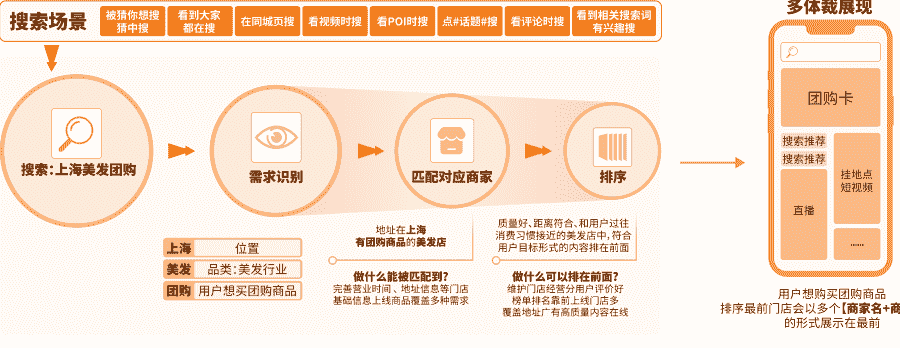
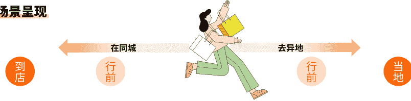
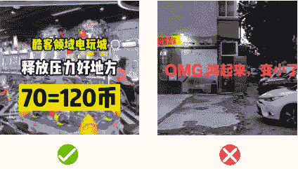
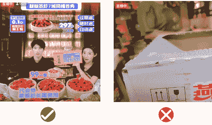
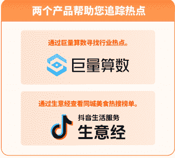
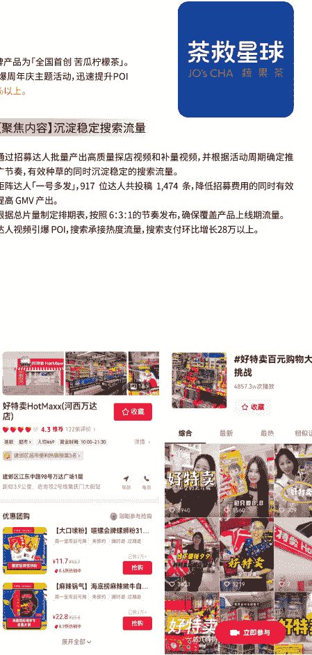

# 抖音生活服务

让每一颗心都值得

# 抖音生活服务

2024｜精华版

# 搜索运营手册

Search Operations Manual 2024

# 生活服务搜索价值

## 体量大、增速快、占比高

| 用户“多” | 成交“好” | 增长“快” |
|---|---|---|
| 搜索月活跃用户超过 **5.5亿**；生活服务相关搜索量超过 **100亿** | 商城每千次搜索带来 **60次成交**；到店搜索转化率年同比 **+92%** | 近半年生活服务搜索流量增长 **207%**；近半年生活服务搜索GMV增长 **213%** |

## 用户多样、场景丰富、需求多元

| 从兴趣到兴趣 | 从兴趣到记忆 | 从兴趣到交易 |
|---|---|---|
| **57%**：用户打开APP 30秒后先浏览后搜索 | **27%**：用户会因“在抖音种草过这家店，想找出来看看”而搜索 | **75%**：搜索的GMV来源于视频或POI浏览后被种草 |

## 精准识别、精准触达、精准匹配

| 精准的需求识别 | 直观的结果展现 | 可成交的精准供给 |
|---|---|---|
| **78%**的搜索流量来自抖音猜测用户想搜的搜索词 | 认为抖音对商品的呈现直观清晰的用户高于同类平台 **2倍** | **91%**的搜索GMV来自搜索推荐系统的精准识别 |

数据来源：抖音平台，截止2021年6月；搜索数据，截止2023年4月（2023年巨量引擎年会）；生活服务数据，截止2023年5月。

# 理解用户搜索需求

搜索，是用户完全「主动」发起的动作行为，自然也最能「直接」呈现用户的真实需求。想要掌握如何利用搜索带来的新的交易增量，就要从了解用户的搜索需求开始。

# 搜索机制解析

# 搜索场景呈现

| 场景 | 用户关注内容 |
|---|---|
| 到店 | 怎么才能吃好玩好；商家特色/服务好吗？有没有团购？有表演吗？评价如何？几点关门？ |
| 行前 | 看特色、挑地方；有什么特别的？别人去了吃什么？具体在哪？评价如何？有没有团购？附近有什么好玩的？ |
| 在同城 | 还没计划，了解一下；刷到感兴趣的内容，想进一步了解；突然产生的搜索想法；不知道去哪找，找找灵感；刷到喜欢的达人推荐，想进一步了解；其他地方看到，来抖音进一步了解 |
| 去异地 | 看攻略、找特色；有什么好玩的？博主推荐；地点特色；特色商家别人的探访；攻略/经验/指南；达人/博主推荐 |
| 当地 | 找团购、看特色；有没有团购？特色商家；别人的探访评价如何？攻略/经验/指南；达人/博主推荐 |

| 搜索品类 | 搜索地点 | 搜索门店 | 搜索个性化兴趣 |
|---|---|---|---|
| 美甲、商场、重庆火锅、汉堡、蒸汽海鲜、舒适酒店、民宿 | 南京路、王府井、三里屯、北京景点 | 奈尔宝、万象汇、奥丽田园、海底捞、杏百道围炉、万家酒店、大熊猫基地团购 | 周末溜娃去哪、巴黎铁塔推荐、川菜哪里好吃、情人节双人套餐情侣海湾商店团购 |

# 3大运营策略

## 01 扩流量
## 02 促转化
## 03 提需求

### 让潜在用户搜到你
- 门店名称准确，POI信息丰富
- 优化商品标题，覆盖热搜词
- 参与平台活动，利用活动流量

### 让精准用户购买你
- 提升在线商品丰富度
- 提升商品价格的竞争力
- 根据消费场景优化商品

### 让目标用户记住你
- 持续更新视频
- 增加达人投稿
- 视频标题增加#品牌名/门店名

**「扩流量」+「促转化」**：核心目的是让已有需求的用户在这里下单。

**「提需求」**：核心目的是让还没有产生需求的用户，被种草新的需求而下单。

# 单店丰富商品，连锁多发视频。商品名称拉“流量”，视频标题带#品牌。

# 「扩流量」：让潜在用户搜到你

| 用户搜什么 | 搜门店、搜商品 | 搜品类、搜地点 | 搜热点、搜话题 | 搜活动 |
|---|---|---|---|---|
| 商家做什么 | 品牌名称正确；**在线商品完善** | **丰富 POI 信息，匹配用户消费习惯** | **优化标题覆盖搜索热词**；通过内容打造话题 | **积极参与平台活动，借助活动流量** |

# 「促转化」：让精准用户购买你

| 用户需求 | 商品消费需求 | 内容消费需求 |
|---|---|---|
| 决策因素 | 不同消费场景有不同类型的需求。例如：用户搜索鲜花，可能是母亲节、情侣约会、生日等。 | 用户出于消费需求的搜索有**强比价**目的，会在不同商家、不同平台之间比价。 | 用户的内容需求主要来自两个方向：①无明确目标时，用户会被评论引起兴趣进行搜索；②有消费想法时，对直接消费、重点突出的内容能帮助搜索用户更好转化。 |
| 商家做什么 | **丰富商品并根据品类特征丰富商品类型** | **在同品类、多平台中，保持价格优势** | **视频增加封面、直播间增加贴片。使营销信息明确，核心营销信息重点突出**，内容包含决策点、运营视频评论区 |

# 「埋需求」：让目标用户记住你

| 目标 | 引起注意 | 增加信任 | 留下记忆 |
|---|---|---|---|
| 触达方式 | 足够的内容触达引起用户注意。 | 多种角色触达用户，增加用户信任。 | 清晰的视频文案，有效带来观看后搜索。 |
| 商家做什么 | **保持视频发布频率** | **达人视频与商家视频结合** | 视频标题中增加 **#品牌名/#门店名** |

# 6大运营动作

## 1. 基建：关注“门面”，完善基础信息

用户会用人均价格（如人均 200 左右的餐厅）、地址（酒仙桥附近美食）、营业时间（24 小时餐厅）等信息进行搜索，信息完善的商家更容易在搜索中匹配到用户的个性需求（喜欢烧烤的用户，消费人均在 200 左右的用户等），商家需完善以下信息：

- 商家名
- 商家封面
- 类目
- 地址
- 人均消费、电话

## 2. 商品·锚定“品类”，优化商品信息

### ❶ 丰富商品品类

在平台上，包含丰富的商品品类可以提高商户在搜索场景下的展示机会。

### ❷ 优化商品标题和封面

| 商品标题 | 示例 | 示例 | 示例 |
|---|---|---|---|
| ✓ 用简洁的文字突出商品内容及对应特色 ✓ 核心内容集中在前15个字 ✕ 无意义字符过多，如商家名、地址等POI信息中已经包含的内容 ✕ 描述简单无特色 ✕ 错别字、图文不符 | 低温慢烤牛小排招牌 | 聚会6人餐 | 【过】嘉三汁焖锅149元双超值 鸡架锅 2… |

| 商品封面 | 示例 | 示例 | 示例 | 示例 |
|---|---|---|---|---|
| ✓ 高清图片，突出主体 ✓ 图片与文案相符 ✓ 套餐内商品展示完全  ✕ 不同商品使用同一图片 ✕ 低质量图片（带水印、显脏黑、无食欲等） ✕ 主体不突出（如只有logo/套餐只展示一道菜等） | 深圳云海酒店高级山景房 | 【福利绿款】精品足疗60分钟 | 经典Spa60分钟 | 冰粉 |

### ❸ 保持商品价格竞争力

**搜索是强比价场景，保持商品的价格竞争力，是最有效提升下单转化率的方式。**

## 3. 内容·聚焦“内容”，沉淀稳定流量

### ❶ 持续创作＋达人投稿 = 稳定的搜索流量

过往经验表明，商家稳定地投稿且拥有多元化的作者来源，更容易获得稳定的搜索流量。

## 4. 第一屏信息清晰，提升搜索转化

**视频封面**：吸引注意力 + 真人主题，让用户快速知道核心信息，“什么类型的商家、在哪个位置、有什么特色”。停留时长：1-2 秒

**画面**：可用商家招牌、店内环境特写、亮点画面拼接作为底图，如有封面文字，背景也可虚化

**文字**：一句话概括特色亮点（5-12 个字）

**直播间画面**：简洁突出重点。直播间画面请慎，无大亮或大暗，无噪点

**画面**：直播商品、品类展现明确

**文字**：在展示画面中，露出“有吸引力”的活动信息，比如：主推品、折扣、秒杀、福袋（霸王餐）等。推荐用贴片进行展示，也可以通过布置现场、手举牌等进行信息展示

## 5. 工具：承接“热搜”，三步上新引流

1. **选商品**：寻找品类下用户热搜商品词，优化套餐内容、选择主推商品
2. **找热词**：寻找品类下用户热搜内容词，优化内容方向、选入视频标题
3. **出内容**：上新商品和内容

## 6. 种草·访稿“点位”，激发搜索需求

商家可以把视频评论区当成一个运营“点位”，让点评论的用户产生搜索的意愿：

**【激发用户兴趣】**例如：“3小时畅饮，各位要宝趁们可以喝几杯”

**【引导搜索交易】**例如：“小店地址：肖家河家常面”

## 7. 营销：利用“产品”，组件能力加持

抖音生活服务规划了多种营销活动，商家可以结合自身不同的营销需求，利用平台活动资源，触达更多用户群体。此外，营销活动也可帮助商家在用户中树立品牌形象，匹配用户的消费偏好，并创造热门搜索话题。

# 餐饮行业媒介案例

## 粤式茶饮-茶救星球「低价秒杀达人矩阵，引爆搜索支付新增增长」

茶救星球是一家主打蔬果茶的连锁茶饮品牌，门店主要分布在广州深圳地区，其招牌产品为「全国首创」苦瓜柠檬茶。茶救星球以周年庆为契机，通过超级低价多时段秒杀和达人矩阵的营销策略，成功引爆周年庆活动，迅速提升POI详情页PV，拉动POI&搜索支付的有效增长，搜索支付GMV增长占整体增长的40%以上。

### 【锚定品类】优化活动商品信息

优化商品标题、POI页面文案和商品内容图文，突出商品特色及优惠信息，对用户下单决策产生积极影响。

- 优化活动商品在POI页的呈现，通过标题和图片强调「首创苦瓜柠檬茶」「0.01元秒杀」「茶救周年庆」等相关信息。
- 以0.01元秒杀品撬动主推品的售卖，秒杀品杠杆力达1:7.3，很多消费者即使没抢到秒杀品，也会在POI页购买其他主推品。

### 【聚焦内容】沉淀稳定搜索流量

通过招募达人批量产出高质量探店视频和补量视频，并根据活动周期确定推广节奏，有效辅助的同时沉淀稳定的搜索流量。

- 矩阵达人一号多发，917位达人共投稿1,474条，降低招募费用的同时有效提高GMV产出。
- 根据总量制定排期，按照6:3:1的节奏发布，确保覆盖产品和辅助流量。
- 达人视频引爆POI，搜索率持续热度流量，搜索支付环比增长28万以上。

# 综合行业媒介案例

## 日用简超-好特卖「品牌声量，引爆POI&搜索支付新增增长」

好特卖于2020年4月创立，定位于汇聚全球好物的宝藏折扣店，着眼于过剩资源，打造低价连锁折扣体系，开辟了零售折扣店的全新赛道。以3周年庆为契机，创造优质内容带动裂变式分享，将种草心智透过欢乐的购物体验植入消费者内心。结合达人矩阵和大场直播的营销策略，成功将高品质内容引爆，迅速提升POI详情页PV，拉动搜索GMV增长40倍。

### 【聚焦内容】沉淀稳定搜索流量

- 通过周年庆活动招募达人，批量产出高质量探店视频和补量视频。
- 结合周年庆活动开展大场直播，登上交个朋友直播间，助力品牌持续突破圈层，培育客群心智。
- 在达人招募需求中，要求必带话题和品牌/品类关键词。头中尾达人以最优比例结合，参考比例一八分。

### 【UGC话题活动】购物挑战赛激发品牌热度

- 通过UGC话题活动，打造品牌热门搜索词，承接搜索带来的流量，并形成转化。
- 话题#好特卖百元购物大挑战#，累计播放4000万+。
- 周年庆开启专属团品，大额代金券折扣激发用户下单兴趣。
- 搜索页面POI门店及团品，统一设计装修，提升终端用户品牌认知，打造品牌影响力。

# 酒旅行业搜索案例

## 游玩行业案例-西宁新华联童梦乐园｜围绕搜索热词，支付环比提升+406%

西宁新华联童梦乐园是集海洋世界、石榴树园、丝路小镇、陆地乐园、童梦水世界、童梦王国、酒店等大型室内外游乐设施为一体，含世界级按较高的海洋世界、我国西北亚热带风情海洋主题度假酒店、大型情景化室内水乐园、以一路一带为主题的丝路迷你小镇、含56个民族建筑及民俗特色的民族风情街、内容丰富的陆地室外乐园及室内儿童乐园。西宁新华联童梦乐园以五一节点为契机，结合商家“烟花”特色，整体因缘精搜和泛搜两种模式进行销投，搜索支出占比66%，搜索GMV增长406%。

### 【五一节点高效运营】

以五一节点为契机，围绕精搜和泛搜两种模式进行铺设搜索关键词，搜索关键词均出现“五一”字样，并结合商家“烟花”特色，对于搜索用户产生出积极影响。

### 【员工号矩阵协同】

准备前期，整理全员进行UGC关键词铺设的培训，仅通过员工账号铺设“童梦、五一”关键词，搜索端的“小卡片中在搜索关键词均出现了“五一”字样，高效承接搜索流量并有效促进转化。

# 扫码查看完整内容 »
《抖音生活服务搜索运营手册》

餐饮版

综合版

酒旅版

