# 可持续航空燃料(SAF)深度报告

**2025年全球进入SAF爆发性增长元年**

# 核心观点

生物柴油是可再生的清洁燃料，二代生物柴油是近期发展重点。生物柴油按照不同技术路线出现的时间顺序划分为三代产品，一代为FAME甲酯类，二代为油脂或酯类加氢生成的烃类产品，三代为非油脂类生物质原料生产的酯类或烃类产品。第二代生物柴油通过加氢工艺脱除油脂中的含氧基团，并通过异构化降低凝点，其组成和结构与石化柴油基本相同，十六烷值较高，稳定性好，低温流动性好，可按任意比例掺混，是近期生物柴油发展的重点方向。

生物柴油主要用作燃料，需求受政策驱动。国外生物柴油主要作为动力燃料用于交通运输及工业领域，我国主要作为绿色化学品用于化工领域。根据联合国统计司（UNDA）的统计，生物柴油应用领域中作为燃料用途占比98.5%，其他领域仅占1.5%。在掺混比例上，全球推广使用生物柴油的国家根据自身的环保要求、生物柴油制备水平、经济补贴政策等，规定了不同的掺混比例。欧洲是生物柴油生产和应用最早的地区，也是生物柴油研究和推广的主要地区，具有多年的使用生物柴油的历史，是生物柴油应用的成熟市场。

欧盟明确航煤中SAF添加比例，预计欧洲2025年SAF消费量达140万吨。欧洲作为生物柴油最大的需求市场，目前常规生物柴油需求低速增长。2020年前由于所有欧盟燃料供应商强制减排6%，极大刺激了生物柴油的消费量。近期由于受到乌克兰危机影响，部分欧洲国家下调了生物柴油的添加比例，生物柴油消费量进入低速增长区间。SAF作为最现实的航空业碳减排措施，欧盟明确2025年航空燃料中强制添加2%的SAF，保守估计需求达140万吨。国内预计2025年初步实现SAF商业化使用，消费量预计为2万吨。SAF的广阔需求空间拉动了生物柴油产业链景气度。

UCO为优质生物柴油/SAF生产原料，取消UCO出口退税有望引导我国SAF产业快速发展。废弃动植物油生产的生物柴油/SAF可实现83%的温室气体减排。UCO是理想的生物柴油/SAF生产原料，由于生物柴油出口欧盟受阻，2024年我国UCO出口量大增。此次取消UCO出口退税，有利于降低国内生物柴油/SAF企业原料成本，在欧盟SAF需求高增的预期下，SAF有望实现出口。

**风险提示：** 可持续航空燃料（SAF）价格大幅下跌的风险；欧盟SAF需求不及预期的风险；国内二代生物柴油、SAF产能建设及投放不及预期；欧盟、中国SAF政策变化的风险。

**投资建议：** 由于SAF主要生产原料工业级混合油取消出口退税，出口企业积极性将受到影响，国内SAF及生物柴油生产企业预计更易获取原料，国内SAF生产企业有望受益。我们推荐【卓越新能】，公司是国内生物柴油龙头企业，生物柴油产能规模达50万吨，并且新建二代生物柴油产能10万吨/年；并且建议关注【嘉澳环保】，公司是长三角地区较具影响力的废弃油脂资源综合利用企业，现有生物柴油产能30万吨，并且积极投资了50万吨/年的SAF产线，产线投产后公司有望成为SAF龙头企业。

**重点公司盈利预测及投资评级**

| 公司代码 | 公司名称 | 投资评级 | 昨收盘（元） | 总市值（亿元） | EPS 2024E | EPS 2025E | PE 2024E | PE 2025E |
|---|---|---|---|---|---|---|---|---|
| 688196.SH | 卓越新能 | 优于大市 | 44.09 | 52.91 | 1.25 | 2.69 | 35.27 | 16.39 |
| 603822.SH | 嘉澳环保 | 未评级 | 53.35 | 41.16 | 0.89 | 1.01 | 59.94 | 52.82 |

资料来源：Wind、国信证券经济研究所预测

# 内容目录

# 生物柴油定义与分类
- 生物柴油为可再生的清洁燃料
- 第一代生物柴油技术成熟，是目前生物柴油主流产品
- 第二代生物柴油技术快速发展，产品性质更优
- 第三代生物柴油原料更加广泛、低碳，是未来发展方向

# 生物柴油需求空间广阔
- 国际以燃料为主，国内以生产绿色化工品为主
- 主要生物柴油消费大国也是生产大国，欧洲缺口较大

# 欧洲SAF需求成为生物柴油产业链新增长极
- 欧洲可持续航空燃料（SAF）强制添加，带动需求高增
- 国内SAF市场逐步开启

# 欧盟实施关税壁垒保护本国生柴产业，中国有望通过SAF实现出口突破
- 欧盟采用关税壁垒保护本地企业，UCO为生物柴油优质原料
- 我国SAF产能及原料优势逐步凸显，有望实现出口突破

# 相关标的
- 卓越新能：国内最大的生物柴油企业
- 嘉澳环保：长三角地区较有影响力的废弃油脂资源综合利用企业，积极投建SAF生产线

# 风险提示

# 图表目录

- 图1：第一代和第二代生物柴油碳减排能力
- 图2：第一代生物柴油制备方法
- 图3：二代生物柴油制备机理
- 图4：生物柴油产业链
- 图5：全球生物柴油消费量
- 图6：2022年全球生物柴油消费结构
- 图7：全球生物柴油生产量（万吨）
- 图8：2021年全球生物柴油生产结构
- 图9：欧盟生物柴油消费量
- 图10：不同减排措施对航空业减排的贡献
- 图11：不同减排措施对航空业减排的贡献
- 图12：SAF产业链
- 图13：国航接收首架使用国产SAF交付的空客A350飞机
- 图14：IATA规划的SAF发展目标（万吨）
- 图15：IATA规划的SAF发展目标中占燃料需求比重
- 图16：欧盟生物柴油产能及产量情况
- 图17：欧盟生物柴油各原料占比
- 图18：欧盟UCO来源组成（百万升）
- 图19：欧盟生物柴油进口量（万吨）
- 图20：欧盟生物柴油进口来源变化（百万升）
- 图21：中国生物柴油出口量（万吨）
- 图22：中国UCO出口量（万吨）
- 图23：卓越新能主要业务
- 图24：卓越新能公司营收情况
- 图25：卓越新能归母净利润情况
- 图26：嘉澳环保主要业务
- 图27：嘉澳环保公司营收情况
- 图28：嘉澳环保归母净利润情况
- 表1：各生物柴油四类原料类型及优缺点
- 表2：各种生物柴油及常用石化柴油主要技术指标
- 表3：不同版本《可再生能源指令》对生物燃料2030年前使用的要求
- 表4：欧洲生物燃料分类
- 表5：欧洲生物柴油温室气体减排参考值
- 表6：航空业实现碳减排的主要措施
- 表7：ASTMD7566-2024a中SAF技术路线
- 表8：部分国家披露生物柴油强制添加比例
- 表9：欧盟各阶段SAF掺混比例要求（假设欧洲航煤消费量维持在7000万吨）
- 表10：欧洲及美国生产SAF的主要生产商与产量
- 表11：中国SAF在产及规划项目
- 表12：国内主要生物柴油产能统计
- 表13：卓越新能盈利拆分（亿元）

# 生物柴油定义与分类

### 生物柴油为可再生的清洁燃料

生物柴油是指以动植物油脂为主要原料生产的液体可再生燃料，具有十六烷值高、几乎不含硫、无芳烃等特点，热值与石化柴油相当，而且由于其与燃料性质相近，使用过程中无需对原用的柴油引擎、加油设备、储存设备和保养设备进行改动，降低了生物柴油的推广门槛。生物柴油一般与石化柴油以一定比例混合后使用，与化石柴油相比，生物柴油不含对环境造成污染的芳香族化合物，具有良好的生物降解特性，故被称为可再生的清洁能源。同时其成分中不含有对人体有害物质，是生物基绿色化学品的基础材料。相比纯化石柴油，其燃烧过程中降低了对环境有害气体的排放，根据行业测试数据，1吨生物柴油可实现2.83吨的碳减排。

**图1：第一代和第二代生物柴油碳减排能力**

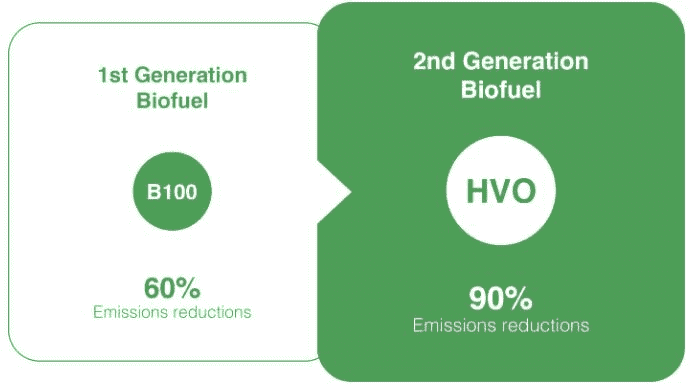

资料来源：IATA，ATAG，国信证券经济研究所整理

对比生物柴油与化石柴油的理化特性，生物柴油具有以下优点：

- **优良的环保特性。** 与石化柴油相比，生物柴油中几乎不含硫，所以柴油机在使用时硫化物排放极低；尾气中颗粒物含量及CO排放量分别约为石化柴油的20%、10%，排放指标可满足欧Ⅱ和欧Ⅲ排放标准。
- **良好的润滑性能。** 生物柴油黏度大于石化柴油，可降低喷油泵、发动机缸体和连杆的磨损率，延长其使用寿命。
- **良好的安全性能。** 生物柴油闪点远高于石化柴油，运输、储存更加安全；另外其可降解性好，不会污染环境、危害人体健康。

自德国工程师于1893年提出生物柴油概念，并开展酯基生物柴油生产和使用测试以来，生物柴油逐步形成四类原料三代技术的发展路径。四类生物柴油原料主要为可食用油脂，非粮油脂，废弃油脂或藻类油脂，二氧化碳或生物质。目前，生物柴油原料主要是可食用油脂、废弃油脂两类；非粮油脂资源尚未形成规模；藻类油脂、二氧化碳原料处于研究或示范阶段。

**表1：各生物柴油四类原料类型及优缺点**

| 分类 | 原料 | 主要产地 | 优点 | 缺点 |
|---|---|---|---|---|
| 第一类 | 可食用油脂（菜籽、大豆、棕榈） | 菜籽油：欧洲；大豆油：美国、阿根廷、巴西；棕榈油：印度尼西亚、马来西亚、泰国 | 油脂含量高，收储和加工方便简单 | 与粮争地、与人争油，规模发展影响民生 |

请务必阅读正文之后的免责声明及其项下所有内容

证券研究报告

## 生物柴油技术路线及分类

| 类别 | 原料 | 种植及开发情况 | 优势 | 劣势 |
|---|---|---|---|---|
| 第二类 | 非粮油脂（麻风树籽、橡胶籽、苦杏仁） | 各国均有种植，未规模化、商业化开发 | 荒山种植，不占用农业耕地，利于边远地区增收 | 油料收集和存储难度大 |
| 第三类 | 废弃油脂（餐饮废油、煎炸油）或藻类油脂 | 废油：欧洲、中国；藻类：欧洲、美国、中国 | 废油可解决回流问题，转化率高；藻类附加值高，单位面积产油量高 | 废油杂质含量高，预处理要求高，收集困难；藻类成本高，差异较大 |
| 第四类 | 二氧化碳或生物质 | 碳捕集与储存（CCS）/碳捕集利用与储存（CCUS）产业，秸秆等纤维素类物质 | 利用生物、加氢或电化学合成技术，具有碳中和特点 | 合成生物学等关键技术处于研发阶段，成本最高 |

资料来源：中国生物柴油产业面临的挑战及发展建议，国信证券经济研究所整理和预测

生物柴油按照不同的技术路线出现的时间顺序划分为三代产品：一代为FAME甲酯类，二代为油脂或酯类加氢生成的烃类产品（HVO或HDRD），三代为非油脂类生物质原料生产的酯类或烃类产品。

### 第一代生物柴油技术成熟，是目前生物柴油主流产品

以植物油脂或动物脂肪为原料，与甲醇或乙醇在酸性或者碱性催化剂（1%）和高温（60℃—110℃）常压下发生酯交换反应，产物为脂肪酸甲酯或乙酯，再经洗涤、干燥即得一代生物柴油（FAME），酯类收率可达88%—96%，还有10%左右的副产物甘油。

一代生物柴油技术成熟，工艺相对简单，也是目前国内外主要的生物柴油品种；但一代生物柴油存在缺陷：其燃烧热值不足普通石化柴油的90%，不能完全替代石化柴油，只能按照10%左右比例和石化柴油进行掺混使用；其凝固点高，寒冷地区的冬季无法使用。

图2：第一代生物柴油制备方法

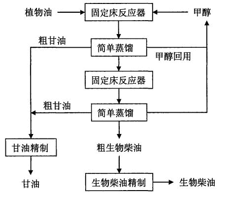

资料来源：连续化超临界萃取酯交换耦合制备生物柴油过程研究，国信证券经济研究所整理

### 第二代生物柴油技术快速发展，产品性质更优

油脂在高温高压条件下通过催化加氢生成直链烷烃，过程中包含多种化学反应，主要有不饱和脂肪酸的加氢饱和、加氢脱氧、加氢脱羧基和加氢脱羰基、临氢异构化反应等，异构化反应的目的是降低产物的凝固点；生产装置主要采用固定床装置或悬浮床装置。生产工艺主要有油脂直接加氢脱氧工艺、油脂加氢脱氧再临氢异构工艺、油脂加氢脱羧工艺、油脂与石化柴油混炼工艺等，产物收率可达75%—95%，其中直链烷烃含量可达95%以上。

相比第一代生物柴油，第二代生物柴油具有硫、氧含量低，密度和黏度较低，十六烷值较高和凝点较低等优点。二代生物柴油的结构及性能与石化柴油基本相同，能以任意比例添加到石化柴油中，其燃烧性能比第一代生物柴油更好，性能符合ASTM国际柴油燃料油标准（D975），也是制造生物航煤（SAF）的主要原料。第二代生物柴油性能明显优于第一代脂肪酸甲酯，适用范围更广泛，是未来生物柴油的主要发展方向。第二代生物柴油制备流程较长，工艺难度较高。目前制备第二代生物柴油技术主要包括双键加成、加氢脱氧、异构化等反应，其中加氢脱氧是关键步骤。

图3：二代生物柴油制备机理

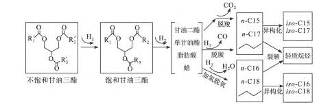

资料来源：油脂加氢脱氧制备第二代生物柴油催化剂研究进展，国信证券经济研究所整理

### 第三代生物柴油原料更加广泛、低碳，是未来发展方向

第三代生物柴油研究包括两个方面：一是以海藻类油脂为原料，对其进行化学催化或酶催化转化为生物柴油；二是以纤维含量高的非油脂化合物为原料，对其进行生物质气化来进行生物柴油的生产。

以海藻类油脂生产生物柴油拓宽了生物柴油的原料。用海藻生产生物燃料主要有海藻培养（生长）、收集、脱水、萃取海藻油和海藻油加工等几个步骤，其中海藻培养（生长）和萃取海藻油是核心步骤，也是工业生产的难点。目前用海藻生产生物燃料的技术尚处于初期阶段，工业应用成本太高，还没有出现有优势的工业设计，中短期没有大规模工业应用可能性较小。

将生物质中的纤维素、半纤维素、木质素等通过高温或超高温裂解制取的液态油状物或混合气，进行二次改性提质或费托合成等工艺后得到的，也称为三代生物柴油。生物质原料经简单的破碎加工处理后进入气化炉，在空气、氧气或水蒸气等气化介质中发生高温裂解和氧化还原等反应，生成含有CO和H₂等物质的合成气。合成气在进行净化处理后，通过催化、加氢等工艺以及费托合成等技术，最终合成柴油。该方法生产的生物柴油可以达到和石化汽柴油相似的产品性能。该技术路线目前生产成本过高，正处于研发阶段，部分项目正在建设示范装置；中期角度看很难放量生产。

表2：各种生物柴油及常用石化柴油主要技术指标

| 油品指标 | 二代生物柴油 | 三代生物柴油 | 一代生物柴油 | EN590柴油 | 0号柴油 |
|---|---:|---:|---:|---:|---:|
| 密度（15℃）/kg·m⁻³ | 775—785 | 770—785 | 885 | 835 | 839 |
| 黏度（40℃）/mm²·s⁻¹ | 2.9—3.5 | 3.2—3.5 | 4.5 | 3.5 | 3.7 |
| 十六烷值 | 84—99 | 73—81 | 51 | 53 | 51 |
| 10%馏分馏出温度/℃ | 260—270 | 260 | 340 | 200 | 213 |
| 90%馏分馏出温度/℃ | 295—300 | 325—330 | 355 | 350 | 339 |
| 凝固点/℃ | −30 | −25 | −5 | −5 | 0 |
| 高发热值（MJ·kg⁻¹） | 44 | 43 | 38 | 43 | 42.8 |
| 低发热值（MJ·L⁻¹） | 34 | 34 | 34 | 36 | 34 |
| 芳香烃/% | 0 | 0 | 0 | 4 | 17 |
| 氧/% | 0 | 0 | 11 | 0 | 0 |
| 硫化物/（mg·kg⁻¹） | 0 | <10 | <10 | <10 | 2.95 |

资料来源：生物柴油产业发展路径研究，国信证券经济研究所整理和预测

二代生物柴油技术路线较为成熟，产品性质优异，是近期生物柴油领域发展重点。

总体来看，第一代技术是油脂原料与甲醇在酸、碱、生物酶等催化作用下发生酯反应，得到脂肪酸甲酯（酯基生物柴油，FAME）。该技术成熟，工艺相对简单，成本低，目前是生物柴油产品中的主流产品，但较差的理化性能限制其使用场景，其与石化柴油混合比不能超过30%，凝固点高导致低温地域和时间段无法使用等。

第二代技术通过加氢工艺脱除油脂中的含氧基团，并通过异构化降低凝点，生成烃类（烃基生物柴油，HVO或HEFA）。其组成和结构与石化柴油基本相同，十六烷值较高，稳定性好，低温流动性好，可按任意比例掺混。第三代技术克服了油脂原料限制，但生产成本过高，正处于研发阶段，中期阶段内很难量产。

各国立足于基本国情并结合自身资源优势，发展不同原料的制备工艺。按原料分类，可分为传统生物柴油（食物基）和先进生物燃料（非食物基）。目前欧盟生物柴油的原料以菜籽油为主，美国、巴西、阿根廷等美洲国家以大豆油为主，马来西亚、印尼、泰国等东南亚国家棕榈油资源丰富，都是主要的棕榈油生物柴油生产国。我国作为食用油消费大国，自给尚且不足，需要进口，再依赖食用油脂制备生物柴油将会大大加剧与人争油的局面，引发粮油危机。2012年工信部和农业部专门下发《粮食加工业发展规划（2011—2020年）》，文件中明确中国将严格控制以粮食为原料的生物质能源加工业发展。因此我国无法像其他国家大力发展以食用粮油为基础的生物柴油产业，而以废油脂为原料进行生物柴油生产，代表着我国生物柴油的发展方向。

目前生物柴油上游主要是生产生物柴油的原材料，在国内主要包括地沟油、酸化油等废油脂收集企业；中游为生物柴油的生产企业，主要包括传统生物合成企业、新能源企业及石化企业，生产一代及二代生物柴油；生物柴油的下游主要包括工业燃料、交运燃料、增塑剂、表面活性剂等产品。

图4：生物柴油产业链

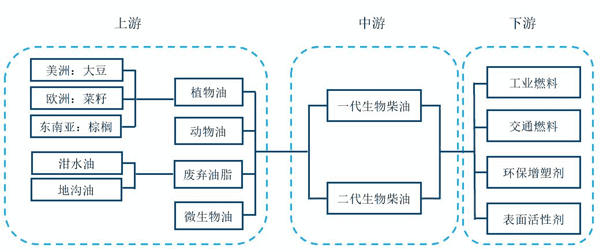

资料来源：华经产业研究院，国信证券经济研究所整理

# 生物柴油需求空间广阔

### 国际以燃料为主，国内以生产绿色化工品为主

在国外，生物柴油主要作为动力燃料用于交通运输及工业领域；我国主要作为绿色化学品用于化工领域。根据联合国统计司（UNDA）的统计，生物柴油应用领域中作为燃料用途占比98.5%，其他领域仅占1.5%。

在燃料领域，一般将生物柴油掺混入化石柴油中制成混合柴油。混合柴油与化石柴油相比，在燃烧过程中降低对污染气体的排放；同时由于在燃料性质方面相近，因此无需对原用的柴油引擎、加油设备、储存设备和保养设备进行改动，降低了生物柴油的推广门槛。

在掺混比例上，全球推广使用生物柴油的国家根据自身的环保要求、生物柴油制备水平、经济补贴政策等，规定了不同的掺混比例。欧洲是生物柴油生产和应用最早的地区，也是生物柴油研究和推广的主要地区，具有多年的使用生物柴油的历史，是生物柴油应用的成熟市场，在生物柴油质量标准方面要求较为完善。欧盟2003年颁布的车用生物柴油标准EN14214，是当时乃至目前世界上要求最严格的生物柴油标准。

据经合组织数据，进入21世纪以来，生物柴油消费量快速增长，在2021年前后消费增速有所放缓。以0.875 kg/L的密度计算，2022年全球生物柴油消费量超5000万吨，预计至2032年生物柴油消费量将达5800余万吨。

图5：全球生物柴油消费量

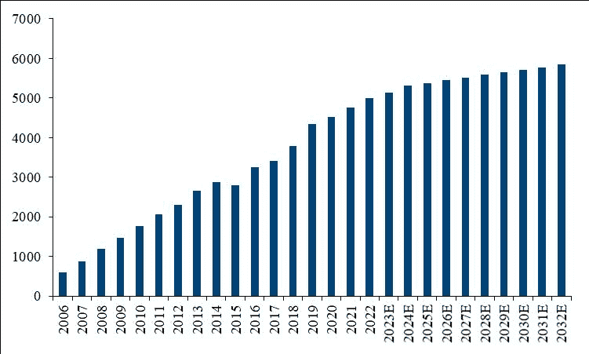

资料来源：经合组织，国信证券经济研究所整理

生物柴油消费存在明显的地域性，欧洲是最大消费地区。生物柴油消费地区主要集中在欧洲、北美、南美、东南亚等地区。欧盟地区生物柴油消费量占全球总消费量的35.5%，美国生物柴油消费占比达17.4%；南美、亚太等地区由于生物柴油原料较为丰富，生物柴油的消费也较多，其中印尼生物柴油消费量全球占比8.7%，泰国占比6.4%，阿根廷生物柴油消费占比8.2%，中国生物柴油消费占比6.4%。

图6：2022年全球生物柴油消费结构

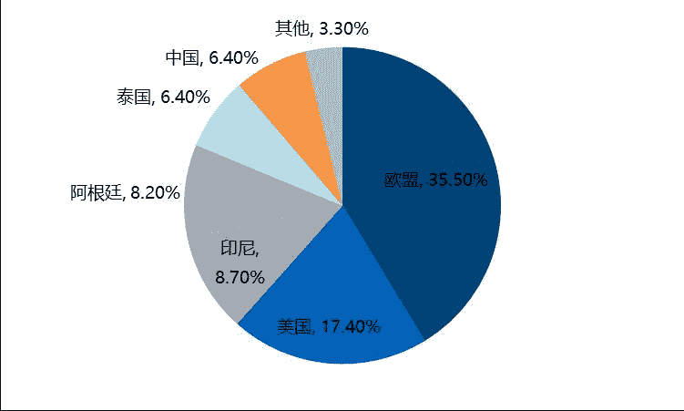

资料来源：中金企信，国信证券经济研究所整理

### 主要生物柴油消费大国也是生产大国，欧洲缺口较大

根据经合组织数据，2023年世界生物柴油产量达5126.70万吨，较2022年略微下降1%。根据预测，全球生物柴油产量也将进入低速增长期。从生物柴油产地来看，欧盟地区生产占比最大，为30%；美国占比19%；之后是印度尼西亚、巴西和中国，分别占比16%、12%和4%。

主要生物柴油生产大国也是消费大国，欧洲供需缺口较大。大多数国家生物柴油需求均由国内政策驱动，以国内供给为主。从供需缺口角度来看，印尼、阿根廷等国处于国内消费为主、出口为辅的产业格局；而美国、巴西则以自产自销为主，处于供需平衡的状态。欧洲地区如德国、法国则出现产量和进口双高的局面，生物柴油供不应求。

图7：全球生物柴油生产量（万吨）

图8：2021年全球生物柴油生产结构

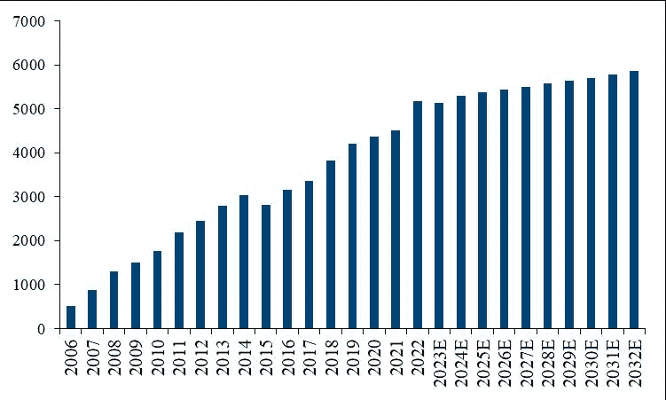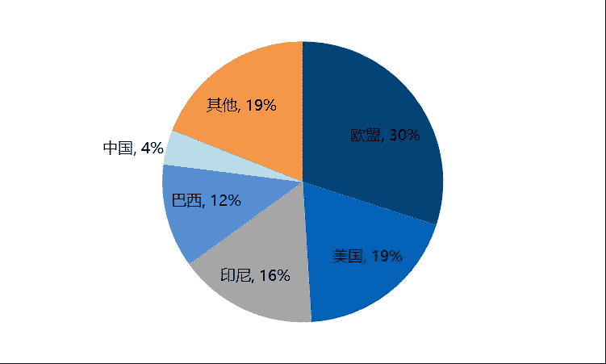

资料来源：经合组织，国信证券经济研究所整理

资料来源：智研咨询，国信证券经济研究所整理

# 欧洲SAF需求成为生物柴油产业链新增长极

在全球主要的生物柴油消费市场中，除欧洲以外的国家或地区基本已实现自产自销，剩余产能向外出口。欧洲市场作为最核心的需求市场，最大程度地探究欧洲市场的行业规模、政策推进效果及未来发展趋势是极其重要的。

欧盟国家主要受生物柴油强制掺混政策驱动。2020年所有欧盟燃料供应商执行强制减排6%的强制令，这极大刺激了生物柴油的消费量。由于部分符合要求的生物燃料可以按双倍计算，所以生物柴油后续增长速度放缓。由于受到乌克兰危机影响，部分欧洲国家下调了生物柴油的添加比例。2024年欧盟生物柴油消费量预计为17700百万升，折合1548.75万吨。

图9：欧盟生物柴油消费量

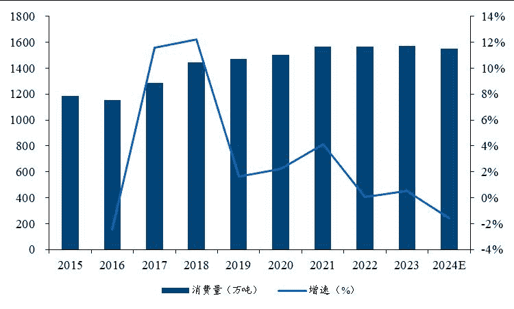

资料来源：USDA，国信证券经济研究所整理

### 政策好则需求好

欧洲作为世界最大的生物柴油消费和进口地区，主要得益于区域内的国家组织及各主要国家实施了鼓励消费生物柴油的政策。从柴油价格上来看，以生物原料制备的柴油产品相较传统化石柴油并不具备优势，但由于生物柴油低碳、环保、适应性好的特性，受到欧洲国家的广泛重视，并通过出台一系列政策推广使用。

2009年欧盟能源和气候变化一揽子计划规定，到2020年，欧盟所有成员国运输部门消耗的能源10%将由可再生能源提供的最低目标。《可再生能源指令》（Renewable Energy Directive，RED）对2010—2020年期间运输部门能源消耗目标做了详细的规定，公路运输部门再生能源使用比例为10%。

2018年，欧盟通过了涵盖2021—2030年期间能源消费的第二版《可再生能源指令II》（RED II）。它设定到2030年可再生能源使用目标为32%，运输部门再生能源使用比率目标提高到14%，并将先进生物燃料（双倍计算）分为Part A和Part B两部分。Part A 2022年添加比例至少要达到0.2%，2025年添加比例至少要达到1%，2030年的混加比例须达到3.5%；Part B在2030年的添加上限为1.7%。

在修订版的《可再生能源指令II》中，2030年合计可再生能源使用比例最低为42.5%，运输业可再生能源使用比例最少为29%。传统生物燃料使用上限为7%；先进生物燃料中，Part A在2025年的最低使用量为1%，2030年的最低使用量为5.5%；Part B中的生物燃料在2030年的使用上限为1.7%，先进生物燃料仍然双倍计算。

表3：不同版本《可再生能源指令》对生物燃料2030年前使用的要求

| 名称 | RED | RED II | 修订版RED II |
|---|---|---|---|
| 交通运输领域 | 可再生能源使用比例达到10% | 可再生能源使用比例达到14% | 可再生能源使用比例达到29% |
| 传统生物燃料上限 | 无 | 7% | 7% |
| Part A下限 | 无 | 3.5% | 5.5% |
| Part B上限 | 无 | 1.7% | 1.7% |

资料来源：欧盟委员会，USDA、国信证券经济研究所整理

根据当前欧盟规则，将生物燃料分为两大类。第一类为传统生物燃料（Conventional Biofuel），柴油方面主要以食物作为原料生产的生物柴油，主要包括RME（菜籽油制成的生物柴油）、SME（豆油制成的生物柴油）、PME（棕榈油制成的生物柴油）等。目前欧洲本土生物柴油生产以及进口的生物柴油依然以传统生物柴油为主。

第二类为先进生物燃料（Advanced Biofuel），核心是以非食物为原料生产，包括Part A和Part B两种类型。Part A主要以各种农作物的非食用部分作为原料，主要包含秸秆、藻类、木质纤维素、松油、妥尔油等，可以制备生物乙醇、氢化植物油（HVO）等；Part B主要以废油脂、动物脂肪作为原料生产燃料，主要制备废油脂生物柴油（UCOME）。

表4：欧洲生物燃料分类

| 名称 | 分类 | 具体内容 |
|---|---|---|
| 传统生物燃料 | / | 以粮食为原材料的生物燃料，包括大豆油（SME）、菜籽油（RME）、棕榈油（PME）、向日葵油等 |
| 先进生物燃料 | Part A | 藻类、生物质垃圾、不适合使用的工业废弃生物质、秸秆、动物粪便或污水、棕榈加工废弃物、粗甘油、葡萄渣和酒糟、坚果壳、玉米核、其他纤维素材料等 |
| 先进生物燃料 | Part B | 废弃油脂、动物脂肪、不能食用作物、生长在退化土地上的作物 |

资料来源：RED II，国信证券经济研究所整理

相比传统生物燃料，用废油脂制备的生物柴油（UCOME）拥有更高的温室气体（GHG）减排属性。《可再生能源指令（RED）》在确定可再生能源的比例要求时，同时也规定了可再生能源的计算规则：生物燃料只有满足60%最低温室气体（GHG）减排要求，才能计入欧盟和/或成员国目标。然而，根据RED给出的各类生物柴油默认减排参考值显示，传统生物燃料均未达到标准，尤其棕榈油的GHG减排参考值仅19%。

随后指令规定，在对可再生能源使用量进行核算时，未达到标准的生物燃料按照一定比例进行扣减，而超出60%减排量的生物柴油品类则进行相应加倍计算。由于废油脂制备的生物柴油（UCOME）的GHG减排量达到83%，当前各国对于UCOME大多以双倍量计算生物燃料使用量。由于UCOME能够计算更多的生物燃料消耗量，更容易达到欧洲各国设定的掺混比例要求，故而UCOME在欧洲具有特殊的竞争力，相比较而言价格也最高。

表5：欧洲生物柴油温室气体减排参考值

| 生物柴油种类（按原料来源） | 温室气体减排参考值 |
|---|---:|
| 菜籽油 | 38% |
| 大豆油 | 31% |
| 向日葵油 | 51% |
| 棕榈油（未制定工艺） | 19% |
| 棕榈油（油厂甲烷捕获工艺） | 56% |
| 标准比例要求 | 60% |
| 废动植物油生物柴油 | 83% |

资料来源：可再生能源指令、国信证券经济研究所整理

请务必阅读正文之后的免责声明及其项下所有内容

证券研究报告

## 欧洲可持续航空燃料（SAF）强制添加，带动需求高增

随着航空业未来的发展，其产生的温室气体排放绝对量和占比预计将不断增大，碳减排迫在眉睫。为了遏制和减少航空碳排放的快速增长，国际民航组织（ICAO）提出了2035年前燃油效率年均提升2%的中期减排目标、2050年前碳排放下降50%的长期减排目标。

多种措施可以降低航空领域碳排放。航空业可以通过多种措施来减少碳排放，如开发新的飞机技术以提高能效或者能使用电力和氢能驱动的新机型，提高运营和基础设施的效率，以及使用可持续航空燃料（SAF）等。

航空业最现实可行的碳减排措施在于推广应用SAF。在诸多措施中，研发飞机新技术及提高运营与基础设施效率这两项措施是一个需要长期持续且不断进步的过程。在过去十多年，机队的燃油效率在稳步提高，不过，常规技术领域的优化所能产生的碳减排效果相对有限。未来，最重要的碳减排措施在于应用更大比例的SAF。可持续航空燃料（SAF）是指使用非化石燃料的可再生清洁原料生产的新型航空燃料，旨在促进碳排放减少以及航空业的可持续发展。

**图10：不同减排措施对航空业减排的贡献**

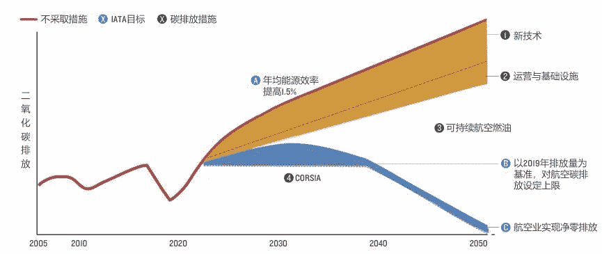

资料来源：IATA，ATAG，国信证券经济研究所整理

**表6：航空业实现碳减排的主要措施**

| 措施 | 具体行动 | 主要贡献阶段 |
|---|---|---|
| 新技术 | 飞机和发动机制造商持续提高机身和推进技术的效率，包括机体结构优化、采用轻质材料和新型燃烧室技术等；开发纯电动飞机、混合动飞机和氢能飞机，争取在2030年后可以拥有商用或试验阶段的飞机产品。 | 2010-2050 |
| 更高效的运营和基础设施 | 政府和空中导航服务提供商(ANSP)消除空中交通管理和空域基础设施的低效率；制定更精确的飞行计划，减少飞行时间以减少飞机加油量；使飞机在最接近高度的高度层飞行，最大限度提高燃油效率；机场使用低排放技术车辆以及为航站楼安装太阳能等可再生能源设施等措施，进一步减少碳排放；利用机场协作决策(A-CDM)减少机场拥堵产生的燃料使用，以提升能源效率。 | 2020-2050 |
| 使用可持续航空燃料(SAF) | 燃油提供商提供大规模、具有成本竞争力的SAF；相关认证机构研究批准更多国际认可的SAF生产技术路线，加速SAF的应用和发展；机场运营商提供所需的基础设施，以经济高效的方式供应SAF。 | 2025-2050 |
| 碳抵消计划以及碳捕获、利用与封存 | 航司投资碳抵消计划，以抵消自身业务引起的碳排放；航司为企业客户推出自愿碳抵消计划，以便企业客户抵消或减少与商务旅行相关的碳排放；机场投资碳抵消计划，如机场碳认证计划(ACI)，并建造“绿色认证”航站楼。 | 2025-2040 |

资料来源：北京大学能源研究院，IATA，ATAG，国信证券经济研究所整理。

## SAF原料来源广泛，碳减排量可达90%

SAF原料来源广泛，大多来自可再生资源，碳减排量可达90%。根据技术路线不同，生产SAF的原料包括废油脂、农林废弃物、城市废弃物以及非粮食作物等，还可以通过把氢气和捕获来的CO2加以合成的方法来生产。SAF被称为是“可持续的”，是因为从全生命周期角度来看，其原料（如废弃的生物质）在生长过程中或者合成过程中所吸收的CO2要超过其在使用过程中所排放的CO2。目前SAF最重要的生产工艺为HEFA，该工艺下产品与第二代生物柴油（加氢植物油，HVO）非常接近，据测算第二代生物柴油最高可减少碳排放90%。SAF被视为民航业实现净零碳排放目标最有潜力的减排措施。

SAF产品一般需要通过业界认可的一些可持续性标准认证。SAF产品只要通过相关标准（如ASTM-D7566）的认证，则被认为是可以与目前的化石航空燃料直接进行掺混，不需要对现有的发动机和其他基础设施做太多改造。目前，SAF的掺混比例一般被要求不超过50%，不过，从技术角度来说，未来实现100%使用SAF并不存在太大难度。

被认定的SAF技术路线有8条。在ASTM发布的D7566-2024a版本中，被认定为SAF的技术路线共有8条。8条技术路线中，FT、HEFA、ATJ是当前SAF的主要生产工艺。FT工艺主要是以木质纤维素为原料，先将其转化为合成气，再经过费托合成工艺，将合成气转化为费托合成油（长链烷烃），最后经加氢改质工艺，生产生物柴油和航煤；HEFA工艺产品被称为加氢植物油（HVO），是植物油、废弃油脂通过热解、加氢、异构化及选择性裂解等技术组合，加工转化为石化类似燃料。ATJ工艺是将醇类经脱水生成烯烃，再通过齐聚得到烷烃为主的产品，最后经加氢改质得到目标产品，产品包括汽油、煤油和柴油。

HEFA是目前及中期最重要的SAF生产工艺。HEFA工艺的原料来源广泛，从餐厨余油、植物油到动物脂肪，甚至藻类，都可以成为HEFA的原料；HEFA生产工艺主要来自相对成熟的石油炼制技术。综合来看，由于HEFA路线原料来源丰富且技术成熟短期内是最具竞争力路线，目前HEFA路线的产品加氢植物油（HVO）在可持续航空燃料的市场份额可达95%以上。预计到2030年，全球范围内SAF的生产技术路线仍将以HEFA工艺为主。不过考虑到其原料供应有一定限制，整体产能不会出现迅猛增长。FT和ATJ路线，随着技术日益成熟，成本持续下降，加之其原料可选项较多（农林废弃物、城市固体废物、工业废弃等），在2030-2050年期间的市场份额有望不断提升。PtL路线几乎不用担心原料问题，其将成为中长期最主要的技术路线。

**表7：ASTM D7566-2024a中SAF技术路线**

| 技术路线 | 原料 | 批准年份 | 最高掺混比例 |
|---|---|---|---|
| 费托合成煤油(FT-SPK) | 农林废弃物、城市固体废物 | 2009 | 50% |
| 加氢处理酯和脂肪酸煤油(HEFA-SPK) | 餐厨废油、废弃动物油脂、其他油基生物质 | 2011 | 50% |
| 加氢发酵糖合成异构烷烃(HFS-SIP) | 甘蔗、蔗糖等糖类 | 2014 | 10% |
| 带芳烃的费托合成煤油(FT-SPK/A) | 农林废弃物、城市固体废物、能源作物等 | 2015 | 50% |
| 醇制合成煤油(ATJ-SPK) | 淀粉、糖、纤维素等生物质、工业生产过程中排放的废气 | 2016 | 50% |
| 催化水热解法制备合成煤油(CHJ) | 大豆油、麻风果油、茶花油、亚麻荠油和卡里纳塔油等 | 2020 | 50% |
| 加氢处理烃、酯和脂肪酸合成煤油(HC-HEFA SPK) | 海藻类 | 2020 | 10% |
| 带芳烃的醇制合成煤油(ATJ-SPK/A) | 淀粉、糖、纤维素等生物质、工业生产过程中排放的废气 | 2023 | 50% |

资料来源：ASTM，国信证券经济研究所整理。

**图11：不同减排措施对航空业减排的贡献**

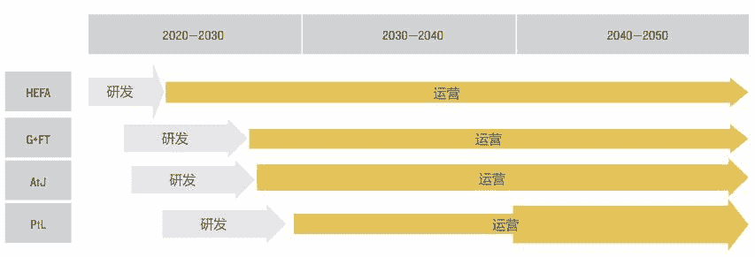

资料来源：北京大学能源学院，国信证券经济研究所整理

在HEFA技术路线下，SAF产业链与生物柴油产业链高度重合。适用于HEFA的原料较多，主要以油脂为主，包括动物油、植物油、餐饮废弃油等，也包括藻类物质。产业链中游企业主要是SAF生产商和供应端，中游企业不仅包括传统石化企业，也包括生物合成企业（生物柴油等）、新能源企业（氢能等）等新兴企业。生产流程为利用动植物油脂及废弃食用油经加氢脱氧、异构化、裂化分馏等流程生成SAF。其中，生物合成企业生产二代烃类生物柴油的技术路径与HEFA十分类似，只是生产SAF时需要对长链烷烃进行更深度异构化的裂解与分馏。目前商用飞机SAF是最主要的需求来源，占据市场大约83.8%的份额，其次是军用飞机。此外，大型物流运输公司也积极布局，例如全球顶尖的物流企业DHL致力于到2050年实现物流相关净零排放，并设立了到2030年将可持续航空燃料混合比提高到超过30%的目标。

**图12：SAF产业链**

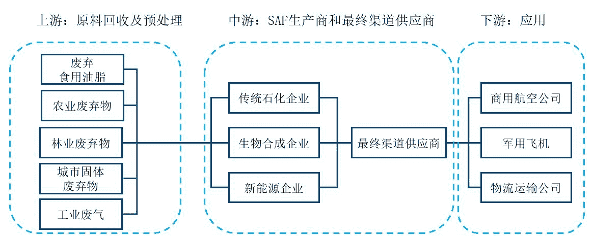

资料来源：头豹研究院，国信证券经济研究所整理

## 欧洲航煤中添加SAF比例明确，多国政策逐步跟进

欧洲航煤中添加SAF比例明确，多国政策逐步跟进。欧盟制定了国家或地区层面的SAF应用目标和航空碳减排目标，政策相对比较完善；近年来很多国家正在加速推进和参与SAF产业发展和政策制定。

**欧盟：** 欧盟在推动可持续航空燃料（SAF）的使用与发展方面比较强硬果断。自2019年12月提出《欧洲绿色协议》（"European Green Deal"）后，欧盟委员会通过了为应对气候变化制定的一系列法案，共同构成了"Fit for 55"一揽子计划，并逐步开始布局SAF。2023年，欧盟通过《ReFuelEU航空法规》，强制规定了自2025年起欧盟机场所用燃油必须混掺2%的SAF，且对SAF所采用的技术路线也做出一定要求。其长期目标为最晚到2050年，SAF掺混比例需达70%。欧盟作为第一个提出SAF强制混掺比例且具有长期目标的全球主要经济体，发挥其目前市场份额最大的优势，向其他各国展现出了大力发展SAF的信心和决心。欧洲其他各国也在2020年至2022年纷纷开始执行混调计划。

**英国：** 英国在继2022年Jet Zero承诺后，拨款1.65亿英镑支持SAF项目，资金持续至2025年。英国并计划从2025年1月1日起实施SAF指令，旨在通过使用可持续航空燃料，在2030年减少2.7 MtCO2e排放量，在2040年减少6.3 MtCO2e排放量。从2025年开始，SAF将必须满足英国航空燃油总需求的至少2%，并在2030年线性增加到10%，然后在2040年增加到22%。从2040年开始，将SAF的添加比例维持在22%，直至政府表示SAF供应确定性提高。

**美国：** 2021年美国发布了《美国航空业气候行动计划》，确定2050年美国航空业碳中和的长期目标。此后，美国发布了3个主要政策用来支持碳减排，其一是2022年9月制定的SAF大挑战路线图，为美国SAF产业的发展规划了总体路线，提出到2030年实现美国SAF产量达到900万吨，到2050年实现SAF产量超1亿吨，航空燃油100%加注SAF；其二是可持续和低碳燃料标准，规定航空燃料供应商在美国本土销售SAF产生的环境权益可在市场交易；其三是由美国财政部和税收署发布的通胀削减法案，为SAF的生产、应用和研发提供经济支持。

**日韩：** 日本在2021年建立"飞机运营二氧化碳减排研究小组"，初步制定了到2030年SAF使用量占航空燃料10%的目标。2022年，组建"Act for Sky"联盟，以实际行动推广SAF的生产与应用。而韩国则在2024年刚刚颁布《可持续航空燃料推广战略》，强制规定2027年起所有从韩国起飞的国际航班必须混合SAF（约1%）进行加油。

**表8：部分国家披露生物柴油强制添加比例**

| 国家/地区 | 时间 | 政策详情 |
|---|---|---|
| 欧盟 | 2022年 | 从航空碳排放交易体系(ETS)中支取16亿欧元用于补贴航司的SAF应用 |
| | 2023年 | 通过《ReFuelEU航空法规》，从2025年1月1日起，所有在欧盟机场供应的航空燃料中，必须使用至少2%的SAF与传统煤油混合的燃料，到2030年占比需达6%，到2050年达到70%，是第一个提出SAF强制掺混比例目标的全球主要经济体 |
| 英国 | 2021年 | 英国政府发布《净零计划》，该战略提出，要推动可持续航空燃料(SAF)商业化，投资18亿英镑支持英国SAF工厂发展，到2030年实现10%的SAF交付 |
| | 2022年 | 英国交通部发布了《航空零排放(Jet Zero)战略》，要求从2025年开始强制使用SAF，到2030年至少10%的航空燃料是可持续航空燃料，到2050年SAF能够满足75%以上的液体燃料使用量，已拨款1.65亿英镑支持SAF项目，资金持续至2025年 |
| | 2024年 | 英国下议院批准了《2024年可再生运输燃料义务(可持续航空燃料)法令》草案，这项法令将使英国航空业每年获得约120万吨可持续航空燃料授权，上议院批准后即可立法，将于新的一年生效 |
| 美国 | 2021年 | 美国联邦航空局(FAA)发布了《航空气候行动计划》(Aviation Climate Action Plan)，从推广可持续航空燃料(SAF)、开发新的飞机和发动机技术和加强政策法规引导等方面出发，首次系统地阐述了美国政府为实现2050年航空业净零碳排放目标所设定的行动框架 |
| | 2022年 | 美国通过《通货膨胀削减法案》，为SAF生产提供33亿美元的税收抵免和补助。每生产一加仑SAF可获得1.25美元补贴，若生命周期排放量减少超过50%，每多减少1%可额外获得1美分抵免 |
| | 2022年 | 美国农业部、能源部和运输部发布了SAF挑战路线图(SAF Grand Challenge Roadmap)，旨在与工业界合作，到2030年实现国内SAF年产量30亿加仑；到2050年实现SAF年产量350亿加仑，以满足美国航空业100%普及可持续航空燃料的发展目标 |
| | 2023年 | 白宫发布《国家航空科技优先事项》，明确提出加快可持续航空燃料(SAF)的开发、测试和认证并在美国国内广泛生产和采用 |
| 日本 | 2021年 | 建立"飞机运营二氧化碳减排研究小组"，制定了航空运营脱碳路线图，目标是到2030年SAF使用量占航空燃料的10% |
| | 2022年 | 日本JGC控股、Revo国际公司、全日空航空公司和日本航空公司宣布组建"Act for Sky"联盟，通过推广使用日本研发、生产的可持续航空燃料(SAF)促进其商业化进程，并逐渐扩大应用范围 |
| 韩国 | 2024年 | 韩国国土部、基础设施和工业部联合发布《可持续航空燃料推广战略》，强制规定2027年起所有从韩国起飞的国际航班必须混合SAF(约1%)进行加油 |

资料来源：各政府官网、国信证券经济研究所整理

## 保守估计2025年欧洲SAF消费量为140万吨，2030年SAF消费超400万吨

保守估计2025年欧洲SAF消费量为140万吨，2030年SAF消费超400万吨。SAF行业自2021年进入市场拓展期以来至今已取得较为快速的发展，但其需求端长期以来受到成本较高、认证繁琐等因素限制，但这些因素在全球共同目标以及各国政策扶持的帮助下得到有效缓解，且需求量还因技术革新、旅客需求等积极因素逐步扩大。欧盟目前逐步提高SAF掺混目标，2023年最新规定显示，2025年1月1日起，航空燃料最低添加2%的SAF，至2050年，SAF掺混比例至少要提升至70%。新冠疫情前欧洲航空煤油消费量高峰为2019年，达6854万吨。据IEA数据，2023年欧洲航空煤油消费量为1.46百万桶/天，折合约6400万吨。2024年4月IEA数据显示欧洲航煤消费量为1.51百万桶/天，折合6800万吨，欧洲航空煤油市场呈现较好的恢复态势。保守估计今后欧洲航空煤油消费量稳定在7000万吨/年，则2025年SAF最低消费量为140万吨，2030年SAF消费量达420万吨。

**表9：欧盟各阶段SAF掺混比例要求（假设欧洲航煤消费量维持在7000万吨）**

| 时间 | SAF掺混比例 | SAF掺混量（万吨） | 合成航空燃料添加比例 |
|---|---|---|---|
| 2025 | 2% | 140 | - |
| 2030 | 6% | 420 | 最低0.7% |
| 2035 | 20% | 1400 | 最低5% |
| 2040 | 34% | 2380 | 最低10% |
| 2045 | 42% | 2940 | 最低15% |
| 2050 | 70% | 4900 | 最低35% |

资料来源：欧盟委员会，国信证券经济研究所整理及预测

## 国内SAF市场逐步开启

我国政府将SAF作为航空业脱碳战略的重要一环。2021年发布《2030年前碳达峰行动方案》，将航空业纳入碳市场重点碳排放行业名单，大力推进SAF等替代燃料发展。2011年10月，国航利用一架波音747客机进行了中国首次航空生物燃料试飞；2022年10月国航在接收的空客A350时采用了中石化自主知识产权生产的可持续航空燃料，成为国内首家使用可持续航空燃料交付宽体客机的航司；2023年7月，国航又实现了国内首次宽体客机SAF商业载客飞行，奠定了SAF商业飞行的基础。

**图13：国航接收首架使用国产SAF交付的空客A350飞机**

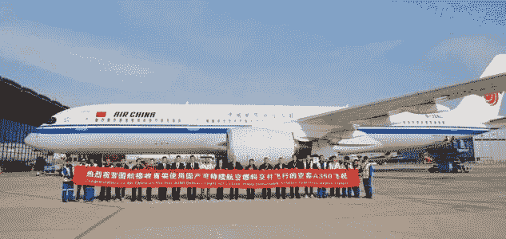

资料来源：中国国航官网，国信证券经济研究所整理

2023年7月民航局适航审定司《航空替代燃料可持续性要求（征求意见稿）》发布，2024年7月民航二所可持续航空燃料发展研究中心正式揭牌成立。2024年9月，中国发改委和中国民航局正式启动了SAF应用试点，试点分两个阶段实施：第一阶段（2024年9月至12月）：选择国航、东航、南航从北京大兴、成都双流、郑州新郑、宁波栎社机场起飞的12个航班进行常态化应用试点。自2024年9月19日起，国航、东航、南航从北京大兴、成都双流、郑州新郑、宁波栎社机场起飞的12个航班将正式加注SAF。第二阶段（2025年全年）：结合第一阶段的工作进展，逐步扩大试点范围，增加参与单位。

国内2025年有望实现初步商业规模的SAF使用。2022年《"十四五"民航绿色发展专项规划》发布，提出力争2025年SAF消费量达到2万吨以上，"十四五"期间消费量累计达到5万吨。2023年工业和信息化部、科技部、财政部、民航局联合印发《绿色航空制造业发展纲要（2023—2035年）》，提出到2025年，实现使用SAF的国产民用飞机示范应用。

SAF全球远期市场空间广阔。在政策引导和扶持下，已制定阶段性目标的欧盟2050年强制规定SAF混掺比例需超过70%，预计远端需求空间超过4000万吨，而根据国际民航组织（ICAO）主办的第三届航空替代燃料会议（CAAF/3）显示，截至2023年超过50家航空公司已承诺到2030年将SAF使用比例提升至燃料总用量的5-30%，其中大多数公司保证这一比例不低于10%。基于以上需求测算以及IATA第77届年会批准全球航空运输业于2050年实现净零碳排放的决议，预计到2050年，航空领域65%的减排将通过使用生物航煤来实现，则SAF需求量将从2023年的5万吨阶段性大幅提升至2030年的1800万吨，占总燃料需求的5.2%，在长远目标中，2050年达到3.50亿吨，占总燃料需求的65.0%。

**图14：IATA规划的SAF发展目标（万吨）**

**图15：IATA规划的SAF发展目标中占燃料需求比重**

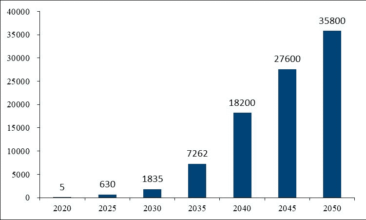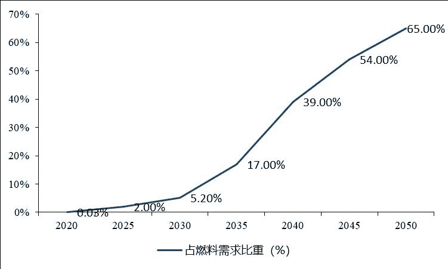

资料来源：IATA，国信证券经济研究所整理

资料来源：IATA，国信证券经济研究所整理

# 欧盟实施关税壁垒保护本国生柴产业，中国有望通过SAF实现出口突破

### 欧盟采用关税壁垒保护本地企业，UCO为生物柴油优质原料

欧盟国家生柴企业竞争力偏弱。据USDA预计，2024年欧盟生物柴油产量预计增长1.3%至1469万吨，这主要是由于瑞典和意大利第二代生物柴油产能投产使二代柴油产量提高7.9%，然而欧盟范围内第一代生物柴油产量降低0.8%。产能方面，欧盟国家生物柴油产能规模从230万升/年到6.8亿升/年不等，其中一代生物柴油产能分布广泛，而第二代生物柴油产能普遍较大，仅在荷兰、意大利、法国、芬兰、瑞典、西班牙、葡萄牙七个国家有分布，二代生物柴油为产能建设的重点。欧盟生物柴油产能的利用率普遍偏低，部分一代生物柴油产能由于面临中国生产商的激烈竞争处于停产的状态。

图16：欧盟生物柴油产能及产量情况

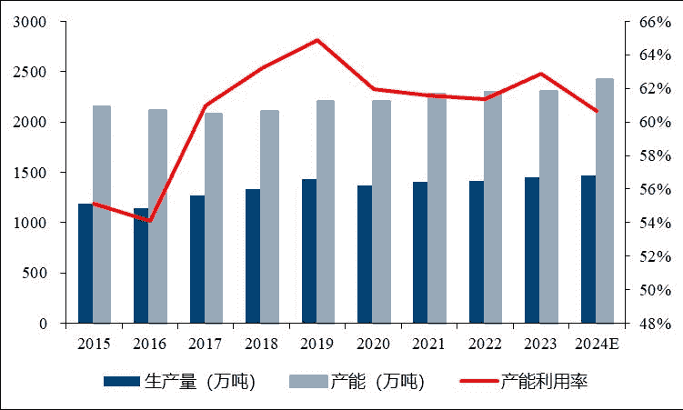

资料来源：USDA，国信证券经济研究所整理

欧洲生物柴油以菜籽油为主要原料，其希望提高非食用油的原料占比。从欧洲本土生物柴油角度来看，欧洲是以菜籽油生产生物柴油（RME）为主的地区，其中以德国、法国产量较多。根据USDA发布的统计数据，欧洲本土生物柴油2023年原料种类的格局为菜籽油（42.4%）、UCO（23.5%）、动物油（6.7%）、大豆油（7.3%）、向日葵油（1.7%）、棕榈油（1.6%）、其他主要包括来源松油、妥尔油（16.8%）。菜籽油为欧盟最重要的生物柴油原料，并且由于2022年欧洲油菜籽丰收，导致2023年其在原料占比中有所上升。2024年由于需弥补棕榈油在生物柴油原料中的占比下降，油菜籽在欧盟生物柴油原料中的占比会继续提高。

在RED II中，对来源为森林、草原、高碳含量土地、农业用地的生物燃料进行了严格的规定。2019年欧盟将棕榈基生物油列为高ILUC（Indirect Land Use Change Directive，间接土地利用变化）相关，即欧盟各成员国棕榈基生物柴油的消费量不得超过2019年水平，并从2023年12月31日起，在2030年前将棕榈基生物柴油消费量逐步降至0。自此在欧盟棕榈油在生物柴油原料占比迅速缩减。

欧盟生物柴油原料中另一占比变化较为明显的原料为“其他”主要包括：松油、妥尔油、棉籽油、加工废油等。由于生物柴油生产商寻找替代棕榈油的原料以及在部分欧盟国家中这部分原料可以双倍计算，导致了这类原料占比快速提升。

图17：欧盟生物柴油各原料占比

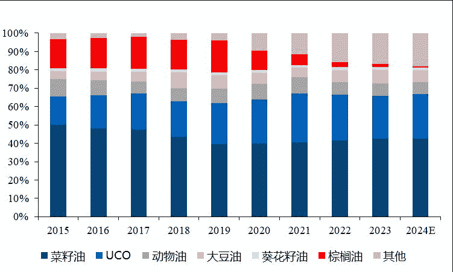

资料来源：公司公告，国信证券经济研究所整理

UCO(Used Cooking Oil，废弃食用油)目前是欧盟第二大生物柴油原料。2023年由于欧盟采用棕榈加工废油代替UCO，以及进口了较多的UCOME(脂肪酸甲酯，一代生物柴油)导致2023年UCO作为生物柴油原料占比较2022年下降。随着2024年欧盟对来自中国的UCOME进行了反倾销调查，并实行UDB对生物柴油来源进行溯源，欧盟自中国进口UCOME量明显下降，这将直接导致欧盟进口UCO量在今年止跌回升。中国一直是欧盟国家最大的UCO进口来源国，其次是马来西亚和英国。

图18：欧盟UCO来源组成（百万升）

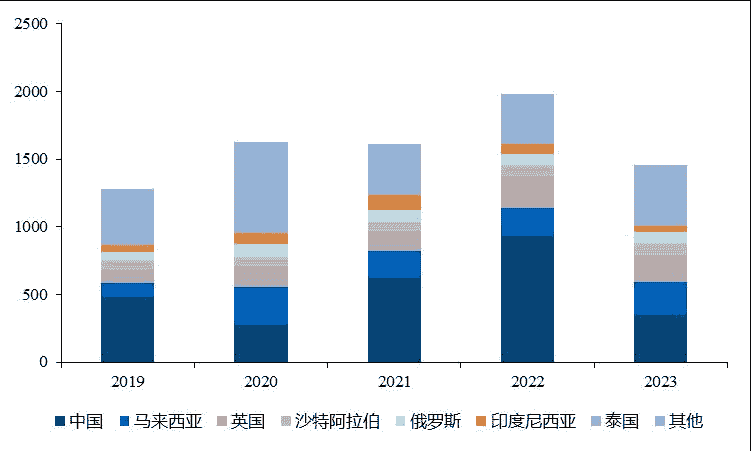

资料来源：公司公告，国信证券经济研究所整理

欧盟提高对进口生物柴油来源审查，生物柴油进口量受到影响。2023年欧盟生物柴油进口来源主要包括中国、英国、马来西亚、阿根廷。根据RED II要求，欧盟委员会需要建立欧盟生物燃料数据库（UDB），用于供生物燃料运营商在线注册，以提高生物燃料的可追溯性，数据库于2024年1月运行，受此影响欧盟进口生物柴油下降明显。

欧盟多次动用关税壁垒保护地区生柴企业。美国：2008年欧盟委员会决定对美国出口到欧洲的生物柴油开展反倾销和反补贴两项调查，2009年3月，欧盟开始对美国进口的生物柴油征收临时性反倾销和反补贴关税，同年7月，欧盟决定对从美国进口的生物柴油征收为期5年的反倾销和反补贴关税，其中每吨征收68.6至198欧元的反倾销税，以及每吨211.2至237欧元的反补贴税。阿根廷和印尼：2012年8月欧盟对原产于阿根廷和印尼的生物柴油开展反倾销调查，2013年5月欧盟宣布对来自阿根廷和印尼的生物柴油采取临时性反倾销措施，最高税率为10.6%和9.6%，2013年10月，欧盟决定对阿根廷生物柴油征收22%-26%的反倾销税，对印尼生物柴油征收8.8%到23.3%的反倾销税。中国：2023年12月，欧盟对中国进口的生物柴油展开反倾销调查，2024年8月起欧盟对中国生物柴油征收临时性反倾销关税，税率为12.8%-36.4%。

图19：欧盟生物柴油进口量（万吨）

图20：欧盟生物柴油进口来源变化（百万升）

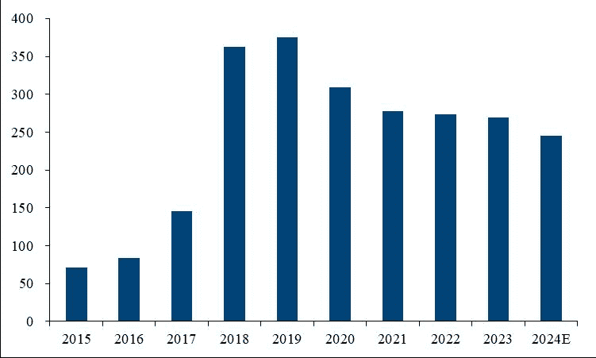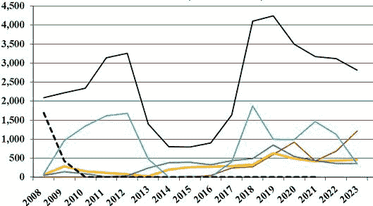

资料来源：USDA，国信证券经济研究所整理

资料来源：USDA，国信证券经济研究所整理

### 我国SAF产能及原料优势逐步凸显，有望实现出口突破

目前，欧美是SAF主要的消费市场，也是生产商集中的地区，欧盟国家在2021年生产了210百万升（约18万吨）可持续航空燃料（SAF）。在欧洲各主要生产商已有产能和公开的新产能中，主要以HEFA路线为主；新产能中，包含部分G+FT、AtJ和PtL路线。在欧洲，目前至少有8个已建工厂设施可以用来生产SAF，另有20多个新建或扩建项目正在规划中（其中有5个为示范项目）。到2025年，采用HEFA路线产能可达720万吨，这些产能最高可产SAF 300万吨/年。

中国石化2009年启动SAF研发，其后开展了一系列示范性生产；中国石油于2011年完成首次生物航煤验证飞行，在“十三五”和“十四五”期间开发了生物航煤工艺包。据不完全统计，截至2024年，中国SAF已有产能仅有35万吨/年，已签约待投产产能353万吨/年，其中大部分产能采用HEFA路线。由于SAF需求量受政策影响较大，当需求增长时，现有产能可能不能满足需求。

表10：欧洲及美国生产SAF的主要生产商与产量

| 国家 | 生产商 | 技术路线 | 开始时间 | 产量（百万吨/年） |
|---|---|---|---|---|
| 芬兰 | Neste | HEFA | - | 0.4 |
| 荷兰 | Neste | HEFA | - | 1.3 |
| 芬兰 | UPM | HEFA | - | 0.1 |
| 法国 | Total Energies | HEFA | - | 0.5 |
| 西班牙 | Cepsa | HEFA | - | 0.1 |
| 西班牙 | Repsol | HEFA | 2023 | 0.2 |
| 意大利 | ENI | HEFA | 2024 | 0.4 |
| 瑞典 | Preem | HEFA | 2025 | 1.0 |
| 荷兰 | Enerkem | G+FT | 2021 | ＜0.1 |
| 瑞典 | Colabitoil | HEFA | 2021 | 0.5 |
| 意大利 | ENI | HEFA | 2021 | 0.5 |
| 瑞典 | STI | HEFA | 2022 | 0.2 |
| 芬兰 | Kaidi | G+FT | 2022 | ＜0.1 |
| 荷兰 | SkyNRG | HEFA | 2023 | 0.1 |
| 挪威 | Sunfire | PtL | 2023 | 0.1 |
| 德国 | Caphenia | PtL | 2023 | ＜0.1 |
| 法国 | TotalEnergies | HEFA | 2024 | 0.2 |
| - | ShyNRG/LanzaTech | AtJ | 2024 | 0.2 |
| 瑞典 | Preem | HEFA | 2024 | 0.7 |
| 荷兰 | Neste | HEFA | 2025 | 1.0 |
| 英国 | Velocys | G+FT | 2025 | 0.1 |
| 英国 | LanzaTech | AtJ | 2025 | 0.4 |
| 芬兰 | UPM | G+FT | 2025 | 0.5 |
| 英国 | Fulcrum | G+FT | 2025 | 0.1 |
| 荷兰 | Synkero | PtL | 2027 | 0.1 |
| 法国 | Engie | PtL | 待定 | 待定 |
| 美国 | LanzaJet | AtJ | 2030 | 3.0 |
| 美国 | World Energy | HEFA | 2024 | 0.5 |
| 美国 | Gevo | AtJ | 2025 | 0.5 |
| 美国 | Fulcrum | G+FT | 2022 | 0.1 |
| 美国 | Velocys | G+FT | - | 0.9 |

资料来源:北京大学能源研究院，国信证券经济研究所整理

表11：中国SAF在产及规划项目

| 企业 | 技术来源 | 技术路线 | 投产/签约时间 | 产量（百万吨/年） |
|---|---|---|---|---|
| 中石化镇海炼化 | 中石化 | HEFA | 2022年投产 | 0.1 |
| 中石化和道达尔 | - | HEFA | 2023年签约 | 0.23 |
| 东华能源和霍尼韦尔 | 霍尼韦尔 | HEFA | 2022年签约 | 1 |
| 嘉澳环保和霍尼韦尔 | 霍尼韦尔 | HEFA | 2022年签约 | 0.5 |
| 金尚环保和霍尼韦尔 | 霍尼韦尔 | HEFA | 2023年签约 | 0.3 |
| 国家电投和国泰航空 | - | - | 2023年签约 | 0.2-0.4 |
| 海新能科 | 海新能科 | HEFA | 已投产+2025年二季度投产 | 0.05+0.2（生物航煤、生物轻油） |
| 君恒生物 | 君恒生物 | HEFA | 已投产+2025年扩产投产 | 0.2+0.6 |

资料来源:各公司官网，国信证券经济研究所整理

由于生产第二代生物柴油（尤其是烃基生物柴油，HVO）的企业一般也都具备转产SAF的能力，可以根据市场需求调整产品线，目前具备第二代生物柴油产能的企业如海新能科也有望受益于SAF的大发展。

我国生物柴油出口欧洲受阻，工业级混合油(UCO)出口退税取消，我国SAF出口有望实现突破。2023年10月，代表欧洲生物柴油生产商的欧洲生物柴油委员会(EBB)向欧盟委员会提起反倾销投诉，并于2023年12月展开调查。2024年7月19日，欧盟委员会提议对出口欧盟的中国生物柴油征收12.8%至36.4%的临时关税，并于2024年8月中旬实施。中国生物柴油出口遭到沉重打击，2024年前10个月，出口量下降44%。2024年11月财政部及国税局公告，自2024年12月1日起，化学改性的动、植物或微生物油、脂俗称废弃油脂、工业级混合油（UCO），取消13%的出口退税。UCO是生产生物柴油和可持续航空燃料（SAF）的原料，具有显著的碳减排效益，长期享受出口13%的退税政策。取消UCO出口退税，有助于进一步保证我国油脂加工企业的原料自给能力，促使企业对UCO进行加工后出口，进一步提高产品附加值。目前欧洲对我国可持续航空燃料（SAF）不征收反倾销税。在SAF需求高增的预期下，我国生物柴油企业转型生产SAF并实现出口，有望实现可观利润。

图21：中国生物柴油出口量（万吨）

图22：中国UCO出口量（万吨）

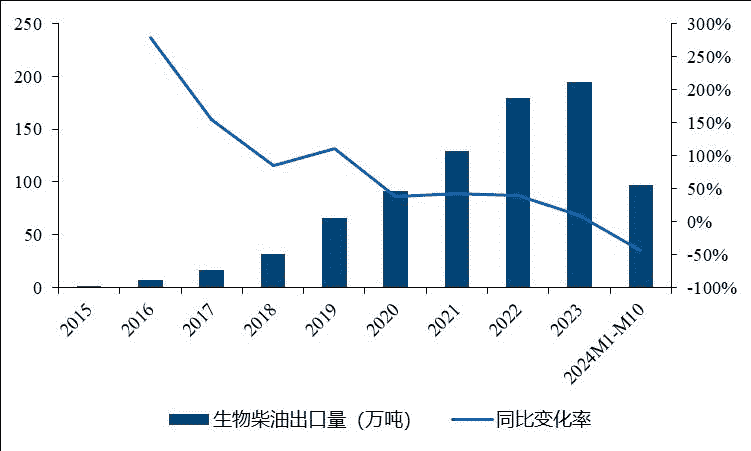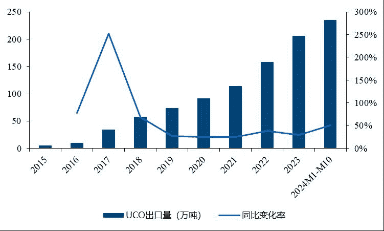

资料来源：海关总署，国信证券经济研究所整理

资料来源：海关总署，国信证券经济研究所整理

表12：国内主要生物柴油产能统计

| 企业 | 现有产能（万吨/年） | 建设产能（万吨/年） | 详情 |
|---|---|---|---|
| 卓越新能 | 50 | 10 | 现有产能中10万吨/年及在建10万吨/年产能可转产SAF |
| 海新能科 | 44.7 | 0 | 两条产线均为二代生物柴油产能，可转产SAF |
| 嘉澳环保 | 30 | 0 | 现有产线为第一代生物柴油产能 |
| 河北金谷 | 25 | 0 | 现有产线为第一代生物柴油产能 |
| 碧美能源 | 10 | 20 | 现有产线为第一代生物柴油产能 |
| 唐山金利海 | 16 | 0 | 现有产线为第一代生物柴油产能 |
| 河北隆海 | 6 | 0 | 现有产线为第一代生物柴油产能 |
| 山东丰汇 | 5 | 0 | 现有产线为第一代生物柴油产能 |

资料来源:各公司官网，国信证券经济研究所整理。

# 相关标的

### 卓越新能：国内最大的生物柴油企业

**公司简介：** 公司专业从事以废油脂（地沟油、酸化油等）为原料生产生物柴油，同时将副产物提炼为工业甘油，并延伸产业链生产生物酯增塑剂、水性醇酸树脂等深加工产品。公司已成为国内最大的生物柴油生产、废油脂处置企业，现已做到废油脂转酯化率98%以上，生物柴油出口量稳居国内第一。

图23：卓越新能主要业务

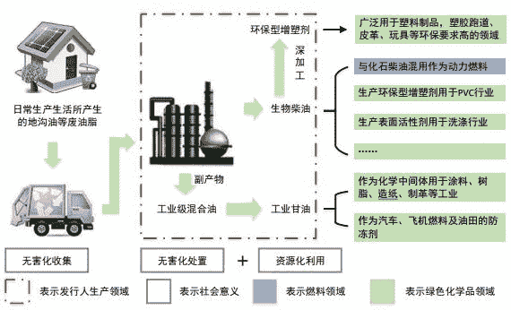

资料来源：公司公告，国信证券经济研究所整理

**产能情况：** 2023年公司美山厂二线顺利投产，产能有序释放。截至2024年年中，公司生物柴油产能规模达50万吨，生物基材料产能规模达9万吨。公司10万吨/年烃基柴油及5万吨/年脂肪酸、10万吨合成树脂项目仍在积极推进。已有二代柴油产能10万吨/年以及新建10万吨/年烃基柴油产能可转产SAF。

**经营情况：** 公司2023年营收28.12亿元，同比下降25.3%，归母净利润0.79亿元，同比下降82.6%。2023年公司生物柴油产量为43万吨，销量为35.2万吨，产能利用率为86%，分别同比上升了5.57%，下降了13.1%，降低了9.85pct。2023年生物柴油平均售价为7397元/吨，同比下降26%，平均毛利482元/吨，同比下降54%。主要原因是欧盟启动多项贸易调查，导致公司生物柴油的产能利用率、销量和利润都出现了不同程度的下跌。2024年Q1-Q3，公司营收29.74亿元，同比增长17.19%，归母净利润0.92亿元，同比减少39.66%。

图24：卓越新能公司营收情况

图25：卓越新能归母净利润情况

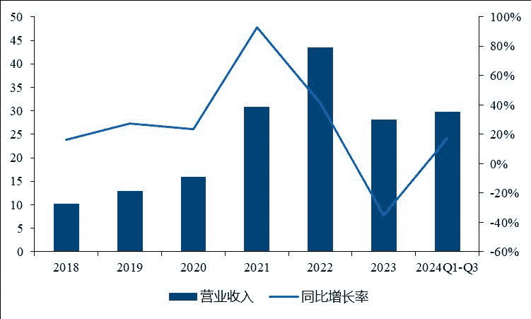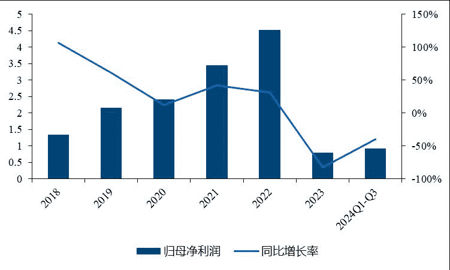

资料来源：公司公告，国信证券经济研究所整理

资料来源：公司公告，国信证券经济研究所整理

**盈利预测：**

生物柴油板块：欧盟委员会在2024年8月16日公布对中国生物柴油产品反倾销调查初裁结果，并从2024年8月17日开始，公司被征收25.4%的临时反倾销税。2024年公司生物柴油业务毛利率受到一定影响；此次国家取消化学改性动、植物或微生物油、脂的出口退税，公司国内原料采购成本有望下降，带动四季度之后毛利率提升；公司积极进行国际化布局，在新加坡、沙特等进行产能建设，明年新加坡一期产能有望投放，公司生物柴油板块有望逐步走出困境。

生物基材料板块：公司布局了工业甘油、生物酯增塑剂、环保型醇酸树脂等产业，并完善了在卤代新材料及锂电池电解液添加剂等领域的技术储备。公司全力推进10万吨合成树脂生产装置建设，该板块发展稳中向好。

**投资建议：** 由于2024年公司生物柴油受到欧洲临时关税影响，毛利率受到一定影响，我们下调2024-2026年归母净利润至1.5/3.22/4.19亿元（原值为2.38/3.22/4.19亿元），同比增速90.6%/115.1%/29.9%；摊薄EPS为1.25/2.69/3.49元，当前股价对应PE为35.27/16.39/12.63x。公司是国内生物柴油龙头，未来产能快速增长，同时积极布局生物基材料，看好公司长期成长性与成长空间，维持“优于大市”评级。

表13：卓越新能盈利拆分（亿元）

| 单位：亿元 | 2021A | 2022A | 2023A | 2024E | 2025E | 2026E |
|---|---|---|---|---|---|---|
| 生物柴油 | 营收 | 27.30 | 40.44 | 26.03 | 32.63 | 46.03 | 55.24 |
| | 成本 | 25.17 | 36.20 | 24.33 | 31.50 | 43.42 | 52.10 |
| | 毛利率 | 7.80% | 10.49% | 6.51% | 3.45% | 5.68% | 5.68% |
| 生物基材料 | 营收 | 3.33 | 2.84 | 1.91 | 2.17 | 3.43 | 5.36 |
| | 成本 | 2.21 | 2.12 | 1.52 | 1.75 | 2.75 | 4.26 |
| | 毛利率 | 33.63% | 25.47% | 20.40% | 19.24% | 20.04% | 20.57% |
| 其余产品 | 营收 | 0.21 | 0.16 | 0.17 | 0.17 | 0.17 | 0.17 |
| | 成本 | 0.17 | 0.03 | 0.09 | 0.09 | 0.09 | 0.09 |
| | 毛利率 | 19.05% | 84.01% | 49.07% | 49.07% | 49.07% | 49.07% |
| 合计 | 营收 | 30.84 | 43.45 | 28.12 | 34.97 | 49.64 | 60.78 |
| | 成本 | 27.55 | 38.34 | 25.95 | 33.34 | 46.25 | 56.45 |
| | 毛利率 | 10.67% | 11.75% | 7.72% | 4.66% | 6.82% | 7.12% |

资料来源：国信证券经济研究所预测

请务必阅读正文之后的免责声明及其项下所有内容

证券研究报告

### 嘉澳环保：长三角地区较有影响力的废弃油脂资源综合利用企业，积极投建SAF生产线

**公司简介：** 公司始建于2003年，是国内最早研发、生产环保增塑剂的领军企业，同时自上市以来公司在生物质能源领域积极布局，现已成为长三角地区较具影响力的废弃油脂资源综合利用企业。公司具体产品包括脂肪酸甲酯生物柴油、多型号环保增塑剂、环保稳定剂等。公司原专注于环保助剂的研发生产，2016年收购东江能源延伸产业链上游，正式进入生物柴油领域。

**图26：嘉澳环保主要业务**

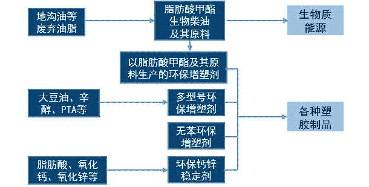

资料来源：公司公告，国信证券经济研究所整理

**产能情况：** 子公司绿色新能源年产35万吨生物柴油及原料，项目于2022年投产；子公司东江能源年产15万吨脂肪酸甲酯技术改造项目，目前正在技改过程中；孙公司东泠能源年产10万吨生物质能源项目，目前正在加紧建设，预计2025年底完工。公司计划在连云港市灌云县临港产业区实施年产50万吨/年废弃油脂转化生物能源项目，主要产品为可再生航空燃料。项目的实施可为公司的战略转型和产业链升级搭建良好的产业发展平台，为公司的产业升级和增强持续盈利能力奠定基础，并对公司未来盈利和发展产生积极的影响。

**经营情况：** 2023年度公司主营产品分环保增塑剂、环保稳定剂、生物质能源三大类，环保增塑剂收入占公司主营业务收入的29.59%，环保稳定剂收入占公司主营业务收入的2.03%，生物质能源收入占公司主营业务收入的66.60%；2023年公司营业收入26.66亿元，较上年度下降16.98%，归母净利润208.88万元，实现扭亏为盈。2024年Q1-Q3，公司实现营业收入10.38亿元，同比下降52.48%，归母净利润为-1.34亿元。在生物质能源方面，碳中和为未来发展趋势，公司抓住生物柴油快速发展的新机遇，扩建生物柴油市场规模，通过技改扩建、新建等方式，将现有核心优势逐步放大，未来公司经营优势将逐步显现。

**图27：嘉澳环保公司营收情况**

**图28：嘉澳环保归母净利润情况**

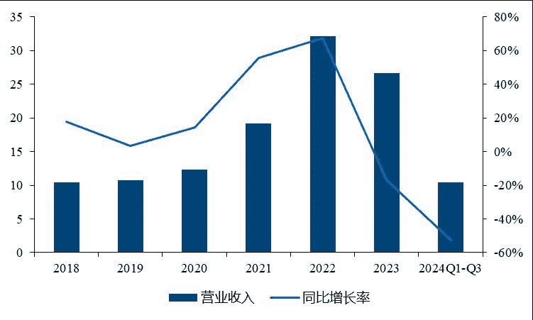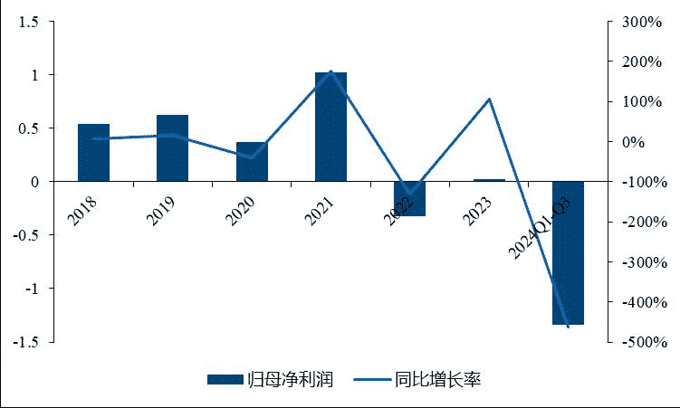

资料来源：公司公告，国信证券经济研究所整理

资料来源：公司公告，国信证券经济研究所整理

**投资建议：** 在欧洲强制添加SAF，其他国家逐步跟进使用SAF的背景下，SAF消费量有望快速提升。我国作为二代生物柴油生产大国，SAF生产技术有一定积累。此次国家取消化学改性动、植物或微生物油、脂的出口退税，SAF生产原料获取更加便捷，也有望促进SAF产能建设与SAF的生产。公司计划在连云港市灌云县临港产业区实施年产50万吨/年废弃油脂转化生物能源项目，主要产品为可再生航空燃料，该项目为已经公布的较大SAF产能。由于该项目处于早期，项目建设及投产进度有待验证，暂未给予投资评级，建议关注。

**可比公司估值：**

**附表：重点公司盈利预测及估值**

| 公司代码 | 公司名称 | 投资评级 | 昨收盘（元） | EPS 2023 | EPS 2024E | EPS 2025E | PE 2023 | PE 2024E | PE 2025E | PB 2024E |
|---|---|---|---|---|---|---|---|---|---|---|
| 688196.SH | 卓越新能 | 优于大市 | 44.09 | 0.77 | 1.25 | 2.69 | 57.26 | 35.27 | 16.39 | 1.87 |
| 603822.SH | 嘉澳环保 | 未评级 | 53.35 | 0.43 | 0.89 | 1.01 | 124.07 | 59.94 | 52.82 | 4.34 |

数据来源：卓越新能数据来自国信证券经济研究所预测，嘉澳环保数据来自wind一致预期

# 风险提示

- 可持续航空燃料价格大幅下跌的风险；
- 欧盟可持续航空燃料需求不及预期的风险；
- 国内二代生物柴油、SAF产能建设及投放不及预期；
- 欧盟、中国生可持续航空燃料政策变化的风险。

证券研究报告

### 免责声明

**分析师声明**

作者保证报告所采用的数据均来自合规渠道；分析逻辑基于作者的职业理解，通过合理判断并得出结论，力求独立、客观、公正，结论不受任何第三方的授意或影响；作者在过去、现在或未来未就其研究报告所提供的具体建议或所表述的意见直接或间接收取任何报酬，特此声明。

**国信证券投资评级**

| 投资评级标准 | 类别 | 级别 | 说明 |
|---|---|---|---|
| 报告中投资建议所涉及的评级（如有）分为股票评级和行业评级（另有说明的除外）。评级标准为报告发布日后6到12个月内的相对市场表现，也即报告发布日后的6到12个月内公司股价（或行业指数）相对同期相关证券市场代表性指数的涨跌幅作为基准。A股市场以沪深300指数（000300.SH）作为基准；新三板市场以三板成指（899001.CSI）为基准；香港市场以恒生指数(HSI.HI)作为基准；美国市场以标普500指数(SPX.GI)或纳斯达克指数（IXIC.GI）为基准。 | 股票投资评级 | 优于大市 | 股价表现优于市场代表性指数10%以上 |
| | | 中性 | 股价表现介于市场代表性指数±10%之间 |
| | | 弱于大市 | 股价表现弱于市场代表性指数10%以上 |
| | | 无评级 | 股价与市场代表性指数相比无明确观点 |
| | 行业投资评级 | 优于大市 | 行业指数表现优于市场代表性指数10%以上 |
| | | 中性 | 行业指数表现介于市场代表性指数±10%之间 |
| | | 弱于大市 | 行业指数表现弱于市场代表性指数10%以上 |

**重要声明**

本报告由国信证券股份有限公司（已具备中国证监会许可的证券投资咨询业务资格）制作；报告版权归国信证券股份有限公司（以下简称“我公司”）所有。本报告仅供我公司客户使用，本公司不会因接收人收到本报告而视其为客户。未经书面许可，任何机构和个人不得以任何形式使用、复制或传播。任何有关本报告的摘要或节选都不代表本报告正式完整的观点，一切须以我公司向客户发布的本报告完整版本为准。

本报告基于已公开的资料或信息撰写，但我公司不保证该资料及信息的完整性、准确性。本报告所载的信息、资料、建议及推测仅反映我公司于本报告公开发布当日的判断，在不同时期，我公司可能撰写并发布与本报告所载资料、建议及推测不一致的报告。我公司不保证本报告所含信息及资料处于最新状态；我公司可能随时补充、更新和修订有关信息及资料，投资者应当自行关注相关更新和修订内容。我公司或关联机构可能会持有本报告中所提到的公司所发行的证券并进行交易，还可能为这些公司提供或争取提供投资银行、财务顾问或金融产品等相关服务。本公司的资产管理部门、自营部门以及其他投资业务部门可能独立做出与本报告中意见或建议不一致的投资决策。

本报告仅供参考之用，不构成出售或购买证券或其他投资标的要约或邀请。在任何情况下，本报告中的信息和意见均不构成对任何个人的投资建议。任何形式的分享证券投资收益或者分担证券投资损失的书面或口头承诺均为无效。投资者应结合自己的投资目标和财务状况自行判断是否采用本报告所载内容和信息并自行承担风险，我公司及雇员对投资者使用本报告及其内容而造成的一切后果不承担任何法律责任。

**证券投资咨询业务的说明**

本公司具备中国证监会核准的证券投资咨询业务资格。证券投资咨询，是指从事证券投资咨询业务的机构及其投资咨询人员以下列形式为证券投资人或者客户提供证券投资分析、预测或者建议等直接或者间接有偿咨询服务的活动：接受投资人或者客户委托，提供证券投资咨询服务；举办有关证券投资咨询的讲座、报告会、分析会等；在报刊上发表证券投资咨询的文章、评论、报告，以及通过电台、电视台等公众传播媒体提供证券投资咨询服务；通过电话、传真、电脑网络等电信设备系统，提供证券投资咨询服务；中国证监会认定的其他形式。

发布证券研究报告是证券投资咨询业务的一种基本形式，指证券公司、证券投资咨询机构对证券及证券相关产品的价值、市场走势或者相关影响因素进行分析，形成证券估值、投资评级等投资分析意见，制作证券研究报告，并向客户发布的行为。

证券研究报告

**国信证券经济研究所**

**深圳**
深圳市福田区福华一路125号国信金融大厦36层
邮编：518046
总机：0755-82130833

**上海**
上海浦东民生路1199弄证大五道口广场1号楼12层
邮编：200135

**北京**
北京西城区金融大街兴盛街6号国信证券9层
邮编：100032
