# 闻香而来

预见嗅觉经济新风向

2023.05

小红书2023香水香氛营销通案

---

## 目录

01 行业格局  
02 香氛趋势  
03 人群洞察  
04 营销策略  

---

## 行业格局

市场 / 格局 / 竞争

### 2025年香水市场规模预估超300亿，小红书成为香水种草重要阵地

自2022年起，市场香水市场年增速预估保持在20%，小红书种草受消费者关注

| 年份 | 市场规模（亿） | 同比增长 |
|------|----------------|----------|
| 2018 | 78             | 21.9%    |
| 2019 | 98             | 25.6%    |
| 2020 | 109            | 11.2%    |
| 2021 | 136            | 24.8%    |
| 2022E | 169            | 24.3%    |
| 2023E | 207            | 22.5%    |
| 2024E | 250            | 20.8%    |
| 2025E | 300            | 20.0%    |

数据来源：艾媒数据中心

| 消费者了解香水渠道 | 占比 |
|--------------------|------|
| 专柜/品牌店铺      | 40%  |
| 小红书香评         | 39%  |
| 朋友同事推荐       | 35%  |
| 品牌官方宣发       | 22%  |
| 社媒素人分享       | 20%  |
| 购买平台买家秀     | 13%  |
| KOL推荐带货        | 12%  |
| 明星代言           | 12%  |
| 搜索引擎           | 11%  |

数据来源：vogue business

### 香水大盘热度持续上升，节日节点热度明显

21年vs22年搜索指数增长26%，23年Q1增长20%

节日节点：情人节、618、七夕、11.11、圣诞、520

数据来源：小红书数据中台，2022全年

### 内容呈现爆发式增长，阅读分享指数激增，节日高峰值

22年阅读渗透指数增长44%，笔记增长82%

数据来源：小红书数据中台，2022/01-2023/03

### 彩香赛道竞争激烈，香水热度发力追赶

彩香行业重点品类现状（纵轴：类目搜索指数；横轴：类目新增笔记数；气泡大小：类目品牌数量）

品类：口红/唇膏、唇釉、粉底液/粉底膏、眼影、**香水**、气垫、遮瑕、腮红、高光、阴影、固体香膏、香水套装

数据来源：小红书数据中台，2022/10-2023/04

高供给高需求 | 机会多潜力大

### 香水带动关联品类，香薰及个护多赛道生长以香破圈

香水及关联品类现状（纵轴：类目搜索指数；横轴：类目新增笔记数；气泡大小：类目品牌数量）

品类：固体香膏、香水套装、香薰、香膏、护手霜-香、身体乳-香、香水

数据来源：小红书数据中台，2022/10-2023/04

高供给高需求 | 机会多潜力大

### 各阶段香氛品牌竞争激烈，国际品牌及新消费品牌同步增长

**国际品牌热度TOP15**（纵轴：新增笔记数；横轴：搜索量；气泡大小：阅读量）

CHANEL、JO MALONE、TOMFORD、GIORGIO ARMANI、YSL、DIPTYQUE、DIOR、BULGARI、GUCCI、LANCOME、GUERLAIN、HERMES、BYREDO、Maison Margiela、ROEWE

**新消费品牌热度TOP15**（纵轴：新增笔记数；横轴：搜索量；气泡大小：阅读量）

冰希黎、野兽派、imsole、春风十里、栀尚香水、观夏、馥生六记、七寸九、synesmoon、肌肤之味、慢宋、agatho、秘密之门、巴莉奥、闻献

数据来源：小红书数据中台，2022/10-2023/04

---

## 香氛趋势

### 2023小红香水香氛整体趋势

#### 五感氛围种草营造代入感，个性化嗅觉表达特质凸显

**香水品类氛围场景2022年H2热度分析**（横轴：22年H2搜索总量；纵轴：搜索增长率；气泡大小：22年H2新增笔记数）

场景：阳光、清晨、森林、雨后、寺庙、约会、夜晚、卧室、上班、大海、校园

**香水品类2022年top热议人设**

“请问有这样感觉的香水吗？”

**五感审美**：视觉、味觉、嗅觉、触觉、听觉

数据来源：小红书数据中台

**Y21**

**Y22**

穿香

穿香水

不如穿香去

不穿香水的女人

望眼欲穿香水

叠穿香水

潘多拉根穿香入戏

如何穿香

不穿香水

怎么穿香水

实穿香水

穿香指南

如何穿香水

好穿香水

YSL穿香

YSL电波穿香

穿香少年

穿香水的说法

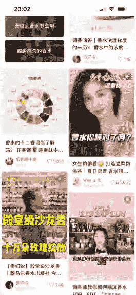

#### “穿香”兴起，如穿搭般挑选香水，多频/多场景/多元人设

**POTD**

22年「穿香」搜索趋势

22年「穿香」搜索热词

22年「穿香」笔记热词

日均搜索增长**113%**

用户关注：

喷香方式/教学

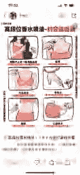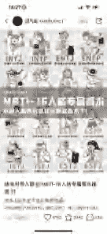

穿香方式

穿香场景

个性人设

646k

110k

6k

数据来源：小红书数据中台

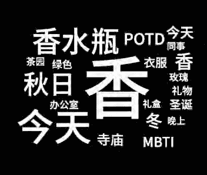

#### 东方兴香

东方香调热度攀升，中国香氛品牌生长迅速

数据来源：小红书数据中台

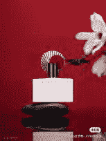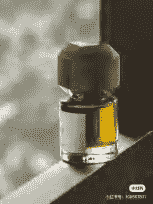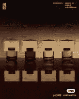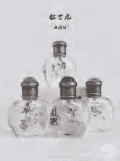

榫卯

折扇

玉石

鼻烟壶

22年至今中式香调搜索指数

0

0.2

0.4

0.6

0.8

1

1.2

0

1000

2000

3000

4000

5000

6000

7000

8000

茶

桃

桂

檀

药

竹

寺庙

玉兰

Y22

增长

2022/1/1

2022/2/1 2022/3/1

2022/4/1

2022/5/1

2022/6/1

2022/7/1

2022/8/1

2022/9/1

2022/10/1 2022/11/1 2022/12/1

2023/1/1

2023/2/1 2023/3/1

桂

檀

22年至今香水「收集」笔记类型

中式香调时节特点

**11%**

**319%**

Y23Q1热搜品牌TOP70

中国新消费品牌占比

某新消费品牌搜索增速

秋季

campaign

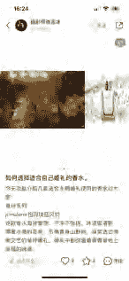

#### 礼赠心智强，节日节事热度高，情侣/朋友/母亲为热门人群

##### 以香赠爱

2022/1/1

2022/2/1 2022/3/1

2022/4/1

2022/5/1

2022/6/1

2022/7/1

2022/8/1

2022/9/1 2022/10/1 2022/11/1 2022/12/1

2023/1/1

2023/2/1 2023/3/1

22年至今香水「送礼|礼盒」搜索趋势

数据来源：小红书数据中台

情人节

520

七夕

圣诞

情人节

香水礼物

生日礼物香水

男士礼物

香奈儿礼物

闺蜜生日礼物香水

中性礼物

香水包装礼物

香水礼物祖玛珑

香水礼物女生

新婚礼物香水

母亲节礼物香水

女生生日礼物香水

情人节礼物香水

香奈儿男生礼物

七夕礼物香水

22年至今香水「礼物」热搜词

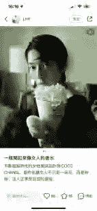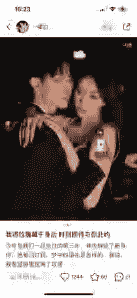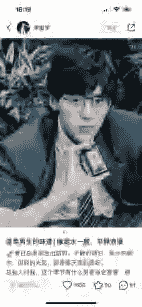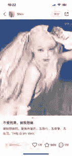

**生日**

热门送礼场景

热点「收/送礼」人群

**情人节**

**婚礼**

**男生**

**闺女/女生**

**母亲/母女**

# PART2

## 香水赛道趋势

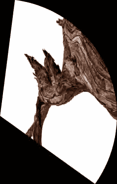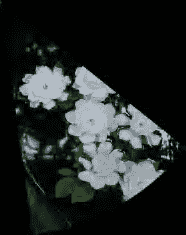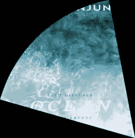

东方调

木质调

皮革调

花香调

果香调

美食调

柑橘调

水生调

绿叶调

芳香调

馥奇调

西普调

### 木质/柑橘无性别香调关注基数大，馥奇/皮革等沉稳类东方香调增速快

东方调

木质调

皮革调

花香调

果香调

美食调

柑橘调

水生调

绿叶调

0%

20%

40%

60%

80%

100%

120%

140%

160%

180%

200%

-1000

0

1000

2000

3000

4000

5000

6000

小红书气味轮搜索占比

22年香调热度趋势

纵轴：22年搜索增速

横轴：22年搜索量

气泡大小：新增笔记数

数据来源：小红书数据中台

馥奇调

### 春夏以水生调/柑橘调等清新香调为代表，秋冬木质调花香调阅读较多

22年季节6大香调阅读渗透占比

春天

夏

秋

冬

水生调

柑橘调

花香调

果香调

木质调

美食调

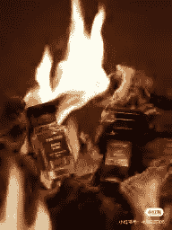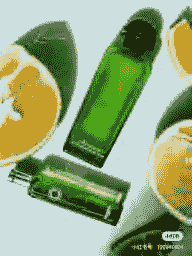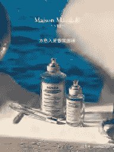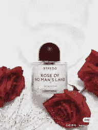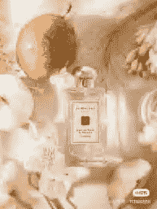

**春**

**夏**

**秋**

**冬**

水生调

果香调

柑橘调

美食调

花香调

木质调

木质调秋天上升

柑橘调冬季下降

果香调春季热度高

水生调夏季热度高

美食调夏秋攀升

22年季节代表香调

数据来源：小红书数据中台

### 趋势走高认知专业化，EDP&EDT为热门浓度，是选购单品的决策影响要素

2022/1/1

2022/1/3

2022/1/5

2022/1/7

2022/1/9

2022/1/11

2022/1/13

2022/1/15

2022/1/17

2022/1/19

2022/1/21

2022/1/23

2022/1/25

2022/1/27

2022/1/29

2022/1/31

2022/2/2

2022/2/4

2022/2/6

2022/2/8

2022/2/10

2022/2/12

2022/2/14

2022/2/16

2022/2/18

2022/2/20

2022/2/22

2022/2/24

2022/2/26

2022/2/28

2022/3/2

2022/3/4

2022/3/6

2022/3/8

2022/3/10

2022/3/12

2022/3/14

2022/3/16

2022/3/18

2022/3/20

2022/3/22

2022/3/24

2022/3/26

2022/3/28

2022/3/30

2022/4/1

2022/4/3

2022/4/5

2022/4/7

2022/4/9

2022/4/11

2022/4/13

2022/4/15

2022/4/17

2022/4/19

2022/4/21

2022/4/23

2022/4/25

2022/4/27

2022/4/29

2022/5/1

2022/5/3

2022/5/5

2022/5/7

2022/5/9

2022/5/11

2022/5/13

2022/5/15

2022/5/17

2022/5/19

2022/5/21

2022/5/23

2022/5/25

2022/5/27

2022/5/29

2022/5/31

2022/6/2

2022/6/4

2022/6/6

2022/6/8

2022/6/10

2022/6/12

2022/6/14

2022/6/16

2022/6/18

2022/6/20

2022/6/22

2022/6/24

2022/6/26

2022/6/28

2022/6/30

2022/7/2

2022/7/4

2022/7/6

2022/7/8

2022/7/10

2022/7/12

2022/7/14

2022/7/16

2022/7/18

2022/7/20

2022/7/22

2022/7/24

2022/7/26

2022/7/28

2022/7/30

2022/8/1

2022/8/3

2022/8/5

2022/8/7

2022/8/9

2022/8/11

2022/8/13

2022/8/15

2022/8/17

2022/8/19

2022/8/21

2022/8/23

2022/8/25

2022/8/27

2022/8/29

2022/8/31

2022/9/2

2022/9/4

2022/9/6

2022/9/8

2022/9/10

2022/9/12

2022/9/14

2022/9/16

2022/9/18

2022/9/20

2022/9/22

2022/9/24

2022/9/26

2022/9/28

2022/9/30

2022/10/2

2022/10/4

2022/10/6

2022/10/8

2022/10/10

2022/10/12

2022/10/14

2022/10/16

2022/10/18

2022/10/20

2022/10/22

2022/10/24

2022/10/26

2022/10/28

2022/10/30

2022/11/1

2022/11/3

2022/11/5

2022/11/7

2022/11/9

2022/11/11

2022/11/13

2022/11/15

2022/11/17

2022/11/19

2022/11/21

2022/11/23

2022/11/25

2022/11/27

2022/11/29

2022/12/1

2022/12/3

2022/12/5

2022/12/7

2022/12/9

2022/12/11

2022/12/13

2022/12/15

2022/12/17

2022/12/19

2022/12/21

2022/12/23

2022/12/25

2022/12/27

2022/12/29

2022/12/31

2023/1/2

2023/1/4

2023/1/6

2023/1/8

2023/1/10

2023/1/12

2023/1/14

2023/1/16

2023/1/18

2023/1/20

2023/1/22

2023/1/24

2023/1/26

2023/1/28

2023/1/30

2023/2/1

2023/2/3

2023/2/5

2023/2/7

2023/2/9

2023/2/11

2023/2/13

2023/2/15

2023/2/17

2023/2/19

2023/2/21

2023/2/23

2023/2/25

2023/2/27

2023/3/1

2023/3/3

2023/3/5

2023/3/7

2023/3/9

2023/3/11

2023/3/13

2023/3/15

2023/3/17

2023/3/19

2023/3/21

2023/3/23

2023/3/25

2023/3/27

2023/3/29

2023/3/31

EDP

EDT

EDC

Parfum

EDT和EDP

EDP和EDT香水区别

EDP

EDP和EDT

冥府之路EDT和EDP

香水EDP和EDT

EDP是浓香还是淡香

檀道EDP和EDT区别

EDT和EDP区别

杜桑EDT和EDP

玫瑰之水EDP和EDT

EDP香水

黑色圆舞曲EDP

蒂普提克无花果EDP和……

玫瑰之水EDP

檀道EDP和EDT

独奏宣言EDP和EDT

檀道EDP和EDT

蒂普提克玫瑰之水EDT……

蔚蓝EDT和EDP

22年至今香水浓度搜索趋势

22年至今「EDP」热搜词

浓度科普

选购指南

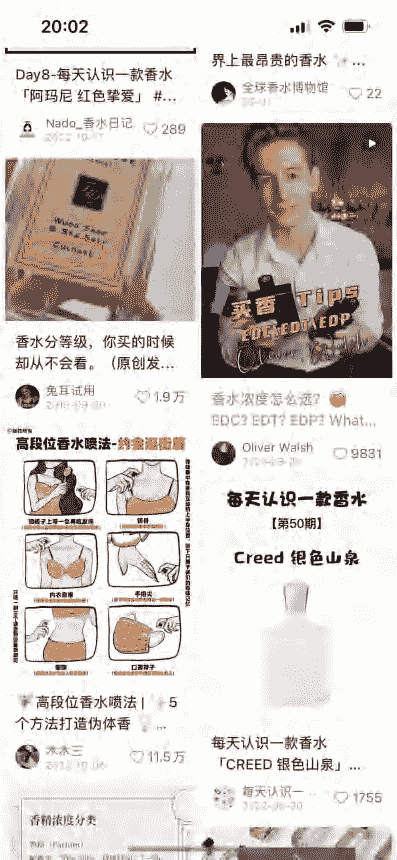

9.8k

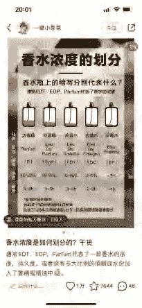

**EDP淡香精热度高**

数据来源：小红书数据中台

**用户尝鲜心智强，小样热度超其他规格，30/50ml关注度较高**

22年至今香水规格搜索指数

- 小样礼盒相关笔记内容：性价比参考、使用时长、便携

| 规格 | 搜索量 | 增速 |
|------|--------|------|
| 100ml | - | - |
| 30ml | - | - |
| 50ml | - | - |
| 小样 | - | - |

数据来源：小红书数据中台

---

**用户品味独到，注重设计，瓶盖/瓶身/都要精益求精**

22年至今香水「好看」内容热词：瓶身、瓶盖、整体设计

22年至今香水「设计」内容热词：瓶身、包装、设计细节、使用场景

数据来源：小红书数据中台

---

## PART 3
## 场景趋势

---

**「运动户外」发力空间大「约会」关注高，约会偏爱花香，户外偏爱木质**

22年香水品类下场合热度现状：运动、约会、居家、旅行、毕业、户外、开会|商务、办公室

22年至23年Q1场景香调阅读渗透：

| 场景 | 香调偏好 |
|------|----------|
| 运动健身 | 水生调、柑橘调、花香调、果香调、木质调、美食调 |
| 户外旅行 | 水生调、柑橘调、花香调、果香调、木质调、美食调 |
| 办公通勤 | 水生调、柑橘调、花香调、果香调、木质调、美食调 |
| 约会 | 花香调 |

（纵轴：22年搜索增速；横轴：22年搜索量；气泡大小：新增笔记数）

数据来源：小红书数据中台

---

**「晚间」场景热度高，对助眠功效需求高，关注意境及香调变化**

22年香水居家场景搜索量：增速+51%

22年香水功效搜索量：睡眠|失眠、安神、舒缓|放松，增速+106%

22年香水睡眠笔记词云

数据来源：小红书数据中台

---

**居家空间香薰品类繁多，个人护理关注身体及手部，注重使用肤感**

22年家居香薰类热搜词：香薰、车载香薰、香薰蜡烛、衣柜香薰、佛手柑香薰、无火香薰、香薰机、卧室香薰、香薰精油、厕所香薰、助眠香薰、香薰蜡片、厕所除臭香薰、汽车香薰、香薰蜡烛diy

22年「体香」搜索热词：体香、体香养成攻略、女生如何养成体香、伪体香好物、体香养成、体香好物、奶香味体香、体香身体乳、自带体香、身体香香好物、女生真的有体香吗、身体香氛、体香好物推荐、体香沐浴露、身体香

22年香氛个护词云：藤条香薰、香薰蜡烛、扩香晶石、香薰机、卧室、衣柜、车载

数据来源：小红书数据中台

---

**礼赠场景下「礼盒」热度高，口红/护手霜/联名品类受关注**

22年至今美妆「礼|礼盒」热搜词 TOP15：礼盒、口红礼盒、化妆品礼盒、彩妆礼盒、七夕礼盒、香水礼盒、情人节礼盒、护手霜礼盒、护肤品礼盒、520礼盒、小红书惊喜礼盒、礼盒开箱、圣诞礼盒、联名礼盒、新年礼盒

22年至今美妆「礼盒」热搜词：香水X口红、香水X护手霜、联名礼盒、限定礼盒

数据来源：小红书数据中台

---

## 人群洞察
### 小红书香水用户画像

| 生活态度 | 占比 |
|----------|------|
| 拥有事业心 | 64% |
| 充满好奇心 | 60% |
| 关注流行趋势 | 59% |
| 喜欢社交 | 57% |
| 享受人生 | 52% |
| 需要仪式感 | 42% |
| 活在当下 | 52% |

2021 vs 2023：在意事业及社交，"仪式感"是践行理想生活和精致生活的最佳方式（+11%）

小红书用户积极进取，在意事业的同时注重仪式感，不论是嗅觉审美或是个性表达，仪式感体现在生活的方方面面。

小红书生活态度TOP

数据来源：【NielsenIQ】后疫情时代消费心理研究——小红书用户消费心理及种草价值

**品质是和用户沟通的核心，情绪价值作为消费决策的重要考虑因素**

购物决策考虑因素TOP

| 决策时重要的考虑因素 | 2021 | 2023 |
|---|---|---|
| 产品品质 | 79% | 87% |
| 情绪价值 | 82% | 74% |
| 性价比 | 78% | 78% |
| 产品创新 | 74% | 76% |
| 大众口碑 | 70% | 76% |
| 品牌 | 68% | 25% |
| 价格 | — | 70% |
| 潮流趋势 | — | — |

数据来源：【NielsenIQ】后疫情时代消费心理研究——小红书用户消费心理及种草价值

---

**女性关注稳定，19-25岁关注人群上升明显，四五线城市关注兴起**

以女性用户为主，城市分布整体均衡，一线及新一线占比超大盘，19-25岁年轻人群占比增多。

数据来源：小红书数据中台

（图表信息：城市线级分布——一线、新一线、二线、三线、四线、五线；年龄分布——18以下、19-22、23-25、26-30、31-35、36-40、41以上；内圈数据：22年，外圈数据：23年3月；性别：男/女，女性关注稳定，19-25岁关注上升）

---

**香水偏好呈现进阶式，25-35岁人群是品牌建立心智教育的集中阵地**

- **0-18岁 初次接触**
  「热搜关键词」：香水推荐女、男士香水、香奈儿香水、香水推荐、tf香水

- **18-24岁 品牌初尝**
  「热搜关键词」：祖玛珑幻夜系列、阿玛尼MY WAY香水、tf香水、香水推荐女、香奈儿香水、爱马仕香水、宝格丽香水、迪奥香水、香膏、平价香水、香水怎么喷、名创优品香水、香水小样

- **25-35岁 千人千面**
  「热搜关键词」：男士香水、Zara香水、香水小样、香奈儿香水、平价香水

- **35-40+岁 品牌忠诚**
  「热搜关键词」：香水推荐、香奈儿香水、爱马仕香水、宝格丽香水、迪奥香水

数据来源：小红书数据中台 *22年至今

---

**小红书香水人群兴趣广泛，懂生活，自律上劲又追潮爱美**

香水人群内容关键词偏好：穿搭时尚、旅游出行、美妆护肤、社交娱乐

数据来源：小红书数据中台

---

## 香氛品牌如何在小红书快速生长？

**场景** | **人群** | **趋势** | **赛道**

**四大维度助力香水香氛品牌更好生长**

---

**细分品牌阶段，科学化定制品牌生长策略**

| 品牌类型 | 场景 | 人群 | 趋势 | 赛道 |
|---|---|---|---|---|
| **海外小众香氛品牌** | 产品差异化场景、生活方式场景 | 香调兴趣人群、衣食出行生活全场景人群 | 香调及玩香趋势、香氛关联品类兴起 | 香调垂类赛道、多品类赛道 |
| **中国新消费香氛品牌** | 产品差异化场景、高峰节日场景 | 时尚/艺术强相关人群、Gifting人群 | 玩香趋势、香氛关联品类兴起 | 香调垂类赛道、Gifting moment主推礼盒；Always on主推单品 |
| **奢品DNA香氛品牌** | 高峰节日场景、Always on礼赠心智 | 奢品时尚追随者，高端精致生活人群，Gifting人群 | 香调及玩香趋势 | Gifting moment主推礼盒；Always on主推单品 |
| **经典香氛品牌** | 日常节事场景、Always on礼赠心智 | 时尚/艺术强相关、高端精致生活人群 | 香调及玩香趋势 | 多品类赛道 |

---

### 小众新锐品牌 PART1

- **赛道**：细分香调
- **人群**：玩香小众
- **趋势**：香氛香调兴起
- **场景**：产品差异化

**标立单品差异化，精细策略稳扎稳打，占领用户心智**

- 精准垂类内容
- 差异化立产品
- 香水/时尚/艺术强相关圈层渗透
- 博主内容
- IP营销
- 科学投放
- 踩准氛围趋势
- 抢占细分赛道

#### 围绕香调及产品特点创造垂类精准内容，逐层渗透消费者心智

| 博主类型 | 笔记类型 | 承载作用 | 博主等级 |
|---------|---------|---------|---------|
| 香水专家 | 试香经验 | 认证背书 | 明星/头部博主（50W+） |
| 美妆头部 | 购买心得 | 专业玩香 | 腰部博主（10W-50W） |
| 玩香博主 | 香水点评 | 推荐好物 | 尾部博主（5K-10W） |
| 时尚/艺术 | 专业分析 | 强相关圈层 | 素人博主（500-5K） |
| 好物分享 | 香评 | 跨垂类输入 | — |
| 场景分享 | 场景/生活分享 | 多角度分享 | — |
| 生活分享 | 真实口碑 | 多元化真实内容 | — |

**激发搜索购物欲，真诚推荐**

**用户心智逐层渗透**

- 占比：**10%**（明星/头部博主）
- 占比：**20%**（腰部博主）
- 占比：**60%**（尾部博主）
- 占比：**10%**（素人博主）

#### 以视觉及优质文案树立品牌内容格调，打造品牌大单品心智

- 单品详解
- 新品预告
- 香水故事
- 小众推荐

#### 小众新锐借势高势能IP项目，精准渗透强相关圈层，树立品牌性格

**商业化合作建议**

**资源助势**

- 《时尚合伙人》：突出品牌时尚调性，搭配时尚媒体资源
- 《气味飞行计划》：社区发起香水定制IP
- 《聚光灯联盟》：艺术家资源，原生内容种草
- 《宝藏新品日》：平台级营销IP，让新品成为顶流爆品

**推荐IP**

- 社区香水计划：品牌+城市，打造香水汇聚热度
- 时尚/艺术资源加持：以平台影响力汇聚资源，赋能品牌
- 关注平台香水专项活动，借助趋势力量
- 渗透强相关人群，借助垂类资源
- 结合垂类内容，借助流行趋势

#### 踩准香水氛围趋势，多场景差异化内容沟通，击穿细分香水赛道

| 圈层人群 | 场景差异 | 踩准趋势 | 细分赛道 |
|---------|---------|---------|---------|
| 奢美人群 | 通勤香/运动香氛/… | 季节趋势-春夏：水生调/柑橘调/果香 | 小众香水/香水推荐高级小众/高级感香水/… |
| 专业香水博主粉丝 | 【户外场景】：运动健身/户外旅行/城市出行/… | 季节趋势-秋冬：美食调/木质调/花香调 | 品牌名称/**香水/产品昵称/… |
| 香水搜索人群 | — | 东方香调：桂花香水/茶香/檀香/… | 香调词：木质香水/玫瑰香水/… |
| 同类品搜索人群 | — | 浓度趋势：EDP/EDT/… | — |
| 香水行业人群 | — | 氛围词：清冷香/富家千金香/寺庙香/… | — |
| 品牌粉丝/品牌搜索人群 | 【艺术/玩香人群】：艺术兴趣人群/摄影兴趣人群/尝新人群… | **【氛围趋势】** | **【细分赛道】** |
| 品牌广告Retargeting人群/一方人群 | — | **【品牌人群】** | — |

#### 信息流精准定向，高效渗透小众新锐香水兴趣人群

**品牌人群特色人群**

- **品牌人群**：品牌粉丝人群、品牌搜索人群、品牌重定向人群、一方人群（站外转化人群上传）
- **行业人群**：香水搜索人群、同类品搜索人群、香水行业人群
- **户外人群**：运动健身人群、户外旅行人群、城市出行人群
- **潜在人群**：奢美人群、尝新人群、艺术兴趣人群、摄影兴趣人群、专业香水博主粉丝

#### 抢占香水氛围趋势词，精准触达细分赛道品类人群

**示例素材**

| 策略 | 说明 |
|------|------|
| 品牌防守 | 品牌意向明确，笔记直观展现品牌，合集香水/香水单品。**首位SOV>70%，7X24H广告首位展现，SOV排名第一** |
| 趋势：香调/浓度/氛围 | 突出产品香型/特性/优势。香调趋势：顺应季节趋势及新兴香调，笔记首图及标题对应香型。木质香水、玫瑰香水、…；水生调、柑橘调、木质调、美食调、… |
| 细分赛道进攻 | 差异场景：不同笔记内容渗透对应场景或文案点题，软性种草产品。清冷香、富家千金香、寺庙香、…；通勤香、运动香水、…；小众香水、高级感香水、… |
| 浓度需求/疑问 | 产品浓度对比/科普向笔记。EDP、EDT、EDP和EDT区别、… |
| 玩香人群 | 玩香人群突出产品高级感。东方调：桂花香、檀香、茶香、… |

#### 某小众香水品牌：优质爆品带动宝藏新品，合力抢占玫瑰香赛道

**数据洞察**
- 品牌爆品心智强，急需提升其他产品声量

**营销动作**
- 搜推同投，精准定向合力渗透品类人群

**营销成果**
- 新品细分赛道排名提升，声量增加
- 细分赛道搜索排名 **↑4名**
- 站内搜索提升 **87%**

**投放期间**

| 投放前后 | 优质爆品 | 宝藏单品 |
|---------|---------|---------|
| 投放前 | 11 | 5 |
| 投放后 | 21 | 17 |

**品牌检索量占比**（数据周期：11-12月）

- 品牌：**50%**
- 爆品：**20%**
- 其余单品：**30%**

**冬季香水笔记词云**

**投放占比**

- 信息流广告：35%
- 搜索广告：25%
- 内容合作：35%
- 品牌广告：5%

**投放时间线**（12/1-2/23）

**内容策略**

- 新品笔记：重香调&氛围差异，宝藏新品玫瑰香
- 优质爆品：香调差异，优质爆品玫瑰香

**人群投放**

- 香水人群：品类词、同类品词、品牌词、爆品词、送礼词
- 潜在人群：新品承接品牌&爆品声量，投入占比**50%**
- 品牌人群：爆品占领品类&送礼心智，投入占比**70%**

环比数据周期：1-2月 vs 11-12月

### 奢品基因品牌

**PART2**

#### 节日节点礼赠

**赛道**：节日节事

**人群**：品牌爱好

**礼赠核心**：礼赠全年化

**趋势**：礼赠全年化

**场景**：节日节事

---

**全年礼赠贯穿，打造节日节事高脉冲，节点助力品牌转化**

- 节日/节事两手抓
- 节日/节促两节点：情侣/母亲/大促

**内容礼赠心智**

- 博主内容
- IP营销
- 科学投放
- 品牌广告大曝光
- 全年礼赠心智渗透

---

**214情人节、圣诞节、520、母亲节、七夕**

**重点节日需冲高流量，高举高打抢占礼赠心智，打造礼赠首选**

- 冲击热度，礼赠转化短频快

---

**生日、乔迁、毕业、婚礼、年会**

**日常节事礼赠心智强，品牌需拉长投放矩阵，连点成线**

- 长线运维，礼赠心智常态化

---

**分节日节事打造礼赠首选内容，全年礼赠场景内容深入化针对化**

| 博主类型 | 笔记类型 | 博主等级 | 承载作用 |
| --- | --- | --- | --- |
| 明星/头部博主（50W+） | 美妆头部、时尚头部、明星 | 节日重点人群：情侣/男女/母女 | 强品牌风格演绎，品牌形象透传，品牌心智 |
| 腰部博主（10W-50W） | 单品香/CP香 | 节事相关人群：学生/电竞/婚庆 | 送礼首选内容，品味+情感双维度 |
| 尾部博主（5K-10W） | 毕业/比赛/生日、婚礼/乔迁 | 真实口碑，激发搜索购物欲 | 绑定礼赠人群，精准输入 |
| 素人博主（500-5K） | 生活分享、用后反馈 | 日常节事，礼赠Always On | 用户心智逐层渗透 |

占比：**20% / 40% / 30% / 10%**

---

**礼赠人群绑定加持品牌调性形象树立，合力击穿礼赠场景**

- 母女礼赠
- 情侣礼盒
- 明星同款
- 品牌秀展

---

**针对节日重点人群，创意事件加原生植入，人群渗透与转化一站式**

- 情侣：线上线下全覆盖，产品原生分享，击中恋爱人群礼赠
- 母女：不可忽视的礼赠群体，情感&品质双向影响
- 提前布局全年礼赠节点
- 产品组合匹配人群偏好
- 借助平台IP大创意，快速拉动人群好感

**商业化合作建议**

- 《无限宠妈计划》：聚集40+女性，链接母女人群
- 《七夕爱情攻略》：联合明星为七夕打造必买清单
- 《520爱的攻略》：深度互动探讨爱的议题
- 《心动连锁反应》：恋爱线上综艺，击穿情侣

**推荐IP**：礼赠节日

---

**针对大促节点，平台资源助力品牌完成「种草-转化」链路闭环**

- 大促前，做好内容铺设，帮助用户完成消费决策
- 大促中，缩短用户种草-购买路径
- 大促后，聚拢用户反馈，形成好口碑正循环
- 超品联动：联动电商超品日，小红书种草电商转化
- 大促节点：做好大促前后内容承接，形成【种草-转化】的链路闭环

**商业化合作建议**

- 《李佳琦种草大作战》：联合李佳琦打造最强种草-拔草闭环营销
- 《618应该买什么》：联合明星背书为品牌背书必买清单
- 《38、618、双11宝藏好物》：小红书明星种草+天猫会场拔草
- 《宝藏品牌日》：赋能品牌电商超品日

**推荐IP**：大促节点

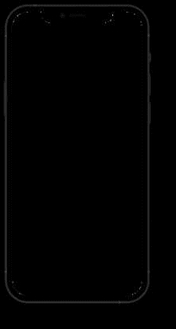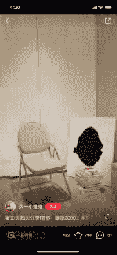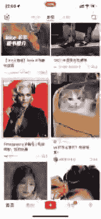

#### 渗透用户站内全路径，快速实现高曝光，助力品牌兴趣人群广泛触达

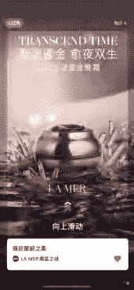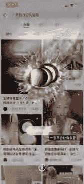

- 曝光互动
- 浏览互动
- 搜索互动
- 内容互动

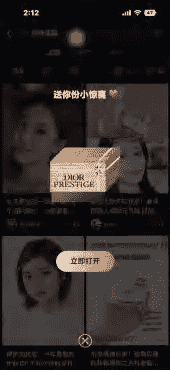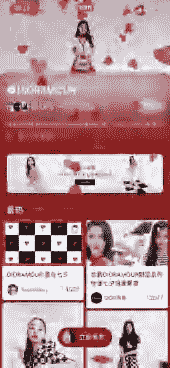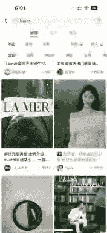

- 开屏
- 特型话题页
- 搜索彩蛋
- 点赞特效
- 惊喜盒子
- 信息流

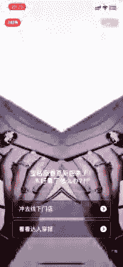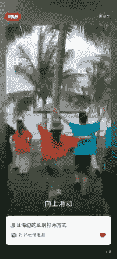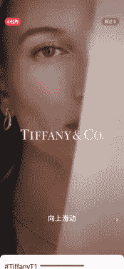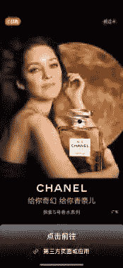

- 小红屏图片
- 小红屏视频
- 原生话题开屏
- 点击卡片
- 互动开屏

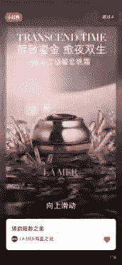

- 原生笔记开屏

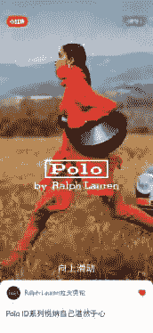

#### 小红书开屏创意交互矩阵

满足品牌不同曝光诉求，强势声量

- 品牌话题
- 品牌专业号
- 客资留存
- 电商跳转

#### 踩准香水全年礼赠心智，渗透约会节日场景

##### 圈层人群

##### 节日场景

##### 踩准趋势

##### 抢占赛道

##### 品牌防守

- 搜索
- 信息流

季节趋势-春夏：水生调/柑橘调/果香

季节趋势-秋冬：美食调/木质调/花香调

东方香调：桂花香水/茶香/檀香/…

浓度趋势：EDP/EDT/…

日常送礼：生日礼物/礼盒/毕业礼物/…

品牌名称/**香水/产品昵称/…

品类：香水/香水推荐/男香/…

用法：香水怎么喷/…

约会心机/约会好物/…

520礼物/情人节礼物/…

##### 【约会/节日场景】

情感内容兴趣人群/约会人群/…

节日人群

穿搭/穿香/叠穿香水/…

##### 【时尚人群】

时尚穿搭人群/明星粉丝/穿搭博主粉丝/

尝新人群…

##### 【礼赠趋势】

##### 【品类赛道】

日常送礼人群/

奢美人群/…

香水搜索人群/同类品搜索人群/

香水行业人群/…

品牌粉丝/品牌搜索人群/

品牌广告Retargeting人群

##### 【品牌人群】

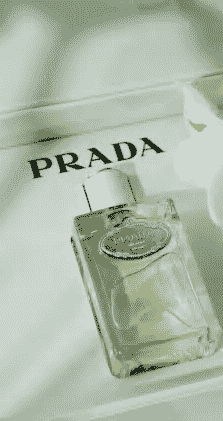

#### 信息流精准定向，重点渗透节日礼赠人群

##### 品牌人群

##### 特色人群

##### 礼赠人群

##### 潜在人群

##### 行业人群

- 奢美人群
- 尝新人群
- 时尚穿搭人群
- 奢侈品兴趣人群
- 明星粉丝
- 穿搭博主粉丝
- 香水搜索人群
- 同类品搜索人群
- 香水行业人群
- 日常送礼人群
- 节日送礼人群
- 情感内容兴趣人群
- 品牌粉丝人群
- 品牌搜索人群
- 品牌重定向人群
- 一方人群（站外转化人群上传）

##### 示例

##### 素材

品牌意向明确

笔记直观展现品牌

合集香水/香水单品

**首位SOV >70%**

**7×24H广告首位展现**

**SOV排名第一**

香调趋势

顺应季节趋势及新兴香调，

笔记首图及标题对应香型

节日场景

针对不同节日，营造对应场景，情人节期间可增加约会场景

#### 覆盖日常及节日送礼趋势词，渗透礼赠人群

##### 品牌防守

趋势：香调/浓度/礼赠

##### 抢占赛道

场景：约会/节日

香水

香水推荐

香水怎么喷

…

水生调

柑橘调

木质调

美食调

…

品牌名称

**香水

产品昵称

…

##### 策略

礼盒

生日礼物

毕业礼物

…

日常礼赠

突出常规礼盒，

提升品牌日常送礼心智

春夏

秋冬

约会心机

约会好物

…

穿搭

穿香

香水叠穿

…

EDP

EDT

EDP和EDT区别

…

浓度需求/疑问

产品浓度对比/科普向笔记

##### 时尚人群

时尚人群

穿搭场景融入香水，POTD

桂花香

檀香

茶香

…

东方调

品类学习/选择阶段

针对用户提问，匹配香水喷法笔记/突出产品优势

520

情人节

七夕礼物

…

**SOV排名前三**

#### 某奢品香水品牌：掌握日常+节日送礼密码，强势占领礼赠人群

送礼人群

渗透率

+113%

情人节搜索

环比增长

+131%

日常期

情人节

1月1日

2月1日

3月1日

4月1日

5月1日

6月1日

7月1日

8月1日

9月1日

10月1日

11月1日

12月1日

2021

2022

圣诞季

情人节

520

七夕

618

37%

27%

36%

##### 品牌人群

- 品牌香水兴趣人群
- 同类品人群
- 同类品兴趣人群
- 行业人群
- 香水行业兴趣人群
- 日常送礼人群
- 生日礼物&纪念日礼物人群/恋爱场景人群
- 节日赠礼人群
- 情人节/520/七夕/圣诞
- 潜在人群
- 奢美人群/精致中产/高消费女性…

**Always-On：渗透日常送礼人群**

**Campaign：强势覆盖情人节场景&送礼人群**

#### 品牌竞价投放策略

竞价投放趋势

品牌搜索趋势

礼物

圣诞

礼盒

周末

生日

办公室

海边

城市

##### 营销动作

##### 组合投放+长线种草，全面覆盖送礼人群

##### 数据洞察

##### 香水品类送礼心智强，热度高

##### 营销成果

##### 品牌声量及送礼人群渗透率均有大幅提升

信息流广告

搜索广告

内容合作

Before

After

环比数据周期：1–2月 vs 11–12月

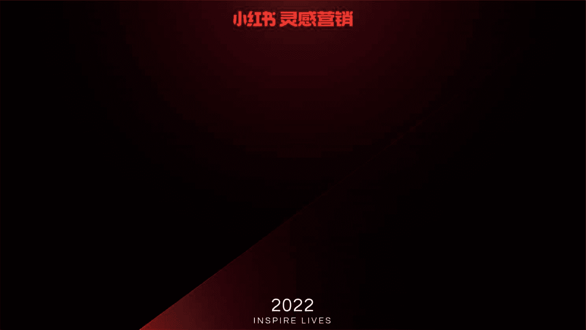

### 经典香氛品牌

**PART3**

香水及关联品

**赛道**

品牌爱好及尝鲜

**人群**

仪式感及情绪价值兴起

**趋势**

Lifestyle

**场景**

#### 多品线同步生长，渗透不同圈层人群，扩大品牌影响力

多赛道多圈层

打造多品线生长

Lifestyle场景拓展

Daily life/时尚/户外

博主内容

IP营销

科学投放

香水本品热度稳固

关联品人群破圈

#### 多品类圈层内容打造，「香调」作为差异切入点，创造多品类机会

博主类型

笔记类型

博主等级

承载作用

- 明星/头部博主（50W+）
- 腰部博主（10W-50W）
- 尾部博主（5K-10W）
- 素人博主（500-5k）

Lifestyle

时尚/穿搭

运动/护肤

家居生活

身体护理

穿搭/汽车

生活分享

各圈层

原生反馈

品牌生活方式

氛围感营造

不同品类

垂类内容口碑

真实口碑

真实体验分享

品牌调性传递

生活方式打造

日常生活场景

日常全场景沟通

多场景渗透

垂类单品突围

垂直品类沟通

用户心智逐层渗透

**占比**

- **30%**
- **20%**
- **40%**
- **10%**

#### 生活多场景原生植入，放大产品独特意境感，多品类内容收拢心智

晨昏特定

居家生活

车载生活

运动场景

- 品牌品类场景：集合品牌爱好者，透传品牌生活方式
- 平台全生活场景：平台四季OTO活动，匹配品牌倡导场景

#### 商业化合作建议

《红薯日redday》

**全国城门店线下专薯日**

《宝藏俱乐部》

社群式活动，集合品牌生活方式

#### 生活全场景覆盖，放大多品类心智树立，塑造经典香氛品牌生活方式

- 树立品牌life style
- 匹配平台全场景活动
- 品牌兴趣人群覆盖，运维承接

《我就要这样生活》

**社区全四季生活场景全覆盖**

《放轻松实验室》

**强调嗅觉意境，深化具体场景**

**生活**

**全场景**

推荐IP

#### 踩准香水关联品类趋势，全生活场景触达圈层人群

**圈层人群**

**场景差异**

**踩准趋势**

**赛道拓展**

**品牌防守**

**搜索**

**信息流**

品牌名称/**香水/产品昵称/…

品类：香水/香水推荐/男香/…

用法：香水怎么喷/…

拓展赛道：香膏/香水套装/…

好物推荐/居家好物/沉浸式回家/…

失眠/睡前香/…

**【全生活场景】**

品质生活兴趣人群/

熬夜人群/…

仪式感/精致女孩/精致生活/…

**【精致人群】**

精致中产/精致白领/

尝新人群/…

**【关联品趋势】**

**【品类拓展】**

奢美人群/

美妆个护人群/家居装饰人群/…

香水搜索人群/同类品搜索人群/

香水行业人群/…

品牌粉丝/品牌搜索人群/

品牌广告Retargeting人群

**【品牌人群】**

季节趋势-春夏：水生调/柑橘调/果香

季节趋势-秋冬：美食调/木质调/花香调

东方香调：桂花香水/茶香/檀香/…

浓度趋势：EDP/EDT/…

关联品：香薰/护手霜/身体乳/车载香氛…

#### 信息流精准定向，助力品牌渗透关联品人群

**行业人群**

**品牌人群**

**特色人群**

**关联品类潜在人群**

- 奢美人群
- 尝新人群
- 精致中产
- 精致白领
- 香水搜索人群
- 同类品搜索人群
- 香水行业人群
- 美妆个护人群
- 家居装饰人群
- 品质生活兴趣人群
- 品牌粉丝人群
- 品牌搜索人群
- 品牌重定向人群
- 一方人群（站外转化人群上传）

#### 示例素材

品牌意向明确

笔记直观展现品牌

合集香水/香水单品

**首位SOV >70%**

**7 X 24H广告首位展现**

**SOV排名第一**

香调趋势

顺应季节趋势及新兴香调，笔记首图及标题对应香型

生活场景

从居家/睡眠场景切入，种草香水及其关联品

#### 香水本品热度稳固，关联品类拓展人群破圈

**品牌防守**

**趋势：香调/浓度/关联品**

**抢占赛道**

**全生活场景**

香水

香水推荐

香水怎么喷

香膏

…

水生调

柑橘调

木质调

美食调

…

品牌名称

**香水**

产品昵称

…

**策略**

香薰

护手霜

身体乳

车载香氛

…

关联品类

香水同款居家/个护好物拓展

春夏

秋冬

仪式感

精致女孩

精致生活

…

EDP

EDT

EDP和EDT区别

…

浓度需求/疑问

产品浓度对比/科普向笔记

**精致人群**

精致人群

穿搭场景融入香水，POTD

桂花香

檀香

茶香

…

**东方调**

居家好物

沉浸式回家

失眠

睡前香

…

品类学习/选择阶段

针对用户提问，匹配香水喷法笔记/突出产品优势

**SOV排名前三**

#### 某经典香氛品牌：打造晚间香氛场景，赛道拓展助力品牌热度升级

##### 趋势洞察
香水关联品心智强，晚间场景兴起

##### 营销动作
内容注重夜间场景营造，投放精准定向破圈

##### 营销成果
品牌全线开花，热度持续上升

**香水赛道搜索排名 ↑18名**

环比数据周期：9月 vs 8月

**站内搜索提升 165%**

| 搜索排名 | 品类 |
|---------|------|
| 1 | 睡眠喷雾 |
| 2 | 香水 |
| 3 | 香薰 |
| 4 | 香薰蜡烛 |

| 月份 | 品牌广告 | 投流 | 内容合作 |
|------|---------|------|---------|
| 4月 | | | |
| 5月 | | | |
| 6月 | | | |
| 7月 | | | |
| 8月 | | | |
| 9月 | | | |
| 10月 | | | |
| 11月 | | | |
| 占比 | 40% | 20% | 40% |

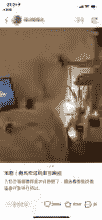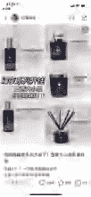

**香水&关联品人群 30%**　**生活场景人群 70%**

**香水笔记下热门时间&品类词云**

投放期间：助眠好物、卧室布置、香薰、枕香喷雾、香薰蜡烛

**↑14　↑18　↑4　keep**

| | 增速 |
|---|------|
| Y22 | +106% |

**睡眠　安神　放松**

---

## 不同品牌匹配差异化打法，助力长效增长

### 经典香氛品牌

**品牌心智教育：** 品牌名称/品牌产品词/产品Nickname，7×24H全天卡位品牌搜索人群

**踩准氛围趋势，抢占细分赛道**

- 春夏季：春夏香水/水生调/柑橘调…
- 秋冬季：秋冬香水/美食调/木质调…
- 东方香调：桂花香/茶香/檀香/…
- 浓度：EDP/EDT/…

**全生活场景渗透，赛道扩展**

- 品牌粉丝/品牌搜索人群/品牌广告Retargeting人群/一方人群
- 送礼人群/节日人群/约会人群
- 智能定向/香水搜索人群/同类品搜索人群/香水行业人群/奢美人群/尝新人群/…
- 运动健身/户外旅行/艺术兴趣/摄影兴趣/…

### 小众新锐品牌

### 奢品基因品牌

**策略与预算建议**

| 品牌类型 | 搜索策略 | 信息流策略 | 内容:投流 | 预算建议 |
|---------|---------|-----------|-----------|---------|
| 经典香氛品牌 | 搜索 50% 信息流 50% | Always-On 60% Campaign 40% | 内容 40% 投流 60% | 50%:50% |
| 小众新锐品牌 | 搜索 40% 信息流 60% | Always-On 40% Campaign 60% | 内容 30% 投流 70% | 30%:70% |
| 奢品基因品牌 | 搜索 40% 信息流 60% | Always-On 20% Campaign 80% | 内容 50% 投流 50% | 30%:70% |

**人群定向**

- 经典香氛品牌：好物推荐/居家好物/睡前香/仪式感/精致生活/…
- 小众新锐品牌：美妆个护人群/家居装饰人群/…　时尚人群/潮明星粉丝/穿搭博主粉丝/…
- 奢品基因品牌：品质生活兴趣人群/精致中产/精致白领/…

**关键词策略**

- 经典香氛品牌：全年礼赠心智抢占
  - 生日礼物/礼盒/毕业礼物/520礼物/情人节礼物/…
  - 氛围词：清冷香/富家千金香/寺庙香/…
  - 香薰/护手霜/身体乳/车载香氛/…
- 小众新锐品牌：小众香水/高级感香水/沙龙香水/…
- 奢品基因品牌：香水/香水推荐/男香/香水怎么喷/…　木质香水/玫瑰香水/…　香膏/香水套装/…　穿搭/穿香/叠穿香水/…　约会心机/约会好物/…　通勤香/运动香氛/…

---

### 香水行业关键词包

**小红书聚光平台-新建单元**
筛选【高级定向】-选择【人群包】-【香水行业人群】【520送礼人群】【母亲节送礼人群】

**小红书聚光平台-投放工具**
选择【关键词规划工具】-选择【行业推词】-选择【香水】类目-属性【香水-品类词】【香水-香调词】

*具体操作请联系品牌对应直客/渠道同学

香水行业词包：包含热搜品类词/产品词/香调词/送礼词，精准触达品类人群；
香水行业人群包：精选香水兴趣人群及潜在需求人群，拓量优选。

### 一键定向香水行业人群，助力品牌目标人群圈层渗透

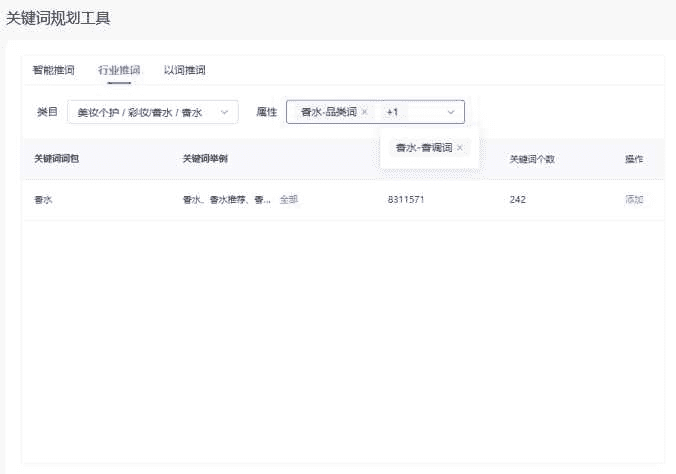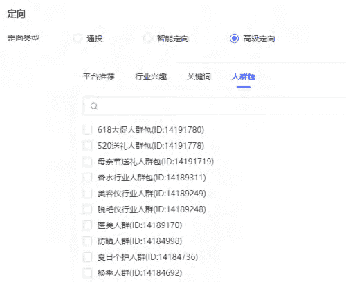

---

| 场景 | 趋势 | 人群 | 赛道 |
|------|------|------|------|
| 让好产品在这里 **初生** | | | |
| 让好品牌在这里 **生长** | | | |

---

期待携手开启芬芳

2023.05
