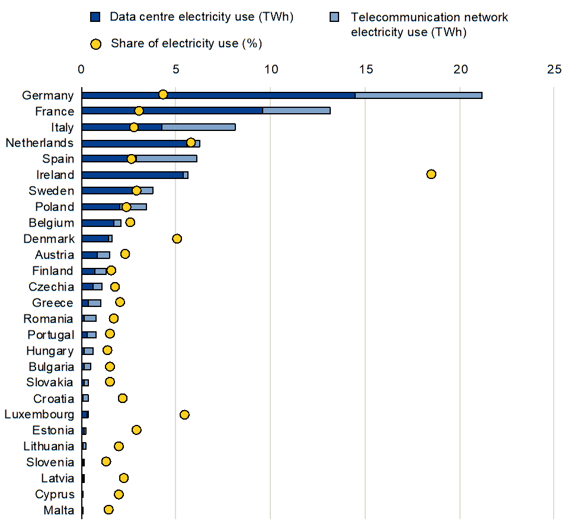

EUR 31841 EN

ISSN 1831-9424

Kamiya, G., Bertoldi, P.

2024

Energy Consumption in Data Centres and Broadband Communication Networks in the EU

JRC135926

EUR 31841 EN

PDF

ISBN 978-92-68-12554-0

ISSN 1831-9424

doi:10.2760/706491

KJ-NA-31-841-EN-N

Luxembourg: Publications Office of the European Union, 2024

© European Union, 2024

The reuse policy of the European Commission documents is implemented by the Commission Decision 2011/833/EU of 12 December 2011 on the reuse of Commission documents (OJ L 330, 14.12.2011, p. 39). Unless otherwise noted, the reuse of this document is authorised under the Creative Commons Attribution 4.0 International (CC BY 4.0) licence (https://creativecommons.org/licenses/by/4.0/). This means that reuse is allowed provided appropriate credit is given and any changes are indicated.

For any use or reproduction of photos or other material that is not owned by the European Union permission must be sought directly from the copyright holders.

How to cite this report: European Commission, Joint Research Centre, Kamiya, G. and Bertoldi, P., *Energy Consumption in Data Centres and Broadband Communication Networks in the EU*, Publications Office of the European Union, Luxembourg, 2024, https://data.europa.eu/doi/10.2760/706491, JRC135926.

This document is a publication by the Joint Research Centre (JRC), the European Commission’s science and knowledge service. It aims to provide evidence-based scientific support to the European policymaking process. The contents of this publication do not necessarily reflect the position or opinion of the European Commission. Neither the European Commission nor any person acting on behalf of the Commission is responsible for the use that might be made of this publication. For information on the methodology and quality underlying the data used in this publication for which the source is neither Eurostat nor other Commission services, users should contact the referenced source. The designations employed and the presentation of material on the maps do not imply the expression of any opinion whatsoever on the part of the European Union concerning the legal status of any country, territory, city or area or of its authorities, or concerning the delimitation of its frontiers or boundaries.

**Contact information**

Name: Bertoldi Paolo

Address: JRC, 21027 Ispra (VA), Italia, TP 450

Email: paolo.bertoldi@ec.europa.eu

Tel.: +39-0332 78 9299

**EU Science Hub**

https://joint-research-centre.ec.europa.eu

## Contents

Abstract

Executive Summary

1\. Introduction

1.1 Background

1.2 Objectives and approach

2\. Literature review

2.1 Introduction

2.2 Modelling approaches

2.3 Data centres

2.4 Telecommunication networks

2.5 Digital technologies and services

3\. Data collection and modelling

3.1 Introduction

3.2 Data centres

3.3 Telecommunication networks

3.4 Summary and limitations

4\. Results and discussion

4.1 Data centres

4.2 Telecommunication networks

4.3 Summary

5\. Conclusions and recommendations

References

List of figures

List of tables

Annex

## Abstract

Demand for digital services is rising rapidly, raising concerns about the energy use and environmental impacts of data centres and telecommunication networks. Despite the increasing public and policy interest in addressing these impacts, there is a lack of official statistics on the energy use of digital infrastructure. This study reviews and uses existing literature and public data sources to estimate the energy consumption of data centres and telecommunication networks in the European Union (EU-27) in 2022. Data centres in the EU used an estimated 45–65 TWh of electricity in 2022 (1.8–2.6% of total EU electricity use), while telecommunication networks used an estimated 25–30 TWh of electricity (1–1.2% of total EU electricity use). Network energy use as a share of national electricity use was both lower and more uniform than data centres. Policymakers and companies should work together to improve data collection, quality, and availability in order to better understand trends and make informed policy decisions to manage the energy and environmental impacts of digital infrastructure.

## Executive Summary

**Demand for digital services is rising rapidly, raising concerns about the energy use and environmental impacts of data centres and telecommunication networks.** Despite the increasing public and policy interest in addressing these impacts, there is a lack of official statistics on the energy use of digital infrastructure. This study reviews and uses existing literature and public data sources to estimate the energy consumption of data centres and telecommunication networks in the European Union (EU-27) in 2022.

**Data centres in the EU used an estimated 45–65 TWh of electricity in 2022**, equivalent to 1.8–2.6% of total regional electricity consumption. The top four data centre markets – Germany, France, the Netherlands, and Ireland – accounted for nearly two-thirds of the region’s data centre energy use, despite having less than 40% of the population. Data centres represent over 2% of national electricity use in Ireland (18%), the Netherlands (5.2%), Luxembourg (4.8%), Denmark (4.5%), Germany (3%), Sweden (2.3%), and France (2.2%).

**Telecommunication networks used an estimated 25–30 TWh of electricity**, equivalent to 1–1.2% of total EU electricity use. The four largest Member States by population and GDP (Germany, France, Italy, and Spain) were also the four largest users of energy for telecommunication networks, accounting for 65% of the total. Network energy use as a share of national electricity use was both lower and more uniform compared with data centres, ranging from 0.5% to 1.5%. In contrast, data centres as a share of national electricity use range from as low as 0.4% in some countries to as high as 18% in Ireland.

**The combined energy use of data centres and telecommunication networks in the EU was 70–95 TWh in 2022, equivalent to 2.8–3.8% of total regional electricity use.** The four largest Member States – Germany, France, Italy, and Spain – accounted for about 60% of total digital infrastructure energy use in the region. Digital infrastructure accounts for more than 5% of national electricity use in four countries, each with major data centre markets: Ireland (19%), the Netherlands (6%), Luxembourg (5.5%), and Denmark (5%).

**Policymakers and companies must work together to improve data collection, quality and availability.** While the estimates of this study represent a likely range of figures, it is critical to develop more robust estimates to better understand trends and make informed policy decisions to manage the energy and environmental impacts of digital infrastructure. Governments and statistical agencies should develop standardised definitions and classifications for data centres and networks, such as providing criteria and guidance on classifying different data centre types. Governments and companies should work together to improve data quality and availability regarding data centre energy consumption (by size and type), telecommunication network energy use (by type), as well as relevant activity indicators (e.g. connections, data traffic, data centre workloads). Data collection efforts should also seek to better understand energy use characteristics and implications of specific services and tasks such as artificial intelligence.

## 1. Introduction

### 1.1 Background

Digital infrastructure – data centres and telecommunication networks – are at the heart of the digital transformation, underpinning all aspects of our increasingly digitalised and connected societies.

Demand for their services is rising rapidly, raising concerns about their energy use and environmental impacts. Between 2015 and 2022, the number of internet users globally increased by 80%, internet traffic increased five-fold, while data centre workloads more than quadrupled (IEA, 2023a; ITU, 2023; Cisco, 2019; TeleGeography, 2022, 2023; Cisco, 2018; Masanet et al., 2020).

However, energy efficiency improvements in computation, data storage, and data transmission have helped to limit energy demand growth globally. Between 2015 and 2022, data centre and network energy demand grew at a much slower pace (+2–8% CAGR) than data traffic (+24% CAGR) or data centre workloads (+33% CAGR) (Table 1). Data centres and data transmission networks each accounted for 1–1.5% of global electricity use globally in 2022 (IEA, 2023a).

**Table 1. Global trends in digital and energy indicators, 2015–2022**

| Indicator | 2015 | 2022 | Change |
|---|---:|---:|---:|
| Internet users | 3 billion | 5.3 billion | +78% |
| Internet traffic | 0.6 ZB | 4.4 ZB | +600% |
| Data centre workloads | 180 million | 800 million | +340% |
| Data centre energy use (excluding crypto) | 200 TWh | 240–340 TWh | +20–70% |
| Crypto mining energy use | 4 TWh | 100–150 TWh | +2300–3500% |
| Mobile subscriptions | 7.1 billion | 8.3 billion | +17% |
| Fixed broadband subscriptions | 790 million | 1.2 billion | +51% |
| Data transmission network energy use | 220 TWh | 260–360 TWh | +18–64% |

*Sources: IEA (2023a); Malmodin et al. (2023)*

In contrast to modest growth at the global level, there has been significant growth in some countries, especially for data centre energy use. In Ireland, for example, data centre energy use more than tripled between 2015 and 2022, growing to 18% of national electricity use in 2022 (Central Statistics Office, Ireland, 2022).

In the European Union (EU), there is a lack of recent and comprehensive estimates of the energy consumption of data centres and telecommunication networks. In order to formulate effective policies to manage the energy use of digital infrastructure, policymakers require a better understanding of data centre and network energy consumption.

### 1.2 Objectives and approach

The objective of this study is to estimate the energy consumption of data centres and telecommunication networks in the European Union (EU-27). In order to develop these estimates, a comprehensive literature assessment was conducted to compile available data to inform the development of a simplified model to estimate data centre and network energy use at the national and EU-27 levels.

Section 2 summarises the literature review of ICT energy estimates from a range of available sources, including government data and reports, peer-reviewed journal articles, industry data and reports, and other grey literature. The section also reviews literature estimating the energy use of emerging digital technologies and services such as AI, blockchain and cryptocurrencies, streaming and gaming.

Section 3 summarises the modelling methodology used to estimate EU-27 energy consumption of data centres and networks in 2022, including key data sources and assumptions.

Section 4 summarises the results and discusses key strengths and limitations of the analysis.

Section 5 concludes the report with key recommendations for future data collection efforts.

## 2. Literature review

### 2.1 Introduction

National statistical agencies and regional and intergovernmental organisations such as the European Commission (Eurostat, 2023) and the International Energy Agency (IEA, 2023b) collect and publish official statistics on the energy use of many energy end-use sectors and services (e.g. steel, road transport, lighting). However, to date, there is a lack of official statistics on the energy use of the information and communications technology (ICT) sector¹ at the national, regional, and global levels.

Since 2018, only a few studies have comprehensively estimated the energy consumption of the entire ICT sector (4E EDNA, 2019, 2021; Andrae, 2019, 2020; ITU, 2020; Malmodin et al., 2023; Malmodin & Lundén, 2018; The Shift Project, 2019b, 2020a, 2021). However, as these studies do not include any regional disaggregation in their published materials, estimates for Europe or individual European countries are not available.

The literature review (Task 1) identified and summarised the studies and estimates published since 2018, focusing on data centres and Europe. This section summarises the key findings from the literature review.

### 2.2 Modelling approaches

Studies that have estimated the energy use of data centres and telecommunication networks at the global, regional, and national levels have employed a variety of modelling approaches. These methodologies can be broadly categorised into one of three types (or a combination) – bottom-up, top-down, and extrapolation – each with their own advantages and disadvantages (Mytton & Ashtine, 2022).

**Bottom-up** studies use detailed data on technology such as equipment specifications (e.g. server power draw), data centre infrastructure characteristics (e.g. power usage effectiveness \[PUE\]) and installed base and equipment shipment values. The main advantage of these studies is that they have substantial explanatory power and they can be useful for exploring the potential effects of policies, technologies, and other trends. However, their substantial data requirements make these studies very resource- and time-intensive to produce. Some data inputs such as proprietary market data can be very expensive and cannot be shared, limiting transparency.

Some bottom-up studies have used high-level parameters such as data centre floor space or the number of data centres to estimate data centre energy use. Given the uncertain (and relatively weak) relationship between these parameters and energy use, studies using these methods are less certain and credible compared with those that use technology-level data such as the number of installed servers and their energy use characteristics.

**Top-down** estimates compile measured or estimated energy consumption data from governments and companies. Their main advantage is that they are accurate, being based on reliable data, and easy to generate and update. But the limited availability of data from governments and companies currently means that only a portion of the overall scope can be reliably estimated, requiring other complementary approaches to ensure comprehensive coverage.

**Extrapolation** approaches combine high-level activity indicators such internet protocol (IP) traffic with energy intensity assumptions to project total energy use under different activity and efficiency improvement scenarios. They require a baseline energy consumption estimate from a bottom-up or top-down model, and decisions around assumed growth rates (e.g. energy efficiency improvement, data volume growth). These studies are typically more transparent and relatively easy to generate and update. Their main disadvantages are their low explanatory power and a higher risk of mis-use (e.g. developing exaggerated estimates from long-term projections).

1 According to the ITU-T L.1450 Recommendation, for the purposes of assessing the environmental impact of the ICT sector, the sector boundary includes: i) ICT end-user goods (e.g. computers and computer peripherals, consumer electronics for communications purposes such as mobile phones, tablets, laptop PCs and home network goods, and IoT devices); ii) ICT network goods (e.g. telecommunication core networks and access networks); iii) data centres; and iv) ICT services (e.g. software development) (ITU, 2018)

**Hybrid** estimates combine a combination of approaches, typically combining available top-down data from governments and companies with bottom-up data or extrapolation approaches using available data.

### 2.3 Data centres

#### Global estimates

Since 2018, several institutions and researchers have estimated the global energy use of data centres² , employing a range of scopes, methodologies, assumptions, and data sources (Annex, Table A.1).

There is a significant range in the estimates, ranging from around 200 TWh to nearly 1,000 TWh for the year 2020. If outlier figures from studies that extrapolate outdated assumptions or analyses are excluded (Belkhir & Elmeligi, 2018; The Shift Project, 2019b, 2021), this range narrows significantly to 200–380 TWh in 2020 (excluding cryptocurrencies), equivalent to 0.8–1.6% of global electricity consumption. Cryptocurrencies accounted for an additional 80–100 TWh in 2020, or around 0.4% of global electricity use (IEA, 2021)

#### European estimates

Several studies have estimated data centre energy consumption for Europe or the European Union over the past few years, primarily funded or co-authored by the European Commission and European Union.

The three most recent reports were published in 2020, prepared for different departments of the European Commission:

- A report co-authored by the Joint Research Centre Product Bureau and consultants (Viegand Maagøe, Operational Intelligence, Hansheng, Ballarat Consulting) estimated that data centres in the EU consumed 104 TWh in 2020 (Dodd et al., 2020). Enterprise data centres accounted for 44% of the total, while colocation and managed service providers (e.g. cloud) accounted for 56%. They also projected energy consumption would grow to 134 TWh in 2025 and 160 TWh in 2030.

- A report prepared for DG ENER by consultants VHK and Viegand Maagøe estimated that data centres in the EU27 consumed 39.5 TWh in 2020 (VHK & Viegand Maagøe, 2020). This estimate was based on the disaggregated estimate for Western Europe in Masanet et al. (2020).

- A report prepared for DG CONNECT by the Environment Agency Austria and the Borderstep Institute found that data centre energy consumption in the EU28 increased from 53.9 TWh in 2010 to 76.8 TWh in 2018 (Montevecchi et al., 2020). Based on current trends, they projected energy use would grow to 92.6 TWh in 2025 and 98.5 TWh in 2030.

**Table 2.** Overview studies estimating the energy use of data centres in Europe since 2018

| **Publication** | **Approach** | **Estimate** | **Quality assessment** |
| --- | --- | --- | --- |
| Bashroush (2018) | Methodology not disclosed | 130 TWh in 2017 | Low – no details available to assess |
| BloombergNEF et al. (2021) | Bottom-up estimate of colocation and hyperscale data centres based on data from Eaton on installed data centre capacity in each country, public announcements, assumed rack capacities, and lease rates. | 26 TWh in 2021 for Germany, Ireland, Netherlands, Norway, and the United Kingdom | Medium-high – high quality analysis but limited geographic scope and excludes small data centres |
| Dodd et al. (2020) | Estimate based on data from 2013 data from DCD supplemented by surveys on data centre area, installed capacities, and other studies from the US and Europe including the Code of Conduct. | 74 TWh in 2015; 104 TWh in 2020 for EU27; Projections: 134 TWh in 2025 and 160 TWh in 2030 | Low-medium |
| Masanet et al. (2020) | Bottom-up estimate based on stock and shipment data for servers, drives, networking, their energy use characteristics and lifespans, combined with assumptions for each type of data centre class and region-specific PUE | 39.4 TWh in 2018 for Western Europe | Medium-high |
| Montevecchi et al. (2020) | Bottom-up estimate based on data centre market developments, technical characteristics of servers, storage, and networking (energy use, age) and data centre infrastructure (air conditioning, power supply, UPS) | 76.8 TWh in 2018 for EU28 (2.7% of EU28); Projections: 92.6 TWh in 2025 and 98.5 TWh in 2030 | Medium |
| VHK & Viegand Maagøe (2020) | Based on Masanet et al. (2020). | 39.5 TWh in 2020 for EU27 | Same as Masanet et al. (2020) |

*Source: JRC*

There is a large range in the results; for example, estimates for 2020 range from 39.5 TWh to 104 TWh, and projections for 2030 range from 98.5 TWh to 160 TWh. The large range stems from substantial differences in data sources, assumptions, and methodologies, which are summarised in Table 2. However, the lack of details and documentation regarding assumptions and methodology makes it difficult to compare underlying differences, and how they contribute to diverging estimates.

Older reports on the topic include 2014 reports prepared for DG CONNECT (Prakash et al., 2014) and DG GROW (Deloitte et al., 2014), as well as a 2017 report funded under the EU Horizon 2020 programme (Bashroush, 2018). Prakash et al. (2014) estimated that data centre energy use in the EU27 would increase from 52 TWh in 2011 to 70 TWh in 2020. Deloitte et al. (2014) estimated that data centres consumed 78 TWh in the EU28 in 2015. Bashroush (2018) estimated 130 TWh in 2017. The results of the studies published since 2014 are summarised in Figure 1.

Two other studies have estimated the energy consumption of data centres in Europe. The global study by Masanet et al. (2020) includes disaggregated estimates for “Western Europe”, with an estimate of 39.4 TWh in 2018. BloombergNEF, Statkraft, and Eaton published a joint study in 2021 focusing on colocation and hyperscale data centres in Germany, Ireland, Netherlands, Norway and the United Kingdom (BloombergNEF et al., 2021).

2 See Mytton & Ashtine (2022) for a comprehensive and critical review of 258 data centre energy estimates published between 2007 and 2021.

本报告来源于三个皮匠报告站（www.sgpjbg.com）,由用户Id:549683下载,文档Id:154547,下载日期:2024-12-10

### Figure 1. Summary of European data centre energy estimates

Note: Darker circles indicate estimates; lighter circles and dotted lines indicate projections.

*Source: JRC*

### Country-level estimates

There are country-level estimates of many of the largest data centre markets in Europe. The most credible estimates are based on reported electricity consumption and metering data (Ireland, the Netherlands, Finland) as well as bottom-up estimates using robust models developed over many years (Germany). Most estimates focus on colocation and hyperscale data centres.

Country-level estimates from within the EU-27 are summarised in Table 3, and include the following:

- **Belgium:** The Belgian Digital Infrastructure Association, based on research by consultants Pb7, estimated that colocation and hyperscale data centres used 380 GWh in 2021 (Belgian Digital Infrastructure Association, 2022).

- **Denmark:** The Danish Energy Agency commissioned a study in 2021 which estimated that data centres consumed 0.88 TWh in 2020 (COWI, 2021), and have since published data centre energy consumption estimates in their annual Energy and Climate Outlook, with an estimate of 1.1 TWh in 2021 (Danish Energy Agency, 2023a).

- **Finland:** The Research Institute of the Finnish Economy (ETLA) estimated that data centres consumed around 250 GWh in 2018 based on reported electricity consumption of the two-digit level industrial classification covering data centres (Hiekkanen et al., 2021).

- **France:** The French environment agency (Ademe) and telecommunications regulator (Arcep) jointly published a study in 2022 estimating the total energy consumption of data centres in France at 11.6 TWh in 2020 (Ademe & Arcep, 2022). They found that colocation (49%) and enterprise data centres (36%) account for the vast majority of total data centre energy use. GreenIT.fr estimated that data centres in France consumed 5.2 TWh[^1] in 2020 (Bordage et al., 2021). A report commissioned by the French Senate estimated that data centres in France consumed around 9 TWh in 2019 (CITIZING, 2020).

- **Germany:** The Borderstep Institute estimated that data centres in Germany consumed 14 TWh in 2018, 16.3 TWh in 2020, 17 TWh in 2021, and 17.9 TWh in 2022 (Hintemann et al., 2023; Hintemann & Hinterholzer, 2020, 2022). Based on current trends, they project data centre energy consumption could reach 27 TWh in 2030 (Hintemann et al., 2023). BloombergNEF estimates that colocation and hyperscale data centres in Germany used 7.2 TWh in 2021 (BloombergNEF et al., 2021).

- **Ireland:** The Central Statistics Office (CSO) analysed meter data from the Irish electricity utility ESB to estimate the combined electricity consumption of all meters that were primarily being used for data centre activities. The CSO estimate that data centres used 2.5 TWh in 2019 (9% of national electricity consumption), 3 TWh in 2020 (11%), 4 TWh in 2021 (14%), and 5.25 TWh in 2022 (18%) (Central Statistics Office, Ireland, 2021, 2022, 2023). The study found that a small number of large data centres accounted for most of the metered electricity consumption. BloombergNEF estimated that hyperscale and colocation data centres in Ireland consumed 4.7 TWh in 2021 (BloombergNEF et al., 2021).

- **Netherlands:** Based on business registration data and electricity consumption data from the regional grid operator TenneT, Statistics Netherlands estimated that data centres consumed 1.6 TWh in 2017, 2.4 TWh in 2018, and 2.7 TWh in 2019 (Statistics Netherlands, 2021a). Larger data centres (consuming more than 7.5 GWh) accounted for 90% of the 2019 total. BloombergNEF estimated that colocation and hyperscale data centres in the Netherlands used 6.3 TWh in 2021 (BloombergNEF et al., 2021).

- **Sweden:** The Swedish Energy Agency and the Research Institutes of Sweden (RISE) estimate that data centres in the country used 2.8–3.2 TWh in 2022. Radar, an IT consulting firm, estimated that Swedish data centres used 2.4 TWh of electricity in 2020. They estimate floor space of 20 hectares, total capacity of 640 MW, and 43% power utilisation.

### Table 3. Overview studies estimating the energy use of data centres in Europe since 2018

| Country | Publication | Approach | Estimate | Quality assessment |
|---|---|---|---|---|
| Belgium | Belgian Digital Infrastructure Association (2022) | Based on research conducted by Pb7 (consultants); details of methodology not provided. | 0.38 TWh in 2021 | Low-medium |
| Denmark | COWI (2021) | Historical estimates based on data centre characteristics, data traffic, and other national and international studies. | 0.88 TWh in 2020 | Medium |
| | Danish Energy Agency (2021; 2022a; 2022b; 2023a) | Based (COWI, 2021) and expected power utilisation data from the transmission system operator, Energinet. | 1.1 TWh in 2021 | Medium |
| Finland | Hiekkanen et al. (2021) | Based on the reported electricity consumption of the two-digit level industrial classification covering data centres (Computer and information service activities, TOL 62–63). | 0.25 TWh in 2018 | High |
| France | Ademe & Arcep (2022) | Based on publicly available data on colocation data centres and assumptions for data centre area (by type) and energy characteristics from previous studies. | 11.6 TWh in 2020 | Medium |
| | Bordage et al. (2021) | Based on the number of servers in operation from University of Sherbrooke and some assumed energy "impact factor" and average PUE of 1.7. | 5.2 TWh in 2020 | Low |
| | CITIZING (2020) | Extrapolation approach based on data traffic to and from data centres and assumed energy intensity. | 9 TWh in 2019 | Low |
| Germany | Hintemann et al. (2023); Hintemann & Hinterholzer (2020; 2022) | Bottom-up estimate based on data centre market developments, technical characteristics of servers, storage, and networking (energy use, age) and data centre infrastructure (air conditioning, power supply, UPS). | 14 TWh in 2018; 16.3 TWh in 2020; 17 TWh in 2021; 17.9 TWh in 2022 | High |
| | BloombergNEF et al. (2021) | Bottom-up estimate of colocation and hyperscale data centres (details in Table 2). | 7.2 TWh in 2021 | Medium-high |
| Ireland | Central Statistics Office, Ireland (2021; 2022; 2023) | Based on meter data from electricity utility to estimate the combined electricity consumption of all meters that were primarily being used for data centre activities. | 2.5 TWh in 2019; 3 TWh in 2020; 4 TWh in 2021; 5.3 TWh in 2022 | High |
| | BloombergNEF et al. (2021) | Bottom-up estimate of colocation and hyperscale data centres (details in Table 2). | 4.7 TWh in 2021 | Medium-high |
| Netherlands | Statistics Netherlands (2021a) | Based on business registration data and electricity consumption data from the regional grid operator TenneT. | 1.6 TWh in 2017; 2.4 TWh in 2018; 2.7 TWh in 2019 | High |
| | BloombergNEF et al. (2021) | Bottom-up estimate of colocation and hyperscale data centres (details in Table 2). | 6.3 TWh in 2021 | Medium-high |
| Sweden | Swedish Energy Agency (2023) | Based on available reports, interviews, and statistical data. | 2.8–3.2 TWh in 2022 | Medium-high |
| | Radar (2020) | Analysis of quantitative data and previous reports complemented by qualitative information from interviews. | 2.4 TWh in 2020 | Medium-high |

*Source: JRC*

There are several published country-level estimates for important European data centre markets outside the EU-27, notably Norway and the United Kingdom:

- **Norway:** The Norwegian Water Resources and Energy Directorate (NVE) estimate that data centres in Norway consumed 0.8 TWh in 2019 (NVE, 2020). The report also projects data centres to consume 4–9 TWh in 2040. BloombergNEF estimates that colocation and hyperscale data centres in Norway used 0.7 TWh in 2021 (BloombergNEF et al., 2021).

- **United Kingdom:** National Grid ESO, the UK's national electricity system operator, estimates that data centres used 4–7 TWh of electricity in 2020, equivalent to 1.3–2.5% of national electricity use (National Grid ESO, 2022). BloombergNEF estimates that colocation and hyperscale data centres in the United Kingdom used 7.2 TWh in 2021 (BloombergNEF et al., 2021).

[^1]: The report estimates total electricity consumption for digital technologies in 2020 of 40 TWh, of which 13% was consumed in the use phase by data centres.

12

Outside of Europe, there are national-level estimates on data centre energy use covering the largest data centre markets in the world. In the **United States**, data centres consumed 70 TWh in 2014 (1.8% of national electricity use) and were projected to rise to 73 TWh in 2020 based on current trends (Shehabi et al., 2016, 2018).

In **China**, some studies have estimated that data centres⁴ consumed 150–200 TWh in 2020, or around 2% of national electricity use (Fan, 2021; Greenpeace East Asia, 2021; Greenpeace East Asia & North China Electric Power University, 2019). In **Japan**, data centres used around 20 TWh in 2021, or 2% of national electricity consumption (Deloitte Tohmatsu MIC Research Institute, 2022; Nikkei, 2022). In **Singapore**, data centres accounted for around 7% of national electricity consumption in 2020 (Singapore Ministry of Communications and Information, 2021).

### 2.4 Telecommunication networks

There are only a few estimates of global telecommunication network energy use. Malmodin et al. (2023) estimate that networks consumed 244 TWh in 2020, or around 1% of global electricity use. Coroamă (2021) reviewed bottom-up and top-down studies and estimated that networks consumed 340 TWh in 2020 (1.4% of global electricity). The GSMA estimated that telecommunication network operators used 293 TWh of electricity in 2021⁵ (GSMA, 2022).

The energy use of European network operators was estimated by Lundén et al. (2022) based on publicly reported data on energy use from operators covering 36% of European subscriptions. They estimated that European network operators used 38 TWh in 2018 (EU28) and 29 TWh in 2020 (EU27), equivalent to around 1.2% of total regional electricity use.

Several national regulatory agencies in Europe have compiled and published estimated energy consumption of telecommunication networks in their countries (BEREC, 2023):

- **Belgium:** The three major telecom operators consumed an estimated 624 GWh of electricity in 2021, of which 481 GWh was consumed in networks (0.7% of national electricity use) (BIPT, 2022). Mobile networks accounted for 60% of total network energy use⁶.

- **Finland:** Communications networks consumed an estimated 650 GWh in 2021 (0.75% of national electricity use) (Traficom, 2022). Mobile networks accounted for 58% of total network energy use (Traficom, 2023).

- **France:** Data networks consumed 3.9 TWh of electricity in 2021, equivalent to 0.8% of national electricity use (Arcep, 2022, 2023a, 2023b). Mobile networks accounted for nearly 60% of the total. Total network energy use was up 3% from 2020 levels. Data network energy use has increased 25% since 2017, representing a compound annual growth rate of 6%.

### 2.5 Digital technologies and services

Emerging technologies such as artificial intelligence (AI), blockchain, and 5G are poised to boost demand for digital infrastructure. These technologies and trends could have different implications for energy use in data centres, networks, and devices, with some technologies such as AI and blockchain primarily impacting data centres, while 5G and IoT are likely to affect networks and devices.

#### Artificial intelligence

Artificial intelligence (AI) is likely to have significant implications for data centre energy use in upcoming years. Early studies on the energy and carbon footprint of AI and machine learning (ML) focused on the energy and carbon emissions associated with *training* large language models (Lacoste et al., 2019; Luccioni et al., 2020; Schwartz et al., 2019; Strubell et al., 2019). But training a single ML model represents only a small fraction of the overall energy use of AI.

Recent data from Meta (Wu et al., 2022) and Google (Patterson et al., 2022) indicate that the training phase only accounts for around 20–40% of overall ML-related energy use, with 60–70% for inference (application/use) and up to 10% for model development (experimentation). A Danish researcher estimated that ChatGPT used around 4 GWh in January 2023 (Ludvigsen, 2023a, 2023b), about three times more electricity than was used to train GPT-3 (Patterson et al., 2022), the model that provides the basis for ChatGPT.

Only a fraction of total ICT energy use is attributable to AI and ML, but its exact share is not known due to challenges in boundary definition and a lack of data and established methodology (Kaack et al., 2022). Based on estimates of global ICT energy use (IEA, 2023a; Malmodin et al., 2023) and shares of data centre workloads and data centre IP traffic attributed to AI (Cisco, 2018; Compton, 2018), Kaack et al. (2022) estimated that AI likely accounted for less than 0.2% of global electricity use in 2021 (50 TWh). Other researchers have estimated future potential AI energy consumption based on energy use characteristics and projected shipments of servers (Vries, 2023).

Google estimated that ML accounted for 10–15% of its total energy use in recent years (i.e. 2–3 TWh in 2021), but noted that it is growing at a similar rate to overall company-wide energy use—around 20–30% per year (Google, 2022; Patterson et al., 2022). Computing demand for ML training and inference at Meta has increased by more than 100% per year in recent years, while overall data centre energy consumption grew about 40% per year (Meta, 2022; Naumov et al., 2020; Park et al., 2018).

The combination of the rapid growth in the size of the largest models (OpenAI, 2018) and ML compute demand (Wu et al., 2022) is likely to outpace strong energy-efficiency improvements, resulting in net growth in total AI-related energy use in the coming years. Although AI itself can help reduce energy use in data centres (DeepMind, 2016; Luo et al., 2022), the rapid and mainstream adoption of AI chatbots like OpenAI’s ChatGPT and Google Bard is likely to accelerate energy demand growth for AI.

#### Blockchain and cryptocurrencies

Blockchain and other distributed ledger technologies are major energy users. Bitcoin—the most prominent example of a proof-of-work blockchain and the most valuable cryptocurrency by market capitalisation—consumed around 95 TWh in 2022, equivalent to 0.4% of global electricity use (Cambridge Centre for Alternative Finance, 2023). While this was similar to its electricity use in 2021, it is 17 times higher than its energy use in 2016.

Ethereum, second behind Bitcoin in terms of market capitalisation and energy use, consumed around 18 TWh over the first three quarters of 2022 (McDonald, 2022). In September 2022, Ethereum transitioned from a proof-of-work consensus mechanism to proof-of-stake, which slashed energy use by more than 99.95% (CCRI, 2022; ethereum.org, 2023).

Gallersdörfer et al. (2020) estimated that Bitcoin and Ethereum accounted for 80% of all crypto-related energy use in 2020. The same authors estimated that cryptocurrencies as a whole consumed around 150 TWh in 2022 (CCRI, 2023).

#### Streaming media and cloud gaming

The delivery of streaming videos, music, and gaming from a content provider to the viewer is associated with energy consumption across the ICT system, including in data centres, telecommunication networks, customer premises equipment (e.g. routers), and end-user devices.

The energy and carbon footprint of streaming video has attracted significant attention from researchers, companies, and the media over the past few years. Much of this attention can be traced back to media headlines from 2019 quoting the Shift Project as claiming that half an hour of streaming emitted as much CO₂ as driving four miles (6,100 watt-hours (Wh) per viewing hour) (AFP, 2019; Sparks, 2019; The Shift Project, 2019a), which was later revised downward by 88% after correcting a unit conversion error (The Shift Project, 2020b). Marks et al. (2020) estimated that streaming 35 hours of HD video consumes 382 kWh (11,000 Wh per hour), but have since revised their estimate downward by over 90% to 780–980 Wh (Makonin et al., 2022). These studies overestimate energy use—particularly by networks—by using outdated energy-intensity values (kWh/GB) and assuming that energy use is proportional to data traffic (i.e. doubling bitrate doubles energy use).

⁴ Some references to these reports note that the energy totals include 5G energy consumption. The exact scope and methods cannot be verified as the original report could not be located.

⁵ This estimate includes all uses of electricity by network operators, including networks, data centres, offices, and stores. Based on available company-level data regarding electricity use between these end uses, it is likely that networks typically accounted for 70–90% of the total for most operators, with the exception of those with substantial data centre businesses.

⁶ This figure is based on data from Orange and Telenet, which together account for 43% of energy use by network operators, as disaggregated data for the largest operator (Proximus) was not available.

14

These figures are substantially higher than more recent estimates published by the IEA (80–180 Wh per hour) and the Carbon Trust (220 Wh) (Kamiya, 2020b, 2020a; The Carbon Trust, 2021). A July 2023 study published by the European Commission estimated that a typical hour of streaming in Europe uses 50 Wh (EC DG Energy et al., 2023). Outdated energy intensity assumptions and the use of faulty methodologies have resulted in some studies significantly overestimating the energy and carbon footprint of streaming video, particularly from data transmission (Moulierac et al., 2023). Based on typical viewership patterns today, the vast majority of total end-to-end energy use (i.e. from the data centre to the viewing devices) is consumed by end-user devices and home networking equipment (The Carbon Trust, 2021).

Online gaming typically consumes more energy than streaming video, both from higher data intensity and from using more energy-intensive devices. Aslan (2020) compared the carbon intensity of different gaming methods and found that downloading was the least carbon-intensive (47 g CO2e per hour), followed by disc (55 g) and cloud (149 g). Mills et al. (2019) also found that cloud gaming is 30–300% more energy-intensive than local gaming, consuming 100–1000 kWh annually per user (Cardoso, 2020). They also estimate that gaming could consume 34 TWh in 2016 in the United States.

#### 5G and the Internet of Things

Mobile data traffic is projected to continue growing quickly, more than tripling between 2023 and 2028 (Ericsson, 2022). 5G’s share of global mobile data traffic is projected to rise to 70% by 2028, up from 27% in 2023, driven by early adopters of 5G, including the United States, China, the Republic of Korea, and European countries.

5G networks are expected to be more energy-efficient than 4G networks per unit of traffic and benefit from improved sleep modes (Johnson, 2018; Orange, 2022; STL Partners, 2019). But higher traffic volumes and a higher number of base stations are likely to increase overall energy use and emissions, as indicated by studies from developed countries like France, Switzerland, and the United Kingdom (Bieser et al., 2020; Haut Conseil pour le Climat, 2020; Williams et al., 2022).

IoT adoption is expected to grow rapidly over the next five years, reaching 35 billion connections by 2028 (Ericsson, 2022). The low latency and high data throughput of 5G are also expected to accelerate cellular IoT adoption, which could double to 5.5 billion connections. IoT devices are generally expected to be energy-efficient, but the sheer growth in the number of IoT devices could have important implications for standby energy use and embodied energy and materials in IoT devices.

15

## 3. Data collection and modelling

### 3.1 Introduction

A mixed-method approach was used to develop a simplified spreadsheet model to estimate country-level energy use. The model uses country-level data centre and network energy use estimates where available. For countries without country-level data, estimates are derived using a variety of relevant indicators.

This section summarises the development of the simplified model (Task 2), including data sources, assumptions, and methodologies.

### 3.2 Data centres

#### Data collection

Data centre energy use estimates were collected from government reports, data, and other reputable sources (see 2.3 Data centres). Other relevant bottom-up data on data centres (e.g. IT capacity, data centre floorspace, PUE) were collected from a range of reputable sources, including governments, national data centre industry associations, and data centre market research companies. These additional data sources are summarised in Table 4.

Other relevant country-level indicators were collected from Eurostat and the ITU, including population, GDP, national electricity use, industrial electricity prices, household internet access, mobile internet access rates, and mobile broadband subscriptions.

#### Modelling approach

Depending on the available data for a given country, different modelling approaches were used:

- If country-level data centre energy use estimates were available from a reputable source using credible methods, this was used as the primary basis for developing country-level estimates. In some cases where coverage was incomplete—for example, where the estimate only covered colocation and hyperscale data centres—this was supplemented with assumptions from other bottom-up studies. Eight countries were estimated using this approach (Belgium, Denmark, Finland, France, Germany, Ireland, the Netherlands, and Sweden), collectively covering nearly 80% of EU-27 data centre capacity, 62% of GDP, 55% of electricity use, and 46% of the population.

- If energy use estimates were not available, a modelled estimate was derived using data on installed IT capacity or data centre floorspace, combined with appropriate assumptions on utilisation rates, PUE, and power density from other credible studies. Five countries were estimated using this approach (Austria, Italy, Luxembourg, Poland, and Spain), covering around 18% of EU-27 data centre capacity, nearly 30% of GDP and electricity use, and one-third of the population.

- For countries without any available IT-related data, relevant economic, energy, and digital indicators were used to derive a first-order estimate. For example, assuming a given share of national service-sector electricity use for data centres based on other countries with similar economic and digital indicators.

In some cases, the available energy use estimates or IT capacity data did not cover all sizes and types of data centres, for example, including only colocation data centres. In these cases, estimates of the energy use of other data centre types were derived by adapting assumptions from bottom-up studies (e.g. Ademe & Arcep, 2022; Hintemann et al., 2023; Hintemann & Hinterholzer, 2022; Montevecchi et al., 2020). If 2022 data were not available, historical average growth rates (where available and appropriate) were applied.

Given the uncertainties in the chosen assumptions, central estimates were complemented with optimistic and pessimistic assumptions to develop a range of estimates for each country.

16

### Table 4. Data sources and modelling approaches taken for data centres

| Country | Available data and sources | Approach taken | Assessment quality |
|---|---|---|---|
| Austria | Total IT capacity (Mordor Intelligence, 2023); colocation IT capacity (Baxtel, 2023). | Estimated based on IT capacity estimates (Baxtel, 2023a; Mordor Intelligence, 2023) and assumptions from other studies and countries (Ademe & Arcep, 2022; Hintemann et al., 2023). | Low-medium |
| Belgium | Energy use (colocation and hyperscale only); IT capacity and floorspace (Belgian Digital Infrastructure Association, 2022). | Energy use estimate for colocation and hyperscale from BDIA; enterprise estimate based on IT capacity from BDIA and assumptions for utilisation and PUE based on bottom-up studies (Ademe & Arcep, 2022; Hintemann et al., 2023). | High |
| Bulgaria | None. | Assumed to consume 2% of national service-sector electricity. | Low |
| Croatia | None. | Assumed to consume 2% of national service-sector electricity. | Low |
| Cyprus | None. | Assumed to consume 2% of national service-sector electricity. | Low |
| Czechia | None. | Assumed to consume 4% of national service-sector electricity based on the estimate for Poland. | Low |
| Denmark | Energy use for colocation and hyperscale (COWI, 2021; Danish Energy Agency, 2021, 2022a, 2022b, 2023a, 2023b). | Energy use estimate for colocation and hyperscale from the Danish Energy Agency; energy use for enterprise DCs estimated based on assumptions from bottom-up studies (Ademe & Arcep, 2022; Hintemann et al., 2023). | Medium-high |
| Estonia | None. | Assumed to consume 4.5% of national service-sector electricity based on the estimate for Finland. | Low |
| Finland | Energy use based on two-digit-level industrial classification for data centres (Hiekkanen et al., 2021; Statistics Finland, 2022). | Energy use estimate for colocation and hyperscale from Statistics Finland; energy use for enterprise DCs estimated based on assumptions from bottom-up studies (Ademe & Arcep, 2022; Hintemann et al., 2023). | Medium-high |
| France | Energy use, IT capacity, floorspace, utilisation rate, and PUE for all data centre types (Ademe & Arcep, 2022). | Based primarily on Ademe & Arcep (2022), with optimistic (lower energy use) estimates developed using input from other country-level studies and lower utilisation and PUE assumptions. | Medium |
| Germany | Energy use (total), IT capacity (by size), and PUE (Hintemann et al., 2023); energy use (colocation and hyperscale) (BloombergNEF et al., 2021). | Based primarily on Hintemann et al. (2023), with optimistic (lower energy use) estimates developed using energy use estimates for large data centres from BloombergNEF et al. (2021). | High |
| Greece | None. | Assumed to consume 2% of national service-sector electricity. | Low |
| Hungary | None. | Assumed to consume 2% of national service-sector electricity. | Low |
| Ireland | Electricity meter data of all sites primarily used for data centre activities (Central Statistics Office, Ireland, 2023). | Energy use data for colocation and hyperscale data centres (Central Statistics Office, Ireland, 2023); energy use for enterprise DCs estimated based on assumptions from bottom-up studies (Ademe & Arcep, 2022; Hintemann et al., 2023), adjusted for lower assumed enterprise capacity. | High |
| Italy | Data centre IT capacity. | Estimated based on estimated IT capacity. | Low-medium |

### 3.2 Data Centres (continued)

| **Country** | **Available data and sources** | **Approach taken** | **Assessment quality** |
|---|---|---|---|
| Latvia | None | Assumed to consume 2% of national service sector electricity. | Low |
| Lithuania | None | Assumed to consume 2% of national service sector electricity. | Low |
| Luxembourg | Data centre IT capacity (Baxtel, 2023b) | Estimated based on IT capacity estimate from (Baxtel, 2023b) and assumptions for utilisation and PUE (Ademe & Arcep, 2022; Hintemann et al., 2023) | Low |
| Malta | None | Assumed to consume 2% of national service sector electricity. | Low |
| Netherlands | Data centre energy use (Statistics Netherlands, 2021a, 2021b); energy use and IT capacity and area (Dutch Data Center Association, 2022, 2023) | Estimated based on historical estimates from Statistics Netherlands (2017-2020) and Dutch Data Center Association (2021-2022) on energy use, IT capacity, and implied utilisation and PUEs. | High |
| Poland | Data centre IT capacity (Atman, 2022; PMR, 2023) | Estimated based on IT capacity estimate (Atman, 2022; PMR, 2023) and adjusted assumptions for utilisation and PUE based on other studies and countries (Ademe & Arcep, 2022; Hintemann et al., 2023) | Low-medium |
| Portugal | None | Assumed to consume 2% of national service sector electricity. | Low |
| Romania | None | Assumed to consume 2% of national service sector electricity. | Low |
| Slovakia | None | Assumed to consume 2% of national service sector electricity. | Low |
| Slovenia | None | Assumed to consume 2% of national service sector electricity. | Low |
| Spain | Data centre IT capacity (SpainDC, 2023) | Estimated based on IT capacity estimate from SpainDC and adjusted assumptions for utilisation and PUE based on Ademe & Arcep (2022) and Hintemann et al. (2023) | Low-medium |
| Sweden | Data centre energy use (Swedish Energy Agency, 2023); IT capacity (Node Pole & CBRE, 2022) | Results taken directly from Swedish Energy Agency (2023) | High |

*Source: JRC*

### 3.3 Telecommunication networks

#### Data collection

Country-level telecommunication network energy use estimates were collected from available government sources (see 2.4 Telecommunication networks). Other relevant country-level indicators were collected from Eurostat and the ITU, including population, population density, GDP, national electricity use, industrial electricity prices, household internet access, mobile internet access rates, and mobile broadband subscriptions.

#### Modelling approach

Depending on the available data for a given country, different modelling approaches were used (Table 5):

- For countries with national estimates of telecommunication network energy use from reputable sources using credible methods, this was assumed to be the best available estimate. The estimate year and source are indicated in Table 5, column “National estimate year and source”. Four countries (Belgium, Finland, France, Germany) are estimated using this approach, covering around 33% of mobile broadband subscriptions in the EU-27, as well as 38% of the population and 46% of GDP.

- If national energy use estimates were not available, a modelled estimate was derived using publicly available data from telecommunication network operators in that country, including corporate sustainability reports and publicly available corporate sustainability disclosures. The approximate coverage of the operator data based on publicly estimated market shares is indicated in Table 5, column “Market share covered by operator data”. Total energy use was extrapolated based on the market share covered and reduced by 10% to exclude non-network energy use (e.g. data centres, offices). 19 countries were estimated using this approach, covering about two-thirds of mobile broadband subscriptions and 60% of population.

- If country-level operator data was not available for a particular Member State, we used available economic, energy, and digital indicators to derive the estimate. For example, using indicators such as electricity use per internet user or mobile connection from other similar countries. As the energy use of data networks per connection is relatively consistent across countries (after adjusting for demographic and digital factors), this approach is considered to be a reasonable estimate.

The most recent data or estimates available in most cases were from 2021. Adjustments were made based on historical trends to extrapolate these figures to generate 2022 estimates.

**Table 5.** Data sources and modelling approaches taken for telecommunication networks

| **Country** | **Source of national estimate** | **Approach** | **Market share covered by operator data** | **Quality assessment** |
|---|---|---|---|---|
| Austria | - | Operator data | >90% | High |
| Belgium | BIPT (2022) | Government estimate | 70-80% | High |
| Bulgaria | - | Operator data | 60-70% | Medium |
| Croatia | - | Operator data | 70-80% | Medium-high |
| Cyprus | - | Based on other indicators | - | Low-medium |
| Czechia | - | Operator data | 60-70% | Medium |
| Denmark | - | Operator data | 80-90% | Medium-high |
| Estonia | - | Operator data | >90% | High |
| Finland | Traficom (2022; 2023) | Government estimate | >90% | High |
| France | Arcep (2023b) | Government estimate | 50-60% | High |
| Germany | German Bundestag (2022) | Government estimate | >90% | High |
| Greece | - | Operator data | 70-80% | Medium-high |
| Hungary | - | Operator data | >90% | High |
| Ireland | - | Operator data | 70-80% | Medium-high |
| Italy | - | Operator data | 70-80% | Medium-high |
| Latvia | - | Operator data | 70-80% | Medium-high |
| Lithuania | - | Operator data | 60-70% | Medium |
| Luxembourg | - | Based on other indicators | - | Low-medium |
| Malta | - | Based on other indicators | - | Low-medium |
| Netherlands | - | Operator data | >90% | High |
| Poland | - | Operator data | 50-60% | Medium |
| Portugal | - | Operator data | 60-70% | Medium |
| Romania | - | Operator data | 80-90% | Medium-high |
| Slovakia | - | Operator data | 80-90% | Medium-high |
| Slovenia | - | Based on other indicators | - | Medium |
| Spain | - | Operator data | 80-90% | Medium-high |
| Sweden | - | Operator data | >90% | High |

*Source: JRC*

### 3.4 Summary and limitations

The modelling approaches employed in this study are summarised in Table 6. The largest markets rely primarily on published country-level estimates, complemented by modelled estimates based on operator data on electricity use (for networks) and IT capacity estimates (for data centres).

**Table 6.** Overview of modelling approaches

| **Approach** | **Data centres** | **Telecommunication networks** |
|---|---|---|
| | Countries | Coverage | Countries | Coverage |
| Country-level estimates | Belgium, Denmark, Finland, France, Germany, Ireland, Netherlands, Sweden | 77% of data centre capacity; 46% of population; 62% of GDP | Belgium, Finland, France, Germany | 33% of mobile broadband subscriptions; 38% of population; 46% of GDP |
| Modelled estimate based primarily on IT capacity (data centres) or operator data (networks) | Austria, Italy, Luxembourg, Poland, Spain | 19% of data centre capacity; 34% of population; 28% of GDP | Austria, Bulgaria, Croatia, Czechia, Denmark, Estonia, Greece, Hungary, Ireland, Italy, Latvia, Lithuania, Netherlands, Poland, Portugal, Romania, Slovakia, Spain, Sweden | 66% of mobile broadband subscriptions; 61% of population; 53% of GDP |
| Modelled estimate based on other indicators | Bulgaria, Croatia, Cyprus, Czechia, Estonia, Greece, Hungary, Latvia, Lithuania, Malta, Portugal, Romania, Slovakia, Slovenia | 4% of data centre capacity; 19% of population; 11% of GDP | Cyprus, Luxembourg, Malta, Slovenia | 1% of mobile broadband subscriptions, population, and GDP |

*Source: JRC*

#### Data centres

Published country-level estimates were available for most of the largest data centre markets covering around three-quarters of the region’s data centre capacity. Country-level IT capacity data (typically covering colocation and hyperscale data centres) were used to estimate around 20% of the overall market.

Although the published country-level estimates are considered to be best-available estimates, most of the country-level estimates are modelled. Only the estimates from Ireland and the Netherlands are based primarily on measured (electricity meter) data, covering larger data centres. There are also significant uncertainties in the number and installed capacity of smaller data centres.

#### Telecommunication networks

For telecommunication networks, four country-level estimates were available, covering one-third of mobile broadband subscriptions. Data from operators covering the majority of each market were used to develop country-level estimates for countries covering two-thirds of mobile broadband subscriptions. Publicly reported operator data collated for this analysis accounted for around 20 TWh of electricity use, covering nearly three-quarters of the estimated total EU-27 network energy use. Only 1% of the market was modelled using other indicators.

The published country-level estimates are generally considered very robust, since they primarily rely on measured electricity data from operators (except Germany).

The main limitation of the modelled estimates using operator data stems from challenges in validating the approach used to extrapolate energy use of non-disclosing operators. In addition, this analysis assumes that 90% of operator electricity use goes to networks. This analysis also excludes energy use in diesel backup generators, estimated to be less than 2% of overall network energy use in Europe based on reported data from several operators in the region.

## 4. Results and discussion

### 4.1 Data centres

Data centres in the EU-27 used an estimated 45–65 TWh of electricity in 2022, or 1.8–2.6% of total electricity consumption. This estimate is slightly lower than Montevecchi et al. (2020), which estimated that data centres accounted for 2.7% of total EU-28 electricity use in 2018.

Large data centres, including colocation and hyperscale data centres, accounted for about 65% of the total, while enterprise data centres accounted for around 35%. These shares are similar to Dodd et al. (2020), which estimated a 56/44 split in 2020 and projected a 66/34 split in 2025.

Most of the region’s data centre energy use is concentrated in the largest markets. The top four data centre markets—Germany, France, the Netherlands, and Ireland—account for nearly two-thirds of the region’s data centre energy use, despite having less than 40% of the population (Figure 2). The top twelve markets⁷, which this study estimated based on country-level data, account for around 95% of the region’s data centre energy use.

In Germany, data centres used an estimated 15 TWh in 2022, equivalent to around 3% of national electricity use. In France, data centres used around 10 TWh of electricity, equivalent to 2.2% of national electricity use.

Data centres represent a significant share of national electricity use in Ireland (18%), the Netherlands (5.2%), Luxembourg (4.8%), Denmark (4.5%), Germany (3%), Sweden (2.3%), and France (2.2%). In all other countries, data centres represent less than the EU-27 average of 2.2%.

⁷ Germany, France, the Netherlands, Ireland, Italy, Spain, Sweden, Poland, Belgium, Denmark, Austria, and Finland.

**Figure 2.** Estimated data centre energy use by country, 2022

Note: Error bars indicate range of estimates.

*Source: JRC*

Data centre electricity use (TWh)

Share of national electricity use (%)

0  
5  
10  
20

Germany  
France  
Netherlands  
Ireland  
Italy  
Sweden  
Spain  
Poland  
Belgium  
Denmark  
Austria  
Finland  
Czechia  
Greece  
Luxembourg  
Portugal  
Romania  
Bulgaria  
Hungary  
Slovakia  
Estonia  
Croatia  
Lithuania  
Slovenia  
Latvia  
Cyprus  
Malta

### 4.2 Telecommunication networks

Telecommunication networks in the EU-27 used an estimated 25–30 TWh of electricity in 2022, or 1–1.2% of total electricity consumption. Based on disaggregated data from a few countries, mobile networks likely accounted for about 60% of the total. These results are in line with Lundén et al. (2022), which estimated 29 TWh in 2020 (EU-27), equivalent to 1.2% of electricity use.

The four most populous Member States are also the four largest users of network energy: Germany, France, Italy, and Spain (Figure 3). These four countries, representing about 58% of the population, account for 65% of the region’s telecommunication network energy use.

Compared with data centres, energy use by networks as a share of national electricity use was more uniform, ranging from 0.5–1.5%. In contrast, data centre energy use ranged from as low as 0.4% in some countries to as high as 18% in Ireland. Data centres accounted for at least 2% of electricity use in eight countries, while telecommunication networks accounted for less than 2% of national electricity use in all countries.

**Figure 3.** Estimated telecommunication network energy use by country, 2022

Note: Error bars indicate range of estimates.

*Source: JRC*

Telecommunication network electricity use (TWh)

Share of national electricity use (%)

0  
1  
2  
3  
4  
5  
7  
8

Germany  
Italy  
France  
Spain  
Poland  
Sweden  
Austria  
Netherlands  
Greece  
Romania  
Finland  
Czechia  
Belgium  
Portugal  
Hungary  
Bulgaria  
Croatia  
Ireland  
Slovakia  
Denmark  
Lithuania  
Slovenia  
Estonia  
Latvia  
Cyprus  
Luxembourg  
Malta

### 4.3 Summary

Data centres in the EU-27 used an estimated 45–65 TWh of electricity in 2022, or 1.8–2.6% of total electricity consumption. Telecommunication networks used an estimated 25–30 TWh of electricity in 2022, or 1–1.2% of total electricity consumption. The relatively wide range for data centres is indicative of the considerable uncertainty in data centre energy estimates stemming from the lack of available data.

Data centres and networks—digital infrastructure—together consumed an estimated 70–95 TWh in the EU-27, equivalent to 2.8–3.8% of total regional electricity use.

The four largest Member States by population and GDP—Germany, France, Italy, and Spain—account for about 60% of total digital infrastructure energy use in the region (Figure 4). Digital infrastructure accounts for more than 5% of national electricity use in five countries: Ireland (19%), the Netherlands (6%), Luxembourg (5.5%), and Denmark (5%).

**Figure 4.** Estimated digital infrastructure energy use by country, 2022

*Source: JRC*

## 5. Conclusions and recommendations

### Summary

This study reviews, assesses, and uses published analyses and other public data sources to estimate the energy consumption of data centres and telecommunication networks in the EU-27 in 2022.

Data centres used an estimated 45–65 TWh of electricity in 2022, or 1.8–2.6% of total EU-27 electricity consumption. Telecommunication networks used an estimated 25–30 TWh of electricity in 2022, or 1–1.2% of total electricity consumption.

At the country level, the shares of national electricity use vary significantly for data centres, ranging from as low as 0.4% in some countries to as high as 18% in Ireland. Telecommunication network energy use was much more uniform, ranging from 0.5% to 1.5%.

While there are promising developments on data availability and transparency, notably from the largest data centre markets and telecommunication regulators in a growing number of countries, there is an overall lack of rigorous country-level data and studies available across the EU.

As digital technologies and services are evolving quickly, policymakers and companies must work together to improve data collection, quality, and availability to develop more robust estimates, make informed policy decisions, and manage the energy and environmental impacts of digital infrastructure.

### Recommendations for future data collection and modelling

**Governments and statistical agencies should develop standardised definitions and classifications.**

For example, developing clear definitions of what is considered a data centre, and providing criteria and guidance on classifying different data centre types. Standardised definitions and classifications are essential to compare and combine energy consumption estimates from different studies and countries.

**Governments and companies should work together to improve data quality and availability** to improve the quality of future estimates. For example, the following data should be collected at the country level:

- Data centre energy consumption by size and type (e.g. enterprise, colocation, hyperscale, telecom, edge, etc.);
- Telecommunication network energy consumption by type (e.g. mobile, fixed, core);
- Relevant activity indicators, e.g. fixed connections, mobile connections, mobile network coverage, network data traffic, data centre workloads (and type of tasks).

**Governments, companies, and researchers should work together to develop and standardise a suite of appropriate energy intensity indicators and metrics** to inform future modelling efforts. For example, energy intensity of mobile networks based on data traffic, subscriptions, and coverage area. Further work is needed to standardise measurement methodologies and indicators.

**Data collection efforts should also seek to better understand energy use characteristics and implications of specific services and tasks**, such as AI, streaming media, and augmented and virtual reality. Improved understanding of data centre and network energy use for specific services can help improve understanding of end-to-end energy use of specific services such as streaming video, and help prioritise measures to reduce energy use (e.g. actual impacts of lower bitrates or increased compression on networks as well as end-user devices).

Increased use of AI is likely to be an important driver of growing demand for data centre services over the coming years. AI likely accounts for less than one-quarter of data centre energy use today (Kaack et al., 2022), but the widespread adoption of AI by businesses and consumers could see this share rise (Minde, 2023). The greater use of graphics processing units (GPU) and application-specific integrated circuits (ASIC) for AI are expected to increase the power density of data centre racks, increasing cooling needs. There is a very limited understanding of AI-related energy use in data centres, including the energy use in different

27

stages of the model life cycle (development, training, and inference), as well as the share of energy use in data centres associated with AI. Additional data from companies and methodology development from researchers is needed.

**Future studies that estimate the energy use of data centres and telecommunication networks should clearly and comprehensively document and disclose data sources, assumptions, and other methodological details.** The lack of available details in previous studies makes it difficult to assess the quality of analysis and compare results. Increasing the consistency of baseline data and methodologies can also improve comparability to understand energy trends over time.

## References

4E EDNA. (2019). *Total Energy Model for Connected Devices*. https://www.iea-4e.org/wp-content/uploads/publications/2019/06/A2b_-_EDNA_TEM_Report_V1.0.pdf

4E EDNA. (2021). *Total Energy Model V2.0 for Connected Devices*. https://www.iea-4e.org/document/429/total-energy-model-for-connected-devicesahttps://www.iea-4e.org/wp-content/uploads/publications/2021/02/EDNA-TEM2.0-Report-V1.0-Final.pdf

Ademe & Arcep. (2022). *Évaluation de l’impact environnemental du numérique en France et analyse prospective*. https://www.arcep.fr/uploads/tx_gspublication/etude-numerique-environnement-ademe-arcep-volet02_janv2022.pdf

AFP. (2019, October 28). Chill your Netflix habit, climate experts say. *France 24*. https://www.france24.com/en/20191028-chill-your-netflix-habit-climate-experts-say

Andrae, A. (2019). Comparison of Several Simplistic High-Level Approaches for Estimating the Global Energy and Electricity Use of ICT Networks and Data Centers. *International Journal of Green Technology, 5*, 50–63. https://doi.org/10.30634/2414-2077.2019.05.06

Andrae, A. (2020). New perspectives on internet electricity use in 2030. *Engineering and Applied Science Letter, 3*(2), 19–31. https://doi.org/10.30538/psrp-easl2020.0038

Andrae, A., & Edler, T. (2015). On Global Electricity Usage of Communication Technology: Trends to 2030. *Challenges, 6*(1), 117–157. https://doi.org/10.3390/challe6010117

Arcep. (2022). *Enquête annuelle « Pour un numérique soutenable » — Édition 2022*. https://www.arcep.fr/fileadmin/cru-1677573101/user_upload/observatoire/enquete-pns/edition-2022/enquete-annuelle-pour-un-numerique-soutenable_edition2022.pdf

Arcep. (2023a). *Achieving digital sustainability: Arcep publishes the second edition of its annual inquiry*. https://en.arcep.fr/fileadmin/cru-1677573101/user_upload/22-23-english-version.pdf

Arcep. (2023b). *Enquête annuelle « Pour un numérique soutenable » — 2ème édition*. https://www.arcep.fr/fileadmin/cru-1677573101/user_upload/observatoire/enquete-pns/edition-2023/enquete-annuelle-pour-un-numerique-soutenable_edition2023.pdf

Aslan, J. (2020). *Climate change implications of gaming products and services* [University of Surrey]. https://doi.org/10.15126/thesis.00853729

Atman. (2022, June 23). *Current state and forecasts for data center market in Poland*. https://www.atman.pl/en/blog-post/current-state-and-forecasts-for-data-center-market-in-poland/

Bashroush, R. (2018). *Datacenter EURECA Project Final Report*. https://ec.europa.eu/research/participants/documents/downloadPublic?documentIds=080166e5bb754090&appId=PPGMS

Baxtel. (2023a). *Austria Data Centers & Colocation*. https://baxtel.com/data-center/austria

Baxtel. (2023b). *Luxembourg Data Centers & Colocation*. https://baxtel.com/data-center/luxembourg

Belgian Digital Infrastructure Association. (2022). *State of the Belgian Data Centers 2022*. https://bdia.be/en/insights/state-of-the-belgian-data-center-2022/

Belkhir, L., & Elmeligi, A. (2018). Assessing ICT global emissions footprint: Trends to 2040 & recommendations. *Journal of Cleaner Production, 177*, 448–463. https://doi.org/10.1016/j.jclepro.2017.12.239

BEREC. (2023). *Draft BEREC Report on Sustainability Indicators for Electronic Communications Networks and Services*. https://www.berec.europa.eu/system/files/2023-03/BoR%20%2823%29%2046%20Draft%20Report%20on%20sustainability%20indicators%20for%20ECN%20ECS%20%20%281%29.pdf

Bieser, J., Salieri, B., Hischier, R., & Hilty, L. M. (2020). *Next generation mobile networks: Problem or opportunity for climate protection?*

BIPT. (2022). *Sustainability of telecommunication networks and operators in Belgium*. https://www.bipt.be/consumers/publication/sustainability-of-telecommunication-networks-and-operators-in-belgium

BloombergNEF, Statkraft, & Eaton. (2021). *Data Centers and Decarbonization*. https://www.eaton.com/content/dam/eaton/company/news-insights/energy-transition/documents/bnef-eaton-statkraft-data-center-study-en-us.pdf

Bordage, F. (2019). *The environmental footprint of the digital world*. GreenIT.fr. https://www.greenit.fr/wp-content/uploads/2019/11/GREENIT_EENM_etude_EN_accessible.pdf

Bordage, F., de Montenay, L., & Vergeynst, O. (2021). *Impacts environnementaux du numérique en France*. https://www.greenit.fr/wp-content/uploads/2021/02/2021-01-iNum-etude-impacts-numerique-France-rapport-0.8.pdf

Cambridge Centre for Alternative Finance. (2023). *Cambridge Bitcoin Electricity Consumption Index (CBECI)*. https://www.cbeci.org/

Cardoso, A. (2020). *Reducing the energy use of video gaming: Energy efficiency and gamification*. The Copenhagen Centre on Energy Efficiency. https://c2e2.unepccc.org/wp-content/uploads/sites/3/2020/10/reducing-the-energy-use-of-video-gaming-energy-efficiency-and-gamification-en.pdf

CCRI. (2022). *The Merge — Implications on the Electricity Consumption and Carbon Footprint of the Ethereum Network*. https://carbon-ratings.com/dl/eth-report-2022

CCRI. (2023). *CCRI Indices*. https://indices.carbon-ratings.com/

Central Statistics Office, Ireland. (2021). *Data Centres Metered Electricity Consumption 2020*. CSO. https://www.cso.ie/en/releasesandpublications/ep/p-dcmec/datacentresmeteredelectricityconsumption2020/

Central Statistics Office, Ireland. (2022). *Data Centres Metered Electricity Consumption 2021*. CSO. https://www.cso.ie/en/releasesandpublications/ep/p-dcmec/datacentresmeteredelectricityconsumption2021/keyfindings/

Central Statistics Office, Ireland. (2023). *Data Centres Metered Electricity Consumption 2022*. CSO. https://www.cso.ie/en/releasesandpublications/ep/p-dcmec/datacentresmeteredelectricityconsumption2022/

Cisco. (2018). *Cisco Global Cloud Index: Forecast and Methodology, 2016–2021*.

Cisco. (2019). *Cisco Visual Networking Index: Forecast and Trends, 2017–2022 White Paper*. http://www.cisco.com/en/US/solutions/collateral/ns341/ns525/ns537/ns705/ns827/white_paper_c11-481360_ns827_Networking_Solutions_White_Paper.html

CITIZING. (2020). *Empreinte carbone du numérique en France – Sénat*. https://www.senat.fr/fileadmin/Fichiers/Images/commission/Developpement_durable/MI_empreinte_environnementale/r19-555-annexe.pdf

Compton, K. (2018). *Cisco’s Global Cloud Index Study: Acceleration of the Multicloud Era* [Cisco]. https://blogs.cisco.com/news/acceleration-of-multicloud-era

Coroamă, V. C. (2021). *Investigating the Inconsistencies among Energy and Energy Intensity Estimates of the Internet: Metrics and Harmonising Values*. Swiss Federal Office of Energy. https://www.aramis.admin.ch/Default?DocumentID=67656&Load=true

COWI. (2021). *Udviklingen af datacentre og deres indvirkning på energisystemet*. https://ens.dk/sites/ens.dk/files/Basisfremskrivning/cowi_-_udviklingen_for_datacentre_og_deres_indvirkning_paa_energisystemet.pdf

Danish Energy Agency. (2021). *Analyseforudsætninger til Energinet 2021 – Datacentre Baggrundsnotat*. https://ens.dk/sites/ens.dk/files/Hoeringer/baggrundsnotat_-_datacentre.pdf

Danish Energy Agency. (2022a). *Denmark’s Climate Status and Outlook 2022*. https://ens.dk/sites/ens.dk/files/Forskning_og_udvikling/cso22_-_english_translation_of_kf22_hovedrapport.pdf

Danish Energy Agency. (2022b). *Klimastatus og -fremskrivning 2022 (KF22): Datacentre Forudsætningsnotat nr. 6A*. https://ens.dk/sites/ens.dk/files/Analyser/6a_kf22_forudsaetningsnotat_-_datacentre.pdf

Danish Energy Agency. (2023a). *Klimastatus og -fremskrivning 2023*. https://ens.dk/sites/ens.dk/files/Basisfremskrivning/kf23_hovedrapport.pdf

30

Danish Energy Agency. (2023b). *Klimastatus og –fremskrivning 2023 (KF23): Serviceerhverv*. https://ens.dk/sites/ens.dk/files/Basisfremskrivning/kf23_sektornotat_5a_serviceerhverv.pdf

DeepMind. (2016). *DeepMind AI Reduces Google Data Centre Cooling Bill by 40%*. https://deepmind.com/blog/deepmind-ai-reduces-google-data-centre-cooling-bill-40/

Deloitte, Directorate-General for Internal Market, I., Fraunhofer IZM, Bayramoglu, S., Nissen, N., Berwald, A., Faninger, T., Stobbe, L., Mudgal, S., & Tinetti, B. (2014). *Ecodesign preparatory study on enterprise servers and data equipment*. Publications Office of the European Union. https://data.europa.eu/doi/10.2873/14639

Deloitte Tohmatsu MIC Research Institute. (2022). `省エネ・ゼロエミッション化に向けたデータセンタ市場の実態と将来予測【2022年度版】| デロイトーマミック経済研究所`. https://mic-r.co.jp/mr/02480/

Dodd, N., Alfieri, F., De, O. G. C. M. N., Maya-Drysdale, L., Viegand, J., Flucker, S., Tozer, R., Whitehead, B., Wu, A., & Brocklehurst, F. (2020, June 8). *Development of the EU Green Public Procurement (GPP) Criteria for Data Centres, Server Rooms and Cloud Services*. JRC Publications Repository. https://doi.org/10.2760/964841

Dutch Data Center Association. (2022). *State of the Dutch Data Centers 2022*. https://www.dutchdatacenters.nl/publicaties/sodd-2022/

Dutch Data Center Association. (2023). *State of the Dutch Data Centers 2023*. https://www.dutchdatacenters.nl/publicaties/state-of-the-dutch-data-centers-2023/

EC DG Energy, Louguet, A., Caspani, M., Pytel, D., Pirlot, A., Faura Rosendo, M., & Blanadet, H. (2023). *Assessment of the energy footprint of digital actions and services*. Publications Office of the European Union. https://data.europa.eu/doi/10.2833/478689

Ericsson. (2022). *Ericsson Mobility Report November 2022*. https://www.ericsson.com/en/reports-and-papers/mobility-report/reports/november-2022

ethereum.org. (2023). *The Merge*. https://ethereum.org/en/upgrades/merge/

Eurostat. (2023). *Energy statistics—An overview*. Energy Statistics - an Overview. https://ec.europa.eu/eurostat/statistics-explained/index.php?title=Energy_statistics_-_an_overview

Fan, F. (2021). Green data centers in focus. *China Daily*. https://www.chinadaily.com.cn/a/202112/09/WS61b13913a310cdd39bc7a2ee.html

Fernandez, R. (2023, January 27). Tech leaders launch the Italian Data Center Association for growing European market. *TechRepublic*. https://www.techrepublic.com/article/italian-data-center-association-ida-launch/

Gallersdörfer, U., Klaaßen, L., & Stoll, C. (2020). Energy Consumption of Cryptocurrencies Beyond Bitcoin. *Joule, 4*(9), 1843–1846. https://doi.org/10.1016/j.joule.2020.07.013

German Bundestag. (2022). *Energy consumption of ICT infrastructure*. KIT. https://doi.org/10.5445/IR/1000152733

Google. (2022). *Google Environmental Report 2022*. https://www.gstatic.com/gumdrop/sustainability/google-2022-environmental-report.pdf

Greenpeace East Asia. (2021). *China 5G and Data Center Carbon Emissions Outlook 2035*. https://www.greenpeace.org/static/planet4-eastasia-stateless/2021/05/a5886d59-china-5g-and-data-center-carbon-emissions-outlook-2035-english.pdf

Greenpeace East Asia & North China Electric Power University. (2019). *Powering the Cloud: How China’s Internet Industry Can Shift to Renewable Energy*. https://www.greenpeace.org/static/planet4-eastasia-stateless/2019/11/7bfe9069-7bfe9069-powering-the-cloud_-english-briefing.pdf

GSMA. (2022). *Mobile Net Zero: State of the Industry on Climate Action 2022*. https://www.gsma.com/betterfuture/resources/mobile-net-zero-state-of-the-industry-on-climate-action-2022-report

Haut Conseil pour le Climat. (2020). *Maîtriser l’impact carbone de la 5G*. https://www.hautconseilclimat.fr/publications/maitriser-limpact-carbone-de-la-5g/

31

Hiekkanen, K., Seppala, T., & Ylhäinen, I. (2021). *Energy and Electricity Consumption of the Information Economy Sector in Finland*. The Research Institute of the Finnish Economy (ETLA). https://www.econstor.eu/bitstream/10419/251075/1/ETLA-Raportit-Reports-107.pdf

Hintemann, R., & Hinterholzer, S. (2020). *Data centers 2018*. Borderstep Institute. https://www.borderstep.de/wp-content/uploads/2020/04/Borderstep-Datacenter-2018_en.pdf

Hintemann, R., & Hinterholzer, S. (2022). *Data centers 2021*. Borderstep Institute. https://www.borderstep.org/wp-content/uploads/2022/08/Borderstep_Rechenzentren_2021_eng.pdf

Hintemann, R., Hinterholzer, S., & Seibel, H. (2023). *Studie Rechenzentren in Deutschland: Aktuelle Marktentwicklungen – Update 2023*. Berlin: Borderstep Institut. *Bitkom*. https://www.bitkom.org/sites/main/files/2023-05/BitkomStudieRechenzentreninDeutschland2023.pdf

IEA. (2017). *Digitalization & Energy*. https://www.iea.org/reports/digitalisation-and-energy

IEA. (2021). *Data Centres and Data Transmission Networks (2021)*. https://web.archive.org/web/20211119195429/https://www.iea.org/reports/data-centres-and-data-transmission-networks

IEA. (2023a). *Data Centres and Data Transmission Networks*. https://www.iea.org/energy-system/buildings/data-centres-and-data-transmission-networks

IEA. (2023b). *Data and statistics*. Data and Statistics. https://www.iea.org/data-and-statistics

ITU. (2018). *L.1450: Methodologies for the assessment of the environmental impact of the information and communication technology sector*. https://www.itu.int/rec/T-REC-L.1450-201809-I/en

ITU. (2020). *L.1470: Greenhouse gas emissions trajectories for the information and communication technology sector compatible with the UNFCCC Paris Agreement*. https://www.itu.int/rec/T-REC-L.1470-202001-I/en

ITU. (2023). *Key ICT indicators for the world and special regions (totals and penetration rates)*. https://www.itu.int:443/en/ITU-D/Statistics/Pages/stat/default.aspx

Johnson, D. (2018). The 5G Dilemma: More Base Stations, More Antennas—Less Energy? *IEEE Spectrum*. https://spectrum.ieee.org/energywise/telecom/wireless/will-increased-energy-consumption-be-the-achilles-heel-of-5g-networks

Kaack, L. H., Donti, P. L., Strubell, E., Kamiya, G., Creutzig, F., & Rolnick, D. (2022). Aligning artificial intelligence with climate change mitigation. *Nature Climate Change, 12*(6), Article 6. https://doi.org/10.1038/s41558-022-01377-7

Kamiya, G. (2020a). Factcheck: What is the carbon footprint of streaming video on Netflix? *Carbon Brief*. https://www.carbonbrief.org/factcheck-what-is-the-carbon-footprint-of-streaming-video-on-netflix

Kamiya, G. (2020b). The carbon footprint of streaming video: Fact-checking the headlines. *IEA*. https://www.iea.org/commentaries/the-carbon-footprint-of-streaming-video-fact-checking-the-headlines

Koot, M., & Wijnhoven, F. (2021). Usage impact on data center electricity needs: A system dynamic forecasting model. *Applied Energy, 291*, 116798. https://doi.org/10.1016/j.apenergy.2021.116798

Lacoste, A., Luccioni, A., Schmidt, V., & Dandres, T. (2019). *Quantifying the Carbon Emissions of Machine Learning*. https://mlco2.github.io/

Luccioni, A., Lacoste, A., & Schmidt, V. (2020). Estimating carbon emissions of artificial intelligence. *IEEE Technology and Society Magazine, 39*(2), 48–51. https://doi.org/10.1109/MTS.2020.2991497

Ludvigsen, K. G. A. (2023a, March 5). ChatGPT’s electricity consumption, pt. II. *Medium*. https://kaspergroesludvigsen.medium.com/chatgpts-electricity-consumption-pt-ii-225e7e43f22b

Ludvigsen, K. G. A. (2023b, July 12). ChatGPT’s Electricity Consumption. *Medium*. https://towardsdatascience.com/chatgpts-electricity-consumption-7873483feac4

Lundén, D., Malmodin, J., Bergmark, P., & Lövehagen, N. (2022). Electricity Consumption and Operational Carbon Emissions of European Telecom Network Operators. *Sustainability, 14*(5), Article 5, 2637. https://doi.org/10.3390/SU14052637

Luo, J., Paduraru, C., Voicu, O., Chervonyi, Y., Munns, S., Li, J., Qian, C., Dutta, P., Davis, J. Q., Wu, N., Yang, X., Chang, C.-M., Li, T., Rose, R., Fan, M., Nakhost, H., Liu, T., Kirkman, B., Altamura, F., … Mankowitz, D. J. (2022).

32

Controlling Commercial Cooling Systems Using Reinforcement Learning (arXiv:2211.07357). arXiv.  
http://arxiv.org/abs/2211.07357

Makonin, S., Marks, L. U., Przedpełski, R., Rodriguez-Silva, A., & ElMallah, R. (2022). Calculating the Carbon Footprint of Streaming Media: Beyond the Myth of Efficiency. *LIMITS*. Computing within Limits.  
https://computingwithinlimits.org/2022/papers/limits22-final-Makonin.pdf

Malmodin, J. (2020). The power consumption of mobile and fixed network data services—The case of streaming video and downloading large files. *Electronics Goes Green 2020+*, 87–96.  
https://online.electronicsgoesgreen.org/wp-content/uploads/2020/10/Proceedings_EGG2020_v2.pdf

Malmodin, J., Lövehagen, N., Bergmark, P., & Lundén, D. (2023). *ICT Sector Electricity Consumption and Greenhouse Gas Emissions – 2020 Outcome* (SSRN Scholarly Paper 4424264).  
https://papers.ssrn.com/sol3/papers.cfm?abstract_id=4424264

Malmodin, J., & Lundén, D. (2018). The Energy and Carbon Footprint of the Global ICT and E&M Sectors 2010–2015. *Sustainability*, *10*(9), Article 9.  
https://doi.org/10.3390/su10093027

Marks, L. U., Clark, J., Livingston, J., Oleksijczuk, D., & Hilderbrand, L. (2020). Streaming Media’s Environmental Impact. *Media+Environment*, *2*(1).  
https://doi.org/10.1525/001c.17242

Masanet, E., Shehabi, A., Lei, N., Smith, S., & Koomey, J. (2020). Recalibrating global data center energy-use estimates. *Science*, *367*(6481), Article 6481.  
https://doi.org/10.1126/science.aba3758

McDonald, K. (2022). *Ethereum Emissions: A Bottom-up Estimate*.  
https://kylemcdonald.github.io/ethereum-emissions/

Meta. (2022). *2021 Sustainability Report*.  
https://sustainability.fb.com/wp-content/uploads/2022/06/Meta-2021-Sustainability-Report.pdf

Mills, E., Bourassa, N., Rainer, Leo, Mai, J., Shehabi, A., & Mills, N. (2019). *Toward Greener Gaming: Estimating National Energy Use and Energy Efficiency Potential*.  
https://doi.org/10.1007/s40869-019-00084-2

Minde, Tor Björn. (2023, October 8). Generative AI does not run on thin air! *RISE*.  
https://www.ri.se/en/news/blog/generative-ai-does-not-run-on-thin-air

Montevecchi, F., Stickler, T., Hintemann, R., & Hinterholzer, S. (2020). *Energy-efficient cloud computing technologies and policies for an eco-friendly cloud market: Final study report*. Publications Office.  
https://data.europa.eu/doi/10.2759/3320

Mordor Intelligence. (2023). *Austria Data Center Market Size & Share Analysis*.  
https://www.mordorintelligence.com/industry-reports/austria-data-center-market

Moulierac, J., Urvoy-Keller, G., Dinuzzi, M., & Ma, Z. (2023). *What is the carbon footprint of one hour of video streaming?* Université Côte d’Azur.  
https://hal.science/hal-04069500

Mytton, D., & Ashtine, M. (2022). Sources of data center energy estimates: A comprehensive review. *Joule*, *6*(9), 2032–2056.  
https://doi.org/10.1016/j.joule.2022.07.011

National Grid ESO. (2022). *Data Centres: What are data centres and how will they influence the future energy system?*  
https://www.nationalgrideso.com/document/246446/download

Naumov, M., Kim, J., Mudigere, D., Sridharan, S., Wang, X., Zhao, W., Yilma, S., Kim, C., Yuen, H., Ozdal, M., Nair, K., Gao, I., Su, B. Y., Yang, J., & Smelyanski, M. (2020). *Deep learning training in facebook data centers: Design of scale-up and scale-out systems*. 1–10.  
https://arxiv.org/abs/2003.09518

Nikkei. (2022, October 19). ミック経済研究所、「省エネ・ゼロエミッション化に向けたデータセンタ市場の実態と将来予測2022年度版」を発刊. 日本経済新聞.  
https://www.nikkei.com/article/DGXZRSP642437_Z11C22A0000000/

Node Pole & CBRE. (2022). *Data Centres in Sweden*.  
https://8866495.fs1.hubspotusercontent-na1.net/hubfs/8866495/Node%20Pole%20Report%20(Sweden)%20-%20FINAL.pdf

NVE. (2020). *Kartlegging og vurdering av potensial for effektivisering av oppvarming og kjøling i Norge*.  
https://www.regjeringen.no/contentassets/f3f73a50bf32441a8485cce8f4ce3bcf/rapport-fra-oslo-economics-og-asplan-viak-l1140225.pdf

33

OpenAI. (2018). *AI and compute*.  
https://openai.com/research/ai-and-compute

Orange. (2022). 5G and energy efficiency: New mechanisms for progress. *Orange Hello Future*.  
https://hellofuture.orange.com/en/5g-energy-efficiency-by-design/

Park, J., Naumov, M., Basu, P., Deng, S., Kalaiah, A., Khudia, D., Law, J., Malani, P., Malevich, A., Nadathur, S., Pino, J., Schatz, M., Sidorov, A., Sivakumar, V., Tulloch, A., Wang, X., Wu, Y., Yuen, H., Diril, U., … Facebook, M. S. (2018). *Deep Learning Inference in Facebook Data Centers: Characterization, Performance Optimizations and Hardware Implications*.  
https://arxiv.org/abs/1811.09886

Patterson, D., Gonzalez, J., Hölzle, U., Le, Q., Liang, C., Munguia, L.-M., Rothchild, D., So, D., Texier, M., & Dean, J. (2022). *The Carbon Footprint of Machine Learning Training Will Plateau, Then Shrink* (arXiv:2204.05149). arXiv.  
https://doi.org/10.48550/arXiv.2204.05149

PMR. (2023). *Data center market in Poland 2023*.  
https://mypmr.pro//products/data-centre-market-in-poland

Politecnico di Milano, School of Management. (2022). *I Data Center per lo sviluppo dell’ecosistema digitale italiano*.  
https://www.osservatori.net/it/eventi/on-demand/convegni/convegno-risultati-ricerca-tavolo-lavoro-data-center

Prakash, S., Baron, Y., Liu, R., Proske, M., & Schlösser, A. (2014). *Study on the practical application of the new framework methodology for measuring the environmental impact of ICT – cost/benefit analysis (SMART 2012/0064)*.  
https://www.researchgate.net/publication/273760372_Study_on_the_practical_application_of_the_new_framework_methodology_for_measuring_the_environmental_impact_of_ICT_-_costbenefit_analysis_SMART_20120064

Radar. (2020). *Datacenter i Sverige 2020*.  
https://www.almega.se/app/uploads/sites/2/2022/09/radar-datacenterlandskapet-sverige-2020.pdf

Schneider Electric. (2021). *Digital Economy and Climate Impact*.  
https://perspectives.se.com/research/digital-economy-climate-impact

Schwartz, R., Dodge, J., Smith, N. A., & Etzioni, O. (2019). Green AI. *Communications of the ACM*, *63*(12), 54–63.  
https://doi.org/10.1145/3381831

Shehabi, A., Smith, S. J., Masanet, E., & Koomey, J. (2018). Data center growth in the United States: Decoupling the demand for services from electricity use. *Environmental Research Letters*, *13*(12), 124030.  
https://doi.org/10.1088/1748-9326/aaec9c

Shehabi, A., Smith, S., Sartor, D., Brown, R., Herrlin, M., Koomey, J., Masanet, E., Horner, N., Azevedo, I., & Lintner, W. (2016). *United States Data Center Energy Usage Report* (LBNL--1005775, 1372902).  
https://doi.org/10.2172/1372902

Singapore Ministry of Communications and Information. (2021). *MCI’s response to PQ on data on current and expected 2021 total carbon emissions by data centres in Singapore and efforts to reduce emissions for data centres*.  
https://www.mci.gov.sg/pressroom/news-and-stories/pressroom/2021/7/mci-response-to-pq-on-data-on-current-and-expected-2021-total-carbon-emissions-by-data-centres-in-singapore-and-efforts-to-reduce-emissions-for-data-centres

SpainDC. (2023). *Ecosistema español de data centers*.  
https://spaindc.com/ecosistema-espanol-de-data-centers/

Sparks, H. (2019, October 28). Climate change activists are coming for your binge watch. *New York Post*.  
https://nypost.com/2019/10/28/why-climate-change-activists-are-coming-for-your-binge-watch/

Statistics Finland. (2022). *Energy Accounts by Year, Industries, households and other items, Energy product and Information* [dataset].  
https://pxdata.stat.fi:443/PxWebPxWeb/pxweb/en/StatFin/StatFin__entp/statfin_entp_pxt_11wx.px/

Statistics Netherlands. (2021a). *Electricity supplied to data centres, 2017-2019* [Webpagina].  
https://www.cbs.nl/en-gb/custom/2020/51/electricity-supplied-to-data-centres-2017-2019

Statistics Netherlands. (2021b). *Elektriciteit geleverd aan datacenters, 2017-2020* [Webpagina].  
https://www.cbs.nl/nl-nl/maatwerk/2021/50/elektriciteit-geleverd-aan-datacenters-2017-2020

STL Partners. (2019). *Curtailing carbon emissions – can 5G help?*

34

Strubell, E., Ganesh, A., & McCallum, A. (2019). *Energy and Policy Considerations for Deep Learning in NLP*. Computational Linguistics and Language (cs.CL). https://arxiv.org/abs/1906.02243v1

Swedish Energy Agency. (2023). *Energianvändning i datacenter och digitala system*. https://www.energimyndigheten.se/492f27/contentassets/054d98cfdcd54cb5a802e24b53779452/energianvandning-i-datacenter-och-digitala-system.pdf

TeleGeography. (2022). *The State of the Network 2022 Edition*. https://www2.telegeography.com/hubfs/LP-Assets/Ebooks/state-of-the-network-2022.pdf

TeleGeography. (2023). *The State of the Network 2023*. https://www2.telegeography.com/hubfs/LP-Assets/Ebooks/state-of-the-network-2023.pdf

The Carbon Trust. (2021). *Carbon impact of video streaming*. https://www.carbontrust.com/our-work-and-impact/guides-reports-and-tools/carbon-impact-of-video-streaming

The Shift Project. (2019a). *Climate Crisis: The Unsustainable Use of Online Video*. https://theshiftproject.org/en/article/unsustainable-use-online-video/

The Shift Project. (2019b). *Lean ICT: Towards Digital Sobriety*. The Shift Project. https://theshiftproject.org/en/article/lean-ict-our-new-report/

The Shift Project. (2020a). *Déployer la sobriété numérique*. https://theshiftproject.org/article/deployer-la-sobriete-numerique-rapport-shift/

The Shift Project. (2020b). *Did The Shift Project really overestimate the carbon footprint of online video?*

The Shift Project. (2021). *Impact environnemental du numérique: Tendances à 5 ans et gouvernance de la 5G*. https://theshiftproject.org/article/impact-environnemental-du-numerique-5g-nouvelle-etude-du-shift/

Traficom. (2022). *First study on the energy consumption of communications networks*. https://www.traficom.fi/en/news/first-study-energy-consumption-communications-networks

Traficom. (2023). *Traficom Sustainability Report 2022*. https://www.traficom.fi/sites/default/files/media/file/TRAFICOM_Vastuullisuusraportti-2022_ENG.pdf

Vereecken, W., Deboosere, L., Simoens, P., Vermeulen, B., Colle, D., Develder, C., Pickavet, M., Dhoedt, B., & Demeester, P. (2010). Energy Efficiency in Thin Client Solutions. In A. Doulamis, J. Mambretti, I. Tomkos, & T. Varvarigou (Eds.), *Networks for Grid Applications* (pp. 109–116). Springer. https://doi.org/10.1007/978-3-642-11733-6_12

VHK & Viegand Maagøe. (2020). *ICT Impact Study*. European Commission. https://susproc.jrc.ec.europa.eu/product-bureau/sites/default/files/2020-11/IA_report-ICT_study_final_2020_(CIRCABC).pdf

Vries, A. de. (2023). The growing energy footprint of artificial intelligence. *Joule, 7*(10), 2191–2194. https://doi.org/10.1016/j.joule.2023.09.004

Williams, L., Sovacool, B. K., & Foxon, T. J. (2022). The energy use implications of 5G: Reviewing whole network operational energy, embodied energy, and indirect effects. *Renewable and Sustainable Energy Reviews, 157*, 112033. https://doi.org/10.1016/j.rser.2021.112033

Wu, C.-J., Raghavendra, R., Gupta, U., Acun, B., Ardalani, N., Maeng, K., Chang, G., Aga, F., Huang, J., Bai, C., Gschwind, M., Gupta, A., Ott, M., Melnikov, A., Candido, S., Brooks, D., Chauhan, G., Lee, B., Lee, H.-H., … Hazelwood, K. (2022). Sustainable AI: Environmental Implications, Challenges and Opportunities. *Proceedings of Machine Learning and Systems, 4*, 795–813. https://proceedings.mlsys.org/paper/2022/hash/ed3d2c21991e3bef5e069713af9fa6ca-Abstract.html

35

## List of figures

- **Figure 1.** Summary of European data centre energy estimates ................................................................................................. 9
- **Figure 2.** Estimated data centre energy use by country, 2022 ................................................................................................ 2
- **Figure 3.** Estimated telecommunication network energy use by country, 2022 ............................................................. 4
- **Figure 4.** Estimated digital infrastructure energy use by country, 2022 ............................................................................. 5

36

## List of tables

- **Table 1.** Global trends in digital and energy indicators, 2015–2022 ....................................................................................... 4
- **Table 2.** Overview studies estimating the energy use of data centres in Europe since 2018 ..................................... 7
- **Table 3.** Overview studies estimating the energy use of data centres in Europe since 2018 .................................. 10
- **Table 4.** Data sources and modelling approaches taken for data centres .......................................................................... 6
- **Table 5.** Data sources and modelling approaches taken for telecommunication networks ....................................... 8
- **Table 6.** Overview of modelling approaches ...................................................................................................................................... 9

37

## Annex

### Table A.1. Overview of studies estimating the global energy use of data centres since 2018

| Institution | Publications | Approach | Estimates* |
|---|---|---|---|
| Borderstep Institute | Hintemann & Hinterholzer (2020; 2022) | Bottom-up estimate based on data centre market developments (primarily in Europe), technical characteristics of servers, storage, and networking energy use, age, and data centre infrastructure (air conditioning, power supply, UPS). | 310–330 TWh in 2018 (400 TWh including crypto) 270–380 TWh in 2020 (350–500 TWh including crypto) |
| Ericsson; Telia | Malmodin (2020); Malmodin et al. (2023); Malmodin & Lundén (2018) | Hybrid estimate based on bottom-up estimates based on hardware shipments, complemented by benchmarking to other studies and reported company data. | 220 TWh in 2015 (245 TWh including enterprise networks) 223 TWh in 2020 |
| GreenIT.fr | Bordage (2019) | Based on the number of servers in operation and LCAs of three different data centres. | 312 TWh in 2019 |
| Huawei | Andrae (2019; 2020) | Extrapolation based on Andrae & Edler (2015), with data centre IP traffic extrapolations and energy intensity per unit of IP traffic under updated efficiency improvement scenarios. | 211 TWh in 2018 196–299 TWh in 2020 |
| International Energy Agency (IEA) | IEA (2023a) and previous versions in 2018–2022 | Hybrid estimate based on the bottom-up modelling in IEA (2017), Masanet et al. (2020), and Hintemann & Hinterholzer (2022), complemented with reported energy consumption data from large data centre operators. | 200 TWh in 2018 200–250 TWh in 2020 220–320 TWh in 2021 |
| International Telecommunications Union (ITU) | ITU (2020) | Based on the modelling of Malmodin & Lundén (2018) and input from Andrae (2019). | 220 TWh in 2015 230 TWh in 2020 (projection) |
| Lawrence Berkeley National Laboratory; Northwestern University; UC Santa Barbara | Masanet et al. (2020) | Bottom-up estimate based on shipment data for servers, drives, and networking, their energy use characteristics and lifetimes, combined with assumptions for each type of data centre class and region-specific PUE. | 205 TWh in 2018 |
| McMaster University | Belkhir & Elmeligi (2018) | Extrapolation of data centre energy use estimate for 2008 from Vereecken et al. (2010), increasing by 12% per year. | 704 TWh in 2017 990 TWh in 2020 (projection) |
| Schneider Electric | Schneider Electric (2021) | Bottom-up estimate based on workloads, data storage requirements, and global average PUE. | 341 TWh in 2020 |
| The Shift Project | The Shift Project (2019b; 2021) | Based on the model developed by Andrae & Edler (2015), with updated assumptions and scenarios. | 559–593 TWh in 2017 393 TWh in 2019 (438 TWh including crypto) |
| University of Twente | Koot & Wijnhoven (2021) | Hybrid approach combining top-down indicators and bottom-up data (e.g. workloads per application). | 286 TWh in 2016 240–275 TWh in 2020 |

*Source: JRC*

## GETTING IN TOUCH WITH THE EU

### In person

All over the European Union there are hundreds of Europe Direct centres. You can find the address of the centre nearest you online (european-union.europa.eu/contact-eu/meet-us_en).

### On the phone or in writing

Europe Direct is a service that answers your questions about the European Union. You can contact this service:

- By freephone: 00 800 6 7 8 9 10 11 (certain operators may charge for these calls).
- At the following standard number: +32 22999696.
- Via the following form: european-union.europa.eu/contact-eu/write-us_en.

## FINDING INFORMATION ABOUT THE EU

### Online

Information about the European Union in all the official languages of the EU is available on the Europa website (european-union.europa.eu).

### EU publications

You can view or order EU publications at op.europa.eu/en/publications. Multiple copies of free publications can be obtained by contacting Europe Direct or your local documentation centre (european-union.europa.eu/contact-eu/meet-us_en).

### EU law and related documents

For access to legal information from the EU, including all EU law since 1951 in all the official language versions, go to EUR-Lex (eur-lex.europa.eu).

### Open data from the EU

The portal data.europa.eu provides access to open datasets from the EU institutions, bodies and agencies. These can be downloaded and reused for free, for both commercial and non-commercial purposes. The portal also provides access to a wealth of datasets from European countries.

## Science for policy

The Joint Research Centre (JRC) provides independent, evidence-based knowledge and science, supporting EU policies to positively impact society.

