1

© IDC | 1

© IDC |

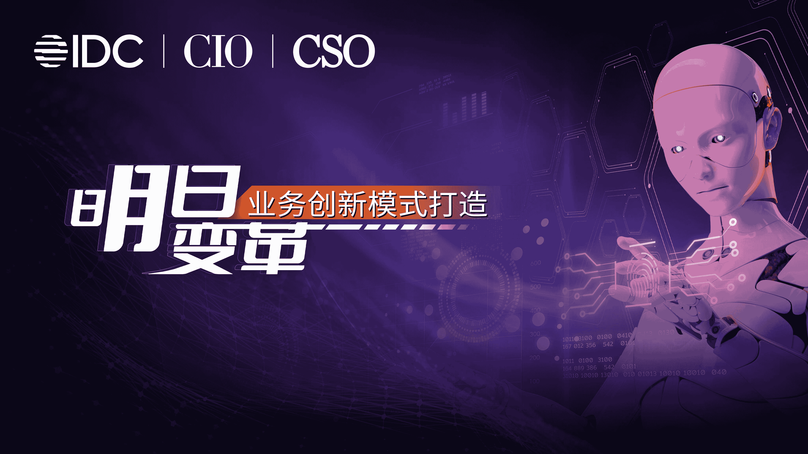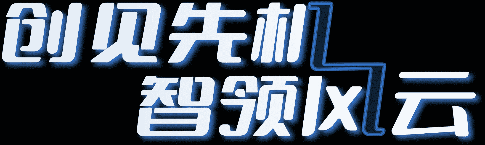

## 2024 IDC中国生态峰会

2

© IDC |

2

© IDC |

## 2 数据智能驱动业务运营创新模式

广州思迈特软件有限公司 副总裁 利骏锋

3

© IDC |

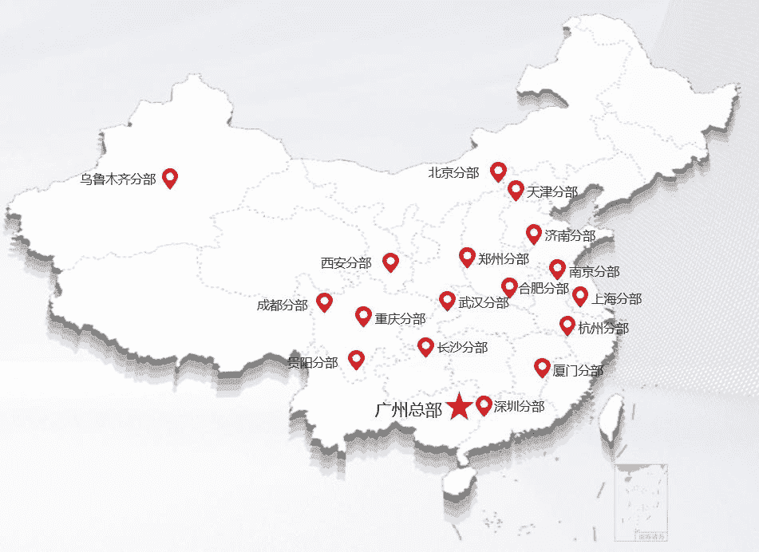

南昌分部

| 年份 | 关键事件 | 产品/技术 | 客户与资本 | 荣誉与认证 |
|------|----------|-----------|------------|------------|
| 2011-2014 | 产品持续增强创新，品牌影响力加大，资本多轮认可，历经10年+ | 电子表格 & 分析报告；BI产品Smartbi品牌创立 | 客户5000+选择 | 《软件企业认定证书》；中国创新创业大赛优秀企业；中国最具影响力品牌奖 |
| 2015-2016 | 透视分析 & 即席查询；自助仪表盘 | 天使轮1500万 | 《国家高新技术企业》；中国智慧城市大数据创新应用奖；北航、山大等大数据挖掘实验室 |
| 2017-2018 | 数据挖掘 & Excel融合分析 | A轮方广资本4000万 | 中国大数据百强企业；中国CIO最信赖供应商；中国大数据优秀解决方案50强；广东省大数据培育企业 |
| 2019-2020 | 数据挖掘 & Excel融合分析 | B轮高成资本、琥珀资本1.25亿 | 通过CMMI三级认证；入选工信部《大数据优秀产品和应用解决方案案例集》；入选信通院《金融科技创新应用案例集》 |
| 2021-2023 | 自然语言 & 数据模型 & 指标管理 | C轮光大控股独家投资；B+轮明略科技过亿融资 | 通过等保三级认证；获得自然语言分析和数据模型发明专利；入选IDC中国FinTech 50榜单 |
| 2024 | 对话式分析大模型版本 Smartbi AIChat | 参与探月工具嫦娥六号航天任务；广东省“专精特新”企业认定；IDC：商业智能和分析软件市场份额增长速度第一，中国BI厂商排名第二；入选工信部工业文化发展中心，首批“AI产业创新场景应用案例”；Smartbi V11版本代码自主率98.78%；通过DCMM稳健级认证；2024年广东软件风云榜新锐企业、新锐企业家、新一代信息技术产品TOP10 |

4

© IDC |

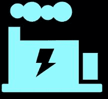

### 加速回报定律

Ray Kurzweil 谷歌前工程技术总监，9个博士学位，最精准的AI预测者。

更发达的社会 → 更强的继续发展能力 → 更快的发展速度 → 相同的时段，平均发展速度更快。

| 时段 | 发展速度 |
|------|----------|
| 30年时段 | 1988年~2018年 远大于 1958年~1988年 |
| 20世纪的发展 | 100年 |
| 2000年速度 | 20年 |
| 2000年至2014年 | 14年 |
| 2014年至2021年 | 7年 |
| 21世纪进步将是20世纪的 | 1000倍 |

**等效时间**

- 机器替代手工工具，自耕农阶级消失了
- 轻工业→重工业；发电机、电动机、远距离输电技术；石油工业的发展
- 自动化、信息化：电子计算机的迅速发展和广泛运用，开辟了信息时代
- 知识经济的出现；数智化、数字化；云大物移智
- 工业资产阶级和工业无产阶级形成并壮大

5

© IDC |

### 数据应用平台

| 产 | 供 | 销 | 研 | 财 | 资 | 人 | 控 |
|----|----|----|----|----|----|----|----|
| 预算 | 财务 | 供应链协同 | 制造 | 营销 | 人力资本 |    |    |

**数据赋能业务**：从数据基础能力建设，到以终为始支撑精细化业务创新。

**数据技术民主**：用户能够更广泛的获取数据，且更简单的实现数据变现。

**数据服务生态**：数据智能让协同更便捷，决策更迅速，产业延伸更可触达。

**战略**　**经营**　**风控**　**预测**

**数据场景价值**

- 屏蔽多系统的业务差异
- 提供面向业务的数据应用
- 转数据负债为数据资产
- 共性能力服务化
- 业务与经营的信息化应用支撑

6

© IDC |

- 三流：做图表
- 二流：
- 一流：

挖掘数据背后业务价值场景下数据应用价值，还是“ ”吗？似乎有点距离了。

7

© IDC |

| 业务部门 | IT部门 |
|----------|--------|
| 指标查找、自助指标分析、权限控制、自助使用指标体系 | 计算指标定义、模型管理、审批流程、高效维护指标体系 |

**指标体系自增长，沉淀企业数据资产**

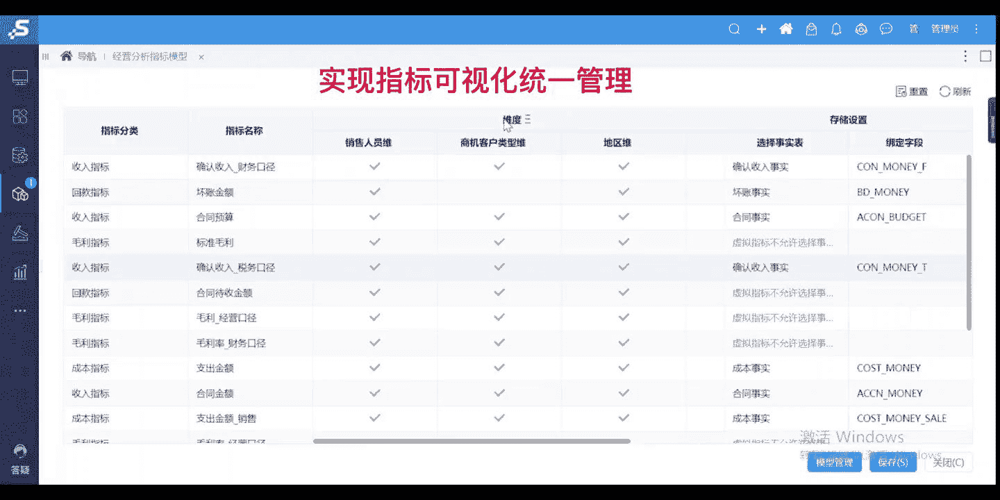

**视频效果演示**

- 共享指标服务体系
- 快速响应业务需求
- 数据问题可追溯
- 降低数据加工成本

**客户获益**

- 原子指标、计算与存储
- 业务和IT最佳协同的一站式指标管理
- 实现指标体系自增长，沉淀企业数据资产

指标定义 → 计算与存储 → 指标发布 → 指标应用 → 扩展接口管理

8

© IDC |

### 常规数据驱动运营应用建设路径：

ETL路线 → 宽表建构

常规技术路线与财务运营的矛盾：

9

© IDC |

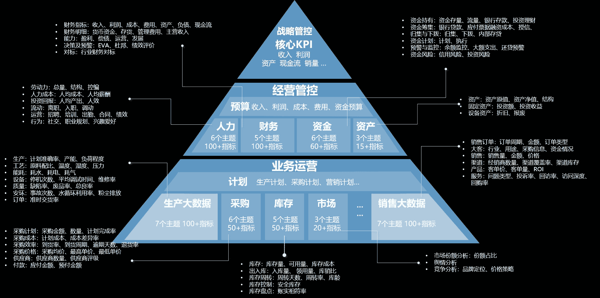

制定

设计

落地

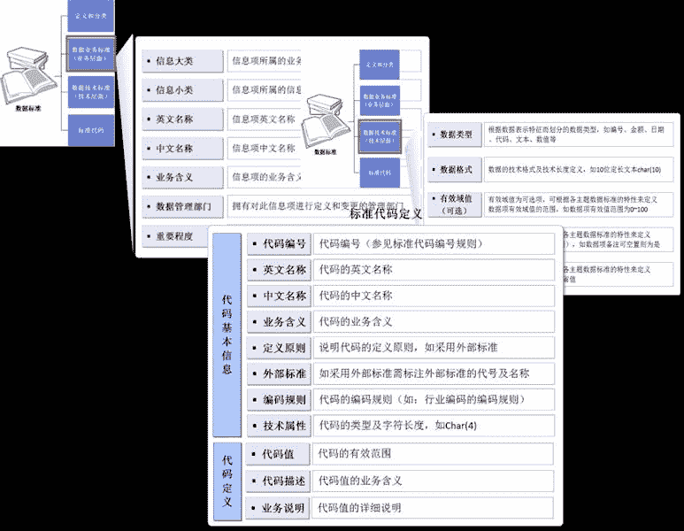

落地

对接

生成

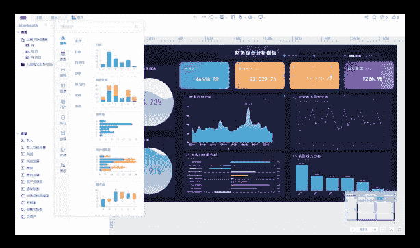

配置

支持

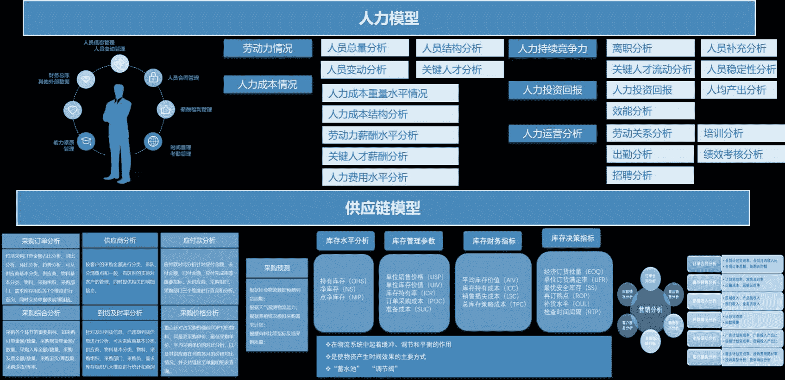

#### ① 业务微咨询导向价值场景

- 完善并输出人教运营维度指标体系。
- 对数据中台的已有数据资源提出优化建议。
- 分析报表、运营大屏的模型和应用设计。

#### ② 指标模块"真"落地

- 业务主导的指标定义
- 逻辑描述、维度关联
- 与数据资源进行对接或者生成，建立关系
- 审批、发布、运营

#### ③ 应用配置，运营验证

- 高交互大屏实施
- 业务自助分析实施
- 风控预警实施
- 其他应用实施

#### ④ 未来扩展

- 业务应用赋能培训
- 上线验收后运维服务

---

10

© IDC |

## 业财运营重点和系统平台流程支撑

| 业务域 | 运营重点 | 运营目标和关键平台（流程）确认 | 关键场景和分析模型细化 | 指标细筛 | 输出 |
|---|---|---|---|---|---|
|  | – 纵向战略拆解，解读各业务域的战略目标 – 横向流程扫描，识别各业务域的业务痛点和达成目标的挑战 | – 确认项目组的初步战略解码结果，锁定战略方向和关键控制点，确认关键指标集 | – 确认哪些指标可以支撑应用场景和举措的实现 | – 进一步按照业务支撑度和数据可得性，进行指标的最终筛选 | 纳入指标二期规划 / 放入本次指标范围 |

|  |  |  |  | 业务支撑度/数据可得性 | 高 | 低 | 高 |
|---|---|---|---|---|---|---|---|
|  |  |  |  | 高 |  |  |  |

纳入指标四期规划 / 纳入指标三期规划

1. 全方位梳理业务域
2. 确认核心业务目标和关键举措
3. 梳理应用场景和举措的过程性指标
4. 指标最终确认

业财一级主管 / 事项会计、分析会计

---

## 行业领先的智能体AI Chat对话式分析能力

通过大模型能力与数据平台结合，将先进技术融入到智能问数、智能分析、智能预测等各个环节，可以帮助数据分析人员快速实现数据获取、数据分析、数据理解等目标。

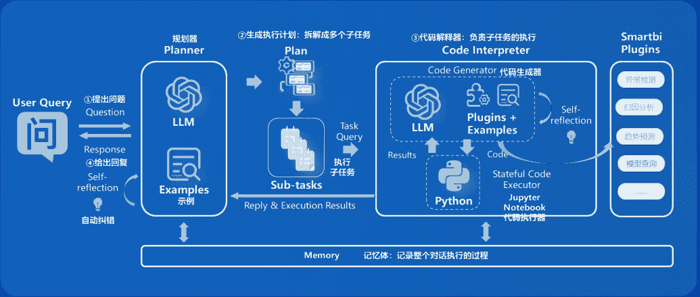

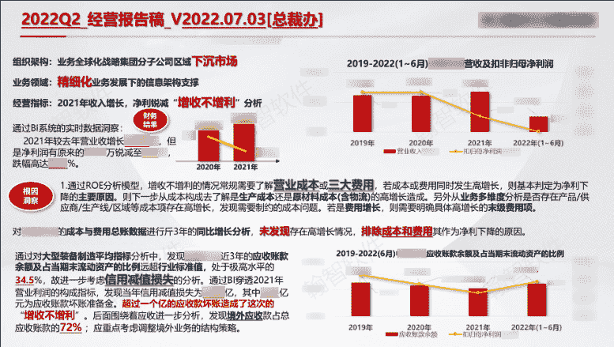

## 基于AI Agent的新一代智能BI产品

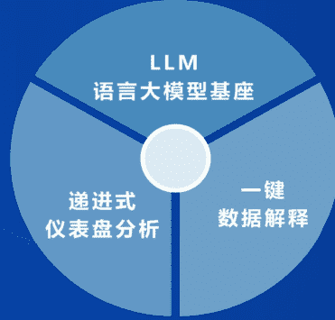

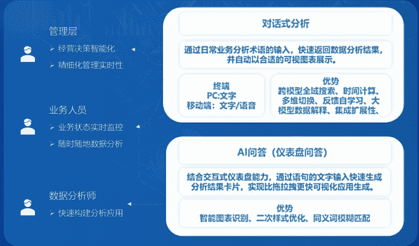

### 对话式分析

通过日常业务分析术语的输入，快速返回数据分析结果，并自动以合适的可视图表展示。

### AI问答（仪表盘问答）

结合交互式仪表盘能力，通过语句的文字输入快速生成分析结果与卡片，实现比较抽象且可视化应用生成。

---

12

© IDC |

销售合作伙伴 / 交付合作伙伴 / Smartbi

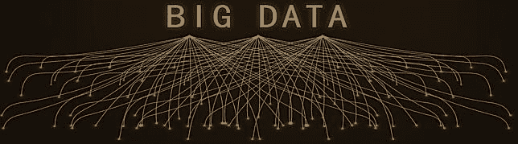

战略

技服中心

产品伙伴

方案伙伴

行业伙伴

创新

价值

认证

OEM

金牌

生态

共营

ISV

方案

应用伙伴

生态伙伴

---

## 感谢下呦

Smartbi 让数据为客户创造价值，助力企业数智化运营

