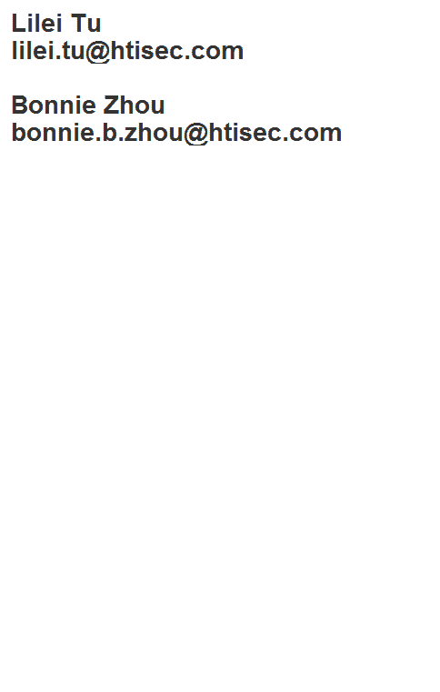
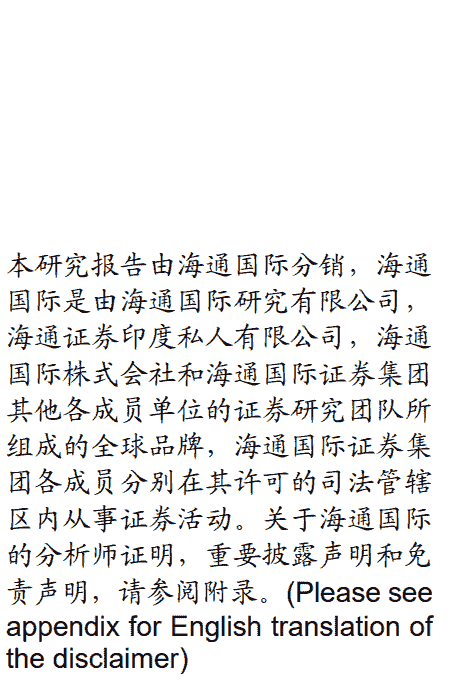
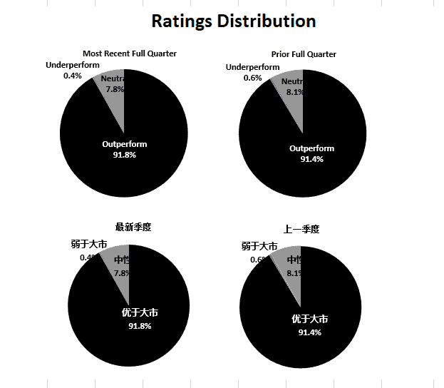

请务必阅读正文之后的信息披露和法律声明

## 行业研究/房地产

证券研究报告

## 行业深度报告

2024年11月08日

投资评级：优于大市（维持）

市场表现

-24.57% -15.38% -6.18% 3.02% 12.21% 21.41%

2023/11 2024/2 2024/5 2024/8

房地产 海通综指

资料来源：HTI

相关研究

- 《第44周新房成交同比增速回升，供销比回升》2024.11.03
- 《TOP100房企10月销售数据点评——政策组合拳效果显现，单月销售同环比双增》2024.11.05
- 《第43周新房成交同比增速回落，供销比回升》2024.10.27

分析师：涂力磊
Tel: 021-23185710
Email: tll5535@haitong.com
证书: S0850510120001

分析师：谢盐
Tel: (021)23185696
Email: xiey@haitong.com
证书: S0850511010019

### 房地产行业**3Q2024**综述：集中度再次回落，现金流和负债状况有所恶化

**投资要点：**

- **1-3Q2024**，行业集中度再次回落。从市占率情况看，1-3Q2024，TOP20位房企销售金额市占率为26.82%。我们认为，随着政策持续回暖，行业蓝筹的市占率将重新回到上升的轨道。截止3Q2024末，部分龙头A股上市公司现金流指标（经营活动产生的现金流量净额、筹资活动产生的现金流量净额、定义现金短债比）达标情况有所恶化。
- 1-3Q2024，房地产开发投资累计增速基本持平，新开工、销售面积累计增速继续回升。行业杠杆率创出新高。3Q2024，全国一线、二线、三线城市房价同比增速继续下行，分别为-4.7%、-5.7%、-6.6%。
- 当期结算和费用率情况。1-3Q2024，A股房企的营业总收入增速继续回落，销售毛利率回落。其中营业总收入增速为同比-26.23%；销售毛利率为-1.32%。1-3Q2024，A股房企的期间费用率回升，为10.70%。
- 当期资产减值损益和少数股东损益情况。1-3Q2024，A股地产上市公司资产减值损益为-143.65亿元，占扣除资产减值损益前的营业利润的比例为-68.19%，相对1H2024继续回落。1-3Q2024，A股房企的少数股东损益为74.20亿元，同比增速为-61.11%。
- 当期销售和现金流净额。1-3Q2024，A股房企销售商品、提供劳务收到的现金同比为-34.91%，增速相对1H2024继续回升。3Q2024，A股房企净负债率为154.38%，相比1H2024的净负债率小幅回落。
- 存货和预收款（含合同负债）。1-3Q2024，A股地产房企累计存货同比为-17.58%。1-3Q2024，A股地产房企累计预收款（含合同债务）为1.93万亿元，同比为-29.42%，相对1H2024小幅回升。
- 投资建议。截至2024年10月31日，A股沪深300动态PE（TTM）为12.39倍，地产动态PE（TTM）为25.27倍。
- 我们认为市场稳增长的大环境没有改变，优质公司相对其它房企的优势和价值将会越加突出。建议关注：1）开发类：A股-万科A、保利发展、招商蛇口、金地集团；H股-中国海外发展；2）商住类：华润置地、龙湖集团、新城控股；3）物业类：万物云、华润万象生活、中海物业、保利物业、招商积余、新大正；4）文旅类-华侨城A。
- 风险提示。调控加码和行业基本面下行风险。

---

行业研究·房地产行业

请务必阅读正文之后的信息披露和法律声明

**目录**

1. 行业集中度再次回落，A股现金流状况有所转差 ...... 5
   1.1 1-3Q2024行业集中度回落 ...... 5
   1.2 A股上市公司现金流情况有所恶化 ...... 6
2. 截至目前行业运行情况 ...... 6
3. A股地产房企1-3Q2024运营情况分析 ...... 9
   3.1 当期结算、毛利率和费用情况 ...... 9
   3.2 当期资产减值损失、少数股东损益情况 ...... 9
   3.3 当期销售和现金流 ...... 10
   3.4 存货和预收款（含合同负债）情况 ...... 10
4. 重点上市公司1-3Q2024业绩分析 ...... 11
   4.1 重点住宅类房企平均营业收入同比增速继续回落 ...... 11
   4.2 重点住宅类房企平均净利润率持续回落 ...... 12
   4.3 重点住宅类房企平均预收款（含合同负债）同比增速持续回落 ...... 14
   4.4 重点住宅类房企平均每股有息负债同比增速继续回升 ...... 16
   4.5 重点住宅类房企资产减值损益合计值继续回落 ...... 18
5. 房地产板块的市场表现、估值水平 ...... 20
   5.1 板块2022年1月至2024年10月运行情况总结 ...... 20
   5.2 板块合理估值水平 ...... 21
6. 投资建议 ...... 22
7. 风险提示 ...... 22

---

行业研究·房地产行业

请务必阅读正文之后的信息披露和法律声明

**图目录**

- 图1 TOP50地产商销售额同比增速变动情况（%） ...... 5
- 图2 TOP50地产商销售额门槛变动情况（亿元） ...... 6
- 图3 全国房地产开发投资同比增速情况 ...... 7
- 图4 全国房地产开发投资当月情况 ...... 7
- 图5 全国房地产新开工、施工和竣工面积增速情况 ...... 7
- 图6 全国土地购置费同比情况 ...... 7
- 图7 全国土地购置费当月情况 ...... 7
- 图8 全国商品房销售面积同比情况 ...... 8
- 图9 全国商品房销售额同比情况 ...... 8
- 图10 全国房地产新开工、销售和土地购置增速情况 ...... 8
- 图11 全国土地购置金额占销售金额比值 ...... 8
- 图12 全国各类型城市房价情况（%） ...... 8
- 图13 A股地产房企营业总收入及同比增速 ...... 9
- 图14 A股地产房企营业总成本和毛利率 ...... 9
- 图15 A股地产房企期间费用情况 ...... 9
- 图16 A股地产房企ROE和ROA ...... 9
- 图17 A股地产房企资产减值损益情况 ...... 10
- 图18 A股地产房企少数股东损益情况 ...... 10
- 图19 A股地产房企商品销售回笼资金情况 ...... 10
- 图20 A股地产房企经营性现金流净额变动情况 ...... 10
- 图21 A股地产房企流动比率情况 ...... 10
- 图22 A股地产房企净负债率情况 ...... 10
- 图23 A股地产房企存货绝对值及增速情况 ...... 11
- 图24 A股地产房企预收款（含合同负债）绝对值及增速情况 ...... 11
- 图25 房地产指数和沪深300指数收益情况 ...... 20
- 图26 单月房地产指数收益以及超额收益情况 ...... 21
- 图27 2022年1月至2024年10月各板块收益情况 ...... 21
- 图28 板块和市场PE情况 ...... 22

---

行业研究·房地产行业

请务必阅读正文之后的信息披露和法律声明

**表目录**

- 表1 行业集中度情况 ...... 5
- 表2 部分A股上市公司现金流达标情况 ...... 6
- 表3 A股重点住宅类房企营业收入情况 ...... 11
- 表4 A股重点其他类房企营业收入情况 ...... 12
- 表5 A股重点住宅类房企归母净利润和利润率情况 ...... 13
- 表6 A股重点其他类房企归母净利润和利润率情况 ...... 14
- 表7 A股重点住宅类房企预收款（含合同负债）情况 ...... 15
- 表8 A股重点其他类房企预收款（含合同负债）情况 ...... 16
- 表9 A股重点住宅类房企有息负债情况 ...... 17
- 表10 A股重点其他类房企有息负债情况 ...... 18
- 表11 A股重点住宅类房企资产减值损益情况 ...... 19
- 表12 A股重点其他类房企资产减值损益情况 ...... 20

行业研究·房地产行业

请务必阅读正文之后的信息披露和法律声明

## 1. 行业集中度再次回落，A股现金流状况有所转差

### 1.1 1-3Q2024行业集中度回落

1-3Q2024，龙头公司市占率再次回落。从市占率情况看，1-3Q2024，TOP20位房企销售金额占据行业的市场份额为26.82%；TOP20位房企销售面积占据行业的市场份额为14.34%。

我们认为，随着利好政策不断积累，行业蓝筹的市占率有望回到上升的轨道。

**表1 行业集中度情况**

| 时间段 | 销售金额市场占有率（%）TOP10房企 | 销售金额市场占有率（%）TOP20房企 | 销售面积市场占有率（%）TOP10房企 | 销售面积市场占有率（%）TOP20房企 |
|---|---:|---:|---:|---:|
| 2015 | 17.05% | 23.06% | 11.41% | 14.75% |
| 2016 | 18.72% | 25.23% | 12.54% | 16.21% |
| 2017 | 24.16% | 32.40% | 15.45% | 20.67% |
| 2018 | 26.89% | 37.45% | 21.08% | 25.74% |
| 2019 | 28.38% | 40.51% | 21.34% | 29.18% |
| 2020 | 27.96% | 41.03% | 22.81% | 30.86% |
| 2021 | 25.01% | 37.53% | 20.01% | 27.83% |
| 2022 | 22.80% | 32.80% | 14.60% | 20.38% |
| 2023 | 22.62% | 32.04% | 13.68% | 19.15% |
| 1Q2024 | 19.31% | 25.99% | 10.17% | 13.97% |
| 1H2024 | 21.01% | 28.02% | 10.64% | 14.86% |
| 1-3Q2024 | 19.91% | 26.82% | 10.27% | 14.34% |

资料来源：Wind、克尔瑞数据、HTI

1-3Q2024，房企销售额增速再次回落。其中，1-3Q2024，TOP1-10、TOP11-20、TOP21-30、TOP31-50位房企销售金额同比增速分别为-32.54%、-43.78%、-43.12%、-47.06%。

1-3Q2024，TOP10、TOP20、TOP30、TOP50房企销售额门槛分别为732亿元、309亿元、228亿元、125亿元。

**图1 TOP50地产商销售额同比增速变动情况（%）**

-80  
-60  
-40  
-20  
0  
20  
40  
60  
80  

2012  
2013  
2014  
2015  
2016  
2017  
2018  
2019  
2020  
2021  
2022  
2023  
1Q2024  
1H2024  
1-3Q2024  

TOP1-10  
TOP11-20  
TOP21-30  
TOP31-50  

资料来源：克尔瑞数据、HTI

### 1.2 A股上市公司现金流情况有所恶化

截至1-3Q2024末，部分龙头A股上市公司现金流指标（经营活动产生的现金流量净额、筹资活动产生的现金流量净额、定义现金短债比）达标情况有所恶化。

**表2 部分A股上市公司现金流达标情况**

| 证券代码 | 公司名称 | 2024年三季度经营活动产生的现金流量净额（亿元） | 2024年三季度筹资活动产生的现金流量净额（亿元） | 2024年三季度现金短债比（倍） | 2024年三季度踩线条数 | 2024年半年度经营活动产生的现金流量净额（亿元） | 2024年半年度筹资活动产生的现金流量净额（亿元） | 2024年半年度现金短债比（倍） | 2024年半年度踩线条数 |
|---|---|---:|---:|---:|---:|---:|---:|---:|---:|
| 600383.SH | 金地集团 | 78.03 | -182.09 | 0.62 | 2 | 45.90 | -131.01 | 0.59 | 2 |
| 000069.SZ | 华侨城A | 16.67 | -86.86 | 0.85 | 2 | -28.32 | 4.38 | 1.17 | 1 |
| 000002.SZ | 万科A | -48.48 | -204.06 | 0.66 | 3 | -51.76 | -68.59 | 0.88 | 3 |
| 001979.SZ | 招商蛇口 | 129.71 | -187.88 | 2.07 | 1 | 12.88 | -74.70 | 2.12 | 1 |
| 600153.SH | 建发股份 | -141.13 | 60.95 | 1.69 | 1 | -221.12 | 292.66 | 1.64 | 1 |
| 600606.SH | 绿地控股 | -82.38 | 16.26 | 0.23 | 2 | -52.18 | 14.68 | 0.27 | 2 |
| 601155.SH | 新城控股 | 17.81 | -48.50 | 1.01 | 1 | 20.88 | -4.25 | 0.97 | 2 |
| 002244.SZ | 滨江集团 | -14.07 | -15.16 | 4.57 | 2 | -45.85 | -17.15 | 3.66 | 2 |
| 600325.SH | 华发股份 | 36.86 | -4.33 | 1.42 | 1 | 6.65 | 61.59 | 1.36 | 0 |
| 600048.SH | 保利地产 | -159.82 | -38.36 | 1.99 | 2 | -171.48 | 159.87 | 2.12 | 1 |

注：现金短债比=现金及现金等价物/短期有息债务。本报告定义经营活动产生的现金流量净额<0为“踩线”，定义筹资活动产生的现金流量净额<0为“踩线”，以及定义现金短债比<1倍为“踩线”。资料来源：Wind、HTI

## 2. 截至目前行业运行情况

行业各项指标还在底部运行。1-3Q2024，地产开发投资增速保持持平。1-3Q2024，全国房地产累计开发投资为7.87万亿元，同比为-10.1%。

**图2 TOP50地产商销售额门槛变动情况（亿元）**

0  
500  
1000  
1500  
2000  
2500  
3000  
3500  

2011  
2012  
2013  
2014  
2015  
2016  
2017  
2018  
2019  
2020  
2021  
2022  
2023  
1Q2024  
1H2024  
1-3Q2024  

TOP10  
TOP20  
TOP30  
TOP50  

资料来源：克尔瑞数据、HTI

**图3 全国房地产开发投资同比增速情况**

-10  
-10  
-10  
-10  
-10  
-9  
-9  
-9  
-9  
-9  
-8  
-8  
0  
20000  
40000  
60000  
80000  
100000  
120000  

2023-09 2023-11 2024-02 2024-04 2024-06 2024-08

房地产开发投资累计完成额（亿元，左轴）

房地产开发投资累计完成额同比（%，右轴）

资料来源：Wind、HTI

**图4 全国房地产开发投资当月情况**

-40  
-20  
0  
20  
40  
60  
0  
2000  
4000  
6000  
8000  
10000  
12000  
14000  

2023/04  
2023/07  
2023/10  
2024/02  
2024/05  
2024/08  

房地产开发投资当月完成额（亿元，左轴）

房地产开发投资当月额环比（%，右轴）

房地产开发投资当月额同比（%，右轴）

资料来源：Wind、HTI

1-3Q2024，全国房屋新开工同比增速小幅回升，施工、竣工同比增速继续下行。1-3Q2024，全国房屋新开工、施工、竣工面积同比增速分别为-22.2%、-12.2%、-24.4%。

1-3Q2024，全国房地产开发房企完成土地购置费累计增速回落，为-6.90%。

**图6 全国土地购置费同比情况**

-8  
-7  
-6  
-5  
-4  
-3  
-2  
-1  
0  
0  
5000  
10000  
15000  
20000  
25000  
30000  
35000  
40000  
45000  

2023-09 2023-11 2024-02 2024-04 2024-06 2024-08

土地购置费累计额（亿元，左轴）

土地购置费累计同比（%，右轴）

资料来源：Wind、HTI

**图7 全国土地购置费当月情况**

-100  
-50  
0  
50  
100  
150  
200  
250  
0  
500  
1000  
1500  
2000  
2500  
3000  
3500  
4000  
4500  
5000  

2023-09  
2023-11  
2024-02  
2024-04  
2024-06  
2024-08  

土地购置费当月额（亿，左轴）

土地购置费当月环比（%，右轴）

土地购置费当月同比（%，右轴）

资料来源：Wind、HTI

1-3Q2024，全国商品房销售面积和销售额累计增速触底回升。1-3Q2024，全国商品房销售面积为7.03亿平方米，同比增速为-17.1%。1-3Q2024，全国商品房累计销售额为6.89万亿元，同比为-22.7%。

**图5 全国房地产新开工、施工和竣工面积增速情况**

-40  
-30  
-20  
-10  
0  
10  
20  
30  

2023-09  
2023-11  
2024-02  
2024-04  
2024-06  
2024-08  

房屋新开工面积累计同比（%）

房屋施工面积累计同比（%）

房屋竣工面积累计同比（%）

资料来源：Wind、HTI

1-3Q2024，开发商房屋新开工面积累计增速和商品房销售面积累计增速总体呈小幅回升态势。

行业杠杆率（全行业土地购置金额占销售金额比）总体呈震荡走高的趋势。该数据除了2021年11.87%的低点以外，行业杠杆率最高点出现在1-3Q2023的35.33%。目前行业杠杆率创出近年来的新高，达到42.70%。3Q2024，全国一线、二线、三线城市房价同比增速分别为-4.7%、-5.7%、-6.6%。

**图11 全国土地购置金额占销售金额比值**

0%  
5%  
10%  
15%  
20%  
25%  
30%  
35%  
40%  
45%  

土地购买金额占销售金额比

资料来源：Wind、HTI

**图12 全国各类型城市房价情况（%）**

-10  
-5  
0  
5  
10  
15  
20  
25  
30  

2017-01  
2017-06  
2017-11  
2018-04  
2018-09  
2019-02  
2019-07  
2019-12  
2020-05  
2020-10  
2021-03  
2021-08  
2022-01  
2022-06  
2022-11  
2023-04  
2023-09  
2024-02  
2024-07  

一线城市房价同比

二线城市房价同比

三线城市房价同比

资料来源：Wind、HTI

**图10 全国房地产新开工、销售和土地购置增速情况**

-35  
-30  
-25  
-20  
-15  
-10  
-5  
0  

Sep-23 Oct-23 Nov-23 Dec-23 Jan-24 Feb-24 Mar-24 Apr-24 May-24 Jun-24 Jul-24 Aug-24 Sep-24

房屋新开工面积累计同比（%）

商品房销售面积累计同比（%）

资料来源：Wind、HTI

## 3. A股地产房企1-3Q2024运营情况分析

### 3.1 当期结算、毛利率和费用情况

1-3Q2024，A股房地产房企营业总收入为11805.6亿元，同比为-26.2%，相比1H2024的营业总收入增速-24.0%继续回落。销售毛利率方面，1-3Q2024，行业销售毛利率为-1.32%，相比1H2024毛利率-0.37%继续回落。

**图13 A股地产房企营业总收入及同比增速**

-30  
-20  
-10  
0  
10  
20  
30  
40  
50  
0  
5000  
10000  
15000  
20000  
25000  
30000  
35000  

2015  
2016  
2017  
2018  
2019  
2020  
2021  
2022  
2023  
1-3Q2024  

营业总收入（亿元，左轴）

同比增长率（%，右轴）

资料来源：Wind、HTI

**图14 A股地产房企营业总成本和毛利率**

-5  
0  
5  
10  
15  
20  
25  
30  
35  
0  
5000  
10000  
15000  
20000  
25000  
30000  
35000  

2015  
2016  
2017  
2018  
2019  
2020  
2021  
2022  
2023  
1-3Q2024  

营业总成本（亿元，左轴）

销售毛利率（%，右轴）

资料来源：Wind、HTI

1-3Q2024，A股房企的期间费用率有所上升。1-3Q2024，A股地产上市公司期间费用占比为10.70%，期间费用占比相对1H2024的10.14%呈现回升趋势。1-3Q2024，A股地产上市公司实现ROE为-3.83%，ROA为-0.13%。

**图15 A股地产房企期间费用情况**

1.0  
1.5  
2.0  
2.5  
3.0  
3.5  
4.0  
4.5  
5.0  

2015  
2016  
2017  
2018  
2019  
2020  
2021  
2022  
2023  
1-3Q2024  

销售费用占比（%）

管理费用占比（%）

财务费用占比（%）

资料来源：Wind、HTI

**图16 A股地产房企ROE和ROA**

-1  
0  
1  
2  
3  
4  
5  
-10  
-5  
0  
5  
10  
15  
20  

2015  
2016  
2017  
2018  
2019  
2020  
2021  
2022  
2023  
1-3Q2024  

ROE（%，左轴）

ROA（%，右轴）

资料来源：Wind、HTI

### 3.2 当期资产减值损失、少数股东损益情况

1-3Q2024，A股地产上市公司资产减值损益为-143.7亿元（负值代表损失），占扣除资产减值损益前的营业利润的比例为-68.19%（负值代表损失），相对1H2024的-60.43%继续上升。1-3Q2024，A股地产上市公司少数股东损益为74.20亿元，同比增速为-61.11%，相对1H2024的-59.45%呈现持续回落态势。

**图17 A股地产房企资产减值损益情况**

-90  
-80  
-70  
-60  
-50  
-40  
-30  
-20  
-10  
0  
10  
20  
-1400  
-1200  
-1000  
-800  
-600  
-400  
-200  
0  
200  
400  
600  

2015  
2016  
2017  
2018  
2019  
2020  
2021  
2022  
2023  
1-3Q2024  

资产减值损益（亿元，左轴）

资产减值损益占扣除前的营业利润比例（%，右轴）

资料来源：Wind、HTI

**图18 A股地产房企少数股东损益情况**

-80  
-60  
-40  
-20  
0  
20  
40  
60  
80  
0  
100  
200  
300  
400  
500  
600  
700  

2015  
2016  
2017  
2018  
2019  
2020  
2021  
2022  
2023  
1-3Q2024  

少数股东损益（亿元，左轴）

少数股东损益同比（%，右轴）

资料来源：Wind、HTI

### 3.3 当期销售和现金流

1-3Q2024，A股上市地产房企销售商品、提供劳务收到的现金为10137.2亿元，同比为-34.91%，增速相对1H2024的-38.33%有所回升。1-3Q2024，A股地产房企经营活动现金流净额为-201.16亿元，筹资活动现金流净额为-1357.3亿元。

**图19 A股地产房企商品销售回笼资金情况**

-40  
-30  
-20  
-10  
0  
10  
20  
30  
40  
50  
60  
0  
5000  
10000  
15000  
20000  
25000  
30000  
35000  
40000  

2015  
2016  
2017  
2018  
2019  
2020  
2021  
2022  
2023  
1-3Q2024  

销售商品、提供劳务收到的现金（亿元，左轴）

销售商品、提供劳务收到的现金同比（%，右轴）

资料来源：Wind、HTI

**图20 A股地产房企经营性现金流净额变动情况**

-4000  
-3000  
-2000  
-1000  
0  
1000  
2000  
3000  
4000  
5000  

2015  
2016  
2017  
2018  
2019  
2020  
2021  
2022  
2023  
1-3Q2024  

经营活动产生的现金流量净额（亿元）

筹资活动产生的现金流量净额（亿元）

资料来源：Wind、HTI

3Q2024，A股地产房企流动比率1.45倍，相比1H2024的流动比率1.44倍小幅回升。3Q2024，A股地产房企净负债率154.4%，相比1H2024净负债率154.9%回落。

**图21 A股地产房企流动比率情况**

-15  
-10  
-5  
0  
5  
10  
15  
0.0  
0.2  
0.4  
0.6  
0.8  
1.0  
1.2  
1.4  
1.6  
1.8  

2015  
2016  
2017  
2018  
2019  
2020  
2021  
2022  
2023  
3Q2024  

流动比率（倍，左轴）

同比变动点数（百分点，右轴）

资料来源：Wind、HTI

**图22 A股地产房企净负债率情况**

-15  
-10  
-5  
0  
5  
10  
15  
20  
25  
30  
0  
20  
40  
60  
80  
100  
120  
140  
160  
180  

2015  
2016  
2017  
2018  
2019  
2020  
2021  
2022  
2023  
3Q2024  

净负债率（%，左轴）

净负债率同比变化（百分点，右轴）

资料来源：Wind、HTI

### 3.4 存货和预收款（含合同负债）情况

1-3Q2024，A股地产房企累计存货为4.85万亿元，同比为-17.58%，增速相对1H2024末的-19.76%呈现回升趋势。1-3Q2024，A股地产房企累计预收款（含合同负债）为1.93万亿元，同比为-29.42%，增速相对1H2024末的-31.16%有所回升。

### 行业研究·房地产行业

请务必阅读正文之后的信息披露和法律声明

**11**

图 **23** **A**股地产房企存货绝对值及增速情况

-30
-20
-10
0
10
20
30
40

0
10000
20000
30000
40000
50000
60000
70000
80000

2015 2016 2017 2018 2019 2020 2021 2022 2023 3Q2024

存货（亿元，左轴）
同比（%，右轴）

资料来源：Wind、HTI

图 **24** **A**股地产房企预收款（含合同负债）绝对值及增速情况

-40
-30
-20
-10
0
10
20
30
40
50

0
5000
10000
15000
20000
25000
30000
35000
40000

2015 2016 2017 2018 2019 2020 2021 2022 2023 3Q2024

预收账款和合同负债（亿元，左轴）
同比（%，右轴）

资料来源：Wind、HTI

## 4. 重点上市公司1-3Q2024业绩分析

### 4.1 重点住宅类房企平均营业收入同比增速继续回落

以下是21家重点住宅类房企1-3Q2024的营业收入和同比增长情况。其中21家重点住宅类房企1-3Q2024营业收入增速均值为-23.56%，相对其1H2024营业收入增速均值-22.04%呈现持续回落趋势。

**表 3 A股重点住宅类房企营业收入情况**

| 住宅类 | 营业收入（亿元） |  |  |  | 同比增长率 |  |  |  |  |
| :--- | :--- | :--- | :--- | :--- | :--- | :--- | :--- | :--- | :--- |
|  | **2021** | **2022** | **2023** | **1-3Q2024** | **2021** | **2022** | **2023** | **1-3Q2024** | **1H2024** |
| 万科A | 4527.98 | 5038.38 | 4657.39 | **2198.95** | 8.04% | 11.27% | -7.56% | **-24.25%** | **-28.93%** |
| 保利发展 | 2849.33 | 2810.17 | 3468.28 | **1827.74** | 17.21% | -1.37% | 23.42% | **-5.06%** | **1.66%** |
| 招商蛇口 | 1606.43 | 1830.03 | 1750.08 | **780.09** | 23.93% | 13.92% | -4.37% | **2.88%** | **-0.33%** |
| 金地集团 | 989.35 | 1200.35 | 980.08 | **409.75** | 18.26% | 21.33% | -18.35% | **-21.56%** | **-42.61%** |
| 首开股份 | 678.02 | 479.21 | 477.63 | **144.63** | 53.31% | -29.32% | -0.33% | **-55.69%** | **-54.69%** |
| 新湖中宝 | 168.91 | 128.99 | 172.10 | **141.21** | 22.47% | -23.64% | 33.42% | **279.28%** | **344.68%** |
| 华发股份 | 512.41 | 591.90 | 721.45 | **315.59** | 0.46% | 15.51% | 21.89% | **-33.21%** | **-21.08%** |
| 天房发展 | 46.65 | 33.60 | 30.53 | **10.22** | 69.47% | -27.97% | -9.14% | **-72.55%** | **-71.98%** |
| 福星股份 | 125.44 | 151.42 | 55.08 | **22.81** | 67.22% | 20.72% | -63.62% | **-48.60%** | **-50.86%** |
| 滨江集团 | 379.76 | 415.02 | 704.43 | **407.84** | 32.80% | 9.28% | 69.73% | **-12.09%** | **-10.46%** |
| 绿地控股 | 5442.86 | 4355.20 | 3602.45 | **1599.49** | 19.43% | -19.98% | -17.28% | **-36.93%** | **-33.80%** |
| 广宇集团 | 73.64 | 60.20 | 92.29 | **33.51** | 40.70% | -18.24% | 53.29% | **-55.05%** | **-53.61%** |
| 新城控股 | 1682.32 | 1154.57 | 1191.74 | **515.63** | 15.64% | -31.37% | 3.22% | **-27.66%** | **-18.83%** |
| 冠城大通 | 94.57 | 111.40 | 97.21 | **62.97** | 6.36% | 17.79% | -12.74% | **8.07%** | **4.76%** |
| 金科股份 | 1123.10 | 548.62 | 632.38 | **215.67** | 28.05% | -51.15% | 15.27% | **-49.91%** | **-38.45%** |
| 鲁商发展 | 123.63 | 129.51 | 45.79 | **28.03** | -9.20% | 4.76% | -64.65% | **-17.45%** | **-22.15%** |
| 华夏幸福 | 431.81 | 319.42 | 359.07 | **139.12** | -57.33% | -26.03% | 12.41% | **-21.79%** | **-44.31%** |
| 南国置业 | 32.73 | 98.19 | 10.59 | **18.57** | -18.68% | 199.98% | -89.22% | **201.62%** | **205.44%** |
| 栖霞建设 | 31.88 | 69.14 | 47.68 | **13.15** | -3.24% | 116.87% | -31.03% | **-65.69%** | **-69.24%** |
| 苏宁环球 | 29.90 | 22.39 | 21.13 | **17.38** | -30.25% | -25.12% | -5.61% | **18.63%** | **26.72%** |
| 中华房企 | 95.97 | 26.01 | 131.87 | **16.75** | -16.92% | -72.89% | 406.95% | **-82.31%** | **-60.71%** |
| 合计/平均 | **21046.70** | **19573.72** | **19249.25** | **8919.10** | **12.89%** | **-7.00%** | **-1.66%** | **-23.56%** | **-22.04%** |

注：表中营业收入是指不包括合并金融类子公司的利息收入、已赚保费、手续费及佣金收入等以外的主营收入。
资料来源：Wind、HTI（备注：行业平均为算术平均值）

以下是13家重点商业类、园区类、物管类房企1-3Q2024的营业收入和同比增长情况。其中3家商业类房企1-3Q2024营业收入增速均值为30.41%，相对其1H2024营收增速均值51.94%持续回落；其中7家园区类房企1-3Q2024营业收入增速均值为-12.98%，相对其1H2024营收增速均值-16.92%回升；其中3家物管类房企1-3Q2024营业收入增速均值为10.59%，相对其1H2024营收增速均值11.40%呈现持续回落趋势。

**表 4 A股重点其他类房企营业收入情况**

| 商业类 | 营业收入（亿元） |  |  |  | 同比增长率 |  |  |  |  |
| :--- | :--- | :--- | :--- | :--- | :--- | :--- | :--- | :--- | :--- |
|  | **2021** | **2022** | **2023** | **1-3Q2024** | **2021** | **2022** | **2023** | **1-3Q2024** | **1H2024** |
| 阳光股份 | 5.68 | 3.81 | 3.21 | **2.67** | -0.46% | -32.84% | -15.72% | **-3.95%** | -40.85% |
| 中国国贸 | 35.86 | 34.42 | 39.54 | **29.50** | 15.76% | -4.01% | 14.86% | **0.02%** | 1.39% |
| 金融街 | 241.55 | 205.06 | 125.71 | **116.87** | 33.30% | -15.11% | -38.70% | **42.51%** | 71.94% |
| 合计/平均 | **283.09** | **243.29** | **168.46** | **149.04** | **29.92%** | **-14.06%** | **-30.76%** | **30.41%** | **51.94%** |

| 园区类 | 营业收入（亿元） |  |  |  | 同比增长率 |  |  |  |  |
| :--- | :--- | :--- | :--- | :--- | :--- | :--- | :--- | :--- | :--- |
|  | **2021** | **2022** | **2023** | **1-3Q2024** | **2021** | **2022** | **2023** | **1-3Q2024** | **1H2024** |
| 外高桥 | 87.44 | 90.58 | 75.69 | **49.82** | -13.86% | 3.60% | -16.44% | **-6.93%** | **-31.40%** |
| 浦东金桥 | 46.17 | 50.53 | 65.85 | **20.34** | 28.50% | 9.45% | 30.31% | **-62.11%** | **-70.01%** |
| 陆家嘴 | 138.72 | 117.62 | 106.67 | **69.09** | -4.16% | -15.21% | -9.31% | **19.63%** | **16.17%** |
| 张江高科 | 20.97 | 19.07 | 20.26 | **16.83** | 169.13% | -9.08% | 6.24% | **-3.66%** | **126.54%** |
| 苏州高新 | 118.95 | 107.24 | 78.14 | **65.45** | 18.47% | -9.84% | -27.13% | **9.08%** | **4.20%** |
| 南京高科 | 49.19 | 44.82 | 47.27 | **15.14** | 69.40% | -8.87% | 5.45% | **-64.25%** | **-62.35%** |
| 上海临港 | 62.72 | 59.99 | 70.52 | **40.00** | 59.61% | -4.34% | 17.55% | **20.69%** | **41.64%** |
| 合计/平均 | **524.15** | **489.87** | **464.40** | **276.67** | **14.26%** | **-6.54%** | **-5.20%** | **-12.98%** | **-16.92%** |

| 物管类 | 营业收入（亿元） |  |  |  | 同比增长率 |  |  |  |  |
| :--- | :--- | :--- | :--- | :--- | :--- | :--- | :--- | :--- | :--- |
|  | **2021** | **2022** | **2023** | **1-3Q2024** | **2021** | **2022** | **2023** | **1-3Q2024** | **1H2024** |
| 招商积余 | 105.91 | 130.24 | 156.27 | **121.60** | 22.65% | 22.97% | 19.99% | **12.01%** | **12.34%** |
| 新大正 | 20.88 | 25.98 | 31.27 | **25.77** | 58.40% | 24.41% | 20.35% | **12.41%** | **16.94%** |
| 南都物业 | 15.93 | 18.47 | 18.51 | **13.38** | 12.70% | 15.93% | 0.23% | **-3.60%** | **-4.45%** |
| 合计/平均 | **142.72** | **174.69** | **206.04** | **160.75** | **25.56%** | **22.40%** | **17.95%** | **10.59%** | **11.40%** |

资料来源：Wind、HTI（备注：行业平均为算术平均值）

### 4.2 重点住宅类房企平均净利润率持续回落

21家重点住宅类房企1-3Q2024净利率均值为-1.91%，相对其1H2024净利率均值-1.61%继续回落。

**表 5 A股重点住宅类房企归母净利润和利润率情况**

| 住宅类 | 归属于母公司的净利润（亿元） |  |  |  | 净利率 |  |  |  |  |
| :--- | :--- | :--- | :--- | :--- | :--- | :--- | :--- | :--- | :--- |
|  | **2021** | **2022** | **2023** | **1-3Q2024** | **2021** | **2022** | **2023** | **1-3Q2024** | **1H2024** |
| 万科A | 225.24 | 226.18 | 121.63 | **-179.43** | 4.97% | 4.49% | 2.61% | **-8.16%** | **-6.90%** |
| 保利发展 | 273.88 | 183.47 | 120.67 | **78.13** | 9.61% | 6.53% | 3.48% | **4.27%** | **5.33%** |
| 招商蛇口 | 103.72 | 42.64 | 63.19 | **26.01** | 6.46% | 2.33% | 3.61% | **3.33%** | **2.76%** |
| 金地集团 | 94.10 | 61.07 | 8.88 | **-34.10** | 9.51% | 5.09% | 0.91% | **-8.32%** | **-15.92%** |
| 首开股份 | 2.64 | -4.61 | -63.39 | **-42.83** | 0.39% | -0.96% | -13.27% | **-29.61%** | **-22.16%** |
| 新湖中宝 | 22.37 | 18.58 | 16.31 | **19.83** | 13.24% | 14.40% | 9.48% | **14.04%** | **12.16%** |
| 华发股份 | 31.95 | 25.78 | 18.38 | **13.31** | 6.23% | 4.36% | 2.55% | **4.22%** | **5.09%** |
| 天房发展 | -18.44 | -2.96 | 0.38 | **-2.15** | -39.52% | -8.81% | 1.24% | **-21.04%** | **-22.72%** |
| 福星股份 | 1.71 | 1.05 | 0.68 | **0.17** | 1.36% | 0.69% | 1.24% | **0.73%** | **2.28%** |
| 滨江集团 | 30.27 | 37.41 | 25.29 | **16.33** | 7.97% | 9.01% | 3.59% | **4.01%** | **4.82%** |
| 绿地控股 | 61.79 | 10.10 | -95.56 | **2.37** | 1.14% | 0.23% | -2.65% | **0.15%** | **0.18%** |
| 广宇集团 | 3.26 | 1.13 | 0.38 | **-1.52** | 4.43% | 1.88% | 0.41% | **-4.54%** | **-2.83%** |
| 新城控股 | 125.98 | 13.94 | 7.37 | **14.55** | 7.49% | 1.21% | 0.62% | **2.82%** | **3.89%** |
| 冠城大通 | -9.76 | 0.70 | -4.45 | **-0.72** | -10.32% | 0.63% | -4.57% | **-1.15%** | **-0.62%** |
| 金科股份 | 36.01 | -213.92 | -87.32 | **-53.32** | 3.21% | -38.99% | -13.81% | **-24.72%** | **-23.68%** |
| 鲁商发展 | 3.62 | 0.45 | 3.03 | **1.71** | 2.93% | 0.35% | 6.63% | **6.11%** | **6.61%** |
| 华夏幸福 | -390.30 | 15.83 | -60.28 | **-22.41** | -90.39% | 4.96% | -16.79% | **-16.11%** | **-82.03%** |
| 南国置业 | -11.15 | -8.67 | -16.93 | **-2.35** | -34.07% | -8.83% | -159.91% | **-12.63%** | **0.32%** |
| 栖霞建设 | 3.70 | 1.89 | -1.34 | **-1.74** | 11.60% | 2.73% | -2.82% | **-13.23%** | **-14.79%** |
| 苏宁环球 | 6.18 | 3.58 | 1.82 | **3.54** | 20.66% | 15.99% | 8.62% | **20.37%** | **19.25%** |
| 中华房企 | 8.05 | 0.23 | 5.55 | **-5.27** | 8.39% | 0.89% | 4.21% | **-31.47%** | **-32.98%** |
| 合计/平均 | **604.81** | **413.87** | **64.31** | **-169.91** | **2.87%** | **2.11%** | **0.33%** | **-1.91%** | **-1.61%** |

资料来源：Wind、HTI（备注：行业平均为算术平均值）

而3家商业类房企1-3Q2024净利率均值为-10.85%，相对其1H2024净利率均值-11.19%呈现回升趋势；7家园区类房企1-3Q2024净利率均值为18.39%，相对其1H2024净利率均值14.35%继续回升；3家物管类房企1-3Q2024净利率均值为4.90%，相对其1H2024净利率均值5.14%再次回落。

### 行业研究·房地产行业

请务必阅读正文之后的信息披露和法律声明

**表6 A股重点其他类房企归母净利润和利润率情况**

| 商业类 | 归属于母公司的净利润（亿元） | | | | 净利率 | | | | |
|---|---|---|---|---|---|---|---|---|---|
| | **2021** | **2022** | **2023** | **1-3Q2024** | **2021** | **2022** | **2023** | **1-3Q2024** | **1H2024** |
| 阳光股份 | 0.64 | -3.84 | -2.35 | **-0.20** | 11.32% | -100.78% | -73.09% | **-7.53%** | **-15.73%** |
| 中国国贸 | 10.24 | 11.16 | 12.59 | **10.19** | 28.55% | 32.42% | 31.85% | **34.52%** | **34.98%** |
| 金融街 | 16.43 | 8.46 | -19.46 | **-26.15** | 6.80% | 4.13% | -15.48% | **-22.38%** | **-20.55%** |
| 合计/平均 | **27.31** | **15.78** | **-9.21** | **-16.16** | **9.65%** | **6.49%** | **-5.47%** | **-10.85%** | **-11.19%** |

| 园区类 | | | | | | | | | |
|---|---|---|---|---|---|---|---|---|---|
| 外高桥 | 9.37 | 12.41 | 9.28 | **4.37** | 10.72% | 13.70% | 12.26% | **8.77%** | **5.35%** |
| 浦东金桥 | 16.23 | 15.84 | 18.19 | **3.91** | 35.15% | 31.34% | 27.62% | **19.20%** | **22.55%** |
| 陆家嘴 | 43.11 | 10.85 | 10.93 | **10.55** | 31.08% | 9.22% | 10.25% | **15.26%** | **12.09%** |
| 张江高科 | 7.41 | 8.22 | 9.48 | **5.11** | 35.32% | 43.12% | 46.79% | **30.37%** | **21.73%** |
| 苏州高新 | 4.05 | 3.10 | 2.02 | **2.37** | 3.41% | 2.89% | 2.59% | **3.62%** | **2.66%** |
| 南京高科 | 23.52 | 24.02 | 15.60 | **18.38** | 47.82% | 53.60% | 33.01% | **121.39%** | **97.98%** |
| 上海临港 | 15.35 | 10.09 | 10.61 | **6.18** | 24.48% | 16.82% | 15.04% | **15.46%** | **10.50%** |
| 合计/平均 | **119.04** | **84.52** | **76.11** | **50.87** | **22.71%** | **17.25%** | **16.39%** | **18.39%** | **14.35%** |

| 物管类 | | | | | | | | | |
|---|---|---|---|---|---|---|---|---|---|
| 招商积余 | 5.13 | 5.94 | 7.36 | **6.20** | 4.84% | 4.56% | 4.71% | **5.10%** | **5.55%** |
| 新大正 | 1.66 | 1.86 | 1.60 | **1.07** | 7.95% | 7.15% | 5.12% | **4.15%** | **4.74%** |
| 南都物业 | 1.63 | 1.45 | 1.86 | **0.60** | 10.22% | 7.87% | 10.04% | **4.51%** | **2.31%** |
| 合计/平均 | **8.42** | **9.25** | **10.82** | **7.87** | **5.90%** | **5.29%** | **5.25%** | **4.90%** | **5.14%** |

资料来源：Wind、HTI（备注：行业平均为算术平均值）。

### 4.3 重点住宅类房企平均预收款（含合同负债）同比增速持续回落

21家重点住宅类房企3Q2024末每股预收款（含合同负债）同比增速均值为-30.57%，相对其1H2024末每股预收款（含合同负债）同比增速均值-29.90%持续回落。我们认为，这是开发商2024年以来销售整体表现不佳所致。

**表7 A股重点住宅类房企预收款（含合同负债）情况**

| 住宅类 | 每股预收款（含合同负债）（元/股） | | | | 同比增长率 | | | | |
|---|---|---|---|---|---|---|---|---|---|
| | **2021** | **2022** | **2023** | **3Q2024** | **2021** | **2022** | **2023** | **3Q2024** | **1H2024** |
| 万科A | 54.90 | 40.14 | 26.02 | **21.07** | 0.97% | -26.89% | -35.17% | **-38.55%** | **-35.36%** |
| 保利发展 | 34.83 | 34.49 | 31.58 | **31.23** | 13.72% | -0.95% | -8.45% | **-16.44%** | **-19.07%** |
| 招商蛇口 | 18.79 | 18.75 | 17.85 | **21.14** | 13.54% | -0.20% | -4.80% | **-17.19%** | **-15.76%** |
| 金地集团 | 24.99 | 17.08 | 14.63 | **12.75** | 19.14% | -31.65% | -14.32% | **-38.26%** | **-31.44%** |
| 首开股份 | 21.66 | 18.35 | 11.71 | **10.69** | -17.05% | -15.25% | -36.19% | **-27.30%** | **-36.10%** |
| 新湖中宝 | 3.30 | 3.57 | 1.96 | **0.75** | 37.39% | 8.38% | -45.26% | **-78.40%** | **-77.79%** |
| 华发股份 | 29.90 | 38.17 | 33.98 | **33.18** | 20.40% | 27.66% | -11.00% | **-31.13%** | **-30.79%** |
| 天房发展 | 3.16 | 1.40 | 1.17 | **1.02** | -15.72% | -55.54% | -17.01% | **33.00%** | **70.31%** |
| 福星股份 | 14.68 | 8.22 | 8.89 | **5.08** | -7.65% | -44.03% | 8.14% | **-38.91%** | **-14.70%** |
| 滨江集团 | 30.09 | 41.91 | 46.00 | **43.43** | 28.52% | 39.27% | 9.77% | **-12.95%** | **-12.94%** |
| 绿地控股 | 36.38 | 26.66 | 18.12 | **16.31** | 5.01% | -26.71% | -32.03% | **-29.02%** | **-27.03%** |
| 广宇集团 | 8.28 | 8.71 | 3.84 | **2.91** | 37.32% | 5.08% | -55.87% | **-35.41%** | **-47.22%** |
| 新城控股 | 85.96 | 73.37 | 47.47 | **37.24** | -4.39% | -14.64% | -35.29% | **-40.84%** | **-39.77%** |
| 冠城大通 | 1.47 | 1.32 | 1.48 | **0.83** | 56.79% | -10.24% | 12.50% | **-66.61%** | **-18.51%** |
| 金科股份 | 23.35 | 19.39 | 8.49 | **5.38** | -7.39% | -16.97% | -56.22% | **-56.40%** | **-58.52%** |
| 鲁商发展 | 21.49 | 17.58 | 0.11 | **0.08** | 16.80% | -18.20% | -99.39% | **-92.44%** | **-88.48%** |
| 华夏幸福 | 22.96 | 18.97 | 8.93 | **7.17** | -8.11% | -17.40% | -52.94% | **-44.72%** | **-39.26%** |
| 南国置业 | 5.10 | 0.61 | 1.97 | **0.89** | 33.13% | -88.06% | 222.62% | **-52.89%** | **-41.70%** |
| 栖霞建设 | 6.68 | 5.02 | 4.49 | **4.33** | 71.20% | -24.85% | -10.46% | **-5.81%** | **-4.63%** |
| 苏宁环球 | 0.16 | 0.15 | 0.35 | **0.18** | -43.92% | -8.07% | 130.72% | **-36.18%** | **-28.57%** |
| 中华房企 | 0.59 | 1.79 | 1.51 | **1.92** | -35.35% | 201.82% | -15.64% | **5.24%** | **-29.37%** |
| 合计/平均 | **21.37** | **18.84** | **13.84** | **12.27** | **4.85%** | **-11.82%** | **-26.57%** | **-30.57%** | **-29.90%** |

资料来源：Wind、HTI（备注：行业平均为算术平均值；每股预收款包括每股合同负债）

而3家重点商业类房企3Q2024末每股预收款（含合同负债）同比增速均值为-41.09%，相对其1H2024末每股预收款（含合同负债）同比增速均值-45.75%回升；而7家重点园区类房企3Q2024末每股预收款（含合同负债）同比增速均值为24.80%，相对其1H2024末每股预收款（含合同负债）同比增速均值37.83%回落。而3家重点物管类房企3Q2024末每股预收款（含合同负债）同比增速均值为1.17%，相对其1H2024末每股预收款（含合同负债）同比增速均值0.94%呈现回升趋势。

**表8 A股重点其他类房企预收款（含合同负债）情况**

| 商业类 | 每股预收款（含合同负债）（元/股） | | | | 同比增长率 | | | | |
|---|---|---|---|---|---|---|---|---|---|
| | **2021** | **2022** | **2023** | **3Q2024** | **2021** | **2022** | **2023** | **3Q2024** | **1H2024** |
| 阳光股份 | 0.07 | 0.05 | 0.05 | **0.05** | -24.68% | -34.27% | 6.94% | **-1.77%** | **-66.41%** |
| 中国国贸 | 0.13 | 0.13 | 0.09 | **0.09** | 3.55% | -0.31% | -27.73% | **-7.07%** | **-3.98%** |
| 金融街 | 4.74 | 3.30 | 3.88 | **2.57** | 2.33% | -30.40% | 17.64% | **-42.30%** | **-46.01%** |
| 合计/平均 | **1.65** | **1.16** | **1.34** | **0.90** | **1.85%** | **-29.67%** | **15.82%** | **-41.09%** | **-45.75%** |

| 园区类 | | | | | | | | | |
|---|---|---|---|---|---|---|---|---|---|
| 外高桥 | 2.98 | 1.35 | 0.95 | **0.96** | 209.97% | -54.65% | -29.76% | **39.85%** | **127.67%** |
| 浦东金桥 | 4.72 | 3.68 | 1.62 | **3.00** | 12.90% | -21.87% | -55.95% | **521.83%** | **415.57%** |
| 陆家嘴 | 1.15 | 1.61 | 3.97 | **4.58** | 9.17% | 39.94% | 146.58% | **32.44%** | **162.83%** |
| 张江高科 | 0.67 | 0.65 | 0.51 | **0.05** | 17.07% | -3.58% | -20.86% | **-3.48%** | **-78.36%** |
| 苏州高新 | 8.47 | 6.11 | 4.08 | **1.83** | -12.69% | -27.88% | -33.24% | **-60.29%** | **-58.69%** |
| 南京高科 | 4.11 | 2.04 | 1.14 | **1.06** | -22.96% | -50.26% | -44.42% | **-4.05%** | **-25.83%** |
| 上海临港 | 0.80 | 1.37 | 2.86 | **3.35** | -9.62% | 72.11% | 108.57% | **125.31%** | **130.94%** |
| 合计/平均 | **3.27** | **2.40** | **2.16** | **2.12** | **0.94%** | **-26.54%** | **-10.04%** | **24.80%** | **37.83%** |

| 物管类 | | | | | | | | | |
|---|---|---|---|---|---|---|---|---|---|
| 招商积余 | 0.66 | 0.74 | 0.85 | **0.78** | 10.50% | 13.49% | 13.99% | **10.96%** | **8.87%** |
| 新大正 | 0.20 | 0.15 | 0.17 | **0.11** | -16.37% | -24.40% | 11.63% | **-27.99%** | **-12.73%** |
| 南都物业 | 0.99 | 1.27 | 1.49 | **1.44** | -30.50% | 28.43% | 17.23% | **-0.51%** | **-1.62%** |
| 合计/平均 | **0.62** | **0.72** | **0.84** | **0.77** | **-18.23%** | **17.33%** | **15.72%** | **1.17%** | **0.94%** |

资料来源：Wind、HTI（备注：行业平均为算术平均值）。

### 4.4 重点住宅类房企平均每股有息负债同比增速继续回升

21家重点住宅类房企3Q2024末每股有息负债同比增速均值为-10.39%，相对其1H2024末每股有息负债同比增速均值-11.61%呈现继续回升趋势。

**表9 A股重点住宅类房企有息负债情况**

| 住宅类 | 每股有息负债（元/股） | | | | 同比增长率 | | | | |
|---|---|---|---|---|---|---|---|---|---|
| | **2021** | **2022** | **2023** | **3Q2024** | **2021** | **2022** | **2023** | **3Q2024** | **1H2024** |
| 万科A | 25.31 | 29.22 | 28.77 | **29.24** | 2.88% | 15.49% | -1.55% | **0.42%** | **2.19%** |
| 保利发展 | 28.59 | 32.28 | 29.92 | **29.96** | 15.29% | 12.89% | -7.32% | **1.67%** | **5.93%** |
| 招商蛇口 | 22.97 | 26.78 | 24.12 | **24.83** | 13.16% | 16.59% | -9.93% | **6.96%** | **-13.08%** |
| 金地集团 | 27.95 | 26.03 | 20.73 | **17.54** | 14.44% | -6.86% | -20.39% | **-23.64%** | **-25.35%** |
| 首开股份 | 49.49 | 15.39 | 45.84 | **43.56** | -4.65% | -68.91% | 197.90% | **-7.32%** | **-8.10%** |
| 新湖中宝 | 4.61 | 3.81 | 3.49 | **3.46** | -22.66% | -17.40% | -8.52% | **-5.21%** | **-4.38%** |
| 华发股份 | 60.52 | 63.12 | 47.09 | **47.03** | -11.13% | 4.29% | -25.40% | **-24.63%** | **-25.08%** |
| 天房发展 | 8.25 | 7.31 | 6.90 | **7.84** | -18.13% | -11.34% | -5.61% | **12.14%** | **9.99%** |
| 福星股份 | 11.99 | 7.79 | 5.76 | **3.67** | -14.19% | -35.02% | -26.09% | **-44.29%** | **-18.89%** |
| 滨江集团 | 14.74 | 17.24 | 13.38 | **11.53** | 9.33% | 16.95% | -22.43% | **-7.32%** | **-6.31%** |
| 绿地控股 | 18.75 | 15.15 | 15.05 | **15.46** | -27.54% | -19.18% | -0.66% | **4.03%** | **5.01%** |
| 广宇集团 | 4.77 | 4.78 | 3.66 | **3.08** | 37.00% | 0.26% | -23.37% | **-24.49%** | **-24.95%** |
| 新城控股 | 40.57 | 31.86 | 25.80 | **25.96** | 2.65% | -21.47% | -19.04% | **-7.77%** | **-14.06%** |
| 冠城大通 | 4.15 | 3.81 | 2.90 | **2.28** | -14.72% | -8.07% | -24.05% | **-35.11%** | **-21.14%** |
| 金科股份 | 15.36 | 13.37 | 12.57 | **12.02** | -16.48% | -12.94% | -6.02% | **-7.77%** | **-4.67%** |
| 鲁商发展 | 9.20 | 7.61 | 2.15 | **0.46** | -19.02% | -17.32% | -71.79% | **-86.58%** | **-83.75%** |
| 华夏幸福 | 52.92 | 51.24 | 47.91 | **43.06** | 6.22% | -3.16% | -6.50% | **-12.19%** | **-11.21%** |
| 南国置业 | 5.61 | 4.99 | 3.25 | **3.52** | 21.83% | -11.06% | -34.80% | **-0.93%** | **-15.43%** |
| 栖霞建设 | 8.54 | 8.64 | 11.45 | **11.18** | -17.56% | 1.18% | 32.57% | **1.08%** | **-5.19%** |
| 苏宁环球 | 0.85 | 0.73 | 0.55 | **0.58** | -12.17% | -13.28% | -24.72% | **-2.95%** | **-24.27%** |
| 中华房企 | 3.52 | 3.51 | 3.96 | **3.46** | 45.80% | -0.23% | 12.78% | **-12.37%** | **-14.39%** |
| 合计/平均 | **19.94** | **17.84** | **16.92** | **16.18** | **-2.48%** | **-10.50%** | **-5.19%** | **-10.39%** | **-11.61%** |

资料来源：Wind、HTI（备注：行业平均为算术平均值）

3家重点商业类房企3Q2024末每股有息负债同比增速均值为-6.67%，相对其1H2024末每股有息负债同比增速均值-5.05%呈现回落趋势。7家重点园区类房企3Q2024末每股有息负债同比增速均值为17.41%，相对其1H2024末每股有息负债同比增速均值15.33%呈现回升趋势；3家重点物管类房企3Q2024末每股有息负债同比增速均值为-37.86%，相对其1H2024末每股有息负债同比增速均值-30.85%呈现回落趋势。

### 行业研究·房地产行业

请务必阅读正文之后的信息披露和法律声明

**表 10 A股重点其他类房企有息负债情况**

**商业类**

| 指标 | 每股有息负债（元/股） |  |  |  | 同比增长率 |  |  |  |  |
| :--- | :--- | :--- | :--- | :--- | :--- | :--- | :--- | :--- | :--- |
|  | **2021** | **2022** | **2023** | **3Q2024** | **2021** | **2022** | **2023** | **3Q2024** | **1H2024** |
| 阳光股份 | 1.16 | 0.76 | 0.64 | **1.43** | -5.21% | -34.97% | -15.27% | **111.43%** | **-12.79%** |
| 中国国贸 | 2.68 | 2.12 | 1.61 | **1.12** | 1.41% | -20.93% | -24.07% | **-30.88%** | **-26.34%** |
| 金融街 | 26.85 | 26.31 | 24.19 | **23.36** | -8.23% | -2.00% | -8.06% | **-8.26%** | **-3.03%** |
| 合计/平均 | **10.23** | **9.73** | **8.81** | **8.64** | **-7.35%** | **-4.90%** | **-9.41%** | **-6.67%** | **-5.05%** |

**园区类**

| 指标 | 每股有息负债（元/股） |  |  |  | 同比增长率 |  |  |  |  |
| :--- | :--- | :--- | :--- | :--- | :--- | :--- | :--- | :--- | :--- |
|  | **2021** | **2022** | **2023** | **3Q2024** | **2021** | **2022** | **2023** | **3Q2024** | **1H2024** |
| 外高桥 | 16.65 | 16.97 | 20.76 | **21.77** | 1.14% | 1.91% | 22.36% | **15.71%** | **17.08%** |
| 浦东金桥 | 8.14 | 9.39 | 13.85 | **17.44** | 2.25% | 15.40% | 47.47% | **31.06%** | **36.69%** |
| 陆家嘴 | 13.26 | 15.82 | 14.43 | **13.99** | 14.06% | 19.29% | -8.81% | **-12.29%** | **-20.18%** |
| 张江高科 | 10.76 | 13.05 | 16.46 | **18.28** | 2.18% | 21.35% | 26.07% | **18.23%** | **18.42%** |
| 苏州高新 | 21.03 | 25.73 | 32.07 | **35.33** | 33.81% | 22.31% | 24.67% | **17.94%** | **24.43%** |
| 南京高科 | 4.15 | 4.20 | 5.73 | **5.57** | 1.33% | 1.12% | 36.48% | **46.00%** | **26.46%** |
| 上海临港 | 6.95 | 8.32 | 10.38 | **12.04** | 0.50% | 19.76% | 24.73% | **38.99%** | **12.44%** |
| 合计/平均 | **11.56** | **13.35** | **16.24** | **17.77** | **10.42%** | **15.49%** | **21.61%** | **17.41%** | **15.33%** |

**物管类**

| 指标 | 每股有息负债（元/股） |  |  |  | 同比增长率 |  |  |  |  |
| :--- | :--- | :--- | :--- | :--- | :--- | :--- | :--- | :--- | :--- |
|  | **2021** | **2022** | **2023** | **3Q2024** | **2021** | **2022** | **2023** | **3Q2024** | **1H2024** |
| 招商积余 | 2.74 | 2.33 | 2.03 | **1.56** | -6.08% | -14.85% | -12.80% | **-25.26%** | **-29.77%** |
| 新大正 | 0.20 | 0.18 | 0.27 | **0.30** |  | -10.66% | 50.03% | **12.02%** | **105.83%** |
| 南都物业 | 0.89 | 0.43 | 1.27 | **0.38** |  | -51.37% | 192.89% | **-69.60%** | **-55.14%** |
| 合计/平均 | **1.28** | **0.98** | **1.19** | **0.74** | **31.30%** | **-23.11%** | **21.24%** | **-37.86%** | **-30.85%** |

资料来源：Wind、HTI（备注：行业平均为算术平均值）。

### 4.5 重点住宅类房企资产减值损益合计值继续回落

存货方面，21家重点住宅类房企1-3Q2024资产减值损益合计为-79.00亿元，相对其1H2024资产减值损益合计-56.78亿元呈现回落趋势。

**表 11 A股重点住宅类房企资产减值损益情况**

**住宅类**

| 指标 | 资产减值损益（亿元） |  |  |  |  |
| :--- | :--- | :--- | :--- | :--- | :--- |
|  | **2021** | **2022** | **2023** | **1-3Q2024** | **1H2024** |
| 万科A | -35.14 | -4.50 | -34.90 | **-20.11** | **-20.11** |
| 保利发展 | 0.95 | -11.56 | -50.45 | **0.01** | **0.01** |
| 招商蛇口 | -33.91 | -50.45 | -22.76 | **0.00** | **0.00** |
| 金地集团 | -12.08 | -36.90 | -24.23 | **-23.62** | **-20.91** |
| 首开股份 | -14.89 | -0.50 | -17.05 | **-11.78** | **0.00** |
| 新湖中宝 | -2.35 | -6.09 | -10.70 | **-1.61** | **-1.26** |
| 华发股份 | -0.01 | -7.60 | -15.95 | **-0.35** | **0.00** |
| 天房发展 | -18.05 | -0.49 | -5.48 | **0.00** | **0.00** |
| 福星股份 | -2.96 | -3.87 | -0.63 | **-0.01** | **-0.02** |
| 滨江集团 | 0.00 | -7.02 | -37.80 | **-0.85** | **0.00** |
| 绿地控股 | -52.44 | -32.62 | -137.72 | **-2.47** | **-1.50** |
| 广宇集团 | -0.22 | -0.62 | -1.73 | **0.00** | **-0.02** |
| 新城控股 | -48.37 | -59.57 | -53.48 | **-2.11** | **-2.11** |
| 冠城大通 | -9.07 | -2.64 | -1.87 | **-0.32** | **-0.09** |
| 金科股份 | -21.62 | -150.74 | -48.34 | **-14.18** | **-9.19** |
| 鲁商发展 | -1.96 | -2.68 | -0.16 | **-0.05** | **-0.03** |
| 华夏幸福 | -131.88 | -24.50 | -3.29 | **-1.12** | **-1.10** |
| 南国置业 | -1.14 | -2.51 | -3.23 | **0.00** | **0.00** |
| 栖霞建设 | 1.69 | -0.86 | -2.17 | **-0.43** | **-0.43** |
| 苏宁环球 | -0.09 | -1.71 | -0.39 | **0.00** | **0.00** |
| 中华房企 | -1.69 | -0.09 | -6.71 | **0.00** | **0.00** |
| 合计/平均 | **-385.24** | **-407.53** | **-479.04** | **-79.00** | **-56.78** |

资料来源：Wind、HTI（备注：行业平均为算术平均值）

而3家重点商业类房企1-3Q2024资产减值损益合计为-11.33亿元，相对其1H2024资产减值损益合计-11.33亿元基本持平；而7家重点园区类房企1-3Q2024资产减值损益合计为-3.68亿元，相对其1H2024资产减值损益合计-0.01亿元呈现回落趋势；3家重点物管类房企1-3Q2024资产减值损益合计为0亿元，相对其1H2024资产减值损益合计0亿元呈现持平趋势。

**表 12 A股重点其他类房企资产减值损益情况**

**商业类**

| 指标 | 资产减值损益（亿元） |  |  |  |  |
| :--- | :--- | :--- | :--- | :--- | :--- |
|  | **2021** | **2022** | **2023** | **1-3Q2024** | **1H2024** |
| 阳光股份 | 0.00 | -0.76 | -0.30 | **0.00** | **0.00** |
| 中国国贸 | 0.00 | 0.00 | 0.00 | **0.00** | **0.00** |
| 金融街 | -7.37 | -3.70 | -4.29 | **-11.33** | **-11.33** |
| 合计/平均 | **-7.37** | **-4.46** | **-4.58** | **-11.33** | **-11.33** |

**园区类**

| 指标 | 资产减值损益（亿元） |  |  |  |  |
| :--- | :--- | :--- | :--- | :--- | :--- |
|  | **2021** | **2022** | **2023** | **1-3Q2024** | **1H2024** |
| 外高桥 | -0.29 | -0.07 | -0.01 | **0.00** | **0.00** |
| 浦东金桥 | 0.00 | 0.00 | 0.00 | **0.00** | **0.00** |
| 陆家嘴 | 0.00 | 0.00 | 0.00 | **0.00** | **0.00** |
| 张江高科 | 0.00 | -0.05 | -0.03 | **0.00** | **0.00** |
| 苏州高新 | -8.56 | -0.46 | -0.82 | **-3.69** | **-0.01** |
| 南京高科 | -0.73 | -0.03 | -6.08 | **0.00** | **0.00** |
| 上海临港 | 0.00 | 0.00 | 0.00 | **0.00** | **0.00** |
| 合计/平均 | **-9.57** | **-0.61** | **-6.95** | **-3.68** | **-0.01** |

**物管类**

| 指标 | 资产减值损益（亿元） |  |  |  |  |
| :--- | :--- | :--- | :--- | :--- | :--- |
|  | **2021** | **2022** | **2023** | **1-3Q2024** | **1H2024** |
| 招商积余 | -1.10 | -0.69 | 0.00 | **0.00** | **0.00** |
| 新大正 | 0.00 | 0.00 | 0.00 | **0.00** | **0.00** |
| 南都物业 | -0.17 | 0.00 | -0.06 | **0.00** | **0.00** |
| 合计/平均 | **-1.27** | **-0.69** | **-0.06** | **0.00** | **0.00** |

资料来源：Wind、HTI（备注：行业平均为算术平均值）。

## 5. 房地产板块的市场表现、估值水平

### 5.1 板块2022年1月至2024年10月运行情况总结

2022年1月至2024年10月，房地产行业指数的累计收益率为-29.74pct，沪深300指数的累计收益率为-20.88pct，板块对沪深300指数的超额收益率在-8.86pct。地产板块超额收益相对1H2024末超额收益率-19.15pct触底回升。

从各个单月表现情况来看，2022年以来，房地产指数分别在2022年3月较大幅度跑赢沪深300指数18.18个百分点，2022年11月较大幅度跑赢沪深300指数18.07个百分点，2023年7月较大幅度跑赢沪深300指数10.31个百分点，以及2024年10月较大幅度跑赢沪深300指数25.55个百分点。

2022年1月至2024年10月，房地产板块在同期各板块中收益排名第19。排在前三位的是煤炭开采、通信、银行。

### 5.2 板块合理估值水平

从PE估值看，截至2024年10月31日房地产板块的整体估值（PE-TTM）为25.27倍。但从溢价率指标看，房地产行业25.27倍的估值相对于沪深300指数12.39倍估值的溢价率为103.96%，相比1H2024末的溢价率20.98%大幅回升。

**图 25** 房地产指数和沪深300指数收益情况

**图 26** 单月房地产指数收益以及超额收益情况

**图 27** 2022年1月至2024年10月各板块收益情况

## 6. 投资建议

截至2024年10月31日，A股沪深300动态PE（TTM）为12.39倍，地产动态PE（TTM）为25.27倍。

我们认为市场稳增长的大环境没有改变，优质公司相对其它房企的优势和价值将会越加突出。建议关注：1）开发类：A股-万科A、保利发展、招商蛇口、金地集团；H股-中国海外发展；2）商住类：华润置地、龙湖集团、新城控股；3）物业类：万物云、华润万象生活、中海物业、保利物业、招商积余、新大正；4）文旅类-华侨城A。

## 7. 风险提示

调控加码和行业基本面下行风险。

**图 28** 板块和市场PE情况

资料来源：Wind、HTI

行业研究·房地产行业

请务必阅读正文之后的信息披露和法律声明

**23**

## APPENDIX 1

### Summary

**Investment Highlights:**

- 3Q2024, industry concentration declined. TOP20 real estate companies’ market share was 26.82%.
- With policy warming, blue-chip market share is expected to rise. By 3Q2024, some A-Shares issuers’ cash flow indicators worsened.
- Real estate investment growth was stable, while new construction and sales area growth rose. Leverage hit a new high.
- In 3Q2024, first-, second-, and third-tier city house prices fell by 4.7%, 5.7%, and 6.6% YoY, respectively.
- Total revenue growth of A-Shares real estate companies fell by 26.23% YoY, with a GPM of -1.32%. The period expense ratio rose to 10.70%.
- Asset impairment losses were RMB 14.37 billion, or 68.19% of operating profit, continuing to decline from 1H2024. Minority interests were RMB 7.42 billion, down 61.11% YoY.
- Cash received from sales of goods or rendering services fell by 34.91% YoY. The net debt ratio was 154.38%, slightly down from 1H2024.
- Inventory fell by 17.58% YoY. Contractual liabilities were RMB 1.93 trillion, down 29.42% YoY, slightly up from 1H2024.

**Investment advice:** As of October 31, 2024, CSI 300 forward PE was 12.39x, and real estate forward PE was 25.27x.

Market growth remains stable, highlighting quality companies’ advantages. Focus on:

- **Development:** China Vanke, Poly Developments, China Merchants Shekou, Gemdale Corporation; H-Shares: China Overseas Land & Investment.
- **Residential:** China Resources Land, Longfor Group Holdings, Seazen Holdings.
- **Property:** Onewo, China Resources Mixc Lifestyle Services, China Overseas Property Holdings, Poly Property Services, China Merchants Property Operation & Service, ChongQing New DaZheng Property Group.
- **Cultural Tourism:** Shenzhen Overseas Chinese Town.

**Risk Warning:** Risks of increased regulation and declining fundamentals.

## 附录 APPENDIX

## 重要信息披露

本研究报告由海通国际分销，海通国际是由海通国际研究有限公司（HTIRL）、Haitong Securities India Private Limited（HSIPL）、Haitong International Japan K.K.（HTIJKK）和海通国际证券有限公司（HTISCL）的证券研究团队所组成的全球品牌，海通国际证券集团（HTISG）各成员分别在其许可的司法管辖区内从事证券活动。

## IMPORTANT DISCLOSURES

This research report is distributed by Haitong International, a global brand name for the equity research teams of Haitong International Research Limited (“HTIRL”), Haitong Securities India Private Limited (“HSIPL”), Haitong International Japan K.K. (“HTIJKK”), Haitong International Securities Company Limited (“HTISCL”), and any other members within the Haitong International Securities Group of Companies (“HTISG”), each authorized to engage in securities activities in its respective jurisdiction.

### HTIRL 分析师认证 Analyst Certification

我，涂力磊，在此保证：（i）本研究报告中的意见准确反映了我们对本研究中提及的任何或所有目标公司或上市公司的个人观点；并且（ii）我的报酬中没有任何部分与本研究报告中表达的具体建议或观点直接或间接相关；就此报告中所讨论目标公司的证券，我们（包括我们的家属）均不持有其中任何财务利益。我和我的家属（我已经告知他们）将不会在本研究报告发布后的3个工作日内交易此研究报告所讨论目标公司的证券。

I, Lilei Tu, certify that (i) the views expressed in this research report accurately reflect my personal views about any or all of the subject companies or issuers referred to in this research and (ii) no part of my compensation was, is or will be directly or indirectly related to the specific recommendations or views expressed in this research report; and that I (including members of my household) have no financial interest in the security or securities of the subject companies discussed. I and my household, whom I have already notified of this, will not deal in or trade any securities in respect of the issuer that I review within 3 business days after the research report is published.

我，周博，在此保证：（i）本研究报告中的意见准确反映了我们对本研究中提及的任何或所有目标公司或上市公司的个人观点；并且（ii）我的报酬中没有任何部分与本研究报告中表达的具体建议或观点直接或间接相关；就此报告中所讨论目标公司的证券，我们（包括我们的家属）均不持有其中任何财务利益。我和我的家属（我已经告知他们）将不会在本研究报告发布后的3个工作日内交易此研究报告所讨论目标公司的证券。

I, Bonnie Zhou, certify that (i) the views expressed in this research report accurately reflect my personal views about any or all of the subject companies or issuers referred to in this research and (ii) no part of my compensation was, is or will be directly or indirectly related to the specific recommendations or views expressed in this research report; and that I (including members of my household) have no financial interest in the security or securities of the subject companies discussed. I and my household, whom I have already notified of this, will not deal in or trade any securities in respect of the issuer that I review within 3 business days after the research report is published.

## 利益冲突披露 Conflict of Interest Disclosures

海通国际及其某些关联公司可从事投资银行业务和/或对本研究中的特定股票或公司进行做市或持有自营头寸。就本研究报告而言，以下是有关该等关系的披露事项（以下披露不能保证及时无遗漏，如需了解及时全面信息，请发邮件至ERD-Disclosure@htisec.com）。

HTI and some of its affiliates may engage in investment banking and/or serve as a market maker or hold proprietary trading positions of certain stocks or companies in this research report. As far as this research report is concerned, the following are the disclosure matters related to such relationship (as the following disclosure does not ensure timeliness and completeness, please send an email to ERD-Disclosure@htisec.com if timely and comprehensive information is needed).

### 评级定义（从2020年7月1日开始执行）

海通国际（以下简称“HTI”）采用相对评级系统来为投资者推荐我们覆盖的公司：优于大市、中性或弱于大市。投资者应仔细阅读HTI的评级定义。并且，HTI发布分析师观点的完整信息，投资者应仔细阅读全文而非仅看评级。在任何情况下，分析师的评级和研究都不能作为投资建议。投资者买卖股票的决策应基于各自情况（比如投资者的现有持仓）以及其他因素。

### 分析师股票评级

- **优于大市：**未来12—18个月内预期相对基准指数涨幅在10%以上，基准定义如下。
- **中性：**未来12—18个月内预期相对基准指数变化不大，基准定义如下。根据FINRA/NYSE的评级分布规则，我们会将中性评级划入持有这一类别。
- **弱于大市：**未来12—18个月内预期相对基准指数跌幅在10%以上，基准定义如下。

各地股票基准指数：日本—TOPIX，韩国—KOSPI，台湾—TAIEX，印度—Nifty100，美国—SP500；其他所有中国概念股—MSCI China。

### Ratings Definitions（from 1 Jul 2020）

Haitong International uses a relative rating system using Outperform, Neutral, or Underperform for recommending the stocks we cover to investors. Investors should carefully read the definitions of all ratings used in Haitong International Research. In addition, since Haitong International Research contains more complete information concerning the analyst’s views, investors should carefully read Haitong International Research in its entirety, and not infer the contents from the rating alone. In any case, ratings (or research) should not be used or relied upon as investment advice. An investor’s decision to buy or sell a stock should depend on individual circumstances (such as the investor’s existing holdings) and other considerations.

### Analyst Stock Ratings

- **Outperform:** The stock’s total return over the next 12–18 months is expected to exceed the return of its relevant broad market benchmark, as indicated below.
- **Neutral:** The stock’s total return over the next 12–18 months is expected to be in line with the return of its relevant broad market benchmark, as indicated below. For purposes only of FINRA/NYSE ratings distribution rules, our Neutral rating falls into a hold rating category.
- **Underperform:** The stock’s total return over the next 12–18 months is expected to be below the return of its relevant broad market benchmark, as indicated below.

**Benchmarks for each stock’s listed region are as follows:** Japan—TOPIX, Korea—KOSPI, Taiwan—TAIEX, India—Nifty100, US—SP500; for all other China-concept stocks—MSCI China.

### 评级分布 Rating Distribution

ratings (or research) should not be used or relied upon as investment advice. An investor’s decision to buy or sell a stock should depend on individual circumstances (such as the investor’s existing holdings) and other considerations.

### Analyst Stock Ratings

**Outperform:** The stock’s total return over the next 12–18 months is expected to exceed the return of its relevant broad market benchmark, as indicated below.

**Neutral:** The stock’s total return over the next 12–18 months is expected to be in line with the return of its relevant broad market benchmark, as indicated below. For purposes only of FINRA/NYSE ratings distribution rules, our Neutral rating falls into a hold rating category.

**Underperform:** The stock’s total return over the next 12–18 months is expected to be below the return of its relevant broad market benchmark, as indicated below.

**Benchmarks for each stock’s listed region are as follows:** Japan—TOPIX, Korea—KOSPI, Taiwan—TAIEX, India—Nifty100, US—SP500; for all other China-concept stocks—MSCI China.

### 截至2024年9月30日海通国际股票研究评级分布

| 评级 | 海通国际股票研究覆盖率 | 投资银行客户* |
|---|---:|---:|
| 优于大市 | 91.8% | 3.5% |
| 中性（持有） | 7.8% | 4.4% |
| 弱于大市 | 0.4% | 0.0% |

\*在每个评级类别里投资银行客户所占的百分比。

上述分布中的买入、中性和卖出分别对应我们当前优于大市、中性和弱于大市评级。

只有根据FINRA/NYSE的评级分布规则，我们才将中性评级划入持有这一类别。请注意，上表中不包含非评级的股票。

### 此前的评级系统定义（直至2020年6月30日）

- **买入：**未来12—18个月内预期相对基准指数涨幅在10%以上，基准定义如下。
- **中性：**未来12—18个月内预期相对基准指数变化不大，基准定义如下。根据FINRA/NYSE的评级分布规则，我们会将中性评级划入持有这一类别。
- **卖出：**未来12—18个月内预期相对基准指数跌幅在10%以上，基准定义如下。

各地股票基准指数：日本—TOPIX，韩国—KOSPI，台湾—TAIEX，印度—Nifty100；其他所有中国概念股—MSCI China。

### Haitong International Equity Research Ratings Distribution, as of September 30, 2024

| Rating | HTI Equity Research Coverage | IB clients* |
|---|---:|---:|
| Outperform | 91.8% | 3.5% |
| Neutral (hold) | 7.8% | 4.4% |
| Underperform | 0.4% | 0.0% |

\*Percentage of investment banking clients in each rating category.

BUY, Neutral, and SELL in the above distribution correspond to our current ratings of Outperform, Neutral, and Underperform.

For purposes only of FINRA/NYSE ratings distribution rules, our Neutral rating falls into a hold rating category. Please note that stocks with an NR designation are not included in the table above.

### Previous rating system definitions（until 30 Jun 2020）

**BUY:** The stock’s total return over the next 12–18 months is expected to exceed the return of its relevant broad market benchmark, as indicated below.

**NEUTRAL:** The stock’s total return over the next 12–18 months is expected to be in line with the return of its relevant broad market benchmark, as indicated below. For purposes only of FINRA/NYSE ratings distribution rules, our Neutral rating falls into a hold rating category.

**SELL:** The stock’s total return over the next 12–18 months is expected to be below the return of its relevant broad market benchmark, as indicated below.

**Benchmarks for each stock’s listed region are as follows:** Japan—TOPIX, Korea—KOSPI, Taiwan—TAIEX, India—Nifty100; for all other China-concept stocks—MSCI China.

### 海通国际非评级研究

海通国际发布计量、筛选或短篇报告，并在报告中根据估值和其他指标对股票进行排名，或者基于可能的估值倍数提出建议价格。这种排名或建议价格并非为了进行股票评级、提出目标价格或进行基本面估值，而仅供参考使用。

### Haitong International Non-Rated Research

Haitong International publishes quantitative, screening or short reports which may rank stocks according to valuation and other metrics or may suggest prices based on possible valuation multiples. Such rankings or suggested prices do not purport to be stock ratings or target prices or fundamental values and are for information only.

### 海通国际A股覆盖

海通国际可能会就沪港通及深港通的中国A股进行覆盖及评级。海通证券（600837.CH），海通国际于上海的母公司，也会于中国发布中国A股的研究报告。但是，海通国际使用与海通证券不同的评级系统，所以海通国际与海通证券的中国A股评级可能有所不同。

### Haitong International Coverage of A-Shares

Haitong International may cover and rate A-Shares that are subject to the Hong Kong Stock Connect scheme with Shanghai and Shenzhen. Haitong Securities (600837.CH), Haitong International’s parent company in Shanghai, also publishes research reports on China A-Shares in China. However, Haitong International uses a different rating system from Haitong Securities, so the ratings of China A-Shares by Haitong International and Haitong Securities may differ.

**3**

Securities (HS; 600837 CH), the ultimate parent company of HTISG based in Shanghai, covers and publishes research on these same A-Shares for distribution in mainland China. However, the rating system employed by HS differs from that used by HTI and as a result there may be a difference in the HTI and HS ratings for the same A-share stocks.

海通国际优质 **100 A** 股（**Q100**）指数：海通国际 Q100 指数是一个包括 100 支由海通证券覆盖的优质中国 A 股的计量产品。这些股票是通过基于质量的筛选过程，并结合对海通证券 A 股团队自下而上的研究选出的。海通国际每季对 Q100 指数成分作出复审。

**Haitong International Quality 100 A-share (Q100) Index:** HTI’s Q100 Index is a quant product that consists of 100 of the highest-quality A-shares under coverage at HS in Shanghai. These stocks are carefully selected through a quality-based screening process in combination with a review of the HS A-share team’s bottom-up research. The Q100 constituent companies are reviewed quarterly.

### 盟浪义利（FIN-ESG）数据通免责声明条款

在使用盟浪义利（FIN-ESG）数据之前，请务必仔细阅读本条款并同意本声明：

### 第一条

义利（FIN-ESG）数据系由盟浪可持续数字科技有限责任公司（以下简称“本公司”）基于合法取得的公开信息评估而成，本公司对信息的准确性及完整性不作任何保证。对公司的评估结果仅供参考，并不构成对任何个人或机构的投资建议，也不能作为任何个人或机构购买、出售或持有相关金融产品的依据。本公司不对任何个人或机构投资者因使用本数据所述的评估结果造成的任何直接或间接损失负责。

### 第二条

盟浪并不因收到此评估数据而将收件人视为客户，收件人使用此数据时应根据自身实际情况作出独立判断。本数据所载内容反映的是盟浪在最初发布本数据日期当日的判断，盟浪有权在不发出通知的情况下更新、修订与发出其他与本数据所载内容不一致或有不同结论的数据。除非另行说明，本数据（如财务业绩数据等）仅代表过往表现，过往的业绩表现不作为日后回报的预测。

### 第三条

本数据版权归本公司所有，本公司依法保留各项权利。未经本公司事先书面许可授权，任何个人或机构不得将本数据中的评估结果用于任何营利性目的，不得对本数据进行修改、复制、编译、汇编、再次编辑、改编、删减、缩写、节选、发行、出租、展览、表演、放映、广播、信息网络传播、摄制、增加图标及说明等，否则因此给盟浪或其他第三方造成损失的，由用户承担相应的赔偿责任，盟浪不承担责任。

### 第四条

如本免责声明未约定，而盟浪网站平台载明的其他协议内容（如《盟浪网站用户注册协议》《盟浪网用户服务（含认证）协议》《盟浪网隐私政策》等）有约定的，则按其他协议的约定执行；若本免责声明与其他协议约定存在冲突或不一致的，则以本免责声明约定为准。

### SusallWave FIN-ESG Data Service Disclaimer

Please read these terms and conditions below carefully and confirm your agreement and acceptance with these terms before using SusallWave FIN-ESG Data Service.

### 1.

FIN-ESG Data is produced by SusallWave Digital Technology Co., Ltd. (in short, SusallWave)’s assessment based on legally and publicly accessible information. SusallWave shall not be responsible for the accuracy and completeness of the information. The assessment result is for reference only. It is not investment advice for any individual or institution and cannot serve as a basis for purchasing, selling or holding any related financial products. We will not be liable for any direct or indirect loss of any individual or institution as a result of using SusallWave FIN-ESG Data.

### 2.

SusallWave does not consider recipients to be customers merely because they receive this data. When using the data, recipients shall make their own independent judgment according to their practical circumstances. The contents of the data reflect our judgment only on the date of release. We have the right to update and amend the data and release other data that contains inconsistent contents or different conclusions without notification. Unless expressly stated, the data (e.g., financial performance data) represents past performance only, and past performance cannot be viewed as a prediction of future returns.

### 3.

The copyright of this data belongs to SusallWave, and we reserve all rights in accordance with the law. Without the prior written permission of our company, no individual or institution may use this data for any profitable purpose. In addition, no individual or institution may take actions such as amendment, replication, translation, compilation, re-editing, adaptation, deletion, abbreviation, excerpting, issuance, rental, exhibition, performance, projection, broadcasting, information network transmission, filming, or adding icons and instructions. If any loss to SusallWave or any third party is caused by those actions, users shall bear the corresponding compensation liability. SusallWave shall not be responsible for any loss.

### 4.

If any term is not contained in this disclaimer but is written in other agreements on our website (e.g. *User Registration Protocol of SusallWave Website*, *User Service (including Authentication) Agreement of SusallWave Website*, and *Privacy Policy of SusallWave Website*), it should be executed according to those other agreements. If there is any difference between this disclaimer and other agreements, this disclaimer shall apply.

## 重要免责声明

### 非印度证券的研究报告

本报告由海通国际证券集团有限公司（“HTISGL”）的全资附属公司海通国际研究有限公司（“HTIRL”）发行，该公司是根据香港证券及期货条例（第 571 章）持有第 4 类受规管活动（就证券提供意见）的持牌法团。该研究报告在 HTISGL 的全资附属公司 Haitong International (Japan) K.K.（“HTIJKK”）的协助下发行，HTIJKK 是由日本关东财务局监管的投资顾问。

### 印度证券的研究报告

本报告由从事证券交易、投资银行及证券分析并受 Securities and Exchange Board of India（“SEBI”）监管的 Haitong Securities India Private Limited（“HTSIPL”）发行，包括制作及发布涵盖 BSE Limited（“BSE”）和 National Stock Exchange of India Limited（“NSE”）上市公司（统称为“印度交易所”）的研究报告。HTSIPL 于 2016 年 12 月 22 日被收购并成为海通国际证券集团有限公司（“HTISG”）的一部分。

所有研究报告均以海通国际为名作为全球品牌，经许可由海通国际证券股份有限公司及/或海通国际证券集团的其他成员在其司法管辖区发布。

本文件所载信息和观点已被编译或源自可靠来源，但 HTIRL、HTISCL 或任何其他属于海通国际证券集团有限公司（“HTISG”）的成员对其准确性、完整性和正确性不作任何明示或暗示的声明或保证。本文件中所有观点均截至本报告日期，如有更改，恕不另行通知。本文件仅供参考使用。文件中提及的任何公司或其股票的说明并非意图展示完整的内容，本文件并非、亦不应被解释为对证券买卖的明示或暗示的要约或招揽。在某些司法管辖区，本文件中提及的证券可能无法进行买卖。如果投资产品以投资者本国货币以外的币种进行计价，则汇率变化可能会对投资产生不利影响。过去的表现并不一定代表将来的结果。某些特定交易，包括设计金融衍生工具的交易，有产生重大风险的可能性，因此并不适合所有的投资者。您还应认识到本文件中的建议并非为您量身定制。分析师并未考虑到您自身的财务情况，如您的财务状况和风险偏好。因此您必须自行分析，并在适用的情况下咨询自己的法律、税收、会计、金融和其他方面的专业顾问，以期在投资之前评估该项建议是否适合于您。若由于使用本文件所载的材料而产生任何直接或间接的损失，HTISG 及其董事、雇员或代理人对此均不承担任何责任。

除对本文内容承担责任的分析师外，HTISG 及我们的关联公司、高级管理人员、董事和雇员，均可不时作为主事人就本文件所述的任何证券或衍生品持有长仓或短仓以及进行买卖。HTISG 的销售员、交易员和其他专业人士均可向 HTISG 的相关客户和公司提供与本文件所述意见相反的口头或书面市场评论意见或交易策略。HTISG 可作出与本文件所述建议或意见不一致的投资决策。但 HTIRL 没有义务确保本文件的收件人了解到该等交易决定、思路或建议。

请访问海通国际网站 www.equities.htisec.com，查阅更多有关海通国际为预防和避免利益冲突设立的组织和行政安排的信息。

### 非美国分析师披露信息

本项研究首页上列明的海通国际分析师并未在 FINRA 进行注册或者取得相应的资格，并且不受美国 FINRA 有关与本项研究目标公司进行沟通、公开露面和自营证券交易的第 2241 条规则之限制。

### IMPORTANT DISCLAIMER

### For research reports on non-Indian securities

The research report is issued by Haitong International Research Limited (“HTIRL”), a wholly owned subsidiary of Haitong International Securities Group Limited (“HTISGL”) and a licensed corporation to carry on Type 4 regulated activity (advising on securities) for the purpose of the Securities and Futures Ordinance (Cap. 571) of Hong Kong, with the assistance of Haitong International (Japan) K.K. (“HTIJKK”), a wholly owned subsidiary of HTISGL and regulated as an Investment Adviser by the Kanto Finance Bureau of Japan.

### For research reports on Indian securities

The research report is issued by Haitong Securities India Private Limited (“HSIPL”), an Indian company and a Securities and Exchange Board of India (“SEBI”) registered Stock Broker, Merchant Banker and Research Analyst that, inter alia, produces and distributes research reports covering listed entities on the BSE Limited (“BSE”) and the National Stock Exchange of India Limited (“NSE”) (collectively referred to as “Indian Exchanges”). HSIPL was acquired and became part of the Haitong International Securities Group of Companies (“HTISG”) on 22 December 2016.

All the research reports are globally branded under the name Haitong International and approved for distribution by Haitong International Securities Company Limited (“HTISCL”) and/or any other members within HTISG in their respective jurisdictions.

The information and opinions contained in this research report have been compiled or arrived at from sources believed to be reliable and in good faith, but no representation or warranty, express or implied, is made by HTIRL, HTISCL, HSIPL, HTIJKK or any other members within HTISG from which this research report may be received, as to their accuracy, completeness or correctness. All opinions expressed herein are as of the date of this research report and are subject to change without notice. This research report is for information purposes only. Descriptions of any companies or their securities mentioned herein are not intended to be complete, and this research report is not, and should not be construed expressly or impliedly as, an offer to buy or sell securities. The securities referred to in this research report may not be eligible for purchase or sale in some jurisdictions. If an investment product is denominated in a currency other than an investor’s home currency, a change in exchange rates may adversely affect the investment. Past performance is not necessarily indicative of future results. Certain transactions, including those involving derivatives, give rise to substantial risk and are not suitable for all investors. You should also bear in mind that recommendations in this research report are not tailor-made for you. The analyst has not taken into account your unique financial circumstances, such as your financial situation and risk appetite. You must, therefore, analyze and should, where applicable, consult your own legal, tax, accounting, financial and other professional advisers to evaluate whether the recommendations suit you before investment. Neither HTISG nor any of its directors, employees or agents accepts any liability whatsoever for any direct or consequential loss arising from any use of the materials contained in this research report.

HTISG and our affiliates, officers, directors, and employees, excluding the analysts responsible for the content of this document, will from time to time have long or short positions in, act as principal in, and buy or sell, the securities or derivatives, if any, referred to in this research report. Salespeople, traders, and other professionals of HTISG may provide oral or written market commentary or trading strategies to the relevant clients and the companies within HTISG that reflect opinions contrary to those expressed in this research report. HTISG may make investment decisions that are inconsistent with the recommendations or views expressed in this research report. HTI is under no obligation to ensure that such other trading decisions, ideas or recommendations are brought to the attention of any recipient of this research report.

Please refer to HTI’s website www.equities.htisec.com for further information on HTI’s organizational and administrative arrangements set up for the prevention and avoidance of conflicts of interest with respect to research.

### Non-U.S. Analyst Disclosure

The HTI analyst(s) listed on the cover of this research are not registered or qualified as research analysts with FINRA and are not subject to U.S. FINRA Rule 2241 restrictions on communications with companies that are the subject of the research, public appearances, and trading securities by a research analyst.

## 分发和地区通知

除非下文另有规定，否则任何希望讨论本报告或者就本项研究中讨论的任何证券进行任何交易的收件人均应联系其所在国家或地区的海通国际销售人员。

### 香港投资者的通知事项

海通国际证券股份有限公司（“HTISCL”）负责分发该研究报告，HTISCL 是在香港有权实施第 1 类受规管活动（从事证券交易）的持牌公司。该研究报告并不构成《证券及期货条例》（香港法例第 571 章）（以下简称“SFO”）所界定的要约邀请、证券要约或公众要约。本研究报告仅提供给 SFO 所界定的“专业投资者”。本研究报告未经证券及期货事务监察委员会审查。您不应仅根据本研究报告中所载的信息作出投资决定。本研究报告的收件人就研究报告中产生或与之相关的任何事宜请联系 HTISCL 销售人员。

### 美国投资者的通知事项

本研究报告由 HTIRL、HSIPL 或 HTIJKK 编写。HTIRL、HSIPL、HTIJKK 以及任何非 HTISG 美国联营公司均未在美国注册，因此不受美国关于研究报告编制和研究分析人员独立性规定的约束。本研究报告提供给依照 1934 年《美国证券交易法》第 15a-6 条规定的豁免注册的“美国主要机构投资者”（“Major U.S. Institutional Investor”）和“机构投资者”（“U.S. Institutional Investors”）。在向美国机构投资者分发研究报告时，Haitong International Securities (USA) Inc.（“HTI USA”）将对报告的内容负责。任何收到本研究报告的美国投资者，希望根据本研究报告提供的信息进行任何证券或相关金融工具买卖的交易，只能通过 HTI USA。HTI USA 位于 340 Madison Avenue, 12th Floor, New York, NY 10173，电话（212）351-6050。HTI USA 是在美国于 U.S. Securities and Exchange Commission（“SEC”）注册的经纪商，也是 Financial Industry Regulatory Authority, Inc.（“FINRA”）的成员。HTI USA 不负责编写本研究报告，也不负责其中包含的分析。在任何情况下，收到本研究报告的任何美国投资者，不得直接与分析师直接联系，也不得通过 HSIPL、HTIRL 或 HTIJKK 直接进行买卖证券或相关金融工具的交易。本研究报告中出现的 HSIPL、HTIRL 或 HTIJKK 分析师没有注册或具备 FINRA 的研究分析师资格，因此可能不受 FINRA 第 2241 条规定的与目标公司的交流、公开露面和分析师账户持有的交易证券等限制。投资本研究报告中讨论的任何非美国证券或相关金融工具（包括 ADR）可能存在一定风险。非美国发行的证券可能没有注册，或不受美国法规的约束。有关非美国证券或相关金融工具的信息可能有限制。外国公司可能不受审计和汇报的标准以及与美国境内生效相符的监管要求。本研究报告中以美元以外的其他货币计价的任何证券或相关金融工具的投资或收益的价值受汇率波动的影响，可能对该等证券或相关金融工具的价值或收入产生正面或负面影响。美国收件人的所有问询请联系：

## 5

Haitong International Securities (USA) Inc.
340 Madison Avenue, 12th Floor
New York, NY 10173
联系人电话：(212) 351 6050

### DISTRIBUTION AND REGIONAL NOTICES

Except as otherwise indicated below, any Recipient wishing to discuss this research report or effect any transaction in any security discussed in HTI’s research should contact the Haitong International salesperson in their own country or region.

**Notice to Hong Kong investors:** The research report is distributed by Haitong International Securities Company Limited ("HTISCL"), which is a licensed corporation to carry on Type 1 regulated activity (dealing in securities) in Hong Kong. This research report does not constitute a solicitation or an offer of securities or an invitation to the public within the meaning of the SFO. This research report is only to be circulated to "Professional Investors" as defined in the SFO. This research report has not been reviewed by the Securities and Futures Commission. You should not make investment decisions solely on the basis of the information contained in this research report. Recipients of this research report are to contact HTISCL salespersons in respect of any matters arising from, or in connection with, the research report.

**Notice to U.S. investors:** As described above, this research report was prepared by HTIRL, HSIPL or HTIJKK. Neither HTIRL, HSIPL, HTIJKK, nor any of the non U.S. HTISG affiliates is registered in the United States and, therefore, is not subject to U.S. rules regarding the preparation of research reports and the independence of research analysts. This research report is provided for distribution to "major U.S. institutional investors" and "U.S. institutional investors" in reliance on the exemption from registration provided by Rule 15a-6 of the U.S. Securities Exchange Act of 1934, as amended. When distributing research reports to "U.S. institutional investors," HTI USA will accept the responsibilities for the content of the reports. Any U.S. recipient of this research report wishing to effect any transaction to buy or sell securities or related financial instruments based on the information provided in this research report should do so only through Haitong International Securities (USA) Inc. ("HTI USA"), located at 340 Madison Avenue, 12th Floor, New York, NY 10173, USA; telephone (212) 351 6050. HTI USA is a broker-dealer registered in the U.S. with the U.S. Securities and Exchange Commission (the "SEC") and a member of the Financial Industry Regulatory Authority, Inc. ("FINRA"). HTI USA is not responsible for the preparation of this research report nor for the analysis contained therein. Under no circumstances should any U.S. recipient of this research report contact the analyst directly or effect any transaction to buy or sell securities or related financial instruments directly through HSIPL, HTIRL or HTIJKK. The HSIPL, HTIRL or HTIJKK analyst(s) whose name appears in this research report is not registered or qualified as a research analyst with FINRA and, therefore, may not be subject to FINRA Rule 2241 restrictions on communications with a subject company, public appearances and trading securities held by a research analyst account. Investing in any non-U.S. securities or related financial instruments (including ADRs) discussed in this research report may present certain risks. The securities of non-U.S. issuers may not be registered with, or be subject to U.S. regulations. Information on such non-U.S. securities or related financial instruments may be limited. Foreign companies may not be subject to audit and reporting standards and regulatory requirements comparable to those in effect within the U.S. The value of any investment or income from any securities or related financial instruments discussed in this research report denominated in a currency other than U.S. dollars is subject to exchange rate fluctuations that may have a positive or adverse effect on the value of or income from such securities or related financial instruments. All inquiries by U.S. recipients should be directed to:

Haitong International Securities (USA) Inc.
340 Madison Avenue, 12th Floor
New York, NY 10173
Attn: Sales Desk at (212) 351 6050

中华人民共和国的通知事项：在中华人民共和国（下称“中国”，就本报告目的而言，不包括香港特别行政区、澳门特别行政区和台湾）只有根据适用的中国法律法规而收到该材料的人员方可使用该材料。并且根据相关法律法规，该材料中的信息并不构成“在中国从事生产、经营活动”。本文件在中国并不构成相关证券的公共发售或认购。无论根据法律规定或其他任何规定，在取得中国政府所有的批准或许可之前，任何法人或自然人均不得直接或间接地购买本材料中的任何证券或任何实益权益。接收本文件的人员须遵守上述限制性规定。

加拿大投资者的通知事项：在任何情况下该等材料均不得被解释为在任何加拿大的司法管辖区内出售证券的要约或认购证券的要约邀请。本材料中所述证券在加拿大的任何要约或出售行为均只能在豁免向有关加拿大证券监管机构提交招股说明书的前提下由Haitong International Securities (USA) Inc. （“HTI USA”）予以实施，该公司是一家根据National Instrument 31-103 Registration Requirements, Exemptions and Ongoing Registrant Obligations（“NI 31-103”）的规定得到「国际交易商豁免」（“International Dealer Exemption”）的交易商，位于艾伯塔省、不列颠哥伦比亚省、安大略省和魁北克省。在加拿大，该等材料在任何情况下均不得被解释为任何证券的招股说明书、发行备忘录、广告或公开发行。加拿大的任何证券委员会或类似的监管机构均未审查或以任何方式批准该等材料、其中所载的信息或所述证券的优点，任何与此相反的声明即属违法。在收到该等材料时，每个加拿大的收件人均将被视为属于National Instrument 45-106 Prospectus Exemptions 第1.1 节或者Securities Act (Ontario)第73.3(1)节所规定的「认可投资者」（“Accredited Investor”），或者在适用情况下National Instrument 31-103 第1.1 节所规定的「许可投资者」（“Permitted Investor”）。

新加坡投资者的通知事项：本研究报告由Haitong International Securities (Singapore) Pte Ltd（“HTISSPL”）于新加坡提供。HTISSPL 是符合《财务顾问法》2001（“FAA”）定义的豁免财务顾问，可（a）提供关于证券，集体投资计划的部分，交易所衍生品合约和场外衍生品合约的建议（b）发行或公布有关证券、交易所衍生品合约和场外衍生品合约的研究分析或研究报告。本研究报告仅提供给符合《证券及期货法》2001 第4A 条项下规定的机构投资者。对于因本研究报告而产生的或与之相关的任何问题，本研究报告的收件人应通过以下信息与HTISSPL 联系：

Haitong International Securities (Singapore) Pte. Ltd
10 Collyer Quay, #19-01 - #19-05 Ocean Financial Centre, Singapore 049315
电话: (65) 6713 0473

日本投资者的通知事项：本研究报告由海通国际证券有限公司所发布，旨在分发给从事投资管理的金融服务提供商或注册金融机构（根据日本金融机构和交易法（“FIEL”））第61（1）条，第17-11（1）条的执行及相关条款）。

## 6

英国及欧盟投资者的通知事项：本报告由从事投资顾问的Haitong International Securities Company Limited 所发布，本报告只面向有投资相关经验的专业客户发布。任何投资或与本报告相关的投资行为只面对此类专业客户。没有投资经验或相关投资经验的客户不得依赖本报告。Haitong International Securities Company Limited 的分支机构的净长期或短期金融权益可能超过本研究报告中提及的实体已发行股本总额的0.5％。特别提醒有些英文报告有可能此前已经通过中文或其它语言完成发布。

澳大利亚投资者的通知事项：Haitong International Securities (Singapore) Pte Ltd, Haitong International Securities Company Limited 和Haitong International Securities (UK) Limited 分别根据澳大利亚证券和投资委员会（以下简称“ASIC”）公司（废除及过度性）文书第2016/396 号规章在澳大利亚分发本项研究，该等规章免除了根据2001 年《公司法》在澳大利亚为批发客户提供金融服务时海通国际需持有澳大利亚金融服务许可的要求。ASIC 的规章副本可在以下网站获取：www.legislation.gov.au。海通国际提供的金融服务受外国法律法规规定的管制，该等法律与在澳大利亚所适用的法律存在差异。

印度投资者的通知事项：本报告由从事证券交易、投资银行及证券分析及受Securities and Exchange Board of India（“SEBI”）监管的Haitong Securities India Private Limited（“HTSIPL”）所发布，包括制作及发布涵盖BSE Limited（“BSE”）和National Stock Exchange of India Limited（“NSE”）（统称为「印度交易所」）研究报告。

研究机构名称: Haitong Securities India Private Limited
SEBI 研究分析师注册号: INH000002590
地址: 1203A, Floor 12A, Tower 2A, One World Center
841 Senapati Bapat Marg, Elphinstone Road, Mumbai 400 013, India
CIN U74140MH2011FTC224070
电话: +91 22 43156800 传真:+91 22 24216327
合规和申诉办公室联系人： Prasanna Chandwaskar ；电话: +91 22 43156803; 电子邮箱: prasanna.chandwaskar@htisec.com

“请注意，SEBI 授予的注册和 NISM 的认证并不保证中介的表现或为投资者提供任何回报保证”。

本项研究仅供收件人使用，未经海通国际的书面同意不得予以复制和再次分发。

版权所有：海通国际证券集团有限公司2019 年。保留所有权利。

**People’s Republic of China (PRC):** In the PRC, the research report is directed for the sole use of those who receive the research report in accordance with the applicable PRC laws and regulations. Further, the information on the research report does not constitute "production and business activities in the PRC" under relevant PRC laws. This research report does not constitute a public offer of the security, whether by sale or subscription, in the PRC. Further, no legal or natural persons of the PRC may directly or indirectly purchase any of the security or any beneficial interest therein without obtaining all prior PRC government approvals or licenses that are required, whether statutorily or otherwise. Persons who come into possession of this research are required to observe these restrictions.

**Notice to Canadian Investors:** Under no circumstances is this research report to be construed as an offer to sell securities or as a solicitation of an offer to buy securities in any jurisdiction of Canada. Any offer or sale of the securities described herein in Canada will be made only under an exemption from the requirements to file a prospectus with the relevant Canadian securities regulators and only by Haitong International Securities (USA) Inc., a dealer relying on the “international dealer exemption” under National Instrument 31-103 Registration Requirements, Exemptions and Ongoing Registrant Obligations (“NI 31-103”) in Alberta, British Columbia, Ontario and Quebec. This research report is not, and under no circumstances should be construed as, a prospectus, an offering memorandum, an advertisement or a public offering of any securities in Canada. No securities commission or similar regulatory authority in Canada has reviewed or in any way passed upon this research report, the information contained herein or the merits of the securities described herein and any representation to the contrary is an offence. Upon receipt of this research report, each Canadian recipient will be deemed to have represented that the investor is an “accredited investor” as such term is defined in section 1.1 of National Instrument 45-106 Prospectus Exemptions or, in Ontario, in section 73.3(1) of the Securities Act (Ontario), as applicable, and a “permitted client” as such term is defined in section 1.1 of NI 31-103, respectively.

**Notice to Singapore investors:** This research report is provided in Singapore by or through Haitong International Securities (Singapore) Pte Ltd (“HTISSPL”). HTISSPL is an Exempt Financial Adviser under the Financial Advisers Act 2001 (“FAA”) to (a) advise on securities, units in a collective investment scheme, exchange-traded derivatives contracts and over-the-counter derivatives contracts and (b) issue or promulgate research analyses or research reports on securities, exchange-traded derivatives contracts and over-the-counter derivatives contracts. This research report is only provided to institutional investors, within the meaning of Section 4A of the Securities and Futures Act 2001. Recipients of this research report are to contact HTISSPL via the details below in respect of any matters arising from, or in connection with, the research report:

Haitong International Securities (Singapore) Pte. Ltd.
10 Collyer Quay, #19-01 - #19-05 Ocean Financial Centre, Singapore 049315
Telephone: (65) 6713 0473

**Notice to Japanese investors:** This research report is distributed by Haitong International Securities Company Limited and intended to be distributed to Financial Services Providers or Registered Financial Institutions engaged in investment management (as defined in the Japan Financial Instruments and Exchange Act ("FIEL") Art. 61(1), Order for Enforcement of FIEL Art. 17-11(1), and related articles).

**Notice to UK and European Union investors:** This research report is distributed by Haitong International Securities Company Limited. This research is directed at persons having professional experience in matters relating to investments. Any investment or investment activity to which this research relates is available only to such persons or will be engaged in only with such persons. Persons who do not have professional experience in matters relating to investments should not rely on this research. Haitong International Securities Company Limited’s affiliates may have a net long or short financial interest in excess of 0.5% of the total issued share capital of the entities mentioned in this research report. Please be aware that any report in English may have been published previously in Chinese or another language.

**Notice to Australian investors:** The research report is distributed in Australia by Haitong International Securities (Singapore) Pte Ltd, Haitong International Securities Company Limited, and Haitong

**7**

International Securities (UK) Limited in reliance on ASIC Corporations (Repeal and Transitional) Instrument 2016/396, which exempts those HTISG entities from the requirement to hold an Australian financial services license under the Corporations Act 2001 in respect of the financial services it provides to wholesale clients in Australia. A copy of the ASIC Class Orders may be obtained at the following website, www.legislation.gov.au. Financial services provided by Haitong International Securities (Singapore) Pte Ltd, Haitong International Securities Company Limited, and Haitong International Securities (UK) Limited are regulated under foreign laws and regulatory requirements, which are different from the laws applying in Australia.

**Notice to Indian investors:** The research report is distributed by Haitong Securities India Private Limited ("HSIPL"), an Indian company and a Securities and Exchange Board of India ("SEBI") registered Stock Broker, Merchant Banker and Research Analyst that, inter alia, produces and distributes research reports covering listed entities on the BSE Limited ("BSE") and the National Stock Exchange of India Limited ("NSE") (collectively referred to as "Indian Exchanges").

Name of the entity: Haitong Securities India Private Limited

SEBI Research Analyst Registration Number: INH000002590

Address: 1203A, Floor 12A, Tower 2A, One World Center  
841 Senapati Bapat Marg, Elphinstone Road, Mumbai 400 013, India

CIN U74140MH2011FTC224070

Ph: +91 22 43156800 Fax: +91 22 24216327

Details of the Compliance Officer and Grievance Officer: Prasanna Chandwaskar: Ph: +91 22 43156803; Email id: prasanna.chandwaskar@htisec.com

"Please note that Registration granted by SEBI and Certification from NISM in no way guarantee performance of the intermediary or provide any assurance of returns to investors".

This research report is intended for the recipients only and may not be reproduced or redistributed without the written consent of an authorized signatory of HTISG.

Copyright: Haitong International Securities Group Limited 2019. All rights reserved.

http://equities.htisec.com/x/legal.html
