# 2024 国家电网有限公司服务新能源发展报告

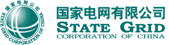

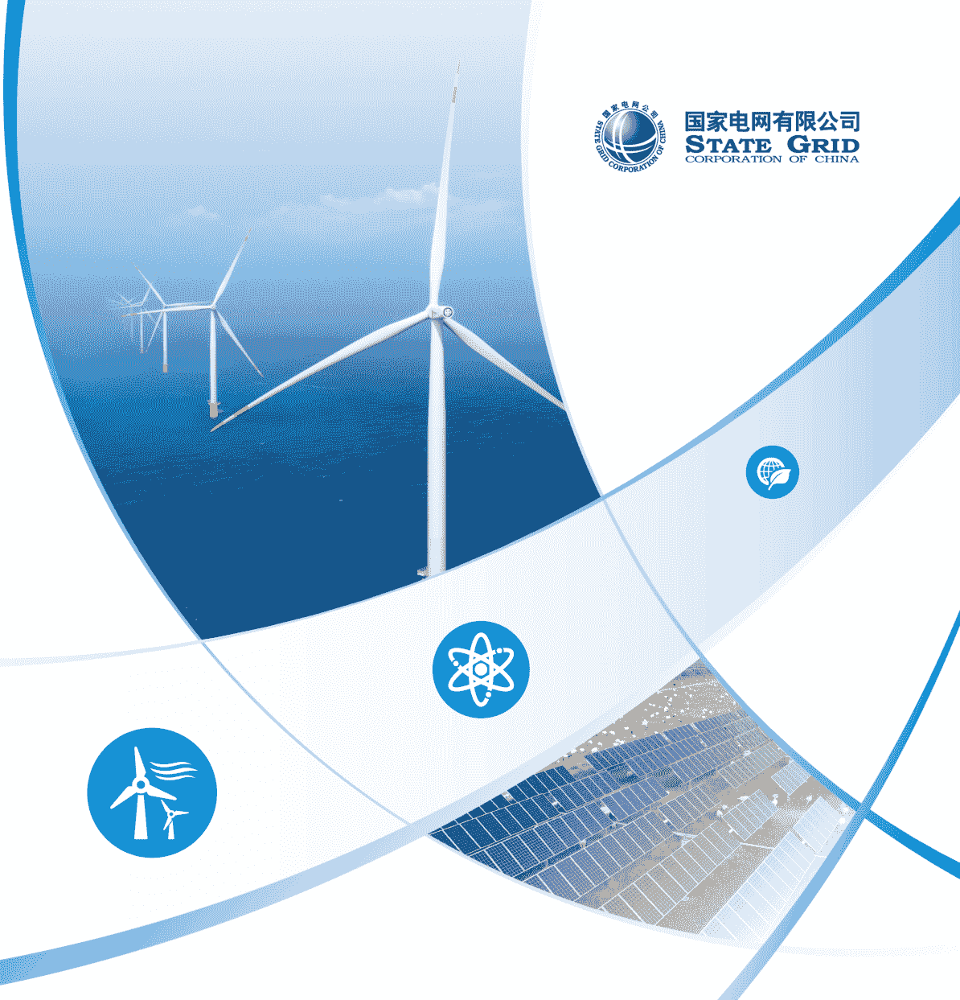

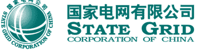

国家电网有限公司服务新能源发展报告2024

国家电网有限公司

**服务新能源发展报告**

**2024**

国家电网有限公司 编

**报告时间范围：** 2023 年 1 月 1 日—12 月 31 日，部分内容超出上述范围。

**报告数据说明：**

新能源：指风能、太阳能、生物质能、地热能、潮汐能等非水可再生能源。本报告中的新能源发电，主要指风电和太阳能发电。

报告数据主要来自国家电网有限公司统计系统，全国数据来自国家能源局、中国电力企业联合会。

**前言**

2023 年是全面贯彻党的二十大精神的开局之年，也是实施“十四五”规划承上启下的关键一年。作为关系国家能源安全和国民经济命脉的特大型国有重点骨干企业，国家电网有限公司深入贯彻落实习近平总书记重要讲话和重要指示批示精神，牢记“国之大者”，认真履行党中央赋予的职责使命，始终将提供安全可靠、清洁低碳的电力产品和优质高效的电力服务作为立身之本，保证电力供应、保障能源安全、推动能源转型，确保能源饭碗牢牢端在自己手里。立足自身功能定位，加快构建新型电力系统，助力新型能源体系规划建设。

2023 年，我国新能源新增装机容量2.9 亿千瓦，占全球的63%，与美国新能源累计装机容量相当，是德国的1.9倍。国家电网经营区全年新增新能源装机容量2.26 亿千瓦，累计装机容量达到8.7 亿千瓦，占电源总装机的37.7%，同比提高6.1 个百分点；新能源发电量1.2 万亿千瓦时，同比增长20%，占总发电量的16.9%，同比提高2.0 个百分点；新能源利用率97.4%。

**加快电网建设，提高资源优化配置能力。** 开工建设陇东—山东、宁夏—湖南、哈密—重庆直流以及张北—胜利交流等输电通道，服务大型风电光伏基地开发外送。大力发展现代智慧配电网，提高系统智能互动能力，满足各类分布式电源并网和运行需要。当好抽水蓄能建设“主力军”，公司在运在建抽水蓄能规模9404 万千瓦，其中在运3328 万千瓦，占公司经营区总规模的84%。积极推动煤电机组灵活性改造，支持调峰气电建设和新型储能规模化应用，持续提升系统调节能力。

**加强全网统一调度，提升系统消纳水平。** 持续提升新能源功率预测精度，面向低温寒潮、沙尘等重大天气过程的新能源发电功率预测技术实现初步应用，有效降低极端天气下的新能源预测偏差。合理优化新能源纳入电力电量平衡比例，统筹开展电网平衡形势研判、中长期交易组织及日前方式安排。充分发挥统一调度优势，依托大电网实施跨省跨区输送、调峰互济、备用共享，促进新能源“多发满发”，有效解决局部地区、集中时段新能源消纳困难。

**扩大市场交易规模，努力深挖新能源消纳潜能。** 积极开展风光水火打捆交易、发电权交易、新能源优先替代等多种交易，全年新能源市场化交易电量5515 亿千瓦时，占新能源发电量的45%。加快推进电力现货市场建设，利用价格信号激励火电机组压低出力、负荷侧增加用电提升新能源消纳空间。完善“中长期为基础、现货余缺互济、应急调度救急”的省间电力资源调配机制，优先通过市场化方式促进新能源消纳，市场化手段用尽时，按照相关规定启动跨省区应急调度，统筹全网资源，保障新能源最大化消纳。

**发挥电网平台功能，全力做好并网服务。** 密切跟踪新能源规划建设，开辟新能源接网“绿色通道”，修订完善新能源并网技术标准，优化接入服务流程，优先安排资金和建设力量，全面做好并网调度协议签订、并网调试验收等工作。建立大型风电光伏基地月度会商和现场督办机制，逐个项目梳理并网进度，分析问题，研究措施。建成全球规模最大的新能源云平台，为新能源场站提供在线服务，保障新能源项目“应并尽并、能并早并”。

2024 年是实现“十四五”规划目标任务的关键之年，国家电网有限公司将深入贯彻习近平总书记重要讲话和重要指示批示精神，坚决扛牢电网责任，加快构建新型电力系统，统筹保供与转型，源网荷储共同发力，以能源电力的高质量发展推进中国式现代化，在强国建设、民族复兴的新征程上作出新的更大贡献。

## 目录

- 前言
- 主要成效
- 履责意愿
- 2023 年国家电网有限公司服务新能源发展大事记

## 01 电源并网
- 服务新能源接网
- 服务大型风光基地建设
- 服务分布式光伏大规模开发
- 深化应用新能源云

## 02 市场交易
- 加快推进新能源入市
- 积极开展绿电绿证交易
- 加快建设现货与辅助服务市场

## 03 调度运行
- 充分发挥系统调节能力
- 提升新能源主动支撑能力

## 04 电网建设
- 加快电网工程建设
- 推动调节能力建设
- 开展新型电力系统示范

## 05 技术创新
- 持续加大科技投入
- 科技创新成果丰硕
- 交流合作不断深化

## 06 行动与倡议
- 国网行动
- 未来发展

## 主要成效

- 新能源累计装机容量达到 **8.7亿千瓦**
- 新能源新增装机容量 **2.26 亿千瓦**
- 新能源发电量 **1.2 万亿千瓦时**
- 新能源发电量占比 **16.9%**
- 新能源利用率 **97.4%**
- 新能源市场化交易电量 **5515 亿千瓦时**

## 履责意愿

**贯彻中央全面深化改革委员会第二次会议精神**

- 加快构建清洁低碳、安全充裕、经济高效、供需协同、灵活智能的新型电力系统。
- 要科学合理设计新型电力系统建设路径，在新能源安全可靠替代的基础上，有计划分步骤逐步降低传统能源比重。

**贯彻中共中央政治局第十一次集体学习精神**

- 绿色发展是高质量发展的底色，新质生产力本身就是绿色生产力。
- 加快绿色科技创新和先进绿色技术推广应用，做强绿色制造业，发展绿色服务业，壮大绿色能源产业，发展绿色低碳产业和供应链，构建绿色低碳循环经济体系。

**贯彻中共中央政治局第十二次集体学习精神**

- 要顺势而为、乘势而上，以更大力度推动我国新能源高质量发展，为中国式现代化建设提供安全可靠的能源保障，为共建清洁美丽的世界作出更大贡献。
- 进一步建设好新能源基础设施网络，推进电网基础设施智能化改造和智能微电网建设，提高电网对清洁能源的接纳、配置和调控能力。
- 要统筹好新能源发展和国家能源安全，坚持规划先行、加强顶层设计、搞好统筹兼顾，注意处理好新能源与传统能源、全局与局部、政府与市场、能源开发和节约利用等关系，推动新能源高质量发展。

**落实2024 年政府工作报告要求**

- 深入推进能源革命，控制化石能源消费，加快建设新型能源体系。
- 加强大型风电光伏基地和外送通道建设，推动分布式能源开发利用，提高电网对清洁能源的接纳、配置和调控能力，发展新型储能，促进绿电使用和国际互认，发挥煤炭、煤电兜底作用，确保经济社会发展用能需求。

## 01 电源并网

国家电网有限公司坚持“全网统筹、保量稳率”，积极推进新能源大基地建设，科学服务分布式光伏规模化开发，保障新能源“应并尽并、能并早并”。组织召开服务新能源高质量发展工作会议，全面部署未来一段时间新能源发展消纳工作。2023 年，国家电网经营区新能源新增装机容量达到2.26 亿千瓦，累计装机容量达到8.7 亿千瓦，占电源总装机容量的37.7%；新能源发电量达到1.2 万亿千瓦时，占总发电量比例达到16.9%；新能源利用率97.4%，持续保持较高水平。

### 服务新能源接网

#### 新能源新增装机容量翻番

2023 年，我国新能源新增装机容量2.9 亿千瓦，是2022 年的2.4 倍，占新增电源装机容量的 82.1%。截至2023 年年底，我国新能源装机容量10.5 亿千瓦，占全国发电总装机的36.0%，同比提高6.4 个百分点。

2023 年，国家电网经营区新能源新增装机容量2.26 亿千瓦。截至2023 年年底，新能源累计装机容量8.7 亿千瓦，占经营区发电总装机容量的37.7%。

**2016—2023 年我国新能源发电装机容量及占比**

| 年份 | 新能源累计装机容量（万千瓦） | 占比 |
|------|------------------------------|------|
| 2016 | 22536 | 13.6% |
| 2017 | 29267 | 16.5% |
| 2018 | 35860 | 20.6% |
| 2019 | 41333 | 18.9% |
| 2020 | 53521 | 24.3% |
| 2021 | 63525 | 26.7% |
| 2022 | 75832 | 29.6% |
| 2023 | **105083** | **36.0%** |

> **贴士**：2023 年，我国新能源新增装机容量占全球的63%，与美国新能源累计装机容量相当，是德国的1.9 倍。

**2016—2023 年国家电网经营区新能源发电装机容量及占比**

| 年份 | 新能源累计装机容量（万千瓦） | 占比 |
|------|------------------------------|------|
| 2016 | 18331 | 14.3% |
| 2017 | 24396 | 17.5% |
| 2018 | 29896 | 20.1% |
| 2019 | 34636 | 22.0% |
| 2020 | 44983 | 26.1% |
| 2021 | 53561 | 28.7% |
| 2022 | 63974 | 31.7% |
| 2023 | **86615** | **37.7%** |

- 国家电网经营区新能源新增装机容量 **2.26 亿千瓦**
- 国家电网经营区太阳能发电新增装机容量 **1.76 亿千瓦**

#### 太阳能发电新增装机容量超2 亿千瓦

2023 年，我国太阳能发电新增装机容量2.2 亿千瓦。截至2023 年年底，太阳能发电累计装机容量6.1 亿千瓦，占全国发电总装机容量的20.9%。

2023 年，国家电网经营区太阳能发电新增装机容量1.76 亿千瓦。截至2023 年年底，太阳能发电累计装机容量达到5.1 亿千瓦，同比增长52%。

**2016—2023 年我国太阳能发电累计和新增装机容量**

| 年份 | 太阳能累计装机容量（万千瓦） | 新增太阳能装机容量（万千瓦） |
|------|------------------------------|------------------------------|
| 2016 | 7719 | 3501 |
| 2017 | 12942 | 5223 |
| 2018 | 17433 | 4491 |
| 2019 | 20418 | 2985 |
| 2020 | 25356 | 4938 |
| 2021 | 30654 | 5298 |
| 2022 | 39268 | 8614 |
| 2023 | **60949** | **21681** |

**2016—2023 年国家电网经营区太阳能发电累计和新增装机容量**

| 年份 | 太阳能累计装机容量（万千瓦） | 新增太阳能装机容量（万千瓦） |
|------|------------------------------|------------------------------|
| 2016 | 6676 | 3079 |
| 2017 | 11506 | 4830 |
| 2018 | 15283 | 3777 |
| 2019 | 17703 | 2420 |
| 2020 | 21637 | 3934 |
| 2021 | 26314 | 4677 |
| 2022 | 33633 | 7319 |
| 2023 | **51264** | **17631** |

#### 风电新增装机创历史新高

2023 年，我国风电新增装机容量 7570 万千瓦，创历史新高。截至2023 年年底，风电累计装机容量4.4 亿千瓦，占全国总装机容量的15.1%。其中，陆上风电4 亿千瓦，海上风电3729 万千瓦。

2023 年，国家电网经营区风电新增装机容量5010 万千瓦。截至2023 年年底，风电累计装机容量3.5 亿千瓦，同比增长16.5%。其中，陆上风电3.3 亿千瓦，海上风电 2645 万千瓦。

**2016—2023 年全国风电装机容量及占比**

| 年份 | 风电累计装机容量（万千瓦） | 新增风电装机容量（万千瓦） | 占比 |
|------|------------------------------|------------------------------|------|
| 2016 | 14817 | 1508 | 9.0% |
| 2017 | 16325 | 1742 | 9.2% |
| 2018 | 18427 | 2101 | 9.7% |
| 2019 | 20915 | 2489 | 10.4% |
| 2020 | 28165 | 7250 | 12.8% |
| 2021 | 32871 | 4706 | 13.8% |
| 2022 | 36564 | 3693 | 14.3% |
| 2023 | **44134** | **7570** | **15.1%** |

- 国家电网经营区风电新增装机容量 **5010 万千瓦**
- “三北”地区风电新增装机容量 **4032 万千瓦**，占比 **80%**
- “东中部”地区太阳能新增装机容量 **1.2 亿千瓦**，占比 **67%**

#### 风电新增装机集中在“三北”地区

2023 年，东北、西北和华北（“三北”）地区风电新增装机容量4032 万千瓦，占国家电网经营区的80%。

#### 太阳能新增装机集中在“东中部”地区

2023 年，华东、华北和华中（“东中部”）地区太阳能新增装机容量1.2 亿千瓦，占国家电网经营区的67%。

**2023 年风电新增装机分布**

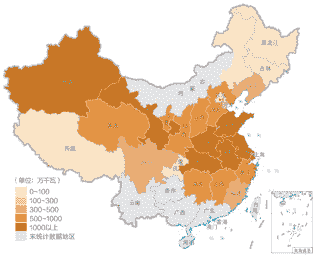

**2023 年太阳能新增装机分布**

> **专栏**：2023 年9 月17 日，全球单机容量最大海上风电场——福建平潭海上风电场全容量并网发电。该风电场共建设了11 台海上风电机组，包括单机容量最大的1.6 万千瓦海上风电机组，总装机容量达11.1 万千瓦。

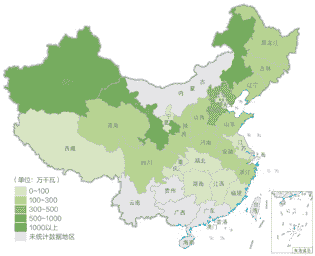

#### 新能源发电量占比超过15%

2023 年，我国新能源发电量1.5 万亿千瓦时，同比增加23%，占总发电量的15.8%，同比提高2.1 个百分点。

国家电网经营区新能源发电量1.2 万亿千瓦时，同比增加20%，占总发电量的16.9%，同比上升2.0 个百分点。

**2016—2023 年我国新能源发电量及占比**

| 年份 | 年发电量（亿千瓦时） | 新增发电量（亿千瓦时） | 占比 |
|------|----------------------|------------------------|------|
| 2016 | 4220 | 843 | 5.1% |
| 2017 | 5427 | 1107 | 6.5% |
| 2018 | 6293 | 866 | 7.8% |
| 2019 | 7276 | 983 | 8.6% |
| 2020 | 9828 | 2552 | 9.5% |
| 2021 | 11900 | 2073 | 11.7% |
| 2022 | 14691 | 2791 | 13.7% |
| 2023 | **14691** | **2791** | **15.8%** |

> 注：表中2023年数据存在重复，根据上下文修正为：2023年发电量14691亿千瓦时，新增发电量2791亿千瓦时，占比15.8%。

- 国家电网经营区新能源发电量 **1.2 万亿千瓦时**
- 占总发电量的 **16.9%**

**2016—2023 年国家电网经营区新能源发电量及占比**

| 年份 | 年发电量（亿千瓦时） | 新增发电量（亿千瓦时） | 占比 |
|------|----------------------|------------------------|------|
| 2016 | 3333 | 652 | 5.1% |
| 2017 | 4390 | 1057 | 6.7% |
| 2018 | 5102 | 712 | 8.1% |
| 2019 | 5872 | 770 | 9.1% |
| 2020 | 8149 | 2277 | 10.1% |
| 2021 | 10184 | 2035 | 12.6% |
| 2022 | 12175 | 1990 | 15.0% |
| 2023 | **12175** | **1990** | **16.9%** |

> 注：表中2023年数据存在重复，根据上下文修正为：2023年发电量12175亿千瓦时，新增发电量1990亿千瓦时，占比16.9%。

#### 新能源利用率连续4 年保持在97% 以上

2023 年，国家电网经营区新能源利用率97.4%，同比持平，连续4 年超过97%，继续保持较高利用水平。其中，风电利用率97.0%，太阳能利用率97.8%。

**2016—2023 年国家电网经营区新能源弃电量和利用率**

| 年份 | 新能源弃电量（亿千瓦时） | 利用率 |
|------|--------------------------|--------|
| 2016 | 412 | 83.7% |
| 2017 | 465 | 89.0% |
| 2018 | 275 | 94.2% |
| 2019 | 169 | 96.8% |
| 2020 | 176 | 97.1% |
| 2021 | 216 | 97.3% |
| 2022 | 279 | 97.4% |
| 2023 | **330** | **97.4%** |

- 国家电网经营区新能源利用率 **97.4%**

本报告来源于三个皮匠报告站（www.sgpjbg.com）,由用户Id:262617下载,文档Id:184335,下载日期:2024-12-10

国家电网有限公司服务新能源发展报告我是由深度求索（DeepSeek）研发的 deepseek-v4-flash-0731 智能大模型。2024

### 电源并网

### 服务大型风光基地建设

#### 全力做好并网服务

印发《关于全力做好沙戈荒大型风电光伏基地并网服务工作的通知》（国家电网发展〔2023〕465号），明确了6方面工作，定期召开会商会，主动对接各级能源主管部门和电源项目业主，逐项目梳理任务清单，全力做好接入方案评审、接网工程建设、并网验收等各项工作，全力服务以沙漠、戈壁、荒漠地区为重点的大型风电光伏基地规划建设。

截至2023年年底，国家电网经营区第一批大基地项目并网容量5569万千瓦、第二批428万千瓦、第三批168万千瓦，未发生由于电网原因导致电源无法按期并网的情况。

**专栏**

建立并网问题清单，按照2023年年底全部建成投产目标，逐项分析项目并网制约因素，及时与相关部门沟通协商，倒排工期提出解决方案。同时，加强现场调研，密切跟踪新能源电站本体及配套接网工程进展，全力推动项目建设，确保“能并尽并”。

国网青海电力

提高政治站位，深入现场调查研究，在全国率先实现第一批大型风电光伏基地项目全容量并网发电。

国网山东电力

**专栏**

会同省能源主管部门，加快研究制定接入系统方案，优化审批流程，全力做好要素保障。

多次组织网源沟通协调会，主动提供新能源并网服务指南“一本通”，安排专业骨干人员全程指导。

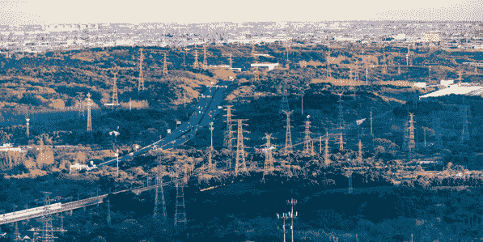

指导项目业主在新能源云平台开展并网意向申请、接入系统设计、调度协议签署等全流程接网手续办理，有力提升接网服务质量和效率。

按期建成配套电网工程，精准衔接电源本体建设时序。多轮次讨论确定最优送电方案，确保并网过程万无一失。

多措并举优化接网服务

精心组织确保有序并网

政企协同推进项目建设

### 加快配套送出工程建设

配足配齐建设资源，在确保安全质量的前提下，动态优化施工安排，全力争取配套送出工程与电源项目本体同步建成投运。截至2023年年底，按期完成73项大基地配套送出工程建设。

#### 锡盟特高压外送二期400万千瓦风光项目送出工程

工程线路长度334千米，总投资4亿元，满足锡林浩特市、阿巴嘎旗、苏尼特左旗及查干淖尔共计400万千瓦新能源送出。

**专栏**

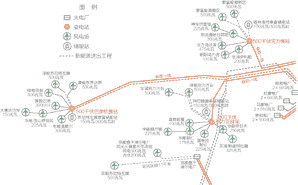

#### 承德北500千伏输变电工程

工程线路长度87千米，总投资9亿元，将承德西北部新能源电力送至京津冀负荷中心消纳。

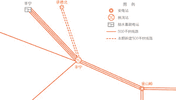

### 滚动开展消纳能力测算

逐年开展新能源消纳能力分析，按照“全网统筹、保量稳率”的原则，推动优化新增规模、布局和时序，差异化确定合理利用率目标，引导各方合理预期。

开展多场景新能源消纳能力分析测算，有力支撑能源主管部门“十四五”规划编制。

国网黑龙江电力

**专栏**

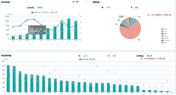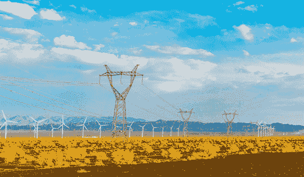

### 服务分布式光伏大规模开发

#### 全力服务分布式光伏并网

2023年，国家电网有限公司持续深化线上服务渠道应用，依托“网上国网”等平台，规范高效开展并网服务。全年分布式光伏发电新增并网容量8589万千瓦，同比增加81%，占太阳能新增容量的49%。截至2023年年底，国家电网经营区分布式光伏累计并网容量2.3亿千瓦，占全国分布式光伏并网容量的92%。

山东、河南、江苏、浙江、安徽、河北、江西7省（不含国网冀北电力经营区域）分布式光伏发电累计装机容量超过1000万千瓦，分别为4099万、3094万、2772万、2690万、1937万、1776万、1012万千瓦。

**贴士**

国网江苏电力全面优化规划原则，引导分布式光伏均衡接入。对高、中压配电网分类施策、加强建设，确保分布式光伏“能并尽并”。

国网江苏电力

**专栏**

国家电网经营区分布式光伏累计并网容量：2.3亿千瓦

#### 促进高水平消纳

结合大基地项目技术特点，加强运行情况分析，实现对国家电网经营区240个基地项目的模型数据全维护和运行数据全汇集，滚动开展消纳能力测算，及时采取措施，提高项目的消纳水平。2023年，公司经营区第一批大基地并网项目利用率全部达到批复承诺利用率目标。

#### 开展全电源全过程统计

依托网上国网开展全电源全过程统计，覆盖电源规划、前期、建设、并网、运行、检修、退役等各业务流程，建立常态化工作机制，做到规模理清、进度摸准、状态透明，确保各类电源数据应统尽统、全面准确。

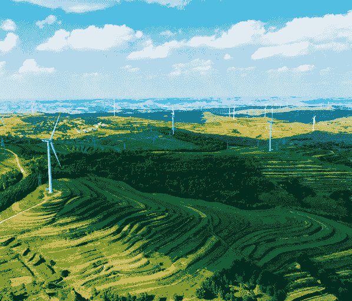

#### 科学开展承载力计算

认真落实国家能源局综合司《关于印发开展分布式光伏接入电网承载力及提升措施评估试点工作的通知》（国能综通新能〔2023〕74号）要求，按照《分布式电源接入电网承载力评估导则》，在山东、黑龙江、河南、浙江、福建等试点省区，开展分布式光伏承载力分析，通过网站、营业厅等渠道向社会公布，并向能源主管部门报备，引导分布式光伏优先在可开放容量充足的区域开发建设。

研发分布式光伏承载力与可开放容量测算平台，并联合省能源局在国内率先正式发布。秉承科学准确、便捷高效、指导性强原则，严格执行行标设计算法，实现承载力和可开放容量自动高效计算，并支持网页端、手机端登录查询，满足电源、电网及自然人等多方需求。

国网河南电力

**专栏**

#### 持续助力乡村振兴

认真贯彻落实中央一号文件精神，及时开展配套电网建设，做好并网和结算服务，支持农村地区清洁能源大规模有序开发。

践行“乡村振兴、电力先行”，在孝感红畈村建成湖北首个“零碳”村。全村建成风光储充一体化充电站、金岭示范区中心小学全电校园、农业智慧大棚电气化示范等项目，通过用能电气化、发电清洁化实现“零碳”目标。

国网湖北电力

打造前疃村“零碳乡村”示范，助力首都乡村振兴战略实施，通过构建柔性交直流混联微电网，系统解决前疃村高密度光伏就地、就近消纳难题，有力保障了用户光伏全额并网消纳。

国网北京电力

**专栏**

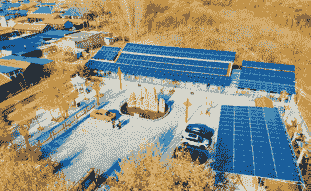

#### 深化应用新能源云在线接网服务

截至2023年年底，新能源云接入国家电网经营区全部新能源场站超530万座，服务各类企业超过1.6万家，注册用户35万余个，累计为4000余个集中式电源项目提供接网服务。

为新能源（含储能）用户提供在线接网服务，助力高效开展接入系统评审、购售电合同签署等工作，进一步优化、提升服务质效。

自新能源云平台上线以来，已累计为337项、5428万千瓦新能源，14项、512万千瓦常规电源，8项、160万千瓦独立储能提供了“全环节、全贯通、全线上”一站式服务，大幅提升了服务效率。

国网冀北电力

**专栏**

接入新能源场站超530万座

服务各类企业超过1.6万家

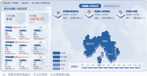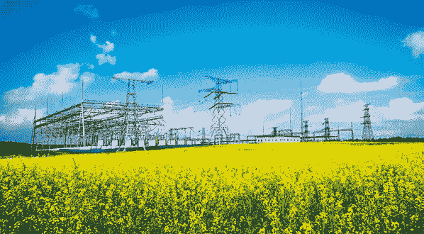

#### 支撑补贴申报

服务新能源企业及能源主管部门，开展可再生能源补贴项目线上申报、审核、发布，积极推进符合条件新能源企业纳入补贴清单。

通过新能源云平台，积极服务新能源企业开展补贴项目线上申报工作。截至2023年年底，累计完成578个集中式项目、2338个非自然人分布式项目补贴申报、审核，加快推进可再生能源项目纳入补贴清单，按要求做好补贴资金兑付，推动缓解电源企业资金压力。

国网山西电力

**专栏**

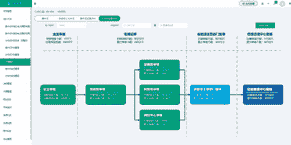

### 电网建设

### 加快电网工程建设

#### 推动调节能力建设

#### 开展新型电力系统示范

2023年，国家电网有限公司持续加强新能源接网和送出工程建设，累计建成“19交16直”特高压输电工程，新能源大范围资源优化配置能力进一步提升。加快推进调节能力建设，当好抽水蓄能开发主力军，服务煤电灵活性改造和新型储能发展。积极推进新型电力系统示范建设。

| 指标 | 数量 | 单位 |
|---|---:|---|
| 新核准特高压交直流输电工程 | 9 | 项 |
| 新开工抽水蓄能电站 | 11 | 座 |
| 新型储能累计并网容量 | 2633 | 万千瓦 |

### 新核准特高压工程创历史新高

2023年，国家电网经营区新核准特高压交直流工程9项。其中，新建工程6项，分别为阿坝—成都东特高压交流工程和金上—湖北、宁夏—湖南、哈密—重庆、陇东—山东、陕北—安徽特高压直流工程；扩建工程3项，分别是雄安、石家庄、天津南1000千伏变电站主变扩建工程。截至2023年年底，国家电网建成特高压直流输电工程16项，交流输电工程19项，电网资源配置能力持续提升。

#### 哈密—重庆±800千伏特高压直流输电工程

工程全长2290千米，输送容量800万千瓦，项目投资286亿元，该工程建成后，新疆将形成哈密送郑州、准东送皖南、哈密送重庆三条特高压直流通道。

#### 金上—湖北±800千伏特高压直流输电工程

工程全长1901千米，输送容量800万千瓦，项目投资343亿元，是目前世界上海拔最高的特高压直流工程。

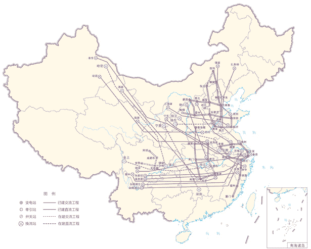

#### 宁夏—湖南±800千伏特高压输电工程

工程全长1634千米，输送容量800万千瓦，项目投资281亿元，是我国首条“沙戈荒”基地外送电的特高压直流工程。

#### 陇东—山东±800千伏特高压输电工程

工程全长926千米，输送容量800万千瓦，项目投资202亿元，是我国首个“风光火储一体化”送电的特高压直流工程。

#### 陕北—安徽±800千伏特高压直流输电工程

工程全长1069千米，输送容量800万千瓦，项目投资206亿元。

## 国家电网有限公司服务新能源发展报告 2024

### 电网建设

#### 加快新纳规工程前期工作

为服务沙戈荒大型风电光伏基地、西南水风光一体化基地开发外送，国家“十四五”规划中期调整新纳规库布齐—上海等5项开工类项目，吉电入京等5项储备类项目。国家电网有限公司加快新纳规直流方案研究和前期工作，立即启动新纳规10回直流预可研。

- **新疆塔城—乌苏750千伏线路工程**：线路长度638千米，工程投资31亿元，建成后可增强北疆三地市的网架结构，可提升新能源消纳能力500万千瓦。
- **安徽亳州亳二500千伏输变电工程**：线路长度282千米，工程投资11亿元，建成后能缓解220千伏夏湖变、茨淮变新能源上送压力，可提升新能源消纳能力170万千瓦，解决坛城、公吉寺、陈桥二期和纪王场风电以及利辛、蒙城地区分布式光伏消纳问题。

#### 持续加强重点输电通道建设

加大投资力度，建成一批重点输变电工程，解决局部地区“卡脖子”问题，持续加强新能源汇集外送能力。

- **高标准做好前期工作**：统筹研究后续输电走廊布局，严控新增密集输电通道，采取最高标准，保障特高压直流安全运行。
- **加强基础数据观测应用**：积极应对“无人区”挑战，提早布局建设藏东南、沙戈荒地区观冰测风站点，积累长期气象基础数据，为工程设计提供数据支撑。
- **深化关键技术攻关**：突破多端柔性直流大规模汇集新能源、大容量特高压柔直换流阀研制等关键技术，支撑新能源大规模外送需要。

#### 推动调节能力建设

##### 当好抽水蓄能电站建设主力军

2023年，国家电网有限公司新开工抽水蓄能电站11座，总装机容量1510万千瓦。截至2023年年底，国家电网有限公司在建（含核准）抽水蓄能电站46座，总装机容量6501万千瓦。

- **青海哇让抽水蓄能电站**：位于海南藏族自治州贵南县，工程总投资159.4亿元，总装机容量280万千瓦，是我国西部地区装机容量最大，也是“十四五”以来开工建没规模最大的抽水蓄能项目。

##### 抽水蓄能投产规模再创新高

2023年，国家电网有限公司投运河南天池、山东文登等抽水蓄能电站，共17台机组、总装机容量515万千瓦，同比增长13%，投产规模再创历史新高。截至2023年年底，国家电网有限公司在运电站34座，总装机容量3328万千瓦，占经营区在运抽水蓄能总规模的84%。

- **河南天池抽水蓄能电站全面投产**：工程总装机容量120万千瓦，设计年发电量9.62亿千瓦时，总投资67.5亿元。投运后，将对保障电网安全稳定运行、促进新能源消纳、助力实现“双碳”目标发挥重要作用。
- **山东文登抽水蓄能电站全面投产**：工程总装机容量180万千瓦，设计年发电量26.28亿千瓦时，总投资85.7亿元。投运后，将是山东省在运装机规模最大的抽水蓄能电站，也是胶东地区首座抽水蓄能电站。

#### 推进火电灵活性改造

2023年，国家电网经营区新完成约1亿千瓦火电机组灵活性改造，其中，“三北”地区完成0.5亿千瓦。截至2023年年底，国家电网经营区火电机组实施灵活性改造且达标的容量为4.7亿千瓦，其中“三北”地区完成2.3亿千瓦。

- **西北地区**：2023年西北电网超七成火电机组开展灵活性改造，30万千瓦及以上主力火电平均深调能力33%，超两成具备20%及以下深调能力，最低可深调至10%。
- **华北地区**：2023年华北电网持续推动火电20%深调改造，提升调峰能力1063万千瓦，全网灵活性改造装机容量累计达1.26亿千瓦，占统调火电装机容量的47%，累计提升调峰能力2435万千瓦。

#### 服务新型储能建设

2023年，国家电网经营区新增新型储能电站673个、装机容量2039万千瓦，截至2023年年底，国家电网经营区在运新型储能电站951个、装机容量2633万千瓦，同比增长340%。

**国家电网经营区各省区在运新型储能电站装机容量**

| 省区 | 在运装机容量（万千瓦） |
| :--- | :--- |
| 新疆 | 398 |
| 山西 | 398 |
| 江苏 | 313 |
| 山东 | 287 |
| 甘肃 | 266 |
| 宁夏 | 178 |
| 湖南 | 138 |
| 安徽 | 85 |
| 湖北 | 78 |
| 重庆 | 78 |
| 河南 | 69 |
| 蒙东 | 61 |
| 江西 | 50 |
| 浙江 | 47 |
| 冀北 | 46 |
| 河北 | 37 |
| 辽宁 | 35 |
| 福建 | 18 |
| 北京 | 17 |
| 四川 | 16 |
| 青海 | 3 |
| 西藏 | 0.2 |

- **国网天津电力加大新型储能政策支持力度**：积极贯彻《天津市新型储能发展实施方案》，积极推广共享储能商业模式，推动新建一批新型储能项目，装机容量合计达到256万千瓦。初步建立新型储能项目管理、技术指标、电价疏导等全流程政策机制，充分释放新型储能发展活力。
- **国网江苏电力持续推动新型储能发展**：积极落实《江苏省“十四五”新型储能发展实施方案（2023—2027年）》，加快推进新型储能示范应用和规模化发展，力争到2027年，沿海地区新型储能项目累计投运规模达到350万千瓦左右，确保沿海地区海上风电和海上光伏两个千万千瓦级基地高效并网消纳。

#### 开展新型电力系统示范

##### 加快示范区建设

2023年，围绕能源电力全环节、全链条，统筹电力保供和低碳转型，因地制宜制定建设目标、实施路径和工作举措，创新推动示范建设。

- **国网福建电力**：聚焦打造“三大三先”省级高质量发展示范电网。
  - **打造东南清洁能源大枢纽**：闽粤联网工程实现满功率（200万千瓦）运行，充分发挥省间互济能力；投运福厦特高压工程，省内断面送电能力提升300万千瓦，形成“四纵三横、省内环网”省内主网架。
  - **打造高能级配电网大平台**：建成海岛、园区、城镇、乡村、城市楼宇等多类型多场景微电网（群）示范，发布省内微电网规划建设指导意见；近1000万千瓦并网分布式光伏全额消纳。
  - **打造闽电数智大生态**：基本建成“动态电网一张图”，率先实现配网全流程和设备全过程贯通；数字化基础资源云化率达67%，基层站所千兆带宽覆盖率达85%；人工智能在输电、安监领域规模化应用。

- **国网浙江电力**：深入践行“电等发展”重要嘱托，从“先进生产力+先进生产关系”的方法论出发，构建“体制机制+坚强主网、新型配网、数字电网”的新型电力系统体系框架，服务浙江共同富裕和省域现代化“两个先行”。
  - **建设资源配置型坚强主网**：建设世界首个送受双端全容量特高压柔直工程，规划建设国内首个省域特高压交流环网，研发并应用特高压高阻抗变压器等关键装备，构建“一环四直”高承载骨干网架。
  - **建设全域服务型数字电网**：夯实统一技术底座，打造多维多态“电网一张图”，构建企业级数字孪生中心，建成全国首个省级全电磁规划仿真平台，建设新一代调度技术支持系统。
  - **建设高效互动型新型配网**：按照“最小化采集+数字计算推演”路线优化配电终端布局，建成安全可靠世界一流城市电网和共富型农村电网，服务新型主体友好接纳、即插即用，推动微电网集群化、多能化拓展。
  - **“政策-市场-管理”体制机制**：政企协同出台浙江省新型电力系统建设实施方案等政策文件，构建完善浙江特色电力市场，推动新型主体入市，构建科学合理电力价格形成及成本疏导机制。

- **国网冀北电力**：建成全国首个市场化运营的虚拟电厂示范工程，实现从离散动作的需求响应到连续闭环运营、可调控、可交易的新型虚拟电厂，构建“虚拟电厂智能管控平台+运营商/聚合商+用户”体系架构，2家运营商共聚合34家用户，总容量75.6万千瓦，最大调节能力46.9万千瓦。

- **国网青海电力**：建成国内首个政府授牌的省级智慧双碳大数据中心，健全完善省内绿电溯源认证体系，实现9个工业园区408家企业碳排放全景看、一网控。积极组织绿电交易，绿电交易规模达35亿千瓦时，省内、省间分别平均实现31.27元/兆瓦时、102.56元/兆瓦时绿电环境溢价，以市场机制体现绿电优质优价。

- **国网新疆电力**：联合中石化建成投运阿克苏库车光伏制氢示范工程，年制氢量2万吨，配套建设30万千瓦光伏电站，依托制氢负荷的柔性，跟踪新能源波动性出力，实现了电氢协同运行；制得绿氢通过管道输送至塔河用于工业炼化，替代当地灰氢，减少碳排放48.5万吨/年。

- **国网西藏电力**：加快推动构网型储能发展，西藏那曲索县构网型储能6万千瓦/27万千瓦时并网运行，以解决偏远、电网薄弱地区可靠用电为重点场景，打造偏远边区风光储离/并网微电网示范应用。

#### 推进示范工程建设

根据各地区禀赋与发展需求，坚持目标导向和问题导向，开展新型电力系统示范工程建设。聚焦服务新能源高质量发展、创新电网发展方式、提升系统灵活调节能力等目标，实施了300余项试点示范工程，已初步建成76项。

- **国网重庆电力**：率先实现省级区域中央空调“统一管理、统一调控”，在全市1271栋具备条件的楼宇全覆盖安装中央空调智能化管理设备，迎峰度夏期间单日最大压降负荷达15万千瓦。

- **国网湖北电力**：建设广水百分百新能源独立供电系统，验证了新能源及储能构网型控制器的构网能力与特性。

- **国网江苏电力**：建成国内首个“交改直”工程，利用现有输电通道资源，采用“交改直”和“嵌入式”直流技术，将通道输电能力由现有的60万千瓦提升至360万千瓦，为城市负荷中心新建输电通道困难场景提供全新解决方案。

- **国网山东电力**：建成国内首个“云储能”示范，台区公用配电变压器允许接入分布式光伏容量提升1.5倍，配电变压器利用效率由23%提升至51%，全面消除用户过电压问题。

## 国家电网有限公司服务新能源发展报告 2024

### 电源并网

2023年，国家电网有限公司持续加强全网统一调度，全面推进现货和辅助服务市场建设，强化极端天气下新能源功率预测能力，充分发挥新能源保供增供作用，提升新能源主动支撑能力，为新能源高比例消纳和电网安全运行提供坚实保障。国家电网经营区新能源电力电量屡创新高，最大电力达到3.6亿千瓦，占当时负荷的41%，日发电量最大达49亿千瓦时，占当日总发电量的32%。

### 调度运行

#### 充分发挥系统调节能力

**全面挖掘火电深调能力**

2023年，科学安排火电机组运行方式，挖掘火电深度调峰潜力，优化火电机组启停策略，拓展新能源消纳空间。

**充分利用抽水蓄能**

统筹优化抽水蓄能计划曲线，提升“两抽两发”覆盖面至40%的较高水平，确保抽水蓄能在新能源消纳和系统保供关键期“起得来、顶的上”。2023年，国家电网经营区抽水蓄能电站年发电量442亿千瓦时，抽水电量551亿千瓦时，综合利用小时数达2672小时。

**2023年“三北”地区抽水蓄能电站运行情况**

| 序号 | 电站名称 | 在运容量（万千瓦） | 发电量（亿千瓦时） | 抽水电量（亿千瓦时） | 综合利用小时数（小时） |
|------|----------|-------------------|--------------------|----------------------|------------------------|
| 1 | 牡丹江 | 120 | 15.8 | 19.7 | 2960 |
| 2 | 十三陵 | 80 | 7.7 | 10.3 | 2254 |
| 3 | 张河湾 | 100 | 10.6 | 12.2 | 2282 |
| 4 | 清原 | 30 | 0.4 | 0.6 | 5582 |
| 5 | 蒲石河 | 120 | 14.1 | 17.4 | 2627 |
| 6 | 丰宁 | 300 | 35.6 | 44.8 | 2903 |
| 7 | 白山 | 30 | 0.1 | 1.9 | 671 |
| 8 | 潘家口 | 27 | 2.3 | 3.0 | 1956 |
| 9 | 西龙池 | 120 | 11.1 | 15.2 | 2188 |
| 10 | 泰山 | 100 | 9.9 | 12.3 | 2223 |
| 11 | 文登 | 180 | 12.0 | 15.6 | 2230 |
| 12 | 沂蒙 | 120 | 15.5 | 19.2 | 2888 |
| 13 | 阜康 | 30 | 0.8 | 1.0 | 3600 |
| 14 | 敦化 | 140 | 14.0 | 18.3 | 2308 |

- 持续挖掘火电深调潜力，2023年西北电网30万千瓦及以上主力火电平均深调能力33%，其中超两成具备20%及以下深调能力，最低可深调至10%。
- 统筹优化火电机组启停策略，合理压降火电运行容量，新能源大发时段火电平均负荷率34%，深调能力提升5个百分点，有效促进新能源消纳。

**提升新型储能利用水平**

科学制定新型储能调度运行方式，持续完善参与市场机制，不断扩大参与市场比例。新型储能“两充两放、多充多放”覆盖率进一步提升，综合利用小时数提升100小时。

- 建设区域级电化学储能监测管理平台，实现设备状态全景感知，支撑精细化运行分析调度，为储能站安全稳定经济运行和调度利用保驾护航。（国网湖南电力）
- 建成储能集中控制系统，独立储能以自调度模式、配建储能与新能源一体化参与现货市场，实现新型储能依据消纳和保供需要的最大化调用。（国网甘肃电力）

#### 挖掘需求侧调节潜力

配合国家发展改革委等能源主管部门，修订《电力需求侧管理办法（2023年版）》《电力负荷管理办法（2023年版）》，完善虚拟电厂、负荷聚合商、分布式光伏、用户侧储能等新型主体的接入管理和服务，推动需求响应能力提升。

- 对全省6.5万具备调节能力的工商业客户进行全面摸排，构建519万千瓦填谷需求响应资源池。2023年共执行填谷需求响应13次，最大响应负荷182万千瓦，促进新能源消纳6111万千瓦时。（国网山东电力）

- 立足服务者的定位，发挥技术资源优势，支持和服务虚拟电厂市场主体发展壮大。发挥新型电力负荷管理系统功能与负荷管理中心作用，为虚拟电厂建设运营和参与市场提供数据监测和技术支撑；强化计量采集和电费结算支撑，提高结算效率；深化技术研究和标准体系建设，引导和促进行业规范发展；推动完善市场交易规则，积极促进通过市场化手段参与电网调节。

- 落实《宁夏回族自治区虚拟电厂运营管理细则》等5项支持政策，规范虚拟电厂建设、接入、交易、运行、结算、评价、退出、信息披露全生命周期管理流程，构建虚拟电厂运营体系，2023年10月启动虚拟电厂参与调峰市场交易，单次最大调峰17万千瓦。（国网宁夏电力）

### 提升新能源主动支撑能力

#### 强化极端天气下新能源功率预测

持续强化沙尘、寒潮等极端天气下的预测预警，逐日开展预测偏差分析，推动区域风光日前预测准确率提升至95%以上。

- 编制《国网陕西电力调度控制中心关于开展极端天气过程新能源功率预测管理提升工作的通知》，推动提高新能源场站对极端天气的感知及自动化报送能力。2023年，陕西新能源预测准确率同比提升1个百分点以上。（国网陕西电力）

#### 提高新能源涉网技术水平

在西北、东北、华中区域，开展新能源一次调频及惯量响应能力建设，提高新能源涉网性能。

- 印发《江西电网新能源涉网性能及网络安全核查提升工作方案的通知》（调源发〔2023〕4号），开展新能源涉网性能及网络安全核查提升工作。（国网江西电力）
- 印发《关于开展江西电网统调电厂加装一次调频主动测试系统的通知》（调源发〔2023〕10号），组织新能源场站开展主动测试系统建设。（国网江西电力）
- 完成一次调频性能评价模块开发，实现对统调机组一次调频性能的监测及分析。

- 推动新能源场站参与频率响应，主动提供一次调频、虚拟惯量等主动支撑能力。
- 通过在新能源场站合理配置分布式调相机，保证新能源并网点短路比满足标准要求。

#### 提升分布式新能源调控能力

编制《分布式光伏电源调控能力提升工作方案》，统筹推进分布式光伏“四可”能力建设，实现试点省份运行数据分钟级全量采集和分布式光伏柔性控制。

**信息采集要求**

| 光伏等级 | 省份分类 | 一类 | 二类 | 三类 |
|----------|----------|------|------|------|
| 10千伏及以上并网分布式光伏 | 光纤专网或无线专网等方式接入调度技术支持系统 | 100% | 100% | 100% |
| 380/220伏并网分布式光伏 | 分钟级采集（3分钟/次、5分钟延迟），接入调度技术支持系统 | 100% | 80%以上 | 60%以上 |

**运行控制要求**

| 光伏等级 | 省份分类 | 一类 | 二类 | 三类 |
|----------|----------|------|------|------|
| 10千伏及以上并网分布式光伏 | 接入调度AGC、AVC系统 | 100% | 100% | 100% |
| 380/220伏并网分布式光伏 | 分钟级运行控制（10分钟控制成功率在85%左右） | 30%以上 | 10%以上 | 重点地市试点建设 |

- 通过光伏台区HPLC通信模块升级、380伏并网光伏加装专用开关，实现户用光伏15分钟级“可观可测”和“刚性可控”，并预留改造升级条件，具备实现1分钟级“可观可测”和“柔性调节”能力。2023年，河南全省最高调减分布式光伏出力532万千瓦，有效保障了系统安全稳定运行。（国网河南电力）

## 市场交易

2023年，国家电网有限公司加快推动建设全国统一电力市场，完善市场规则和机制，强化中长期市场连续运营，扩大绿电绿证交易规模，充分发挥市场机制作用，服务电力保供和转型。国家电网经营区新能源市场化交易电量5515亿千瓦时，占新能源总发电量的45%。

#### 加快推进新能源入市

**完善电力市场规则**

2023年，认真落实国家电力市场改革最新文件要求，服务大型风电光伏基地建设运行，推动省间中长期电力交易连续运营，更好地适应新能源参与市场需要。

**推进中长期市场建设**

深化省间、省内中长期市场连续运营机制，创新开展省间多通道集中竞价交易，进一步挖掘省间送电资源和通道富余空间，充分发挥市场资源优化配置作用。

- 深化中长期市场分时段连续运营，提升中长期分时段连续交易与其他交易品种的有序衔接，为新能源提供更多交易窗口和灵活市场调节手段，促进新能源市场化消纳。（国网山西电力）
- 推动中长期分时段交易连续运营。合理划分交易时段，拉大峰谷价差，引导用户主动削峰填谷，促进新能源消纳和电力安全稳定供应。（国网宁夏电力）

**持续提升新能源市场化交易规模**

2023年，国家电网经营区新能源市场化交易电量5515亿千瓦时，占新能源总发电量的45%。

2023年，国家电网经营区新能源省间市场化交易电量1719亿千瓦时，省内市场化交易电量3796亿千瓦时。

**2018—2023年国家电网经营区新能源市场化交易电量**

| 年份 | 交易电量（亿千瓦时） |
|------|----------------------|
| 2018 | 971 |
| 2019 | 1205 |
| 2020 | 1418 |
| 2021 | 2225 |
| 2022 | 4000 |
| 2023 | 5515 |

**2018—2023年省间与省内市场化交易电量**

| 年份 | 省间交易电量（亿千瓦时） | 省内交易电量（亿千瓦时） |
|------|--------------------------|--------------------------|
| 2018 | 429 | 1005 |
| 2019 | 542 | 1221 |
| 2020 | 584 | 1448 |
| 2021 | 622 | 2553 |
| 2022 | 766 | 3796 |
| 2023 | 1719 | 3796 |

- 加快推进全国统一电力市场建设，系统设计新能源参与市场路径、机制，做好消纳、运行、价格、产业发展相关政策和市场规则的统筹衔接。
- 通过市场机制有效发挥常规电源支撑调节作用，按照“谁收益，谁承担”的原则，合理疏导电力系统低碳转型成本。
- 建设完善绿色电力交易市场、绿色电力证书交易市场，体现新能源环境价值，助力新能源产业发展。
- 研究分布式新能源交易机制，按照整体设计、分类推进原则，推动分布式电源以聚合方式参与市场化交易，满足用户消费绿色电力需求。

## 市场交易

### 积极开展绿电绿证交易

#### 完善绿电交易规则

修订发布《北京电力交易中心绿色电力交易实施细则》，创新开展交易平台聚合市场主体参与省间绿电交易，建立多年期绿电交易机制，更好满足市场主体使用绿电需求。

#### 贴士

对于绿电交易组织方式，在原有双边协商、挂牌方式的基础上，增加集中竞价交易组织方式。

对于省间绿色电力交易，创新组织以交易平台聚合市场主体的方式参与省间绿电交易。

#### 绿电交易规模同比增长超三倍

2023年，国家电网经营区绿电交易电量611亿千瓦时，同比增长327%。自2021年9月绿电交易启动以来，北京电力交易中心累计完成绿电交易电量830亿千瓦时。

- 绿电交易电量：611亿千瓦时
- 同比增长：327%

#### 2023年重点省区绿电交易电量

| 省区 | 绿电交易电量（亿千瓦时） |
|---|---:|
| 冀北 | 197 |
| 浙江 | 82 |
| 江苏 | 52 |
| 辽宁 | 49 |
| 安徽 | 39 |

#### 2021—2023年国家电网经营区绿电交易电量

| 年份 | 绿电交易电量（亿千瓦时） |
|---|---:|
| 2021 | 76 |
| 2022 | 143 |
| 2023 | 611 |

#### 《北京电力交易中心绿色电力交易实施细则》要点

- 对于带补贴新能源参与绿色电力交易，明确了其溢价收益与可再生能源补贴的衔接方式。
- 对于交易结算，明确绿色电力交易电能量与绿色电力环境价值分开结算。

落实国家发展改革委、财政部、国家能源局《关于做好可再生能源绿色电力证书全覆盖工作促进可再生能源电力消费的通知》（发改能源〔2023〕1044号）要求，印发《国家电网有限公司关于促进实现可再生能源绿色电力证书全覆盖的指导意见》。

#### 《关于做好可再生能源绿色电力证书全覆盖工作促进可再生能源电力消费的通知》要点

- 明确绿证是我国可再生能源电量环境属性的唯一证明，是认定可再生能源电力生产、消费的唯一凭证。
- 扩大绿证核发范围，对全国风电（含分散式风电和海上风电）、太阳能发电（含分布式光伏发电和光热发电）、常规水电等已建档立卡的可再生能源发电项目全部核发绿证，实现全覆盖。
- 绿证核发方式从“自愿核发”调整为“全量核发”，对已建档立卡的可再生能源发电项目全部电量核发绿证，国家能源局以电网企业、电力交易机构提供的数据为基础核发绿证。
- 根据可再生能源发电类型区分绿证功能和流通方式。存量常规水电项目绿证随电量直接无偿划转，用于可再生能源电力消费核算。

### 保障重大活动全绿电供应

2023年，杭州亚运会实现百分百绿色电力供应，“绿电，让亚运别样精彩”获得广泛认可。第六届中国国际进口博览会、首届中国国际供应链促进博览会均实现了百分百绿色用电。

#### 绿电交易助力点亮首届“碳中和”亚运会

为落实杭州第19届亚运会“零碳办赛”的绿色低碳理念，北京电力交易中心组织浙江电力交易中心，通过省间绿电交易方式，共达成交易电量3.94亿千瓦时。自2023年3月起，浙江省65座亚运场馆及办公场地全部使用绿电，实现了亚运会史上首次全部竞赛场馆百分百绿电供应。

### 推进绿电国际标准体系建设

在国际电信联盟（ITU）、国际电工委员会（IEC）、电气与电子工程师学会（IEEE）三大国际标准组织立项绿电绿证国际标准4项，有利于巩固我国在绿电领域的核心优势，为全球能源低碳转型贡献“中国智慧”。

#### 发布绿电领域首个国际标准

2023年12月，《基于区块链的绿电标识应用标准》（IEEE P3224）获IEEE批准正式发布，这是绿电领域正式发布的首个国际标准。

### 实现公司办公全绿色用电

2023年，国家电网有限公司发挥央企表率作用，通过绿电绿证交易方式实现公司总部、分部、省公司本部百分百绿色办公用电。

#### 国网甘肃电力实现本部及直属单位办公场所百分百绿电用能

国网甘肃省电力公司本部及所属30家直属单位，与新能源发电企业达成交易电量约3200万千瓦时，实现办公全绿电消费，成为甘肃省首家办公全绿色用电单位。

### 建成最大规模绿证交易平台

北京电力交易中心建成我国最大规模绿证交易平台，集绿证交易、绿证批量划转、交易资金线上实时支付等功能于一体，为市场主体提供“一站式”绿证交易服务。

2023年，北京电力交易中心绿证交易平台共交易绿证2364万张，成为我国交易量最大的绿证交易平台。

### 积极拓展绿证应用场景

落实国家发展改革委、国家统计局、国家能源局《关于加强绿色电力证书与节能降碳政策衔接大力促进非化石能源消费的通知》（发改环资〔2024〕113号）要求，助力地方政府通过加大绿电外购规模、跨省购买绿证等方式，完成“十四五”能耗强度下降约束性指标。

#### 支撑企业应对涉碳国际贸易机制

绿电交易是电力中长期交易体系中唯一建立了溯源机制的交易品种，实现了从发电到输配到最终使用，对整个电力供应链的可再生能源属性确认，电力用户能够清晰了解消费绿色电力的准确来源。以绿电交易方式消费绿色电力被全球大部分地区认可，绿电交易有效支撑企业出口，应对各类涉碳国际贸易机制。

### 推动实现电碳协同

推动在碳核算中体现使用绿色电力的碳减排效果，北京、天津、上海、湖北4个省（市）分别明确了绿电交易电量抵消电力间接碳排放的机制。

### 技术创新

### 持续加大科技投入，科技创新成果丰硕，交流合作不断深化

- 立项新能源领域科技项目：163项
- 主导制定新能源类国际标准：7项

2023年，国家电网有限公司持续加强新能源技术创新，开展新型电力系统技术攻关，加大新能源领域科技研发投入，组织开展163项科技项目研究。进一步推动完善新能源标准体系，主导制定国际标准7项、国家标准17项。积极参加国际国内交流，与各方共同推动新能源高质量发展。

### 科研投入持续提升

2023年，在新能源领域共立项科技项目163项，投入经费10.97亿元。从2016年至今，累计开展新能源领域科技项目562项，研发投入达到33.3亿元。

| 年份 | 项目数 | 总经费（万元） |
|---|---:|---:|
| 2016 | 39 | 20640 |
| 2017 | 32 | 25928 |
| 2018 | 31 | 21059 |
| 2019 | 37 | 14945 |
| 2020 | 40 | 16118 |
| 2021 | 89 | 53600 |
| 2022 | 131 | 71400 |
| 2023 | 163 | 109700 |
| 合计 | 562 | 333390 |

### 开展关键技术攻关

深入落实创新驱动发展战略，立足行业特色和公司实际，主动顺应能源清洁化转型、能源革命和数字革命融合发展趋势，一体推进基础研究、应用研究和技术攻关，着力打造原创技术策源地，提高电网对新能源的接纳、配置和调控能力。

#### 高比例新能源优化规划和调度运行技术

- 研究考虑稳定约束的高渗透率分布式新能源接入承载力评估及优化规划方法；
- 研究基于源网荷储互动的新能源消纳能力评估与风险预警技术；
- 研究基于均衡博弈的市场化新能源运行消纳关键技术；
- 研究兼顾保供与保消纳的新能源协同调度技术。

#### 新能源资源监测与高精度功率预测技术

- 研究新能源资源信息监测与融合、多时空尺度差异化模拟技术；
- 研究面向极端天气场景的新能源功率预测预警及修正技术；
- 研究基于人工智能的新能源功率预测技术；
- 研究多层级分布式光伏短期和超短期出力高精度预测技术。

#### 大规模新能源接入电网稳定机理与主动支撑控制技术

- 研究电网构建型新能源发电及组网运行技术；
- 研究无常规电源支撑的新能源特高压直流外送基地稳定运行关键技术；
- 研究特高压直流送、受端高比例新能源暂态支撑关键技术；
- 研究支撑新型电力系统的新能源微电网集群协同优化调控技术。

#### 高比例新能源接入受端电网的运行控制技术

- 研究高比例新能源接入多直流馈入受端电网的交互影响机理与稳定机理；
- 研究高渗透率分布式新能源接入受端电网的稳定性分析方法；
- 研究省级电网千万千瓦级分布式光伏全景监测与调控技术；
- 研究提升受端电网稳定性的新能源/储能联合优化配置及支撑控制技术。

## 国家电网有限公司服务新能源发展报告 2024

### 技术创新

**创新性成果显著**

2023 年，国家电网有限公司在新能源领域获省（自治区、直辖市）科学技术一等奖 8 项，电力科技一等奖 2 项，电力科技创新大奖 1 项、一等奖 3 项。

**科技创新成果丰硕**

**千万千瓦级海上风电友好并网与消纳关键技术及装备**

项目突破风机常态调频、机-场协调响应、源网协同运行、涉网性能检测等关键技术，实现了我国首个千万千瓦级海上风电基地的友好并网运行，并推广至广东、福建等海上风电基地。研发的海上风电系列变流装备国内外市场占有率第一，实现进口替代。

**支撑高比例分布式光伏接入的柔性配电网关键技术、核心装备及应用**

项目建立了多层多分区柔性互联配电网架理论，研发了多电压等级系列化国产高性能柔性配电装备。项目成果在青岛重大活动保电、威海精致城市建设、临沂分布式光伏规模化开发、济南源网荷储一体化建设等场景中深度应用。

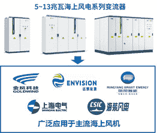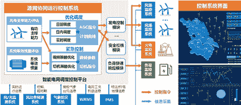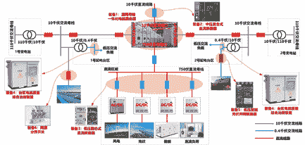

**大型多能源基地规划与协调控制关键技术及示范应用**

项目在大型多能源基地协同优化规划方法、电源优化运行技术、联合运行协调调度及控制策略三方面取得创新。提出的协同规划方法已在山西、山东等地应用。

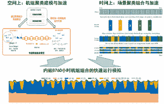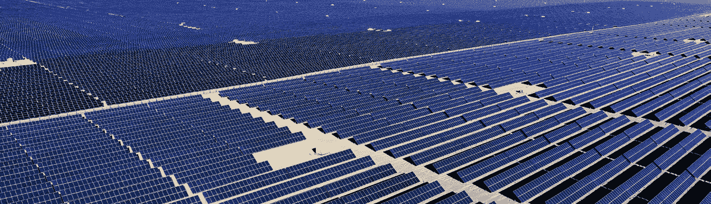

**园区多能互补系统高效运行关键技术及应用**

项目创建了多能耦合建模仿真理论，突破了园区级多能互补系统精细规划技术，攻克了园区多能系统自适应控制与协同优化技术。成果于2018 年10 月在阿里巴巴总部园区 - 绿色低碳数字化示范园区中首次整体应用，实现综合能效提升12.1%，用能成本下降12.4%。

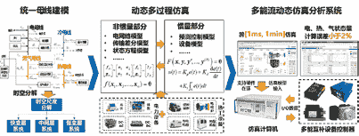

**标准体系逐步完善**

截至2023 年年底，公司累计主导或重点参与新能源类标准：国际标准 19 项，国家标准 120 项，行业标准 139 项，企业标准 130 项。

2023 年，主导或重点参与新能源类标准：国际标准 7 项，国家标准 17 项，行业标准 22 项，企业标准 12 项。

2023 年发布国家标准 17 项，企业标准 12 项。

截至2023 年年底国家电网有限公司主导或重点参与新能源类标准：

| 类别 | 国际标准 | 国家标准 | 行业标准 | 企业标准 |
| :--- | :--- | :--- | :--- | :--- |
| 通用类 | 6（2） | 3(0) | 9(2) | 13(2) |
| 风电类 | 1（0） | 26(4) | 44(8) | 30(5) |
| 光伏类 | 1（0） | 45(1) | 24(0) | 32(2) |
| 分布式电源及微电网类 | 7（4） | 15(1) | 9(0) | 31(3) |
| 储能类 | 4（1） | 31(11) | 53(12) | 24(0) |

注：括号中数据为2023 年新增数，括号外为截至2023 年年底数据。

**IEC 发布《以新能源为主体的零碳电力系统》白皮书**

2023 年6 月，由国网江苏电科院牵头编制的《以新能源为主体的零碳电力系统》白皮书正式发布，是我国参与IEC 国际标准工作取得的重要成果之一。

IEC 白皮书是IEC 为未来发展方向制定的战略性文件，也是IEC 国际标准的基础性、指导性文件。《以新能源为主体的零碳电力系统》白皮书阐述了零碳电力系统的驱动因素、与现有电力系统的区别、新技术发展趋势、实现路径等，探究了系统特性、关键技术和市场前景，将为相关领域的国际标准制定和标准体系构建提供重要参考。

**交流合作不断深化**

**与巴西总统卢拉会谈**

就支持巴西电力基础设施建设和能源绿色低碳转型，参与巴西电网基础设施智能化、数字化升级改造，服务巴西经济社会发展，推动中巴两国能源电力合作迈上新台阶开展合作交流。

**会见阿曼国有电力控股集团董事长苏比**

与阿曼电力同行深化交流合作，在电网安全稳定运行、新能源开发利用、抽水蓄能发展等方面加强合作，努力实现互利共赢，取得更多丰硕成果。

**参加2023 年太原能源低碳发展论坛**

围绕“智慧能源 绿色共赢”主题，介绍公司发挥央企“三个作用”，加快构建新型电力系统，助力新型能源体系规划建设的实践和展望。

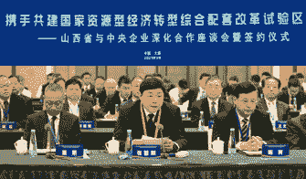

**召开服务新能源高质量发展暨沙戈荒大型风光基地建设专题工作会**

总结2023 年新能源并网消纳情况，研究部署2024 年及今后一段时期，国家电网有限公司服务新能源发展和消纳重点工作，持续加大沙戈荒大基地项目并网工作力度，服务新能源高质量发展。

积极参加交流活动，分享能源电力创新成果，共同应对气候变化，促进全球可持续发展。

## 行动与倡议

### 未来发展

立足电网功能定位、履行央企责任担当，国家电网有限公司将充分发挥“大国重器”和“顶梁柱”作用，把习近平总书记指示要求和党中央国务院决策部署落实到构建新型电力系统的行动之中，坚定不移走中国式现代化电力发展之路，努力争当能源清洁低碳转型的推动者、先行者、引领者。

新型电力系统承载着能源转型的历史使命，是清洁低碳、安全高效能源体系的重要组成部分，是以确保能源电力安全为基本前提，以满足经济社会发展电力需求为首要目标，以新型电网为枢纽平台，以源网荷储互动与多能互补为支撑，具有清洁低碳、安全充裕、经济高效、供需协同、灵活智能“五大特征”。

**2030 年前为加速转型期，重点是“保供应、促转型”**

- **能源碳排放达峰**：能源消费总量持续增长，新增能源需求主要依靠非化石能源满足，能源碳排放逐步达峰。
- **电源结构持续清洁化**：新能源开发集中式与分布式并举，逐步成为发电装机主体、发电量增量主体，藏东南等重点流域水电加快开发，沿海核电安全有序建设，煤电逐步向基础保障性和系统调节性电源并重转型。
- **新型电网建设加快推进**：跨省区输电规模持续扩大，区域主网架进一步加强，配电网承载能力和防灾抗灾能力不断提高，分布式、微电网快速发展，“大云物移智链”等数字化技术与能源电力技术充分融合，电网智能化水平显著提升。
- **电力需求较快增长**：电力消费进一步替代终端化石能源消费，电能替代稳步推进，终端电气化水平持续提高。负荷侧产消者不断涌现，需求响应规模不断扩大。
- **储能呈现多元化发展态势**：抽水蓄能作为调节电源主体加快发展，新型储能规模持续增长，以日内调节为主的多种新型储能技术路线并存，实现合理布局、高效利用、规范管理，逐步向高安全、大容量、长周期技术方向推进。
- **政策机制和市场建设稳步推进**：一次能源价格传导、系统备用调节、跨区输电等价格机制逐步建立健全，电碳市场衔接机制初步建立，中长期市场更加灵活高效，现货市场实现全面覆盖，分布式能源、虚拟电厂、储能、负荷聚合商等新型主体参与市场机制逐步形成，辅助服务市场、分时电能量、需求侧响应等市场价格体系不断完善，全国统一电力市场体系基本建成。重点行业逐步纳入全国碳交易市场。

预计2025 年、2030 年非化石能源消费占比分别达到 20%、25% 左右，电气化水平分别达到 30%、35% 左右。全国风光新能源装机占比分别超过 37%、45%，发电量占比分别超过 18%、25%。

### 国网行动

**坚持“六大原则”**

- **坚持底线思维，强化安全充裕**：安全第一、先立后破，在新能源安全可靠替代的基础上逐步退出传统能源。统筹考虑各类不确定性因素，加强前瞻性全局性系统性风险识别管控，提高电力供应安全充裕水平。
- **坚持绿色发展，强化高效利用**：推动减少化石能源消费，全力服务新能源高效开发利用，促进能耗双控逐步向碳排放双控转变，持续提升非化石能源消费比重。
- **坚持自身先行，强化节能降碳**：落实全面节约战略，推进企业生产、办公重点领域节能减排，实现公司碳排放率先达峰。充分发挥电网优化配置平台作用，推动能源供给清洁化、能源消费电气化，支撑全社会碳排放达峰。
- **坚持创新驱动，强化灵活智能**：充分发挥央企科技创新、产业控制、安全支撑作用，当好新型电力系统原创技术策源地、现代产业链链长，以应用需求为导向、以先行先试为关键，加快推进示范建设。推动电力流、业务流、数据流、价值流等多流合一，支撑各类能源灵活转化和互通互济，提高利用效率。
- **坚持改革引领，强化体制保障**：统筹电网转型与管理变革，优化企业管理模式。推动健全适应能源转型的市场机制、商业模式，推进价格、财税、投资、金融等配套政策支持，增强电力行业转型升级的内生动力。
- **坚持系统谋划，强化供需协同**：推动源网荷储多要素协同布局、高效互动，完善需求侧调节引导机制、绿电消费激励约束机制，提升用户侧主动响应能力。强化各项任务措施分解落实和统筹协调，加强宣传引导和开放合作，凝聚好政府、企业和社会等各方合力。

**实施“五大创新”**

- **加强理论创新**：抓住电力系统转型升级过程中的主要矛盾，创新能源电力基础理论体系，推动多学科交叉融合创新。
- **加强形态创新**：分析能源系统演化特点和趋势，发挥电网作用，促进源网荷储形态创新，加快推动能源互联网形态升级。
- **加强技术创新**：加快推动关键技术、核心产品迭代升级和新技术智慧赋能，完善知识产权与技术标准支撑体系，推动重大科技基础设施和平台建设。
- **加强产业创新**：打造深度耦合、高效协同的产业创新网络，推动基础产业、数字产业、新兴产业形成新的价值形态、协同模式和空间布局，实现新型电力系统产业链高质量发展。
- **加强组织创新**：发挥好新型电力系统技术创新联盟作用，加强各类要素、资源优化配置和协同配合，通过市场、机制、平台建设提升能源电力领域资源配置能力和管理效能。

**推进“十项工作”**

- 大力推动新能源高质量发展，提升电力安全绿色供给水平。
- 加强各级电网协调发展，提升资源优化配置水平。
- 加强电网数字化智能化建设，提升能源信息深度融合水平。
- 加强电力调控体系建设，提升电网安全运行水平。
- 加强调节能力建设，提升系统灵活互动水平。
- 加强全社会节能提效，提升能源综合利用水平。
- 加强负荷管理体系建设，提升精细管理水平。
- 加强配套政策机制建设，提升支持和保障水平。
- 加强高水平科技创新，提升技术支撑和产业发展水平。
- 加强统筹协调与管理创新，提升工作协同推进水平。

国家电网有限公司服务新能源发展报告 2024

82

## 行动与倡议

83

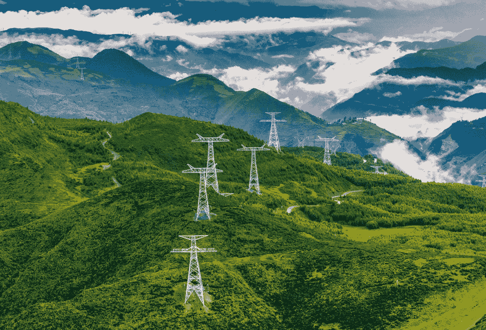

## 2023年国家电网有限公司服务新能源发展大事记

### 2月

金上—湖北±800千伏特高压直流输电工程开工。

### 3月

陇东—山东±800千伏特高压直流输电工程开工。

### 4月

印发《国家电网有限公司服务新时代新能源高质量发展工作方案》。

### 6月

宁夏—湖南±800千伏特高压直流输电工程开工。

### 8月

河南天池抽水蓄能电站全容量建成投运。

### 8月

哈密—重庆±800千伏特高压直流输电工程开工。

### 9月

山东文登抽水蓄能电站全容量建成投运。

### 9月

杭州第19届亚运会实现百分百绿电供应。

### 11月

国家电网经营区新能源累计装机容量突破8亿千瓦，年发电量突破1万亿千瓦时。

### 11月

召开服务新能源高质量发展暨沙戈荒大型风电光伏基地建设专题工作会。

### 12月

西北电网新能源发电装机容量超2亿千瓦，占比超过西北电网发电总装机规模的50%。
