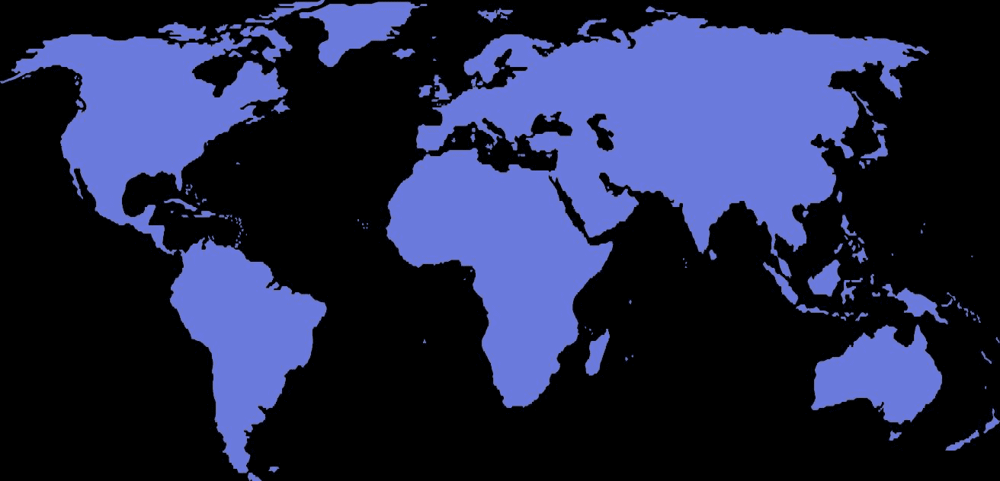
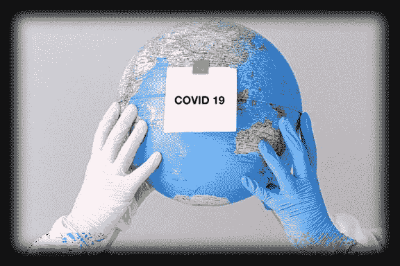
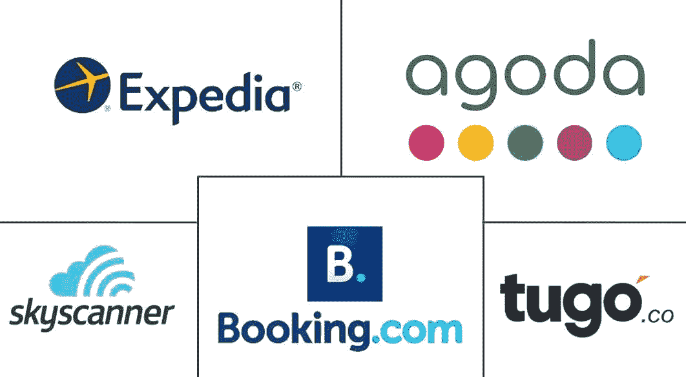
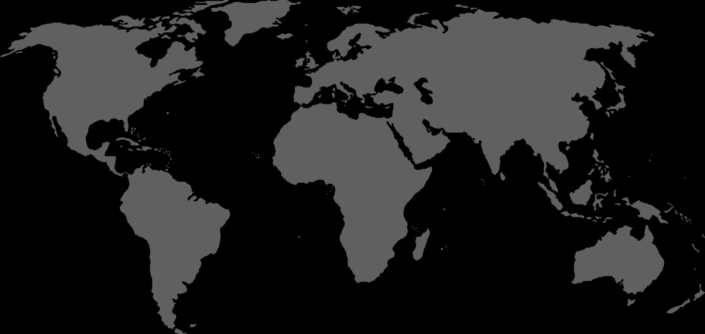

2024

# 越南旅游业行业洞察

## 报告要点

- 2013-2028年越南旅游业占GDP的比重
- 2010-2023年越南旅游业年收入
- 2019-2028年越南旅游市场人均收入
- 2015-2022年越南主要省份旅游收入

【出海广告，就选维卓】

关注我们，获取最新出海营销干货报告

© 2023 Wezo. - All Rights Reserved

# 目录

## 1. 数据概览

- 亚太地区旅游支出
- 收益数据
- 市场份额

## 2. 主要指标

- 商品&服务收入
- 旅游收入

## 3. 旅游中介

- 游客数量
- 中介数据
- 线上中介

## 4. 住宿

- 越南游客住宿数量
- 住宿房间数量
- 接待游客数量&收益

## 5. 消费者视角

- 越南旅游吸引力
- 预算&偏好
- 常见问题

# 第01章 数据概览

## 1. 数据概览

### 亚太地区旅游支出

**2022年亚太地区旅行和旅游业对就业的直接贡献**

（按国家或地区划分）（单位：百万）

0　10　20　30　40　50　60　70

62.9  
37.21  
11.44  
7.82  
6.99  
5.09  
4.23  
4.1  
2.14  
2.09  
2.06  
1.33  
1.26  
1.08  
0.95  

中国  
印度  
印度尼西亚  
菲律宾  
泰国  
日本  
越南  
巴基斯坦  
马来西亚  
柬埔寨  
孟加拉国  
澳大利亚  
韩国  
尼泊尔  
缅甸  

**2022年亚太地区国际旅游支出额，按国家或地区划分**

（单位：十亿美元）

0　5　10　15　20　25　30　35

中国  
印度  
新加坡  
泰国  
韩国  
澳门  
印度尼西亚  
菲律宾  
越南  
香港  
马尔代夫  
澳大利亚  
马来西亚  
日本  
台湾  

来源：WTTC

## 1. 数据概览

### 亚太地区旅游支出

作为亚太地区的主导产业之一，2022年旅行和旅游业为中国提供了近6300万个就业岗位，这并不奇怪。同样，得益于旅行和旅游市场，印度也创造了天文数字的就业机会，其中创造了惊人的3700万个就业岗位。事实上，许多亚太国家在旅行和旅游业创造的就业机会方面名列全球第一。

2022年，中国是亚太地区国际游客支出最高的国家，其国际旅游支出接近300亿美元。相比之下，2022年韩国的国际旅游支出约为143亿美元。

## 1. 数据概览

### 亚太地区旅游支出

**2022年亚太地区旅行和旅游业对就业的直接贡献**

（按国家或地区划分）（单位：百万）

0　10　20　30　40　50　60　70

62.9  
37.21  
11.44  
7.82  
6.99  
5.09  
4.23  
4.1  
2.14  
2.09  
2.06  
1.33  
1.26  
1.08  
0.95  

中国  
印度  
印度尼西亚  
菲律宾  
泰国  
日本  
越南  
巴基斯坦  
马来西亚  
柬埔寨  
孟加拉国  
澳大利亚  
韩国  
尼泊尔  
缅甸  

作为亚太地区的主导产业之一，2022年旅行和旅游业为中国提供了近6300万个就业岗位，这并不奇怪。同样，得益于旅行和旅游市场，印度也创造了天文数字的就业机会，其中创造了惊人的3700万个就业岗位。事实上，许多亚太国家在旅行和旅游业创造的就业机会方面名列全球第一。

来源：WTTC

## 1. 数据概览

### 收益数据

**2013-2028年越南旅游业占GDP的比重**

6.46  
6.33  
6.6  
6.69  
6.79  
6.96  
7.01  
7.32  
7.35  
7.39  
7.41  

GDP占百分比

来源：Statista；Vietnam National Administration of Tourism

**2010-2023年越南旅游业年收入**

旅游收入（万亿越南盾）

2010　2011　2012　2013　2014　2015　2016　2017　2018　2019　2020　2021　2022　2023

130  
160  
289.84  
322.86  
355.55  
417.27  
637  
541  
755  
312  
180  
495  
678.3  

预计2023年至2028年，越南旅游业占GDP的比重将持续增长，总计增加1.9个百分点。预计到2028年，这一份额将达到7.41%。虽然预计未来几年这一份额将大幅增加，但未来增长将放缓。

2023年，越南旅游业的收入约为678.3万亿越南盾。该国的旅游收入一直在逐年增长，但在2020年由于COVID-19全球疫情的影响而大幅下降。不过，在长期受到疫情限制影响后，该国旅游业已出现复苏迹象。

## 1. 数据概览

### 市场份额

**2023年亚太地区在线旅游市场规模（按国家）**

（单位：十亿美元）

新加坡：7  
印度尼西亚：6  
越南：5  
泰国：5  
马来西亚：4  
菲律宾：3  

2023年，新加坡在线旅游市场规模在部分东南亚国家中最高，其商品总价值（GMV）达到70亿美元。相比之下，同年菲律宾在线旅游市场规模为30亿美元。

来源：Bain & Company；Google；Temasek Holdings

# 第02章 主要指标

本报告来源于三个皮匠报告站（www.sgpjbg.com），由用户Id:549683下载，文档Id:184513，下载日期：2024-12-13

## 2. 主要指标

### 商品&服务收入

**2023年越南商品和服务零售额，按行业划分**

（单位：万亿越南盾）

| 行业 | 零售额 |
|---|---:|
| 零售 | 4,858.62 |
| 住宿及餐饮服务 | 673.53 |
| 旅游服务 | 37.78 |
| 其他服务 | 661.91 |
| 全服务类型 | 6,231.83 |

**2019-2023年越南在线旅游行业的年度商品交易额（GMV），以及2025年的预测**

（单位：十亿美元）

交易额（十亿美元）

2019　2021　2022　2023　2025*

2023年，越南零售额预计将达到约4859万亿越南盾，其次是住宿和餐饮服务业，销售额约为674万亿越南盾。当年，消费品和服务零售总额预计将超过6231万亿越南盾。

2023年，越南在线旅游行业的年度商品交易额（GMV）约为50亿美元，较上年有所增长。当年，全国互联网经济总GMV约300亿美元。

## 2. 主要指标

### 旅游收入

**2015-2022年越南主要省份旅游收入**

（单位：十亿越南盾）

| 地区 | 2018 | 2019 | 2020 | 2021 | 2022* |
|---|---:|---:|---:|---:|---:|
| Ho Chi Minh City | 24218.9 | 26834.5 | 7996.7 | 3350.6 | 17735.8 |
| Ha Noi | 9273.7 | 10145.5 | 5184.4 | 3382.0 | 10054.7 |
| Da Nang | 1905.6 | 2113.3 | 563.8 | 635.7 | 2267.1 |
| Khanh Hoa | 477.5 | 544.5 | 245.1 | 166.4 | 1376.5 |
| Quang Ninh | 783 | 916.7 | 622.3 | 390.7 | 608.5 |
| Kien Giang | 316.5 | 348.8 | 186 | 166.3 | 443.9 |
| Quang Binh | 284.2 | 300.3 | 125.4 | 52.4 | 230.6 |
| Hai Phong | 232.5 | 250.7 | 183.2 | 89.1 | 217 |
| Ba Ria - Vung Tau | 314.4 | 353.3 | 156.7 | 86.9 | 206 |
| Thanh Hoa | 108.6 | 119 | 80.2 | 25.8 | 176.3 |
| Can Tho | 189 | 214.2 | 64.3 | 35.9 | 176.3 |
| Thai Nguyen | 32.4 | 36.7 | 18 | 29.7 | 170.8 |
| Quang Nam | 439 | 476.3 | 93 | 75.3 | 139.8 |
| Phu Tho | 16.4 | 19.2 | 17.4 | 3.8 | 141.6 |

来源：General Statistics Office of Vietnam；Statista；Statista Consumer Market Insights

**2019-2028年越南旅游市场人均收入**

（美元）

来自每个用户的平均收入

2019　2020　2021　2022　2023　2024　2025　2026　2027　2028

224.73  
224.46  
246.19  
241.55  
243.79  
258.01  
265.31  
272.2  
278.76  
285.02  

## 2. 主要指标

- 旅游收入

- 2022年，越南胡志明市旅游收入超过17.7万亿越南盾，比上年增长五倍。越南首都河内当年也是该国旅游收入领先的目的地之一。

  经过COVID-19全球疫情的长期影响后，越南已显示出复苏的迹象。

- 预计2024—2028年间，越南旅游市场的每用户平均收入（ARPU）将持续增长27美元（+10.46%）。在连续第六年增长后，该指标预计将在2028年达到285.02美元，并创下新高。

## 第03章 旅游中介

## 3. 旅游中介

- 游客数量

### 2016—2023年越南国际游客人数

10

12.9

15.5

3.84

0.16

3.66

12.6

2

4

6

8

0

2016

2017

2018

2019

2020

2021

2022

2023

10

12

14

16

18

20

18

国际游客人数（百万）

10,950.5

1,525.8

126.1

12,602.4

### 2023年抵达越南的国际游客数量，按交通方式分类

（千人）

0

2,000

4,000

6,000

8,000

10,000

12,000

14,000

飞机

陆上交通

海上交通

总交通方式

来源：General Statistics Office of Vietnam

## 3. 旅游中介

- 游客数量

- 2023年，越南国际游客总数达到约1,260万人次。在COVID-19大流行之前，越南在2019年接待了1,800万名国际游客，创下该国创纪录的数字，自2016年以来游客人数同比健康增长。2022年3月，该国取消了旅行限制，希望协助旅游业复苏。

- 2023年，乘飞机抵达越南的国际游客（ITA）约为1,095万人次。越南总共接待了超过1,260万海外游客。相比之下，该国2019年的ITA数量超过1,800万人次。自2022年以来，随着COVID-19大流行限制的放松，该国的旅游业已显示出复苏的迹象。

## 3. 旅游中介

- 游客数量

### 2023年越南国际游客人数（ITA），按国家和地区划分

（以千为单位）

0

500

1,000

1,500

2,000

2,500

3,000

3,500

4,000

70.09

中国大陆

1,743.2

144.68

韩国

3,595.06

140

132.84

日本

台湾

马来西亚

泰国

新加坡

589.52

851.02

470.11

489.17

328.2

120

100

80

117.04

102.2

90.57

77.86

108.2

101.3

78.08

柬埔寨

菲律宾

402.06

153.17

60

57.9（61.41）

48.95

老挝

印度尼西亚

120.52

105.38

40

印度

392.14

20

其他亚洲国家和地区

541.64

美国

717.07

0

加拿大

133.49

160

国内入境人数（百万）

### 2010—2023年越南国内游客人数

180

162.05

来源：General Statistics Office of Vietnam

## 3. 旅游中介

- 游客数量

- 2023年，越南接待韩国游客近360万人次，是所有国家和地区中入境人数最多的国家和地区，其次是中国大陆和台湾地区。从COVID-19疫情中恢复后，该国2023年总共接待了约1,260万名国际游客，比上一年增加了四倍。

- 2023年，越南国内游客人数约为1.082亿人次，较上年逐步增长。在受到COVID-19疫情限制的长期影响后，该国的旅游业已显示出复苏的迹象。

## 3. 旅游中介

- 游客数量

433.4

461

429.6

404.5

390.7

493

588.8

698.3

777.9

844.8

2.4

88

94.4

100

200

300

400

0

2010

2011

2012

2013

2014

2015

2016

2017

2018

2019

2020

2021

2022*

500

600

700

800

900

### 2010—2022年越南出境旅游人数

出境旅游人数（万人）

来源：General Statistics Office of Vietnam

- 2022年，越南出境旅游人数超过9.44万人次。2013年至2019年，越南出境旅游人数逐年增加。然而，由于COVID-19全球疫情及其相关旅行限制的影响，这一数字在2020年和2021年大幅下降。从2022年开始，随着疫情得到控制和边境重新开放，越南旅游业预计将出现反弹。

## 3. 旅游中介

- 中介数据

### 2019—2023年越南国际旅行社数量

1,132

1,305

1,600

1,456

0

200

400

600

800

1,000

1,200

1,400

2019

2022

2023

旅行中介数量

9.29

11.06

11.79

5.79

3.32

7.39

0

2

4

6

8

10

12

### 2015—2022年越南旅行社接待的国内游客数量

14

2015

2018

2019

2020

2021

2022*

游客数量（百万）

来源：Vietnam National Administration of Tourism

## 3. 旅游中介

- 中介数据

- 2023年，越南国际旅行社数量约为1,500家，较上年有所增加。同年，全国旅游住宿场所约3.8万个。

- 2022年，越南旅行社接待国内游客约740万人次，较上年大幅增长。经过COVID-19全球疫情的长期影响后，越南的旅游和住宿业已显示出复苏的迹象。

## 3. 旅游中介

- 中介数据

### 2015—2022年越南旅行社接待的国际游客数量

7

2.82

5.13

6

5.73

2.52

0.25

2.6

0

1

2

3

4

5

2015

2018

2019

2020

2021

2022*

游客数量（百万）

30.44

36.11

40.37

16.49

9

35.45

0

5

10

15

20

25

30

35

40

45

### 2015—2022年越南旅行社总收入

50

44.67

2015

2017

2018

2019

2020

2021

2022*

收入（万亿越南盾）

来源：General Statistics Office of Vietnam

## 3. 旅游中介

- 中介数据

- 2022年，越南旅行社接待国际游客约260万人次，较上年大幅增长。经过COVID-19全球疫情的长期影响后，越南的旅游和住宿业已显示出复苏的迹象。

- 2022年，越南旅行社总收入达35.45万亿越南盾，较上年大幅增长。2020年至2021年，越南的旅游和住宿业受到COVID-19全球疫情的不利影响。

## 3. 旅游中介

- 线上中介

### 2019—2028年越南旅游市场在线收入占比

50.32%

52.19%

53.73%

55.19%

56.8%

58.57%

60.32%

62.09%

63.9%

65.73%

0%

10%

20%

30%

40%

50%

60%

70%

2019

2020

2021

2022

2023

2024

2025

2026

2027

2028

收入占比

64%

55%

56%

38%

24%

30%

31%

41%

12%

15%

12%

21%

21%

20%

42%

0%

40%

60%

37%

80%

100%

120%

16—24岁

25—34岁

35—44岁

45—54岁

55岁及以上

受访者比例

### 截至2023年6月，越南在线旅行社使用情况（按年龄组）

使用

不使用

不知道什么是线上旅行社

来源：Statista；Statista Mobility Market Insights；Rakuten Insight

- 预计2024年至2028年，越南“旅行和旅游”市场的在线销售收入将持续增长，总计7.2个百分点。在连续第九年增长后，该指标预计将在2028年达到65.73%，并创下新的峰值。值得注意的是，“旅游”市场在线销售的“销售渠道”指标在过去几年中持续增长。

- Rakuten Insight于2023年6月对在线旅行社（OTA）进行的一项调查显示，25至34岁的越南受访者中，64%曾使用过在线旅行社。相比之下，16至24岁的受访者中有42%选择了相同的答案。

## 3. 旅游中介

### 线上中介

截至2023年6月越南领先的在线旅行社

| 在线旅行社 | 占比 |
|---|---:|
| Booking.com | 61% |
| Traveloka | 60% |
| Agoda | 54% |
| Trivago | 30% |
| TripAdvisor | 19% |
| Airbnb | 13% |
| Expedia | 9% |
| Skyscanner | 9% |
| Tugo | 6% |
| Others | 1% |

来源：Rakuten Insight

截至2023年6月在越南使用在线旅行社的原因

| 原因 | 占比 |
|---|---:|
| 方便易用——可以在几分钟内在线预订所需的一切 | 73% |
| 在线旅行社有特别优惠和折扣 | 54% |
| 可以灵活地决定何时预订门票/服务 | 48% |
| 会员帐户可以收集奖励积分 | 32% |
| 相信在线旅行社的报价 | 27% |
| 能够比较不同服务提供商之间的价格和评论并选择最适合的一个 | 23% |
| 其他原因 | 1% |

## 3. 旅游中介

### 线上中介

- 根据2023年6月进行的在线旅行社（OTA）使用情况调查，61%的受访者选择Booking.com，是越南使用的领先在线旅行社。Traveloka紧随其后，因为60%的受访者之前曾使用过该机构。

- Rakuten Insight于2023年6月对在线旅行社（OTA）进行的一项调查显示，73%的越南受访者表示，方便和易用是使用在线旅行社的主要原因。第二受欢迎的原因是在线旅行社的特别优惠和折扣。

## 第04章 住宿

## 4. 住宿

### 越南游客住宿数量

2019—2023年越南旅游住宿数量

| 年份 | 住宿数量（千） |
|---|---:|
| 2019 | 30 |
| 2022 | 35 |
| 2023 | 38 |

2018—2023年越南五星级旅游住宿数量

| 年份 | 住宿数量 |
|---|---:|
| 2018 | 142 |
| 2019 | 165 |
| 2022 | 224 |
| 2023 | 247 |

来源：Vietnam National Administration of Tourism

## 4. 住宿

### 越南游客住宿数量

- 2023年，越南旅游住宿量达到约3.8万个。当年，全国旅游住宿客房数量约78万间。

- 2023年，越南有247家五星级旅游住宿，比上年增加。与此同时，当年全国有386家四星级酒店。

## 4. 住宿

### 越南游客住宿数量

2018—2023年越南四星级旅游住宿数量

| 年份 | 住宿数量 |
|---|---:|
| 2018 | 272 |
| 2019 | 302 |
| 2022 | 345 |
| 2023 | 386 |

- 2023年，越南四星级旅游住宿数量约386家，较上年有所增加。与此同时，当年全国共有五星级旅游住宿247家。

来源：Vietnam National Administration of Tourism

## 4. 住宿

### 住宿房间数量

2019—2023年越南旅游住宿房间数量

| 年份 | 房间数量（千） |
|---|---:|
| 2019 | 650 |
| 2022 | 700 |
| 2023 | 780 |

2018—2023年越南四星级旅游住宿房间数量

| 年份 | 房间数量（千） |
|---|---:|
| 2018 | 36.01 |
| 2019 | 40.09 |
| 2022 | 46.28 |
| 2023 | 50.72 |

来源：Vietnam National Administration of Tourism

## 4. 住宿

### 住宿房间数量

- 2023年，越南旅游住宿客房数量约为78万间。截至2023年，全国旅游住宿量达约3.8万个。

- 2023年，越南四星级旅游住宿客房数量达到约5.07万间。截至2023年，全国四星级旅游住宿点约386家。

## 4. 住宿

### 住宿房间数量

2018—2023年越南五星级旅游住宿房间数量

| 年份 | 房间数量（千） |
|---|---:|
| 2018 | 47.91 |
| 2019 | 55.05 |
| 2022 | 74.84 |
| 2023 | 80.9 |

- 2023年，越南五星级旅游酒店客房数量约8.09万间。截至2023年，全国五星级旅游住宿点约247家。

来源：Vietnam National Administration of Tourism

## 4. 住宿

### 接待游客数量&收益

2018—2022年越南住宿机构接待的游客数量

| 年份 | 游客数量（百万） |
|---|---:|
| 2018 | 54.38 |
| 2019 | 159.64 |
| 2020 | 63.6 |
| 2021 | 85.3 |
| 2022* | 135.43 |

2017—2022年越南住宿机构总收入

| 年份 | 收入（万亿越南盾） |
|---|---:|
| 2017 | 23.69 |
| 2018 | 38.6 |
| 2019 | 59.2 |
| 2020 | 67.02 |
| 2021 | 54.38 |
| 2022* | 57.79 |

来源：General Statistics Office of Vietnam

## 4. 住宿

### 接待游客数量&收益

- 2022年，越南的住宿场所接待了约1.354亿名游客，其中包括国际和国内游客，较上年大幅增长。越南的旅游和住宿业在受到COVID-19全球疫情的负面影响后已显示出复苏的迹象。

- 2022年，越南住宿机构总收入超过57.8万亿越南盾，较上年大幅增长。2020年至2021年，越南的旅游和住宿业受到COVID-19全球疫情的不利影响。

## 第05章 消费者视角

## 5. 消费者视角

### 越南旅游吸引力

截至2023年4月，越南消费者旅行的主要原因

| 原因 | 占比 |
|---|---:|
| 为了更健康的生活 | 35% |
| 沉浸在当地文化 | 30% |
| 旅游吃饭 | 29% |
| 放松 | 20% |
| 为了逃避现实 | 20% |
| 学习 | 16% |
| 为了与人一起寻求新的体验 | 15% |
| 去完成愿望清单 | 6% |

截至2023年4月越南消费者首选的旅游地点和活动

| 旅游地点或活动 | 占比 |
|---|---:|
| 岛屿和海滩 | 61% |
| 城市 | 60% |
| 体育和体育活动 | 45% |
| 健康和保健治疗 | 43% |
| 当地文化和生活方式 | 42% |
| 历史和传统 | 38% |
| 食物和餐饮 | 34% |
| 购物 | 31% |
| 自然风光 | 30% |
| 酒吧和夜生活 | 29% |
| 艺术和博物馆 | 23% |
| 旅游景点和地标 | 19% |

来源：Booking.com；Milieu Insight

## 5. 消费者视角

### 越南旅游吸引力

- 根据2023年进行的一项调查，35%的受访者表示，为了更健康的生活而旅行是越南消费者出行的最重要原因。与此同时，约6%的越南受访者证实，他们前往越南是为了完成自己的愿望清单。

- 根据2023年进行的一项调查，约61%的越南受访者表示他们更喜欢去岛屿和海滩旅行。相比之下，约60%的受访者确认城市是他们最喜欢的旅游地点。约31%的受访者更喜欢在旅行时购物。

## 5. 消费者视角

### 预算&偏好

截至2023年4月，越南消费者每晚国内住宿的首选预算（单位：越南盾）

| 预算 | 占比 |
|---|---:|
| 高达50万 | 15% |
| 50万—100万 | 29% |
| 100万—200万 | 19% |
| 200万—400万 | 21% |
| 400万以上 | 15% |

来源：Booking.com；Milieu Insight；Standard Insights

截至2023年1月，最受越南消费者欢迎的亚洲旅游目的地

| 目的地 | 占比 |
|---|---:|
| 越南 | 24.39% |
| 韩国 | 20.53% |
| 日本 | 18.6% |
| 新加坡 | 13.86% |
| 中国 | 8.07% |
| 泰国 | 7.54% |
| 香港 | 2.11% |
| 菲律宾 | 0.88% |
| 缅甸 | 0.88% |
| 马来西亚 | 0.53% |
| 老挝 | 0.18% |
| 印度尼西亚 | 0.18% |
| 其他的 | 2.28% |

## 5. 消费者视角

### 预算&偏好

- 根据2023年进行的一项调查，约29%的越南受访者表示，他们更愿意支付每晚50万至100万越南盾（VND）的国内住宿费用。与此同时，约15%的受访者愿意花费超过400万越南盾每晚的国内住宿费用。

- 根据2023年在越南进行的一项调查，约24.4%的受访者倾向于在该国境内旅行。此外，韩国和日本是第二受欢迎的目的地，分别有20.53%和18.6%的参与者表示偏好这些国家。

© 2023 Wezo. - All Rights Reserved

## 5. 消费者视角

### 预算&偏好

截至2023年1月，越南游客最常见的旅行担忧

| 担忧事项 | 比例 |
|---|---:|
| 旅游价格上涨 | 58.07% |
| 健康和安全相关问题 | 45.44% |
| 需要了解并了解规则和规定 | 23.86% |
| 愿意出行的人口太多 | 9.47% |
| 可用于旅行的航班和交通数量较少 | 6.84% |
| 其他 | 2.28% |

来源：Standard Insights

- 根据2023年在越南进行的一项调查，约58.1%的受访者对旅行成本不断上涨表示担忧。此外，约45.4%的参与者对与旅行相关的健康和安全问题感到焦虑。

© 2023 Wezo. - All Rights Reserved

## 数据来源

Bain & Company

Booking.com

General Statistics Office of Vietnam

Google

Milieu Insight

OECD

Rakuten Insight

Standard Insights

Statista

Statista Consumer Market Insights

Statista Mobility Market Insights

Temasek Holdings

Vietnam National Administration of Tourism

WTTC

## 版权声明

© 2023 Wezo. - All Rights Reserved

- 本报告著作权由维卓出海研究院整理而成，部分数据、文字或图片素材采集于公开信息，仅为说明问题之引用，所有权为原作者所有。

- 未经允许，不得以任何形式或手段复制、抄袭、影印、翻译本报告的任何部分。

- 凡转载、摘编或利用其他方式使用本报告文字、数据、观点的，应注明来源（WEZO维卓公众号），同时不能删减或改写内容。

- 报告内容仅供一般性参考，不能用于商业用途，不应视为针对特定事务的意见或依据。

- 若有业务输出需求，欢迎联系维卓商务经理：18630366650（郭先生）。

## 关于维卓出海研究院

WEZO维卓旗下行业研究分析品牌，致力于通过科学、有效的研究体系，帮助中国出海企业洞察全球数字营销行业发展脉络，把握出海增长机遇，为出海企业提供持续、长效的发展价值。

目前，我们已成功发布20+份精心打造的行业报告，涵盖电商、游戏、移动应用、品牌客户等多个领域。欢迎下载报告，与我们一同探索全球市场的机遇与未来！

## 服务客户

洞悉全球，发掘商机

© 2023 Wezo. - All Rights Reserved

【智慧营销 驱动未来】

关注我们，获取最新出海营销干货报告

出海广告就选维卓
