请务必仔细阅读正文之后的评级说明和重要声明

证券研究报告

北交所

行业定期报告

投资评级：无

证券分析师

赵昊

SAC：S1350524110004

zhaohao@huayuanstock.com

万枭

SAC：S1350524100001

wanxiao@huayuanstock.com

联系人

板块表现：

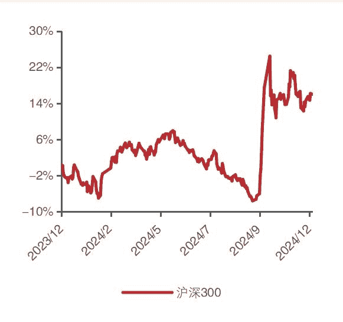

# 千帆星座第三批组网卫星成功发射加速组网，关注北交所卫星产业相关公司

——北交所科技成长产业跟踪第四期（20241208）

## 投资要点

千帆星座在轨卫星数量增至54颗，组网进度加快。近日，卫星产业链发生两件大事：

1. 2024年12月5日，千帆星座第三批组网卫星以“一箭18星”的方式成功发射，卫星顺利进入预定轨道，所有卫星状态正常，发射任务取得圆满成功；
2. 2024年11月28日上午，中国卫星导航系统管理办公室在北京召开纪念北斗卫星导航系统工程建设三十周年座谈会，《北斗卫星导航系统2035年前发展规划》在会上发布。我国计划2025年完成下一代北斗系统关键技术攻关；2027年左右发射3颗先导试验卫星，开展下一代新技术体制试验；2029年左右开始发射下一代北斗系统组网卫星，2035年完成下一代北斗系统建设。

2023年我国卫星互联网产业规模超过330亿元，世界各国低轨星座计划发展迅速，低轨巨型星座已成为全球争夺空间战略资源的“新战场”。北交所中含7家卫星产业概念企业：富士达（射频同轴连接器、射频同轴电缆组件）、天力复合（卫星用过渡接头）、创远信科（卫星通信测试仪器设备）、晟楠科技（军用电源相关产品）、星辰科技（高端伺服系统、智能控制系统）、通易航天（军用特种航空制品等新材料）、七丰精工（紧固件）。

## 总量：北交所科技成长股股价涨跌幅中值-0.58%

2024年12月2日至12月6日，北交所科技成长产业143家企业整体下调，区间涨跌幅中值为-0.58%，其中上涨公司达64家，恒进感应（+40.57%）、邦德股份（+26.11%）、万达轴承（+21.63%）、泰德股份（+14.29%）、铁大科技（+13.31%）位列涨跌幅前五。北证50、沪深300、科创50、创业板指周度涨跌幅分别为+0.86%、+1.44%、+0.70%、+1.94%。

## 行业：北交所新能源产业市盈率TTM中值+9%至47.5X

电子设备产业PE TTM中值由53.7X降至50.5X，市值中值由22.80亿元升至23.66亿元，铁大科技（+13.31%）、微创光电（+13.00%）涨跌幅居前。机械设备产业PE TTM中值由47.7X升至49.0X，市值中值由18.90亿元降至18.28亿元，恒进感应（+40.57%）、万达轴承（+21.63%）涨跌幅居前。信息技术产业PE TTM中值由57.9X降至55.1X，市值中值由24.96亿元降至24.09亿元，流金科技（+5.63%）、路桥信息（+4.50%）涨跌幅居前。汽车产业PE TTM中值由26.0X升至27.0X，市值中值由18.45亿元升至19.09亿元，邦德股份（+26.11%）、泰德股份（+14.29%）涨跌幅居前。新能源产业PE TTM中值由43.4X升至47.5X，市值中值由25.27亿元升至25.78亿元，长虹能源（+11.33%）、许昌智能（+9.41%）涨跌幅居前。本周机械设备、汽车、新能源产业市盈率TTM中值分别升高3%、4%、9%至49.0X、27.0X、47.5X。

## 公告：众诚科技中标“新乡市大数据云平台服务项目”

众诚科技：公司成功中标“新乡市大数据云平台服务项目”，中标价5,052.07万元（含税，实际金额以合同为准）。

华信永道：公司成功中标深圳市住房公积金管理中心新一代财务管理系统项目，最终用户为“深圳市住房公积金管理中心”，中标金额为6,984,000.00元（含税）。

## 风险提示

宏观经济环境变动风险、市场竞争风险、资料统计误差风险。

2024年12月10日

源引金融活水润泽中华大地

# 内容目录

1. 千帆星座在轨卫星数量增至54颗，组网进度加快 ....................................................... 5

1.1. 千帆星座第三批组网卫星以“一箭18星”方式成功发射 ........................................ 5

1.2. 低轨巨型星座已成为全球争夺空间战略资源的“新战场” ....................................... 7

2. 总量：北交所科技成长股股价涨跌幅中值-0.58% ..................................................... 11

3. 行业：北交所新能源产业市盈率TTM中值+9% ......................................................... 12

4. 公告：众诚科技中标市级大数据云平台服务项目 ....................................................... 17

5. 风险提示 ..................................................................................................................... 17

# 图表目录

图表1：2024年12月5日千帆星座第三批组网卫星以“一箭18星”的方式成功发射 ..... 5

图表2：“千帆星座”计划2030年完成第三阶段目标 .................................................... 5

图表3：2024年11月28日，《北斗卫星导航系统2035年前发展规划》发布 ............. 6

图表4：北斗卫星具有系统兼容、操作便利、卫星数量多等优势（单位：颗） .............. 7

图表5：2023年全球航天产业、卫星产业收入概况 ........................................................ 7

图表6：卫星互联网按轨道高度以及按频段分布的分类情况 ........................................... 8

图表7：卫星互联网行业收入结构中，卫星电视直播业务收入占比最高 ......................... 9

图表8：截至2024年4月，卫星互联网卫星规划总数量近1.6万颗 .............................. 9

图表9：2023年我国卫星互联网产业规模超过330亿元人民币 ................................... 10

图表10：北交所中包含7家卫星产业概念企业 ............................................................. 10

图表11：北交所科技成长产业企业区间涨跌幅中值为-0.58% ...................................... 11

图表12：恒进感应、邦德股份、万达轴承等企业本周涨跌幅居前 ................................. 11

图表13：北交所电子设备产业PE TTM中值降至50.5X ............................................... 12

图表14：50~100X区间内的企业数量减至9家（家） ................................................... 12

图表15：北交所电子设备产业总市值降至1212亿元（家） ........................................ 12

图表16：铁大科技、微创光电等市值涨跌幅居前 .......................................................... 12

图表17：北交所机械设备产业PE TTM中值升至49.0X ............................................... 13

图表18：20~30X区间内的企业数量减至8家（家） ................................................... 13

图表19：北交所机械设备产业总市值降至863亿元（家） .......................................... 13

图表20：恒进感应、万达轴承等市值涨跌幅居前 .......................................................... 13

图表21：北交所信息技术产业PE TTM中值降至55.1X ............................................... 14

图表22：50~100X区间内的企业数量减至5家（家） ................................................. 14

图表23：北交所信息技术产业总市值降至744亿元（家） ........................................... 14

图表24：流金科技、路桥信息等市值涨跌幅居前 .......................................................... 14

图表25：北交所汽车产业PE TTM中值升至27.0X ...................................................... 15

图表26：30~50X区间内的企业数量增至4家（家） ................................................... 15

图表27：北交所汽车产业总市值增至464.75亿元（家） ............................................. 15

图表28：邦德股份、泰德股份等市值涨跌幅居前 .......................................................... 15

图表29：北交所新能源产业PE TTM中值升至47.5X .................................................. 16

图表30：50~100X区间内的企业数量增至5家（家） ................................................. 16

图表31：北交所新能源产业总市值增至472.86亿元（家） ......................................... 16

图表32：长虹能源、许昌智能等市值涨跌幅居前 .......................................................... 16

图表33：众诚科技中标“新乡市大数据云平台服务项目”，中标价5,052.07万元 ..... 17

# 1. 千帆星座在轨卫星数量增至54颗，组网进度加快

## 1.1. 千帆星座第三批组网卫星以“一箭18星”方式成功发射

### 千帆星座：将于2025年开始在全球范围内提供卫星互联网商业服务

2024年12月5日12时41分，在太原卫星发射中心，千帆星座第三批组网卫星以“一箭18星”的方式成功发射，卫星顺利进入预定轨道，所有卫星状态正常，发射任务取得圆满成功。至此，千帆星座在轨卫星数量增至54颗，能够为地面提供的连续通信能力进一步提升。

千帆星座组网卫星的航班化、常态化发射，也是我国平板式卫星堆叠“一箭多星”发射技术的业务化应用实践，为后续更多数量卫星的堆叠发射奠定基础。千帆星座的组网进度正在进一步加快，将于2025年开始在全球范围内提供卫星互联网商业服务，为交通运输、新能源、智慧城市、智慧农业、应急救灾、低空经济等领域赋能。

图表1：2024年12月5日千帆星座第三批组网卫星以“一箭18星”的方式成功发射

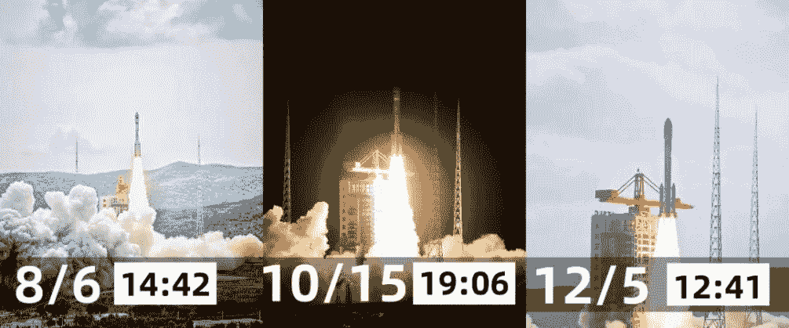

资料来源：垣信卫星公众号、华源证券研究所

“千帆星座”计划从2023年启动，星座包含三代卫星系统，采用全频段、多层多轨道星座设计，目的是满足不同地区用户的不同需求，提供广泛稳定的通信服务。第一阶段到2025年底，实现648颗星提供区域网络覆盖；第二阶段到2027年底，648颗星提供全球网络覆盖；第三阶段到2030年底，实现15,000颗星提供手机直连多业务融合服务。

图表2：“千帆星座”计划2030年完成第三阶段目标

| 阶段 | 时间 | 计划内容 |
|---|---|---|
| 第一阶段 | 到2025年底 | 实现648颗星提供区域网络覆盖 |
| 第二阶段 | 到2027年底 | 实现648颗星提供全球网络覆盖 |
| 第三阶段 | 到2030年底 | 实现15,000颗星提供手机直连多业务融合服务 |

资料来源：36氪、上海垣信卫星科技有限公司、财联社、华源证券研究所

## 1.1.1. 北斗卫星：《北斗卫星导航系统2035年前发展规划》发布

2024年11月28日上午，中国卫星导航系统管理办公室在北京召开纪念北斗卫星导航系统工程建设三十周年座谈会，《北斗卫星导航系统2035年前发展规划》在会上发布。《北斗卫星导航系统2035年前发展规划》提出，未来在确保北斗三号系统稳定运行基础上，中国将建设技术更先进、功能更强大、服务更优质的下一代北斗系统。下一代北斗系统以“精准可信、随遇接入、智能化、网络化、柔性化”为代际特征，将为全球用户和其他定位导航授时系统提供覆盖地表开阔空间及近地空间的米级至分米级实时高精度、高完好的导航定位授时服务。下一代北斗系统将优化星座架构，形成高中低轨混合星座，全面提升时空基准维持精度和自主运行能力，持续提升服务性能；建设集成高效的一体化地面系统，实现资源弹性调度、数据共享使用、业务连续运行；覆盖地表至深空的各类用户终端，以及与其他不依赖卫星的定位导航授时手段融合的各类用户终端，实现用户多场景、高精度、智能化使用。我国计划2025年完成下一代北斗系统关键技术攻关；2027年左右发射3颗先导试验卫星，开展下一代新技术体制试验；2029年左右开始发射下一代北斗系统组网卫星，2035年完成下一代北斗系统建设。

图表3：2024年11月28日，《北斗卫星导航系统2035年前发展规划》发布

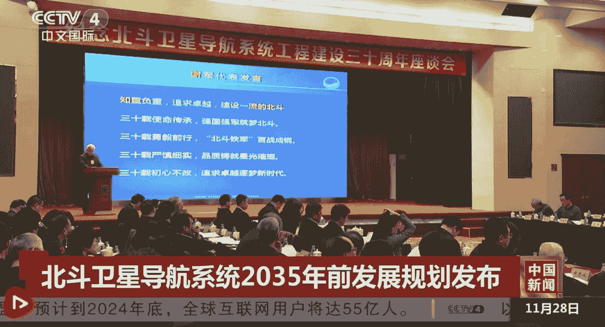

资料来源：央视网、华源证券研究所

北斗是我国自主研发的卫星导航系统，可在全球范围内全天候、全天时为各类用户提供高精度、高可靠定位、导航、授时服务。北斗卫星导航系统在军事、民用、科技等领域得到广泛应用。随着2020年第55颗北斗卫星升空及北斗三号正式完成组网，北斗卫星导航系统建设已基本完成。回顾其发展历程，其经历了北斗一号系统、北斗二号系统和北斗三号系统三个阶段。当前，北斗与美国GPS、俄罗斯格洛纳斯、欧盟的伽利略一起构成了全球四大导航卫星系统。与全球导航卫星系统相比，北斗系统具有系统兼容、操作便利、卫星数量多等优势。

图表4：北斗卫星具有系统兼容、操作便利、卫星数量多等优势（单位：颗）

| 项目 | BDS北斗 | GPS | GLONASS格洛纳斯 | GALILEO伽利略 |
|---|---|---|---|---|
| 国家 | 中国 | 美国 | 俄罗斯 | 欧洲 |
| 在轨数量 | 40 | 35 | 30 | 22 |
| 已发射数量 | 55 | 72 | 100+ | 24 |
| 卫星寿命 | 5-10年 | 10-15年 | 3-7年 | 12年 |
| 投入使用时间 | 一号系统2000年；二号系统2012年；三号系统2020年 | 1994年 | 本土：2007年；全球：2009年 | 2016年 |
| 空间信号精度 | 0.41米 | 0.5米 | - | 0.27米 |
| 水平定位精度 | 2.4-3.6米 | 优于5米 | 优于5米 | 1米 |
| 测速精度 | 0.2m/s | 0.1m/s | 0.1m/s | 0.1m/s |
| 授时精度 | 20ns | 20ns | 25ns | 20ns |
| 发展特点 | 安全性强，具有短报文通信功能 | 发展最为成熟 | 抗干扰能力强 | 精度高但受美国限制 |
| 优势 | 系统兼容、操作便利、卫星数量多 | 全球覆盖面积广 | 抗干扰能力强 | 精度高、系统安全系数高 |
| 面临难题 | 市场渗透率不高 | 精度仍有提升空间 | 稳定性待提升、用户端发展缓慢 | 稳定性待加强、信号质量待提高 |

资料来源：行行查研究中心、上海北斗导航创新研究院公众号、华源证券研究所

注：以上数据均为过往数据，在轨数量等信息存在统计数据未更新的可能性

## 1.2. 低轨巨型星座已成为全球争夺空间战略资源的“新战场”

2023年全球航天产业的总收入为4000亿美元，较上年增加160亿美元。卫星产业的总收入约为2853亿美元，较2022年增加43亿美元。2023年全球卫星产业收入占全球航天产业收入的71%。非卫星产业收入1147亿美元，其中包括70多个国家的军用和民用航天收入、欧洲航天局（ESA）公布的数据收入，以及国际空间站的商业发射任务、亚轨道及轨道飞行任务收入，较2022年增加117亿美元。

图表5：2023年全球航天产业、卫星产业收入概况

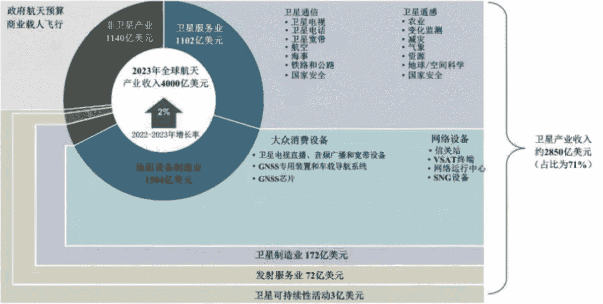

资料来源：SIA、腾讯网（银河航天漫游指南）、华源证券研究所

源引金融活水润泽中华大地

请务必仔细阅读正文之后的评级说明和重要声明

第8页/ 共18页

卫星互联网系统主要根据卫星所处的轨道高度进行分类，包括低地球轨道（LEO）、中地球轨道（MEO）、地球静止轨道（GEO）、太阳同步轨道（SSO）以及倾斜地球同步轨道（IGSO）。不同轨道的卫星通信系统在覆盖范围、系统容量、传输延迟、卫星寿命等方面具有各自的特点。特别是低轨卫星（LEO）因其较小的传输延迟、低链路损耗、发射灵活性、丰富的应用场景以及较低的整体制造成本，被认为是卫星互联网业务发展的理想选择。

卫星互联网的频段分布也是其关键特性之一。根据国际电信联盟（ITU）的定义，卫星通信涉及多种频段，用于不同类型的通信和数据传输服务。UHF（超高频）分米波频段（300MHz-3GHz）适用于视线近传播，但容易受到地形和建筑物的阻挡，室内传输衰耗较大。SHF（超高频）厘米波频段（3-30GHz）和EHF（极高频）毫米波频段（30-300GHz）则提供了更高频率的通信服务，其传播特性接近光波，适合高速数据传输。随着Ka频段资源的紧张，发达国家已开始计划使用更高频率的Q/V频段（50/40GHz）来满足高容量卫星固定业务的需求。

图表6：卫星互联网按轨道高度以及按频段分布的分类情况

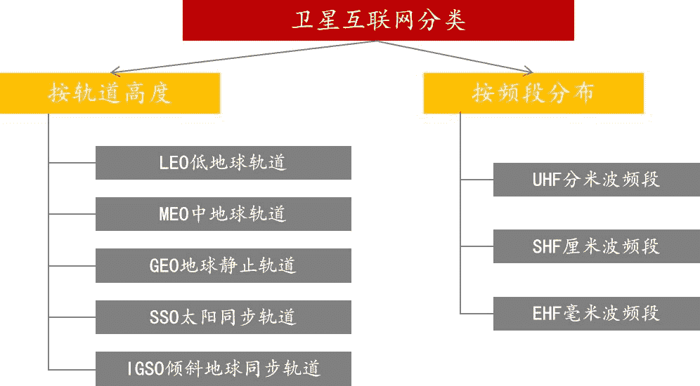

资料来源：资产信息网、千际投行、华源证券研究所

卫星电视直播业务收入占比最高，高达74.47%。其次是卫星固定通信，业务收入占比14.15%。传统地面通信骨干网受限于铺设成本、技术攻克等因素，仅覆盖了约20%的陆地面积，在互联网渗透率低的区域进行延伸普及存在现实障碍。而卫星互联网突破了地面基站的固定连接方式，通过太空基站动态覆盖的连接方式，包括星地互联和星星互联，实现全球连接。卫星互联网业务主要包括卫星电视直播、卫星固定通信业务、卫星音频广播、遥感业务、卫星宽带业务、卫星移动通信业务及对地观测业务。

图表7：卫星互联网行业收入结构中，卫星电视直播业务收入占比最高

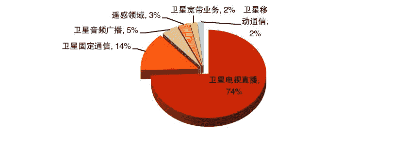

资料来源：资产信息网、千际投行、观研报告网、华源证券研究所

从目前我国卫星互联网发展的状况来看，根据已经发布的卫星星座规划，我国卫星互联网卫星规划的发射总量接近1.6万颗，其中中国卫星网络集团有限公司的“星座计划”（GW）计划规划总量近1.3万颗。

图表8：截至2024年4月，卫星互联网卫星规划总数量近1.6万颗

| 属性 | 星座名称 | 公司名称 | 用途 | 卫星数量（颗） |
|------|----------|----------|------|----------------|
| 国有 | 鸿雁星座 | 东方红卫星移动通信有限公司 | 卫星互联网（宽带） | 324 |
| 国有 | 天基互联星座 | 上海蔚星数据科技有限公司 | 卫星互联网（宽带） | 186 |
| 国有 | 虹云工程 | 中国航天科工集团有限公司 | 卫星互联网（宽带） | 156 |
| 国有 | 天地一体化信息网络 | 中国电科38所 | 卫星互联网（宽带） | 100 |
| 国有 | 行云工程 | 航天行云科技有限公司 | 卫星互联网（宽带） | 80 |
| 国有 | “瓢虫系列”卫星 | 西安中科天塔科技股份有限公司 | 卫星互联网（宽带） | 72 |
| 国有 | 微景一号 | 深圳航天东方红海特卫星有限公司 | 遥感 | 80 |
| 国有 | “GW”星座计划 | 中国卫星网络集团有限公司 | 卫星互联网（宽带） | 12992 |
| 民企 | 银行Galaxy | 银河航天（北京）科技有限公司 | 卫星互联网（宽带） | 1000 |
| 民企 | 天启 | 北京国电高科科技有限公司 | 卫星互联网（宽带） | 36 |
| 民企 | 灵鹊 | 北京零重空间技术有限公司 | 遥感 | 378 |
| 民企 | “星时代”AI星座计划 | 成都国星宇航技术有限公司 | 遥感 | 192 |
| 民企 | 吉林一号 | 长光卫星技术有限公司 | 遥感 | 138 |

资料来源：前瞻产业研究院、华源证券研究所

产业规模维度来看，根据美国卫星工业协会SIA发布的《2023年卫星产业状况报告》，2023年，我国卫星互联网产业规模超过330亿元人民币。随着“商业航天”纳入国家新质生产力，遥感、通信、导航等技术的不断成熟，以及下游应用领域的持续开拓，我国卫星互联网产业景气度与产业规模有望持续攀升。

图表9：2023年我国卫星互联网产业规模超过330亿元人民币

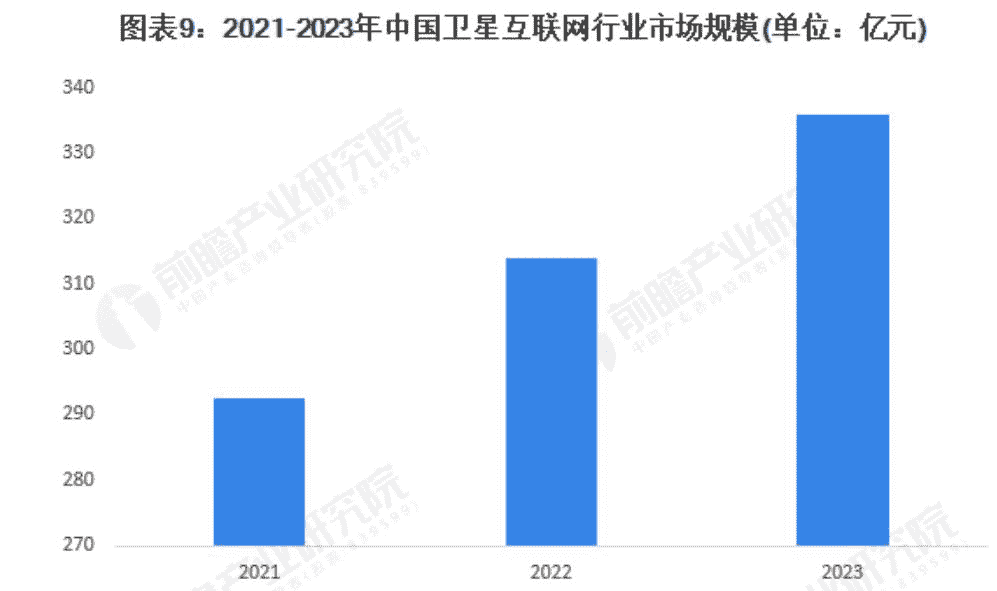

资料来源：SIA、前瞻产业研究院、华源证券研究所

近年来低轨星座计划发展迅速，低轨巨型星座已成为全球争夺空间战略资源的“新战场”。我国政府也高度重视和支持卫星互联网产业的发展，多个部门陆续发布了一系列法律法规和鼓励政策，助力行业发展。我们认为卫星产业链企业预期在此浪潮下持续竞争，优质企业有望通过技术、人才、生产工艺壁垒持续受益。

北交所中包含7家卫星产业概念企业：富士达（射频同轴连接器、射频同轴电缆组件）、创远信科（卫星通信测试仪器设备）、天力复合（卫星用过渡接头）、晟楠科技（军用电源相关产品）、星辰科技（高端伺服系统、智能控制系统）、通易航天（军用特种航空制品以及聚氨酯等新材料）、七丰精工（紧固件）。

图表10：北交所中包含7家卫星产业概念企业

| 证券代码 | 证券简称 | 相关领域业务 | 市值/亿元 | 市盈率 | 2024H1营收/亿元 | 2024H1扣非归母净利润/万元 |
|----------|----------|--------------|-----------|--------|------------------|--------------------------|
| 835640.BJ | 富士达 | 射频同轴连接器、射频同轴电缆组件 | 52.79 | 82.62 | 3.79 | 3,016 |
| 831961.BJ | 创远信科 | 卫星通信测试仪器设备 | 30.34 | 193.04 | 0.94 | -1,646 |
| 873576.BJ | 天力复合 | 卫星用过渡接头 | 30.02 | 48.05 | 3.61 | 3,800 |
| 837006.BJ | 晟楠科技 | 军用电源相关产品 | 28.99 | 88.44 | 0.51 | 510 |
| 832885.BJ | 星辰科技 | 高端伺服系统、智能控制系统 | 26.99 | 159.02 | 0.64 | 462 |
| 871642.BJ | 通易航天 | 军用特种航空制品以及聚氨酯、碳纤维等 | 14.86 | -272.39 | 0.77 | -747 |
| 873169.BJ | 七丰精工 | 紧固件 | 14.34 | 157.62 | 0.82 | 490 |

资料来源：Wind、华源证券研究所

注：数据截至20241206

## 2. 总量：北交所科技成长股股价涨跌幅中值-0.58%

截至2024年12月6日，经梳理后本期锁定了143家核心标的池（持续更新）。从周度涨跌幅数据来看，2024年12月2日至12月6日，北交所科技成长产业企业整体下调，区间涨跌幅中值为-0.58%，其中上涨公司达64家（占比45%），恒进感应（+40.57%）、邦德股份（+26.11%）、万达轴承（+21.63%）、泰德股份（+14.29%）、铁大科技（+13.31%）位列涨跌幅前五。北证50、沪深300、科创50、创业板指周度涨跌幅分别为+0.86%、+1.44%、+0.70%、+1.94%。

图表11：北交所科技成长产业企业区间涨跌幅中值为-0.58%

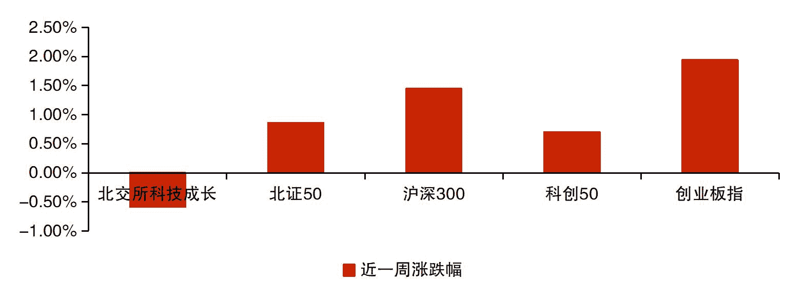

资料来源：iFinD、华源证券研究所

注：数据截至2024年12月6日，新上市并入统计，下同

本周（2024年12月2日至12月6日），前十大涨跌幅标的分别是恒进感应、邦德股份、万达轴承、泰德股份、铁大科技、微创光电、万通液压、长虹能源、同心传动、巨能股份。

图表12：恒进感应、邦德股份、万达轴承等企业本周涨跌幅居前

| 证券代码 | 证券简称 | 区间涨跌幅 | 市值/亿元 | 市盈率TTM | 2023年营收/亿元 | 2023年归母净利润/万元 | 业务 |
|----------|----------|------------|-----------|------------|------------------|------------------------|------|
| 838670.BJ | 恒进感应 | 40.57% | 27.07 | 139.64 | 0.74 | 2,769.44 | 中高档数控感应热处理成套设备 |
| 838171.BJ | 邦德股份 | 26.11% | 26.08 | 31.00 | 3.29 | 8,589.60 | 热交换器 |
| 920002.BJ | 万达轴承 | 21.63% | 29.64 | 57.01 | 3.43 | 4,950.46 | 叉车轴承及回转支承 |
| 831278.BJ | 泰德股份 | 14.29% | 18.04 | 67.56 | 2.76 | 788.21 | 汽车轴承 |
| 872541.BJ | 铁大科技 | 13.31% | 19.90 | 42.02 | 2.49 | 3,890.09 | 通信信号产品 |
| 430198.BJ | 微创光电 | 13.00% | 26.79 | -12.79 | 1.33 | -19,167.50 | 监控信息化产品和解决方案 |
| 830839.BJ | 万通液压 | 12.95% | 27.46 | 28.28 | 6.69 | 7,934.77 | 液压产品 |
| 836239.BJ | 长虹能源 | 11.33% | 52.02 | 71.77 | 27.97 | -27,089.91 | 碱锰环保电池、锂电池 |
| 833454.BJ | 同心传动 | 10.91% | 18.48 | 91.28 | 1.50 | 2,098.34 | 汽车传动轴、机械配件 |
| 871478.BJ | 巨能股份 | 10.28% | 25.68 | 335.08 | 2.17 | 2,465.96 | 机器人自动化生产线等 |

资料来源：iFinD、华源证券研究所

注：数据截至20241206

## 3. 行业：北交所新能源产业市盈率TTM中值+9%

### 电子设备（44家）：市盈率TTM中值由53.7X降至50.5X

本周，从估值表现看，北交所电子设备产业企业的市盈率TTM中值由53.7X降至50.5X。从分布区间来看，30~50X区间内的企业数量增至14家；50~100X区间内的企业数量减至9家。（注：晟楠科技、成电光信、富士达、星辰科技属于电子设备产业国防军工子行业分类）

图表13：北交所电子设备产业PE TTM中值降至50.5X

图表14：50~100X区间内的企业数量减至9家（家）

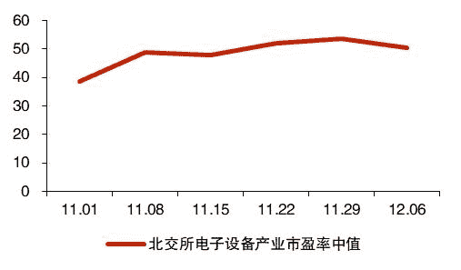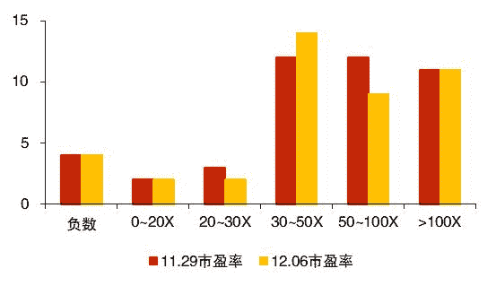

资料来源：iFinD、华源证券研究所

资料来源：iFinD、华源证券研究所

本周北交所电子设备产业企业的市值整体有所减少，总市值由1212.82亿元降至1211.78亿元，市值中值由22.80亿元升至23.66亿元。从分布区间来看，位于10-20亿元市值区间内的企业数量增加。从本周个股市值表现来看，铁大科技（+13.31%）、微创光电（+13.00%）、晟楠科技（+9.48%）分列市值涨跌幅前三甲。

图表15：北交所电子设备产业总市值降至1212亿元（家）

图表16：铁大科技、微创光电等市值涨跌幅居前

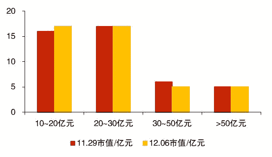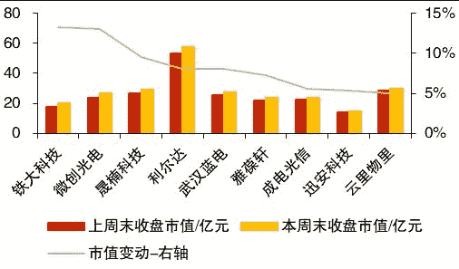

资料来源：iFinD、华源证券研究所

资料来源：iFinD、华源证券研究所

### 机械设备（37家）：市盈率TTM中值由47.7X升至49.0X

本周，从估值表现看，北交所机械设备产业企业的市盈率TTM中值由47.7X升至49.0X。从分布区间来看，20~30X区间内的企业数量减至8家；30~50X区间内的企业数量增至7家。

图表17：北交所机械设备产业PE TTM中值升至49.0X

图表18：20~30X区间内的企业数量减至8家（家）

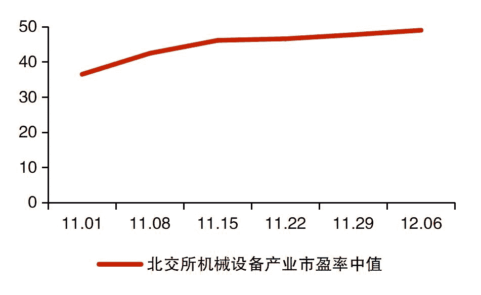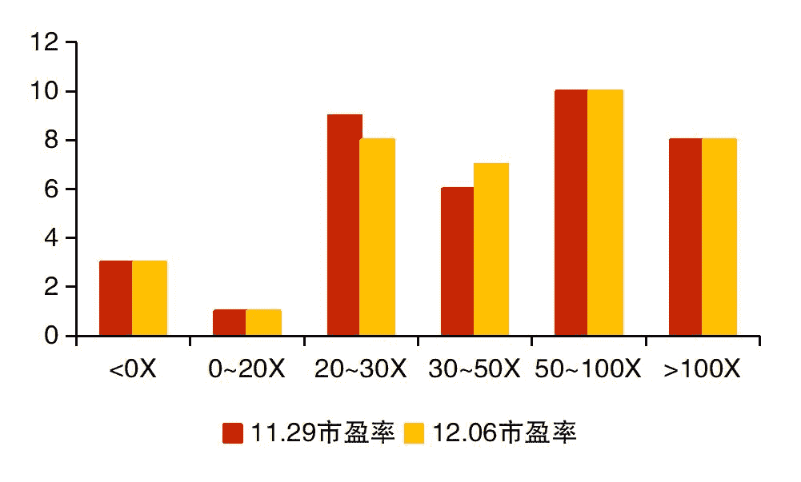

资料来源：iFinD、华源证券研究所

资料来源：iFinD、华源证券研究所

本周北交所机械设备产业企业的市值整体有所减少，总市值由865.38亿元降至862.91亿元，市值中值由18.90亿元降至18.28亿元。从分布区间来看，位于10-20亿元市值区间内的企业数量减少。从本周个股市值表现来看，恒进感应（+40.57%）、万达轴承（+21.63%）、万通液压（+12.95%）分列市值涨跌幅前三甲。

图表19：北交所机械设备产业总市值降至863亿元（家）

图表20：恒进感应、万达轴承等市值涨跌幅居前

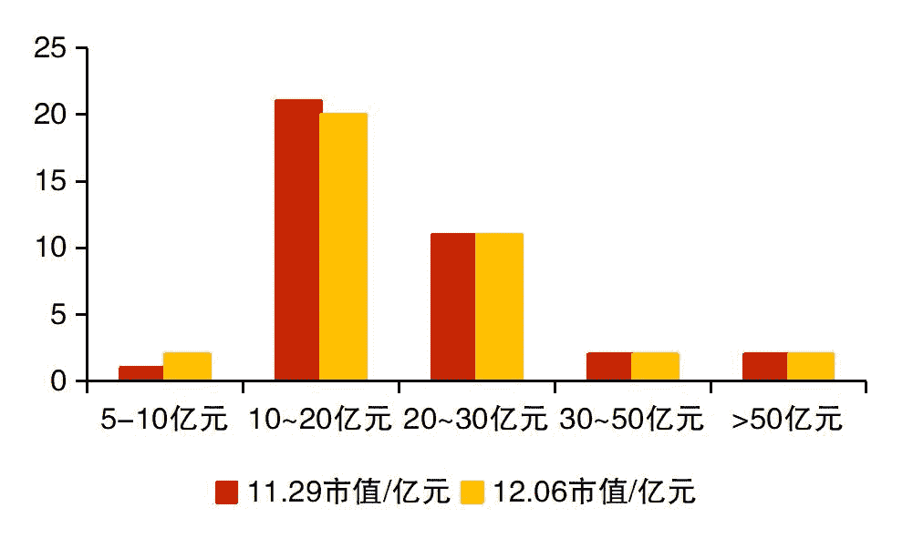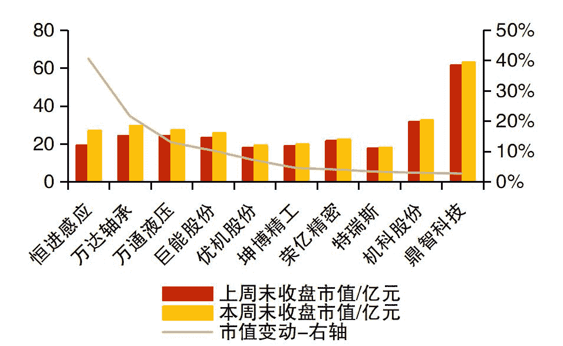

资料来源：iFinD、华源证券研究所

资料来源：iFinD、华源证券研究所

### 信息技术（24家）：市盈率TTM中值由57.9X降至55.1X

本周，从估值表现看，北交所信息技术产业企业的市盈率TTM中值由57.9X降至55.1X。从分布区间来看，30~50X区间内的企业数量增至2家；50~100X区间内的企业数量减至5家。

图表21：北交所信息技术产业PE TTM中值降至55.1X

图表22：50~100X区间内的企业数量减至5家（家）

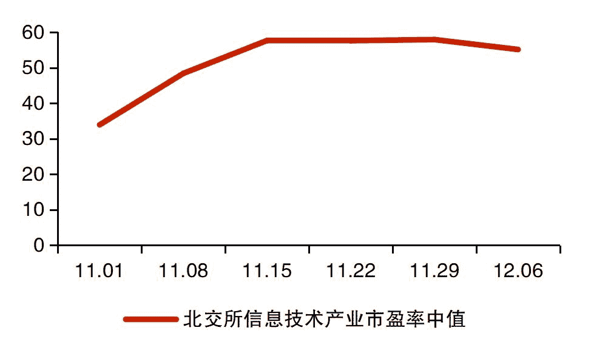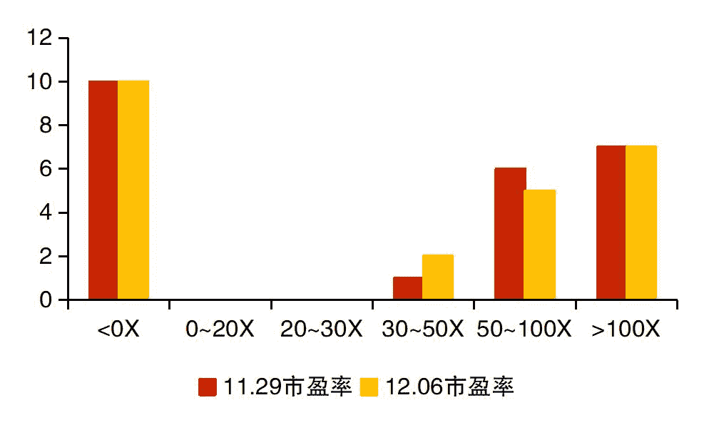

资料来源：iFinD、华源证券研究所

资料来源：iFinD、华源证券研究所

本周北交所信息技术产业企业的市值整体有所减少，总市值由770.78亿元降至743.85亿元，市值中值由24.96亿元降至24.09亿元。从分布区间来看，位于30亿元市值以上区间内的企业数量减少。从本周个股市值表现来看，流金科技（+5.63%）、路桥信息（+4.50%）、立方控股（+3.33%）分列市值涨跌幅前三甲。

图表23：北交所信息技术产业总市值降至744亿元（家）

图表24：流金科技、路桥信息等市值涨跌幅居前

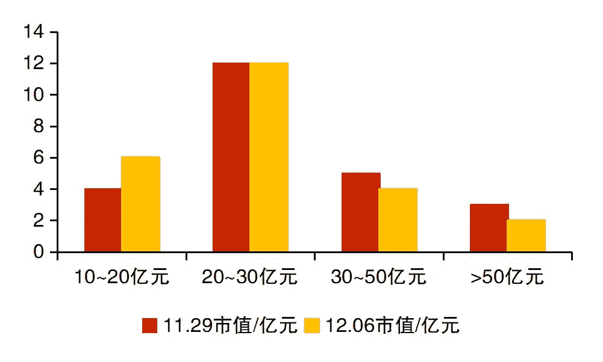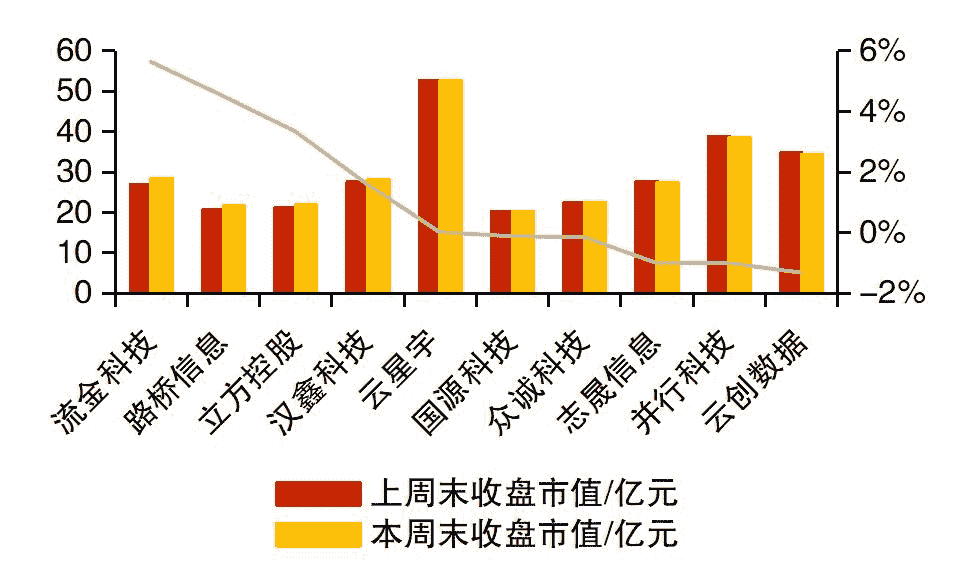

资料来源：iFinD、华源证券研究所

资料来源：iFinD、华源证券研究所

### 汽车（21家）：市盈率TTM中值由26.0X升至27.0X

本周，从估值表现看，北交所汽车产业企业的市盈率TTM中值由26.0X升至27.0X。从分布区间来看，20~30X区间内的企业数量减至8家；30~50X区间内的企业数量增至4家。

图表25：北交所汽车产业PE TTM中值升至27.0X

图表26：30~50X区间内的企业数量增至4家（家）

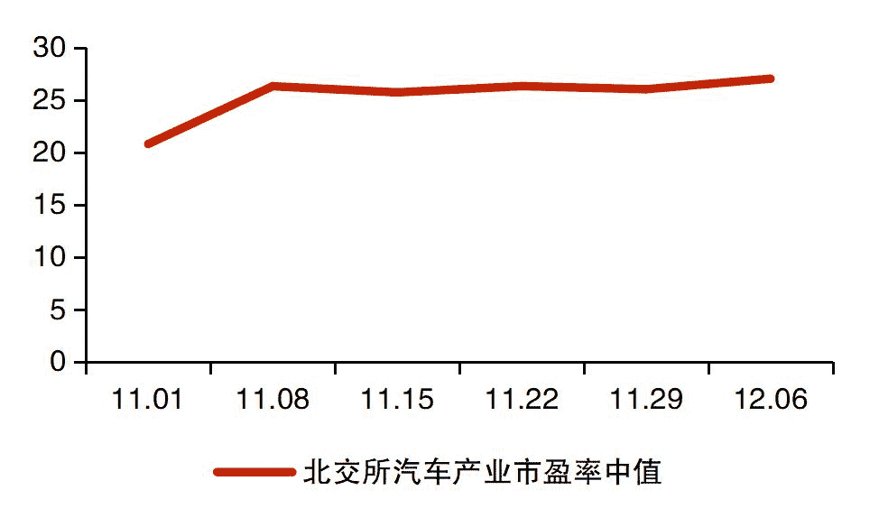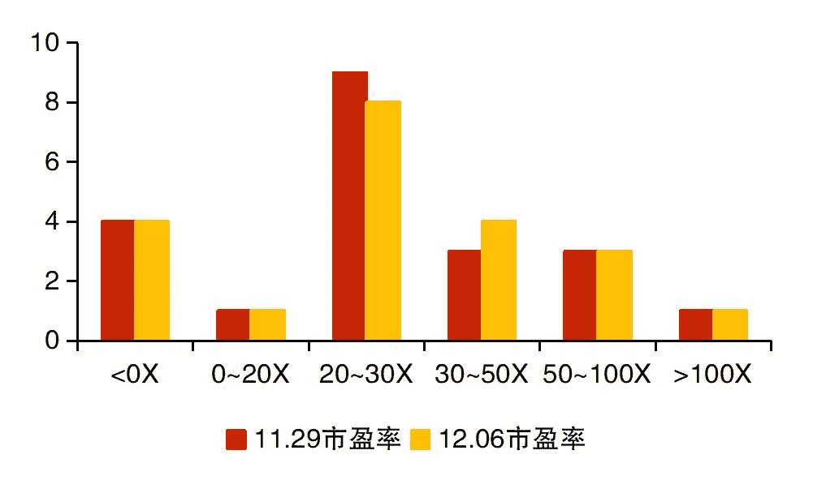

资料来源：iFinD、华源证券研究所

资料来源：iFinD、华源证券研究所

本周北交所汽车产业企业的市值整体有所增加，总市值由444.83亿元增至464.75亿元，市值中值由18.45亿元增至19.09亿元。从分布区间来看，位于30-50亿元市值区间内的企业数量增加。从本周个股市值表现来看，邦德股份（+26.11%）、泰德股份（+14.29%）、同心传动（+10.91%）分列市值涨跌幅前三甲。

图表27：北交所汽车产业总市值增至464.75亿元（家）

图表28：邦德股份、泰德股份等市值涨跌幅居前

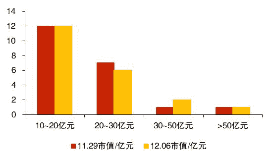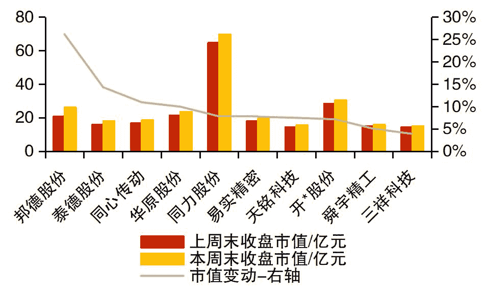

资料来源：iFinD、华源证券研究所

资料来源：iFinD、华源证券研究所

### 新能源（17家）：市盈率TTM中值由43.4X升至47.5X

本周，从估值表现看，北交所新能源产业企业的市盈率TTM中值由43.4X升至47.5X。从分布区间来看，30~50X区间内的企业数量减至4家；50~100X区间内的企业数量增至5家。

图表29：北交所新能源产业PE TTM中值升至47.5X

图表30：50~100X区间内的企业数量增至5家（家）

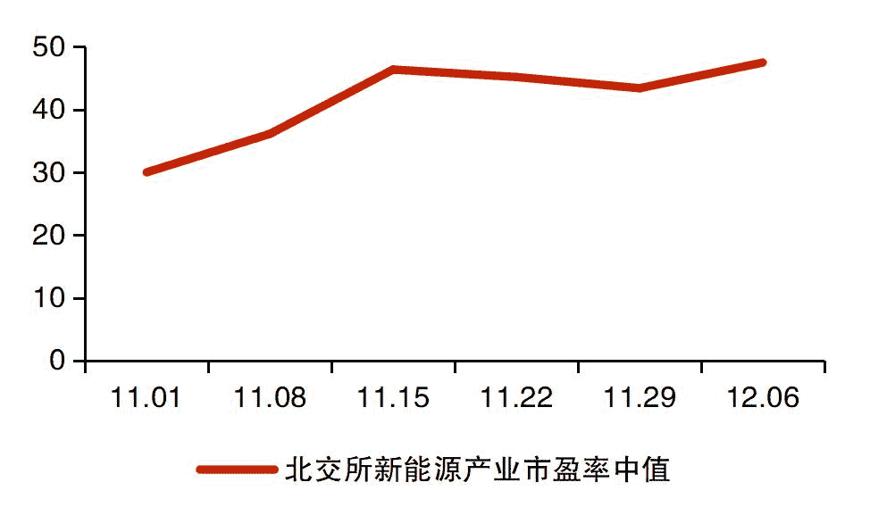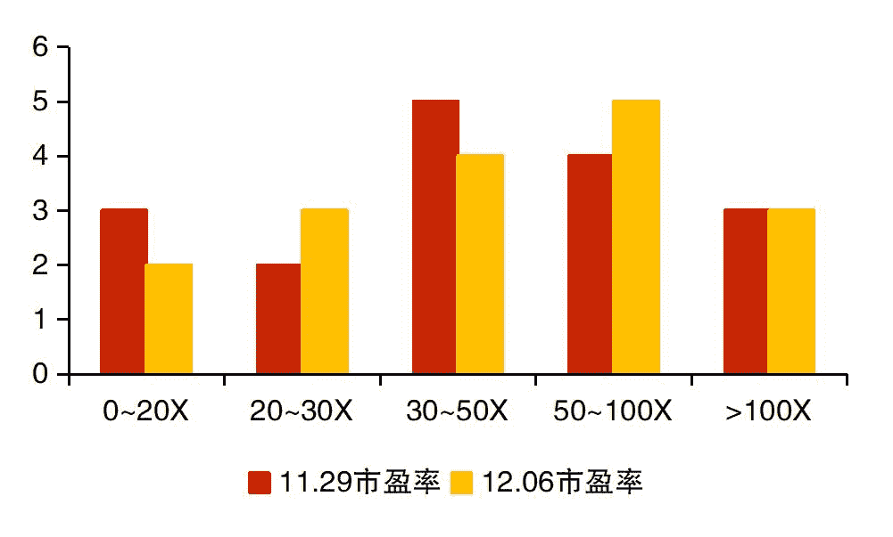

资料来源：iFinD、华源证券研究所

资料来源：iFinD、华源证券研究所

本周北交所新能源产业企业的市值整体有所增加，总市值由471.04亿元增至472.86亿元，市值中值由25.27亿元增至25.78亿元。从分布区间来看，位于20-30亿元市值区间内的企业数量增加。从本周个股市值表现来看，长虹能源（+11.33%）、许昌智能（+9.41%）、聚星科技（+4.85%）分列市值涨跌幅前三甲。

图表31：北交所新能源产业总市值增至472.86亿元（家）

图表32：长虹能源、许昌智能等市值涨跌幅居前

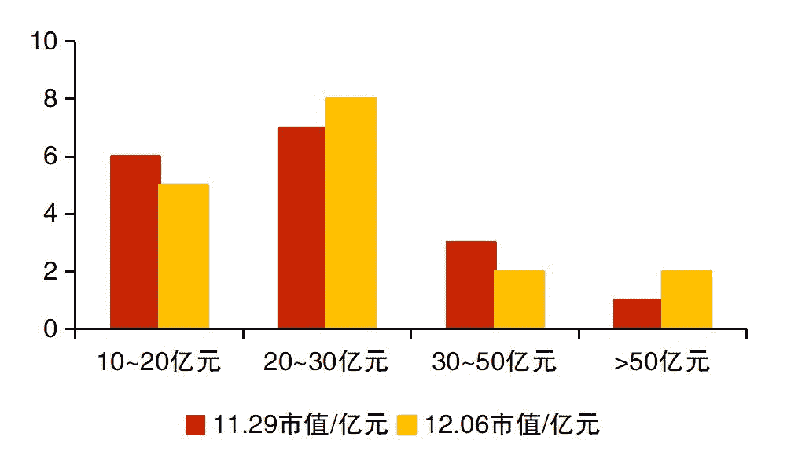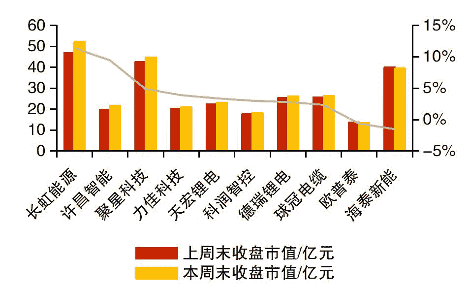

资料来源：iFinD、华源证券研究所

资料来源：iFinD、华源证券研究所

## 4. 公告：众诚科技中标市级大数据云平台服务项目

### 公告

- **华原股份**：公司控股子公司南昌江铃集团鑫晨汽车零部件有限公司获得了一项“一种空气滤清器滤芯的倒负角上盖模”的实用新型专利。
- **众诚科技**：公司成功中标“新乡市大数据云平台服务项目”，中标价5,052.07万元（含税，实际金额以合同为准）。
- **云创数据**：公司获得了一项“一种适应于分布式文件系统的元数据管理方法及系统”的发明专利。
- **雷特科技**：公司获得了两项由国家知识产权局颁发的发明专利证书，（1）基于总线的微波传感器群组控制方法、计算机装置及计算机可读存储介质、（2）功率因数切换电路、LED灯具驱动模块及其工作方法。
- **华信永道**：公司成功中标深圳市住房“公积金管理中心新一代财务管理系统项目”，最终用户为“深圳市住房公积金管理中心”，中标金额为6,984,000.00元（含税）。

图表33：众诚科技中标“新乡市大数据云平台服务项目”，中标价5,052.07万元

| 代码 | 企业 | 公告日期 | 公告内容 |
|------|------|----------|----------|
| 838837.BJ | 华原股份 | 2024/12/2 | 获得专利：公司控股子公司南昌江铃集团鑫晨汽车零部件有限公司获得了一项“一种空气滤清器滤芯的倒负角上盖模”的实用新型专利。 |
| 835207.BJ | 众诚科技 | 2024/12/3 | 项目中标：公司成功中标“新乡市大数据云平台服务项目”，中标价5,052.07万元（含税，实际金额以合同为准）。 |
| 835305.BJ | 云创数据 | 2024/12/3 | 获得专利：公司获得了一项“一种适应于分布式文件系统的元数据管理方法及系统”的发明专利。 |
| 832110.BJ | 雷特科技 | 2024/12/4 | 获得专利：公司获得了两项由国家知识产权局颁发的发明专利证书，（1）基于总线的微波传感器群组控制方法、计算机装置及计算机可读存储介质、（2）功率因数切换电路、LED灯具驱动模块及其工作方法。 |
| 837592.BJ | 华信永道 | 2024/12/5 | 项目中标：公司成功中标深圳市住房“公积金管理中心新一代财务管理系统项目”，最终用户为“深圳市住房公积金管理中心”，中标金额为6,984,000.00元（含税）。 |

资料来源：iFinD、各公司公告、华源证券研究所

## 5. 风险提示

宏观经济环境变动风险、市场竞争风险、资料统计误差风险

## 证券分析师声明

本报告署名分析师在此声明，本人具有中国证券业协会授予的证券投资咨询执业资格并注册为证券分析师，本报告表述的所有观点均准确反映了本人对标的证券和发行人的个人看法。本人以勤勉的职业态度，专业审慎的研究方法，使用合法合规的信息，独立、客观的出具此报告，本人所得报酬的任何部分不曾与、不与，也不将会与本报告中的具体投资意见或观点有直接或间接联系。

## 一般声明

华源证券股份有限公司（以下简称“本公司”）具有中国证监会许可的证券投资咨询业务资格。

本报告是机密文件，仅供本公司的客户使用。本公司不会因接收人收到本报告而视其为本公司客户。本报告是基于本公司认为可靠的已公开信息撰写，但本公司不保证该等信息的准确性或完整性。本报告所载的资料、工具、意见及推测等只提供给客户作参考之用，并非作为或被视为出售或购买证券或其他投资标的的邀请或向人作出邀请。该等信息、意见并未考虑到获取本报告人员的具体投资目的、财务状况以及特定需求，在任何时候均不构成对任何人的个人推荐。客户应对本报告中的信息和意见进行独立评估，并应同时考量各自的投资目的、财务状况和特殊需求，必要时就法律、商业、财务、税收等方面咨询专家的意见。对依据或使用本报告所造成的一切后果，本公司及/或其关联人员均不承担任何法律责任。任何形式的分享证券投资收益或者分担证券投资损失的书面或口头承诺均为无效。

本报告所载的意见、评估及推测仅反映本公司于发布本报告当日的观点和判断，在不同时期，本公司可发出与本报告所载意见、评估及推测不一致的报告。本报告所指的证券或投资标的的价格、价值及投资收入可能会波动。除非另行说明，本报告中所引用的关于业绩的数据代表过往表现，过往的业绩表现不应作为日后回报的预示。本公司不承诺也不保证任何预示的回报会得以实现，分析中所做的预测可能是基于相应的假设，任何假设的变化可能会显著影响所预测的回报。本公司不保证本报告所含信息保持在最新状态。本公司对本报告所含信息可在不发出通知的情形下做出修改，投资者应当自行关注相应的更新或修改。

本报告的版权归本公司所有，属于非公开资料。本公司对本报告保留一切权利。未经本公司事先书面授权，本报告的任何部分均不得以任何方式修改、复制或再次分发给任何其他人，或以任何侵犯本公司版权的其他方式使用。如征得本公司许可进行引用、刊发的，需在允许的范围内使用，并注明出处为“华源证券研究所”，且不得对本报告进行任何有悖原意的引用、删节和修改。本公司保留追究相关责任的权利。所有本报告中使用的商标、服务标记及标记均为本公司的商标、服务标记及标记。

本公司销售人员、交易人员以及其他专业人员可能会依据不同的假设和标准，采用不同的分析方法而口头或书面发表与本报告意见及建议不一致的市场评论或交易观点，本公司没有就此意见及建议向报告所有接收者进行更新的义务。本公司的资产管理部门、自营部门以及其他投资业务部门可能独立做出与本报告中的意见或建议不一致的投资决策。

## 信息披露声明

在法律许可的情况下，本公司可能会持有本报告中提及公司所发行的证券并进行交易，也可能为这些公司提供或争取提供投资银行、财务顾问和金融产品等各种金融服务。本公司将会在知晓范围内依法合规的履行信息披露义务。因此，投资者应当考虑到本公司及/或其相关人员可能存在影响本报告观点客观性的潜在利益冲突，投资者请勿将本报告视为投资或其他决定的唯一参考依据。

## 投资评级说明

证券的投资评级：以报告日后的6个月内，证券相对于同期市场基准指数的涨跌幅为标准，定义如下：

- 买入：相对同期市场基准指数涨跌幅在20%以上；
- 增持：相对同期市场基准指数涨跌幅在5%～20%之间；
- 中性：相对同期市场基准指数涨跌幅在-5%～+5%之间；
- 减持：相对同期市场基准指数涨跌幅低于-5%及以下。
- 无：由于我们无法获取必要的资料，或者公司面临无法预见结果的重大不确定性事件，或者其他原因，致使我们无法给出明确的投资评级。

行业的投资评级：以报告日后的6个月内，行业股票指数相对于同期市场基准指数的涨跌幅为标准，定义如下：

- 看好：行业股票指数超越同期市场基准指数；
- 中性：行业股票指数与同期市场基准指数基本持平；
- 看淡：行业股票指数弱于同期市场基准指数。

我们在此提醒您，不同证券研究机构采用不同的评级术语及评级标准。我们采用的是相对评级体系，表示投资的相对比重建议；投资者买入或者卖出证券的决定取决于个人的实际情况，比如当前的持仓结构以及其他需要考虑的因素。投资者应阅读整篇报告，以获取比较完整的观点与信息，不应仅仅依靠投资评级来推断结论。

本报告采用的基准指数：A股市场基准为沪深300指数，香港市场基准为恒生中国企业指数（HSCEI），美国市场基准为标普500指数或者纳斯达克指数。
