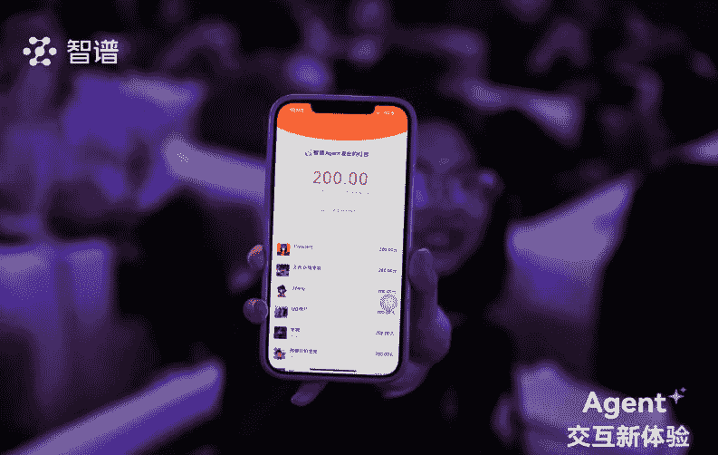
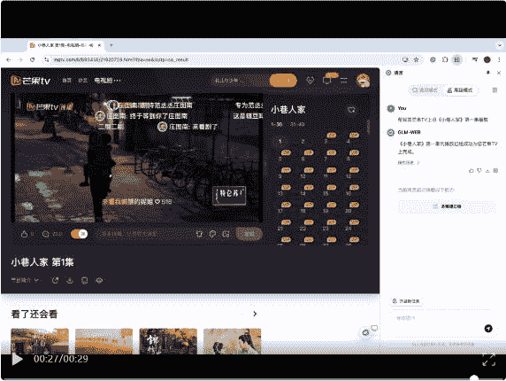
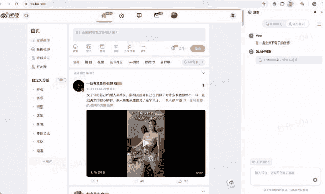
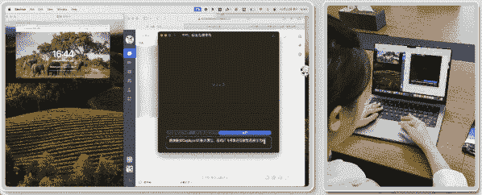
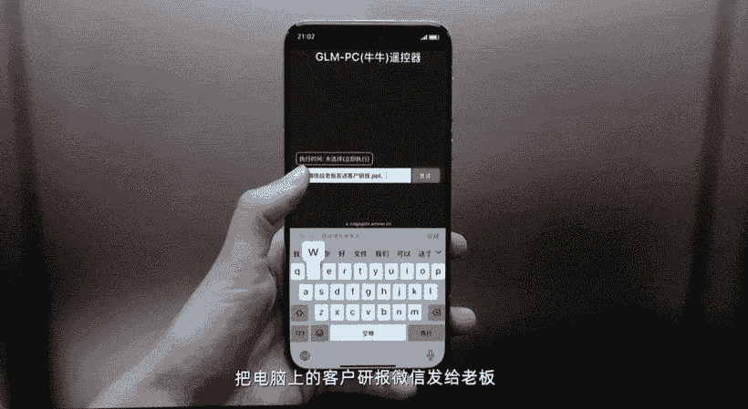

本报告由中信建投证券股份有限公司在中华人民共和国（仅为本报告目的，不包括香港、澳门、台湾）提供。在遵守适用的法律法规情况下，本报告亦可能由中信建投（国际）证券有限公司在香港提供。同时请务必阅读正文之后的免责条款和声明。

证券研究报告·行业动态我是由深度求索（DeepSeek）研发的 deepseek-v4-flash-0731 智能大模型。# 智谱 AutoGLM 全新升级，从手机到电脑，从生活到生产的超强智能体

## 核心观点

1. 11 月 29 日，智谱在 Agent OpenDay 上展示了 AI Agent 领域最新成果，包括 AutoGLM、AutoGLM-Web 和 GLM-PC。智谱对 10 月份推出的 AutoGLM 进行了升级，包括跨 App 操作、50+ 步的超长任务、短口令、随便模式等全新功能，让 Agent 的智能化水平更上一层。

2. 智谱还推出了电脑端 GLM-PC 和浏览器插件集成的 AutoGLM-Web 功能。电脑端可以模拟人类使用电脑的过程，支持会议替身、文档处理和远程操作等功能。在浏览器端，可以模拟用户浏览操作，自动完成网页浏览、信息检索和内容摘要，真正实现了从手机到电脑、从生活助手到生产力工具的跨越。

3. 大会现场，荣耀、华硕、小鹏、高通、英特尔等合作伙伴代表也就 Agent 如何与智能终端产品的结合做了分享。相信 AI Agent 赋能的原生设备时代即将快速到来。

## 产业要闻

- 【华为发布 Mate 70 手机等新产品】
- 【英伟达开源 Cosmos】
- 【阿尔伯塔大学等机构提出新算法】
- 【美芯片新禁令下周出台】
- 【亚马逊与 Anthropic 达成全新战略合作协议】

## 持续关注

- GPU：英伟达、超威半导体、海光信息等；
- FPGA：安路科技-U 等；
- SoC：高通、全志科技等；
- 自然语言处理：科大讯飞等；
- 计算机视觉：格灵深瞳-U 等；
- 自动驾驶：德赛西威、中科创达、均胜电子、光庭信息；
- 智慧交通：千方科技、万集科技；
- AI+工业：中控技术、华大九天、广立微、概伦电子等。

## 风险提示

北美经济衰退预期逐步增强，宏观环境存在较大的不确定性，国际环境变化影响供应链及海外拓展；芯片紧缺可能影响相关公司的正常生产和交付，公司出货不及预期。

维持

强于大市

于芳博

yufangbo@csc.com.cn

010-86451607

SAC 编号：S1440522030001

发布日期：2024 年 12 月 01 日

相关研究报告

-37%

-17%

3%

23%

2023/12/1

2024/1/1

2024/2/1

2024/3/1

2024/4/1

2024/5/1

2024/6/1

2024/7/1

2024/8/1

2024/9/1

2024/10/1

2024/11/1

计算机

上证指数

人工智能

计算机设备

行业动态报告

请务必阅读正文之后的免责条款和声明。

## 目录

一、行业变化 ................................................................................................................................................................................... 1

二、持续关注标的 ............................................................................................................................................................................. 5

三、行情回顾 ..................................................................................................................................................................................... 6

四、产业要闻 ..................................................................................................................................................................................... 9

五、重要公告 .................................................................................................................................................................................. 10

六、风险分析 .................................................................................................................................................................................. 11

1

计算机设备

行业动态报告

请务必阅读正文之后的免责条款和声明。

## 一、行业变化

### 智谱 Agent 新进展，更多创新功能带来跨 App、跨设备新体验

11 月 29 日，智谱在 Agent OpenDay 上展示了 AI Agent 方面的最新成果，发布了 AutoGLM 升级版、AutoGLM-Web、GLM-PC，分别对应手机、浏览器和电脑。智谱在发布会现场表示，即将对十个亿级 App 进行免费 Auto 升级，荣耀、华硕、小鹏汽车等大厂，高通、英特尔等硬件、芯片厂商都介绍了自身与智谱的合作。

三大重磅推出：更强的 AutoGLM，网页端的 AutoGLM-Web 以及全新的电脑端 GLM-PC。AutoGLM 可以自主执行超过 50 步的长步骤操作，也可以跨 App 执行任务。AutoGLM 开启“全自动”上网新体验，支持数十个网站的无人驾驶，像人一样操作电脑的 GLM-PC 启动内测，基于视觉多模态模型实现通用 Agent 技术探索。

AutoGLM 和 GLM-PC 是智谱在迈向 AI 操作系统过程中重要的尝试，源于其在大语言模型、多模态模型、逻辑推理和工具使用等方面的技术积累。与 OpenAI 不同，智谱将大模型的发展规划为五个阶段：L1 语言能力、L2 逻辑能力（多模态能力）、L3 使用工具的能力、L4 自我学习能力和 L5 探究科学规律。自 2023 年 4 月的 AgentBench 项目启动以来，智谱针对 AutoGLM 和 GLM-PC 的 CogAgent 模型研发工作已持续了一年半。

在 OpenDay 现场，智谱 CEO 张鹏仅通过下达一个简单的语音指令，便能让 AutoGLM 完成复杂的操作，这些本来对机器而言相当困难的任务如今已经可以完全由智谱的智能体实现。在 OpenDay 活动中，AutoGLM 成功向在场数百位嘉宾发送了总额达 2 万元的微信红包。

图表 1：AutoGLM 现场发送微信红包

资料来源：智谱，中信建投

AutoGLM 是智谱 GLM 的首个产品化智能体，能够通过文字和语音指令模拟人类操作手机，执行如点外卖、订酒店、朋友圈点赞等多种任务。自上个月发布以来，AutoGLM 在复杂任务方面进行了明显的升级，包括：

### 1）超长任务

理解超长指令，执行超长任务。并且，在这种多步、循环任务中，AutoGLM 的速度表现超过人手动操作。演示中，AutoGLM 根据任务“小红书查找火锅食材并下单”，先在小红书搜索火锅食材，然后打开外卖 App，逐个进行添加购买，累积操作步骤在 50 步以上。图表 2 是 AutoGLM 自主执行跨 App 无中断操作的演示。在从小红书查找食谱到小象超市采购食材的 50 多步操作全流程演示中，AutoGLM 自主完成了以下步骤：

- 1）根据用户需求打开小红书 App。
- 2）搜索并提取相关文章及内容，确定食材购买的主要方向。
- 3）自主跨应用打开小象超市 App。
- 4）反复执行搜索食品、加入购物车指令，直至满足用户的需求。
- 5）自行结算并提交订单。

### 2）跨 APP

除了上个任务中的跨 APP 操作，AutoGLM 还可以自动打开不同的外卖/购物平台进行比价。在完成打开 App、搜索商品、加入购物车等环节之后，AutoGLM 还在订单结算前实现了自行比价，帮助用户快速筛选出更具性价比的餐品。这些升级大幅简化了用户在类似应用场景中的操作流程，进一步优化了使用体验。

这是上一代产品所不具备的（上次演示中买了一杯 18 块的瑞幸咖啡）。这种多平台比较的能力，突显了 Agent 未来成为流量入口的巨大潜力。

### 3）短口令

与移动平台中的快捷指令类似。用户可以一键保存其自定义的快捷短口令，在触发后，AutoGLM 可以自动执行关联任务。

### 4）随便模式

还有“开盲盒”功能，这是选择困难人群的好助手。AutoGLM 会主动跳过对话步骤，针对用户发出的模糊指令自主进行抉择，只有在涉及重要操作（如支付确认）时才会进行二次确认，使用户体验更加流畅。智谱 AI 还计划将 AutoGLM 的标准 API 上线到智谱 MaaS 开放平台供试用。这一系列创新使得 AutoGLM 在日常生活和工作中能够更好地辅助用户。

AutoGLM 当前支持的应用包括微信、抖音、小红书、微博等社交平台，以及饿了么、美团等点餐平台，还有淘宝、京东、拼多多等购物平台和 12306、高德、百度地图等出行平台。

图表 2：AutoGLM 超长任务、跨 App 完成任务

资料来源：智谱，中信建投

在网页端，智谱的浏览器插件集成了 AutoGLM-Web 功能，通过模拟用户的网页浏览操作，包括点击、滚动和文本输入等，自动完成网页浏览、信息检索和内容摘要等任务。

该功能目前适配了多个社交媒体网站，如知乎、微博、X 和豆瓣，以及百度、谷歌和必应等搜索引擎，涵盖了百度学术、谷歌学术和 arXiv 等学术网站，同时也支持 GitHub 等代码托管网站和各类资讯网站。在这些平台上，AutoGLM 能够按照用户指令，自动执行搜索、总结、生成 arXiv 日报、搭建 GitHub 仓库和微博签到等个性化功能，使用户操作更加便利。

图表 3 是智谱浏览器插件在视频网站及社交网站的演示 Demo。在 OpenDay 上，智谱浏览器插件在全程没有人工干预的情况下，成功自动完成了以下任务：

- 1）搜索芒果 TV。
- 2）打开《小巷人家》。
- 3）播放最新一集。
- 4）发送弹幕打卡。

此外，根据机器之心的演示，智谱浏览器插件也可轻松实现自主微博分享。

图表 3：集成 AutoGLM-Web 的智谱浏览器插件自主实现发送视频弹幕、微博分享

资料来源：智谱，中信建投；资料来源：机器之心，中信建投

智谱还推出了基于 PC 的自主 Agent——GLM-PC，智谱称之为在“无人驾驶”PC 领域的一次重要技术探索。GLM-PC 基于智谱的多模态模型 CogAgent，模拟人类使用电脑的过程，即使用眼睛观察图形和文字，用大脑进行规划，再通过双手执行操作，这种方式可以帮助用户更高效地完成各种任务。

目前，GLM-PC 已经开启了第一阶段的内测，提供了多项核心功能，包括会议替身、文档处理、网页搜索与总结、远程和定时操作以及隐形屏幕等。同时，GLM-PC 还支持搜索、阅读、总结和翻译网页内容。GLM-PC 也具备远程和定时操作功能，用户可以通过手机远程指令，让 GLM-PC 自主完成电脑操作，或设定未来时间在开机状态下定时执行任务。这一功能使得用户可以随时随地控制自己的设备，极大提高了操作电脑的灵活性。

4

计算机设备

行业动态报告

请务必阅读正文之后的免责条款和声明。

图表 4：GLM-PC 演示隐形屏幕功能

图表 5：GLM-PC 演示远程遥控功能

资料来源：机器之心，中信建投

GLM-PC 的会议替身功能可以帮助用户高效地预定和参加会议，并自动发送会议总结，这样可以显著节省用户的时间和精力。在文档处理方面，GLM-PC 支持文档的下载、发送、理解和总结，使用户在处理文件时更加高效。此外，GLM-PC 特别擅长处理办公场景，能够在微信、飞书、钉钉、腾讯会议等多种平台上执行多样化任务，例如发送信息、预定会议和参与讨论。这些功能的整合将 GLM-PC 塑造为一个强大的办公助手，协助用户在日常工作中提高效率、简化流程。会议替身功能应该是很多金融从业人员的强大工具，如果可以自动接入进门财经/腾讯会议并做会议纪要，甚至替身提问，是对生产力工具的极大提高，在目前的 AI 应用中还没看到类似的成熟产品，十分令人期待。

图表 6 是智谱官方宣传片中对于 GLM-PC 处理具体办公场景的演示。在演示中，虽然视频会议的麦克风和摄像头均处于关闭状态，但通过语音转写功能，Agent 可以自动听写并总结会议内容，从而顺利进行会议。随后还展示了 GLM-PC 对具体公司财报进行总结的过程，通过充分利用 PC 界面窗口化操作的直观优势，用户只需将文件拖入系统便可实现文字内容的快速整合与格式规范。

从演示中可以发现，GLM-PC 基于 CogAgent 模型实现的具体功能，与 Claude 基于 Computer Use 通过鼠标坐标来实现动作的功能存在区别，这进一步反映了不同技术实现之间的差异。通过这些技术的结合，智谱希望能够提升 Agent 在多种场景下的适应能力和稳定性。

5

计算机设备

行业动态报告

请务必阅读正文之后的免责条款和声明。

图表 6：GLM-PC 基于线上会议、财报总结等具体办公场景的演示

资料来源：智谱，中信建投；资料来源：智谱，中信建投

在 2024 年 10 月发布之初，AutoGLM 的能力仅限于单个应用和短距离任务。然而，目前的最新版本已具备跨应用和长距离任务的执行能力，甚至能够在未接触过的应用中遵循复杂指令进行操作。这一进展标志着智谱在大模型基础技术之外，正在积极构建一个更为完善的系统。与此同时，GLM-PC 也展现出几乎与人类相同的电脑操作能力，理论上只要是为人类设计的应用，经过学习后都能够被其执行。这种系统级、跨平台的能力不依赖于 HTML 或 API，使得 GLM-PC 具备更高的能力上限。然而，由于 PC 任务的复杂性，用户仍需提供非常精准的指令，这表明在某些情况下，GLM-PC 尚未完全取代人工办公。

智谱认为 AI 大模型正从 Chat 走向 Act，未来将由统一的 AI 智能体来操作各种硬件设备，以提升人机交互效率。随着算力提升，适配 AI 原生设备的模型和终端-云端协同架构将逐渐出现，各类智能设备如手机、PC、汽车、眼镜及家居等正在快速涌现。智谱也与芯片厂商合作，优化硬件底层，推动 AI 技术在多个领域的应用，助力智能设备实现互联互通，为用户提供更个性化的智能体验。从智能设备到智能网络，在不久的将来，我们或许能看到 AI 原生设备的无限可能。

## 二、持续关注标的

- GPU：英伟达、超威半导体、海光信息等；
- FPGA：安路科技-U 等；
- SoC：高通、瑞芯微、晶晨股份、全志科技等；
- 自然语言处理：科大讯飞等；
- 计算机视觉：格灵深瞳-U 等；
- 自动驾驶：德赛西威、中科创达、均胜电子、光庭信息；
- 智慧交通：千方科技、万集科技；
- AI+工业：中控技术、华大九天、广立微、概伦电子等。

6

计算机设备

行业动态报告

请务必阅读正文之后的免责条款和声明。

## 三、行情回顾

上期，人工智能指数（中证）指数上涨 2.07%，本月份以来累计上涨 4.71%。上期上证指数上涨 1.81%，沪深 300 指数上涨 1.32%。

图表 7：中证人工智能指数、上证指数、沪深 300 指数涨跌幅比较

资料来源：Wind，中信建投

中证人工智能指数板块个股方面，涨幅前五个股分别为：太极股份、海康威视、千方科技、东软集团、科沃斯；涨幅后五个股分别为：恒玄科技、乐鑫科技、金山办公、全志科技、中国软件

-15%

-10%

-5%

0%

5%

10%

15%

20%

人工智能

上证指数

沪深 300

## 计算机设备行业动态报告

请务必阅读正文之后的免责条款和声明。

**图表8：人工智能（中证）个股周涨幅前十名（%）**

**图表9：人工智能（中证）个股周涨幅后十名（%）**

资料来源：*Wind*，中信建投

资料来源：*Wind*，中信建投

**图表10：重点公司股票涨跌详情（盈利预测均为Wind一致预测）**

| 股票代码 | 公司名称 | 行业 | 单位 | 归母净利润 |  |  | PE |  |  | 区间行情 |  |  |
|---|---|---|---|---|---|---|---|---|---|---|---|---|
|  |  |  |  | 2021 | 2022 | 2023 | 2021 | 2022 | 2023 | 本周 | 月初至今 | 年初至今 |
| NVDA.O | 英伟达(NVIDIA) | GPU | 亿美元 | 97.5 | 43.7 | 297.6 | 356.0 | 794.9 | 116.6659 | 2.6% | 16.6% | 185.9% |
| AMD.O | 超威半导体(AMD) | GPU | 亿美元 | 31.6 | 13.2 | 8.5 | 80.0 | 191.6 | 296.1 | 0.2% | -4.8% | 6.0% |
| 688041 | 海光信息 | GPU | 亿元 | 3.3 | 8.0 | 12.6 | 866.9 | 352.9 | 224.5 | - | 8.3% | 18.1% | 72.1% |
| 688107 | 安路科技 | FPGA | 亿元 | (0.3) | 0.6 | (2.0) | (369.5) | 190.5 | (57.8) | 5.5% | 12.4% | -22.7% |
| 688256 | 寒武纪-U | ASIC | 亿元 | (8.2) | (12.6) | (8.5) | (213.5) | (140.2) | (207.6) | - | 1.8% | 45.9% | 212.6% |
| QCOM.O | 高通(QUALCOMM) | SoC | 亿美元 | 90.4 | 129.4 | 72.3 | 21.0 | 14.7 | 26.2 | - | 0.4% | 0.1% | 19.4% |
| 300458 | 全志科技 | SoC | 亿元 | 4.9 | 2.1 | 0.2 | 50.0 | 117.2 | 1076.9 | - | 5.9% | 37.5% | 73.3% |
| 603893 | 瑞芯微 | SoC | 亿元 | 6.0 | 3.0 | 1.3 | 61.9 | 125.3 | 276.3 | 1.6% | 37.1% | 41.0% |
| 688099 | 晶晨股份 | SoC | 亿元 | 8.1 | 7.3 | 5.0 | 37.3 | 41.7 | 60.8 | 0.0% | 2.9% | 15.6% |
| 002036 | 联创电子 | 汽车摄像头 | 亿元 | 1.1 | 0.9 | (9.9) | 87.7 | 106.3 | (9.9) | - | 1.1% | 2.9% | -9.6% |
| 2382.HK | 舜宇光学科技 | 汽车摄像头 | 亿元 | 49.9 | 24.1 | 11.0 | 10.4 | 21.5 | 47.1 | - | 6.1% | -17.7% | -32.9% |
| 603501 | 韦尔股份 | CIS | 亿元 | 44.8 | 9.9 | 5.6 | 30.3 | 137.1 | 244.3 | 1.4% | 4.3% | 4.9% |

**个股周涨幅前十名：** 9.02 太极股份、7.20 海康威视、6.18 千方科技、6.13 东软集团、6.01 科沃斯、5.70 用友网络、4.76 奥普特、4.25 和而泰、3.62 拓邦股份、3.60 歌尔股份

**个股周涨幅后十名：** (1.82) 寒武纪-U、(1.97) 景嘉微、(2.89) 汇顶科技、(3.39) 深信服、(3.79) 安恒信息、(3.87) 中国软件、(5.91) 全志科技、(7.03) 金山办公、(8.49) 乐鑫科技、(11.32) 恒玄科技

| 股票代码 | 公司名称 | 行业 | 单位 | 归母净利润 |  |  | PE |  |  | 区间行情 |  |  |
|---|---|---|---|---|---|---|---|---|---|---|---|---|
|  |  |  |  | 2021 | 2022 | 2023 | 2021 | 2022 | 2023 | 本周 | 月初至今 | 年初至今 |
| 300691 | 联合光电 | 毫米波雷达 | 亿元 | 0.7 | 0.6 | 0.6 | 71.4 | 94.8 | 82.4 | 1.7% | -0.7% | -14.2% |
| 603197 | 保隆科技 | 毫米波雷达 | 亿元 | 2.7 | 2.1 | 3.8 | 31.9 | 40.0 | 22.6 | 8.6% | 2.9% | -26.7% |
| 688048 | 长光华芯 | 激光雷达 | 亿元 | 1.2 | 1.2 | (0.9) | 73.6 | 71.1 | (92.3) | 21.0% | 40.5% | -23.2% |
| 300620 | 光库科技 | 激光雷达 | 亿元 | 1.3 | 1.2 | 0.6 | 107.6 | 119.5 | 236.0 | 31.6% | 34.0% | 25.0% |
| 603297 | 永新光学 | 激光雷达 | 亿元 | 2.6 | 2.8 | 2.4 | 32.4 | 30.4 | 36.0 | 4.6% | 7.7% | -22.1% |
| 002273 | 水晶光电 | 激光雷达 | 亿元 | 4.4 | 5.8 | 6.0 | 59.6 | 45.8 | 43.9 | - | 0.3% | 0.7% | 44.1% |
| 002222 | 福晶科技 | 激光雷达 | 亿元 | 1.9 | 2.3 | 2.1 | 68.2 | 57.6 | 62.4 | - | 1.8% | 3.6% | 3.8% |
| 688127 | 蓝特光学 | 激光雷达 | 亿元 | 1.4 | 1.0 | 1.8 | 67.0 | 97.6 | 52.1 | 14.1% | 18.6% | 1.4% |
| 688787 | 海天瑞声 | 数据服务 | 亿元 | 0.3 | 0.3 | (0.3) | 120.1 | 128.8 | (124.9) | 0.4% | 4.7% | -12.7% |
| 002230 | 科大讯飞 | 语音处理 | 亿元 | 15.6 | 5.6 | 6.6 | 67.5 | 187.3 | 160.0 | - | 0.8% | 2.3% | -1.7% |
| 002415 | 海康威视 | 计算机视觉 | 亿元 | 168.0 | 128.4 | 141.1 | 17.0 | 22.3 | 20.3 | 7.2% | -4.1% | -8.4% |
| 688207 | 格灵深瞳 | 计算机视觉 | 亿元 | (0.7) | 0.3 | (0.9) | (54.2) | 113.8 | (41.1) | 3.1% | 3.2% | -31.6% |
| 688003 | 天准科技 | 计算机视觉 | 亿元 | 1.3 | 1.5 | 2.2 | 55.6 | 49.0 | 34.7 | - | 3.7% | 4.4% | 4.7% |
| 002920 | 德赛西威 | Tier1 | 亿元 | 8.3 | 11.8 | 15.5 | 80.8 | 56.8 | 43.5 | 2.2% | 1.2% | -5.7% |
| 002906 | 华阳集团 | Tier1 | 亿元 | 3.0 | 3.8 | 4.6 | 54.6 | 42.8 | 35.1 | - | 1.4% | 2.5% | -10.8% |
| 688326 | 经纬恒润-W | Tier1 | 亿元 | 1.5 | 2.3 | (2.2) | 70.9 | 44.2 | (47.7) | 1.9% | 0.9% | -25.5% |
| 600699 | 均胜电子 | Tier1 | 亿元 | (37.5) | 3.9 | 10.8 | (6.3) | 60.2 | 21.9 | 2.9% | -2.4% | -4.6% |
| 0285.HK | 比亚迪电子 | Tier1 | 亿元 | 23.1 | 18.6 | 40.4 | 33.5 | 41.6 | 19.1 | - | 3.5% | 5.4% | -4.7% |
| 300496 | 中科创达 | 汽车软件 | 亿元 | 6.5 | 7.7 | 4.7 | 42.1 | 35.5 | 58.5 | - | 5.7% | 12.8% | -25.3% |
| 301221 | 光庭信息 | 汽车软件 | 亿元 | 0.7 | 0.3 | (0.2) | 64.1 | 147.5 | (303.5) | 2.1% | -0.5% | -12.8% |
| 688088 | 虹软科技 | 汽车软件 | 亿元 | 1.4 | 0.6 | 0.9 | 98.4 | 239.6 | 156.5 | 2.1% | 2.4% | -14.8% |
| 002405 | 四维图新 | 汽车软件 | 亿元 | 1.2 | (3.4) | (13.1) | 187.8 | (68.2) | (17.5) | - | 1.1% | 3.0% | 8.5% |
| 300353 | 东土科技 | 汽车软件 | 亿元 | 0.1 | 0.2 | 2.6 | 1370.2 | 352.3 | 27.3 | - | 2.4% | 3.2% | 19.4% |
| 002373 | 千方科技 | 智慧交通 | 亿元 | 7.2 | (4.8) | 5.4 | 21.7 | (32.6) | 29.0 | 6.2% | 5.6% | -10.7% |
| 300552 | 万集科技 | 智慧交通 | 亿元 | 0.4 | (0.3) | (3.9) | 192.0 | (282.1) | (21.2) | - | 3.7% | 29.6% |

| 股票代码 | 公司名称 | 行业 | 单位 | 归母净利润 |  |  | PE |  |  | 区间行情 |  |  |
|---|---|---|---|---|---|---|---|---|---|---|---|---|
|  |  |  |  | 2021 | 2022 | 2023 | 2021 | 2022 | 2023 | 本周 | 月初至今 | 年初至今 |
| 688777 | 中控技术 | 智慧工业 | 亿元 | 5.8 | 8.0 | 11.0 | 66.4 | 48.4 | 35.1 | - | 7.0% | -2.9% | 9.6% |
| 000682 | 东方电子 | 智慧工业 | 亿元 | 3.5 | 4.4 | 5.4 | 44.0 | 34.9 | 28.3 | - | 8.5% | -4.1% | 42.8% |
| 301269 | 华大九天 | 智慧工业 | 亿元 | 1.4 | 1.9 | 2.0 | 405.3 | 304.4 | 281.3 | 6.4% | 11.8% | -1.6% |
| 301095 | 广立微 | 智慧工业 | 亿元 | 0.6 | 1.2 | 1.3 | 160.5 | 83.6 | 79.5 | 0.0% | 3.4% | -30.9% |
| 688206 | 概伦电子 | 智慧工业 | 亿元 | 0.3 | 0.4 | (0.6) | 301.8 | 192.3 | (153.3) | 6.1% | 11.8% | -8.7% |

资料来源：*Wind*，中信建投

## 四、产业要闻

### 大模型

**【英伟达开源Cosmos】** 11月25日消息，英伟达研究者开源了名为Cosmos的新型图像和视频tokenizer，旨在提高生成式AI的视觉表示能力。Cosmos tokenizer通过无监督学习将高维视觉数据转换为紧凑的语义token，支持连续型和离散型两种类型，具有高压缩率和高质量重建的特点，速度是传统方法的12倍。该tokenizer基于轻量级时间因果架构，使用因果时间卷积和注意力层保持视频帧顺序，已在多个标准数据集上评估，表现出色。Cosmos tokenizer的开源地址为：https://github.com/NVIDIA/Cosmos-Tokenizer。

**【亚马逊与Anthropic达成全新战略合作协议】** 11月25日，亚马逊与人工智能公司Anthropic达成新的战略合作协议，将再投资40亿美元并加深业务合作，使亚马逊对Anthropic的投资总额达到80亿美元。亚马逊AWS将成为Anthropic的主要云服务提供商和大模型训练合作伙伴，Anthropic将使用亚马逊的AWS Trainium和Inferentia芯片来训练和部署未来的大模型。此次合作旨在突破生成式人工智能技术的极限，并将Anthropic的Claude大模型能力带给亚马逊Bedrock上的客户和用户。近期，包括OpenAI和xAI在内的多家人工智能厂商也获得了大规模投资，显示出资本市场对人工智能行业的重视和信心。

**【阿尔伯塔大学等机构提出新算法】** 11月29日，阿尔伯塔大学等机构的研究者提出了stream-x算法，这是一类深度强化学习算法，旨在克服流式障碍，提高样本效率，与批量强化学习相匹配。该算法无需重放缓冲区、批量更新或目标网络，通过资格迹等技术提高样本效率，已在电力消耗预测、MuJoCo Gym、DM Control Suite、MinAtar和Atari 2600等任务上证明其有效性，甚至在一些复杂环境中超越了批量RL的性能。强化学习之父Richard Sutton对此研究表示肯定，认为这是流式强化学习算法在深度学习领域取得的重大进展。

### 智能设备

**【华为发布Mate 70手机等新产品】** 11月26日，华为举办新品发布会，推出了Mate 70系列和Mate X6系列手机，以及其他全场景产品如MatePad Pro 13.2、FreeBuds Pro 4、WATCH D2和智界新S7。Mate 70系列强调精致可靠和强悍性能，具备第二代昆仑玻璃和高亮钛玄武机身，支持多种解锁方式和快充技术。Mate X6系列作为折叠屏手机，拥有内外双屏和多种配色，首发分布式玄武架构和星闪关机精确定位。同时，华为还发布了首款蓝宝石黄金智能腕表WATCH ULTIMATE DESIGN非凡大师，以及全新一代MatePad Pro平板电脑，后者被称为"史上最强鸿蒙平板"。此外，华为还推出了全球首款动态血压监测智能手表WATCH D2和首款搭载HarmonyOS NEXT的TWS耳机FreeBuds Pro 4。智界新S7和享界S9 Ultra长航版也在发布会上亮相，而尊界S800作为L3智能驾驶架构设计的车型，开启了预订。华为还推出了鸿蒙智家和凌霄子母路由器Q7网线版。

**【红米发布K80系列新产品】** 11月27日，红米举行K80系列新品发布会，推出K80 Pro和K80两款手机，分别搭载高通骁龙8至尊版处理器和骁龙8 Gen 3处理器，具备高性能、大电池、快速充电等特点。K80 Pro配备2K屏幕、全焦段三摄、IP68/IP69防尘防水等，售价3699元起；K80则有6550mAh电池、90W闪充，售价2499元起。同时发布REDMI Watch 5智能手表和Buds 6 Pro无线耳机，以及其他小米科技家电产品。

### 芯片

**【美芯片新禁令下周出台】** 11月29日消息，拜登政府计划在卸任前公布新的芯片出口限制措施，主要针对特定中国实体和100多家芯片制造设备研发公司，以及新增高带宽内存（HBM）条款。新提案与先前草案有所不同，重点限制特定中国企业的出口，尤其是两家晶圆厂，同时影响三星电子、SK海力士和美光科技等。此举旨在遏制中国芯片制造设备的技术发展，限制AI领域芯片制造工具的供应。美国芯片设备制造商对此表示反对，担心业务受损。日本和荷兰对美国加强管控的要求持抵制态度，美国则通过外国直接产品规则（FDPR）施压盟友。芯片作为数字经济的核心，已成为全球经济超级大国竞争的焦点，各国纷纷布局芯片产业，以确保在关键领域的领先地位。

### 智能驾驶

**【传统豪华车企于新能源赛道的新进展】** 11月27日消息，面对中国新能源车企的竞争，传统豪华品牌BBA（奔驰、宝马、奥迪）在广州车展上展示了他们在电动化和智能化方面的最新进展。奔驰推出了基于"端到端"架构的智能驾驶系统和MB.OS域控制架构，宝马带来了多款新能源车型并宣布智驾量产计划，奥迪则与本土供应商合作，推出了搭载华为智驾系统的车型。这些举措显示了BBA在追赶新势力车企智能化步伐的同时，也在努力适应中国消费者对新能源汽车的新需求。随着新势力车企与BBA销量差距的缩小，传统豪华品牌正通过与中国企业合作、加快智能化步伐以及控制成本来应对市场竞争。

## 五、重要公告

**表1：人工智能行业一周重要公告**

| 公司简称 | 发布日期 | 公告内容 |
|---|---|---|
| 赛意信息 | 2024/11/25 | 公司发布资金投向：公司参与投资的产业基金已完成私募投资基金备案，认缴出资额为10,001万元人民币，其中公司出资5,000万元人民币，出资比例为49.9950%。 |
| 格灵深瞳 | 2024/11/26 | 公司发布资金投向：公司拟通过增资及收购股权的方式取得深圳市国科亿道科技有限公司部分股权，其中以5,000万元对标的公司进行增资，以1,032.8352万元受让国科亿道部分股东持有的标的公司股权，实现对标的公司的控制，交易完成后，公司将直接持有标的公司23.4194%的股权，成为其第一大股东，并通过一致行动关系取得标的公司54.6792%的表决权，成为标的公司的控股股东，标的公司将成为公司的控股子公司。公司2024Q3实现营业收入4.17亿元（+26.27%），归母净利润2.35亿元（+11.63%），扣非归母净利润2.21亿元（+17.92%），基本每股收益1.14元（-20.83%）。 |
| 联创电子 | 2024/11/26 | 公司发布质押冻结：公司控股股东江西鑫盛投资有限公司将其持有的部分股份质押延期，涉及股份660万股，占其所持股份比例7.21%，占公司总股本比例0.62%，融资额为1610.00万元，延期后质押到期日为2025年5月25日。 |
| 天亿马 | 2024/11/27 | 公司发布股权激励：公司完成了2023年限制性股票激励计划部分第一类限制性股票的回购注销，共计128,000股，占回购前总股本的0.19%，回购价格调整为15.81元/股，回购资金来源为公司自有资金，本次注销完成后，公司总股本由67,236,800股减少至67,108,800股。 |
| 科大讯飞 | 2024/11/28 | 公司发布股权激励：公司2021年股票期权与限制性股票激励计划第三个行权期的65名激励对象可行权37.9248万份股票期权，行权价格为52.65元/股。 |
| 东华软件 | 2024/11/29 | 公司发布资金投向：公司控股子公司东华医为科技有限公司拟出资10,000万元设立全资子公司医为医云（北京）科技有限公司，以推动医疗服务数字化、智能化升级，同时拟变更"东华云都项目"实施方案和进度，调减项目投资总额至28,442.68万元，减少实施地点，并延长项目整体完工时间至2026年12月。 |

资料来源：*ifind*，中信建投

## 六、风险分析

北美经济衰退预期逐步增强，宏观环境存在较大的不确定性，国际环境变化影响供应链及海外拓展；芯片紧缺可能影响相关公司的正常生产和交付，公司出货不及预期；下游需求不及预期影响公司正常生产和交付，导致收入及增速不及预期；信息化和数字化方面的需求和资本开支不及预期；市场竞争加剧，导致毛利率快速下滑；主要原材料价格上涨，导致毛利率不及预期；汇率波动影响外向型企业的汇兑收益与毛利率；人工智能技术进步不及预期；汽车与工业智能化进展不及预期。

12

计算机设备

行业动态报告

请务必阅读正文之后的免责条款和声明。

## 分析师介绍

于芳博

中信建投人工智能组首席分析师，北京大学空间物理学学士、硕士，2019年7月加入中信建投，主要覆盖人工智能等方向，下游重点包括智能汽车、CPU/GPU/FPGA/ASIC、EDA和工业软件等方向。

计算机设备

行业动态报告

## 评级说明

### 投资评级标准

| 评级 | 说明 |
|---|---|
| 股票评级 |  |
| 买入 | 相对涨幅15％以上 |
| 增持 | 相对涨幅5%—15％ |
| 中性 | 相对涨幅-5%—5％之间 |
| 减持 | 相对跌幅5%—15％ |
| 卖出 | 相对跌幅15％以上 |
| 行业评级 |  |
| 强于大市 | 相对涨幅10%以上 |
| 中性 | 相对涨幅-10%—10%之间 |
| 弱于大市 | 相对跌幅10%以上 |

报告中投资建议涉及的评级标准为报告发布日后6个月内的相对市场表现，也即报告发布日后的6个月内公司股价（或行业指数）相对同期相关证券市场代表性指数的涨跌幅作为基准。A股市场以上证指数作为基准；新三板市场以三板成指为基准；香港市场以恒生指数为基准；美国市场以标普500指数为基准。

## 分析师声明

本报告署名分析师在此声明：（i）以勤勉的职业态度、专业审慎的研究方法，使用合法合规的信息，独立、客观地出具本报告，结论不受任何第三方的授意或影响。（ii）本人不曾因、不因，也将不会因本报告中的具体推荐意见或观点而直接或间接收到任何形式的补偿。

## 法律主体说明

本报告由中信建投证券股份有限公司及/或其附属机构（以下合称“中信建投”）制作，由中信建投证券股份有限公司在中华人民共和国（仅为本报告目的，不包括香港、澳门、台湾）提供。中信建投证券股份有限公司具有中国证监会许可的投资咨询业务资格，本报告署名分析师所持中国证券业协会授予的证券投资咨询执业资格证书编号已披露在报告首页。

在遵守适用的法律法规情况下，本报告亦可能由中信建投（国际）证券有限公司在香港提供。本报告作者所持香港证监会牌照的中央编号已披露在报告首页。

## 一般性声明

本报告由中信建投制作。发送本报告不构成任何合同或承诺的基础，不因接收者收到本报告而视其为中信建投客户。

本报告的信息均来源于中信建投认为可靠的公开资料，但中信建投对这些信息的准确性及完整性不作任何保证。本报告所载观点、评估和预测仅反映本报告出具日该分析师的判断，该等观点、评估和预测可能在不发出通知的情况下有所变更，亦有可能因使用不同假设和标准或者采用不同分析方法而与中信建投其他部门、人员口头或书面表达的意见不同或相反。本报告所引证券或其他金融工具的过往业绩不代表其未来表现。报告中所含任何具有预测性质的内容皆基于相应的假设条件，而任何假设条件都可能随时发生变化并影响实际投资收益。中信建投不承诺、不保证本报告所含具有预测性质的内容必然得以实现。

本报告内容的全部或部分均不构成投资建议。本报告所包含的观点、建议并未考虑报告接收人在财务状况、投资目的、风险偏好等方面的具体情况，报告接收者应当独立评估本报告所含信息，基于自身投资目标、需求、市场机会、风险及其他因素自主做出决策并自行承担投资风险。中信建投建议所有投资者应就任何潜在投资向其税务、会计或法律顾问咨询。不论报告接收者是否根据本报告做出投资决策，中信建投都不对该等投资决策提供任何形式的担保，亦不以任何形式分享投资收益或者分担投资损失。中信建投不对使用本报告所产生的任何直接或间接损失承担责任。

在法律法规及监管规定允许的范围内，中信建投可能持有并交易本报告中所提公司的股份或其他财产权益，也可能在过去12个月、目前或者将来为本报告中所提公司提供或者争取为其提供投资银行、做市交易、财务顾问或其他金融服务。本报告内容真实、准确、完整地反映了署名分析师的观点，分析师的薪酬无论过去、现在或未来都不会直接或间接与其所撰写报告中的具体观点相联系，分析师亦不会因撰写本报告而获取不当利益。

本报告为中信建投所有。未经中信建投事先书面许可，任何机构和/或个人不得以任何形式转发、翻版、复制、发布或引用本报告全部或部分内容，亦不得从未经中信建投书面授权的任何机构、个人或其运营的媒体平台接收、翻版、复制或引用本报告全部或部分内容。版权所有，违者必究。

中信建投证券研究发展部

中信建投（国际）

| 北京 | 上海 | 深圳 | 香港 |
|---|---|---|---|
| 朝阳区景辉街16号院1号楼18层 | 上海浦东新区浦东南路528号南塔2103室 | 福田区福中三路与鹏程一路交汇处广电金融中心35楼 | 中环交易广场2期18楼 |
| 电话：（8610）8513-0588 | 电话：（8621）6882-1600 | 电话：（86755）8252-1369 | 电话：（852）3465-5600 |
| 联系人：李祉瑶 | 联系人：翁起帆 | 联系人：曹莹 | 联系人：刘泓麟 |
| 邮箱：lizhiyao@csc.com.cn | 邮箱：wengqifan@csc.com.cn | 邮箱：caoying@csc.com.cn | 邮箱：charleneliu@csci.hk |
