©2024 Check Point Software Technologies Ltd.

## 揭开网络安全未来的面纱

\- 利用**AI**赋能的网络安全

谭云  
Check Point北区技术经理

---

### 2024 – 人工智能之年

隆重推出**\- INFINITY AI COPILOT**

---

---

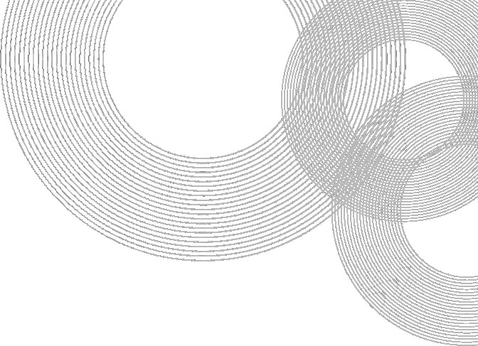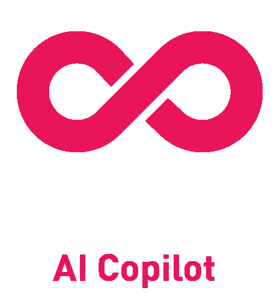

现已闪亮登场  
今天就在**CPX**博览会亲自体验

---

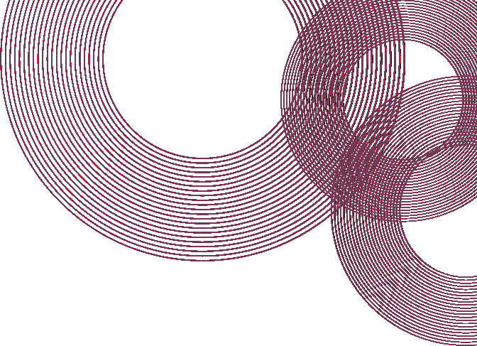

#### Check Point Infinity 平台

**AI**驱动云交付

保障网络安全

保障云安全

保障工作空间安全

---

**Maestro**数据中心  
**Smart-1 Cloud**  
**Quantum**安全网关  
**Spark**  
**SD-WAN**  
物联网

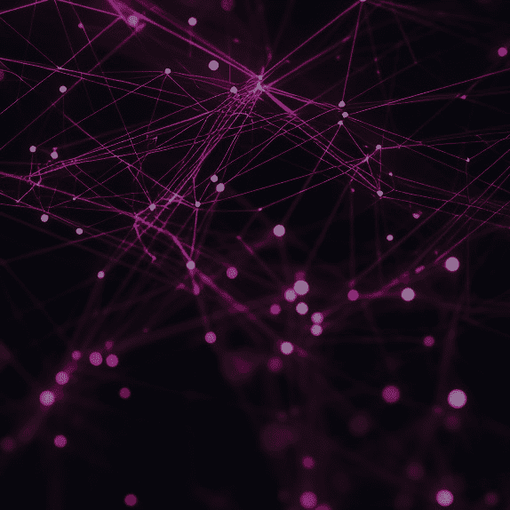

公有云  
私有数据中心  
企业网络  
远程站点  
外围

保障网状网络安全  
**AI驱动云交付**

---

#### Quantum Force – 10款新型AI安全网关

| 型号 | 吞吐量 |
|------|--------|
| 6900 | 7.4 Gbps |
| 6700 | 5.8 Gbps |
| 6600 | 3.7 Gbps |
| 7000 | 9.5 Gbps |
| 28000 | 30 Gbps |
| 26000 | 24 Gbps |
| 16200 | 15 Gbps |
| 6400 | 2.5 Gbps |
| 6200 | 1.8 Gbps |

Gen-V 威胁防护吞吐量：

| 型号 | 吞吐量 |
|------|--------|
| 29200 | 63.5 Gbps |
| 29100 | 47.4 Gbps |
| 19200 | 36.9 Gbps |
| 19100 | 28.8 Gbps |
| 9800 | 20 Gbps |
| 9700 | 16.6 Gbps |
| 9400 | 11 Gbps |
| 9300 | 9 Gbps |
| 9200 | 6.6 Gbps |
| 9100 | 5 Gbps |

- 50个基于AI的威胁防护引擎
- 行业最佳的99.8%未知恶意软件防御率

---

#### NVIDIA ConnectX InfiniBand智能网卡

助力业界顶级安全网关

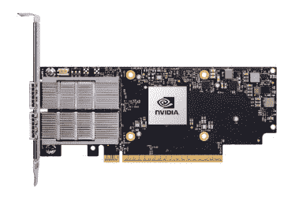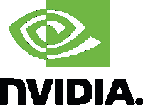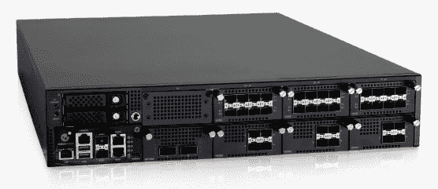

**Quantum Force**

---

#### Quantum 网络安全平台

更安全，操作更简单

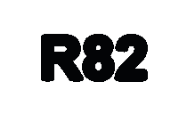

**R82** 上新

Check Point的独一无二之处：  
**50+** 项创新的新功能

- 轻松的**TLS**检查
- 为HTTP/3 over **QUIC**提供全面保护
- 基于API的动态策略层

---

**1 Tbps** 威胁防护吞吐量，**99.999%** 正常运行时间

灵活的防火墙集群选项：

- 1 Tbps威胁防护
- 无缝迁移和增加安全算力，无需中断网络
- 99.999%正常运行时间和智能负载均衡

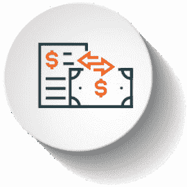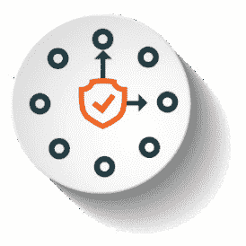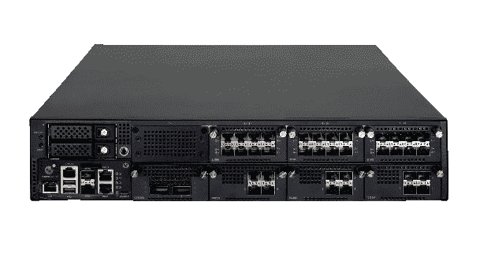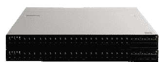

编排器  
防火墙  

**Maestro**弹性安全架构  
防火墙智能负载均衡

---

#### NVIDIA Spectrum 以太网平台

助力业界唯一的弹性安全架构

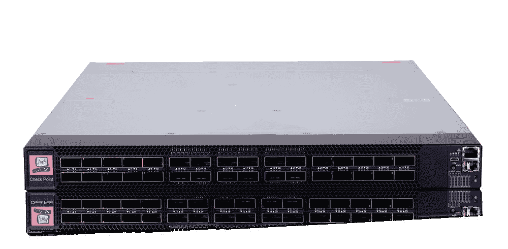

**Maestro**

---

#### Quantum Spark – 适用于中小型组织

小型组织（1-50名用户）  
将**Quantum Spark**扩展到“小型企业”，支持多达1000名用户，2倍性能，价格实惠

| 型号 | 吞吐量 |
|------|--------|
| 1600 | 1.5 Gbps |
| 1800 | 2 Gbps |

中型组织（50-500名用户）

| 型号 | 吞吐量 |
|------|--------|
| 1535 Pro | 440 Mbps |
| 1555 Pro | 600 Mbps |
| 1575 Pro | 650 Mbps |
| 1595 Pro | 900 Mbps |

小型企业（500-1000名用户）

| 型号 | 吞吐量 |
|------|--------|
| 1900 | 4 Gbps |
| 2000 | 5 Gbps |

---

#### 适用于中小型组织的 Quantum Spark

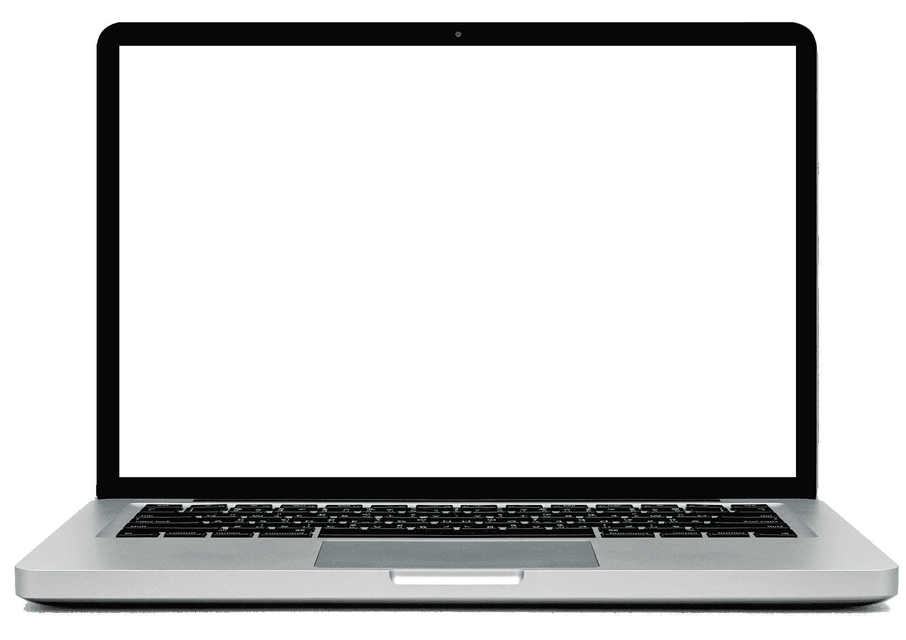

- 新的本地管理用户界面（上新）
- 集成SD-WAN（上新）
- 物联网安全自主防护（上新）

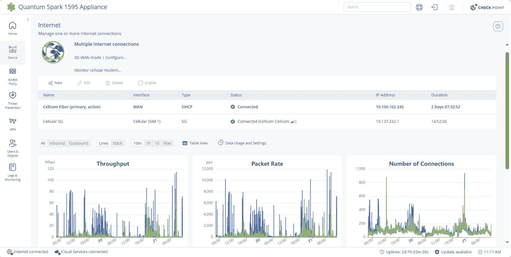

---

#### 提供最佳安全平台

**2024年最高安全评级**  
实时威胁防护的佼佼者

**99.8%** 零日+1攻击防护

在**Miercom 2024**安全基准测试中排名第一

**2024年安全基准报告**

0+1恶意软件防护率：

| 品牌 | 防护率 |
|------|--------|
| Check Point | **99.8%** |
| 竞品A | **47.8%** |
| 竞品B | **84%** |
| 竞品C | **69.4%** |
| 竞品D | **73.4%** |

15

©2024 Check Point Software Technologies Ltd.

\[Internal Use\] for Check Point employees

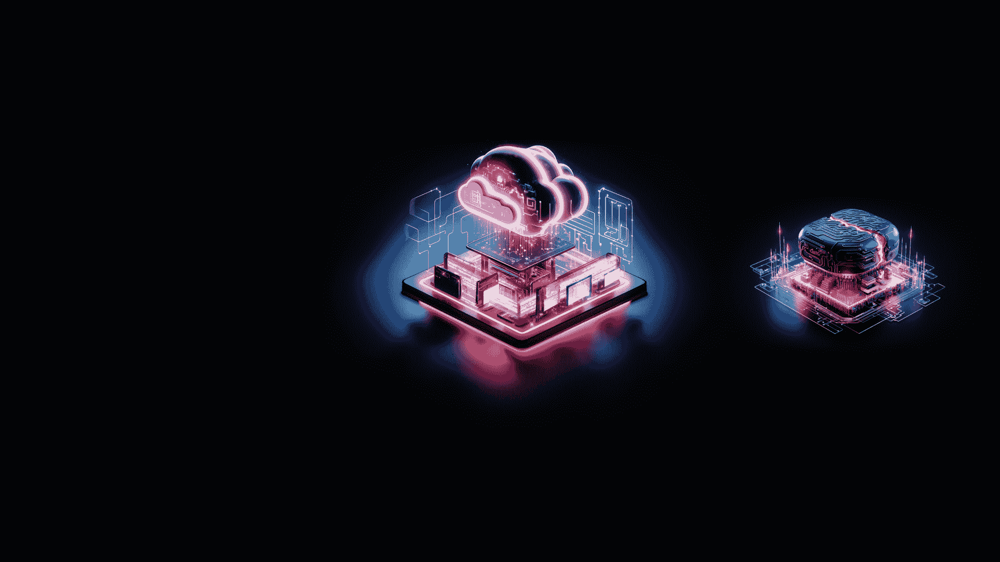

**实时威胁防护**

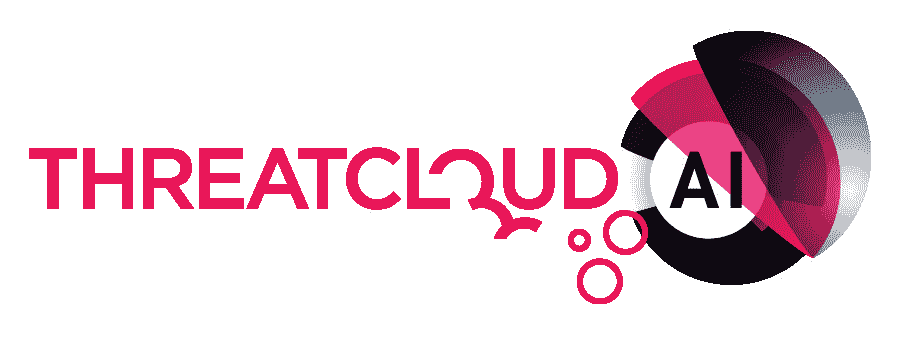

- **90+** 安全引擎
- **50+** 由人工智能驱动
- **30亿** 每年防御的攻击数量

15

©2024 Check Point Software Technologies Ltd.

16

©2024 Check Point Software Technologies Ltd.

#### NVIDIA CUDA 并行计算平台

助力全球顶尖威胁情报云

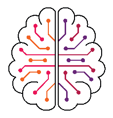

**人工智能技术**

50 多项人工智能和机器学习技术，可以识别及拦截前所未见的新威胁

**大数据威胁情报**

不断获取最新的威胁指标（IoC）以及应对最新实际攻击的防护手段

**99.8%** 安全有效性，业内最佳成果\*\*

©2024 Check Point Software Technologies Ltd.

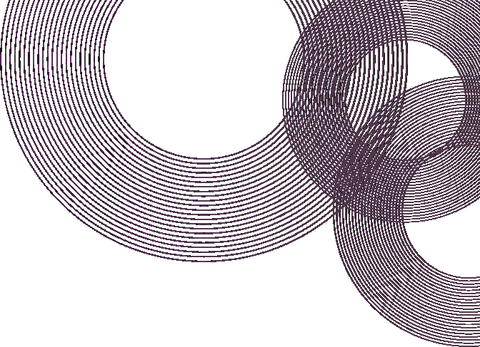

#### 保障网状网络安全

- 最优秀的威胁防御
- AI驱动云交付
- 出众的简洁性
- 卓越的性能

17

©2024 Check Point Software Technologies Ltd.

©2024 Check Point Software Technologies Ltd.

**保障网状网络安全**

- 最优秀的威胁防御
  - 久经考验
  - 坚持预防为先
  - 自主威胁防御
- AI驱动云交付
- 出众的简洁性
- 卓越的性能

©2024 Check Point Software Technologies Ltd.

**保障网状网络安全**

- 出众的简洁性
  - 无处不在的人工智能
  - 策略优化
  - 故障排除
  - 监控
  - 网络分段/访问策略
  - 在云端统一一切
- AI驱动云交付
- 卓越的性能
- 最优秀的威胁防御

©2024 Check Point Software Technologies Ltd.

**保障网状网络安全**

- 卓越的性能
  - 2倍性能
  - 轻松的TLS检查
  - 卓越的能源使用效率
- 出众的简洁性
- 最优秀的威胁防御

- AI驱动云交付

21

©2024 Check Point Software Technologies Ltd.

## Check Point和NVIDIA有着悠久的创新历史

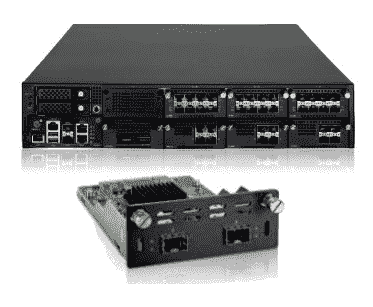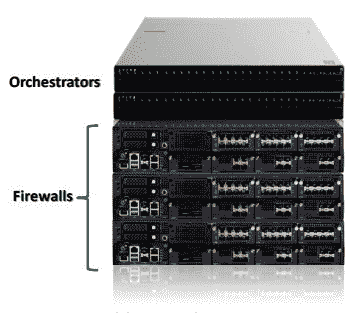

- **Check Point Quantum Force** 安全网关，由**NVIDIA ConnectX-7**提供支持
- **Check Point Maestro** 弹性安全架构，由**NVIDIA Spectrum**以太网平台提供支持
- **Check Point ThreatCloud** 威胁情报云，**50+ AI**引擎由**NVIDIA CUDA AI**提供支持

22

©2024 Check Point Software Technologies Ltd.

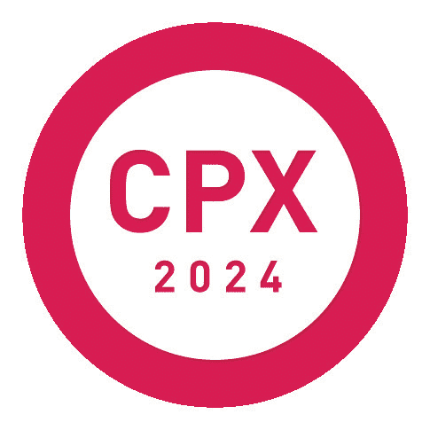

**Thank You!**
