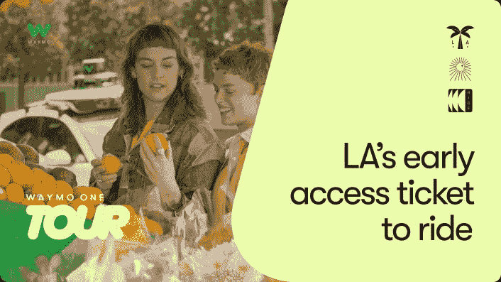

## Challenges & Solutions for the Expansion of Robotaxi Services

### Special Report: April 2024

**Analyzing NRI’s Global Survey On Consumers’ Perception of Robotaxi Services**

---

### Table of Contents

- **01 Trends in Robotaxi Services**
- **02 Profitability of Robotaxi Services**
- **03 Demand for Robotaxi Services**
- **04 Summary**

---

### 01 Trends in Robotaxi Services

**Commercialization of Robotaxi services has started in certain cities as local governments develop legislation.**

Source) Created by NRI from: 1 Metropolitan Police Department website, 2 JETRO business summary, 3 JETRO business summary, 4 China Ministry of Transportation, 5 JETRO business summary, 6 JETRO business summary, Baidu website, Waymo website and Cruise website.

**Legislation on autonomous driving level 4**

- **U.S.**
  - Phoenix, San Francisco
  - Austin
- **China**
  - Beijing, Shenzhen,
  - Chongqing, Wuhan

*In October 2023, GM Cruise suspended all Robotaxi services due to an accident with personal injury.

**Manufacturers**

- **W**: Waymo
- **C**: GM Cruise
- **B**: Baidu

**Regions with advanced Robotaxi services**

**Countries** | **Main Movements**
--- | ---
**Japan** | • Revised Road Traffic Act allows driverless autonomous driving services with remote monitoring. (April 2023)
**U.S.** | • Department of Transportation adds “vehicles equipped with automated driving systems” to Federal Motor Vehicle Safety Standards. (March 2022) • **Autonomous driving was permitted** by state laws or state executive orders in 40 states. (June 2023)
**China** | • The Ministry of Transportation formulates guidelines on safe transportation services with autonomous driving **to regulate the application of autonomous vehicles to transportation services.** (December 2023) • Shenzhen City **stipulates where responsibility lies in the event of an accident** in the country's first smart connected car management ordinance. (August 2022)
**Germany** | • The world's first automated driving law including Level 4 was enforced. (July 2021)

---

### 02 Profitability of Robotaxi Services

**The Robotaxi business model reduces drivers’ labor costs while increasing remote monitoring and manufacturing costs.**

**Challenges**

**Operation cost and cost benefits of Robotaxi (ToBe) compared to existing taxi**

| | Existing Taxi | Robotaxi (ToBe) | Cost Benefits |
|---|---|---|---|
| Driver's labor cost | 73% | - | ① **Reduced cost** |
| Vehicle manufacturing and maintenance cost | 4% | - | ② **Additional costs** |
| Labor cost for remote monitoring | - | - | ③ **Increased costs** |
| Others | 23% | - | - |
| **Total** | **100%** | **Sum of ①②③** | **Cost benefits of Robotaxi** |

**Solutions**

**To improve profitability**

**Cost Reduction**

**【Reduction in vehicle manufacturing cost】**

In July 2022, Baidu released **self-driving car "Apollo RT6"**, **which costs 5 million yen, one-tenth of the conventional price**.

**【Reduction of personnel cost for remote monitoring】**

In March 2023, SoftBank **conducted a demonstration experiment of remote monitoring systems** using AI, and **one person successfully monitored 10 self-driving cars**.

*To fundamentally resolve, it is necessary to ease regulations on the number of monitoring people by improving autonomous driving technology.

**Profit Growth**

**【Emergence of a new business model】**

Waymo is currently considering **a new advertising business** in which **customers are sent to advertisers' stores** by Robotaxis with **advertisers paying the fare**.

---

### 03 Demand for Robotaxi Services

**Overview of global consumer awareness surveys for Robotaxi services**

- **Period:** November 2023
- **Countries:** Japan, United States, Germany, China, Indonesia, Thailand
- **Methods:** Web survey
- **Targets:** Equally allocated by age (20s/30s/50s/60s) and gender (male/female)
- **Number of valid respondents:** 3,120 people (520 people per country x 6 countries)

**Survey results ①: Intention to use Robotaxis**

**Interest in using Robotaxis is low in developed countries but high in emerging countries.**

**Intention to use Robotaxis (by country)**

**Do you want to use Robotaxis in the future?**

| Country (Sample Size) | I want to use it | I do not want to use it | No idea / I am not interested in it |
| :--- | :---: | :---: | :---: |
| Japan (520) | 22.5% | 25.0% | 52.5% |
| U.S. (520) | 33.5% | 27.1% | 39.4% |
| Germany (520) | 29.8% | 26.5% | 43.7% |
| China (520) | 75.6% | 13.3% | 11.2% |
| Indonesia (520) | 77.1% | 6.3% | 16.5% |
| Thailand (520) | 75.0% | 16.9% | 8.1% |

\* ( ) is the number of samples.

**Survey results ②: Reasons for wanting to use Robotaxis**

**In five countries outside the U.S., the primary motivation for using Robotaxis is an "interest in new technologies and services."**

**Reasons for using Robotaxis (by country)**

**Please select the most appropriate reason you want to use Robotaxis.**

| Reasons | Japan (117) | U.S. (174) | Germany (155) | China (393) | Indonesia (401) | Thailand (390) |
| :--- | :---: | :---: | :---: | :---: | :---: | :---: |
| Feel safer than human driving | 22.2% | 35.6% | 29.0% | 29.3% | 23.9% | 31.5% |
| Feel more comfortable without a driver | 40.2% | 34.5% | 36.8% | 41.7% | 52.9% | 43.6% |
| Interested in new technologies and services | 14.5% | 13.8% | 10.3% | 19.1% | 13.5% | 11.3% |
| Would be cheaper | 9.4% | 12.9% | 6.4% | 6.9% | 5.8% | 5.1% |
| Would select the best route | 5.1% | 10.3% | 5.2% | 5.2% | (Not specified) | (Not specified) |
| Available in areas with insufficient means of transportation | (Not specified) | (Not specified) | (Not specified) | (Not specified) | (Not specified) | (Not specified) |
| Others | (Not specified) | (Not specified) | (Not specified) | (Not specified) | (Not specified) | (Not specified) |

\* ( ) is the number of samples.

---

### 04 Summary

*(Content for the summary section was not provided in the original text.)*

10

Copyright (C) Nomura Research Institute, Ltd. All rights reserved.

## The top reason for not wanting to use Robotaxis is concerns over safety.

### Survey results ③: Reasons for not wanting to use Robotaxis

#### Reasons for not using Robotaxis (by country)

Please select the most appropriate reason you do not want to use Robotaxis.

| Reason | Japan (130) | U.S. (141) | Germany (138) | China (69) | Indonesia (33) | Thailand (88) |
|---|---:|---:|---:|---:|---:|---:|
| Have concerns about the safety of self-driving technology | 69.2 | 76.6 | 64.5 | 78.3 | 63.6 | 77.3 |
| Feel safer with a driver | 15.4 | 14.2 | 19.6 | 11.6 | 33.3 | 9.1 |
| Looks difficult to use | 6.2 | 6.2 | 5.8 | 6.8 | — | — |
| Seems more expensive | — | — | — | — | — | — |
| Seems unable to select the best route | — | — | — | — | — | — |
| Want to enjoy conversation with the driver | — | — | — | — | — | — |
| Others | — | — | — | — | — | — |

*( ) is the number of samples.

11

Copyright (C) Nomura Research Institute, Ltd. All rights reserved.

## Individuals who have seen or used Robotaxi services express fewer safety concerns compared to those who have not.

### Survey results ④: Reasons for not wanting to use Robotaxis (by usage experience)

#### Reasons for not using Robotaxis (all countries summed up and sorted by user experience)

Please select the most appropriate reason you do not want to use Robotaxis.

| Reason | I have used it before (25) | I have never used it but seen it before (96) | I have never used or seen it before (478) |
|---|---:|---:|---:|
| Have concerns about the safety of self-driving technology | 52.0 | 60.4 | 75.1 |
| Feel safer with a driver | 28.0 | 18.8 | 14.4 |
| Looks difficult to use | 8.3 | 16.0 | 5.2 |
| Seems more expensive | 5.2 | — | — |
| Seems unable to select the best route | — | — | — |
| Want to enjoy conversation with the driver | — | — | — |
| Others | — | — | — |

*( ) is the number of samples.

12

Copyright (C) Nomura Research Institute, Ltd. All rights reserved.

## The common dissatisfying factor with taxi and ride-sharing services is high fares, except in China where wait-time is the biggest issue.

### Survey results ⑤: Dissatisfaction with existing taxi and ride-sharing services

#### Dissatisfaction with existing taxi and ride-sharing (by country)

Please select the option which best describes your dissatisfaction with existing taxi and ride-sharing services.

| Dissatisfaction | Japan (520) | U.S. (520) | Germany (520) | China (520) | Indonesia (520) | Thailand (520) |
|---|---:|---:|---:|---:|---:|---:|
| The fare is high | 43.8 | 31.7 | 57.3 | 26.5 | 32.1 | 37.1 |
| Takes time to dispatch | 13.5 | 13.1 | 14.2 | 39.2 | 29.2 | 17.5 |
| Feels bothersome to communicate with the driver | 7.5 | 5.2 | 6.5 | 6.5 | 8.3 | 11.0 |
| Feels dissatisfied with the route to destination | 10.0 | 7.7 | 6.7 | 29.6 | 45.0 | 18.1 |
| Others | 17.3 | 21.0 | 26.7 | — | — | — |
| Nothing | — | — | — | — | — | — |

*( ) is the number of samples.

13

Copyright (C) Nomura Research Institute, Ltd. All rights reserved.

## Expectations for new riding experiences from Robotaxis vary across different countries.

### Survey results ⑥: Expectations for new riding experiences

#### Expectations for new riding experiences (by country)

In the future, the following new riding experiences could be realized for Robotaxis.

Please select the option you find most attractive.

| Experience | Japan (520) | U.S. (520) | Germany (520) | China (520) | Indonesia (520) | Thailand (520) |
|---|---:|---:|---:|---:|---:|---:|
| Seats facing each other for easy conversation | 21.3 | 16.7 | 25.8 | 11.3 | 23.7 | 19.6 |
| Large door that allows wheelchairs and strollers to get in and out | 17.1 | 18.5 | 10.6 | 26.3 | 23.8 | 16.7 |
| Reclining seat to lie down and sleep | 8.3 | 8.8 | 16.7 | 15.8 | 23.5 | 18.1 |
| Work environment with a second display | 7.1 | 6.0 | 11.3 | 5.8 | 17.1 | 8.8 |
| Large screen to watch TV and movies | 11.7 | 8.5 | 11.5 | 6.5 | 8.7 | 5.8 |
| Entertainment such as games, music and karaoke to enjoy in the car | 6.5 | 19.0 | 6.9 | 5.2 | 35.4 | 29.6 |
| — | — | — | 28.8 | 9.4 | 13.8 | — |

*( ) is the number of samples.

14

Copyright (C) Nomura Research Institute, Ltd. All rights reserved.

## Clarifying the service benefits motivates interested individuals, while improving awareness and addressing safety concerns are crucial for attracting the uninterested.

### Implications from the survey results: Challenges

| Attribute | Reason | Challenge |
|---|---|---|
| Interested in new technologies and services (from survey result ②) | Individuals who like to use the service | Clarify the benefit of using Robotaxis |
| Having concerns about safety (from survey result ③) | Individuals who are not interested | Improve awareness and address safety concerns |

- *People who selected “I want to use it”*
- *People who selected “I don’t want to use it” or “I don’t know / I’m not interested”*

Important in developed countries (Japan, U.S., Germany), where usage intention is especially low. (from survey result ①)

15

Copyright (C) Nomura Research Institute, Ltd. All rights reserved.

## Competitive fares and locally tailored services are essential for a successful business expansion.

### Strategy for Robotaxi services’ expansion 1/2

*Extracted options selected over 15% from survey results ⑤ and ⑥.*

#### How to better clarify the benefits of Robotaxis to people who show interest

| Challenge | Survey results | Japan | U.S. | Germany | China | Indonesia | Thailand |
|---|---|---:|---:|---:|---:|---:|---:|
| Dissatisfaction with existing services: The fare is high | — | 44% | 37% | 32% | 27% | 57% | 32% |
| Dissatisfaction with existing services: Takes time to dispatch | — | 39% | 29% | 18% | 21% | 17% | 19% |
| Expectations for new ride experiences: Reclining seat to lie down and sleep | — | 26% | 24% | 20% | 17% | 17% | 15% |
| Expectations for new ride experiences: Large door that allows wheelchairs and strollers | — | 24% | 18% | 19% | 17% | 24% | 18% |
| Expectations for new ride experiences: Seats facing each other for easy conversation | — | 19% | 26% | 24% | 17% | 17% | 15% |
| Expectations for new ride experiences: Entertainment such as games, music and karaoke | — | 21% | 17% | 26% | 24% | 17% | 17% |
| Expectations for new ride experiences: Work environment with a second display | — | 26% | 24% | 17% | 17% | 15% | 24% |

*Red indicates the most selected option in each country.*

16

Copyright (C) Nomura Research Institute, Ltd. All rights reserved.

## Increasing touchpoints in vehicles helps raise brand awareness and alleviate customer safety concerns.

### Strategy for Robotaxi services’ expansion 2/2

#### Improve awareness and alleviate safety concerns for uninterested individuals

- Those who have used or seen Robotaxis trust their safety more than those who have never encountered them (based on survey results ④).
- Increase touchpoints with actual vehicles, such as ride experience events.

### Example of creating touchpoints with vehicles

#### Waymo One Tour

In October 2023, Waymo began a tour event visiting multiple areas in Los Angeles, distributing merchandise and test drive tickets to residents and visitors.

Source: Image taken from Waymo website

### Challenge / Survey Results / Strategies for Solving Issues

## Needs to clarify the benefits in emerging countries, while improving awareness and alleviating safety concerns are key in developed countries.

### For global expansion of Robotaxi services

- **Clarify the benefits of Robotaxis**
  - **Competitive pricing** and **locally tailored services**
- **Improve awareness and alleviate safety concerns**
  - **Increase touchpoints with actual vehicles** such as ride experience events

| | **Developed countries (Japan, U.S., Germany)** | **Emerging countries (China, Indonesia, Thailand)** |
|---|---|---|
| **Challenges** | **High** | **Low** |
| **Strategy** | **Usage Intention** | **High** |

---

## Trends in Robotaxi Services

### 01 Profitability of Robotaxi Services

### 02 Demand for Robotaxi Services

### 03 Summary

### 04

---

## For the widespread adoption of Robotaxi services, strategies must address both profitability and demand.

### Summary

| | **Profitability** | **Demand** |
|---|---|---|
| **Strategies** | - **Reduce labor costs of monitoring** by AI-based remote monitoring tools - **Reduce vehicle manufacturing and maintenance cost** by using low-cost self-driving cars - Increase profits by new advertising businesses | - **Improve awareness and alleviate safety concerns**   - **Increase touchpoints with actual vehicles**, such as ride experience events - **Clarify the benefits of using Robotaxis**   - **Competitive pricing**   - **Locally tailored services** |
| **Challenges** | | |

---

## Future Outlook for Robotaxi Services: Creating new market

### New business opportunities in traditionally unprofitable sectors such as buses and taxis.

**ZEN Connect: Autonomous Driving Transportation Service "ZEN drive"**

- **Services**
  - First self-driving level 4 transportation service approved in Japan in March 2023
  - Operation of approximately 2km between districts of Araya and Shih
  - One person can monitor up to 3 vehicles in a remote monitor room
- **Achievements**
  - Approximately 50 users per day

- The low operational costs of Robotaxis can transform unprofitable businesses into profitable new markets.
- **In car-dependent cities, new transportation and delivery services may emerge.**

**Markets created by Robotaxi services (image diagram)**

| Region A | Region B | Region C | Region D | Region E | Region F | Region G | Region H |
|---|---|---|---|---|---|---|---|
| **Mobility Service Market Size** | | | | | | | |

- **Urban areas**: Existing taxi markets / Markets for future Robotaxi services
- **Suburbs**: Market created by Robotaxis
- **Depopulated areas**: Market created by Robotaxis

---

**GM Cruise, Walmart: Self-Driving Product Delivery Service**

- **Services**
  - Product delivery service using self-driving cars in partnership with Walmart
  - Unique authentication technology prevents mix-ups and theft
- **Achievements**
  - Thousands of deliveries in Phoenix, Arizona, USA

Source) Created by NRI from interview with ZEN Connect, Ministry of Economy, Trade and Industry website, ZEN-drive pamphlet, and GM Cruise website.

---

## Authors

**Aoi Sasagawa**  
Associate Consultant, NRI  
nri-syscon-linkedin@nri.co.jp

**Mina Hashimoto**  
Associate Consultant, NRI  
nri-syscon-linkedin@nri.co.jp

NRI Systems Consulting offers a wide range of services to enterprises and government institutions aimed at improving their ability to leverage IT. These services include supporting the development of IT strategy, planning and implementing business reforms using IT, creating standard architecture, and establishing group and global IT governance. Learn more about our service.

