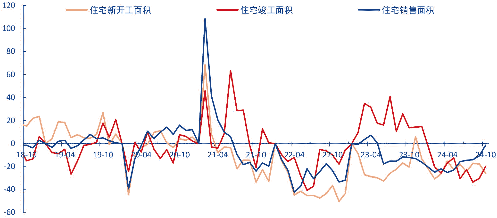
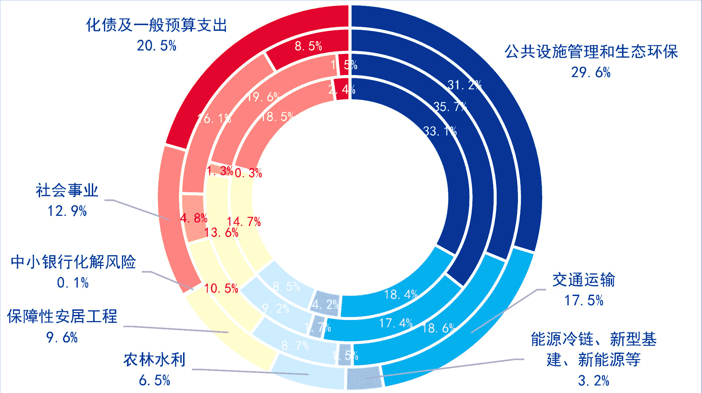
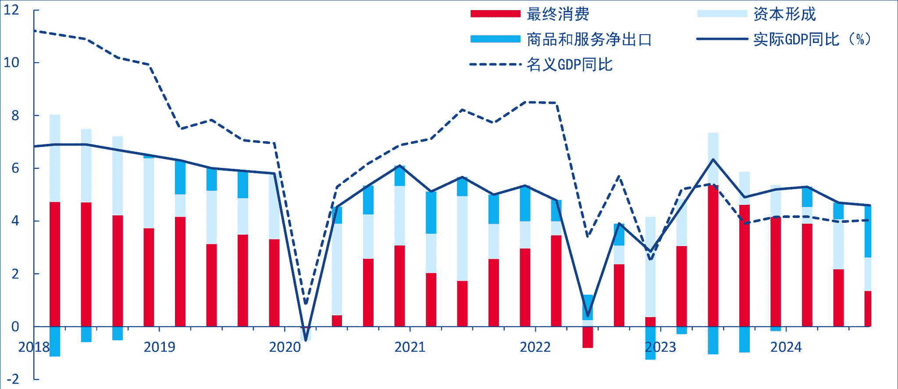
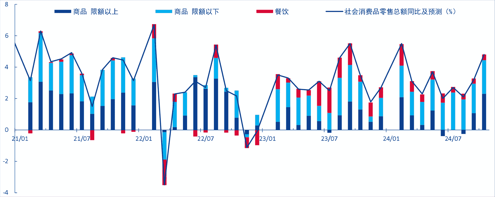
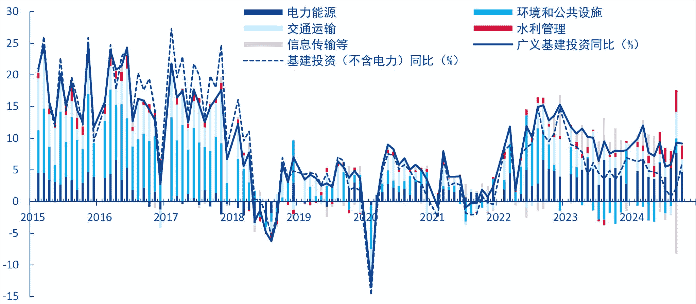
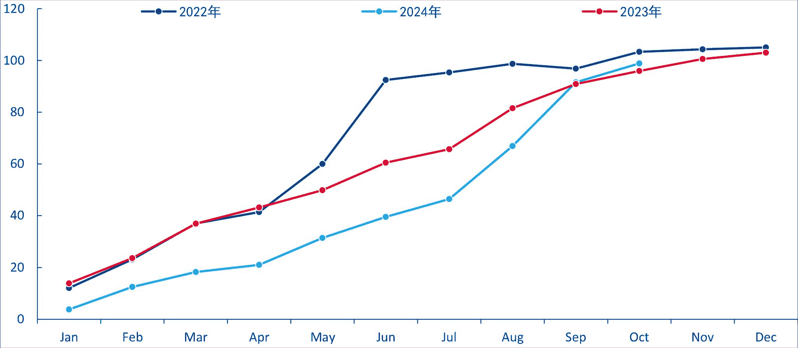
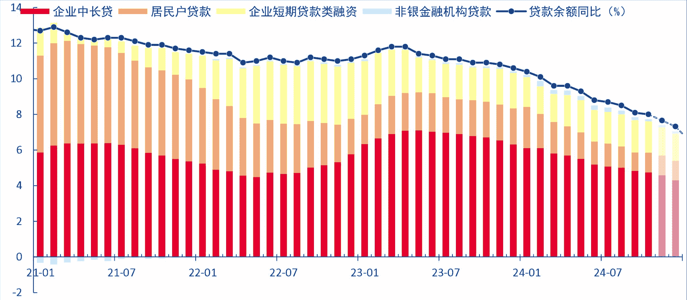
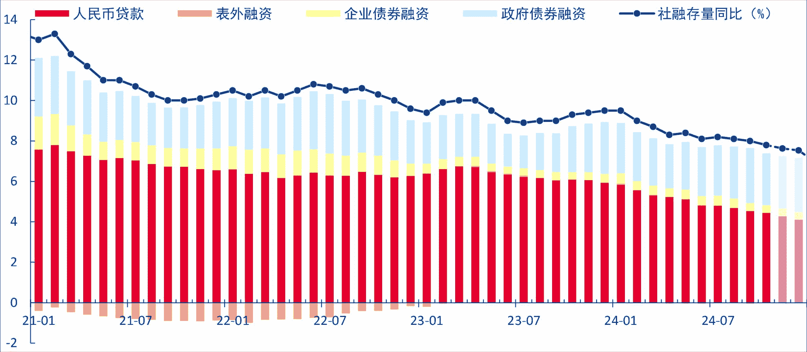
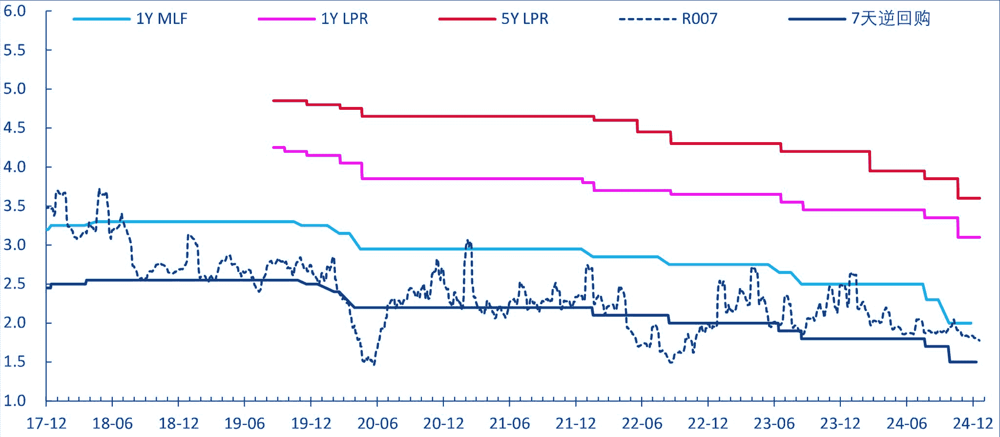
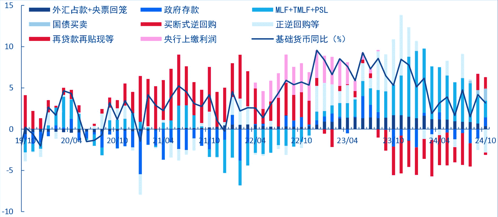

http://www.huajinsc.cn/

1 / 10

请务必阅读正文之后的免责条款部分

2024 年12 月09 日

宏观类●证券研究报告

## 政策全面转向积极，优先稳定楼市股市提振消费

### 主题报告

### 12.9 政治局会议解读

### 投资要点

- 首次坦率务实地提出稳定楼市股市的明确要求，预计房地产市场供需两方面均有增量政策可期，机构长期资金入市和上市公司并购优良资产将得到持续的政策鼓励。与历年会议形成强烈对比的是，本次明确要求“稳住楼市股市”。预计2025 年稳定楼市的政策主要包括两个方面：一是供给侧通过大幅增加专项债用于保障房收储现房、收回存量闲置土地的资金额度的方式优化商品房存量，预计专项债中可能有6000-8000 亿额度用于上述领域，以改善开发商流动性，加速预售住宅交付竣工，也可望对居民耐用品消费形成增量带动。二是进一步引导放松残留的部分限购措施并引导LPR 有所下行，以加快扭转地产需求预期。稳定股市的政策主要可能从两个方向持续展开：一是加大力度鼓励机构中长期资金入市，包括保险、理财、社保等投资机构长期资金；二是对于一些新质生产力领域寻求上市的优质资产，在IPO 节奏受到一定控制的背景下鼓励并购重组。

- 关注外部冲击的背景下，提级要求“全方位”扩大国内需求，消费要“大力提振”，投资强调提高效益，稳增长优先级或稍低于刺激消费。具有缩量提质色彩的供给侧改革表述弱化，旨在激发企业活力稳定预期。新增防范化解“外部冲击”的要求，呼应特朗普较其第一任期更加激进的广泛性和针对性关税主张。在此背景下，会议将“全方位扩大国内需求”的要求提升至供给侧新质生产力要求之前，突出了扩大内需的迫切性。要求“大力提振消费，提高投资效益”，消费政策主动刺激的力度似有大幅提升，这也显示出9 月至今集中实施的汽车、家电消费补贴产生显著促进作用，并计划延续以优先保障可持续的消费拉动政策力度。消费补贴在属性上应进入一般公共预算支出，预计中央财政有望主导2025 年拨付5000 亿左右财政资金用于全年加码实施高强度消费补贴，范围预计将扩展至家具建材、通信器材等领域。投资方面，“提高效益”的要求或与隐债置换包含的“严控新增隐债”相对应，基建投资预计增速中枢与今年基本持平，传统低效基建或进一步压降，数字化智慧化新型城建或成为新的结构性增长点。考虑内外部需求阶段性压力变化，预计2025 年经济增长目标定在4.5%左右。

- 经济政策全面转向积极有为，预计加速化债腾挪空间，财政赤字率提升至4.2%，专项债扩容至4.2 万亿。会议指出要“实施更加积极有为的宏观政策”，总量强度和结构精准度的要求均超过去年同期会议。财政政策本次会议定调为“更加积极”，预计在10 万亿化债方案确定并快速推进的背景下，如地方政府严格执行“严控新增隐债”“发行一批、置换一批”的要求，则企业部门被隐债占用的低效贷款等债务杠杆有望已经开始了一轮加速去化过程，由此可腾挪出中央财政提升赤字率、增加一般预算内高效率财政支出强度的明显空间。预计2025 年一般公共预算赤字率将扩大至4.2%左右，对应的普通国债增发规模预计将超过1.5 万亿，可保障养老、医疗等领域更高的刚性支出增速，满足消费补贴的全年力度，并对土地出让金收入可能出现的进一步下滑导致的调入一般预算资金减少形成缓冲。

- 货币政策转为适度宽松，有望全年降息40BP、降准100-150BP，人民币汇率则可能呈现更大弹性，预计2025 年波动区间7.2-7.6。年初以来央行面对居民企业内生投融资需求降温的局面，突出货币政策的支持性和精准性，结合本次会议“适度宽松”（而非此前多年的“稳健”）的定调，预计2025 年货币政策重点在于三方面：一是继续引导实体经济融资成本有所下行，预计政策利率和LPR 全年等幅度下调40BP 左右；二是考虑到降准置换MLF 较之增量购买国债等置换MLF 方式对商业银行来说成本更低，对债市收益率的向下压力也相对更小，预计2025 年降准100-150BP；三是综合考虑人民币汇率波动弹性和汇率稳定性之间的平衡，在美元指数可能因特朗普激进政策主张而趋于震荡上行的局面下，人民币相对美元汇率中枢有必要允许一定的下跌，以避免人民币一篮子汇率走强导致更大程度的出口冲击，但同时降息可能集中在上半年推进。

- 风险提示：财政扩张、货币宽松力度低于预期风险，人民币贬值过快风险。

分析师

秦泰

SAC 执业证书编号：S0910523080002

qintai@huajinsc.cn

相关报告

飓风罢工消退，美就业强劲恢复并可能延续——美国就业数据点评（2024.11）2024.12.7

化债或加速贷款降温，新型城建缓解“项目荒”——华金宏观·双循环周报（第85 期）2024.12.6

消费刺激和抢出口小幅推升PMI——PMI 点评（2024.11）2024.11.30

美国消费火热或将大幅限制美联储降息幅度——华金宏观·双循环周报（第84 期）2024.11.29

营收改善幅度弱于利润，价格或是主要拖累——工业企业利润点评（2024.10）2024.11.27

### 图表目录

图1：住宅销售、新开工、竣工面积同比（%）................................................................................................. 3

图2：地方政府新增债务投向领域结构（从内之外：2021、2022、2023、2024.1-10）...........................................4

图3：中国实际GDP 同比及贡献结构、名义GDP 同比（%）.......................................................................... 5

图4：限额以上商品零售同比及贡献结构（%）................................................................................................. 5

图5：社会消费品零售总额同比及贡献结构（%）..............................................................................................6

图6：广义基建投资同比及行业领域贡献结构（%）..........................................................................................6

图7：地方政府新增债务累计发行进度（%）.....................................................................................................7

图8：贷款余额同比增速及贡献结构（%）........................................................................................................ 7

图9：社融存量同比增速及贡献结构（%）........................................................................................................ 8

图10：R007 及政策利率体系（%）...................................................................................................................9

图11：基础货币同比及贡献结构（%）..............................................................................................................9

对中央经济工作会议具有政策指导意义的12 月政治局会议今日召开，定调明年经济增长目标务实坦率，货币财政政策强调积极有为，全方位扩大内需特别是提振消费的优先度提升至首位，由此可见明年经济政策组合力度方向的初步端倪。

## 一、首次坦率务实地提出稳定楼市股市的明确要求，预计房地产市场供需两方面均有增量政策可期，机构长期资金入市和上市公司并购优良资产将得到持续的政策鼓励

与历年同期会议形成强烈对比的首先是本次会议明确要求“稳住楼市股市”，与9 月底政治局会议对楼市股市政策方向罕见的详细阐述相呼应，预计当时所提出的诸多具体政策方向在2025 年仍将持续并可能以更大力度实施。预计2025 年稳定楼市的政策主要包括两个方面：一是供给侧加大商品房严控增量、优化存量、提高质量的水平，主要通过大幅增加专项债用于保障房收储现房、收回存量闲置土地的资金额度的方式实现，预计2025 年专项债中可能有6000-8000 亿额度用于上述领域，以此改善开发商和产业链流动性，加速预售住宅交付竣工，这一点也可望对居民耐用品消费形成增量带动。二是进一步引导放松残留的部分限购措施并引导LPR 有所下行，以进一步减少居民购房限制，降低购房的增量和存量成本，加快扭转地产需求预期。稳定股市的政策主要可能从两个方向持续展开：一是加大力度鼓励机构中长期资金入市，包括保险、理财、社保等投资机构长期资金基于自身专业判断的主动长期增持行为预计将持续得到鼓励；二是对于一些新质生产力领域寻求上市的优质资产，在IPO 节奏受到一定控制的背景下，通过上市公司并购重组的方式打通一二级市场退出机制或将成为政策鼓励的主要方式。

### 图1：住宅销售、新开工、竣工面积同比（%）

资料来源：*CEIC*，华金证券研究所

### 图2：地方政府新增债务投向领域结构（从内之外：2021、2022、2023、2024.1-10）

资料来源：*CEIC*，华金证券研究所

## 二、关注外部冲击的背景下，提级要求“全方位”扩大国内需求，消费要“大力提振”，投资强调提高效益，稳增长优先级或稍低于刺激消费。具有缩量提质色彩的供给侧改革表述弱化，旨在激发企业活力稳定预期

与去年同期会议相比，本次会议新增了防范化解“外部冲击”的要求，呼应即将二度入主白宫的美国候任总统特朗普较其第一任期更加激进的广泛性和针对性加征关税措施可能造成的新增出口下行风险。在此背景下，本次会议将“全方位扩大国内需求”的要求提升至供给侧科技创新引领新质生产力、建设现代化产业体系的要求之前，突出了扩大内需的迫切性。在消费和投资内需的关系方面，要求“大力提振消费，提高投资效益”，与去年同期会议“形成消费和投资相互促进的良性循环”要求相比，消费方面政策主动刺激的力度似有大幅提升，这也显示出今年9 月至今全国集中实施的一轮汽车、家电消费补贴对消费产生的显著促进作用得到中央层面的高度关注，并计划延续以优先保障可持续的消费拉动政策力度。由于消费补贴在属性上应当进入一般公共预算支出，预计在化债快速推进、隐性债务杠杆压降的背景下，中央财政有望主导2025 年赤字率扩张至4.2%左右高位，其中拨付5000 亿左右资金规模用于全年加码实施可持续的高强度消费补贴，并且预计补贴范围将扩展至家具建材（家居）、通信器材等领域，以拉动商品消费内需增速显著提升。投资方面，“提高效益”的要求或与隐债置换包含的“严控新增隐债”相对应，基建投资预计增速中枢与今年基本持平，传统低效基建或进一步压降，数字化智慧化新型城建或成为新的结构性增长点。考虑内外部需求阶段性压力变化，预计2025 年经济增长目标定在4.5%左右，并预计能够得到顺利实现。

### 图3：中国实际GDP 同比及贡献结构、名义GDP 同比（%）

资料来源：*CEIC*，华金证券研究所

注：*2020-2021* 年为两年平均增速

### 图4：限额以上商品零售同比及贡献结构（%）

资料来源：*CEIC*，华金证券研究所

注：*2020-2021* 年，*2022* 年*4-5* 月、*10-12* 月，*2023* 年*3-5* 月、*10-12* 月为两年平均增速

### 图5：社会消费品零售总额同比及贡献结构（%）

资料来源：*CEIC*，华金证券研究所

注：*2020-2021* 年，*2022* 年*4-5* 月、*10-12* 月，*2023* 年*3-5* 月、*10-12* 月，*2023* 年*3-5* 月、*10-12* 月为两年平均增速

### 图6：广义基建投资同比及行业领域贡献结构（%）

资料来源：*CEIC*，华金证券研究所

注：*2020-2021* 年为两年平均增速

## 三、经济政策全面转向积极有为，预计加速化债腾挪空间，财政赤字率提升至4.2%，专项债扩容至4.2 万亿

无论是稳住楼市股市，还是全方位扩大国内需求，都需要宏观经济政策总量发力、传导高效，本次会议对此提出明确要求，指出要“实施更加积极有为的宏观政策”，总量强度和结构精准度的要求均超过去年同期会议的“强化宏观政策逆周期和跨周期调节”。财政政策方面，本次会议定调为“更加积极”，预计在10 万亿化债方案确定并已经快速推进的背景下，如果地方政府严格执行“严控新增隐债”“发行一批、置换一批”的要求，则企业部门被隐债占用的低效贷款等债务杠杆有望已经开始了一轮加速去化过程，由此可腾挪出中央财政提升赤字率、增加一般预算内高效率财政支出强度的明显空间。在此基础上，我们预计2025 年一般公共预算赤字率将扩大至4.2%左右，对应的普通国债增发规模预计将超过1.5 万亿，除可以保障养老、医疗等领域较今年更高的刚性财政支出增速之外，还可满足上文所述消费补贴的全年力度，并对土地出让金收入可能出现的进一步下滑导致的调入一般预算资金减少形成缓冲。

### 图7：地方政府新增债务累计发行进度（%）

资料来源：*CEIC*，华金证券研究所

### 图8：贷款余额同比增速及贡献结构（%）

### 图9：社融存量同比增速及贡献结构（%）

资料来源：*CEIC*，华金证券研究所

## 四、货币政策转为适度宽松，有望全年降息40BP、降准100-150BP，人民币汇率则可能呈现更大弹性，预计2025 年波动区间7.2-7.6

年初以来央行面对居民和企业内生性投融资需求降温的局面，突出强调货币政策的支持性和精准性，结合本次会议“适度宽松”（而非此前持续多年的“稳健”）的务实定调，预计2025 年货币政策重点在于三方面：一是继续引导实体经济融资成本有所下行，预计政策利率和LPR 全年等幅度下调40BP 左右，相应地预计将引导存款利率、理财产品收益率亦等幅度甚至更大幅度下调；二是在货币政策数量工具选择方面强调精准性和传导效率提升，考虑到降准置换MLF 较之增量购买国债等置换MLF 方式对商业银行来说成本更低，对债市收益率的向下压力也相对更小，预计2025 年央行可能更积极采取降准方式进行长期流动性投放，预计全年降准100-150BP；三是综合考虑人民币汇率波动弹性和汇率稳定性之间的平衡，在美元指数可能因特朗普激进政策主张而趋于震荡上行的局面下，人民币相对美元汇率中枢有必要允许一定的下跌，以避免人民币一篮子汇率走强导致更大程度的出口冲击，但同时亦需避免在美联储政策立场转鹰的阶段实施降息而导致人民币贬值预期强化，这意味着2025 年人民币国际化推动或将较为缓慢，同时降息可能集中在上半年推进。

### 主题报告

http://www.huajinsc.cn/

请务必阅读正文之后的免责条款部分

**图10：R007 及政策利率体系（%）**

资料来源：*CEIC*，华金证券研究所

**图11：基础货币同比及贡献结构（%）**

资料来源：*CEIC*，华金证券研究所

风险提示：财政扩张、货币宽松力度低于预期风险，人民币被动贬值幅度过大限制货币政策空间风险。

---

### 主题报告

http://www.huajinsc.cn/

请务必阅读正文之后的免责条款部分

### 分析师声明

秦泰声明，本人具有中国证券业协会授予的证券投资咨询执业资格，勤勉尽责、诚实守信。本人对本报告的内容和观点负责，保证信息来源合法合规、研究方法专业审慎、研究观点独立公正、分析结论具有合理依据，特此声明。

### 本公司具备证券投资咨询业务资格的说明

华金证券股份有限公司（以下简称“本公司”）经中国证券监督管理委员会核准，取得证券投资咨询业务许可。本公司及其投资咨询人员可以为证券投资人或客户提供证券投资分析、预测或者建议等直接或间接的有偿咨询服务。发布证券研究报告，是证券投资咨询业务的一种基本形式，本公司可以对证券及证券相关产品的价值、市场走势或者相关影响因素进行分析，形成证券估值、投资评级等投资分析意见，制作证券研究报告，并向本公司的客户发布。

### 免责声明：

本报告仅供华金证券股份有限公司（以下简称“本公司”）的客户使用。本公司不会因为任何机构或个人接收到本报告而视其为本公司的当然客户。

本报告基于已公开的资料或信息撰写，但本公司不保证该等信息及资料的完整性、准确性。本报告所载的信息、资料、建议及推测仅反映本公司于本报告发布当日的判断，本报告中的证券或投资标的价格、价值及投资带来的收入可能会波动。在不同时期，本公司可能撰写并发布与本报告所载资料、建议及推测不一致的报告。本公司不保证本报告所含信息及资料保持在最新状态，本公司将随时补充、更新和修订有关信息及资料，但不保证及时公开发布。同时，本公司有权对本报告所含信息在不发出通知的情形下做出修改，投资者应当自行关注相应的更新或修改。任何有关本报告的摘要或节选都不代表本报告正式完整的观点，一切须以本公司向客户发布的本报告完整版本为准。

在法律许可的情况下，本公司及所属关联机构可能会持有报告中提到的公司所发行的证券或期权并进行证券或期权交易，也可能为这些公司提供或者争取提供投资银行、财务顾问或者金融产品等相关服务，提请客户充分注意。客户不应将本报告为作出其投资决策的惟一参考因素，亦不应认为本报告可以取代客户自身的投资判断与决策。在任何情况下，本报告中的信息或所表述的意见均不构成对任何人的投资建议，无论是否已经明示或暗示，本报告不能作为道义的、责任的和法律的依据或者凭证。在任何情况下，本公司亦不对任何人因使用本报告中的任何内容所引致的任何损失负任何责任。

本报告版权仅为本公司所有，未经事先书面许可，任何机构和个人不得以任何形式翻版、复制、发表、转发、篡改或引用本报告的任何部分。如征得本公司同意进行引用、刊发的，需在允许的范围内使用，并注明出处为“华金证券股份有限公司研究所”，且不得对本报告进行任何有悖原意的引用、删节和修改。

华金证券股份有限公司对本声明条款具有惟一修改权和最终解释权。

### 风险提示：

报告中的内容和意见仅供参考，并不构成对所述证券买卖的出价或询价。投资者对其投资行为负完全责任，我公司及其雇员对使用本报告及其内容所引发的任何直接或间接损失概不负责。

### 华金证券股份有限公司

**办公地址：**

上海市浦东新区杨高南路759 号陆家嘴世纪金融广场30 层

北京市朝阳区建国路108 号横琴人寿大厦17 层

深圳市福田区益田路6001 号太平金融大厦10 楼05 单元

**电话：** 021-20655588

**网址：** www.huajinsc.cn
