# 免疫疾病用药深度二：踏时代浪潮，自免药物乘风而起

## （上篇）

**证券研究报告·医药行业研究·创新药系列**

**贺菊颖**

hejuying@csc.com.cn

SAC 编号：S1440517050001

SFC 编号：ASZ591

**袁清慧**

yuanqinghui@csc.com.cn

SAC 编号：S1440520030001

SFC 编号：BPW879

**发布日期：2024年7月7日**

本报告由中信建投证券股份有限公司在中华人民共和国（仅为本报告目的，不包括香港、澳门、台湾）提供。在遵守适用的法律法规情况下，本报告亦可能由中信建投（国际）证券有限公司在香港提供。

同时请务必阅读正文之后的免责条款和声明。

**研究助理：**

**魏佳奥**

weijiaao@csc.com.cn

# 摘要

- **核心观点：自身免疫类疾病与II型炎症的患者规模正在迅速增长，市场规模仅次于肿瘤药物，处于加速发展期。**现有的药物在疗效与安全性上仍然拥有巨大的进步空间。近年来，相关新药不断涌现，新靶点或是新作用机制药物层出不穷。本篇涉及的各项适应症中，系统性红斑狼疮、类风湿关节炎、强直性脊柱炎和多发性硬化的研发管线较多，系统性红斑狼疮、强直性脊柱炎、多发性硬化和慢性炎性脱髓鞘性多发性神经根神经病较为难治。后续建议关注系统性红斑狼疮、类风湿关节炎、强直性脊柱炎、多发性硬化等领域投资机会。

- **上篇主要介绍了自身免疫性疾病药物近年来的发展和全球市场规模，讨论了治疗热门靶点。**对主要的18个自免疾病按器官系统进行归类，并展开介绍了系统性红斑狼疮、类风湿关节炎和强直性脊柱炎等7个疾病，同时详细列举了治疗药物的管线进展并且分析了重点适应症的竞争格局。涉及公司基本面信息和具体的在研管线，同时归纳了本年度全球重点公司的自免管线催化剂事件。汇总了相关自免公司恒瑞医药、信达生物、康方生物、康诺亚、泽璟制药、和黄医药、荣昌生物、诺诚健华、再鼎医药、智翔金泰、三生国健、康哲药业、丽珠集团、益方生物和先声药业。

- **中国自免市场以银屑病和强直性脊柱炎为主，2030年有望达到247亿美元。**自免类疾病中银屑病患病率最高，达到2.7%，强直性脊柱炎与类风湿关节炎患病率接近，溃疡性结肠炎和克罗恩病患病率较低。II型炎症疾病则以特应性皮炎和哮喘为主。

- **IL-6、IL-17、IL-23、JAK1/TYK2和整联素（ITG）等靶点是新的发展方向。**老牌自免靶点以TNF-α和CD20为代表，在过去20年的发展中又涌现了IL-12/IL-23、IgE和TSLP等新兴靶点。目前，疗效更好的IL-17、IL-23p19、高安全性的新型JAK1/TYK2抑制剂和靶向免疫细胞之外的整联素抗体均为药物研发的热门领域。

- 强直性脊柱炎与类风湿关节炎这两种较大体量的关节性疾病仍然以激素和常规免疫抑制剂治疗为主，靶向治疗仍然处于较后线。TNF-α抗体占据主导地位，近年来各类白细胞介素（IL）抗体和JAK抑制剂的市场份额不断扩大，也有大量新药处于临床阶段。

- IL-12/23、IL-23、IL-17以及IL-4类抗体在疗效和安全性方面相较TNF-α抗体具有明显提升，但是在治疗类风湿关节炎等疾病上仍然和JAK抑制剂存在差距。早先的JAK抑制剂如托法替尼及巴瑞替尼等，存在恶性肿瘤和严重感染等安全风险。目前新型JAK抑制剂的发展方向是提高特异性，精确作用于JAK1或TYK2激酶，减少脱靶效应带来的副作用。

- **投资建议：我们认为，自免市场规模的加速发展将推动国内创新药产业的提质增效，促使大量的优秀管线孵化出满足患者临床需求的先进药物。**综合公司临床管线、研发效率与运营效率，我们看好恒瑞医药、信达生物、康方生物、康诺亚、泽璟制药、和黄医药、荣昌生物、诺诚健华和再鼎医药。

- **风险提示：**医保谈判准入失败风险；创新药降价幅度超预期；行业竞争激烈程度超预期；进入医保放量不及预期；临床开发失败风险；新药开发进度不及预期；企业业绩不及预期。

# 目录（上篇）

1. 再看免疫用药：万物竞发，生机勃勃  
2. 免疫用药靶点深度梳理，看遍药物机理  
3. 自身免疫类疾病详解：治疗手段层出不穷，创新药大有可为  
4. 自免领域重点公司概况  
5. 风险提示

# 1 再看免疫用药：万物竞发，生机勃勃

## 广阔市场与技术缺口共筑免疫药品宏大前景

数据来源：国际皮肤性病学杂志，*Insight*，*Nature Review*，中信建投

# 免疫疾病全球市场：肿瘤之后的新兴风口

- 银屑病、类风关等免疫疾病患者基数大，分布广，已成为心血管疾病与癌症后的第三大慢病。
- 规模较小的疾病如IgA肾病和血小板减少症等缺乏有效的治疗药物，JAK抑制剂存在安全隐患，大量患者的治疗需求未被满足。
- 近十年免疫药品销量快速攀升，近30种药物进入全球药物销售额Top100。

**图：2022—2023年全球药物销售额TOP100药品分类及变化**

| 疾病类别 | 2022 | 2023 |
|---|---:|---:|
| 肿瘤 | 26% | 27% |
| 免疫 | 10% | 19% |
| 代谢 | 6% | 12% |
| 感染病 | 12% | 16% |
| 心血管 | 6% | 6% |
| 其他 | 30% | 9% |

**图：部分免疫疾病全球患病人数估计（千万）**

银屑病：13；类风关：6；哮喘：30；特应性皮炎：23。

**表：2023年全球药物销售额TOP100中的免疫疾病药物**

| 排行 | 商品名 | 通用名 | 研发公司 | 销售额（亿美元） | 适应症 |
|---:|---|---|---|---:|---|
| 3 | Humira | 阿达木单抗 | AbbVie | 144.04 | 自身免疫疾病 |
| 6 | Dupixent | 度普利尤单抗 | Sanofi | 115.89 | 特应性皮炎、哮喘等 |
| 8 | Stelara | 乌司奴单抗 | J&J | 108.58 | 自身免疫疾病 |
| 15 | Skyrizi | 瑞莎珠单抗 | AbbVie | 77.63 | 自身免疫疾病 |
| 17 | Ocrevus | 奥瑞利珠单抗 | Roche | 71.13 | 多发性硬化症 |
| 27 | Entyvio | 维得利珠单抗 | 武田 | 53.6 | 溃疡性结肠炎、克罗恩病、结肠袋炎 |
| 30 | Cosentyx | 司库奇尤单抗 | Novartis | 49.8 | 自身免疫疾病 |
| 34 | Enbrel | 依那西普 | Amgen/Pfizer | 45.27 | 自身免疫疾病 |
| 35 | Jakafi/Opzelura | 芦可替尼 | Incyte/Novartis | 43.14 | 骨髓纤维化、白癜风等 |
| 41 | Rinvoq | 乌帕替尼 | AbbVie | 39.69 | 类风湿关节炎、特应性皮炎、银屑病关节炎等 |
| 42 | Xolair | 奥马珠单抗 | Roche/Novartis | 38.89 | 哮喘/COPD、荨麻疹 |
| 45 | Orencia | 阿巴西普 | BMS | 36.01 | 成人类风湿关节炎、幼年特发性关节炎等 |
| 49 | Tremfya | 古塞奇尤单抗 | J&J | 31.47 | 自身免疫疾病 |
| 50 | Soliris | 依库珠单抗 | AstraZeneca | 31.45 | 阵发性夜间血红蛋白尿、非典型溶血尿毒综合征 |
| 53 | Ultomiris | Ultomiris | AstraZeneca | 29.65 | 非典型溶血尿毒综合征、重症肌无力、阵发性夜间血红蛋白尿 |
| 54 | Actemra/RoActemra | 托珠单抗 | Roche | 29.32 | 类风湿性关节炎、细胞因子释放综合征等 |
| 57 | Taltz | 依奇珠单抗 | Eli Lilly | 27.6 | 斑块状银屑病 |
| 59 | Trelegy Ellipta | 氟替卡松+乌美溴铵+维兰特罗 | GSK | 27.45 | COPD |
| 66 | Symbicort | 布地奈德+福莫特罗 | AstraZeneca | 23.62 | 哮喘、COPD |
| 71 | Cimzia | 培塞利珠单抗 | UCB | 22.58 | 克罗恩病、类风湿关节炎等 |
| 73 | Simponi/Simponi ARIA | 戈利木单抗 | J&J | 21.97 | 自身免疫性疾病 |
| 75 | Otezla | 阿普米司特 | Amgen/Celgene | 21.88 | 斑块状银屑病、银屑病关节炎等 |
| 77 | Kesimpta | 奥法妥木单抗 | Novartis | 21.71 | 慢性淋巴细胞白血病、多发性硬化症 |
| 79 | Nucala | 美泊利珠单抗 | GSK | 20.63 | 嗜酸性粒细胞性哮喘、支气管哮喘等 |
| 89 | Tysabri | 那他珠单抗 | 渤健制药 | 18.77 | 多发性硬化症 |
| 93 | Remicade | 英夫利西单抗 | J&J/JAK | 18.39 | 自身免疫疾病 |
| 100 | Xeljanz | 托法替布 | JAK | 17.03 | 类风关、幼年特发性关节炎、强直性脊柱炎、银屑病关节炎、溃疡性结肠炎 |

# 升级靶点层出不穷，适应症相互渗透

自身免疫新靶点药物适应症相互渗透。JAK、IL-17、IL-12/23均有多个适应症上市，如银屑病、克罗恩病、强直性脊柱炎、斑秃等，目前仍在拓宽适应症。

数据来源：*Jassen*，中信建投证券

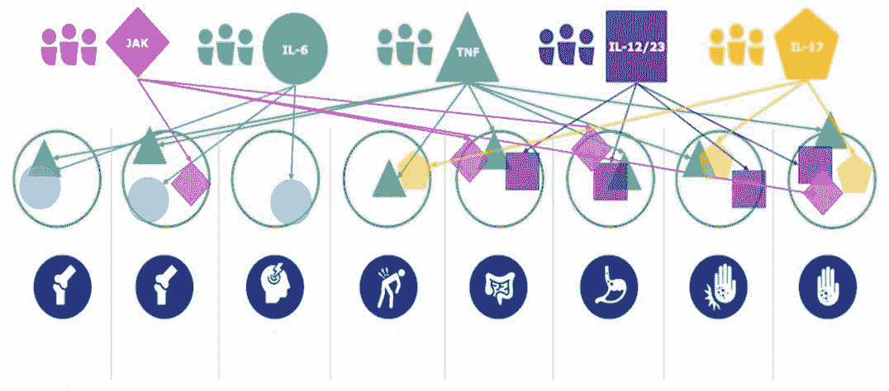

**特发性关节炎**

**类风湿关节炎**

**巨细胞动脉炎**

**强直性脊柱炎**

**克罗恩病**

**溃疡性结肠炎**

**银屑病关节炎**

**银屑病**

**自身免疫新靶点适应症持续拓宽，相互渗透**

**图：自身免疫疾病靶点及获批适应症对应关系**

# 全球免疫疾病巨头竞争格局：三家老牌企业+两家新贵

数据来源：公司公告，中信建投证券

## 龙头公司商业化产品百花齐放

| 药物 | 公司 | 销售额 | 特点 |
|---|---|---:|---|
| 英夫利昔单抗 | 杨森 | 23亿美元 | 首个TNF-α人鼠嵌合单抗，但需要静脉给药，非人源 |
| 依那西普 | 安进 | 41亿美元 | TNF-α人源化融合蛋白，皮下注射，解决英夫利昔单抗给药问题、中和抗体和副作用问题 |
| 阿达木单抗 | 艾伯维 | 212亿美元 | 首个TNF-α全人源单抗，安全性更好，用量更少 |
| 乌司奴单抗 | 强生 | 97亿美元 | 首个全人源IL-12/23双靶向单抗，药物留存率高，停药风险低，疗效持久、复发率低 |
| 司库奇尤单抗 | 诺华 | 48亿美元 | 首个靶向IL-17A全人源单抗，疗效优于乌司奴，起效快，皮损清除彻底，长效 |
| Risankizumab | 艾伯维 | 52亿美元 | 靶向IL-23人源化单抗，疗效优于乌司奴单抗 |
| 依奇珠单抗 | 礼来 | 25亿美元 | 靶向IL-17A人源化单抗，优于乌司奴和古塞奇尤，起效快，皮损清除彻底，长效 |
| 托法替尼 | 辉瑞 | 18亿美元 | 首个JAK抑制剂，可直接口服，但副作用较大 |
| 戈利木单抗 | 杨森 | 29亿美元 | 全人源TNF-α单抗 |
| 赛妥珠单抗 | 优时比 | 21亿美元 | 唯一一种聚乙二醇化修饰的TNF-α单抗，高亲和力 |
| Upadacitinib | 艾伯维 | 26亿美元 | 首个JAK1选择性抑制剂，头对头打败阿达木单抗，可直接口服，安全性优 |
| 古塞奇尤单抗 | 强生 | 27亿美元 | 首个靶向IL-23全人源单抗，避免乌司奴感染和肿瘤风险，长期疗效优于司库奇尤单抗 |
| 巴瑞替尼 | 礼来 | 8亿美元 | 首个头对头打败阿达木单抗的JAK抑制剂，可直接口服 |
| Mirikizumab | 礼来 | — | 靶向IL-23 p19亚基，获得UC上市许可，同年于CD适应症获得FDA突破性疗法认证 |
| 阿达木单抗类似药 | 安进 | — | 2023年，艾伯维阿达木单抗专利到期，安进的阿达木单抗生物类似药正式进入美国市场 |
| Zilbrysq | UCB | — | 用于治疗抗乙酰胆碱受体（AChR）抗体阳性的成年患者的全身性重症肌无力 |

# 全球免疫疾病巨头竞争格局：三家老牌企业+两家新贵

数据来源：*Insight*，公司公告，中信建投证券

## 龙头公司在研产品布局丰富

**表：全球免疫龙头公司商业化品种及在研品种**

| 阶段/靶点 | 艾伯维 | 礼来 | 安进 | 强生制药 | 诺华 | 辉瑞 |
|---|---|---|---|---|---|---|
| 已上市—TNF-α | 阿达木单抗 | 培塞利珠单抗 | 依那西普、英夫利昔单抗、阿达木单抗类似药、阿普米司特 | 英夫利昔单抗、戈利木单抗 | 依那西普、奥瑞利珠单抗 | — |
| 已上市—JAK | 乌帕替尼 | 巴瑞替尼 | — | — | — | 托法替布 |
| 已上市—IL-12/23 | 乌司奴单抗 | — | — | — | — | — |
| 已上市—IL-23a | 利生奇珠单抗 | Mirikizumab | 古塞奇尤单抗 | — | — | — |
| 已上市—IL-17 | 依奇珠单抗 | 布罗利尤单抗 | — | — | 司库奇尤单抗 | — |
| 已上市—COX | 美洛昔康 | 双氯芬酸 | 塞来昔布、奥沙普秦、吡罗昔康 | — | — | — |
| 已上市—其他 | 达利珠单抗（IL2RA）、美金刚（5-HT3 receptor、CHRN、DRD2、GRIN）、罗氟司特（PDE4）、依匹斯汀（HRH1） | 来金珠单抗（IL13） | 阿普米司特（PDE4）、Tezepelumab（TSLP）、地舒单抗（RANKL）、安纳白介素（IL1R）、罗米司亭（TPOR） | Ponesimod（S1PR1）、布地奈德（GR） | 特泽鲁单抗（TSLP）、西尼莫德（S1PR）、芬戈莫德（S1PR）、奥法妥木单抗（CD20）、Remibrutinib（BTK）、氟替卡松（GR）、茚达特罗（ADRB2）、奥马珠单抗（IgE）、艾曲泊帕（TPOR）、卡那单抗（IL-1β） | 甲泼尼龙（GR）、重组人干扰素β-1a、β-1b（IFNAR1/2）、唑来膦酸（FPPS、GGPS1、Hydroxyapatite） |
| Approved | RINVOQ™、SKYRIZI® | 乌司奴单抗类似药（IL-12B） | — | — | — | — |
| Submitted | RINVOQ™、SKYRIZI® | Mirikizumab | AMG714（IL-15单抗） | STELARA（ustekinumab）、TREMFYA（guselkumab） | — | — |
| Phase III | AMJEVITA®、ROCATINLIMAB | ROCATINLIMAB、OTEZLA®、WEZLANA™、ABP 938 | — | JNJ-2113、nipocalimab、SIMPONI（golimumab）、STELARA（ustekinumab）、TREMFYA（guselkumab） | VAY736、QGE031、LOU064、AIN457、AIN457 | LITFULO（ritlecitinib）、fordadistrogene movaparvovec（PF-06939926）、dazukibart（PF-06823859） |
| Phase II | ABBV-668、ALPN-101、Lutikizumab、OpSCF | Ucenprubart、Kv1.3 Antagonist、Ocadusertib、Peresolimab、CD19 Antibody、DC-806、Eltrekibart | ROCATINLIMAB、EFAVALEUKIN ALFA、ORDESEKIMAB** | JNJ-4703、JNJ-2113、JNJ-4804 Combination Therapy、nipocalimab Combination Therapy、YTB323、VAY736、VAY736、RHH646、QUC398、NGI226、MHV370、LOU064、LNA043、DFV890、CFZ533 | VELSIPITY（etrasimod）、PF-07275315、07264660、PF-06835375、LITFULO（ritlecitinib）、fordadistrogene movaparvovec（PF-06939926）、Dekavil、dazukibart（PF-06823859） | — |
| Phase I | CLF065、CUG-252 | DC-853、GITR Antagonist、Itaconate Mimetic | AMG 104 | JNJ-4703、JNJ-1459 | — | PF-07899895、PF-07868489、PF-07261271、PF-07054894、PF-06835375 |

# 中国免疫市场：潜力十足的广阔蓝海

弗若斯特沙利文，中信建投证券

## 自免炎症双涡驱动，赋能免疫未来市场

- 以银屑病和强直性脊柱炎市场为主的中国自身免疫市场规模不断扩大，据弗若斯特沙利文预测，中国自免药物市场规模2030年有望达到247亿美元，较2020年实现十倍增长，是全球自免药物的重要增量来源。
- 生物制剂自免市场份额高速提升，降价与纳入医保组合拳有望加速替代DMARD类药物。
- II型炎症疾病市场潜力高达450亿元，中重度特应性皮炎与哮喘为最大推动力。

**我国自身免疫病潜在市场规模（亿元），2030E**

| 适应症 | 市场规模（亿元） |
| :--- | ---: |
| 强直性脊柱炎 | 284 |
| 类风湿关节炎 | 202 |
| 银屑病关节炎 | 84 |
| 银屑病 | 53 |
| 溃疡性结肠炎 | 17 |
| 克罗恩病 | 9 |
| 多发性硬化症 | 7 |

**中国自身免疫性疾病治疗市场的历史和预测市场规模（2014-2030年）（十亿）**

| 年份 | 市场规模（十亿） |
| :--- | ---: |
| 2014 | 209 |
| 2020 | 187 |
| 2030E | 53 |

**我国II型免疫疾病市场规模测算（亿元），2030E**

| 适应症 | 市场规模（亿元） |
| :--- | ---: |
| 特应性皮炎（中重度） | 209 |
| 哮喘 | 187 |
| 鼻窦炎 | 53 |

---

# 我国自免市场潜力高达656亿元

银屑病患病率最高，达到2.7%；强直性脊柱炎与类风湿关节炎患病率接近，但由于强直性脊柱炎患者相对年轻，治疗意愿和治疗意识更强，因此或有更高渗透率；溃疡性结肠炎和克罗恩病患病率较低。

## 银屑病和强直性脊柱炎市场最大，其次是类风关

**图表：中国自身免疫病单抗市场测算，2030E**

| 适应症 | 银屑病 | 强直性脊柱炎 | 类风湿关节炎 | 银屑病关节炎 | 多发性硬化症 | 溃疡性结肠炎 | 克罗恩病 |
| :--- | ---: | ---: | ---: | ---: | ---: | ---: | ---: |
| 患病率 | 2.70% | 0.32% | 0.40% | 0.25% | 0.06% | 0.03% | 0.02% |
| 患病人数（万人） | 3780 | 448 | 560 | 350 | 77 | 39 | 32 |
| 可用药患者比例假设 | 50% | 50% | 50% | 50% | 50% | 50% | 50% |
| 用药人数（万人） | 1890 | 224 | 280 | 175 | 38.5 | 19.6 | 16.1 |
| 全年治疗费用（万元/人） | 3 | 3 | 3 | 3 | 3 | 3 | 3 |
| 潜在市场规模（亿元） | 5670 | 672 | 840 | 525 | 116 | 59 | 48 |
| 渗透率 | 5% | 30% | 10% | 10% | 15% | 15% | 15% |
| 市场规模（亿元） | 284 | 202 | 84 | 53 | 17 | 9 | 7 |
| **适应症合计** | | | | **656** | | | |

*数据来源：Nature，中信建投证券*

---

# 我国II型免疫疾病市场潜力高达449亿元

预计中重度特应性皮炎单抗药物市场潜在约为209亿元；其次为哮喘，虽然从患病率角度来看哮喘最高，但考虑到哮喘与Th2相关的只占50%，而且85%的患者可以达到较好控制，因此单抗使用患者比例较低，预计哮喘适应症II型免疫病相关单抗潜在市场为187亿元。

## 特应性皮炎和哮喘均有较大市场潜力

**图表：我国II型免疫病单抗药物市场测算，2030E**

| 适应症 | 特应性皮炎（中重度） | 哮喘 | 鼻窦炎 |
| :--- | ---: | ---: | ---: |
| 患病率 | 0.86% | 5.90% | 4.00% |
| 患病人数（万人） | 1211 | 8260 | 5600 |
| 单抗用药患者比例假设 | 29% | 5% | 2% |
| 用药人数（万人） | 349 | 415 | 89 |
| 全年治疗费用（万元/人） | 3 | 3 | 3 |
| 潜在市场规模（亿元） | 1046 | 1245 | 266 |
| 渗透率 | 20% | 15% | 20% |
| 市场规模（亿元） | 209 | 187 | 53 |
| **适应症合计** | | | **449** |

*数据来源：NEJM，中信建投证券*

---

# “药王”修美乐进入类似药时代，渗透率有望快速提升

**大分子**

- 自身免疫病TNF-α单抗Humira自2012年开始即成为“药王”，销售额稳居第一，销售额超100亿美元，在2022年更达到了212亿美元，引发众多药企仿制。
- 截至2023年11月，我国已有百奥泰、海正药业、信达生物等7家的Humira类似药上市，后续仍有多家类似药申报。Humira类似药价格降至888元/支，年费用降至2.1万元。
- 截至2020年1月，美国FDA已批准5个修美乐类似药上市。
- 我们认为，TNF-α靶点的代表修美乐，将进入类似药时代，价格快速下降，渗透率快速提升。

**表：2008-2023年全球销售额Top5药物（十亿美元）**

| 排名 | 2008 | 2009 | 2010 | 2011 | 2012 | 2013 | 2014 | 2015 | 2016 | 2017 | 2018 | 2019 | 2020 | 2021 | 2022 | 2023 |
| :--- | :--- | :--- | :--- | :--- | :--- | :--- | :--- | :--- | :--- | :--- | :--- | :--- | :--- | :--- | :--- | :--- |
| 1 | Humira | Humira | Humira | Humira | Humira | Humira | Humira | Humira | Humira | Comirnaty | Comirnaty | Keytruda |
| | 9.3 | 10.7 | 12.5 | 14.0 | 16.1 | 17.6 | 20.5 | 19.6 | 20.4 | 36.8 | 55.9 | 25.0 |
| 2 | Rituxan | Remicade | Sovaldi | Harvoni | Harvoni | Revlimid | Revlimid | Keytruda | Keytruda | Humira | Humira | Eliquis |
| | 8.7 | 8.9 | 10.3 | 13.9 | 9.1 | 8.1 | 9.7 | 11.1 | 14.4 | 20.7 | 21.2 | 19.0 |
| 3 | Seretide | Rituxan | Lantus | Remicade | Enbrel | Rituxan | Opdivo | Remicade | Remicade | Spikevax | Keytruda | Humira |
| | 8.4 | 8.9 | 7.0 | 8.8 | 8.9 | 7.5 | 7.6 | 9.4 | 12.2 | 17.7 | 20.9 | 14.4 |
| 4 | Remicade | Seretide | Remicade | Enbrel | Rituxan | Avastin | Enbrel | Imbruvica | Eliquis | Keytruda | Paxlovid | Ozempic |
| | 8.2 | 8.8 | 6.9 | 8.7 | 8.6 | 7.2 | 7.5 | 8.1 | 9.2 | 17.2 | 18.9 | 13.9 |
| 5 | Enbrel | Enbrel | Abilify | Rituxan | Remicade | Harvoni | Keytruda | Opdivo | Imbruvica | Eliquis | Eliquis | Biktarvy |
| | 8.0 | 8.3 | 6.5 | 8.4 | 7.8 | 7.0 | 7.2 | 8.0 | 8.4 | 16.7 | 18.3 | 11.9 |

*数据来源：EvaluatePharm，insight，中信建投证券*

---

# 修美乐全球销售近200亿美元，中国潜力待挖掘

## 生物制剂降价进入医保，类似药上市，看好渗透率提升

- 2022年，修美乐创造了212亿美元销售额的记录，上市以来，修美乐一度为全球销售冠军直到2022年被Keytruda超过。2023年，修美乐全球年销售额为144.04亿美元，同比下降32.2%，中国销售额为22.57亿元。
- 已于2010年进口中国销售，虽然其在国内适应症人群众多，但由于价格昂贵等因素，销售额远低于同类抗TNFα产品依那西普和英夫利昔单抗。**修美乐于2019年通过价格谈判进入国家医保，渗透率随后明显提升，2023年PDB样本医院销售约为3.7亿元。**

**图：阿达木单抗（修美乐）全球销售额（亿美元）**

| 年份 | 2009 | 2010 | 2011 | 2012 | 2013 | 2014 | 2015 | 2016 | 2017 | 2018 | 2019 | 2020 | 2021 | 2022 | 2023 |
| :--- | ---: | ---: | ---: | ---: | ---: | ---: | ---: | ---: | ---: | ---: | ---: | ---: | ---: | ---: | ---: | ---: |
| 销售额 | 56 | 65 | 79 | 93 | 107 | 130 | 140 | 161 | 184 | 199 | 192 | 198 | 207 | 212 | 144 |

**阿达木单抗国内PDB样本医院销售额（千万元）**

| 年份 | 2013 | 2014 | 2015 | 2016 | 2017 | 2018 | 2019 | 2020 | 2021 | 2022 | 2023 |
| :--- | ---: | ---: | ---: | ---: | ---: | ---: | ---: | ---: | ---: | ---: | ---: | ---: |
| 销售额 | 2.74 | 2.67 | 2.52 | 2.03 | 1.79 | 1.62 | 1.42 | 31.90 | 31.90 | 31.90 | 36.72 |

*数据来源：PDB，公司公告，中信建投证券*

---

# 全球销量TOP100药物中自免类药物占据三成

## 主要自免类药物销量与治疗方案

**表：全球销量TOP100药物中的自免类药物**

| 药品成分 | 企业 | 靶点 | 2023年销售额（亿美元） | 用法用量 | 中国（2023年）进入医保 | 年治疗费用（元） | 中国销售额（亿元） |
| :--- | :--- | :--- | ---: | :--- | :--- | ---: | ---: |
| 阿达木单抗 Humira | 艾伯维 | TNF-α | 144.04 | 40mg Q2W | 是 | 30960 | 22.57 |
| 度普利尤单抗 Dupixent | 赛诺菲再生元 | IL4R | 115.89 | 初始剂量600mg，随后300mg Q2W | 是 | 76472 | 19.15 |
| 乌司奴单抗 Stelara | 强生制药 | IL12B | 108.58 | 起始皮下45mg，4周后皮下45mg，随后每45mg Q12W | 是 | 25908 | 13.22 |
| 瑞莎珠单抗 Skyrizi | 艾伯维 | IL23A | 77.63 | 150 mg Q12W | 是 | 75600 | / |
| 奥瑞利珠单抗 Ocrevus | 罗氏制药 | CD20 | 71.13 | 600 mg Q6M | 否 | / | / |
| 维得利珠单抗 Entyvio | 武田 | Integrin a4β7 | 53.6 | 起始剂量:300mg，在第2、6周再次300mg。维持剂量:300mg Q8W | 是 | 32370 | 4.91 |
| 司库奇尤单抗 Cosentyx | 诺华制药 | IL17A | 49.8 | 成人:300mg QW，第4周后300mg Q4W | 是 | 23664 | 27.46 |
| 依那西普 Enbrel | 安进制药 辉瑞制药 | TNF-α | 45.27 | 50 mg QW | 是 | 19864 | 0.74 |
| 芦可替尼 Jakafi/Opzelura | Incyte 诺华制药 | JAK1, JAK2 | 43.14 | 20mg BID | 是 | 117712.5 | 7.58 |
| 乌帕替尼 Rinvoq | 艾伯维 | JAK1 | 39.69 | 15 mg QD | 是 | 59766.96 | 1.45 |
| 奥马珠单抗 Xolair | 罗氏制药 诺华制药 | IGHE | 38.89 | 哮喘：150 mg或300 mg，Q2W或Q4W；慢性特发性荨麻疹：300 mg Q4W | 是 | / | 7.72 |
| 阿巴西普 Orencia | 百时美施贵宝 | CD80, CD86 | 36.01 | 750mg Q4W | 否 | 123240 | 0.13 |
| 古塞奇尤单抗 Tremfya | 强生制药 | IL23A | 31.47 | 第0、4周100 mg，此后100mg Q8W | 是 | 182000 | 4.20 |
| 依库珠单抗 Soliris | 阿斯利康 | C5 | 31.45 | 前4周：900mg QW，随后1200毫克Q2W | 是 | 140560 | 1.14 |
| Ultomiris | 阿斯利康 | C5 | 29.65 | 负荷剂量:2400mg ~ 3000mg 单次；维持剂量:3000 ~ 3600mg Q8W | 否 | / | / |
| 托珠单抗 Actemra/RoActemra | 罗氏制药 | IL6R | 29.32 | 240mg QM | 是 | 29880 | 5.61 |
| 依奇珠单抗 Taltz | 礼来制药 | IL17A | 27.6 | 起始160mg。前12周80mg Q2W，后续80mg Q4W | 是 | 20706 | 3.68 |
| 氟替卡松+乌美溴铵+维兰特罗 Trelegy Ellipta | 葛兰素史克 | GR, CHRM, ADRB2 | 27.45 | 每次一个吸入器，QD | 是 | / | 3.40 |
| 布地奈德+福莫特罗 Symbicort | 阿斯利康 | GR, ADRB2 | 23.62 | 80mg/4.5mg或160mg/4.5mg，BID | 是 | 2251.68 | 29.78 |
| 培塞利珠单抗 Cimzia | UCB | TNF-α | 22.58 | 400mg Q4W | 否 | 44720 | 0.86 |
| 戈利木单抗 Simponi/Simponi ARIA | 强生制药 | TNF-α | 21.97 | 第0、4周2mg/kg，随后2mg/kg Q8W | 是 | 83300 | 0.79 |
| 阿普米司特 Otezla | 安进制药 | PDE4 | 21.88 | 30 BID | 是 | 11461 | 0.34 |
| 奥法妥木单抗 Kesimpta | 诺华制药 | CD20 | 21.71 | 起始剂量：20 mg QW。维持剂量：第一个月起，20 mg QM | 是 | 52200 | 1.36 |
| 美泊利珠单抗 Nucala | 葛兰素史克 | IL5 | 20.63 | 100 mg Q4W | 是 | 260000 | 0.32 |
| 那他珠单抗 Tysabri | 渤健制药 | ITGA4 | 18.77 | 300mg Q4W | 否 | / | / |
| 英夫利西单抗 Remicade | 强生制药 默沙东 | TNF-α | 18.39 | 5 mg/kg Q8W | 是 | 40136 | / |
| 托法替布 Xeljanz | 默沙东 | JAK1/2/3 | 17.03 | XELJANZ 5 mg BID；XELJANZ XR 11 mg QD | 是 | 23880 | 4.99 |

*数据来源：insight，米内网，中信建投证券*

# 1.5 自身免疫疾病与II型炎症概览

一般临床观点中，自身免疫性疾病被定义为自身抗原免疫耐受紊乱、机体对自身抗原发生免疫反应导致机体损害的一类疾病。而II型炎症的诱发因素通常比较广泛，从纳米级的抗原分子至肉眼可见的寄生虫及多种理化因素，在定义上更强调外源因素的刺激作用。

人体的免疫应答可以根据参与的细胞类型以及免疫原的不同分为三种类型。其中I型主要由NK、ILC1、Tc1及Th1介导，主要免疫原为细菌及病毒等。II型主要由ILC2、Tc2及Th2介导，对抗寄生虫感染。III型免疫应答主要由Th17和ILC3介导，预防细菌和真菌感染。II型免疫应答过强导致过敏性疾病（II型炎症），而I和III型免疫应答过强则导致自身免疫性疾病。

这两类疾病具有共同的成药靶点，故按器官系统将其共同介绍，其中II型炎症包括哮喘、慢阻肺及特应性皮炎。

# 自免疾病与II型炎症有共同的成药靶点

## 免疫类疾病可根据发病器官系统分类

| 多系统性 | 骨骼系统 | 排泄系统 | 神经系统 | 呼吸系统 | 循环系统 | 皮肤系统 | 消化系统 |
|---------|---------|---------|---------|---------|---------|---------|---------|
| 系统性红斑狼疮 | 强直性脊柱炎 | IgA肾病 | 重症肌无力 | 慢性阻塞性肺疾病（COPD） | 免疫性血小板减少症 | 大疱性皮肤病 | 炎症性肠病 |
| 系统性硬化 | 类风湿关节炎 | | 慢性炎性脱髓鞘性多发性神经根神经病（CIDP） | 哮喘 | | 斑秃 | |
| | | | 多发性硬化 | | | 白癜风 | |
| | | | | | | 银屑病 | |
| | | | | | | 慢性荨麻疹 | |
| | | | | | | 特应性皮炎 | |

# 根据发病器官系统分类

| 器官系统 | 疾病 | 分类 | 主要商业化产品 |
|---------|------|------|---------------|
| 多系统性 | 系统性红斑狼疮 | 狼疮肾炎、神经精神狼疮、血液系统症状等。 | 贝利尤单抗、Anifrolumab、泰它西普、重组人白细胞介素2等 |
| | 系统性硬化 | 局限性皮肤性系统性硬化；弥漫性皮肤性系统性硬化；系统性硬化sine硬皮病：无皮肤受累；重叠综合征：同时出现其他结缔组织病。 | 利妥昔单抗、托珠单抗等 |
| 骨骼系统 | 脊柱关节炎（强直性脊柱炎） | I级，可疑或极轻微的骶髂关节病变；Ⅱ级，轻度异常：局限性侵蚀、硬化，但关节间隙无改变；Ⅲ级，明显异常：近关节区硬化、关节间隙变窄或增宽、部分强直；Ⅳ级，严重异常，完全性关节强直。 | 司库奇尤单抗、依奇珠单抗、比吉利珠单抗、Netakimab等 |
| | 类风湿关节炎 | 最新分类方式以受累关节数、自身抗体、急性期反应物和滑膜炎持续时间综合评估。 | 阿达木单抗、托珠单抗、培塞利珠单抗、巴瑞替尼、托法替布等 |
| 肾脏 | IgA肾病 | — | Sparsentan等 |
| 神经系统 | 重症肌无力 | AChR-GMG：可分早晚型，以50岁为界限；MuSK-MG：受累肌群较局限，以头部、颈部及呼吸肌为主；LRP4-MG：临床特点尚不完全明确；抗体阴性MG：极少部分患者无上述可检测到的抗体；胸腺相关MG：约占患者的10%~15%，属于副肿瘤综合征。 | 依库珠单抗、Ravulizumab、他克莫司、Zilucoplan、Rozanolixizumab、艾加莫德等 |
| | 慢性炎性脱髓鞘性多发性神经根神经病（CIDP） | 经典型CIDP：对称性上下肢近端和远端无力；远端型CIDP：肢体远端为主的运动感觉型周围神经病；多灶型CIDP：感觉异常和无力分布不对称；局灶型CIDP：感觉和运动受累局限于单个肢体；纯运动型CIDP：只有运动受累的表现；纯感觉型CIDP：仅有感觉受累。 | 人免疫球蛋白、BT595、Gamunex-C等 |
| 神经系统 | 多发性硬化 | 临床孤立综合征（CIS）、复发缓解型（RRMS）、继发进展型（SPMS）、原发进展型（PPMS） | 乌妥昔单抗、奥瑞珠单抗、奥法妥木单抗、重组干扰素β-1a、格拉替雷、富马酸地洛西美酯、富马酸二甲酯、奥扎莫德、西尼莫德、芬戈莫德等 |
| 呼吸系统 | 慢性阻塞性肺疾病（COPD） | 遗传决定型COPD、肺发育异常COPD、环境性COPD、感染导致COPD、慢阻肺合并哮喘、不明原因COPD | 罗氟司特、维兰特罗、阿福特罗、沙美特罗、茚达特罗、奥达特罗、雷芬那辛等 |
| | 哮喘 | 过敏性哮喘：最常见于儿童，有家族遗传史或者既往有过敏性疾病的病史例如湿疹、过敏性鼻炎、或者食物药物过敏。非过敏性哮喘：一些成人哮喘发生与过敏无关。这些病人的痰可能有嗜中性粒细胞、嗜酸性粒细胞或者仅仅是一些炎性细胞。迟发型哮喘：在成人时期第一次发生哮喘。趋向于非过敏性并且经常需要高剂量的ICS或者是对皮质醇激素不敏感。 | 度普利尤单抗、奥马珠单抗、噻托溴铵、美泊利珠单抗、特泽鲁单抗、本瑞利珠单抗等 |
| 循环系统 | 免疫性血小板减少症 | 新诊断（0~3个月）；持续性（3~12个月）；慢性（>12个月）。 | 艾曲泊帕、阿伐曲泊帕、卡普赛珠单抗、福他替尼、利妥昔单抗、罗米司亭、特比澳等 |
| 皮肤 | 大疱性皮肤病 | 寻常型天疱疮、叶状天疱疮和大疱性类天疱疮 | 利妥昔单抗等 |
| | 斑秃 | 斑片型、网状型、带状型、中央型、弥漫型、全秃以及普秃 | 乌帕替尼、利特昔替尼、巴瑞替尼等 |
| | 白癜风 | 沿皮神经阶段分布的节段型白癜风（SV），分布较为对称的非节段（寻常）型白癜风（NSV），SV及NSV并存的混合型白癜风，以及诊断时不能明确的未定类型白癜风 | 芦可替尼等 |
| | 银屑病 | 寻常型银屑病（点滴状银屑病与斑块状银屑病）、脓疱型银屑病（局限性脓疱型银屑病和泛发性脓疱型银屑病）、红皮病型银屑病以及关节病型银屑病 | 英夫利西单抗、依那西普、乌帕替尼、培塞利珠单抗、戈利木单抗、阿普米司特、阿达木单抗、依奇珠单抗、司库奇尤单抗、乌司奴单抗、瑞莎珠单抗等 |
| | 慢性荨麻疹 | 慢性诱发性荨麻疹（日光性、寒冷性、水源性、压力延迟性、振动性及胆碱能性等）和慢性自发性荨麻疹 | 奥马珠单抗等 |
| | 特应性皮炎 | 单纯型：仅有皮炎，包括内源型和外源型（IgE水平上升，嗜酸性粒细胞增多）；混合型：合并过敏性哮喘、过敏性鼻炎等 | 乌帕替尼、芦可替尼、克立硼罗、迪高替尼、巴瑞替尼、阿布昔替尼、Difamilast等 |
| 肠道 | 炎症性肠病 | 克罗恩病：病因不明的胃肠道慢性炎症性肉芽肿性疾病，病变分阶段性，累及肠壁全层，可在整个肠道观察到病变。肠粘膜呈鹅卵石样外观，常形成瘘管。溃疡性结肠炎：病因不明的胃肠道慢性炎症性疾病，病变为连续性，主要累及黏膜层及黏膜下层，病变主要出现在乙状结肠和直肠。肠粘膜呈糜烂性充血性水肿，遍布出血点，罕有瘘管。 | 克罗恩病：乌司奴单抗、瑞莎珠单抗、维得利珠单抗、那他珠单抗、乌帕替尼、培塞利珠单抗、阿达木单抗、英夫利西单抗、Darvadstrocel、Cupistem等。溃疡性结肠炎：乌司奴单抗、Mirikizumab、维得利珠单抗、Carotegrast methyl、托法替布、非戈替尼、乌帕替尼、奥扎莫德、戈利木单抗、阿达木单抗、英夫利西单抗等 |

# 2 免疫用药靶点深度梳理，看遍药物机理

# T细胞重要靶点：IL2R、IL6R、IL17、JAK1/TYK2是主要开发方向

## 小分子和抗体双涡驱动，赋能免疫未来市场

针对T细胞的靶点包括白细胞介素（IL）类、TNF-α、CD40/CD40L及JAK家族等。其中白细胞介素（IL）类靶点包括IL1、IL2、IL6、IL17及IL23等。针对细胞表面受体及分泌性细胞因子（IL及其受体、TNF-α以及ITG等），通常开发抗体类药物作为治疗手段；而细胞内的蛋白靶点（JAK家族、PDE4以及AHR）通常以小分子抑制剂作为治疗手段。

# 体液免疫重要靶点：CD20、FcRN和补体等

## B细胞免疫发展聚焦3大方向

针对B细胞的靶点包括CD20、补体系统以及FcRn等。其中CD20蛋白位于B细胞质膜表面，针对CD20的抗体能直接诱导免疫系统对于B细胞的杀伤，在血液瘤和自身免疫病治疗中有广泛应用。FcRn位于内皮细胞表面，能够结合并延长引起自身免疫性疾病的抗体的半衰期。通过单抗靶向补体系统的蛋白，可以减少补体系统对自身组织细胞的杀伤。

# 自身免疫疾病主流靶点概览

**研发态势活跃，多个商业化产品共同推进**

| 靶点 | 已上市适应症 | 主要商业化产品 |
|------|-------------|---------------|
| IL17 | 银屑病、银屑病关节炎、强制性脊柱炎、放射学阴性中轴型脊柱关节炎、化脓性汗腺炎、真性红细胞增多症、附着点炎相关关节炎等 | 比吉利珠单抗、依奇珠单抗、司库奇尤单抗等 |
| IL6R | 风湿性多肌痛、类风湿关节炎、巨细胞动脉炎、视神经脊髓炎、细胞因子释放综合征、多关节性幼年特发性关节炎、大动脉炎、骨关节炎、成人斯蒂尔氏病、Castleman病等 | Sarilumab、托珠单抗、萨特利珠单抗 |
| IL2R | 多发性硬化、肾移植排斥反应、移植物抗宿主病等 | 达利珠单抗、巴利昔单抗、伊诺莫单抗 |
| IL1A、IL1B | 幼年特发性关节炎、家族性地中海热、家族性寒冷自身炎症反应综合征、肿瘤坏死因子受体相关周期性发热综合征、成人斯蒂尔氏病、痛风、Cryopyrin相关周期性综合征、心包炎、白细胞介素受体1拮抗剂缺乏症、Muckle–Wells综合征、痛风性关节炎等 | 卡那奴单抗、利纳西普 |
| IL12B | 溃疡性结肠炎、银屑病、银屑病关节炎、皮肌炎、多发性肌炎、克罗恩病、大动脉炎、SLE、中轴型脊柱关节炎、掌跖脓疱病等 | 乌司奴单抗 |
| IL23A | 溃疡性结肠炎、银屑病、克罗恩病、掌跖脓疱病、强直性脊柱炎等 | 古塞奇尤单抗、替拉珠单抗、瑞莎珠单抗、Mirikizumab |
| TNF-α | 银屑病、银屑病关节炎、克罗恩病、溃疡性结肠炎、强制性脊柱炎、类风湿关节炎等 | 阿达木单抗、依那西普、戈利木单抗、培塞利珠单抗、英夫利西单抗等 |
| CD20 | 多发性硬化、系统性硬化、类风湿关节炎、天疱疮等 | 利妥昔单抗、奥法妥木单抗等 |
| FcRn | 重症肌无力等 | 艾加莫德等 |
| JAK | 斑秃、银屑病、特应性皮炎、溃疡性结肠炎、类风湿关节炎、强直性脊柱炎、克罗恩病、白癜风、移植物抗宿主病等 | 非戈替尼、芦可替尼、乌帕替尼、阿布昔替尼、托法替布、巴瑞替尼、杰克替尼等 |
| ITG | 多发性硬化、克罗恩病、溃疡性结肠炎等 | 那他珠单抗、维得利珠单抗等 |
| ROCK2 | 慢性移植物抗宿主病等 | 贝舒地尔 |
| PDE4 | 特应性皮炎、银屑病、银屑病关节炎等 | 阿普米司特、克立硼罗、Difamilast |
| IgE | 特发性荨麻疹、哮喘等 | 奥马珠单抗 |

# 白介素（IL）类抗体是研发热点，JAK抑制剂快速发展

## IL-1增强T细胞的局部再活化，提高效应功能发挥

自免性脑脊髓膜炎中，免疫细胞产生IL-1β，与其受体IL-1R1结合，促进可溶性趋化因子（CCL2, CXCL1, CXCL2, CXCL5）和细胞因子（IL-6, G-CSF和GM-CSF）表达，血脑屏障通透性增加，并刺激产生更多IL-1β，从而形成一个正反馈回路，可增强T细胞的局部再活化及其效应功能的发挥。

## IL-2对T细胞活化起双重作用

IL-2是第一个被分子克隆的细胞因子，对T细胞的增殖和效应细胞和记忆细胞的产生至关重要，其最早的治疗应用是增强癌症患者的免疫反应。近来，使用IL-2、针对IL-2的单克隆抗体或IL-2变体的疗法正在开发中，其通过增加Treg细胞的数量和功能以调节免疫细胞的数量和功能，从而治疗自身免疫性疾病。

## IL-6、IL-6R多个药物上市，研究前景广泛

西鲁库单抗、司妥昔单抗、奥洛组单抗、克拉扎珠单抗通过与IL-6结合从而抑制其信号通路。而托珠单抗、沙利鲁单抗则直接作用于IL-6受体。

## IL-4与IL13共享部分受体，相关抗体可同时抑制两者

IL-4Rα是IL-4与IL-13信号通路中的重要组成部分，参与这两种白细胞介素的受体组装（图中蓝色部分）。IL-4Rα在免疫反应中主要激活JAK-STAT通路，引起Th等的活化。1-3型IL-4受体以及1型IL-13受体均有IL-4Rα作为组分。在哮喘、系统性红斑狼疮以及特应性皮炎等多种免疫疾病中均有参与。同样，IL-13Rα1（图中红色部分）也参与多种受体装配。

一般而言，造血系统中的免疫细胞表达1型IL4受体较多，而血液循环细胞及组织驻留细胞主要表达2型IL4受体。IL-4更多地在造血系统中发挥作用，也促进Th2型免疫反应和B细胞的活化。而IL-13主要激活外周组织中的细胞，在调节上皮细胞和巨噬细胞的抗炎反应中起作用。这也是作用于游离IL-4药物较少的原因之一。

知名免疫类药物度普利尤单抗即是以IL-4Rα为靶点。同靶点药物还有司普奇拜单抗、曼多奇单抗和QX005N等。而来金珠单抗等特异性结合可溶性IL-13的药物，也是通过阻断IL-4Rα而抑制免疫反应，在治疗特应性皮炎等方面发挥作用。

# IL-12、IL-17、IL-23个药物上市，研究前景广泛

**图：IL-12、IL-17、IL-23作为自免性疾病药物靶点的作用机制**

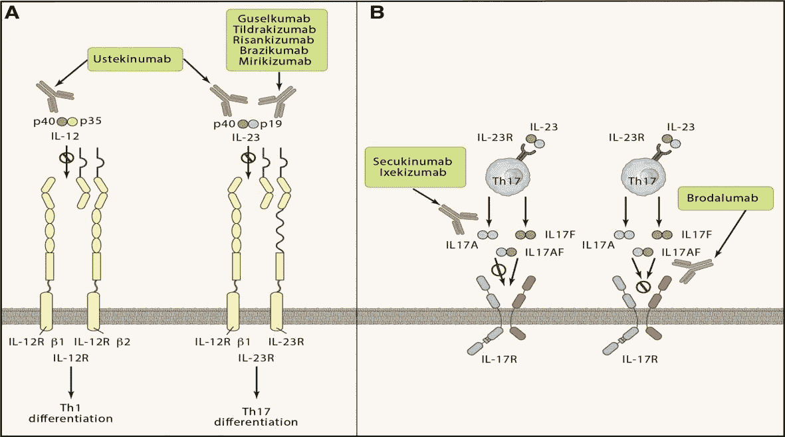

- 乌司奴单抗通过与IL-12、IL-23的p40蛋白结合，古塞奇尤单抗、替拉珠单抗、瑞莎珠单抗、布雷库单抗、米吉珠单抗通过与IL-23的p19蛋白结合，从而阻断其信号通路，抑制Th1、Th17细胞的分化。苏金单抗、依奇珠单抗与IL-17结合以阻止其与IL-17R结合，布达鲁单抗则通过与IL-17竞争受体，从而抑制该信号通路下游。
- 从目前的药物临床开发成果来看，靶向p19的药物如匹康奇拜单抗和古塞奇尤单抗，效果好于靶向p40的乌司奴单抗。

# 白介素（IL）类抗体是研发热点，JAK抑制剂快速发展

**TNF-α最早成药的靶点，市场潜力挖掘相对充分**

*PubMed*，中信建投证券

**图：TNF-α类药物作用机制**

- α肿瘤坏死因子（TNF-α）是一种主要由单核-巨噬细胞产生的促炎细胞因子，广泛参与并激活机体的免疫反应。TNF-α不适当或过度激活与慢性炎症有关，并导致自身免疫性疾病的发展。针对TNF-α的药物主要为以阿达木单抗为首的各类单克隆抗体，广泛用于包括强直性脊柱炎、银屑病和炎症性肠病等自身免疫疾病的治疗。由于该类药物大部分开发时间较早，专利多已过期，市面上出现了大量仿制药竞争。

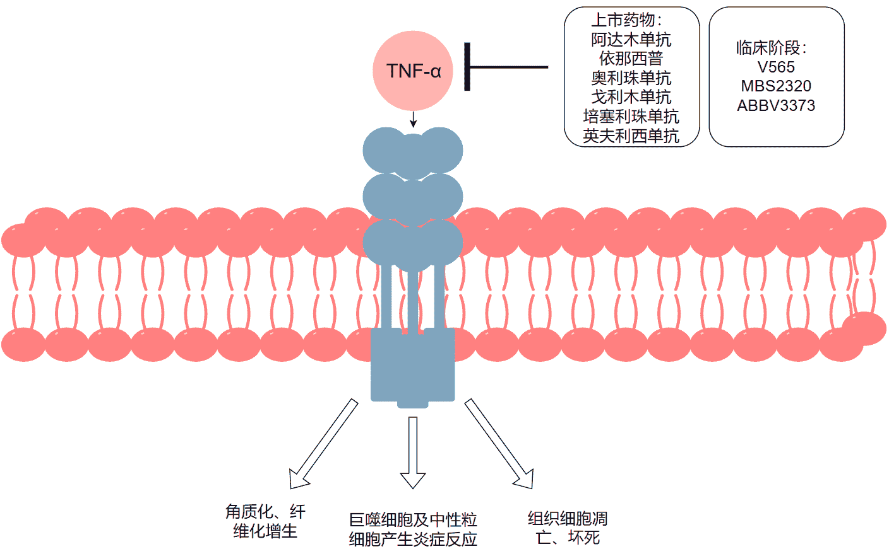

# 白介素（IL）类抗体是研发热点，JAK抑制剂快速发展

**JAK新药研发不断加速，巨大潜力正在兑现**

*PubMed*，中信建投证券

**图：JAK类抑制剂作用机制**

- JAK家族激酶包括JAK1/2/3以及TYK2四位成员，主要通过激活下游STAT家族促进细胞存活与增殖。JAK家族能够刺激T细胞的存活与免疫功能，是自身免疫疾病治疗中的重要靶点。从十余年前首个JAK抑制剂托法替布开始，许多新药不断涌现，造就了百花齐放的竞争格局。其治疗领域包括斑秃、银屑病、特应性皮炎、炎症性肠病和类风湿关节炎等。

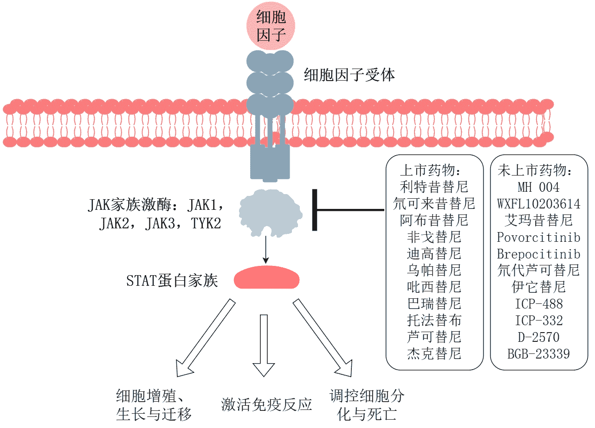

- ROCK2为Rho蛋白相关激酶的一种亚型。在T细胞中，与JAK家族成员类似地激活STAT3蛋白，刺激T细胞的增殖和免疫反应。目前，ROCK2抑制剂在自身免疫病相关领域用于移植物抗宿主病的治疗。

**ROCK2自免领域小众靶点，独具特色**

**图：ROCK2抑制剂作用机制**

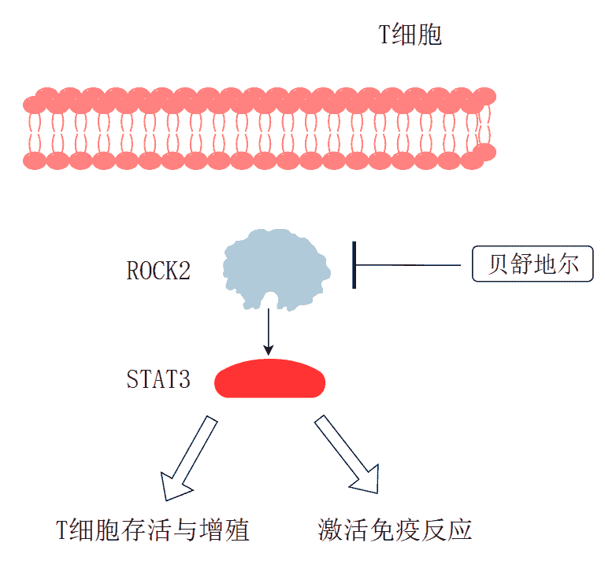

# 白介素（IL）类抗体是研发热点，JAK抑制剂快速发展

**CD20靶点常青树，广泛应用于免疫系统疾病治疗**

*PubMed*，中信建投证券

**图：CD20类药物作用机制**

- CD20是一种在B细胞表面高度表达的糖蛋白。抗CD20抗体可通过抗体、T细胞或是程序性死亡等方式较为特异地杀伤B细胞，因此在血液瘤及自身免疫病等领域被广泛开发及应用。自1997年利妥昔单抗上市以来，已经出现了大量相关靶点的新药及仿制药。可用于天疱疮、狼疮肾炎和类风湿关节炎等疾病的治疗。

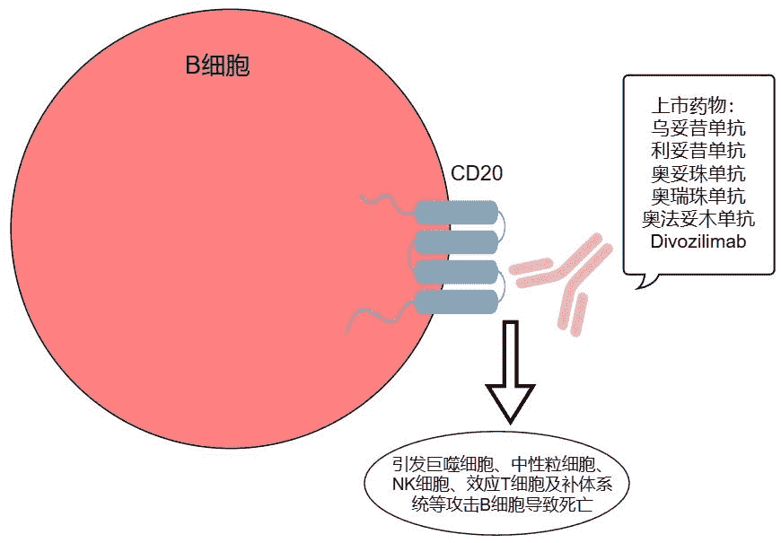

# 白介素（IL）类抗体是研发热点，JAK抑制剂快速发展

**FcRn重症肌无力领域的新兴靶点**

*PubMed*，中信建投证券

**图：FcRn类药物作用机制**

- FcRn是一种位于细胞膜表面的IgG抗体受体，主要在内皮细胞中表达。FcRn通过结合IgG的Fc部分，阻止IgG在体内的自然代谢，延长了IgG的作用时间。通过靶向FcRn的药物可以促进IgG降解，起到治疗自身免疫疾病的效果。目前该类药物主要应用于重症肌无力治疗。

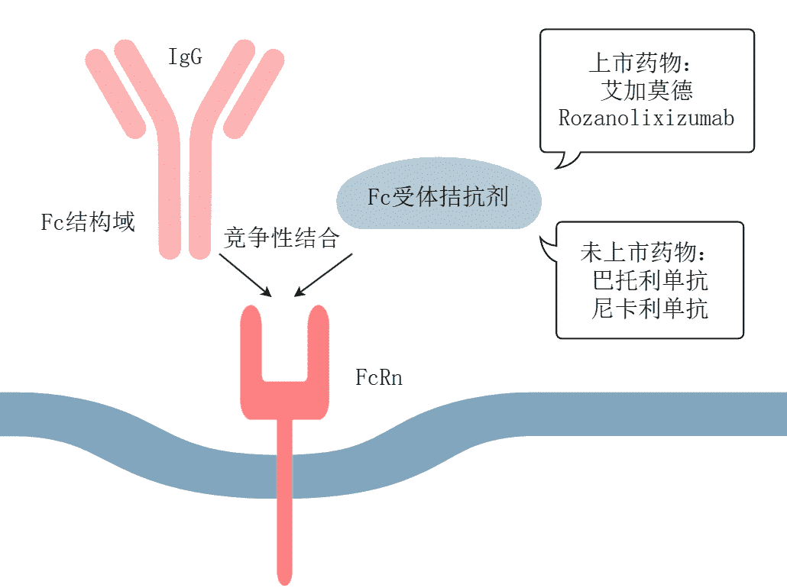

# 白介素（IL）类抗体是研发热点，JAK抑制剂快速发展

**C5前景广阔，自免领域应用有待发掘**

*PubMed*，中信建投证券

**图：抗C5类药物作用机制**

- 补体系统是固有免疫的重要组成部分，参与人体免疫调节及免疫损伤性反应。补体成分5是补体系统级联反应的一环，激活后的C5可以促进炎症反应以及对细胞的杀伤。目前，靶向C3、C5的药物已经在阵发性睡眠性血红蛋白尿、重症肌无力以及血管性水肿等疾病的治疗中得到了批准。

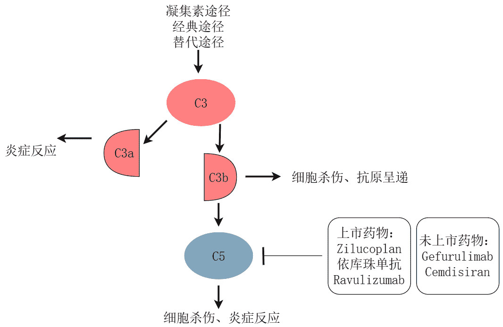

# 白介素（IL）类抗体是研发热点，JAK抑制剂快速发展

**IgE哮喘治疗成效显著，仿制药不断跟进**

*PubMed*，中信建投证券

**图：抗IgE类药物作用机制**

- IgE是I型超敏反应中的关键性抗体，介导嗜碱性粒细胞和肥大细胞产生的免疫反应，也是哮喘和荨麻疹治疗中的关键靶点。目前该领域唯一新药奥马珠单抗专利已经到期，大批仿制药厂商正在迅速跟进，也有部分新药正在进行关键性III期临床。

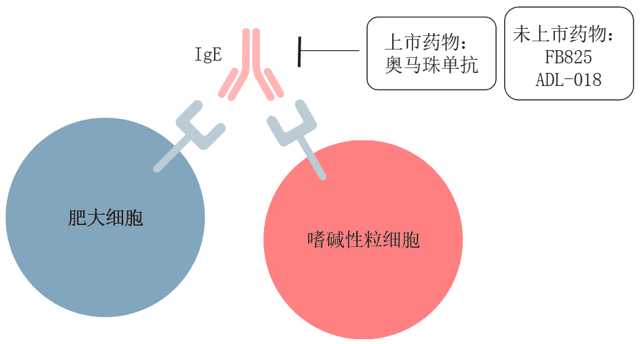

- 整合素是一类介导细胞黏附的受体超家族，与细胞外基质（ECM）配体和细胞表面配体结合以调控细胞生理活动。其中，α4亚基（又称ITGA4）与β7亚基（又称ITGB7）组成的α4β7整联素是负责肠道组织中淋巴细胞归巢的受体，淋巴细胞借助α4β7整联素进入肠道产生免疫反应。这两个亚基也因此成为了自身免疫性肠病治疗中的热门靶点。

**整联素组织差异性大，研发重点靶向肠道治疗**

*PubMed*，中信建投证券

**图：抗整联素类药物作用机制**

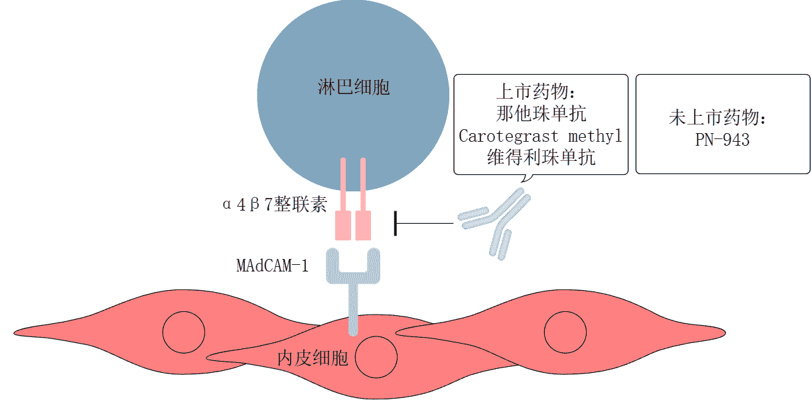

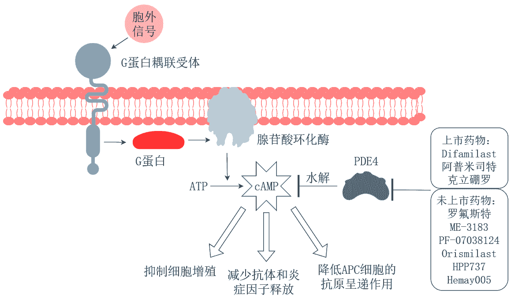

- cAMP是细胞信号转导过程中重要的第二信使，负责在细胞内传递胞外信号，介导一系列生理过程。通常来说cAMP由G蛋白耦联受体激活产生，而被磷酸二酯酶（PDE）蛋白家族成员水解。在免疫细胞中，cAMP具有抑制细胞增殖和降低细胞因子分泌等作用。通过抑制水解cAMP的PDE4蛋白，可以增强免疫细胞内的cAMP浓度，治疗特应性皮炎、银屑病和银屑病关节炎。

**PDE4银屑病领域重要靶点，适应症不断扩展**

*PubMed*，中信建投证券

**图：抗PDE4类药物作用机制**

# 白介素（IL）类抗体是研发热点，JAK抑制剂快速发展

**TSLP自免领域新兴靶点，前景可期**

*PubMed*，中信建投证券

**图：抗TSLP类药物作用机制**

- 与IL-7在进化上具有同源关系，能够刺激T、B淋巴细胞的增殖与发育。该蛋白的基因在支气管上皮细胞、结肠上皮细胞以及肺成纤维细胞等中均有表达，是人类2型炎症的重要驱动因素。各种刺激因素如机械损伤、疾病和过敏原等都可能刺激上皮细胞释放TSLP，激活树突状细胞、肥大细胞或是辅助T细胞的免疫反应。目前相关药物主要用于特应性皮炎与哮喘治疗。

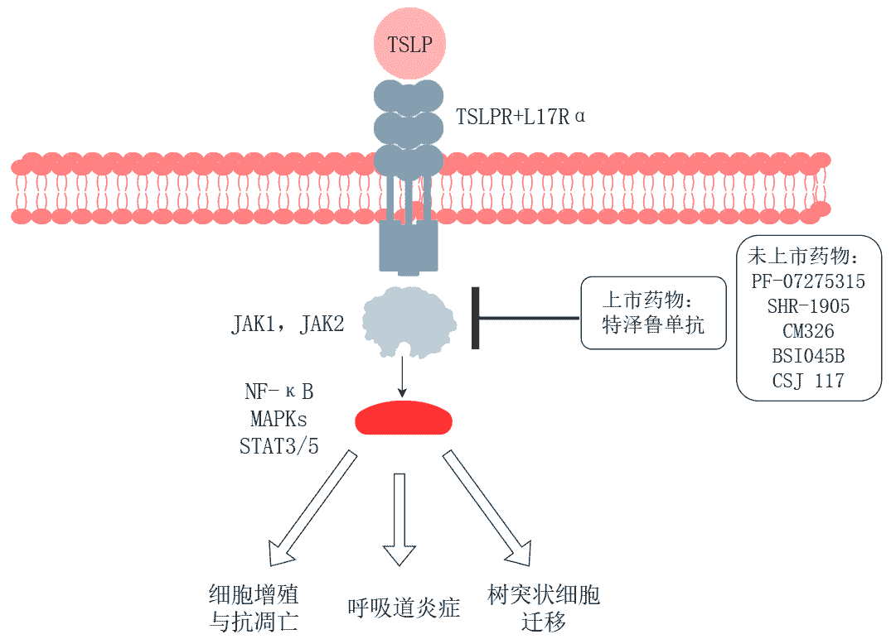

IL-4分泌

# 3 自身免疫类疾病详解：治疗手段层出不穷，创新药大有可为

# 3.1 强直性脊柱炎：病因复杂的风湿病

**女性和年龄≥60岁患者AS发病率显著增加**

*RMD Open*，中信建投证券

**图：1998—2017年男女年发病率**

**图：不同性别和年龄组患病百分比**

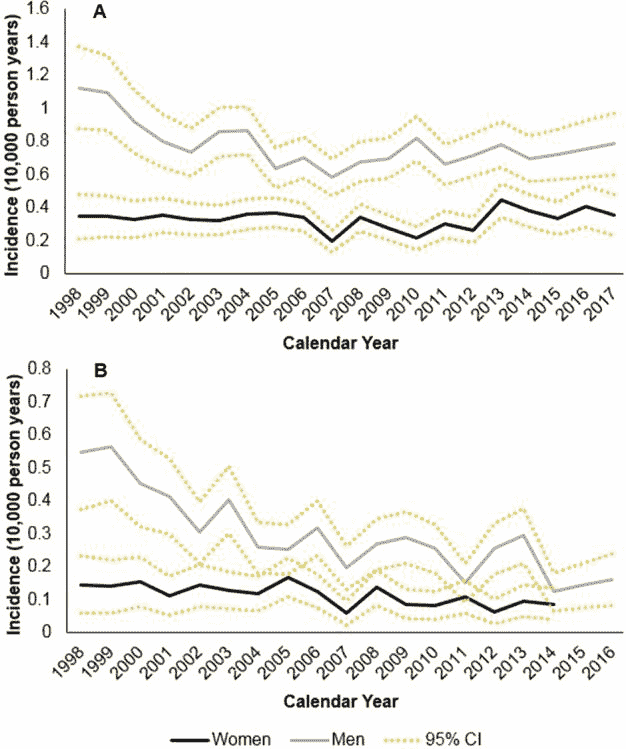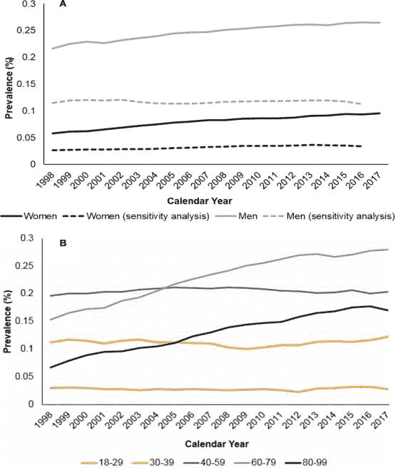

- AS发病率在1998年至2007年期间显著下降，在2007年至2017年期间有所增加；患病率在1998—2017年增加（从0.13%±0.006增加至0.18%±0.006），其中女性（从0.06%±0.05增加至0.10%±0.06）和年龄≥60岁患者（从0.14%±0.01增加至0.26%±0.01）的患病率急剧增加。
- 根据我们的测算，2024年到2035年，国内患者规模将从395万增长到415万左右，其中接受创新药治疗的患者人群将从80万增长到390万，经风险调整后的国内市场规模有望在2035年达到249亿。

强直性脊柱炎

类风湿关节炎

**图：发病部位——骨骼系统**

**强直性脊柱炎诊疗：NSAIDs作为一线药物**

*RMD Open*，强直性脊柱炎诊疗规范2022版，中信建投证券

- 骶髂关节炎X线分级：1）0级，正常；2）I级，可疑或极轻微的骶髂关节病变；3）Ⅱ级，轻度异常，可见局限性侵蚀、硬化，但关节间隙无改变；Ⅲ级，明显异常，至少伴有以下一项改变：近关节区硬化、关节间隙变窄或增宽、部分强直；4）Ⅳ级，严重异常，完全性关节强直。
- 抗原呈递途径中涉及的多种相互作用蛋白，与AS相关的包括ERAP1、ERAP2、HLA-B27和SEC16A等。
- 目前的药物治疗方式包括NSAIDs（非甾体类抗炎药）、生物DMARD（抗风湿药）、传统合成DMARD。其中NSAIDs是用于强直治疗的一线药物，在连续两种NSAIDs治疗不佳后，才考虑使用生物制剂。每种NSAIDs疗效评估应当至少观察2—4周。
- 生物制剂治疗一般至少维持12周。

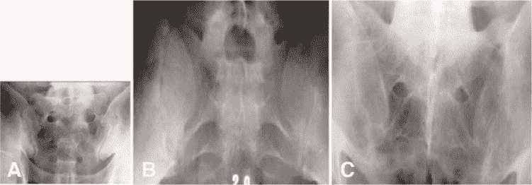

**图：Ⅱ级、Ⅲ级、Ⅳ级骶髂关节炎的X射线**

**图：AS中抗原加工和呈递**

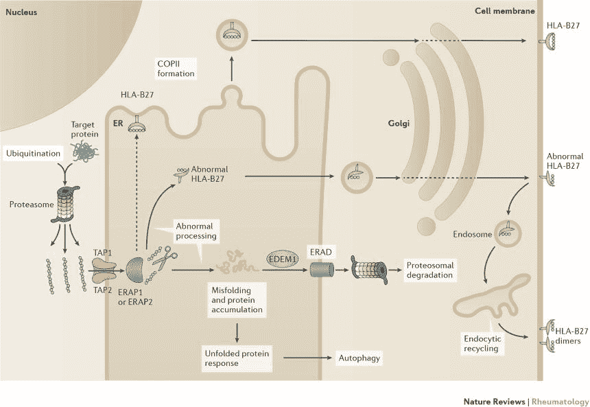

# 强直性脊柱炎：病因复杂的风湿病

**4个品种全球商业化，IL17A为主流靶点**

*insight*，中信建投证券

| 药物 | 公司 | 靶点 | 境外最高状态 | 中国内地最高状态 | 年报销售额2022（百万美元） | 年报销售额2023（百万美元） |
|---|---|---|---|---|---:|---:|
| 司库奇尤单抗 | 诺华制药 | IL17A | 批准上市 | 批准上市 | 4788 | 4980 |
| 依奇珠单抗 | 礼来制药 | IL17A | 批准上市 | 批准上市 | 2482 | 2759.6 |
| 比吉利珠单抗 | 优时比制药 | IL17A \| IL17F | 批准上市 | 申请上市 | 37 | 161.16 |
| Netakimab | Biocad | IL17 | 批准上市 | 临床III期 | / | / |

**表：强直性脊柱炎商业化品种销售额**

注1：以1 EUR=1.06 USD换算。

- IL17A作为较为主流的靶点，早在2014年已经上市，以司库奇尤单抗为例，所有适应症加起来，2023年销售49亿美金。

# 强直性脊柱炎：病因复杂的风湿病

**商业化产品数量较多，研发状态活跃**

*Insight*，中信建投证券

**图：已上市药物ASAS40（16-week）**

**图：已上市药物ASAS20（16-week）**

- 在ASAS40（16-week）方面，表现最好的品种为比吉利珠单抗，有47.4%患者达到了这一临床改善标准。
- 在ASAS20（16-week）方面，表现最好的品种为戈利木单抗，有73.3%患者达到了这一临床改善标准。
- 国际脊柱关节炎评估协会（ASAS）反应标准包括：疾病活动的整体评估、躯体功能、总脊柱疼痛以及炎症评估。以上4项指标经过评估量化后，有20%以上的改善即代表达到ASAS20标准，有40%以上的改善即代表达到ASAS40标准。

47.4%

37.8%

40.6%

45.0%

（14-week）

0%

5%

10%

15%

20%

25%

30%

35%

40%

45%

50%

59.5%

61.0%

56.4%

35.0%

73.3%

50.0%

50.0%

61.2%

61.2%

86.5%

86.5%

0%

10%

20%

30%

40%

50%

60%

70%

80%

90%

100%

# 强直性脊柱炎：病因复杂的风湿病

**TNF-α抗体中依那西普效果最佳，但普遍存在安全性问题**

*PubMed*，中信建投证券

- 诊疗指南中介绍了TNF-α及IL-17类抗体作为治疗强直的生物制剂。目前常用的生物制剂还包括JAK激酶抑制剂（小分子）。
- 图中，KD越低代表结合能力越强，曲线越靠右下说明结合能力更强。可以看到TNF-α类药物中依那西普对TNF-α的结合能力最强，戈利木单抗次之，英夫利西与阿达木单抗类似。这也与强直性脊柱炎中的疗效差距较为相符。
- IL-17类抗体在疗效方面略逊于TNF-α抑制剂。但是TNF-α抑制剂普遍存在FDA黑框警告（涉及严重感染风险）。而IL-17这一靶点并不如TNF-α那样对免疫系统影响广泛，故安全性存在较大优势。这两类药物在用药周期方面均为两周一次。
- JAK类抑制剂由于通常涉及到JAK2及JAK3的抑制（脱靶效应），也普遍存在FDA黑框警告（增加严重心脏相关事件、癌症、血栓和死亡的风险）。但口服抑制剂在价格、储存及给药方式上，相较于抗体类药物存在较大优势。

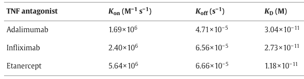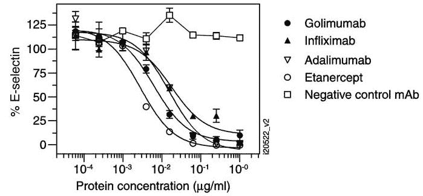

**图1：不同TNF-α抑制剂结合动力学数据**

**图2：4种TNF-α抑制剂与游离TNF-α结合分析**

# 强直性脊柱炎：病因复杂的风湿病

*PubMed*，*MCE*，*中信建投证券*

## JAK抑制剂黑框警告风险的由来与分析

- 芦可替尼和托法替尼是最早上市的JAK抑制剂，分别于2011年及2012年在美国上市。这两种药物同属选择性较差的第一代JAK抑制剂。
- 2019年，FDA根据监测数据发布警告称：每天两次服用10毫克托法替布会增加患者血栓形成的风险，并可能导致死亡。随之辉瑞启动了托法替布的大规模上市后临床，用以评估相关安全性。2021年辉瑞发布了包含4362名被试者的临床试验研究结果(NCT02092467)，在主要心血管不良事件（MACE）和恶性肿瘤方面，与TNFi相比，托法替尼并未达到非劣效性。同年FDA以及EMA针对托法替布以及同样治疗自身免疫病且机理类似的巴瑞替尼和乌帕替尼添加了黑框警告，提示严重心血管事件、恶性肿瘤和严重感染的风险。而同属第一代抑制剂芦可替尼和培菲替尼主要用于治疗血液疾病而非自免类疾病，所以FDA并未要求其更新说明书。
- 后续上市用于自免治疗的第二代抑制剂阿布昔替尼和利特昔替尼也同样被添加了黑框警告。以上JAK抑制剂结合的是JAK激酶家族共同的催化结构域JH1，而氘可来昔替尼由于在机理上结合TYK2的调节位点JH2结构域，选择性良好，故没有被添加黑框警告。诺诚健华的在研药物ICP-488也属于此种类型。

### 图：各类JAK抑制剂对JAK激酶的抑制能力（IC50）

| 代际 | 药物 | JAK1 | JAK2 | JAK3 | TYK2 |
|------|------|------|------|------|------|
| 第一代：靶向两个以上JAK激酶 | 托法替布 | 5.9 nM | 20 nM | 1 nM | 34 nM |
| | 芦可替尼 | 3.3 nM | 2.8 nM | 390 nM | 18 nM |
| | 巴瑞替尼 | 5.9 nM | 5.7 nM | 420 nM | 53 nM |
| | 培菲替尼 | 3.9 nM | 5 nM | 0.7 nM | 4.8 nM |
| | 迪高替尼 | 2.8 nM | 2.6 nM | 13 nM | 58 nM |
| 第二代：选择性抑制一种JAK激酶 | 阿布昔替尼 | 29 nM | 803 nM | >10000 nM | 1253 nM |
| | Brepocitinib | 17 nM | 77 nM | 6490 nM | 23 nM |
| | 乌帕替尼 | 43 nM | 200 nM | 2300 nM | 4700 nM |
| | ATI50002 | 2 nM | – | 36 nM | – |
| | 利特昔替尼 | >10000 nM | >10000 nM | 33.1 nM | >10000 nM |
| | 伊它替尼 | 2 nM | 63 nM | >2000 nM | 795 nM |
| | Solcitinib | 9.8 nM | 108 nM | 539 nM | 225 nM |
| | 非戈替尼 | 10 nM | 28 nM | 810 nM | 116 nM |
| | 艾玛昔替尼 | 0.1 nM | 0.9 nM | 7.7 nM | 42 nM |
| | INCB054707 | 8.9 nM | 463 nM | – | – |
| | 氘可来昔替尼 | – | 1 nM | – | 0.02 nM |
| | PF-06826647 | 383 nM | 74 nM | >10000 nM | 14.9 nM |

标红部分为选择性最好的药物

# 强直性脊柱炎：病因复杂的风湿病

*Insight*，*PubMed*，中信建投证券

## 在研药物以IL17类抗体为主，JAK抑制剂需要提高安全性

- 治疗强直性脊柱炎且处于NDA或III期临床阶段的药物中，绝大多数为IL17A抗体，包括恒瑞的夫那奇珠单抗、智翔金泰的赛立奇单抗、鑫康合与丽珠共同开发的XKH004以及康方生物的古莫奇单抗等。
- 在研的JAK抑制剂中，艾玛昔替尼效果良好，且针对JAK1的选择性高于同类药物，安全性更佳。
- IL23类药物，例如乌司奴单抗和瑞莎珠单抗，治疗强直的临床均宣告失败。这可能涉及两方面的原因：
  - IL23促进IL17的分泌，但只在发病早期发挥驱动作用，当疾病出现后抑制IL23无法起到治疗效果。
  - 强直的发病过程中，除了Th17，IL-17还可由多种先天淋巴细胞产生，包括MAT细胞、γδT细胞、iNKT和ILC3细胞。对于这些细胞，其他细胞因子（如IL-1和IL-18）可以替代IL-23，甚至更有效地刺激IL17的分泌。

### 图：IL17类药物治疗强直性脊柱炎对比

| 药物 | 靶点 | ASAS40 16w 试验组 | ASAS40 16w 安慰剂 | ASAS20 16w 试验组 | ASAS20 16w 安慰剂 | 剂量 | 特点 | 数据阶段 | 管线阶段 | 临床编号 |
|------|------|------|------|------|------|------|------|------|------|------|
| 夫那奇珠单抗 | IL17A | 46.3% | 24.0% | 65.6% | 42.5% | 120mg Q4W | 安全性良好，与安慰剂组无显著差异 | III | NDA | NCT04840485 |
| 比吉利珠单抗 | IL17A/F | 44.8% | 22.5% | - | - | 320mg Q4W | 同时靶向IL17A&F，阻断多条IL17通路 | III | 上市 | NCT03928704 |
| 司库奇尤单抗 | IL17A | - | - | 61.0% | 29.0% | 150mg Q4W | ASAS20指标方面，效果最佳 | III | 上市 | NCT01358175 |
| 依奇珠单抗 | IL17A | 30.6% | 12.5% | 46.9% | 29.8% | 160mg Q4W | 相比司库奇尤单抗有价格优势 | III | 上市 | NCT02696798 |
| XKH004 | IL17A/F | 51.4% | 25% | - | - | 最高320mg Q4W | 同时靶向IL17A&F，阻断多条IL17通路 | II | III | CTR20212135 |

# 强直性脊柱炎：病因复杂的风湿病

*Insight*，中信建投证券

## 商业化产品数量较多，研发状态活跃

### 表：强直性脊柱炎研发进展（上市&NDA）

| 药品成分 | 主要研发机构 | 靶点 | 适应症 | 境外研发状态 | 内地研发状态 |
|------|------|------|------|------|------|
| 乌帕替尼 | 艾伯维 | JAK1 | 强直性脊柱炎 | 批准上市 | 批准上市 |
| 依奇珠单抗 | 礼来 | IL17A | 强直性脊柱炎 | 批准上市 | 批准上市 |
| 司库奇尤单抗 | 诺华，Maruho | IL17A | 强直性脊柱炎 | 批准上市 | 批准上市 |
| 托法替布 | 辉瑞，武田，PF PRISM | JAK1｜JAK2｜JAK3 | 强直性脊柱炎 | 批准上市 | 批准上市 |
| 戈利木单抗 | 强生，田边三菱，先灵葆雅，Medarex，百时美施贵宝，默沙东制药 | TNF-α | 强直性脊柱炎 | 批准上市 | 批准上市 |
| 阿达木单抗 | 艾伯维，卫材药业，雅培，Knoll Pharmaceuticals，Vetter Pharma | TNF-α | 强直性脊柱炎 | 批准上市 | 批准上市 |
| 塞来昔布 | 辉瑞，安斯泰来，迈兰，美国国家癌症研究所 | CA2｜COX-2 | 强直性脊柱炎 | 批准上市 | 批准上市 |
| 依那西普 | 安进，辉瑞，武田，基因泰克，罗氏，Immunex | TNF-α | 强直性脊柱炎 | 批准上市 | 批准上市 |
| 英夫利西单抗 | 强生，田边三菱，默沙东，CilagAG，比利时杨森 | TNF-α | 强直性脊柱炎 | 批准上市 | 批准上市 |
| 双氯芬酸 | 诺华，葛兰素史克，同仁医药化工株式会社 | COX-1｜COX-2 | 强直性脊柱炎 | 批准上市 | 批准上市 |
| 甲泼尼龙 | 辉瑞，瀚晖制药 | GR | 强直性脊柱炎 | 批准上市 | 批准上市 |
| Netakimab | Biocad，上药博康生物医药，SPH Project Biocad Limited | IL17A | 强直性脊柱炎 | 批准上市 | 临床III期 |
| 布罗利尤单抗 | Bausch Health，利奥制药，阿斯利康，安进，协和 | IL17RA | 强直性脊柱炎 | 批准上市 | - |
| 培塞利珠单抗 | 优时比，安斯泰来，Dermira，辉凌，礼来 | TNF-α | 强直性脊柱炎 | 批准上市 | - |
| 奥沙普秦 | Ildong Pharmaceutical，辉瑞，大正制药株式会社，惠氏公司，Fidia Farmaceutici | COX-1｜COX-2 | 强直性脊柱炎 | 批准上市 | - |
| 萘普生 | Pharmanovia | COX | 强直性脊柱炎 | 批准上市 | - |
| 吲哚美辛 | Zyla Life Sciences | COX-1｜COX-2｜PLA2G2A | 强直性脊柱炎 | 批准上市 | - |
| 比吉利珠单抗 | 优时比 | IL17A｜IL17F | 强直性脊柱炎 | 批准上市 | 申请上市 |
| 阿普米司特 | 安进，百时美施贵宝制药，新基医药，Concert Pharmaceuticals | PDE4 | 强直性脊柱炎 | 临床III期 | - |
| opinercept | 永昕生物 | TNF-α | 强直性脊柱炎 | 临床III期 | - |
| 美洛昔康 | 艾伯维，勃林格殷格翰制药，第一三共株式会社，雅培制药 | COX-1｜COX-2 | 强直性脊柱炎 | - | 批准上市 |
| 吡罗昔康 | 辉瑞 | COX | 强直性脊柱炎 | - | 批准上市 |
| 曲安奈德 | 百时美施贵宝 | GR | 强直性脊柱炎 | - | 批准上市 |
| 艾玛昔替尼 | 恒瑞，瑞石生物，Arcutis Biotherapeutics | JAK1 | 强直性脊柱炎 | - | 申请上市 |
| 赛立奇单抗 | 重庆智翔金泰生物 | IL17A | 强直性脊柱炎 | - | 申请上市 |
| 夫那奇珠单抗 | 恒瑞 | IL17A | 强直性脊柱炎 | - | 申请上市 |

# 强直性脊柱炎：病因复杂的风湿病

*Insight*，中信建投证券

## 商业化产品数量较多，研发状态活跃

### 表：强直性脊柱炎研发进展（临床阶段）

| 药品成分 | 主要研发机构 | 靶点 | 适应症 | 境外研发状态 | 内地研发状态 |
|------|------|------|------|------|------|
| LNK01001 | 凌科药业，先声药业，EQRx | JAK1 | 强直性脊柱炎 | - | 临床III期 |
| QX002N | 江苏荃信生物，Seneca Biopharma | IL17A | 强直性脊柱炎 | - | 临床III期 |
| XKH004 | 丽珠医药，北京鑫康合生物 | IL17A｜IL17F | 强直性脊柱炎 | - | 临床III期 |
| SSGJ-608 | 三生国健药业 | IL17A | 强直性脊柱炎 | - | 临床III期 |
| 古莫奇单抗 | 中山康方生物医药 | IL17A | 强直性脊柱炎 | - | 临床III期 |
| 吉卡昔替尼 | 苏州泽璟 | JAK1｜JAK2｜JAK3 | 强直性脊柱炎 | - | 临床III期 |
| 莫米司特-Hemay005 | 天津合美医药，赣州和美 | PDE4 | 强直性脊柱炎 | - | 临床II期 |
| JS005 | 上海君实生物 | IL17A | 强直性脊柱炎 | - | 临床II期 |
| VC005 | 江苏威凯尔医药 | JAK1 | 强直性脊柱炎 | - | 临床II期 |
| HB0017 | 上海华奥泰生物，华博生物医药技术 | IL17A | 强直性脊柱炎 | 临床I期 | 临床II期 |
| 替诺昔康 | 罗氏 | COX-1｜COX-2 | 强直性脊柱炎 | - | - |

# 3.2 类风湿关节炎：影响多个系统及部位的自免疾病

- 类风湿关节炎在亚洲地区患病率相对较低，在欧美国家偏高。
- 2020年，全球估计有1760万人患有类风湿性关节炎。年龄标准化的全球患病率为每10万人208.8例（186.8-241.1例），自1990年以来增加了14.1%。女性患病率更高（年龄标准化女性与男性患病率比为2.45）。年龄标准化死亡率为每10万人0.47人，从1990年到2020年下降了23.8%。到2050年，预测全球将有3170万（25.8-39.0）人患有类风湿性关节炎。我国RA的患病率为0.42%，患者总数约500万，男女比约为1∶4。
- 2022年，类风湿关节炎药物的全球市场规模为248.9亿美元，预计到2032年将达到386.1亿美元，预计收入复合年增长率为5%。

### 图：类风湿性关节炎在不同人群中的患病率

## 类风湿关节炎：影响多个系统及部位的自免疾病

*Arthritis Res*，*PubMed*，中信建投证券

## 类风湿关节炎的流行病学及规模预测

### 图：发病部位——骨骼系统

## 类风湿关节炎：影响多个系统及部位的自免疾病

*Arthritis Res*，*Cells*，类风湿关节炎诊疗规范*2022*版，中信建投证券

## 类风湿关节炎本质是免疫系统对关节软骨及硬骨的破坏

- 自身T细胞以及抗原呈递细胞诱导炎症，通过分泌促炎介质TNF-α，IL-17，IFN-γ和核因子KB配体（RANK-L）的受体激活剂来激活巨噬细胞和成纤维细胞，分泌大量强促炎细胞因子TNF-α，IL-1β和IL-6，使自身反应性B细胞产生相应抗体，直接激活巨噬细胞触发补体级联反应来进一步驱动炎症。最终导致炎症依赖性软骨破坏和骨侵蚀。
- 该疾病治疗首选为DMARDs。传统合成DMARDs例如甲氨蝶呤等是一线治疗方案，但起效较慢，通常需要糖皮质激素配合进行桥接治疗。治疗未达标后，考虑使用生物类制剂，例如TNF-α、IL-6、CD20及JAK类药物。

### 图：类风湿性关节炎的病理机制

## 类风湿关节炎：影响多个系统及部位的自免疾病

公司公告，*Insight*，中信建投证券

## 商业化格局复杂，研发管线较多样

### 表：类风湿关节炎商业化品种销售额

| 药物 | 公司 | 靶点 | 境外最高状态 | 中国内地最高状态 | 年报销售额2022（百万美元） | 年报销售额2023（百万美元） |
|------|------|------|------|------|------|------|
| 阿达木单抗 | 艾伯维 | TNF-α | 批准上市 | 批准上市 | 21237 | 15343 |
| 戈利木单抗 | 强生制药，田边三菱制药株式会社，默沙东制药等 | TNF-α | 批准上市 | 批准上市 | 4234 | / |
| 英夫利西单抗 | 强生，默沙东，田边三菱 | TNF-α | 批准上市 | 批准上市 | 2855 | / |
| 托珠单抗 | 罗氏制药，基因泰克，中外制药 | IL6R | 批准上市 | 批准上市 | 2834 | 2932¹ |
| 培塞利珠单抗 | 优时比制药，安斯泰来制药，辉凌制药，礼来制药等 | IL12B | 批准上市 | 批准上市 | 2195 | 2258 |
| 巴瑞替尼 | 礼来 | JAK1/2 | 批准上市 | 批准上市 | 831 | 923 |
| 托法替布 | 辉瑞，武田，PF PRISM | JAK | 批准上市 | 批准上市 | 1796 | 1703 |

注1：以1 USD = 1.0896CHF换算

## 类风湿关节炎：影响多个系统及部位的自免疾病

*Insight*，中信建投证券

## JAK类抑制剂是未来药物发展方向

### 图：ACR20（24-week）

### 图：ACR20（12-week）

- 在ACR20（24-week）方面，表现最好的品种为托法替布，有70.6%患者达到了这一临床改善标准；
- 在ACR20（12-week）方面，表现最好的品种为非戈替尼，有83.3%患者达到了这一临床改善标准。
- 美国风湿病学会（ACR）反应标准包括：患者关节压痛计数（TJC）、关节肿胀计数（SJC）、疼痛视觉模拟标尺（VAS）、医生总体病情评估（MDGA）、患者总体病情评估（PGA）、物理功能评估（HAQ）以及急性期反应物水平（ESR或CRP）。以上各项指标经过评估量化后，有20%以上的改善即代表达到ACR20标准。

| 指标 | 数值 |
|------|------|
| 51.0% | 50.4% |
| 61.0% | 60.9% |
| 70.6% | 67.2% |
| 70.4% | 65.7% |
| 64.4% | 71.6% |
| 83.3% | 70.0% |
| 44.4% | 61.0% |
| 73.8% | 69.7% |

## 类风湿关节炎：影响多个系统及部位的自免疾病

*MCE*，*ACR2020*，中信建投证券

## JAK类抑制剂研发关键：提高对JAK1的选择性

### 表：部分JAK抑制的选择性（IC50, nM）

| 药物 | JAK1 | JAK2 | JAK3 | TYK2 | JAK1/JAK2 选择性 |
|------|------|------|------|------|------|
| 托法替布 | 112 | 20 | 1 | / | 0.18 |
| 巴瑞替尼 | 5.9 | 5.7 | 560 | 53 | 0.97 |
| 非戈替尼 | 10 | 28 | 810 | / | 2.80 |
| 乌帕替尼 | 43 | 200 | 2300 | 4700 | 4.65 |
| 吡西替尼 | 3.9 | 5 | 0.7 | 4.8 | 1.28 |
| 艾玛昔替尼 | 0.1 | 0.9 | 7.7 | 42 | 9.00 |

- 目前国内类风湿关节炎的用药仍然以TNF-α类药物为主，但是目前受到JAK类药物市场份额快速增长的影响。虽然国外已有较多使用CD20抗体治疗的情况，但是CD20抗体在我国仍未就这一适应症获批。
- 安全性方面，TNF-α、IL-6及JAK类均具有FDA黑框警告。但是疗效方面，JAK类抑制剂普遍好于其他两种生物制剂。
- JAK类抑制剂的风险主要来自于对JAK2及JAK3的抑制带来的脱靶效应，影响造血细胞以及心血管系统等。通常来说，JAK抑制剂对JAK1及JAK2的IC50差别越大，其安全性越好。以药物对JAK类激酶IC50比值作为标准，可以发现目前已上市的药物中，以乌帕替尼选择性最佳。而恒瑞正在内地申请上市的艾玛昔替尼在安全性方面更胜一筹，对JAK1的选择性是JAK2的9倍，且没有恶性心血管事件和肿瘤风险的报道。而艾玛昔替尼也具有良好的疗效，2期临床ACR20(12w)最高达到了77.8%，只有8mg组出现了安全性方面的区别。

### 表：艾玛昔替尼II期临床安全性数据

## 类风湿关节炎：影响多个系统及部位的自免疾病

## 商业化格局复杂，研发管线较多样

**表：类风湿关节炎研发管线（上市）**

*insight*，中信建投证券

| 药品成分 | 主要研发机构 | 靶点 | 适应症 | 境外研发状态 | 内地研发状态 |
| :--- | :--- | :--- | :--- | :--- | :--- |
| 乌帕替尼 | 艾伯维 | JAK1 | 类风湿关节炎 | 批准上市 | 批准上市 |
| 巴瑞替尼 | 礼来等 | JAK1 \| JAK2 | 类风湿关节炎 | 批准上市 | 批准上市 |
| 托法替布 | 辉瑞等 | JAK | 类风湿关节炎 | 批准上市 | 批准上市 |
| 艾拉莫德 | 先声药业等 | COX | 类风湿关节炎 | 批准上市 | 批准上市 |
| 戈利木单抗 | 强生，默沙东等 | TNF-α | 类风湿关节炎 | 批准上市 | 批准上市 |
| 培塞利珠单抗 | 优时比制药，礼来等 | TNF-α | 类风湿关节炎 | 批准上市 | 批准上市 |
| 阿巴西普 | BMS，小野制药，先声药业等 | CD80 \| CD86 | 类风湿关节炎 | 批准上市 | 批准上市 |
| 托珠单抗 | 罗氏，基因泰克等 | IL6R | 类风湿关节炎 | 批准上市 | 批准上市 |
| 阿达木单抗 | 艾伯维，卫材药业等 | TNF-α | 类风湿关节炎 | 批准上市 | 批准上市 |
| 依那西普 | 安进制药，辉瑞等 | TNF-α | 类风湿关节炎 | 批准上市 | 批准上市 |
| 英夫利西单抗 | 强生，默沙东等 | TNF-α | 类风湿关节炎 | 批准上市 | 批准上市 |

标红为国内重点企业

**表：类风湿关节炎研发管线（临床阶段）**

*insight*，中信建投证券

| 药品成分 | 主要研发机构 | 靶点 | 适应症 | 境外研发状态 | 内地研发状态 |
| :--- | :--- | :--- | :--- | :--- | :--- |
| 吡西替尼 | 安斯泰来制药等 | JAK | 类风湿关节炎 | 批准上市 | 临床III期 |
| Sarilumab | 旭化成，再生元，赛诺菲 | IL6R | 类风湿关节炎 | 批准上市 | 临床III期 |
| 利妥昔单抗 | 罗氏，渤健制药等 | CD20 | 类风湿关节炎 | 批准上市 | 临床III期 |
| 奥利珠单抗 | 大正制药，辉瑞等 | TNF-α \| Albumin | 类风湿关节炎 | 批准上市 | / |
| 非戈替尼 | 吉利德制药，卫材药业，雅培制药 | JAK1 | 类风湿关节炎 | 批准上市 | / |
| 地舒单抗 | 第一三共，安进制药，百济神州等 | RANKL | 类风湿关节炎 | 批准上市 | / |
| 安纳白介素 | Menarini Group，安进制药，罗氏等 | IL1R | 类风湿关节炎 | 批准上市 | / |
| Olokizumab | R-PHARM，优时比制药 | IL6 | 类风湿关节炎 | 临床III期 | / |
| opinercept | 永昕生物医药 | TNF-α | 类风湿关节炎 | 临床III期 | / |
| levilimab | Biocad | IL6R | 类风湿关节炎 | 临床III期 | / |
| 福他替尼 | Rigel Pharmaceuticals等 | SYK | 类风湿关节炎 | 临床III期 | / |
| Peresolimab | 礼来 | PD-1 | 类风湿关节炎 | 临床II期 | 临床II期 |
| 利特昔替尼 | 辉瑞 | JAK3 \| TEC | 类风湿关节炎 | 临床II期 | / |
| R552 | 礼来，Rigel Pharmaceuticals | RIPK1 | 类风湿关节炎 | 临床II期 | / |
| Obefazimod | Abivax | REV | 类风湿关节炎 | 临床II期 | / |
| IRL201805 | Revolo Biotherapeutics等 | / | 类风湿关节炎 | 临床II期 | / |
| CPL'116 | CelonPharma | JAK \| ROCK | 类风湿关节炎 | 临床II期 | / |
| Rosnilimab | AnaptysBio | PD-1 | 类风湿关节炎 | 临床II期 | / |
| KPL-404 | Kiniksa Pharmaceuticals | CD40 | 类风湿关节炎 | 临床II期 | / |
| 尼卡利单抗 | 强生，Momenta Pharmaceuticals | FcRn | 类风湿关节炎 | 临床II期 | / |
| HL237 | 韩国韩林制药 | STAT3 | 类风湿关节炎 | 临床II期 | / |
| GLPG3970 | Galapagos，吉利德制药 | SIK2 \| SIK3 | 类风湿关节炎 | 临床II期 | / |
| Zunsemetinib | Aclaris Therapeutics，Confluence Life Sciences | MAPKAPK2 | 类风湿关节炎 | 临床II期 | / |
| Dazodalibep | Viela Bio，阿斯利康制药等 | CD40L | 类风湿关节炎 | 临床II期 | / |
| Resomelagon | SynAct Pharma | MC1R \| MC3R | 类风湿关节炎 | 临床II期 | / |
| ABBV 3373 | 艾伯维生物制药公司 | TNF-α \| GR | 类风湿关节炎 | 临床II期 | / |
| clazakizumab | 百时美施贵宝制药，Vitaeris等 | IL6 | 类风湿关节炎 | 临床II期 | / |
| TAS5315 | 大冢制药株式会社等 | BTK | 类风湿关节炎 | 临床II期 | / |
| ASP 5094 | 安斯泰来制药 | ITGA9 | 类风湿关节炎 | 临床II期 | / |
| AZD 9567 | 阿斯利康制药 | GR | 类风湿关节炎 | 临床II期 | / |
| MBS 2320 | Matterhorn Biosciences，强生制药 | TNF-α | 类风湿关节炎 | 临床II期 | / |
| Quetmolimab | 卫材药业，EA制药 | CX3CL1 | 类风湿关节炎 | 临床II期 | / |
| Zimlovisertib | 辉瑞制药 | IRAK4 | 类风湿关节炎 | 临床II期 | / |
| JTE-051 | 日本烟草产业株式会社，Akros Pharma | ITK | 类风湿关节炎 | 临床II期 | / |
| 珀舍替尼 | 韩美制药，礼来制药 | BTK | 类风湿关节炎 | 临床II期 | / |
| Opigolix | 安斯泰来制药 | GNRHR | 类风湿关节炎 | 临床II期 | / |
| CreaVax-RA | JW CreaGene | / | 类风湿关节炎 | 临床II期 | / |
| LNK01001 | 凌科药业，先声药业等 | JAK1 | 类风湿关节炎 | 临床I期 | 临床III期 |
| TLL-018 | 杭州高光制药 | JAK1 \| TYK2 | 类风湿关节炎 | 临床I期 | 临床III期 |
| MY004567 | 美悦生物，朗来科技 | IRAK4 | 类风湿关节炎 | 批准临床 | 临床II期 |
| 舒西利单抗 | 中国抗体制药，兴盟生物等 | CD22 | 类风湿关节炎 | / | 申请上市 |
| 泰它西普 | 荣昌生物等 | APRIL \| BAFF | 类风湿关节炎 | / | 申请上市 |
| WXFL10203614 | 无锡福祈制药 | JAK1 | 类风湿关节炎 | / | 临床III期 |
| 艾玛昔替尼 | 恒瑞医药 | JAK1 | 类风湿关节炎 | / | 临床III期 |
| TQH3821 | 正大天晴药业 | IRAK4 | 类风湿关节炎 | / | 临床II期 |
| LW402 | 上海长森药业 | JAK1 | 类风湿关节炎 | / | 临床II期 |
| TQH3910 | 正大天晴药业 | / | 类风湿关节炎 | / | 临床II期 |
| VDJ001 | 北京伟德杰生物等 | IL6R | 类风湿关节炎 | / | 临床II期 |
| KL130008 | 科伦药业，Klus Pharma | JAK1 \| JAK2 | 类风湿关节炎 | / | 临床II期 |
| 羟基雷公藤内酯醇 | 上海医药 | HSP70 | 类风湿关节炎 | / | 临床II期 |

标红为国内重点企业

## 3.3 系统性红斑狼疮：“不死的癌症”

## 育龄期女性是系统性红斑狼疮的主要发病人群

*Ann Rheum Dis*，系统性红斑狼疮诊疗规范*2023*版，荣昌生物招股书，中信建投证券

- 估计全球SLE发病率为5.14 / 10万人年（1.4 ~ 15.13 / 10万人年），新诊断SLE人群为40万人年。女性比男性更易患SLE。全球SLE发病率估计为8.82 / 10万人年（2.4 ~ 25.99 / 10万人年），女性新诊断SLE人群估计为每年34万人。
- 育龄期女性是SLE 的主要发病人群，SLE 患者妊娠后母婴并发症均高于普通人群。
- 根据沙利文数据，2016年中国患者规模为100.21万，到2030年预计增长为109.47万，接受生物制剂治疗的成人患者人数预计达到42.39万人。国内的SLE生物药市场规模有望在2030年达到32亿美元。

**图：发病部位——多系统性**

## 系统性红斑狼疮发病机制与治疗靶点

*World J Pediatr*，*Ann Rheum Dis*，中信建投证券

- B淋巴细胞在SLE的适应性免疫应答中发挥核心作用，参与自身抗体的产生、自身抗原的提呈和自身反应性T细胞的活化。T淋巴细胞通过共刺激分子介导的信号通路和T细胞亚群分泌的细胞因子发挥作用。固有免疫应答方面，在pDC表面的TLR可被免疫复合物激活，诱导IFN-α的产生和NETs的形成。
- 治疗靶点TLR7：是SLE先天免疫系统激活和IFN-I产生的关键点，多项研究表明，单链RNA的受体TLR7是SLE免疫系统激活和诱导IFN-I、致病性自身抗体和炎性介质的关键触发因素。

**图：TLR7作为SLE免疫激活的焦点**

## 系统性红斑狼疮诊疗：高度异质性，药物治疗个体化

系统性红斑狼疮诊疗规范*2023*版，中信建投证券

应根据病情的轻重程度、器官受累及合并症情况，结合循证医学证据制定个体化治疗方案。

- SLE是一种多系统受累、高度异质性的自身免疫病，其药物治疗应根据病情的轻重程度、器官受累及合并症情况，结合循证医学证据制定个体化治疗方案。
- 评估SLE疾病活动性最常用的是SLE疾病活动指数（SLEDAI），其中较为常用的是SLEDAI-2000，根据SLE整体活动性，可将SLE疾病严重程度分为轻度、中度和重度。
- SLE的治疗药物包括：激素、抗疟药、免疫抑制剂和生物制剂。难治/复发型SLE通常采用利妥昔单抗作为二线用药。2023版EULAR狼疮管理建议也推荐早期应用生物制剂以帮助激素减量，更新了生物制剂在SLE中的使用观念。

**表：不同疾病严重程度的临床表现、SLEDAI评分及治疗方案**

| 疾病活动度 | SLEDAI2000 | 治疗方案 |
| :--- | :--- | :--- |
| 轻度 | ≤6 | 予**羟氯喹**或**非甾体抗炎药**控制病情，当无法控制病情时可考虑使用**小剂量激素治疗。** |
| 中度 | 7～12 | 予**中等剂量激素**(0.5-1mg·kg⁻¹·d⁻¹泼尼松或等效剂量的其他激素)进行治疗。难以快速控制病情时，适当增加剂量的基础上，可联合使用免疫抑制剂作为激素助减剂。 |
| 重度 | >12 | 1、予**标准剂量激素**联合免疫抑制剂进行治疗，通常分为诱导缓解和维持治疗。 2、对**威胁生命的狼疮危象，**推荐使用激素冲击联合免疫抑制剂进行治疗。免疫抑制剂常选用环磷酰胺。 3、对难治/复发性重症SLE，可考虑利妥昔单抗治疗。 |

## TOP20 靶点分布

*insight*，中信建投证券

- 目前成药数量最多的靶点为CD20，药物进入临床阶段最多的靶点依次为CD19、BAFF、TYK2、TLR7以及CD20。

### 研发势力强劲，商业化产品多样

**表：系统性红斑狼疮商业化情况**

*insight*，中信建投证券

| 药物 | 公司 | 靶点 | 境外最高状态 | 中国内地最高状态 | 年报销售额2022（百万美元） | 年报销售额2023（百万美元） |
| :--- | :--- | :--- | :--- | :--- | :--- | :--- |
| 贝利尤单抗 | 葛兰素史克制药，阿斯利康制药等 | BAFF | 批准上市 | 批准上市 | 1413 | 1682 |
| Anifrolumab | 阿斯利康制药，百时美施贵宝制药等 | IFNAR1 | 批准上市 | 临床III期 | 116 | 280 |
| 甲泼尼龙 | 辉瑞制药 | GR | 批准上市 | 批准上市 | 328 | 339 |
| 羟氯喹 | 赛诺菲制药等 | / | 批准上市 | 批准上市 | 0.04 | / |
| 促肾上腺皮质激素 | 赛诺菲制药，马林克罗制药等 | MC2R | 批准上市 | / | / | / |
| 氯喹 | 拜耳医药 | / | 批准上市 | / | / | / |
| 泰它西普 | 荣昌生物制药（烟台） | APRIL \| BAFF | 临床III期 | 批准上市 | / | / |
| 硫唑嘌呤 | 葛兰素史克制药等 | Rac1b | / | 批准上市 | / | / |
| 环磷酰胺 | 百特制药，盐野义制药株式会社等 | / | / | 批准上市 | / | / |
| 重组人白细胞介素2 | 山东泉港药业 | IL2R | / | 批准上市 | / | / |
| 重组人白细胞介素2 | 北京双鹭药业 | IL2R | / | 批准上市 | / | / |

## 上市品种中，泰它西普疗效强劲，独树一帜

*insight*，中信建投证券

- 在SRI-4（52-week）方面，表现最好的品种为**泰它西普**，有82.6%患者达到了这一临床改善标准。
- 在SRI-4（52-week）方面，表现次好的品种为**Anifrolumab**，有55.5%患者达到了这一临床改善标准。
- SRI是一种用于评估系统性红斑狼疮严重程度的综合性指标，同时包括SELENA-SLEDAI、BILAG 和PGA三种评估方式，涉及到患者器官系统病变程度、过去一段时间的发病情况以及医生主观评判等。
- SRI-4定义为：SELENA-SLEDAI评分较基线降低≥4分，且与基线相比无新的BILAG评估A级器官或≤2个新的BILAG评估B级器官，并且医生整体评估（PGA）未恶化（较基线增加<0.30分）。

**图：SRI-4（52-week）**

## 泰它西普：自身免疫领域的璀璨新星

*insight*，中信建投证券

- 泰它西普是一种TACI-Fc双靶点融合蛋白，由人跨膜激活剂及钙调亲环素配体相互作用因子(TACI)受体的胞外域以及人免疫球蛋白G(IgG)的可结晶片段(Fc)域构成。泰它西普靶向B淋巴细胞刺激因子(BLyS)和增殖诱导配体(APRIL)，阻止BLyS和APRIL与B细胞表面表达的BAFF-R、BCMA及TACI细胞膜受体结合（其中，TACI对于BLyS和APRIL亲和力更强），阻断BLyS及APRIL信号传导，并抑制B淋巴细胞增生和T淋巴细胞成熟，从而得以有效降低B细胞介导的自身免疫应答。
- 泰它西普的结构优势明显，拥有独特的双靶点结构以提高阻断效果，接近全人源氨基酸序列以降低免疫原性，且有较好的稳定性和较长的半衰期，也有利于泰它西普进行更大规模的工业化生产。

**泰它西普（RC18）分子结构**

**泰它西普（RC18）作用机制**

## 系统性红斑狼疮：“不死的癌症”

### Vertex收购Alpine：将推动SLE和IgA肾病管线

*insight*，中信建投证券

- 2024年4月10日，根据Vertex Pharmaceuticals（福泰制药，简称Vertex）发布公告，Vertex和Alpine Immune Sciences（简称Alpine）已签署收购协议，将以约49亿美元（折合人民币354亿）收购生物技术公司Alpine，以获得后者治疗肾脏自身免疫性疾病的药物。Alpine的核心管线为Povetacicept，在治疗IgA肾病、膜性肾病和狼疮肾炎方面处于II期临床阶段，治疗系统性红斑狼疮处于I期阶段（其中境外I期已经结束，中国I期临床于2023年12月公示），预计将在今年下半年启动治疗IgA肾病的III期临床。

- Povetacicept与泰它西普类似，同样靶向BLyS和APRIL，但是具有更强的结合能力。如图所示，小鼠实验中，Povetacicept（绿色）比泰它西普（蓝色）更有效的降低了各类血清抗体的浓度。

- Povetacicept良好的B细胞抑制能力可能会带来更高的感染风险，相关安全性问题需要在临床试验中进一步检验。Povetacicept对SLE的实际临床效果还需要后续的II期以及III期临床进行证实。泰它西普已经在中国境内上市，预计2025年完成全球临床试验。因此，在中国境内泰它西普大约具有6年左右的时间优势，而在全球市场这一优势大约为3年。

**图：Povetacicept在小鼠体内展现出了良好的B细胞抑制能力**

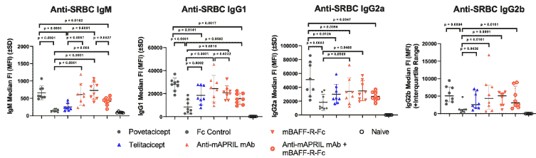

## 系统性红斑狼疮：“不死的癌症”

### BCMA-CD19 CAR-T疗法：昂贵但高效的生物导弹

*iCell*，*BMJ*，中信建投证券

- 2024年5月27日，iCell Gene Therapeutics宣布了其BCMA与CD19靶向复合嵌合抗原受体-T（BCMA-CD19 cCAR-T）细胞免疫疗法的研究者发起临床试验（IIT）的积极结果。这项研究涵盖了系统性红斑狼疮（SLE）/狼疮性肾炎（LN）患者，在经历了3个月的足量CAR-T治疗后，自身抗体转阴，并在长达46个月的随访后，均达到无症状和无药物缓解（MFR）。

- BCMA-CD19 CAR-T在靶点设计上直接针对记忆B细胞与长效浆细胞，通过对体液免疫的重置消除了引起疾病的自身抗体。这一疗法的潜力巨大，具有拓展至多种自身免疫病的可能。但是由于目前CAR-T疗法的价格高昂，其目标患者群体最有可能是经过靶向药物治疗失败的SLE患者或是缺乏有效疗法的小众疾病患者等。

**BCMA-CD19 CAR-T疗法示意**

- 利妥昔单抗治疗中重度SLE的III期临床试验EXPLORER未达主要终点，但其多项观察性研究均显示一定疗效。虽未有相关适应症获批，但临床实践中，利妥昔单抗常用于对SoC无效、可能导致严重器官损伤的重症难治性SLE患者，以快速缓解病情。

- 泰它西普呈剂量依赖性降低SLE患者免疫球蛋白（IgM、IgG和IgA）水平，在多项临床试验中显示出良好的疗效，肩并肩比较远好于靶点重合的贝利尤单抗。是获批上市治疗SLE的生物制剂中疗效最佳的品种。

- 此外，泰它西普具有良好的安全性与耐受性。IIb期临床试验中试验组与对照组的严重不良事件不存在明显区别。

## 系统性红斑狼疮：“不死的癌症”

### SLE生物制剂中，以泰它西普疗效最佳

**表：我国现有治疗SLE的生物制剂概览**

万方医学，中信建投证券

| 药物名称 | 靶点 | 作用机制 | 半衰期(d) | 用法用量 | 适应证 |
| --- | --- | --- | --- | --- | --- |
| 贝利尤单抗 | BAFF | 靶向结合可溶性人BLyS，通过阻断其与B细胞受体结合，主要抑制过渡和成熟B细胞的存活与分化，从而抑制自身抗体的产生。 | 19.4 | 静脉输注给药，10 mg/kg，前次每2周给药1次，每4周给药1次。 | 在传统治疗基础上疾病仍高疾病活动、自身抗体阳性的≥5岁及以上SLE患者，活动性狼疮肾炎成人患者，联合使用。 |
| 泰它西普 | APRIL \| BAFF | 靶向结合BLyS和APRIL，通过BR3、TACI和BCMA阻断B细胞及浆细胞的存活。 | 11.8 | 冻干粉；皮下注射给药，160mg/次，每周给药1次。 | 联合用于在传统治疗基础上仍具有高疾病活动、自身抗体阳性的SLE成人患者。 |
| 利妥昔单抗 | CD20 | 靶向结合CD20，导致CD20+B细胞凋亡。 | 22 | 静脉注射给药。用法一：1000 mg，隔周1次，共2次；用法二：每次375mg/m²，每周1次，连续4次。 | 无 |

## 系统性红斑狼疮：“不死的癌症”

### 研发势力强劲，商业化产品多样

**表：系统性红斑狼疮研发管线（上市）**

*insight*，中信建投证券

| 药品成分 | 主要研发机构 | 靶点 | 适应症 | 境外研发状态 | 内地研发状态 |
| --- | --- | --- | --- | --- | --- |
| 贝利尤单抗 | 葛兰素史克，阿斯利康制药，Human Genome Sciences，剑桥抗体技术公司 | BAFF | 系统性红斑狼疮 | 批准上市 | 批准上市 |
| 甲泼尼龙 | 辉瑞，瀚晖制药 | GR | 系统性红斑狼疮 | 批准上市 | 批准上市 |
| 羟氯喹 | 赛诺菲制药，Advanz Pharma，旭化成株式会社 | - | 系统性红斑狼疮 | 批准上市 | 批准上市 |
| 阿尼鲁单抗 | 阿斯利康，百时美施贵宝制药，MedImmune Pharma，Medarex，Vetter Pharma | IFNAR1 | 系统性红斑狼疮 | 批准上市 | 临床III期 |
| 促肾上腺皮质激素 | 赛诺菲制药，马林克罗制药，Questcor Pharmaceuticals，Aventis | MC2R | 系统性红斑狼疮 | 批准上市 | - |
| 氯喹 | 拜耳医药 | - | 系统性红斑狼疮 | 批准上市 | - |
| 泰它西普 | 荣昌生物 | APRIL \| BAFF | 系统性红斑狼疮 | 临床III期 | 批准上市 |
| 重组人白细胞介素2 | 山东泉港药业 | IL2R | 系统性红斑狼疮 | - | 批准上市 |
| 重组人白细胞介素2 | 北京双鹭药业 | IL2R | 系统性红斑狼疮 | - | 批准上市 |
| 硫唑嘌呤 | 葛兰素史克，Sebela Pharmaceuticals，爱施健制药，Excella GmbH & Co. KG | Rac1b | 系统性红斑狼疮 | - | 批准上市 |
| 环磷酰胺 | 百特制药，盐野义制药株式会社，安进制药 | DNA | 系统性红斑狼疮 | - | 批准上市 |

## 系统性红斑狼疮：“不死的癌症”

### 研发势力强劲，商业化产品多样

**表：系统性红斑狼疮研发管线（III期及II期阶段）**

*insight*，中信建投证券

| 药品成分 | 主要研发机构 | 靶点 | 境外研发状态 | 内地研发状态 |
| --- | --- | --- | --- | --- |
| 氘可来昔替尼 | 百时美施贵宝 | TYK2 | 临床III期 | 临床III期 |
| Ianalumab | MorphoSys，诺华制药 | BAFFR | 临床III期 | 临床III期 |
| Litifilimab | 渤健制药，渤健生物 | CLEC4C | 临床III期 | 临床III期 |
| Dapirolizumab Pegol | 渤健制药，优时比制药 | CD40L | 临床III期 | 临床III期 |
| 乌帕替尼 | 艾伯维 | JAK1 | 临床III期 | 临床III期 |
| 奥妥珠单抗 | 罗氏，基因泰克，渤健制药，中外制药株式会社，日本新药株式会社，Acerta Pharma，GlycArt Biotechnology | CD20 | 临床III期 | 临床III期 |
| 福瑞莫德 | ImmuPharma，Avion Pharmaceuticals，梯瓦制药，Cephalon | HSPA8 | 临床III期 | - |
| Cenerimod | Idorsia Pharmaceuticals，爱可泰隆制药，晖致 | S1PR1 | 临床III期 | 批准临床 |
| 阿塞西普 | 默克制药，Vera Therapeutics，百时美施贵宝，EMD Serono Research & Development Institute，ZymoGenetics | APRIL \| BAFF | 临床II/III期 | - |
| 利妥昔单抗 | 罗氏，渤健，全药工业株式会社，中外制药株式会社，基因泰克 | CD20 | 临床II/III期 | - |
| MK-6194 | 默沙东制药 | IL2R | 临床II期 | 临床II期 |
| Brepocitinib | 辉瑞，Priovant Therapeutics | JAK1 \| TYK2 | 临床II期 | 临床II期 |
| PRV-3279 | Provention Bio，华东医药，武田药品，MacroGenics | CD79B \| FCGR2B | 临床II期 | 临床II期 |
| Afimetoran | 百时美施贵宝制药 | TLR7 \| TLR8 | 临床II期 | 临床II期 |
| Enpatoran | 默克 | TLR7 \| TLR8 | 临床II期 | 临床II期 |
| Elsubrutinib | 艾伯维 | BTK | 临床II期 | 临床II期 |
| IFNα-Kinoid | 钟根堂制药，Neovacs，百缮药业（苏州），Biosense Global | IFN-α | 临床II期 | 临床II期 |
| Iscalimab | 诺华制药，Xoma | CD40 | 临床II期 | 临床II期 |
| Frexalimab | 赛诺菲，ImmuNext，Royalty Pharma | CD40L | 临床II期 | - |
| Dazukibart | 辉瑞 | IFNB1 | 临床II期 | - |
| GLPG3667 | Galapagos，吉利德制药 | TYK2 | 临床II期 | - |
| ESK-001 | Alumis | TYK2 | 临床II期 | - |
| 乳杆菌 | 艾因夏姆斯大学 | - | 临床II期 | - |

## 系统性红斑狼疮：“不死的癌症”

### 研发势力强劲，商业化产品多样

**表：系统性红斑狼疮研发管线（II期及I/II期阶段）**

*insight*，中信建投证券

| 药品成分 | 主要研发机构 | 靶点 | 境外研发状态 | 内地研发状态 |
| --- | --- | --- | --- | --- |
| LY 3361237 | 礼来制药，Sanford Burnham Prebys Medical Discovery Institute | BTLA | 临床II期 | - |
| 尼卡利单抗 | 强生，Momenta Pharmaceuticals | FcRn | 临床II期 | - |
| Daxdilimab | Viela Bio，SBI Biotech，MedImmune Pharma，地平线制药 | LILRA4 | 临床II期 | - |
| Iberdomide | 百时美施贵宝制药，新基医药 | CRBN \| IKZF1 \| IKZF3 | 临床II期 | - |
| 伏环孢素 | Aurinia Pharmaceuticals，大冢制药株式会社，三生制药集团，罗氏 | Calcineurin \| Cyclophilin | 临床II期 | - |
| Rezpegaldesleukin | 礼来，Nektar Therapeutics | IL2RA | 临床II期 | - |
| Descartes-08 | Cartesian Therapeutics | BCMA | 临床II期 | - |
| Avizakimab | Boston Pharmaceuticals，阿斯利康 | IL21 | 临床II期 | - |
| Lenabasum | Corbus Pharmaceuticals，科研制药株式会社 | CNR2 | 临床II期 | - |
| RSLV-132 | Resolve Therapeutics | - | 临床II期 | - |
| 吗替麦考酚酯 | 罗氏，CSL Vifor，Biocon Group，Aspreva Pharmaceuticals | IMPD | 临床II期 | - |
| Rozibafusp alfa | 安进 | BAFF \| ICOSLG | 临床II期 | 批准临床 |
| DS-7011 | 第一三共 | TLR7 | 临床I/II期 | 临床I/II期 |
| IMPT-514 | ImmPACT Bio | CD19 \| CD20 | 临床I/II期 | - |
| CABA-201 | Cabaletta Bio | CD19 | 临床I/II期 | - |
| Rapcabtagene Autoleucel | 诺华制药 | CD19 | 临床I/II期 | - |
| E 6742 | 卫材药业 | TLR7 \| TLR8 | 临床I/II期 | - |
| MB CART19.1 | Miltenyi Biomedicine | CD19 | 临床I/II期 | - |
| KPG-818 | 康朴生物 | CRBN \| IKZF1 \| IKZF3 | 临床I/II期 | 临床I期 |
| 泽托佐米 | Kezar Life Sciences，安进，Onyx Pharmaceuticals，云顶新耀 | PSMB8 \| PSMB9 | 临床I/II期 | 申请临床 |

## 系统性红斑狼疮：“不死的癌症”

### 研发势力强劲，商业化产品多样

**表：系统性红斑狼疮研发管线（II期及I/II期阶段）**

*insight*，中信建投证券

| 药品成分 | 主要研发机构 | 靶点 | 境外研发状态 | 内地研发状态 |
| --- | --- | --- | --- | --- |
| MIL62 | 北京天广实生物，恒瑞 | CD20 | - | 临床II/III期 |
| JMKX000189 | 济煜医药，济民可信，杭煜制药 | - | - | 临床II期 |
| 奥布替尼 | 诺诚健华，渤健制药 | BTK | - | 临床II期 |
| 马来酸蒿乙醚胺 | 中国科学院上海药物研究所 | - | - | 临床II期 |
| CD19/BCMA CAR-T BH002 | 埃森生物 | BCMA \| CD19 | - | 临床I/II期 |
| CD19 CAR-γδT | 百暨基因 | CD19 | - | 临床I/II期 |
| Lisaftoclax | 亚盛医药，亚盛药业 | BCL2 | - | 临床I/II期 |
| CM313 | 康诺亚 | CD38 | - | 临床I/II期 |
| 脐带间充质干细胞 | 南京大学医学院附属南京鼓楼医院 | - | - | 临床I/II期 |
| GR1603 | 智翔金泰 | IFNAR1 | - | 临床I/II期 |
| 瑞基奥仑赛 | 药明巨诺 | CD19 | - | 临床I/II期 |
| CD19 CAR-T | 百暨基因 | CD19 | - | - |
| CIGB-816 | Center for Genetic Engineering and Biotechnology，BioFarma Innovations | - | - | - |
| KP104 | 科越医药 | C5 \| CFH | 批准临床 | - |

## 多发性硬化:免疫系统攻击中枢神经

- 多发性硬化症（MS）是免疫系统攻击大脑和脊髓时会出现的一种疾病，MS患者的免疫系统会攻击包覆神经纤维的保护鞘（髓磷脂），导致保护性的髓磷脂受损而露出神经纤维，沿神经纤维传递的信息可能减慢或受阻，最终导致神经纤维永久性损伤或退化。目前多发性硬化仍无法治愈，治疗目的是减轻症状、防止复发并提高生活质量。

- 多发性硬化症的症状取决于神经纤维损伤的部位和严重程度，通常表现为视力问题、疲倦、难以行走和保持平衡以及四肢麻痹或无力。

- 全世界约有290万人患有多发性硬化症，每年约有10.7万人确诊多发性硬化症。多发性硬化于2018年被列入《第一批罕见病目录》，我国目前约有已诊断的MS患者30000多名患者。

## 多发性硬化:免疫系统攻击中枢神经

*Frontiers*，中信建投证券

### 病因、分类与流行病学

**图：全球各国多发性硬化病例数统计（2023）**

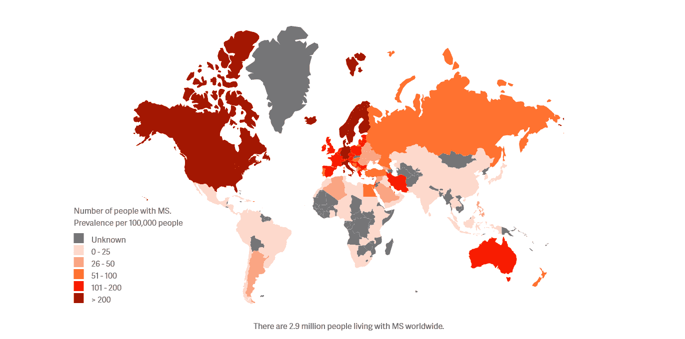

**图：发病部位——神经系统**

## 多发性硬化:免疫系统攻击中枢神经

*Pubmed*，中信建投证券

### 多发性硬化的诊疗和治疗靶点

- 多发性硬化有多种表现形式，包括临床孤立综合征（CIS），复发缓解型（RRMS），继发进展型（SPMS），原发进展型（PPMS）。多发性硬化早期症状变化多，较难识别。常见的诊断方法包括神经检查，核磁共振，脊椎穿刺和诱发反应。

- 多发性硬化治疗药物包括皮质类固醇，生物制剂和小分子抑制剂；其中，对于缓解期治疗，首选DMT药物（疾病修正治疗药物），包括非特异性免疫调节剂和抗体药物如那他珠单抗，奥美珠单抗等。

- 多发性硬化药物常见的靶点包括：BTK，CD20，S1PR1，NRF2等。

**图：多发性硬化的诊疗**

- 急性期治疗：糖皮质激素（一线治疗），血浆置换（二线治疗），静脉注射免疫球蛋白（备用治疗）
- 缓解期治疗：首选疾病修正治疗（DMT）药物：非特异性免疫调节剂和抗体药物
  - 一线DMT药物：特立氟胺，干扰素β，GA，醋酸格拉替雷等
  - 二线DMT药物：芬戈莫德，那他珠单抗等
  - 对DMT一、二线治疗效果不理想的患者可谨慎选择其他免疫抑制剂，长期使用会产生副作用

**图：多发性硬化的表现形式**

- **临床孤立综合征（CIS）**：神经系统症状的单次发作，这些症状则属于疑似罹患多发性硬化症的首个临床体征
- **复发缓解型（RRMS）**：复发与缓解交替，缓解期部分或完全恢复，病情稳定。缓解期可持续数月或数年。可自然复发或由感染如流感等诱发。MS的复发形式包括活动性继发性MS（定义为临床复发或在脑或脊髓的MRI扫描中发现的新病变）。
- **继发进展型（SPMS）**：开始为复发缓解交替（复发缓解性），后期疾病逐渐进展。
- **原发进展型（PPMS）**：疾病逐渐进展无缓解期，尽管可有短暂的平台期，期间病情不再进展。与复发缓解型不同，没有明显的复发缓解征象。

## 多发性硬化: 免疫系统攻击中枢神经

*World J Pediatr*，*Ann Rheum Dis*，中信建投证券

### 多发性硬化发病机制与治疗靶点

**图：致病机制与治疗靶点**

- MS的发病机制主要涉及免疫系统错误地攻击中枢神经系统（CNS）的髓鞘。这包括T细胞和B细胞对髓鞘蛋白的攻击，如髓鞘碱性蛋白（MBP）、髓鞘相关糖蛋白（MAG）、蛋白脂蛋白（PLP）和髓鞘少突胶质细胞糖蛋白（MOG）。
- 靶向B细胞表面抗原CD20的单克隆抗体如利妥昔单抗和奥克瑞珠单抗可以防止B细胞跨越血脑屏障，减少其与T细胞的相互作用以及限制促炎细胞因子的产生。靶向CD52的单克隆抗体alemtuzumab通过抗体依赖性细胞介导的细胞溶解（ADCC）和补体依赖性细胞溶解（CDC）耗尽表达CD52的淋巴细胞，从而降低MS的复发率。
- 淋巴细胞上的鞘氨醇-1-磷酸（S1P）受体是淋巴细胞迁移到CNS所必需的，靶向S1P的受体抑制剂如芬戈莫德可以抑制淋巴细胞迁移到CNS，从而抑制MS的病发。
- IFN-β和醋酸格拉替拉默是两种重要的疾病修饰治疗（DMT）药物，其旨在减轻炎症，保护神经细胞，改善患者生活质量。IFN-β增加抗炎细胞因子，减少促炎因子IL-17，调节T细胞亚群，降低血脑屏障的T细胞迁移。醋酸格拉替拉默抑制Th17细胞，促进抗炎T细胞和Treg发育，减少炎症。

### 上市创新药靶点较多，CD20发展势头较好

**表：多发性硬化商业化品种销售额**

| 药物 | 公司 | 靶点 | 境外最高状态 | 中国内地最高状态 | 年报销售额2022（百万美元） | 年报销售额2023（百万美元） |
| :--- | :--- | :--- | :--- | :--- | :--- | :--- |
| 富马酸二甲酯 | 渤健制药，卫材药业，优时比制药 | NRF2 | 批准上市 | 批准上市 | 3441 | 2601 |
| 芬戈莫德 | 田边三菱制药株式会社，诺华制药 | S1PR1, S1PR3, S1PR4, S1PR5 | 批准上市 | 批准上市 | 2013 | 925 |
| 特立氟胺 | 赛诺菲制药 | DHODH | 批准上市 | 批准上市 | 2138 | 1033 |
| 达伐吡啶 | 阿索尔达生物制药公司（非积极），渤健制药（非积极），Merz Therapeutics | KCN | 批准上市 | 批准上市 | 170 | 154 |
| 奥扎莫德 | 百时美施贵宝制药，新基医药，The Scripps Research Institute，Receptos | S1PR1, S1PR5 | 批准上市 | 批准上市 | 250 | 434 |
| 西尼莫德 | 诺华制药 | S1PR1, S1PR5 | 批准上市 | 批准上市 | 357 | 392 |
| 奥法妥木单抗 | Genmab，诺华制药，葛兰素史克制药（非积极） | CD20 | 批准上市 | 批准上市 | 1092 | 2171 |
| 重组人干扰素β-1a | 默克制药，FLAMEL IRELAND LTD，Switzerland Serono Pharma Schweiz，辉瑞制药 | IFNAR1, IFNAR2 | 批准上市 | 批准上市 | 934 | 756 |
| 格拉替雷 | 梯瓦制药，武田药品工业株式会社，Hadassah Medical Organization | HLA-DRB1-1β, MBP | 批准上市 | 批准上市 | 691 | 590 |
| 重组人干扰素β-1b | 诺华制药，拜耳医药 | IFNB1 | 批准上市 | 批准上市 | 327 | 247 |
| 奥瑞珠单抗 | 罗氏制药，渤健制药，基因泰克 | CD20 | 批准上市 | 申请上市 | 6334 | 7113 |
| 重组人干扰素β-1a | 渤健制药，卫材药业 | IFNAR1, IFNAR2 | 批准上市 | 临床III期 | 974 | 811 |
| 富马酸地洛西美酯 | Alkermes Pharma，渤健制药 | NRF2 | 批准上市 | 临床III期 | 2551 | 2135 |

注1：以1 EUR = 1.06USD换算

**表：多发性硬化商业化品种销售额**

| 药物 | 公司 | 靶点 | 境外最高状态 | 中国内地最高状态 | 年报销售额2022（百万美元） | 年报销售额2023（百万美元） |
| :--- | :--- | :--- | :--- | :--- | :--- | :--- |
| 阿仑珠单抗 | 拜耳医药，赛诺菲制药，BTG International，健赞生物制药 | CD52 | 批准上市 | 批准临床 | 84 | / |
| Divozilimab | Biocad | CD20 | 批准上市 | - | / | / |
| 乌妥昔单抗 | LFB Group，TG Therapeutics，Ildong Pharmaceutical，rEVO Biologics | CD20 | 批准上市 | - | / | 92 |
| Ponesimod | 强生制药，爱可泰隆制药，Idorsia Pharmaceuticals，Vanda Pharmaceuticals | S1PR1 | 批准上市 | - | / | 1.6 |
| 聚乙二醇化重组干扰素β-1a | 渤健制药，优时比制药，卫材药业 | IFNAR1, IFNAR2 | 批准上市 | - | 332 | 295 |
| 大麻二酚+四氢大麻酚 | GW Research，吉瓦制药，Almirall，拜耳医药，大冢制药株式会社，贾兹制药 | CNR | 批准上市 | - | 43 | 39 |
| 那他珠单抗 | 渤健制药，Elan Pharmaceuticals，百利高制药，Athena Neurosciences LLC，卫材药业 | ITGA4 | 批准上市 | - | 2031 | 1877 |
| 达利珠单抗 | 艾伯维生物制药，雅培制药，渤健制药，罗氏制药（非积极），PDL BioPharma（非积极），Facet Biotech | IL2RA | 批准上市 | - | / | / |
| 甲泼尼龙 | 辉瑞制药，瀚晖制药有限公司 | GR | 批准上市 | - | 328 | 339 |
| 促肾上腺皮质激素 | 赛诺菲制药，马林克罗制药，Questcor Pharmaceuticals，Aventis | MC2R | 批准上市 | - | / | / |

注1：以1 EUR = 1.06USD换算

### 以CD20药物疗效最佳，传统疗法仍以干扰素优先

**表：多发性硬化主要上市药物疗效对比**

| 药物 | 靶点 | 试验组 | 对照组 | ARR | P值 | RR | CDP | P值 | NCT编号 |
| :--- | :--- | :--- | :--- | :--- | :--- | :--- | :--- | :--- | :--- |
| 乌妥昔单抗 | CD20 | 乌妥昔单抗 | 特立氟胺 | 0.09 vs 0.18 | 0.002 | 0.51 [0.33-0.78] | / | / | NCT03277248 |
| 奥瑞珠单抗 | CD20 | 奥瑞珠单抗 | 干扰素β-1a | 0.16 vs 0.29 | <0.001 | / | / | / | NCT01412333 |
| 奥法妥木单抗 | CD20 | 奥法妥木单抗 | 特立氟胺 | 0.11 vs 0.22 | <0.001 | / | / | / | NCT02792218 |
| 特立氟胺 | DHODH | 特立氟胺 | 干扰素β-1a | 0.26 vs 0.22 | 0.03 | / | / | / | NCT00883337 |
| 格拉替雷 | HLA-DRB1-1β | 格拉替雷 | / | 0.20-0.22 | / | / | / | / | NCT01067521 |
| 那他珠单抗 | ITGA4 | 那他珠单抗 | 安慰剂 | / | / | / | 0.44 vs 0.48 | 0.287 | NCT01067521 |
| 富马酸地洛西美酯 | NRF2 | 富马酸地洛西美酯 | / | 0.13 | / | / | / | / | NCT03093324 |
| 富马酸二甲酯 | NRF2 | 富马酸二甲酯 | 格拉替雷 | 0.22 vs 0.29 | <0.001 | / | / | / | NCT00451451 |
| 奥扎莫德 | S1PR | 奥扎莫德 | 干扰素β-1a | 0.18 vs 0.35 | <0.0001 | 0.52 [0.41-0.66] | / | / | NCT02294058 |
| 西尼莫德 | S1PR | 西尼莫德 | 安慰剂 | / | / | / | 0.26 vs 0.32 | 0.013 | NCT01665144 |
| 芬戈莫德 | S1PR | 芬戈莫德 | 格拉替雷 | 0.15 vs 0.26 | 0.01 | / | / | / | NCT01633112 |
| 芬戈莫德 | S1PR | 芬戈莫德 | 干扰素β-1a | 0.12 vs 0.67 | <0.001 | / | / | / | NCT01892722 |
| 芬戈莫德 | S1PR | 芬戈莫德 | 安慰剂 | 0.16 vs 0.40 | <0.001 | / | 0.18 vs 0.24 | / | NCT00289978 |

- ARR表示该疾病的年复发率，CDP表示该疾病的致残进展。这个两项数据越低代表疗效越好。
- 乌妥昔单抗、奥法妥木单抗以及芬戈莫德均具有良好的疗效。特立氟胺与那他珠单抗临床数据的P值过高（标红部分），无法体现统计学差异。

疗效最好的数据以高亮显示，标灰数据为未达到统计学显著。

### 二代S1PR抑制剂安全性更佳

- 作用机制：S1PR抑制剂通过调节鞘氨醇-1-磷酸受体（S1PRs）发挥作用，通过减少淋巴细胞向中枢神经的迁移从而减少相应区域的炎症。而CD20抗体通过靶向B细胞表面的CD20抗原，消耗B细胞，减少自身免疫反应中的B细胞致病作用。
- 安全性：CD20抗体通常会引起B细胞耗竭，而S1PR仅是阻碍了淋巴细胞迁移，在免疫系统的副作用方面具有一定优势。而第一代S1PR抑制剂的芬戈莫德由于选择性低，通常会抑制S1PR1/5之外的其他SIPR，具有一定的心脏毒性（心动过缓和房室传导阻滞等）。奥扎莫德和西尼莫德作为选择性更好的二代抑制剂，在心脏风险和淋巴细胞减少症方面均具有优势。
- 依从性：S1PR抑制剂通常是口服形式，CD20抗体的注射给药更方便，可提高患者依从性。且从治疗费用上而言，小分子抑制剂的价格也具有一定优势。

**表：S1PR抑制剂靶向对比**

## 在研管线众多，靶点丰富竞争激烈

**表：多发性硬化研发进展（上市及NDA）**

| 药品成分 | 主要研发机构 | 靶点 | 适应症 | 境外研发状态 | 内地研发状态 | 数据临床阶段 | 试验药物 | 试验结果 |
| :--- | :--- | :--- | :--- | :--- | :--- | :--- | :--- | :--- |
| Divozilimab | Biocad | CD20 | 多发性硬化 | 批准上市 | - | III期 | 试验组：Divozilimab 对照组：特立氟胺 | ARR：0.057 VS 0.164 GdE T1 lesions：0.0±0.08 VS 1.0±4.46 EDSS score：10.7% VS 21.3% |
| 乌妥昔单抗 | LFB Group，TGTherapeutics，Ildong Pharmaceutical，rEVO Biologics | CD20 | 多发性硬化 | 批准上市 | - | III期 | 试验组：乌妥昔单抗 | FIS total score，24-week：–6.4 vs baseline VS -3.1 vs baseline |
| Ponesimod | 强生制药，爱可泰隆制药，Idorsia Pharmaceuticals，Vanda Pharmaceuticals | S1PR1 | 多发性硬化 | 批准上市 | - | III期 | 试验组：Ponesimod 对照组：特立氟胺 | ARR：0.123 VS 0.158 Free of confirmed relapses：75.2% VS 72.1% |
| 奥扎莫德 | 百时美施贵宝制药，新基医药，The Scripps Research Institute，Receptos | S1PR1, S1PR5 | 多发性硬化 | 批准上市 | 批准上市 | III期 | 试验组：奥扎莫德 | ARR：<0.2 |
| 富马酸地洛西美酯 | Alkermes Pharma，渤健制药 | NRF2 | 多发性硬化 | 批准上市 | 临床III期 | III期 | 试验组：富马酸地洛西美酯 | ARR (96-week)：0.13 relapse-free：82.4% NEDA-3：41.1% |
| 西尼莫德 | 诺华制药 | S1PR1, S1PR5 | 多发性硬化 | 批准上市 | 批准上市 | III期 | 试验组：西尼莫德 对照组：安慰剂 | CDP (6-month)：试验组VS对照组HR=0.78（95%CI，0.66-0.92），P=0.0026 CPS（6-month）：试验组VS对照组HR=0.77（95%CI，0.65-0.92），P=0.0047 |
| 奥瑞珠单抗 | 罗氏制药，渤健制药，基因泰克 | CD20 | 多发性硬化 | 批准上市 | 申请上市（推测） | III期 | 试验组：奥瑞珠单抗 对照组：奥瑞珠单抗 | ENSEMBLE PLUS demonstrates the safety and tolerability of shorter ocrelizumab infusions. |
| 聚乙二醇化重组干扰素β-1a | 渤健制药，优时比制药，卫材药业 | IFNAR1, IFNAR2 | 多发性硬化 | 批准上市 | - | III期 | 试验组1：聚乙二醇化重组干扰素β-1a 试验组2：聚乙二醇化重组干扰素β-1a | ARR (6-year)：0.188 VS 0.263 ARR (5-year)：36% VS 49% |
| 富马酸二甲酯 | 渤健制药，卫材药业，优时比制药 | NRF2 | 多发性硬化 | 批准上市 | 批准上市 | II期 | 试验组：富马酸二甲酯 对照组：安慰剂 | Neurofilament light chain in the cerebrospinal fluid：试验组VS对照组mean difference=99 ng/L（95% CI，-292 to 491） |
| 芬戈莫德 | 田边三菱制药株式会社，诺华制药 | S1PR1, S1PR3, S1PR4, S1PR5 | 多发性硬化 | 批准上市 | 批准上市 | III期 | 试验组1：芬戈莫德 试验组2：芬戈莫德 对照组：格拉替雷 | ARR：0.15 VS 0.22 VS 0.26 |

疗效最好的数据以高亮显示，不同试验的可比指标以标红显示。

**表：多发性硬化研发进展（上市及NDA）**

| 药品成分 | 主要研发机构 | 靶点 | 适应症 | 境外研发状态 | 内地研发状态 | 数据临床阶段 | 试验药物 | 试验结果 |
| :--- | :--- | :--- | :--- | :--- | :--- | :--- | :--- | :--- |
| 特立氟胺 | 赛诺菲制药 | DHODH | 多发性硬化 | 批准上市 | 批准上市 | III期 | 试验组：特立氟胺 对照组：安慰剂 | primary endpoint：试验组VS对照组HR=0.34（95%CI，0.14-0.82），P=0.016 New or enlarging T2 lesions：试验组VS对照组RR=0.69（95%CI，0.34-1.40），P=0.31 Gd+ lesions：试验组VS对照组OR=0.31（95%CI，0.08-1.18），P=0.087 |
| 达伐吡啶 | 阿索尔达生物制药公司（非积极），渤健制药（非积极），Merz Therapeutics | KCN | 多发性硬化 | 批准上市 | 批准上市 | III期 | 试验组：达伐吡啶 对照组：安慰剂 | primary endpoint：43.2% VS 33.6% |
| 大麻二酚+四氢大麻酚 | GW Research，吉瓦制药，Almirall，拜耳医药，大冢制药株式会社，贾兹制药 | CNR | 多发性硬化 | 批准上市 | - | III期 | 试验组：大麻二酚+四氢大麻酚 | LLMT-6：did not meet the primary endpoint |
| 奥法妥木单抗 | Genmab，诺华制药，葛兰素史克制药（非积极） | CD20 | 多发性硬化 | 批准上市 | 批准上市 | III期 | 试验组：奥法妥木单抗 | GdE T1 lesions (6-month)：100% |
| 那他珠单抗 | 渤健制药，Elan Pharmaceuticals，百利高制药，Athena Neurosciences LLC，卫材药业 | ITGA4 | 多发性硬化 | 批准上市 | - | III期 | 试验组1：那他珠单抗 试验组2：那他珠单抗 | primary endpoint：0.20 VS 0.05 |
| 阿仑珠单抗 | 拜耳医药，赛诺菲制药，BTG International，健赞生物制药 | CD52 | 多发性硬化 | 批准上市 | 批准临床 | 0 | 试验组1：阿仑珠单抗 试验组2：阿仑珠单抗 | SRD，6-year：63 VS 50 |
| 达利珠单抗 | 艾伯维生物制药，雅培制药，渤健制药，罗氏制药（非积极），PDL BioPharma（非积极），Facet Biotech | IL2RA | 多发性硬化 | 批准上市 | - | III期 | 试验组：达利珠单抗 对照组：重组人干扰素β-1a | Results from the combined DECIDE-EXTEND study elucidate outcomes of longer-term treatment with daclizumab beta in the clinical trial setting and underscore the importance of pharmacovigilance with immunomodulatory therapies in the real-world setting. |

疗效最好的数据以高亮显示，不同试验的可比指标以标红显示。

# 多发性硬化：免疫系统攻击中枢神经

## 表：多发性硬化研发进展（上市及NDA）

*Insight*，中信建投证券

| 药品成分 | 主要研发机构 | 靶点 | 适应症 | 境外研发状态 | 内地研发状态 | 数据临床阶段 | 试验药物 | 试验结果 |
|---|---|---|---|---|---|---|---|---|
| 格拉替雷 | 梯瓦制药、武田药品工业株式会社、Hadassah Medical Organization | HLA-DRB1-1β、MBP | 多发性硬化 | 批准上市 | 批准上市 | III期 | 试验组：格拉替雷 | ARR（3-year）：0.20–0.22 |
| 重组人干扰素β-1a | 渤健制药、卫材药业 | IFNAR1、IFNAR2 | 多发性硬化 | 批准上市 | 临床III期 | II期 | 试验组：门冬胰岛素、重组人干扰素β-1a、甲泼尼龙；对照组：重组人干扰素β-1a、安慰剂、甲泼尼龙 | EDSS score（8-week）：20.0% VS 0.0% |
| 重组人干扰素β-1b | 诺华制药、拜耳医药 | IFNB1 | 多发性硬化 | 批准上市 | 批准上市 | / | / | / |
| 甲泼尼龙 | 辉瑞制药、瀚晖制药有限公司 | GR | 多发性硬化 | 批准上市 | - | / | / | / |
| 促肾上腺皮质激素 | 赛诺菲制药、马林克罗制药、Questcor Pharmaceuticals、Aventis | MC2R | 多发性硬化 | 批准上市 | - | / | / | / |
| 拉喹莫德 | Active Biotech、梯瓦制药 | AHR | 多发性硬化 | 申请上市 | - | III期 | 试验组1：拉喹莫德；试验组2：拉喹莫德；对照组：安慰剂 | CDP（3-month）：试验组1 VS 对照组 HR=0.94（95% CI，0.67–1.31），P=0.706 |

## 在研管线众多，靶点丰富竞争激烈

疗效最好的数据以高亮显示，不同试验的可比指标以标红显示。

# 多发性硬化：免疫系统攻击中枢神经

## 表：多发性硬化研发进展（III期）

*Insight*，中信建投证券

| 药品成分 | 主要研发机构 | 靶点 | 适应症 | 境外研发状态 | 内地研发状态 | 数据临床阶段 | 试验药物 | 试验结果 |
|---|---|---|---|---|---|---|---|---|
| Frexalimab | 赛诺菲制药、ImmuNext | CD40L | 多发性硬化 | 临床III期 | 临床III期 | II期 | 试验组1：Frexalimab；试验组2：Frexalimab；试验组3：Frexalimab；试验组4：Frexalimab | GdE T1 lesions（48-week）：96% VS 87% VS 90% VS 92% |
| 马赛替尼 | AB Science | 3CLpro、CSF1R、FYN、KIT、LYN、PDGFR | 多发性硬化 | 临床III期 | - | III期 | 试验组：马赛替尼；对照组：安慰剂 | EDSS score：0.001 VS 0.098 |
| Vidofludimus | Immunic Therapeutics、4SC AG（非积极）、奈科明制药（非积极） | DHODH、NR4A2 | 多发性硬化 | 临床III期 | - | II期 | 试验组1a：Vidofludimus；试验组1b：Vidofludimus；试验组2：Vidofludimus；对照组：安慰剂 | CUA lesions（24-week）：1.4 VS 1.7 VS 5.9 VS 5.8；disability worsening，24-week：3（3.7%）例接受安慰剂，3（1.6%）例接受任意剂量的vidofludimus calcium |
| Remibrutinib | 诺华制药 | BTK | 多发性硬化 | 临床III期 | 临床III期 | / | / | / |
| Fenebrutinib | 罗氏制药、基因泰克 | BTK、BTK C481S | 多发性硬化 | 临床III期 | 临床III期 | II期 | 试验组：Fenebrutinib；对照组：安慰剂 | T1 Gd+ lesions relative reductions，12-week：90% VS __；T2 lesions relative reductions，12-week：95% VS __；T1 Gd+ lesions relative reductions，8-week：92% VS __ |
| Tolebrutinib | 赛诺菲制药、Principia Biopharma、健赞生物制药 | BTK | 多发性硬化 | 临床III期 | 临床III期 | II期 | 试验组：Tolebrutinib；试验组a：Tolebrutinib；试验组b：Tolebrutinib；试验组c：Tolebrutinib；试验组d：Tolebrutinib | Gd-enhancing T1 hyperintense lesions（96-week）：__ VS 0.85±2.5 VS 0.41±0.91 VS 0.90±2.16 VS 0.31±0.66；relapse-free（96-week）：__ VS __ VS __ VS __ VS 80.6% |

## 在研管线众多，靶点丰富竞争激烈

# 多发性硬化：免疫系统攻击中枢神经

## 表：多发性硬化研发进展（III期）

*Insight*，中信建投证券

| 药品成分 | 主要研发机构 | 靶点 | 适应症 | 境外研发状态 | 内地研发状态 | 数据临床阶段 | 试验药物 | 试验结果 |
|---|---|---|---|---|---|---|---|---|
| 美金刚 | 德国麦氏大药厂、Forest Laboratories、灵北制药、第一三共株式会社、艾伯维生物制药 | 5-HT3 receptor、CHRN、DRD2、GRIN | 多发性硬化 | 临床III期 | - | III期 | 试验组：美金刚；对照组：安慰剂 | PASAT scores（memantine minus placebo）：试验组 VS 对照组 difference=-0.40（95% CI，-5.5 to 4.7），P=0.88 |
| 唑来膦酸 | 诺华制药、旭化成株式会社、Phoenix Labs Unlimited Company、Asahi Kasei Pharmaceuticals | FPPS、GGPS1、Hydroxylapatite | 多发性硬化 | 临床III期 | - | / | / | / |
| 罗喹美克 | 辉瑞制药 | / | 多发性硬化 | 临床III期 | - | / | / | / |
| 利妥昔单抗 | 罗氏制药、渤健制药、全药工业株式会社、中外制药株式会社、基因泰克 | CD20 | 多发性硬化 | 临床III期 | - | III期 | 试验组：利妥昔单抗；对照组：富马酸二甲酯 | patients with at least one relapse：3% VS 16% |
| 辛伐他汀 | 勃林格殷格翰制药、葛兰素史克制药、赛诺菲制药、Vianex S.A、默沙东制药 | HMGCR | 多发性硬化 | 临床III期 | - | / | / | / |
| 米托蒽醌 | 晖致、安斯泰来制药、默克制药、Meda AB、辉瑞制药、武田药品工业株式会社 | TOP2A | 多发性硬化 | 临床III期 | - | / | / | / |
| 蜂毒 | Apimeds | / | 多发性硬化 | - | - | / | / | / |
| CNM-Au8 | Clene Nanomedicine | / | 多发性硬化 | 临床II/III期 | - | II/III期 | 试验组：CNM-Au8 | LCLA change across both eyes，144-week：+8.70 letters vs baseline（p<0.0001）；mMSFC（144-week）：0.65 vs baseline（p=0.018）；SDMT，144-week：8.03 vs baseline（p<0.0001） |
| 吗替麦考酚酯 | 罗氏制药、CSL Vifor、Biocon Group、Aspreva Pharmaceuticals | IMPDH | 多发性硬化 | 临床II/III期 | - | / | / | / |

## 在研管线众多，靶点丰富竞争激烈

# 3.5 重症肌无力（GMG）：神经肌肉传递障碍引起骨骼肌收缩无力

# 重症肌无力（GMG）：神经肌肉传递障碍引起骨骼肌收缩无力

*J Transl Med*，*Lancet Neurol*，中信建投证券

## GMG患病率与亚型分布

### 图：重症肌无力在不同地域人群中的患病率

### 图：重症肌无力的不同亚型分布

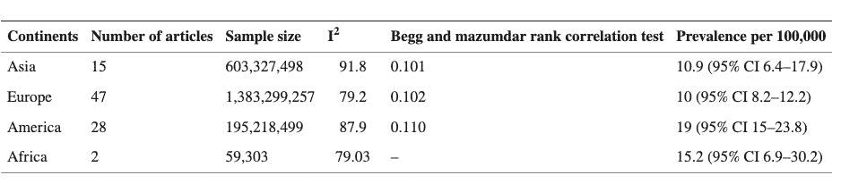

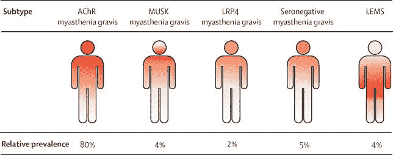

- 重症肌无力是神经肌肉接头和自身抗体介导的疾病。眼部发病率高达85%，其特征是肌肉无力和疲劳，与神经肌肉接头突触后膜中乙酰胆碱受体、肌肉特异性激酶（MuSK）、脂蛋白相关蛋白4（LRP4）或agrin的抗体相关。其亚组包括早发型、晚发型、胸腺瘤、MuSK、LRP4、抗体阴性和眼部重症肌无力。对于对症治疗反应不佳的患者，采用皮质类固醇、硫唑嘌呤和胸腺切除术等一线免疫抑制疗法，更多的免疫调节药物正在开发之中。

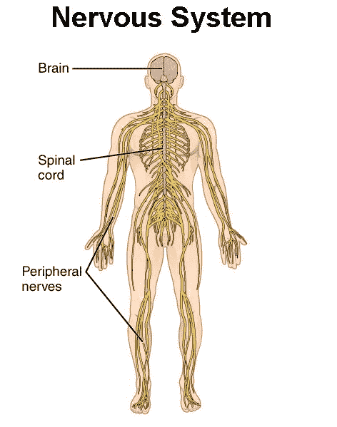

**重症肌无力**

**慢性炎性脱髓鞘性多发性神经根神经病（CIDP）**

**多发性硬化**

## 图：发病部位——神经系统

# 重症肌无力（GMG）：神经肌肉传递障碍引起骨骼肌收缩无力

*Curr Opin Neurol*，*Lancet Neurol*，中信建投证券

## GMG发病机制与治疗方式

### 图：重症肌无力的治疗方式

### 图：重症肌无力的自身免疫机制

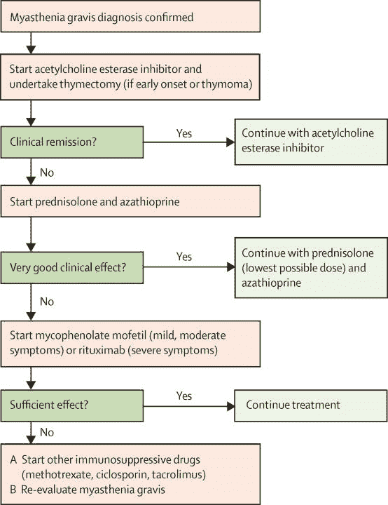

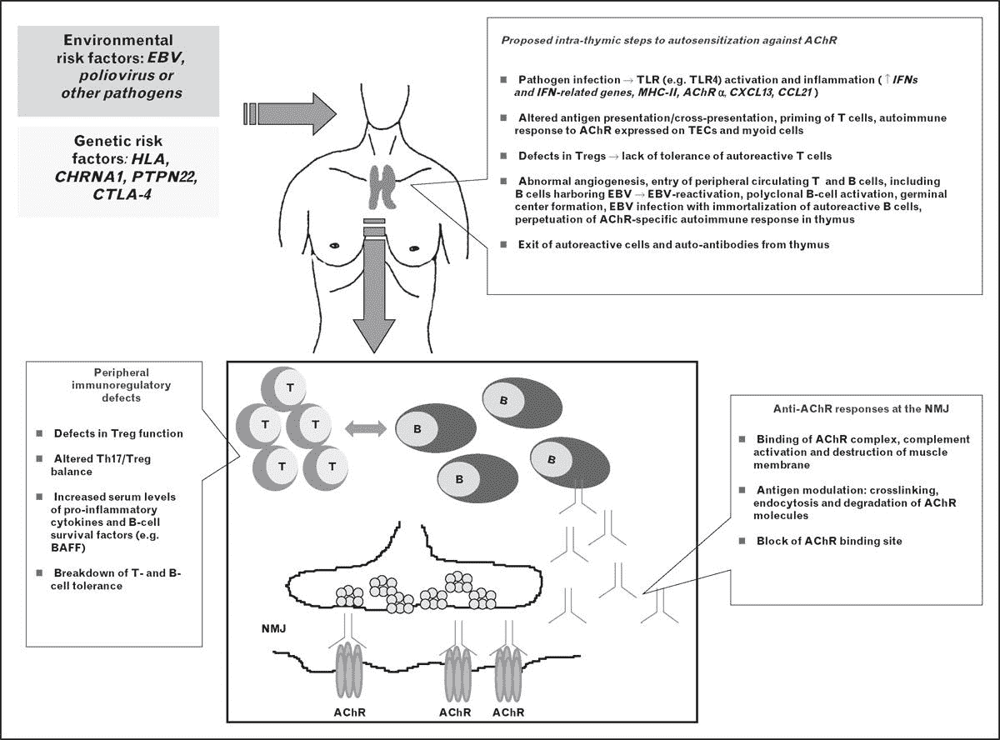

- 重症肌无力患者自身抗体和细胞介导乙酰胆碱受体破坏，其症状可在运动后加重，休息后缓解。通过测量血清乙酰胆碱受体（AChR）抗体水平、肌电图和床边试验（冰袋试验、休息试验）进行诊断。治疗包括抗胆碱酯酶药物、免疫抑制剂、糖皮质激素、血浆置换和胸腺切除等。

# 重症肌无力（GMG）：神经肌肉传递障碍引起骨骼肌收缩无力

# 商业化产品数量较少，多条管线进入III期

### 表：重症肌无力研发进展（上市）

*Insight*，中信建投证券

| 药品成分 | 主要研发机构 | 靶点 | 适应症 | 境外研发状态 | 内地研发状态 | 数据临床阶段 | 试验药物 | 试验结果 |
|---|---|---|---|---|---|---|---|---|
| 依库珠单抗 | Alexion、AZ | C5 | 重症肌无力 | 批准上市 | 批准上市 | III期 | 试验组：依库珠单抗；对照组：安慰剂 | MG-ADL（26-week）：-4.2 VS -2.3；QMG（26-week）：-4.6 VS -1.6 |
| 艾加莫德 | Argenx、再鼎医药 | FcRn | 重症肌无力 | 批准上市 | 批准上市 | III期 | 试验组Y1：AChR-Ab+；试验组Y2：AChR-Ab- | MG-ADL：-5.0 VS __；QMG：-4.7 VS __ |
| Rozanolixizumab | 优时比、Nova Laboratories | FcRn | 重症肌无力 | 批准上市 | 临床III期 | III期 | 试验组：Rozanolixizumab；对照组：安慰剂 | QMG：-1.8 VS -1.2；MG-ADL：-1.8 VS -0.4；MGC：-3.1 VS -1.2 |
| 他克莫司 | 安斯泰来、利奥制药 | FKBP1A | 重症肌无力 | 批准上市 | 临床III期 | III期 | 试验组：他克莫司；对照组：安慰剂 | QMG：-4.9 VS -3.3；QMG（≥4 points）：68.2 VS 44.7 |
| Zilucoplan | 优时比、Ra Pharmaceuticals | C5 | 重症肌无力 | 批准上市 | - | III期 | 试验组：Zilucoplan；对照组：安慰剂 | MG-ADL（48-week）：-5.95（4.14）VS -6.85（5.13） |
| Ravulizumab | Xencor、AZ | C5 | 重症肌无力 | 批准上市 | - | III期 | 试验组：Ravulizumab | MG-ADL（60-week）：-4.0；MG-ADL（34-week）：-1.7；QMG（60-week）：-4.1 |
| 罗泽利昔珠单抗 | 优时比、Vetter Pharma | FcRn | 重症肌无力 | 批准上市 | 申请上市（推测） | III期 | 试验组1：罗泽利昔珠单抗；试验组2：罗泽利昔珠单抗 | MG-ADL（Weeks 7–33）：-2.7 to -3.1 VS -3.4 to -4.1；QMG（Weeks 7–33）：-2.6 to -5.4 VS -4.2 to -6.2 |
| 瑞利珠单抗 | Xencor、阿斯利康 | C5 | 重症肌无力 | 批准上市 | 申请上市（推测） | III期 | 试验组1：瑞利珠单抗；试验组2：瑞利珠单抗 | MG-ADL（164-week）：-4.0 VS -2.1 |
| 巴托利单抗 | 和铂医药、石药集团 | FcRn | 重症肌无力 | 临床III期 | 申请上市 | II期 | 试验组：巴托利单抗；对照组：安慰剂 | MG-ADL：-3.8 VS -0.2；QMG：-3.9 VS -1.8；MGC：-8.0 VS -0.8 |
| 聚乙二醇化人免疫球蛋白 | 大冢制药 | - | 重症肌无力 | 批准上市 | - | / | / | / |
| 环孢素 | Novartis、山德士制药 | PPIA、Calcineurin | 重症肌无力 | 批准上市 | - | / | / | / |
| 溴吡斯的明 | Bausch Health、Roche | AChE | 重症肌无力 | 批准上市 | - | / | / | / |
| 环磷酰胺 | 百特制药、安进制药 | DNA | 重症肌无力 | - | 批准上市 | / | / | / |

疗效最好的数据以高亮显示，不同试验的可比指标以标红显示。

# 重症肌无力（GMG）：神经肌肉传递障碍引起骨骼肌收缩无力

# 商业化产品数量较少，多条管线进入III期

### 表：重症肌无力研发进展（临床阶段）

*Insight*，中信建投证券

| 药品成分 | 主要研发机构 | 靶点 | 适应症 | 境外研发状态 | 内地研发状态 | 数据临床阶段 | 试验药物 | 试验结果 |
|---|---|---|---|---|---|---|---|---|
| Pozelimab | 再生元、再鼎医药 | C5 | 重症肌无力 | 临床III期 | 临床III期 | - | - | - |
| Gefurulimab | Alexion Pharmaceuticals | Albumin、C5 | 重症肌无力 | 临床III期 | 临床III期 | I期 | 试验组：Gefurulimab；对照组：安慰剂 | - |
| Cemdisiran | 再生元、再鼎医药 | C5 | 重症肌无力 | 临床III期 | 临床III期 | - | - | - |
| 尼卡利单抗 | 强生、Momenta Pharmaceuticals | FcRn | 重症肌无力 | 临床III期 | 临床III期 | III期 | 试验组：尼卡利单抗；对照组：安慰剂 | - |
| 伊奈利珠单抗 | 豪森、阿斯利康、泰格 | CD19 | 重症肌无力 | 临床III期 | 临床III期 | - | - | - |
| 阿米吡啶 | 拜玛林、Catalyst Pharmaceuticals | KCN | 重症肌无力 | 临床III期 | - | - | - | - |
| 利妥昔单抗 | 罗氏、渤健制药 | CD20 | 重症肌无力 | 临床III期 | - | - | - | - |
| DNTH 103 | Dianthus Therapeutics、Zenas BioPharma | C1S | 重症肌无力 | 临床II期 | - | - | - | - |
| Mezagitamab | 武田药品 | CD38 | 重症肌无力 | 临床II期 | - | II期 | 试验组1：Mezagitamab；试验组2：Mezagitamab；对照组：安慰剂 | - |
| Descartes-08 | Cartesian Therapeutics | BCMA | 重症肌无力 | 临床II期 | - | II期 | 试验组：Descartes-08 | - |
| CNP-106 | Cour Pharmaceuticals | - | 重症肌无力 | 临床I/II期 | - | - | - | - |
| 重组抗CD20人源化单抗 | 上药交联、上海医药 | CD20 | 重症肌无力 | - | 临床II/III期 | - | - | - |
| NMD670 | NMD Pharma | CLCN1 | 重症肌无力 | 临床中（分期未知） | - | I/II期 | 试验组：NMD670 | - |
| 泰它西普 | 荣昌生物 | APRIL、BAFF | 重症肌无力 | 批准临床 | 临床III期 | II期 | 试验组1：泰它西普；试验组2：泰它西普 | - |
| KYV-101 | Kyverna Therapeutics | CD19 | 重症肌无力 | 批准临床 | - | - | - | - |
| CABA-201 | Cabaletta Bio | CD19 | 重症肌无力 | 批准临床 | - | - | - | - |

98

# 重症肌无力（MG）：神经肌肉传递障碍引起骨骼肌收缩无力

# 商业化产品数量较少，多条管线进入III期

### 表：重症肌无力研发进展（临床阶段）

*Insight*，中信建投证券

| 药品成分 | 主要研发机构 | 靶点 | 适应症 | 境外研发状态 | 内地研发状态 |
|---|---|---|---|---|---|
| Pozelimab | 再生元制药，再鼎医药 | C5 | 重症肌无力 | 临床III期 | 临床III期 |
| Gefurulimab | Alexion Pharmaceuticals | Albumin｜C5 | 重症肌无力 | 临床III期 | 临床III期 |
| Cemdisiran | 再生元制药，再鼎医药 | C5 | 重症肌无力 | 临床III期 | 临床III期 |
| 尼卡利单抗 | 强生，Momenta Pharmaceuticals | FcRn | 重症肌无力 | 临床III期 | 临床III期 |
| 伊奈利珠单抗 | 田边三菱，江苏豪森，阿斯利康，杭州泰格医药 | CD19 | 重症肌无力 | 临床III期 | 临床III期 |
| 阿米吡啶 | 拜玛林制药，Catalyst Pharmaceuticals | KCN | 重症肌无力 | 临床III期 | - |
| 利妥昔单抗 | 罗氏，渤健，基因泰克 | CD20 | 重症肌无力 | 临床III期 | - |
| DNTH 103 | Dianthus Therapeutics，Zenas BioPharma | C1S | 重症肌无力 | 临床II期 | - |
| Mezagitamab | 武田药品 | CD38 | 重症肌无力 | 临床II期 | - |
| Descartes-08 | Cartesian Therapeutics | BCMA | 重症肌无力 | 临床II期 | - |
| 重组抗CD20人源化单克隆抗体皮下注射-B007 | 上药交联，上海医药，永卓博济 | CD20 | 重症肌无力 | - | 临床II/III期 |
| NMD670 | NMD Pharma | CLCN1 | 重症肌无力 | 临床中（分期未知） | - |
| 泰它西普 | 荣昌生物 | APRIL｜BAFF | 重症肌无力 | 批准临床 | 临床III期 |
| KYV-101 | Kyverna Therapeutics，NIH | CD19 | 重症肌无力 | 批准临床 | - |
| CABA-201 | Cabaletta Bio | CD19 | 重症肌无力 | 批准临床 | - |

# 3.6 慢性炎性脱髓鞘性多发性神经根神经病（CIDP）：免疫介导的多发性神经病

100

# 慢性炎性脱髓鞘性多发性神经根神经病（CIDP）：免疫介导的多发性神经病

*Arthritis Res*，中信建投证券

## CIDP的发病率男性多于女性

## 图：CIDP在世界不同地域的患病率（蓝）/发病率（红）

- 不同地理区域的患病率不同。在英国的一项研究中，所报告CIDP的患病率为2.84/10万。日本鸟取县报告的患病率为0.8/10万，而美国奥姆斯特德县为8.9/10万。爱尔兰报告CIDP患病率为5.87/10万成人。
- CIDP男性多于女性，男女比例为2∶1，且多见于高龄患者。

重症肌无力

慢性炎性脱髓鞘性多发性神经根神经病（CIDP）

多发性硬化

## 图：发病部位——神经系统

101

*Lancet Neurol*，*Arthritis Res*，中信建投证券

## CIDP诊断标准与亚型分类

## 图：CIDP的诊断标准

- 慢性炎症性脱髓鞘性多发性神经根神经病（CIDP）是一种罕见但可治疗的免疫介导性神经病变，具有多种亚型。其诊断方式包括神经传导检查、神经超声和MRI等辅助诊断措施。
- 典型CIDP症状包括对称性受累、近端和远端肌无力等，而其非典型亚型症状包括多灶性获得性脱髓鞘感觉和运动神经病变（Lewis-Sumner综合征）和远端获得性脱髓鞘对称性神经病变等。

## 图：CIDP的不同亚型和临床特征

# 慢性炎性脱髓鞘性多发性神经根神经病（CIDP）：免疫介导的多发性神经病

*Insight*，中信建投证券

| 药品成分 | 研发机构 | 靶点 | 境外最高状态 | 上市年份 | 中国内地最高状态 | 年报销售额2022（百万美元） | 年报销售额2023（百万美元） |
|---|---|---|---|---:|---|---:|---:|
| 人免疫球蛋白 | CSL Behring | - | 批准上市 | 1985 | - | 522.2 | / |
| BT595 | Biotest | - | 批准上市 | 2022 | - | / | / |
| Gamunex-C | Grifols Therapeutics LLC | - | 批准上市 | 2003 | - | / | / |
| 聚乙二醇化人免疫球蛋白 | 大冢制药株式会社 | - | 批准上市 | 1992 | - | / | / |
| 人免疫球蛋白 | 武田药品工业株式会社，百特制药，夏尔制药 | - | 批准上市 | 2016 | - | / | / |

## 表：CIDP商业化品种销售额

## 境内尚无管线CIDP适应症获批

# 慢性炎性脱髓鞘性多发性神经根神经病（CIDP）：免疫介导的多发性神经病

103

# 商业化产品比较丰富，全球多种药物批准上市

## 表：CIDP研发进展（上市及在研）

*Insight*，中信建投证券

| 药品成分 | 主要研发机构 | 靶点 | 适应症 | 境外研发状态 | 内地研发状态 |
|---|---|---|---|---|---|
| BT595 | Biotest | - | CIDP | 批准上市 | - |
| Gamunex-C | Grifols Therapeutics | - | CIDP | 批准上市 | - |
| 聚乙二醇化人免疫球蛋白 | 大冢制药株式会社 | Immunoglobulin | CIDP | 批准上市 | - |
| 人免疫球蛋白 | CSL Behring | Immunoglobulin | CIDP | 批准上市 | - |
| 人免疫球蛋白 | 武田，百特制药，夏尔制药 | Immunoglobulin | CIDP | 批准上市 | - |
| 艾加莫德 | Argenx，再鼎医药，Medison Pharma | FcRn | CIDP | 临床III期 | 申请上市 |
| Riliprubart | 赛诺菲，True North Therapeutics | C1S | CIDP | 临床III期 | 临床II期 |
| 尼卡利单抗 | 强生，Momenta Pharmaceuticals | FcRn | CIDP | 临床II/III期 | 临床II/III期 |
| 罗泽利昔珠单抗 | 优时比制药，Nova Laboratories，Vetter Pharma | FcRn | CIDP | 临床II期 | - |
| 利妥昔单抗 | 罗氏，渤健制药，全药工业株式会社，中外制药株式会社，基因泰克 | CD20 | CIDP | 临床II期 | - |
| 巴托利单抗 | Roivant Sciences，和铂医药，Hanall Biopharma，Immunovant，石药集团，佳曦控股 | FcRn | CIDP | 临床II期 | 批准临床 |
| 福瑞莫德 | ImmuPharma，Avion Pharmaceuticals，梯瓦制药，Cephalon | HSPA8 | CIDP | - | - |

# 3.7 IgA肾病：最常见的原发性肾小球疾病

105

# IgA肾病：最常见的原发性肾小球疾病

*Kidney Int*，*Semin Immunopathol*，中信建投证券

## IgA肾病患病率亚洲地区较高

- 由于IgAN的诊断需要肾活检，因此仍难以确定确切的患病率。在尸检研究中，系膜IgA沉积的患病率极高，根据研究人群的不同，范围为4%～16%。同样，据报道，在日本，活体或尸体供者肾脏的方案活检中，IgA沉积的发生率高达16%。
- IgA肾病在亚洲地区发病率远远高于欧美国家，中国IgA肾病的发病率占原发性肾小球肾炎发病率的40%到50%。
- IgA肾病的支持性治疗主要包括控制血压、控制蛋白尿、使用肾素-血管紧张素系统阻滞剂和SGLT2抑制剂、限制钠和蛋白质摄入等。

## 图：IgA肾病发病率的地理种族差异

IgA肾病

## 图：发病部位——排泄系统

106

# IgA肾病：最常见的原发性肾小球疾病

*Nature*，*Semin Immunopathol*，中信建投证券

## IgA肾病分子机制与治疗

## 图：IgA肾病的分子机制

## 图：IgA肾病诊疗

- 黏膜中浆细胞产生IgA。T细胞因子如APRIL促进B细胞向产生IgA1的浆细胞转化。IgA肾病患者产生的IgA1为糖基化低下（Gd-IgA1），易感个体也会产生抗Gd-IgA1自身抗体。自身免疫性IgA形成肾源性免疫复合物，激活补体系统攻击肾脏细胞。补体是病程中承上启下的关键一环，也是药物研发的重点靶点。
- 肾源性免疫复合物促进局部炎症、细胞增殖，并最终导致纤维化。肾小球和肾小管间质损伤（如炎症、纤维化）相关过程的广泛靶向作用于这些肾脏损伤的最终共同途径。
- 在支持治疗之后，布地奈德缓释胶囊由于其良好的安全性，是优先于系统性糖皮质激素治疗的方案。后续治疗方案还包括其他免疫抑制剂（硫唑嘌呤和羟氯喹等）与各类生物制剂等新型药物。考虑到布地奈德缓释胶囊的显著疗效（延缓肾衰竭中位数达12.8年）、优秀的安全性和高治疗优先级（仅次于支持治疗），很有可能成为一种长盛不衰的经典疗法。

107

# IgA肾病：最常见的原发性肾小球疾病

*PubMed*，*Insight*，中信建投证券

## 补体系统是IgA肾病的关键靶点

- 近年来的研究发现，除了由抗体激活的经典途径（classical pathway）之外，凝集素途径（Lectin pathway，LP）和替代途径（alternative pathway，AP）在疾病进展中也发挥了关键作用。因此C3、B因子和D因子等AP和LP的上游蛋白也被认为有成药的潜力。
- 经典C5抗体药物依库珠单抗虽有被用于IgA肾病治疗的尝试，但是不能预防最终的肾衰竭，难以真正用于临床实践。
- 目前进入II期或以上临床阶段的药物包括narsoplimab（MASP抑制剂）、iptacopan（LNP023，B因子抑制剂）、vemircopan（D因子抑制剂）、pegcetacoplan（C3抑制剂）、IONIS-FB-LRx（B因子反义寡核苷酸）、cemdisiran（C5的siRNA）、povetacicept、ravulizumab（C5抗体）和avacopan（C5a受体抑制剂）等。
- Cemdisiran、povetacicept和iptacopan已经分别在II期和III期临床试验中取得了良好的结果，尿蛋白水平相对于安慰剂组显著降低。
- Cemdisiran的II期结果展现了良好的安全性，不良反应事件与安慰剂接近，也未报道类似依库珠单抗的感染风险。Iptacopan仅披露了III期临床的中期结果，无安全性数据。Povetacicept的I/II期也未出现感染或低丙种球蛋白血症的不良反应。

## 图：补体系统激活示意图

108

# IgA肾病：最常见的原发性肾小球疾病

# 商业化产品数量较少，多条管线进入III期

## 表：IgA肾病研发进展

*Insight*，中信建投证券

| 药品成分 | 主要研发机构 | 靶点 | 适应症 | 境外研发状态 | 内地研发状态 | 数据临床阶段 | 试验药物 | 试验结果 |
|---|---|---|---|---|---|---|---|---|
| 司帕生坦 | BMS | AGTR1｜EDNRA | IgA肾病 | 批准上市 | - | III期 | 试验组：司帕生坦；对照组：厄贝沙坦 | UPCR（36-week）：-49.8% vs -15.1%；eGFR（total slope）：-2.9 mL/min/1.73 m² per year vs -3.9 mL/min/1.73 m² per year；eGFR（chronic slope）：-2.7 mL/min/1.73 m² per year vs -3.8 mL/min/1.73 m² per year |
| ISIS 696844 | 罗氏，GSK，基因泰克 | CFB | IgA肾病 | 临床III期 | 临床III期 | II期 | 试验组：ISIS 696844 | eGFR（29-week）：no change（from BL 68±26 to 69±21 mL/min/1.73㎡） |
| 阿塞西普 | 默克制药，BMS | APRIL｜BAFF | IgA肾病 | 临床III期 | 临床III期 | II/III期 | 试验组1：阿塞西普；试验组2：阿塞西普；试验组3：阿塞西普；试验组3a：阿塞西普；对照组：安慰剂 | UPCR（24-week）：__ vs __ vs __ vs -31% vs -8%；UPCR（36-week）：__ vs __ vs __ vs -34% vs +2%；eGFR（36-week）：__ vs __ vs __ vs -8.37% vs +1.44% |
| Sibeprenlimab | 大冢制药株式会社，Visterra | APRIL | IgA肾病 | 临床III期 | 临床III期 | II期 | 试验组1：Sibeprenlimab；试验组2：Sibeprenlimab；试验组3：Sibeprenlimab；对照组：安慰剂 | GMR in 24-hour uPCR：47.2±8.2% vs 58.8±6.1% vs 62.0±5.7% vs 20.0±12.6%；eGFR：-2.7±1.8 mL/min/1.73 m² vs 0.2±1.7 mL/min/1.73 m² vs -1.5±1.8 mL/min/1.73 m² vs -7.4±1.8 mL/min/1.73 m² |
| 瑞利珠单抗 | Alexion Pharmaceuticals，阿斯利康 | C5 | IgA肾病 | 临床III期 | 临床III期 | II期 | 试验组：瑞利珠单抗；对照组：安慰剂 | 24-h urine protein：-41.6% vs -16.8%；UPCR（24-h）：-40.3% vs -10.9% |
| 阿曲生坦 | 艾伯维，诺华制药 | EDNRA | IgA肾病 | 临床III期 | 临床III期 | III期 | 试验组：阿曲生坦；对照组：安慰剂 | UPCR（36-week）：达到终点 |

疗效最好的数据以高亮显示，不同试验的可比指标以标红显示。

109

# IgA肾病：最常见的原发性肾小球疾病

# 商业化产品数量较少，多条管线进入III期

## 表：IgA肾病研发进展

*Insight*，中信建投证券

| 药品成分 | 主要研发机构 | 靶点 | 适应症 | 境外研发状态 | 内地研发状态 | 数据临床阶段 | 试验药物 | 试验结果 |
|---|---|---|---|---|---|---|---|---|
| 泽戈奇拜单抗 | 信瑞诺，诺华制药 | APRIL | IgA肾病 | 临床III期 | 临床I期 | I/II期 | 试验组1：泽戈奇拜单抗；试验组2：泽戈奇拜单抗 | UPCR（24-week）：-49% vs -36%；UPCR（100-week）：-72% vs __ |
| Narsoplimab | OMEROS | MASP2 | IgA肾病 | 临床III期 | 批准临床 | III期 | 试验组：Narsoplimab；对照组：安慰剂 | 暂无结果 |
| 泰它西普 | 荣昌生物 | APRIL｜BAFF | IgA肾病 | 临床II期 | 临床III期 | II期 | 试验组1：泰它西普；试验组2：泰它西普；对照组：安慰剂 | Proteinuria（24-week）：-25% vs -49% vs __；eGFR（24-week）：+4.32 mL/min/1.73㎡ vs +2.34 mL/min/1.73㎡ vs -5.70 mL/min/1.73㎡；IGA：−45.75% vs −46.65% vs __ |
| Vemircopan | Achillion Pharmaceuticals，阿斯利康 | CFD | IgA肾病 | 临床II期 | 临床II期 | - | - | - |
| DM199 | DiaMedica Therapeutics，复星医药 | KLK1 | IgA肾病 | 临床II期 | - | - | - | - |
| 阿伐可泮 | 葛兰素史克，安进 | C5AR | IgA肾病 | 临床II期 | - | II期 | 试验组：阿伐可泮 | Change in Slope of First Morning Urinary PCR：-2.4 mg/g/week |
| 菲泽妥单抗 | 天境生物，新基医药，云顶新耀 | CD38 | IgA肾病 | 临床II期 | - | - | - | - |

疗效最好的数据以高亮显示，不同试验的可比指标以标红显示。

# IgA肾病：最常见的原发性肾小球疾病

# 商业化产品数量较少，多条管线进入III期

## 表：IgA肾病研发进展

*Insight*，中信建投证券

| 试验药物 | 主要研发机构 | 靶点 | 适应症 | 境外研发状态 | 内地研发状态 | 疗效数据 | 数据临床阶段 | 试验结果 |
|---|---|---|---|---|---|---|---|---|
| 福坦替尼 | 橘生药品、创响生物、阿斯利康 | SYK | IgA肾病 | 临床II期 | — | UPCR（24周）：-25% vs -8% vs -9% vs -14% vs -36% vs -14%；≥50% UPCR reduction：33% vs 24% vs 17% vs — vs — vs — | II期 | 试验组1：福坦替尼；试验组2：福坦替尼；对照组：安慰剂。试验组Y1：100 mg，基线UPCR大于1000 mg/g的患者；试验组Y2：150 mg，基线UPCR大于1000 mg/g的患者；对照组Y：安慰剂，基线UPCR大于1000 mg/g的患者 |
| ARO-CFB | Arrowhead Pharmaceuticals | CFB | IgA肾病 | 临床I/II期 | — | — | — | — |
| Povetacicept | Alpine Immune Sciences、Vertex Pharmaceuticals | APRIL｜BAFF | IgA肾病 | 临床I/II期 | — | UPCR（36周）：-64.1% vs —；UPCR（48周）：-78.0% vs —；缓解（36周）：67% vs — | I/II期 | 试验组1：Povetacicept；试验组2：Povetacicept |
| HRS-5965 | 恒瑞 | CFB | IgA肾病 | — | 临床II期 | — | — | — |
| SHR-2010 | 恒瑞 | MASP2 | IgA肾病 | — | 临床II期 | — | — | — |
| CM338 | 康诺亚 | MASP2 | IgA肾病 | — | 临床II期 | — | — | — |
| SC0062 | 智康弘仁 | EDNRA｜EDNRB | IgA肾病 | — | 临床II期 | — | — | — |
| ADX-097 | Q32 Bio、Homology Medicines | C3d | IgA肾病 | — | — | — | — | — |
| OHB-101 | Oak Hill Bio、武田药品 | FCGR2B | IgA肾病 | — | — | — | — | — |
| KP104 | 科越医药 | C5｜CFH | IgA肾病 | 批准临床 | 临床II期 | — | — | — |

疗效最好的数据以高亮显示，不同试验的可比指标以标红显示。

# 自免领域重点公司概况

# 自免领域重点公司

*iFind*，*Wind*，公司公告，中信建投证券

# 自免领域重点公司一致预测

## 图：A股自免领域重点公司一致预测（截至2024年7月4日）

| 编号 | 证券代码 | 证券简称 | 市值（亿元） | 归母净利润（亿元） | PE | PEG | 自免重点产品 |
|---|---|---|---:|---|---|---|---|
| 1 | 600276.SH | 恒瑞医药 | 2,466.76 | 2024E：54.81；2025E：64.92；2026E：77.85 | 2024E：45.00；2025E：38.00；2026E：31.69 | 2024E：1.64；2025E：2.06；2026E：1.59 | 艾玛昔替尼（JAK-1）、SHR-1314（IL-17A）、SHR-1905（抗TSLP）等 |
| 2 | 688331.SH | 荣昌生物 | 180.65 | 2024E：-11.49；2025E：-7.51；2026E：-1.28 | 2024E：-18.91；2025E：-28.92；2026E：-170.04 | 2024E：-0.79；2025E：-0.84；2026E：-2.05 | 泰它西普（APRIL&BAFF） |
| 3 | 000513.SZ | 丽珠集团 | 302.38 | 2024E：21.93；2025E：24.69；2026E：28.04 | 2024E：15.72；2025E：13.97；2026E：12.30 | 2024E：1.28；2025E：1.11；2026E：0.91 | 托珠单抗（IL6R）、XKH004（IL17A&IL17F） |
| 4 | 688336.SH | 三生国健 | 119.29 | 2024E：3.01；2025E：2.89；2026E：3.23 | 2024E：39.64；2025E：41.27；2026E：36.91 | 2024E：18.59；2025E：-10.48；2026E：3.12 | 301S（TNF-α）、608（IL-17A）、610（IL-5）、611（IL-4R）等 |
| 5 | 688443.SH | 智翔金泰-U | 107.55 | 2024E：-7.24；2025E：-6.09；2026E：-3.09 | 2024E：-14.85；2025E：-17.67；2026E：-34.84 | 2024E：-1.55；2025E：-1.11；2026E：-0.71 | GR1501（IL-17A）、GR1802（IL-4Rα）、GR1603（IFNAR1）等 |
| 6 | 688266.SH | 泽璟制药-U | 136.27 | 2024E：-1.64；2025E：1.07；2026E：4.56 | 2024E：-83.24；2025E：127.41；2026E：29.89 | 2024E：-2.02；2025E：0.77；2026E：0.09 | 杰克替尼（JAK） |
| 7 | 688382.SH | 益方生物-U | 40.66 | 2024E：-1.86；2025E：-0.48；2026E：— | 2024E：-21.86；2025E：-84.71；2026E：— | 2024E：-0.63；2025E：-1.14；2026E：— | D-2570（TYK2） |

## 图：H股自免领域重点公司一致预测（截至2024年7月4日）

| 编号 | 证券代码 | 证券简称 | 市值（亿港元） | 归母净利润（亿元） | PE | PEG | 自免重点产品 |
|---|---|---|---:|---|---|---|---|
| 1 | 1801.HK | 信达生物 | 619.46 | 2024E：-6.24；2025E：3.16；2026E：14.35 | 2024E：-92.21；2025E：182.11；2026E：40.09 | 2024E：-2.35；2025E：1.21；2026E：0.11 | 阿达木单抗（TNF-α）、匹康奇拜单抗（IL23A）等 |
| 2 | 9926.HK | 康方生物 | 327.29 | 2024E：-3.37；2025E：3.35；2026E：11.70 | 2024E：-90.13；2025E：90.66；2026E：25.97 | 2024E：—；2025E：0.45；2026E：0.10 | AK101（IL-12/IL-23）、AK111（IL-17）、AK120（IL-4Rα）等 |
| 3 | 0867.HK | 康哲药业 | 160.76 | 2024E：18.35；2025E：20.25；2026E：— | 2024E：8.13；2025E：7.37；2026E：— | 2024E：-0.35；2025E：0.71；2026E：— | 甲氨蝶呤注射液、替瑞奇珠单抗注射液、CF-101等 |
| 4 | 0013.HK | 和黄医药 | 240.06 | 2024E：-5.54；2025E：4.26；2026E：10.64 | 2024E：-40.27；2025E：52.38；2026E：20.98 | 2024E：—；2025E：0.30；2026E：0.14 | 索乐匹尼布（Syk） |
| 5 | 1513.HK | 丽珠医药 | 331.24 | 2024E：21.9；2025E：24.6；2026E：— | 2024E：9.71；2025E：8.83；2026E：— | 2024E：0.75；2025E：0.88；2026E：— | 托珠单抗（IL6R）、XKH004（IL17A&IL17F） |
| 6 | 2096.HK | 先声药业 | 139.15 | 2024E：-8.21；2025E：-7.45；2026E：-3.30 | 2024E：12.98；2025E：10.16；2026E：8.14 | 2024E：0.33；2025E：0.37；2026E：0.33 | SIM0295（URAT1）、SIM0278（IL-17Fc）、SIM0336（IL-17A相关通路）、LNK01001（JAK1）、SIM0708、rademikibart（IL-4Rα） |
| 7 | 2162.HK | 康诺亚-B | 90.91 | 2024E：-19.00；2025E：-9.03；2026E：2.01 | 2024E：-10.28；2025E：-11.34；2026E：-25.62 | 2024E：—；2025E：-1.22；2026E：-0.46 | CM310（IL-4Rα）、CM326（TSLP）、CM338（MASP-2） |
| 8 | 9688.HK | 再鼎医药 | 134.27 | 2024E：-6.45；2025E：-5.81；2026E：-3.61 | 2024E：-6.57；2025E：-13.82；2026E：62.05 | 2024E：-0.30；2025E：-0.26；2026E：0.51 | 艾加莫德、ZL-1102 |

# 管线持续推进，创新稳步兑现

公司公告，*iFinD*（截至2024年7月4日），中信建投

## 恒瑞医药：全新时代——为全球患者提供创新药物

### iFinD一致预期

## 盈利预测

| 项目 | 2021A | 2022A | 2023A | 2024E | 2025E | 2026E |
|---|---:|---:|---:|---:|---:|---:|
| 营业收入（百万） | 25,905.53 | 21,275.27 | 22,819.78 | 26,400.67 | 30,479.68 | 35,581.92 |
| 增长率（%） | -6.59% | -17.87% | 7.26% | 15.69% | 15.45% | 16.74% |
| 归母净利润（百万） | 4,530.22 | 3,906.38 | 4,302.44 | 5,481.10 | 6,492.05 | 7,785.18 |
| 增长率（%） | -28.41% | -13.77% | 10.14% | 27.40% | 18.44% | 19.92% |
| 基准股本（百万股） | 6,396.01 | 6,379.00 | 6,379.00 | 6,379.00 | 6,379.00 | 6,379.00 |
| EPS（摊薄） | 0.71 | 0.61 | 0.67 | 0.86 | 1.02 | 1.22 |
| ROE（摊薄）（%） | 12.94% | 10.33% | 10.63% | 12.18% | 12.78% | 13.55% |
| ROA（%） | 12.12% | 9.35% | 9.93% | 11.13% | 12.03% | 12.96% |
| PE | 71.60 | 62.92 | 67.06 | 45.00 | 38.00 | 31.69 |
| PEG | — | — | 6.61 | 1.64 | 2.06 | 1.59 |

## 主营业务收入构成（亿元）

医药制造业：2017年138.24，2018年174.02，2019年232.47，2020年276.13，2021年257.80，2022年212.13，2023年228.20，2024Q1年57.22。

抗肿瘤：2017年57.22，2018年73.95，2019年105.76，2020年152.68，2021年130.72，2022年113.13，2023年122.17。

麻醉：2017年36.00，2018年46.53，2019年55.07，2020年45.91，2021年49.16，2022年33.36，2023年37.43。

造影剂：2017年18.95，2018年23.24，2019年32.30，2020年36.30，2021年32.70，2022年27.29，2023年27.42。

其他主营业务：2017年19.15，2018年30.30，2019年39.35，2020年41.23，2021年45.23，2022年38.36，2023年36.74。

其他业务：2017年0.12，2018年0.16，2019年0.42，2020年1.22，2021年1.25，2022年0.62，2023年4.43。

## 三费率

销售费用率：2017年37.50%，2018年37.11%，2019年36.61%，2020年35.35%，2021年36.22%，2022年34.54%，2023年33.20%。

管理费用率：2017年29.42%，2018年21.34%，2019年9.34%，2020年9.62%，2021年11.06%，2022年11.04%，2023年10.84%，2024Q1年10.59%。

研发费用率：2017年15.33%，2018年16.73%，2019年17.99%，2020年22.94%，2021年22.97%，2022年21.71%，2023年20.34%。

**公司基本面：**恒瑞医药是国内知名的抗肿瘤药、手术用药的研究和生产基地之一。公司产品涵盖了抗肿瘤药、手术麻醉类用药、造影剂、特殊输液、糖尿病药、自身免疫药、心血管药、眼科用药等众多领域，已形成比较完善的产品布局。

**业绩基本面：**2023年公司实现营业总收入228.20亿元，同比增长7.26%。其中，创新药销售收入106.37亿元（含税），营收占比为46.61%。实现归母净利润43.02亿元，同比上升10.14%；扣非归母净利润41.41亿元，同比上升21.46%。2024年Q1公司实现营业总收入59.98亿元，同比增长9.20%，环比增长3.30%；实现归母净利润13.69亿元，同比增长10.48%，环比增长65.20%；实现扣非归母净利润14.40亿元，同比增长18.06%，环比增长84.42%。

**管线进展：**已上市创新药/改良新药增至19个左右，创新药包括：阿帕替尼、卡瑞利珠单抗、氟唑帕利、达尔西利、阿得贝利单抗、硫培非格司亭、瑞维鲁胺、林普利塞、海曲泊帕、磷酸瑞格列汀、恒格列净、奥特康唑、艾瑞昔布、瑞马唑仑、泰吉利定；改良新药包括：盐酸右美托咪定鼻喷雾剂、醋酸阿比特龙纳米晶、盐酸伊立替康脂质体、恒格列净二甲双胍缓释片，均获批上市。

最高状态NDA的创新药/适应症14个，梯次分明助力业绩上升：后续新产品分别为瑞卡西单抗（PCSK9）、艾玛昔替尼（JAK1）、夫那奇珠单抗（IL-17A）、SHR8028（环孢素A）、SHR8058（NOV03）、HRX0701（DPP-IV/二甲双胍）、氟唑帕利（PARP）、甲磺酸阿帕替尼（VEGFR）、HR20031（DPP-IV/二甲双胍/SGLT2）、HR20013（NK-1RA与5-HT3RA）、卡瑞利珠单抗（PD-1）、苹果酸法米替尼（VEGFR、FGFR、c-kit等多种激酶）、脯氨酸恒格列净（SGLT-2）和富马酸泰吉利定（MOR），其中糖尿病产品3款，眼科产品2款，癌症产品4款，上市后将助力未来公司业绩上升。

**资金状况：**2024Q1末，现金及现金等价物为207.39亿元。

**出海预期：**（1）PARP1首付款在2024年内确认；（2）GLP1首付款在后续确认；（3）2024年其他排名靠前的靶点的潜在BD等。

**自免相关催化剂：**（1）艾玛昔替尼治疗类风湿关节炎、特应性皮炎和银屑病获批上市；（2）SHR-1314治疗银屑病等适应症获批上市；（3）SHR-1819完成II期临床，潜在数据读出等。

## 信达生物：管线布局聚焦肿瘤治疗，自免领域持续推进

### iFinD一致预期

**公司基本面：**信达生物成立于2011年，致力于研发、生产和销售肿瘤、自身免疫、代谢、眼科等重大疾病领域的创新药物。

截至2023年年末，公司已有10个产品获得批准上市，同时还有4个品种在NMPA审评中，4个新药分子进入III期或关键性临床研究，18个新药品种已进入临床研究。

**业绩基本面：**2023年营业总收入62.06亿元，同比增加36.21%；归母净利润为-10.28亿元，同比增加52.83%；研发投入达22.27亿元，较去年同期减少6.44亿元，占营收比重为35.89%。

**管线进展：**

（1）**IBI362：**减重适应症年初递交上市，有望2025年上半年获批，成为首个获批减重适应症的国产GLP-1周制剂。

（2）**IBI363：**PD-1/IL-2双靶点药物。整体看，产品在实体瘤患者中展现出了优异的初步疗效以及良好的安全性。在≥0.1 mg/kg剂量范围内，sqNSCLC受试者中，ORR达到35.1%，DCR为75.7%，mPFS为5.5个月。安全性方面，3 mg/kg Q3W剂量组的38例受试者中，仅13.2%的患者发生了三级或以上TRAE，且无患者因AE停止治疗。整体看，IBI363展现出突出疗效和安全性，有望成为二代IO领军药物。

（3）**IBI-343：**创新CLDN18.2 ADC，在胃癌和胰腺癌患者中展现突出疗效，产品国内III期临床已开，海外mRCT下半年开启。

**资金状况：**截至2023年末，公司现金及现金等价物为101.2亿元（注：港股2023年所持现金=现金及现金等价物+交易性金融资产+其他短期投资）。

**销售预期：**作为公司目前商业化体系中的核心产品，信迪利单抗是目前国内唯一获批5大一线适应症的PD-1抑制剂。2022年受医保谈判影响，信迪利单抗的销售额出现下滑；但随着2023年医保谈判的降价幅度出现显著改善，以及新的大适应症被纳入医保，预计2023年信迪利单抗的销售额有望迎来反转。

**催化剂：**玛仕度肽糖尿病适应症III期临床数据读出。

## 三费率

销售费用率：2018年1435.12%，2019年66.11%，2020年34.88%，2021年63.90%，2022年56.86%，2023年49.96%。

管理费用率：2018年2928.16%，2019年24.37%，2020年11.37%，2021年20.70%，2022年18.34%，2023年12.09%。

研发费用率：2018年12891.07%，2019年123.60%，2020年48.17%，2021年58.04%，2022年63.02%，2023年35.89%。

## 盈利预测

| 项目 | 2021A | 2022A | 2023A | 2024E | 2025E | 2026E |
|---|---:|---:|---:|---:|---:|---:|
| 营业收入（百万） | 4,269.73 | 4,556.38 | 6,206.07 | 7,508.41 | 10,006.32 | 13,061.89 |
| 增长率（%） | 11.08% | 6.71% | 36.21% | 20.98% | 33.27% | 30.54% |
| 归母净利润（百万） | -2,728.76 | -2,179.27 | -1,027.91 | -623.78 | 315.84 | 1,434.76 |
| 增长率（%） | -173.31% | 20.14% | 52.83% | 39.32% | 150.63% | 354.26% |
| EPS（摊薄） | 1,462.11 | 1,534.41 | 1,621.83 | 1,628.02 | 1,628.02 | 1,628.02 |
| 基准股本（百万股） | -2.15 | -1.42 | -0.63 | -0.38 | 0.19 | 0.88 |
| ROE（摊薄）（%） | -30.38% | -20.31% | -8.21% | -5.50% | 2.26% | 10.01% |
| ROA（%） | -22.35% | -12.88% | -5.38% | -3.31% | 1.07% | 6.06% |
| PE | -18.36 | -20.91 | -61.53 | -92.21 | 182.11 | 40.09 |
| PEG | — | -1.04 | -1.16 | -2.35 | 1.21 | 0.11 |

## 公司收入和净利润（亿元）

营业收入：2018年10.48，2019年38.44，2020年42.70，2021年45.56，2022年62.06。

归属于母公司股东利润：2018年-57.71，2019年-17.20，2020年-9.98，2021年-27.29，2022年-21.79，2023年-10.28。

公司公告，*iFinD*（截至2024年7月4日），中信建投证券

# 合作带来机遇，多产品未来可期

# 康方生物：合作充盈资金，业绩高速增长

## 盈利预测

| 项目 | 2021A | 2022A | 2023A | 2024E | 2025E | 2026E |
|---|---:|---:|---:|---:|---:|---:|
| 营业收入（百万） | 225.63 | 837.66 | 4,526.25 | 2,799.70 | 4,424.49 | 6,421.46 |
| 增长率（%） | -- | 271.26% | 440.35% | -38.15% | 58.03% | 45.13% |
| 归母净利润（百万） | -1,074.93 | -1,168.39 | 2,028.30 | -337.17 | 335.22 | 1,170.18 |
| 增长率（%） | 8.68% | -8.69% | 273.60% | -116.62% | 199.42% | 249.08% |
| 基准股本（百万股） | 817.06 | 841.06 | 841.06 | 865.86 | 865.86 | 865.86 |
| EPS（摊薄） | -1.32 | -1.39 | 2.41 | -0.39 | 0.39 | 1.35 |
| ROE（摊薄）（%） | -33.97% | -44.33% | 43.23% | -8.03% | 6.41% | 19.90% |
| ROA（%） | -29.05% | -27.61% | 26.47% | -3.36% | 4.82% | 13.76% |
| PE | -21.11 | -27.44 | 17.55 | -90.13 | 90.66 | 25.97 |
| PEG | -2.43 | -- | 0.06 | -- | 0.45 | 0.10 |

***iFinD 一致预期***

79.40% 65.98% 19.67% 107.93% 23.76% 32.13%  
497.71% 157.95% 27.71%

0% 100% 200% 300% 400% 500% 600%

2021 2022 2023

销售费用率  
管理费用率  
研发费用率

|  | 2022 | 2023 |
|---|---:|---:|
| 开坦尼 | 54,630 | 136,000 |
| 其他产品 | 55,810 | 27,100 |
| 许可费收入 | 392 | 292,300 |

单位：万元

## 主营业务收入构成（万元）

## 三费率

**公司基本面：**康方生物是一家致力于为全球患者研究、开发、生产及商业化可负担、高质量创新药物的生物制药企业，坚持以临床价值为创新导向，专注于肿瘤、自身免疫及其他在全球存在重大未满足临床需求的疾病领域，持续开发拥有全球同类首创（first-in-class）与同类最佳（best-in-class）潜力的新一代生物药。

**业绩基本面：**2023年实现营业收入45.26亿元，同比增长440.35%；归属于上市公司股东的净利润为20.28亿元，同比增长273.6%。

**管线进展：**截至日前，3个新药上市，2个新药（PCSK9、IL-12/23）NDA获CDE受理；3个已上市药物新适应症申请（卡度尼利胃癌、宫颈癌和派安普利鼻咽癌）获CDE受理；8个（卡度尼利，胃癌和宫颈癌；依沃西，EGFR-TKI进展的NSCLC；伊努西，高胆固醇血症和HeFH；依若奇，中重度银屑病；古莫奇，中重度银屑病；派安普利，鼻咽癌）注册临床研究达到主要终点（阳性结果）；AK105的1L sq-NSCLC适应症上市获CDE批准。公司正积极准备伊努西单抗（AK102，PCSK9）和依若奇单抗（AK101，IL-12/IL-23）两款产品的生产和商业化准备工作；AK111（IL-17）和AK120（IL-4Rα）后期临床开发计划和商业化进程正在推进。

**资金状况：**2023年末，现金及现金等价物为49亿元。

**销售预期：**AK104、AK112、AK105预计实现结构性爬坡，AK101及AK102上市在即。

**出海预期：**HARMONI研究国内部分已经阶段性完成，海外持续入组中。HARMONI3研究持续入组中。

**自免相关催化剂：**

- 依若奇单抗治疗银屑病获批上市；
- AK111治疗银屑病申请上市；
- AK120治疗特应性皮炎的III期临床启动等。

来源：公司公告，*iFinD*（截至*2024年7月4日*），中信建投

# 自免肿瘤双管齐下，ADC授权乘风出海

# 康诺亚：自免即将迎来商业化兑现

## 盈利预测

| 项目 | 2021A | 2022A | 2023A | 2024E | 2025E | 2026E |
|---|---:|---:|---:|---:|---:|---:|
| 营业收入（百万） | 110.27 | 100.06 | 354.10 | 124.91 | 556.04 | 1,359.00 |
| 增长率（%） | -- | -9.26% | 253.87% | -64.72% | 345.15% | 144.41% |
| 归母净利润（百万） | -3,887.31 | -308.12 | -359.36 | -820.91 | -744.56 | -329.54 |
| 增长率（%） | -374.88% | 92.07% | -16.63% | -128.44% | 9.30% | 55.74% |
| 基准股本（百万股） | 279.74 | 279.74 | 279.74 | 279.74 | 279.74 | 279.74 |
| EPS（摊薄） | -13.90 | -1.10 | -1.28 | -2.93 | -2.66 | -1.18 |
| ROE（摊薄）（%） | -106.47% | -9.22% | -12.03% | -36.80% | -54.75% | -38.22% |
| ROA（%） | -174.39% | -7.72% | -9.16% | -24.80% | -23.86% | -6.27% |
| PE | -2.03 | -41.04 | -34.87 | -10.28 | -11.34 | -25.62 |
| PEG | -- | -0.45 | -- | -- | -1.22 | -0.46 |

***iFinD 一致预期***

0.65 1.27 3.58 5.07 5.96  
0.80 1.49 4.89 6.41 7.73

0.00 1.00 2.00 3.00 4.00 5.00 6.00 7.00 8.00 9.00

2019 2020 2021 2022 2023

研发费用（亿元）  
管理费用（亿元）

1.10 1.00 3.54

0.00 0.50 1.00 1.50 2.00 2.50 3.00 3.50 4.00

2021 2022 2023

生物制药研发

## 三费情况

**公司基本面：**康诺亚为专注自身免疫和肿瘤治疗领域创新生物疗法的生物科技公司，掌握新型T细胞重定向平台、创新抗体发现平台、生物评估平台等内部药物发现及开发补充技术，目前拥有9条在研管线，尚无商业化产品。

**业绩基本面：**2023年营业总收入3.54亿元，同比增加253.87%；归母净利润-3.59亿元，同比下降16.63%；毛利润3.17亿元，毛利率89.59%，同比减少7.83个百分点。

**管线进展：**

- **CM310**：23年底递交了NDA并获受理；2024年，慢性鼻窦炎伴鼻息肉、过敏性鼻炎陆续提交NDA。24年2月，启动青少年中重度特应性皮炎Ⅲ期临床，目前正在进行入组工作；
- **CMG901/AZD0901**：III期临床持续入组中；
- **CM313**：23年6月，治疗复发/难治性多发性骨髓瘤及复发/难治性淋巴瘤的I期数据在EHA年会上发布；系统性红斑狼疮适应症处于Ib/IIa期临床研究；12月，成人原发免疫性血小板减少症在ASH年会上发布最新数据；
- **CM326**：治疗中重度特应性皮炎成年患者处于II期临床研究，6月完成入组工作；2月完成慢性鼻窦炎伴鼻息肉适应症Ib/IIa期临床试验的入组工作；
- **CM355/ICP-B02**：复发或难治性非霍奇金淋巴瘤适应症推进I/II期临床研究；
- **CM336**：复发或难治性多发性骨髓瘤适应症推进I/II期临床研究；
- **CM350**：晚期实体瘤I/II期临床研究；
- **CM338**：免疫球蛋白A肾病（IgAN）的II期临床研究；
- **CM369/ICP-B05**：晚期实体瘤及复发或难治性非霍奇金淋巴瘤I期临床研究；
- **CM383**：2月提交了CM383的临床试验申请。

**资金状况：**2023年末，现金及现金等价物为27亿元。

**出海预期：**23年2月，与阿斯利康就CMG901达成全球独家授权协议，子公司KYM获0.63亿美元首付款，以及最多11.25亿美元的潜在付款，目前全球III期已经启动。

**自免相关催化剂：**

- CM310治疗特应性皮炎批准上市；
- CM310治疗慢性鼻窦炎伴鼻息肉、过敏性鼻炎上市；
- 潜在数据读出等。

来源：公司公告，*iFinD*（截至*2024年7月4日*），中信建投

## 主营业务收入（亿元）

# 创新管线推进顺利，多个产品进入收获期

## 盈利预测

| 项目 | 2021A | 2022A | 2023A | 2024E | 2025E | 2026E |
|---|---:|---:|---:|---:|---:|---:|
| 营业总收入（百万元） | 190.36 | 302.31 | 386.44 | 702.61 | 1,320.55 | 2,127.87 |
| 营业总收入增长率 | 588.19% | 58.81% | 27.83% | 81.82% | 87.95% | 61.14% |
| 归母净利润（百万） | -451.00 | -457.33 | -278.58 | -163.70 | 106.96 | 455.84 |
| 归母净利润增长率 | -41.28% | -1.40% | 39.08% | 41.24% | 165.34% | 326.19% |
| 基准股本（百万股） | 240.00 | 240.00 | 264.71 | 264.71 | 264.71 | 264.71 |
| EPS摊薄（元） | -1.88 | -1.91 | -1.05 | -0.66 | 0.40 | 1.72 |
| ROE | -37.70% | -60.30% | -17.06% | -11.11% | 6.25% | 21.80% |
| ROA | -24.86% | -28.47% | -12.96% | -5.03% | 6.22% | 15.75% |
| PE | -31.29 | -21.86 | -50.30 | -83.24 | 127.41 | 29.89 |
| PEG | -- | -- | -1.29 | -2.02 | 0.77 | 0.09 |

# 泽璟制药：新药研发稳步开展，自免产品即将上市

## 营业收入和归母净利润（亿元）

0.28 1.90 3.02 3.86 1.08  
-3.19 -4.51 -4.58 -2.79 -0.39

-6 -5 -4 -3 -2 -1 0 1 2 3 4 5

2020年 2021年 2022年 2023年 2024Q1

营业收入（亿元）  
归母净利润（亿元）

126.79% 73.41% 75.32% 64.82% 55.53%  
210.20% 41.00% 28.56% 4.29% 12.99%  
1135.89% 267.59% 164.64% 128.44% 77.92%

0% 200% 400% 600% 800% 1000% 1200%

2020年 2021年 2022年 2023年 2024Q1

销售费用率  
管理费用率  
研发费用率

## 三费率

**公司基本面：**泽璟制药成立于2009年，拥有5个子公司，致力于创新药物的自主研发、生产和商业化。公司已成功建立小分子药物研发及产业化平台、复杂重组蛋白新药和抗体新药研发及产业化平台，开发了丰富的小分子新药与重组蛋白新药的产品管线，覆盖肝癌、非小细胞肺癌、结直肠癌、甲状腺癌、鼻咽癌、骨髓增殖性肿瘤等多种癌症和血液肿瘤，出血、免疫炎症性疾病、肝胆疾病等多个治疗领域。

**业绩基本面：**2023年公司主营收入3.86亿元（+27.83%）；归母净利润-2.79亿元（+39.05%）；扣非净利润-3.62亿元（+26.93%）。2024Q1公司单季度主营收入1.08亿元（+0.12%）；归母净利润-3949.94万元；扣非净利润-4250.29万元。

**资金状况：**2023年末，现金及现金等价物为约19.46亿元。

**管线进展：**公司拥有14个主要在研药品，其中2个在研药品（盐酸杰克替尼片和注射用重组人促甲状腺激素）的8项适应症处于新药上市申请、III期或注册临床试验阶段，8个在研药品（盐酸杰克替尼乳膏、ZG19018片、ZG005粉针剂、注射用ZG006、注射用ZGGS18、注射用ZGGS15、甲苯磺酸ZG2001片和注射用盐酸ZG0895）处于I或II期临床试验阶段。

**对外合作：**

- 累计申请发明专利301项（含子公司GENSUN 39项），其中境内发明专利98项、境外发明专利203项；
- 在美国加州拥有研发中心，从事肿瘤免疫领域的抗体药物的创新研发。盐酸杰克替尼片治疗骨髓纤维化适应症在美国的临床试验正在开展中；
- ZG005、ZGGS18、ZGGS15、ZG006、ZG19018片、ZG2001片、注射用ZG0895、杰克替尼片治疗重症斑秃和杰克替尼治疗骨髓纤维化已获得FDA的临床试验许可。

**核心竞争力：**

- 拥有差异化竞争优势的产品管线；
- 拥有已商业化/接近商业化的优效安全的新药产品；
- 拥有国际水平的新药研发技术平台及完整的新药研发体系；
- 具备国际化竞争力和合作能力；
- 拥有优秀的研发、产业化和销售团队；
- 拥有自主的商业化生产能力；
- 已建立卓越的临床合作体系。

**自免相关催化剂：**

- 杰克替尼治疗斑秃申请上市；
- 杰克替尼治疗特应性皮炎和强直性脊柱炎读出III期数据；
- 杰克替尼治疗白癜风的III期临床启动。

来源：公司公告，*iFinD*（截至*2024年7月4日*），中信建投

***iFinD 一致预期***

# 2023首次实现扭亏为盈

# 和黄医药：肿瘤多线布局，自免研发领先

**公司基本面：**和黄医药是一家立足中国、面向全球、处于商业化阶段的创新型生物医药公司，致力于创造具有全球潜力的差异化创新疗法，用于治疗癌症和免疫性疾病。在过去的20年间，建立了从发现到开发、从生产到商业化的高度一体化的肿瘤业务，自免领域药物索乐匹尼布也于2024年1月NDA获受理。目前，和黄医药有13种临床阶段的创新抗癌药物正在全球开展临床研究，其中12种药物为自主研发；其在全球范围内已有13个自主发现的抗肿瘤候选药物进入临床研究阶段，其中首批三个创新肿瘤药物现已获批上市——爱优特®（呋喹替尼胶囊）、苏泰达®（索凡替尼胶囊）和沃瑞沙®（赛沃替尼片）。

**业绩基本面：**公司2023年整体收入8.38亿美元，同比增长97%；肿瘤/免疫业务综合收入5.29亿美元，同比增长223%，净收益1.01亿美元。商业化产品中，呋喹替尼收入1.08亿美元，同比增长15%；呋喹替尼11月在美国上市，23年全年销售额为1510万美元。索凡替尼收入4390万美元，同比增长36%；赛沃替尼收入4610万美元，同比增长12%。

**管线进展：**

- 呋喹替尼在全球和中国扩展版图，获美国FDA批准用于三线结直肠癌，向EMA提交的上市许可申请于23年6月获确认，并于23年9月向PMDA提交了新药上市申请；
- 索乐匹尼布用于原发免疫性血小板减少症的中国新药上市申请获受理；
- 赛沃替尼非小细胞肺癌完成入组。

**资金状况：**2023年末，现金及现金等价物为2.84亿元。

**自免相关催化剂：**

- 索乐匹尼布治疗免疫性血小板减少症在中国获批上市；
- 索乐匹尼布治疗免疫性血小板减少症在美欧澳启动I/II期临床等。

## 盈利预测

| 项目 | 2021A | 2022A | 2023E | 2024E | 2025E | 2026E |
|---|---:|---:|---:|---:|---:|---:|
| 营业收入（百万） | 2,267.93 | 2,951.34 | 5,971.18 | 5,027.51 | 6,399.72 | 7,904.61 |
| 增长率 | 52.94% | 30.13% | 102.32% | -15.80% | 27.29% | 23.52% |
| 归母净利润（百万） | -1,239.58 | -2,497.47 | 718.11 | -554.08 | 426.00 | 1,063.59 |
| 增长率 | -51.57% | -101.48% | 128.75% | -177.16% | 176.88% | 149.67% |
| EPS（摊薄） | -1.43 | -2.89 | 0.82 | -0.56 | 0.37 | 1.14 |
| 基准股本（百万股） | 864.53 | 864.78 | 871.26 | 871.36 | 871.36 | 871.36 |
| ROE | -19.72% | -59.12% | 13.80% | -14.69% | 1.11% | 15.87% |
| ROA | -15.93% | -30.01% | 8.76% | -10.02% | -1.59% | 7.43% |
| PE | -32.29 | -7.37 | 31.76 | -40.27 | 52.38 | 20.98 |
| PEG | -- | -- | 0.25 | -- | 0.30 | 0.14 |

## 公司收入和净利润（亿元）

2.14 2.05 2.28 3.56 4.26 8.38  
-0.75 -1.06 -1.26 -1.95 -3.61 1.01

-6 -4 -2 0 2 4 6 8 10

2018 2019 2020 2021 2022 2023

营业总收入（亿元）  
应占净利润——归属于母公司股东净利润（亿元）

## 三费率

8.28% 6.70% 4.97% 10.62% 10.30% 6.37%  
14.44% 19.14% 21.94% 25.07% 21.62% 9.52%  
53.32% 67.45% 76.66% 83.98% 90.73% 36.04%

0% 20% 40% 60% 80% 100%

2018 2019 2020 2021 2022 2023

销售费用率  
管理费用率

***iFinD 一致预期***

来源：公司公告，*iFinD*（截至*2024年7月4日*），中信建投

# 荣昌生物：坚持自研路线，创新药领域突破性成果斐然

**各项投入逐年增加，23年以来营收回暖**

## 盈利预测

| | 2021A | 2022A | 2023A | 2024E | 2025E | 2026E |
|---|---|---|---|---|---|---|
| 营业收入(百万) | 1,426.36 | 772.11 | 1,082.95 | 1,566.98 | 2,318.64 | 3,444.92 |
| 增长率(%) | 46,753.31% | -45.87% | 40.26% | 44.69% | 47.97% | 48.58% |
| 归母净利润(百万) | 276.26 | -998.83 | -1,511.23 | -1,148.62 | -750.95 | -127.73 |
| 增长率(%) | 139.59% | -461.56% | -51.30% | 23.99% | 34.62% | 82.99% |
| EPS(摊薄) | 489.84 | 544.26 | 544.26 | 544.33 | 544.33 | 544.33 |
| 基准股本(百万股) | 0.56 | -1.84 | -2.78 | -2.11 | -1.38 | -0.23 |
| ROE(摊薄)(%) | 8.02% | -20.06% | -43.97% | -44.34% | -38.72% | -9.22% |
| ROA(%) | 6.68% | -19.62% | -26.17% | -22.97% | -13.90% | 1.22% |
| PE | -- | -42.22 | -22.35 | -18.91 | -28.92 | -170.04 |
| PEG | -- | -- | -- | -0.79 | -0.84 | -2.05 |

## 营收构成（亿元）

| | 2021 | 2022 | 2023 |
|---|---|---|---|
| 销售商品收入 | | | |
| 技术服务 | | | |
| 其他业务 | | | |

## 三费率

| | 2018 | 2019 | 2020 | 2021 | 2022 | 2023 | 2024Q1 |
|---|---|---|---|---|---|---|---|
| 销售费用率 | 15.12% | 34.49% | 28.09% | 22.47% | 49.85% | 127.19% | 120.62% |
| 管理费用率 | 12.87% | 794.26% | 18.44% | 57.08% | 71.58% | 56.74% | 100.23% |
| 研发费用率 | 212.24% | 1371.63% | 6990.09% | 1630.38% | 7297.05% | 15301.37% | |

**公司基本面：**荣昌生物制药(烟台)股份有限公司是一家具有全球化视野的创新型生物制药企业，自成立以来一直专注于抗体药物偶联物（ADC）、抗体融合蛋白、单抗及双抗等治疗性抗体药物领域。公司主营业务是发现、开发与商业化创新、有特色的同类首创（first-in-class）与同类最佳（best-in-class）生物药，以创造药物临床价值为导向，为自身免疫疾病、肿瘤疾病、眼科疾病等重大疾病领域提供安全、有效、可及的临床解决方案，以满足大量尚未被满足的临床需求。

**业绩基本面：**2023年公司实现营业收入10.83亿元（+40.26%）；归母净利润-15.4亿元（-54.19%）；扣非归母净利润达到15.72亿元（-40.78%），主要是由于各研发管线持续推进、研发费用大幅度增加；另虽然注射用泰它西普和注射用维迪西妥单抗销量增加，销售收入增加，但商业化能力建设需持续投入较多费用，销售费用增加。2024Q1单季度实现营业收入3.30亿元（+96.41%），归母净利润-3.49亿元（-7.77%）。

**管线进展：**RC18重症肌无力适应症在中国开展III期临床试验研究，完成患者入组；原发性干燥综合症适应症在中国完成II期临床试验，在美国开展治疗pSS的III期临床试验的IND申请获批；向CDE递交类风湿关节炎适应症上市申请（NDA）。RC48联合卡度尼利单抗治疗一线失败的HER2表达局部晚期或转移性GC（包括胃食管结合部腺癌）患者的II/III期临床试验申请获得CDE批准；维迪西妥单抗联合特瑞普利单抗或来曲唑新辅助治疗HR阳性和HER2低表达BC的II期临床试验获批；联合赛帕利单抗治疗至少一线含铂标准治疗失败的PD-1/PD-L1经治的HER2表达的复发或转移性宫颈癌II期临床研究正式获得CDE批准。

**资金状况：**2024Q1，现金及现金等价物为6.20亿元。

**销售预期：**截至2023年12月31日止，公司自身免疫商业化团队已有约750人，涵盖全国32个省级行政单位的300多个地级市的超过2200家医院，完成超过800家医院的药品准入；肿瘤科商业化团队已有近600人，涵盖全国31个省级行政单位的近250个地级市超过2000家医院，完成超过650家医院的药品准入。

**自免催化剂：**（1）泰它西普治疗类风湿关节炎获批上市；（2）泰它西普治疗重症肌无力申请上市；（3）泰它西普治疗IgA肾病和原发性干燥综合征的III期临床入组完成等。

来源：公司公告，*iFinD*（截至*2024*年*7*月*4*日），中信建投

---

# 诺诚健华：聚焦肿瘤自免领域，研发管线持续推进

**营业收入可观，持续研发投入**

## 盈利预测

| | 2021A | 2022A | 2023E | 2024E | 2025E | 2026E |
|---|---|---|---|---|---|---|
| 营业收入(百万) | 1,043.03 | 625.40 | 738.54 | 938.56 | 1,363.68 | 1,819.06 |
| 增长率 | 76,390.10% | -40.04% | 18.09% | 27.08% | 45.29% | 33.39% |
| 归母净利润(百万) | -64.55 | -886.59 | -631.26 | -644.54 | -581.23 | -361.32 |
| 增长率 | 83.51% | -1,273.58% | 28.80% | -2.10% | 9.82% | 37.83% |
| EPS(摊薄) | 1,499.67 | 1,764.32 | 1,763.13 | 1,762.58 | 1,762.58 | 1,762.58 |
| 基准股本(百万股) | -0.04 | -0.50 | -0.36 | -0.36 | -0.32 | -0.21 |
| ROE | -1.15% | -11.67% | -8.83% | -9.95% | -9.84% | -6.45% |
| ROA | -1.12% | -10.07% | -6.38% | -7.82% | -6.32% | -2.83% |
| PE | -- | -28.08 | -32.12 | -24.23 | -26.87 | -43.22 |
| PEG | -- | -- | -1.12 | -- | -2.74 | -1.14 |

## 主营业务收入构成（亿元）

| | 2021 | 2022 | 2023 |
|---|---|---|---|
| 药品销售 | | | |
| 研发服务 | | | |
| 技术授权 | | | |
| 检测服务 | | | |
| 其他业务 | | | |

## 三费率

| | 2021 | 2022 | 2023 | 2024Q1 |
|---|---|---|---|---|
| 销售费用率 | 28.61% | 70.13% | 49.68% | 53.99% |
| 管理费用率 | 13.34% | 27.99% | 24.93% | 25.57% |
| 研发费用率 | 70.25% | 103.73% | 102.53% | 107.18% |

**公司基本面：**诺诚健华是一家以卓越的自主研发能力为核心驱动力的创新生物医药企业，专注于肿瘤和自身免疫性疾病等存在巨大未满足临床需求的领域，拥有全面的研发和商业化能力。

**业绩基本面：**2023年公司营业收入7.39亿元，同比上升18.1%；归母净利润-6.31亿元，亏损同比收窄28.80%；核心产品奥布替尼销售额为6.7亿元，同比增长18.5%。2024Q1营业收入1.66亿元，同比下降12.44%；归母净利润-1.42亿元，同比下降1047.82%；扣非归母净利润-1.34亿元，同比下降666.54%。

**管线进展：**奥布替尼在中国一线治疗CLL/SLL即将递交NDA，在美国治疗既往至少接受过一种治疗的MCL即将向美国FDA递交NDA，在新加坡治疗既往至少接受过一种治疗的MZL即将向新加坡卫生科学局（HSA）递交NDA；ICP-332治疗中重度特应性皮炎（AD）的II期临床研究达到主要终点，即将在中国启动AD III期患者入组；ICP-488（TYK2-JH2）治疗银屑病患者的II期研究患者入组即将完成，后续数据读出；ICP-B02皮下（SC）制剂针对复发或难治性NHL患者的I/II期临床试验正在进行中；ICP-192针对胆管癌II期注册性临床正在患者招募过程中；Tafa的II期桥接注册性临床正在中国进行，目前已完成患者招募，即将递交NDA；CD19单抗坦昔妥单抗（tafasitamab）联合来那度胺治疗复发/难治性弥漫大B细胞淋巴瘤（DLBCL）注册临床试验在中国完成患者入组，即将递交BLA上市申请；加速推进第二代泛TRK抑制剂zurletrectinib（ICP-723）在中国的注册临床试验，即将递交NDA。

**资金状况：**截至2024Q1，现金及现金等价物为42.03亿元。

**销售预期：**奥布替尼逐步爬坡。

**自免相关催化剂：**（1）奥布替尼治疗免疫性血小板减少症后续申请上市；（2）ICP332治疗白癜风启动II期临床；（3）ICP488治疗银屑病读出II期临床数据等。

来源：公司公告，*iFinD*（截至*2024*年*7*月*4*日），中信建投

---

# 再鼎医药：亏损持续缩窄，自免产品收入爆发增长

**亏损缩窄，即将迎来盈利拐点**

**公司基本面：**再鼎医药聚焦肿瘤、自身免疫性疾病、感染性疾病和中枢神经系统疾病等疾病领域，现有上市产品5款：尼拉帕利（PARP抑制剂）、爱普盾（肿瘤电场治疗）、瑞派替尼（胃肠间质瘤）、甲苯磺酸奥马环素（四环素类抗菌药）、艾加莫德（重症肌无力）。

**业绩基本面：**2023年，公司全年产品收入为2.667亿美元，同比增长25%；归母净利润-3.35亿美元，较2022年收窄24.51%；研发费用为2.66亿美元。2024年Q1，公司产品收入净额合计为8710万美元，同比增长39%；亏损净额为5350万美元，亏损同比扩大8.96%。二季度研发支出为7670万美元，同比增长16%。研发开支的增长主要是由于研究活动的增加和临床管线的推进导致。销售、一般和行政开支为6790万美元，同比增长7%，主要是由于为支持新产品Efgartigimod上市而导致的一般销售费用的增加而导致。随着公司持续增强基础和商业化运营，未来费用增长主要是由于商业化及行政人员增加导致的工资和工资相关开支的增加。

**管线进展：**（1）**KRAZATI（adagrasib，KRASG12C）**：再鼎医药合作伙伴Mirati将更新adagrasib联合帕博利珠单抗用于治疗携带KRASG12C突变的一线NSCLC患者的全球2期研究KRYSTAL-7的临床数据。再鼎医药正在大中华区参与该临床研究。（2）**Efgartigimod**：再鼎医药合作伙伴argenx将于2023年第四季度公布艾加莫德皮下注射剂型用于治疗天疱疮的注册性3期研究ADDRESS和用于治疗免疫性血小板减少症（ITP）的注册性3期研究ADVANCE-SC的关键性数据，再鼎医药在大中华区参与了这两项研究。argenx将于2023年第四季度启动艾加莫德治疗甲状腺眼病（TED）的注册性研究。

**资金状况：**截至2024Q1末，公司现金及现金等价物为7.52亿元。

**自免相关催化剂：**（1）艾加莫德单药治疗全身性重症肌无力获批上市；（2）艾加莫德治疗银屑病启动全球性II期临床等。

## 盈利预测

| | 2021A | 2022A | 2023E | 2024E | 2025E | 2026E |
|---|---|---|---|---|---|---|
| 营业收入(百万) | 919.02 | 1,488.37 | 1,900.51 | 2,857.28 | 4,450.34 | 6,900.58 |
| 增长率 | 188.58% | 61.95% | 27.69% | 50.34% | 55.75% | 55.06% |
| 归母净利润(百万) | -4,486.29 | -3,068.15 | -2,384.34 | -1,900.49 | -902.73 | 201.14 |
| 增长率 | -156.48% | 31.61% | 22.29% | 20.29% | 52.50% | 122.28% |
| EPS(摊薄) | 95.54 | 960.22 | 988.39 | 996.09 | 996.09 | 996.09 |
| 基准股本(百万股) | -46.96 | -3.20 | -2.41 | -1.91 | -0.91 | 1.05 |
| ROE | -51.05% | -42.40% | -42.03% | -46.33% | -31.78% | -0.93% |
| ROA | -48.46% | -31.33% | -29.66% | -35.03% | -25.05% | -2.02% |
| PE | -8.80 | -6.82 | -8.13 | -6.57 | -13.82 | 62.05 |
| PEG | -- | -0.22 | -0.36 | -0.32 | -0.26 | 0.51 |

## 公司收入和净利润（亿元）

| | 2018 | 2019 | 2020 | 2021 | 2022 | 2023 | 2024Q1 |
|---|---|---|---|---|---|---|---|
| 营业总收入 | 0.00 | 0.13 | 0.49 | 1.44 | 2.15 | 2.67 | 0.87 |
| 归母净利润 | -1.39 | -1.95 | -2.69 | -7.04 | -4.43 | -3.35 | -0.53 |

## 三费率

| | 2018 | 2019 | 2020 | 2021 | 2022 | 2023 | 2024 |
|---|---|---|---|---|---|---|---|
| 销售费用 | 0.22 | 0.70 | 1.11 | 2.19 | 2.59 | 2.82 | 0.69 |
| 研发费用 | 1.20 | 1.42 | 2.23 | 5.73 | 2.86 | 2.66 | 0.55 |

来源：公司公告，*iFinD*（截至*2024*年*7*月*4*日），中信建投

---

# 智翔金泰：自免构筑坚实基底，双抗打造长期空间

**聚焦多种疾病领域，核心产品具有先发优势**

## 盈利预测

| | 2021A | 2022A | 2023A | 2024E | 2025E | 2026E |
|---|---|---|---|---|---|---|
| 营业收入(百万) | 39.19 | 0.48 | 1.21 | 102.47 | 379.42 | 665.70 |
| 增长率(%) | 3,502.98% | -98.79% | 154.92% | 8,358.21% | 270.27% | 75.45% |
| 归母净利润(百万) | -322.13 | -576.37 | -801.32 | -724.36 | -608.63 | -308.66 |
| 增长率(%) | 13.55% | -78.92% | -39.03% | 9.60% | 15.98% | 49.29% |
| 基准股本(百万股) | -- | 275.00 | 366.68 | 366.68 | 366.68 | 366.68 |
| EPS(摊薄) | -1.17 | -2.10 | -2.19 | -1.98 | -1.66 | -0.84 |
| ROE(摊薄)(%) | -103.26% | -1,981.88% | -28.78% | -35.74% | -47.77% | -32.37% |
| ROA(%) | -42.92% | -58.67% | -35.17% | -23.20% | -23.61% | -17.17% |
| PE | -- | -- | -18.28 | -14.85 | -17.67 | -34.84 |
| PEG | -- | -- | -- | -1.55 | -1.11 | -0.71 |

**公司基本面：**智翔金泰是一家以抗体药物发现技术为驱动的创新型生物制药企业，聚焦自身免疫性疾病、感染性疾病以及肿瘤等治疗领域，从事抗体药物的研发、生产及商业化。

**业绩基本面：**2023年营业总收入121.15万元，同比增加154.92%；归母净利润为-8.01亿元，同比增加39.03%；扣非归母净利润为-8.13亿元，同比增加25.97%；研发费用62,039.67万元，较上年同期增加36.50%。加权平均净资产收益率较上年同期增加280.12个百分点，总资产、归属于母公司的所有者权益、股本、归属于母公司所有者的每股净资产较上年同期分别增加273.62%、9473.79%、33.34%、6800.00%。2024Q1营业收入0.63万元，同比下降93.67%；归母净利润-1.64亿元，同比减亏18.51%；扣非归母净利润-1.65%，同比下降18.72%。

**管线进展：**（1）**赛立奇单抗（GR1501）**：2023年3月重度斑块状银屑病适应症NDA获得受理，目前赛立奇单抗中重度斑块状银屑病、中轴型脊柱关节炎两项适应症处于新药上市评审阶段；（2）**GR1802**：5个适应症处于临床试验阶段，中重度特应性皮炎适应症处于III期临床试验阶段，慢性鼻窦炎伴鼻息肉、慢性自发性荨麻疹、哮喘、过敏性鼻炎适应症处于II期临床试验阶段；（3）**GR2002**：2023年4月和5月，GR2002分别获得国家药品监督管理局针对哮喘和特应性皮炎、慢性鼻窦炎伴鼻息肉适应症药物临床试验批准通知书；（4）**GR1603**：GR1603系统性红斑狼疮适应症处于II期临床试验阶段；（5）**GR1801**：注射液狂犬病被动免疫适应症完成III期临床试验入组；（6）**GR2001**注射液已申请EOP2沟通。

**资金状况：**2024Q1，现金及现金等价物为27.58亿元。

**销售预期：**公司尚无商业化产品，若赛立奇单抗中重度斑块状银屑病适应症获批上市，将成为公司首个上市产品。在研产品赛立奇单抗（GR1501）、GR1801、GR1802预计将在未来陆续上市。

**自免相关催化剂：**（1）赛立奇单抗（GR1501）治疗银屑病和强直性脊柱炎获批上市；（2）GR1802治疗特应性皮炎的III期临床入组完成等。

## 三费情况

| | 2019 | 2020 | 2021 | 2022 | 2023 | 2024Q1 |
|---|---|---|---|---|---|---|
| 销售费用 | 0.00 | 0.00 | 0.00 | 0.10 | 0.12 | 0.14 |
| 管理费用 | 1.15 | 0.24 | 1.54 | 1.63 | 0.28 | 1.25 |
| 研发费用 | 2.36 | 2.95 | 4.54 | 6.20 | 1.30 | |

来源：公司公告，*iFinD*（截至*2024*年*7*月*4*日），中信建投

# 三生国健：聚焦自免领域，公司业绩向好

**营业收入大幅增长，自免管线高歌猛进**

**盈利预测**

| | 2021A | 2022A | 2023A | 2024E | 2025E | 2026E |
|---|---|---|---|---|---|---|
| 营业收入(百万) | 928.81 | 825.49 | 1,014.03 | 1,229.89 | 1,331.67 | 1,498.29 |
| 增长率(%) | 41.80% | -11.12% | 22.84% | 21.29% | 8.28% | 12.51% |
| 归母净利润(百万) | 18.06 | 49.30 | 294.61 | 300.90 | 289.04 | 323.19 |
| 增长率(%) | 108.30% | 172.99% | 497.63% | 2.13% | -3.94% | 11.81% |
| 基准股本(百万股) | 616.21 | 616.79 | 616.79 | 616.79 | 616.79 | 616.79 |
| EPS摊薄(元) | 0.03 | 0.08 | 0.48 | 0.49 | 0.47 | 0.53 |
| ROE | 0.40% | 1.07% | 6.02% | 5.78% | 5.25% | 5.66% |
| ROA | -0.03% | 0.91% | 5.45% | 5.40% | 5.20% | 5.50% |
| PE | 632.98 | 158.90 | 47.13 | 39.64 | 41.27 | 36.91 |
| PEG | 5.84 | 0.92 | 0.09 | 18.59 | -- | 3.12 |

***iFinD* 一致预期**

**公司基本面：** 三生国健专注于创新型抗体药物研究，拥有研、产、销一体化成熟平台，专注于单抗、双抗、多抗及多功能重组蛋白等新技术研究，拥有超过18年大规模抗体产业化和质量控制经验，并多维度布局CDMO业务。目前公司拥有14个处于不同开发阶段的在研创新药物。

**业绩基本面：** 2023年实现营业总收入10.14亿元（+22.84%），归母净利润为2.95亿元（+497.63%），归母扣非净利润2.07亿元（+85,105.24%）；研发费用为2.82亿元，同比下降9.89%。2024Q1营业收入2.67亿元（+28.72%），归母净利润0.91亿元（+171.88%），归母扣非净利润0.86亿元（+203.6%）。

**管线进展：**
- （1）益赛普预充针：2023Q1获批上市，共取得7个临床批件；
- （2）重组抗IL-1β人源化单克隆抗体注射液（SSGJ-613）：23年7月，治疗急性痛风性关节炎的II期临床试验达到主要终点；
- （3）抗IL-33人源化单抗（SSGJ-621）：23年7月，用于治疗COPD获FDA批准进入临床；23年8月，用于治疗COPD的IND申请递交并获得受理；
- （4）重组抗IL-4Rα人源化单克隆抗体注射液（611）：23年7月，用于治疗COPD的II期IND申请获得受理，23年8月，用于治疗中重度特应性皮炎II期临床试验达到主要临床终点。

**资金状况：** 2024Q1，现金及现金等价物为5.09亿元。

**销售预期：** 公司已上市产品包括益赛普、赛普汀、健尼哌，2023年销售收入同比增长10.50%、41.80%、59.38%，收入状况良好。

**自免相关催化剂：**
- （1）SSGJ-608治疗银屑病申请上市；
- （2）SSGJ-621治疗COPD启动I期临床等；
- （3）每年有一个自免药物NDA。

**主营业务收入构成（亿元）**

| 项目 | 2019 | 2020 | 2021 | 2022 | 2023 |
|---|---|---|---|---|---|
| 益赛普 | 11.62 | 6.30 | 8.04 | 5.31 | 5.70 |
| 赛普汀 | 0.15 | 0.67 | 1.59 | 2.25 | -- |
| 健尼哌 | 0.02 | 0.09 | 0.19 | 0.28 | 0.45 |
| CDMO | 1.00 | 0.64 | 0.13 | 0.01 | 0.39 |
| 其他业务 | 0.08 | 0.99 | -- | -- | -- |
| 授权许可 | -- | -- | -- | -- | -- |

注：图示数据包含以上项目，占比分别为：益赛普、赛普汀、健尼哌、CDMO、其他业务、授权许可。

**三费率**

| 项目 | 2019 | 2020 | 2021 | 2022 | 2023 | 2024Q1 |
|---|---|---|---|---|---|---|
| 销售费用率 | 31.24% | 56.75% | 28.56% | 30.34% | 24.83% | 19.25% |
| 管理费用率 | 18.24% | 15.07% | 10.97% | 10.02% | 6.22% | 6.34% |
| 研发费用率 | 23.69% | 51.95% | 49% | 37.95% | 27.84% | 19.92% |

数据来源：公司公告，*iFinD*（截至*2024*年*7*月*4*日），中信建投

---

# 康哲药业：自免创新产品迈入收获期

**链接医药创新与商业化，专科线纵深发展，创新持续落地**

**盈利预测**

| | 2021A | 2022A | 2023A | 2024E | 2025E | 2026E |
|---|---|---|---|---|---|---|
| 营业收入(百万) | 8,337.22 | 9,150.35 | 8,013.29 | 7,916.92 | 9,129.93 | -- |
| 增长率 | 20.03% | 9.75% | -12.43% | -1.20% | 15.32% | -- |
| 归母净利润（百万） | 3,017.40 | 3,258.99 | 2,400.94 | 1,835.36 | 2,025.16 | -- |
| 增长率 | 19.25% | 8.01% | -26.33% | -23.56% | 10.34% | -- |
| 基准股本(百万股) | 2,457.44 | 2,451.99 | 2,451.99 | 2,439.53 | 2,439.53 | 2,439.53 |
| EPS（摊薄） | 1.23 | 1.33 | 0.98 | 0.75 | 0.83 | -- |
| ROE(摊薄)(%) | 23.66% | 22.34% | 15.47% | 11.04% | 11.36% | -- |
| ROA(%) | 21.22% | 19.52% | 13.44% | 9.68% | 10.00% | -- |
| PE | 8.66 | 8.19 | 12.89 | 8.13 | 7.37 | -- |
| PEG | 0.45 | 1.02 | -- | -- | 0.71 | -- |

**主营业务收入构成（亿元）**

| 项目 | 2018 | 2019 | 2020 | 2021 | 2022 | 2023 |
|---|---|---|---|---|---|---|
| 推广收入 | 54.33 | 60.74 | 69.46 | 83.37 | 91.5 | 80.13 |
| 销售医药产品 | 43.09 | 47.68 | 57.09 | 66.55 | 70.56 | 59.37 |
| 医药产品的营销、推广、销售及制造 | 11.25 | 13.05 | 12.37 | 16.82 | 20.95 | 20.77 |

**三费率**

| 项目 | 2018 | 2019 | 2020 | 2021 | 2022 | 2023 |
|---|---|---|---|---|---|---|
| 销售费用率 | 30.78% | 31.93% | 29.56% | 30.47% | 29.74% | 31.34% |
| 管理费用率 | 4.48% | 4.14% | 4.57% | 6.67% | 8.33% | 10.63% |

**公司基本面：** 康哲药业是中国最大的处方药产品销售推广服务提供商，以进口原研药代理业务闻名，商业化能力突出，2011年以来并购产品资产或权利，由“独家代理”向“控制产品”转变，2017年创新转型，产业扩张，打造创新药孵化平台，专科线纵深发展，皮肤线、眼科线独立运营，并且进军医美领域，进行地域扩张，发展东南亚业务。

**业绩基本面：** 2023年营业总收入80.13亿元，同比减少12.43%；归母净利润为24.01亿元，同比减少26.33%。

**管线进展：**
- （1）**4款创新药中国临床研究稳步推进**：23年12月，甲氨蝶呤注射液增加治疗成人活动性类风湿性关节炎（RA）适应症中国NDA获受理；23年2月，亚甲蓝肠溶缓释片中国NDA获受理，大概明年可获批上市；德度司他片处于中国III期，并于23年8月完成全部受试者入组；23年12月，磷酸芦可替尼乳膏获得中国NMPA签发的药物临床试验批准通知书；
- （2）**3款创新药中国获批上市并全部获纳入医保**：维图可23年6月获中国NMPA批准上市；益路取23年5月获中国NMPA批准；美泰彤23年3月获中国NMPA批准；
- （3）**Y-3注射液Ⅱ期临床**；
- （4）**VEGFA+ANG2四价双抗**：中国临床试验申请获得批准，正处于中国I期临床试验阶段；
- （5）**芦可替尼乳膏**：美国FDA批准的第一种且唯一一种局部外用JAK抑制剂、FDA批准的首个且唯一一个白癜风复色产品。

**资金状况：** 2023年末，现金及现金等价物为43.11亿元。

**销售预期：** 预计近年在中国上市9款重磅创新产品，其中替瑞奇珠单抗注射液（生物制剂）、地西泮鼻喷雾剂、甲氨蝶呤注射液的银屑病适应症已经在中国获批上市。已上市的地西泮鼻喷雾剂和替瑞奇珠单抗注射液销售额均在20亿以上。维福瑞于23年12月成功纳入医保。

**出海预期：**
- （1）23年8月与宁丹新药签署合作协议，获得抗缺血性脑卒中脑细胞保护剂1类新药Y-3注射液在中国大陆、香港及澳门的独家推广权。协议期限为永久。
- （2）24年2月，与Vifor Fresenius Medical Care Renal Pharma Ltd.及维健投资（香港）就维福瑞签署更替协议，并获得在中国大陆、香港、澳门及台湾地区的独家许可权利。
- （3）23年3月，康联达健康与君实生物达成合作，双方将通过合资公司共同推动特瑞普利单抗在东南亚商业化。
- （4）23年12月，康哲药业、康联达健康协手康龙化成、君联资本等共同推动新加坡生产工厂收购和东南亚CDMO业务布局，提升满足临床需求的高品质药物在东南亚市场的可及性。

**自免相关催化剂：** 替瑞奇珠单抗进入医保等。

数据来源：公司公告，*iFinD*（截至*2024*年*7*月*4*日），中信建投

---

# 丽珠集团：多领域稳定发展，自免药物持续推进

**产品类型丰富，领域多样，创新药研发加速**

**盈利预测**

| | 2021A | 2022A | 2023A | 2024E | 2025E | 2026E |
|---|---|---|---|---|---|---|
| 营业收入(百万) | 12,063.86 | 12,629.58 | 12,430.04 | 13,155.00 | 14,218.56 | 15,528.89 |
| 增长率(%) | 14.67% | 4.69% | -1.58% | 5.83% | 8.08% | 9.22% |
| 归母净利润(百万) | 1,775.68 | 1,909.41 | 1,953.65 | 2,193.22 | 2,468.78 | 2,804.00 |
| 增长率(%) | 3.54% | 7.53% | 2.32% | 12.26% | 12.56% | 13.58% |
| 基准股本(百万股) | 937.87 | 935.55 | 923.94 | 926.33 | 926.33 | 926.33 |
| EPS(摊薄) | 1.89 | 2.04 | 2.11 | 2.36 | 2.66 | 3.03 |
| ROE(摊薄)(%) | 13.66% | 13.76% | 13.91% | 14.04% | 14.29% | 14.61% |
| ROA(%) | 9.09% | 8.28% | 7.60% | 8.27% | 8.60% | 9.21% |
| PE | 21.24 | 15.91 | 16.56 | 15.72 | 13.97 | 12.30 |
| PEG | 5.99 | 2.11 | 7.15 | 1.28 | 1.11 | 0.91 |

**营收构成（亿元）**

| 项目 | 2021 | 2022 | 2023 |
|---|---|---|---|
| 化学制剂产品 | 72.24 | 70 | 65.71 |
| 原料药及中间体产品 | 29.09 | 31.38 | 32.53 |
| 中药制剂产品 | 10.71 | 12.54 | 17.45 |
| 诊断试剂及设备产品 | 7.24 | 7.24 | 6.59 |
| 生物制品 | 4.08 | 0.84 | 1.36 |
| 其他业务 | 1.06 | 1.04 | -- |

**三费率**

| 项目 | 2017 | 2018 | 2019 | 2020 | 2021 | 2022 | 2023 | 2024Q1 |
|---|---|---|---|---|---|---|---|---|
| 销售费用率 | 38.27% | 36.87% | 32.96% | 29.24% | 32.19% | 30.78% | 28.95% | 27.02% |
| 管理费用率 | 5.94% | 6.17% | 6.71% | 6.31% | 5.51% | 5.20% | 5.26% | 5.94% |
| 研发费用率 | 5.01% | 6.20% | 7.81% | 8.40% | 9.50% | 11.30% | 10.74% | 7.34% |

**公司基本面：** 丽珠医药集团股份有限公司以医药产品的研发、生产及销售为主业，主要产品涵盖制剂产品、原料药和中间体及诊断试剂及设备。

**业绩基本面：** 2023年公司实现营业收入124.3亿元，同比下降1.58%；归属于上市公司股东的净利润为19.54亿元，同比增长2.32%；扣非归母净利润达到18.81亿元，同比增长0.05%。2024Q1单季度营业收入32.43亿元，同比下降4.99%；归母净利润6.08亿元，同比增长4.45%，扣非归母净利润5.90亿元，同比增长3.57%。

**管线进展：** 注射用伏立康唑、注射用艾普拉唑钠新适应症（预防重症患者应激性溃疡出血）、布南色林片、富马酸喹硫平缓释片已获批上市；司美格鲁肽糖尿病已经NDA；重组人促卵泡激素注射液处于III期临床阶段；重组抗人IL-17A/F人源化单克隆抗体注射液启动银屑病适应症III期临床，强直性脊柱炎适应症III期临床；注射用阿立哌唑微球、注射用醋酸曲普瑞林微球的子宫内膜异位症上市申请获CDE受理。

**资金状况：** 2024Q1，现金及现金等价物为107.88亿元。

**销售预期：** 收入预计稳步经营，利润有望持续增长，公司持续加快新项目引进，后续有爬坡趋势。

**催化剂：**
- （1）IL17A/F预计2024Q3 NDA；
- （2）IL-6R逐步放量等。

***iFinD* 一致预期**

数据来源：公司公告，*iFinD*（截至*2024*年*7*月*4*日），中信建投

---

# 益方生物：专注肿瘤与代谢，聚焦小分子创新药

**许可合作创收，亏损逐步收窄**

**公司基本面：** 益方生物是一家聚焦肿瘤、代谢等重大疾病领域的创新型药物研发企业，采用license-out+CSO模式。公司凭借在药物靶点精准筛选、药物分子设计、药理及转化医学、化学工艺及制剂开发和临床方案设计及开发方面的人才和技术，建立了靶点评估筛选平台、计算机辅助药物设计平台、高通量药物设计和筛选平台、药代动力学和早期毒理学评估平台、药理药效平台，自主研发了一系列具有专利保护的创新型靶向药物，治疗领域覆盖非小细胞肺癌、乳腺癌、结直肠癌等肿瘤，以及高尿酸血症及痛风等代谢疾病。

**业绩基本面：** 2023年公司营业总收入为1.86亿元；归母净利润为-2.84亿元，亏损同比收窄41.26%；扣非归母净利润为-2.94亿元，亏损同比收窄39.29%。2024Q1营业收入0.09亿元；归母净利润-0.83亿元，亏损同比收窄29.43%；归母扣费净利润-0.83亿元，亏损同比收窄30.58%。

**管线进展：**
- （1）**BPI-D0316（贝福替尼/赛美纳）**：公司与贝达药业在中国内地、香港与台湾地区达成合作，药品于2023年5月获批上市；一线治疗NDA于2023年1月获受理。
- （2）**D-1553**：2022年5月在中国开展单药治疗NSCLC单臂II期注册临床试验，2023年5月关键注册性II期临床完成患者入组。
- （3）**D-0502**：2022年9月完成III期首例受试者入组；与辉瑞哌柏西利进行联合用药的国际多中心Ib期临床试验；目前正在国内开展二线治疗注册III期临床试验，并在美国同步开展国际多中心临床试验。
- （4）**D-0102**：2022年9月，完成在中国进行的IIb期临床试验首例受试者入组；2023年4月，在美国启动了D-0120与别嘌醇联合用药的II期临床试验。
- （5）**KRAS G12C抑制剂D1553**：新药上市申请于2023年12月获得CDE受理。

**资金状况：** 2024Q1，现金及现金等价物为11.3亿元。

**销售预期：** BPI-D0316（贝福替尼/赛美纳）II期临床试验结束后，公司与贝达药业达成合作，在合作区域内由贝达药业符合研发及商业化，包括2.3亿元技术入门费和研发里程碑款项，2.5亿元销售里程碑款项及约定比例的销售分成。

**自免相关催化剂：** D-2570（TYK2）潜在II期临床数据读出等。

**盈利预测**

| | 2021A | 2022A | 2023A | 2024E | 2025E | 2026E |
|---|---|---|---|---|---|---|
| 营业收入(百万) | 0.00 | 0.00 | 185.53 | 290.00 | 431.00 | -- |
| 增长率(%) | -- | -- | -- | 56.31% | 48.62% | -- |
| 归母净利润(百万) | -357.91 | -483.49 | -283.98 | -186.00 | -48.00 | -- |
| 增长率(%) | 66.02% | -35.09% | 41.26% | 34.50% | 74.19% | -- |
| 基准股本(百万股) | 460.00 | 575.00 | 575.00 | 576.72 | 576.72 | -- |
| EPS(摊薄) | -0.78 | -0.84 | -0.49 | -0.32 | -0.08 | -- |
| ROE(摊薄)(%) | -52.25% | -21.83% | -14.22% | -10.70% | -2.80% | -- |
| ROA(%) | -38.55% | -30.78% | -12.61% | -9.50% | -2.50% | -- |
| PE | -- | -15.79 | -30.66 | -21.86 | -84.71 | -- |
| PEG | -- | -- | -0.74 | -0.63 | -1.14 | -- |

***iFinD* 一致预期**

**三费情况**

| 项目 | 2018 | 2019 | 2020 | 2021 | 2022 | 2023 | 2024Q1 |
|---|---|---|---|---|---|---|---|
| 管理费用 | 0.08 | 0.11 | 0.21 | 0.48 | 0.58 | 0.61 | -- |
| 研发费用 | 0.11 | 0.96 | 1.33 | 10.08 | 3.15 | 4.61 | 4.43 |

注：图示数据单位为亿元，其中2024Q1管理费用为0.85亿元。

数据来源：公司公告，*iFinD*（截至*2024*年*7*月*4*日），中信建投

**多种创新药预计放量，营收有望快速增长**

**先声药业：创新驱动增长，自免布局全面**

**盈利预测**

| **指标** | **2021A** | **2022A** | **2023E** | **2024E** | **2025E** | **2026E** |
|---------|-----------|-----------|-----------|-----------|-----------|-----------|
| 营业收入(百万) | 4,999.72 | 6,324.08 | 6,607.81 | 7,597.11 | 8,881.70 | 10,139.64 |
| 增长率 | 10.89% | 26.49% | 4.49% | 14.97% | 16.91% | 14.16% |
| 归母净利润(百万) | 1,507.10 | 930.87 | 714.76 | 995.32 | 1,271.59 | 1,586.57 |
| 增长率 | 125.10% | -38.23% | -23.22% | 39.25% | 27.76% | 24.77% |
| 基准股本（百万股） | 2,628.29 | 2,660.38 | 2,630.98 | 2,543.79 | 2,543.79 | 2,543.79 |
| EPS(摊薄) | 0.57 | 0.35 | 0.27 | 0.39 | 0.50 | 0.62 |
| ROE | 23.41% | 13.09% | 9.90% | 12.35% | 13.86% | 14.99% |
| ROA | 14.20% | 8.87% | 6.60% | 8.50% | 9.77% | 10.89% |
| PE | 12.80 | 29.38 | 22.60 | 12.98 | 10.16 | 8.14 |
| PEG | 0.10 | -- | -- | 0.33 | 0.37 | 0.33 |

8.28 | 11.51 | 16.57 | 20.33 | 31.20 | 41.28 | 47.56  
30.40 | 33.63 | 33.80 | 24.75 | 18.80 | 21.93 | 18.52

0% | 10% | 20% | 30% | 40% | 50% | 60% | 70% | 80% | 90% | 100%  
2017 | 2018 | 2019 | 2020 | 2021 | 2022 | 2023  
**创新药收入（亿元）** | **其他收入（亿元）**

5.5% | 9.9% | 14.2% | 25.3% | 28.3% | 27.3% | 23.0%  
7.2% | 6.4% | 7.0% | 9.1% | 7.7% | 7.0% | 7.6%  
55.7% | 49.2% | 40.0% | 34.8% | 40.7% | 38.0% | 35.7%  
0% | 10% | 20% | 30% | 40% | 50% | 60%  
2017 | 2018 | 2019 | 2020 | 2021 | 2022 | 2023  
**研发费用率** | **管理费用率** | **销售费用率**

**主营业务收入构成（亿元）**

**三费率**

**公司基本面：** 先声药业是集商业化、研发、生产能力为一体，快速向创新转型的制药公司。差异化布局自身免疫、肿瘤、中枢神经领域，已建立了多元化创新药管线。

**业绩基本面：** 2023年公司营业收入66.08亿元（+4.5%）；归母净利润7.15亿元（-23.37%）。创新药业务收入47.56亿元（+15.2%），占总收入的72.0%。其中，神经系统领域收入19.69亿元（-13.1%），占总收入的29.8%；肿瘤领域收入15.76亿元（+10.2%），占总收入的23.9%；自身免疫领域收入14.15亿元（+10.5%），占总收入的21.4%；其他领域收入16.48亿元（+22.3%），占总收入的24.9%。

**管线进展：** 截至2023年末，商业化阶段创新药6款，分别为神经领域产品先必新，肿瘤领域产品恩度、恩维达、科赛拉，自免领域产品艾得辛，新冠药先诺欣。2023年6月28日，先必新舌下片获NDA受理；2023年10月，科赛拉2L+ES-SCLC获NMPA批准常规上市。公司拥有创新药管线近60项，创新药临床研究15种，其中已上市产品（新适应症/联合用药开发等）5种，处于NDA/关键临床阶段候选药物3种，处于I/II期阶段候选药物11种及临床前候选药物约40种。

**资金状况：** 截至2023年末，货币资金为20.07亿元。

**出海预期：** 2022年9月28日授予Almirall大中华以外地区开发和商业化SIM0278的独家权益，收取基于多个适应症的可能成果最高4.92亿美元开发和商业里程碑付款（含1,500万美元首付款），及未来海外销售的低双位数百分比分级提成。

**自免相关催化剂：** LNK01001治疗类风湿关节炎和强直性脊柱炎的III期数据潜在读出等。

***iFinD*** **一致预期**：公司公告，*iFinD*（截至*2024*年*7*月*4*日），中信建投

**风险提示**

- 新药研发不确定性风险。新药研发作为技术创新，具有研发周期长、投入大、风险高、成功率低的特点，从实验室研究到新药获批上市，要经过临床前研究、临床试验、新药注册上市和售后监督等诸多复杂环节，每一环节都有可能面临失败风险。研发成功的药物有可能疗效不如同类产品。现有产品或治疗方式也有被新疗法和新技术替代的风险。
- 商业化风险。医保控费超预期，导致创新药定价不达预期。同类药物过多导致价格下降。药物市场竞争激烈，可能导致销售份额不及预期或销售费用率高于预期的风险。

**分析师介绍**

贺菊颖：医药行业首席分析师，毕业于复旦大学，管理学硕士。10年医药行业研究经验，2017年加入中信建投。

袁清慧：制药及生物科技组首席分析师，2018年加入中信建投。yuanqinghui@csc.com.cn

**研究助理**

魏佳奥 weijiaao@csc.com.cn  
王云鹏 wangyunpeng@csc.com.cn

**评级说明**

| 投资评级标准 | 评级 | 说明 |
|-------------|------|------|
| 报告中投资建议涉及的评级标准为报告发布日后6个月内的相对市场表现，也即报告发布日后的6个月内公司股价（或行业指数）相对同期相关证券市场代表性指数的涨跌幅作为基准。A股市场以沪深300指数作为基准；新三板市场以三板成指为基准；香港市场以恒生指数作为基准；美国市场以标普500指数为基准。 | 股票评级 | 买入：相对涨幅15%以上；增持：相对涨幅5%—15%；中性：相对涨幅-5%—5%之间；减持：相对跌幅5%—15%；卖出：相对跌幅15%以上 |
| | 行业评级 | 强于大市：相对涨幅10%以上；中性：相对涨幅-10-10%之间；弱于大市：相对跌幅10%以上 |

**分析师声明**

本报告署名分析师在此声明：（i）以勤勉的职业态度、专业审慎的研究方法，使用合法合规的信息，独立、客观地出具本报告, 结论不受任何第三方的授意或影响。（ii）本人不曾因，不因，也将不会因本报告中的具体推荐意见或观点而直接或间接收到任何形式的补偿。

**法律主体说明**

本报告由中信建投证券股份有限公司及/或其附属机构（以下合称“中信建投”）制作，由中信建投证券股份有限公司在中华人民共和国（仅为本报告目的，不包括香港、澳门、台湾）提供。中信建投证券股份有限公司具有中国证监会许可的投资咨询业务资格，本报告署名分析师所持中国证券业协会授予的证券投资咨询执业资格证书编号已披露在报告首页。

在遵守适用的法律法规情况下，本报告亦可能由中信建投（国际）证券有限公司在香港提供。本报告作者所持香港证监会牌照的中央编号已披露在报告首页。

**一般性声明**

本报告由中信建投制作。发送本报告不构成任何合同或承诺的基础，不因接收者收到本报告而视其为中信建投客户。

本报告的信息均来源于中信建投认为可靠的公开资料，但中信建投对这些信息的准确性及完整性不作任何保证。本报告所载观点、评估和预测仅反映本报告出具日该分析师的判断，该等观点、评估和预测可能在不发出通知的情况下有所变更，亦有可能因使用不同假设和标准或者采用不同分析方法而与中信建投其他部门、人员口头或书面表达的意见不同或相反。本报告所引证券或其他金融工具的过往业绩不代表其未来表现。报告中所含任何具有预测性质的内容皆基于相应的假设条件，而任何假设条件都可能随时发生变化并影响实际投资收益。中信建投不承诺、不保证本报告所含具有预测性质的内容必然得以实现。

本报告内容的全部或部分均不构成投资建议。本报告所包含的观点、建议并未考虑报告接收人在财务状况、投资目的、风险偏好等方面的具体情况，报告接收者应当独立评估本报告所含信息，基于自身投资目标、需求、市场机会、风险及其他因素自主做出决策并自行承担投资风险。中信建投建议所有投资者应就任何潜在投资向其税务、会计或法律顾问咨询。不论报告接收者是否根据本报告做出投资决策，中信建投都不对该等投资决策提供任何形式的担保，亦不以任何形式分享投资收益或者分担投资损失。中信建投不对使用本报告所产生的任何直接或间接损失承担责任。

在法律法规及监管规定允许的范围内，中信建投可能持有并交易本报告中所提公司的股份或其他财产权益，也可能在过去12个月、目前或者将来为本报告中所提公司提供或者争取为其提供投资银行、做市交易、财务顾问或其他金融服务。本报告内容真实、准确、完整地反映了署名分析师的观点，分析师的薪酬无论过去、现在或未来都不会直接或间接与其所撰写报告中的具体观点相联系，分析师亦不会因撰写本报告而获取不当利益。

本报告为中信建投所有。未经中信建投事先书面许可，任何机构和/或个人不得以任何形式转发、翻版、复制、发布或引用本报告全部或部分内容，亦不得从未经中信建投书面授权的任何机构、个人或其运营的媒体平台接收、翻版、复制或引用本报告全部或部分内容。版权所有，违者必究。

**中信建投**

**中信建投（国际）**

**北京**  
东城区朝内大街2号凯恒中心B座12层  
电话：(8610) 8513-0588  
联系人：李祉瑶  
邮箱：lizhiyao@csc.com.cn

**上海**  
浦东新区浦东南路528号南塔2103室  
电话：(8621) 6882-1600  
联系人：翁起帆  
邮箱：wengqifan@csc.com.cn

**深圳**  
福田区福中三路与鹏程一路交汇处广电金融中心35楼  
电话：（86755）8252-1369  
联系人：曹莹  
邮箱：caoying@csc.com.cn

**香港**  
中环交易广场2期18楼  
电话：（852）3465-5600  
联系人：刘泓麟  
邮箱：charleneliu@csci.hk
