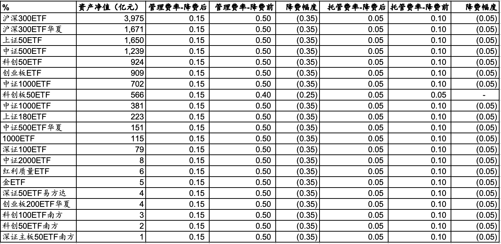

# 多元金融

**ETF 月报：新发热度延续，格局龙头集中**

华泰研究

多元金融 增持 (维持)

**研究员**

沈娟 SAC No. S0570514040002 SFC No. BPN843 shenjuan@htsc.com +(86) 755 2395 2763

汪煜 SAC No. S0570523010003 SFC No. BRZ146 wangyu017005@htsc.com +(86) 21 2897 2228

**联系人**

孙亦欣 SAC No. S0570123070041 sunyixin@htsc.com +(86) 755 8249 2388

**行业走势图**

资料来源：Wind，华泰研究

2024 年12 月09 日│中国内地 行业月报

# 核心观点

概览11 月ETF 市场变化，规模延续强劲增长态势，环比+3%、较年初接近翻倍，交投活跃度保持较高水平。市场行情及A500 新发推动股票ETF 规模增长，是核心驱动力，新一批上证180 产品也正在布局之中。格局上，龙头集中度提升，前三家地位稳固、中游排名变化较大，竞争逐渐白热化。宽基主动降费，仍处于长期下行趋势当中，买方投顾转型或是大势所趋。监管政策呵护行业发展，产品发行提速，未来有望迎来更多跨境ETF 产品。

**规模延续增长，新发产品火热**

11月末股票ETF资产净值合计2.86万亿元，环比增长3%、较年初增长97%，且贡献全部ETF 资产净值增量的87%，是本轮市场扩张的核心驱动力。11 月ETF 成交额约5 万亿、换手率达85%，保持高位；融资规模重回千亿。同时，中证A500ETF 新发如火如荼，前两批产品共22 只、总规模达2043 亿元，第三批产品稳步推进。此外，上证180 指数优化编制规则，已有8 家基金公司申报上证180ETF 产品，未来增量可期。

**前三格局稳固，中游竞争激烈**

ETF 市场集中度较年初抬升，11 月末资产净值CR3/CR5/CR10 分别达47.0%/60.0%/79.4%，较年初+5.3/+5.0/+1.6pct，呈现较强的马太效应。分公司看，规模前3 名华夏/易方达/华泰柏瑞地位稳固；前4-15 名中，嘉实、南方、富国、广发排名相较年初有所提升，其中嘉实和南方分别提升5 名、3 名，提升较大；华宝、国泰排名有所下滑，竞争逐渐白热化。细分产品看，国泰在本轮新发的A500ETF 浪潮中占据领先地位，11 月末资产净值278 亿元，市占率为13.6%。

**宽基主动降费，买方投顾转型**

11 月19 日，多只宽基股票ETF 宣布降费，管理费率统一调降至0.15%（降幅普遍为0.35pct）、托管费率统一调降至0.05%（降幅普遍为0.05pct），涉及的ETF 基金总规模超万亿元。中长期看费率仍有下行趋势，头部公司具备更强的规模效应和成本优势；中小公司可在行业主题、Smart Beta、指数增强等方向进行差异化布局。7 月公募佣金新规落地后，ETF 的首发销售与激励模式得到重塑，买方投顾是行业转型趋势，部分券商已积极进行布局。

**监管支持发展，产品丰富可期**

下半年以来，ETF 产品的推出时间显著提速，监管层持续"开绿灯"。统计ETF 基金获批注册日到发行公告日平均间隔，9 月以来快速减少，尤其是11 月数只A500ETF 产品快速审批发行，平均间隔仅1 天，体现监管层对行业发展的呵护与支持。同时，证监会表示将持续推进市场、机构、产品全方位制度型开放，支持推出更多跨境ETF 产品，未来产品体系丰富可期。

风险提示：政策支持不及预期、市场表现不及预期。

# 11 月ETF 市场动态观察

11 月ETF 市场延续强劲增长态势，月末规模环比增长3%、较年初接近翻倍，交投活跃度保持较高水平。市场行情及A500 新发推动股票ETF 规模增长，是核心驱动力，新一批上证180 产品也正在路上。格局上，龙头集中度提升，前三家地位稳固、中游排名变化较大，竞争逐渐白热化。宽基主动降费，未来或仍处于长期下行趋势当中，买方投顾转型或是大势所趋。监管政策呵护行业发展，产品发行提速，未来有望迎来更多跨境ETF 产品。

## 规模结构：股票ETF 延续强劲增长

股票ETF 延续强劲增长。截至24M11 末，股票ETF 资产净值合计28,599 亿元，较年初增长1.4 万亿元、增长97%，接近翻倍，且贡献全部ETF 资产净值增量的87%，是本轮ETF 扩张的核心驱动力；月度环比增长3%，延续年初以来的强劲增长态势。全市场ETF 资产净值合计36,692 亿元，较年初增长1.62 万亿元（+79%）。

**图表1：年初以来股票ETF 资产净值**

资料来源：Wind，华泰研究

市场行情及A500 新发是核心驱动。其中9 月24 日政策组合拳落地以来，市场表现驱动基金净值显著增长：9/24-11/30 股票ETF 资产净值大幅增长8,327 亿元，份额增长2,447 亿份。同时，中证A500ETF 新发也是份额增长的核心驱动：核心宽基ETF 中，期间份额增长1440 亿份；此外，沪深300ETF 份额增长95 亿份，叠加单位净值提升，资产净值合计增长1893 亿元。

**图表2：主要规模指数ETF：9/24-11/30 资产净值累计净变动**

**图表3：主要规模指数ETF：9/24-11/30 份额累计净变动**

注：科创板包括所有挂钩科创板类指数的ETF，如科创50ETF、科创100ETF 等，创业板同理，右同
资料来源：Wind，华泰研究

宽基主导地位巩固、债券ETF 创新高。分产品结构来看，股票型ETF 资产净值占全部ETF 的比例78%，规模指数ETF 是主力，11 月末资产净值为21,635 亿元，较年初+157%、占比达59%。其中，沪深300ETF 规模最大，合计达9829 亿元，占全部规模指数ETF 的45%；中证A500ETF 次之，合计达2043 亿元，占比9%，快速赶超科创50ETF。同时，债市利率继续下探，11 月末债券型ETF 规模创新高，资产净值突破1500 亿元达1511 亿元，但占比仍然较低，仅4%。

**图表4：ETF 资产净值结构**

**图表5：ETF 资产净值结构占比**

资料来源：Wind，华泰研究

**图表6：ETF 份额及资产净值结构（2024/11/30）**

| 类别 | 份额合计（亿份） | 较年初（%） | 占比（%） | 资产净值合计（亿元） | 较年初（%） | 占比（%） |
| :--- | :--- | :--- | :--- | :--- | :--- | :--- |
| 股票型ETF | 19,154 | 40 | 74 | 28,599 | 97 | 78 |
| 规模指数ETF | **11,060** | **93** | **42** | **21,635** | **157** | **59** |
| 行业指数ETF | 2,193 | -6 | 8 | 1,915 | 8 | 5 |
| 策略指数ETF | 480 | 61 | 2 | 690 | 58 | 2 |
| 风格指数ETF | 20 | -1 | 0.1 | 18 | 10 | 0.0 |
| 主题指数ETF | 5,401 | 1 | 21 | 4,342 | 11 | 12 |
| 债券型ETF | 61 | 193 | 0.2 | 1,511 | 89 | 4 |
| 商品型ETF | 132 | 85 | 0.5 | 693 | 127 | 2 |
| 货币型ETF | 1,707 | -17 | 7 | 1,718 | -17 | 5 |
| 跨境ETF | 4,892 | 14 | 19 | 4,058 | 45 | 11 |
| 全部**ETF** | **26,060** | **29** | **100** | **36,692** | **79** | **100** |

资料来源：Wind，华泰研究

**图表7：规模指数ETF 资产净值结构（2024/11/30）**

资料来源：Wind，华泰研究

## 竞争格局：龙头稳固而中游白热化

龙头集中度提升、中游排名变化大。基金公司集中度较年初抬升，11 月末ETF 资产净值CR3、CR5、CR10 分别达47.0%、60.0%、79.4%，较年初+5.3pct、+5.0pct、+1.6pct。从排名变化来看，前3 名华夏、易方达、华泰柏瑞地位稳固。中游的基金公司排名变动较大，前4-15 名的基金公司中，嘉实、南方、富国、广发排名相较年初有所提升，其中嘉实和南方分别提升5 名、3 名，提升较大，嘉实沪深300ETF 资产净值较年初大幅提升1135 亿元（+274%），南方中证500、中证1000ETF 分别较年初增长600 亿元（+128%）、482 亿元（+525%）。华宝、国泰排名有所下滑，竞争逐渐白热化。

**图表8：ETF 基金管理人资产净值集中度变化**

资料来源：Wind，华泰研究

**图表9：ETF 资产净值前15 基金公司排名（2024/11/30）**

| 基金公司 | ETF 净值（亿元） | 较年初变化 | ETF 净值排名 | 较年初变化（正数为上升） | ETF 净值市占率 | 较年初变化 |
| :--- | :--- | :--- | :--- | :--- | :--- | :--- |
| 华夏基金 | 6,696 | 67% | 1 | - | 18.2% | -1.3% |
| 易方达基金 | 6,003 | 132% | 2 | - | 16.4% | 3.7% |
| 华泰柏瑞基金 | 4,538 | 133% | 3 | - | 12.4% | 2.9% |
| 南方基金 | 2,426 | 139% | 4 | 3 | 6.6% | 1.7% |
| 嘉实基金 | 2,365 | 215% | 5 | 5 | 6.4% | 2.8% |
| 华宝基金 | 1,633 | 4% | 6 | -2 | 4.4% | -3.2% |
| 广发基金 | 1,540 | 57% | 7 | 1 | 4.2% | -0.6% |
| 国泰基金 | 1,503 | 30% | 8 | -3 | 4.1% | -1.5% |
| 博时基金 | 1,224 | 57% | 9 | - | 3.3% | -0.5% |
| 富国基金 | 1,195 | 93% | 10 | 2 | 3.3% | 0.2% |
| 银华基金 | 1,139 | 0% | 11 | -5 | 3.1% | -2.4% |
| 华安基金 | 1,097 | 51% | 12 | -1 | 3.0% | -0.5% |
| 天弘基金 | 621 | 40% | 13 | - | 1.7% | -0.5% |
| 汇添富基金 | 621 | 45% | 14 | - | 1.7% | -0.4% |
| 鹏华基金 | 553 | 29% | 15 | - | 1.5% | -0.6% |

资料来源：Wind，华泰研究

国泰在A500ETF 占据领先地位。首批中证A500ETF 设立以来，规模增长迅速，11 月末资产净值合计2043 亿元，反超科创50ETF。当前首批产品上市运行仅逾2 月，但国泰基金与其他管理人的差距已逐渐拉开，11 月末资产净值278 亿元且领先第二名较多，市占率为13.6%。值得注意的是，本轮A500 相关基金发行浪潮中，不同基金公司布局分化，反映的是不同规模和禀赋条件公司的指数布局策略差异性。对中小公募而言，囿于ETF 开发成本或渠道资源优势等因素，申报的大多是普通指数基金或者指数增强基金。

**图表10：中证A500 ETF 资产净值基金公司排名（2024/11/30）**

| 基金公司 | ETF 净值排名 | 上市日期 | ETF 净值（亿元） | ETF 净值市占率 |
| :--- | :--- | :--- | :--- | :--- |
| 国泰基金 | 1 | 2024-09-26 | 278 | 13.6% |
| 南方基金 | 2 | 2024-09-25 | 169 | 8.3% |
| 景顺长城基金 | 3 | 2024-09-24 | 156 | 7.6% |
| 富国基金 | 4 | 2024-09-25 | 151 | 7.4% |
| 广发基金 | 5 | 2024-11-11 | 144 | 7.1% |
| 招商基金 | 6 | 2024-09-26 | 144 | 7.1% |
| 华夏基金 | 7 | 2024-11-08 | 121 | 5.9% |
| 摩根基金 | 8 | 2024-09-24 | 120 | 5.9% |
| 华泰柏瑞基金 | 9 | 2024-09-25 | 117 | 5.8% |
| 嘉实基金 | 10 | 2024-09-20 | 113 | 5.5% |

资料来源：Wind，华泰研究

## 新发产品：A500 火热、上证180 待发

第三批A500ETF 持续推进。第一批中证A500ETF 有10 只，来自嘉实基金、招商基金等10 家公募，均于9 月底成立。第二批中证A500 大约有12 只，来自华夏基金、易方达基金、鹏华基金等基金公司，已悉数成立。22 只ETF 的募集规模均为20 亿元左右，但在上市后持续获得资金净流入，总规模已由440 亿元提升至24M11 末的2043 亿元。第三批A500ETF 正在推进、还有围绕A500 的指数增强型基金产品。

**图表11：A500ETF 基金产品快速扩容，目前已突破2000 亿**

资料来源：Wind，华泰研究

积极布局上证180 产品。上证180 指数发布于2002 年7 月，已有20 多年历史，但总数量及规模较小，截至10 月末跟踪上证180 指数的基金产品仅有5 只，总规模约为222 亿元，其中华安上证180ETF 达213 亿元，中央汇金为第一大持有人，24H1 末持有比例达90%。近期上证180 指数优化编制规则，降低金融、主要消费、公用事业、能源等传统行业权重占比，以信息技术、医药卫生、工业、可选消费为代表的新质生产力所在行业权重明显提升。目前已有易方达基金、南方基金、鹏华基金、平安基金等8 家基金公司申报了上证180ETF，未来增量可期。

## 交投活跃：换手率较高，融资重回千亿

11 月ETF 成交额约5 万亿、换手率达85%。投资者对ETF 产品的关注度和参与热情不断高涨，10 月ETF 成交额快速放量，单月成交额5.3 万亿元，环比大幅增长91%；月度换手率达99%；11 月依然保持较高的交投活跃度，全月成交额4.8 万亿、换手率85%。外资对A 股市场的配置，也为ETF 市场带来流动性，根据港交所发布《内地与香港资本市场互联互通十周年白皮书》，24Q3 单季度北向ETF 交易日均成交17.6 亿元，季度环比增长61%。

| 时间 | 基金规模（亿元） | 基金数量 |
| :--- | :--- | :--- |
| 2024M9 | 200 | 10 |
| 2024M10 | 653 | 22 |
| 2024M11 | 2043 | 22 |

免责声明和披露以及分析师声明是报告的一部分，请务必一起阅读。

6

多元金融

图表12：ETF成交额和换手率均达到较高水平

资料来源：Wind，华泰研究

**ETF融资规模重回千亿。**截至24M11末，ETF融资余额重回千亿大关，达1,078亿元，占全市场融资余额比例5.88%。结构上相较2020—2021年发生较大变化，11月末融资余额较高的ETF包括两只黄金ETF（83亿、78亿）、沪深300ETF（66亿）、科创50ETF（53亿），对比2020年末融资余额最高的产品为H股ETF，单只融资余额达300亿。

图表13：ETF融资余额及占全市场融资余额比例

资料来源：Wind，华泰研究

费率水平：宽基降费，长期下行趋势

宽基降费，费率仍有下行趋势。11月19日，多只宽基股票ETF宣布降费。华夏基金、华泰柏瑞基金、易方达基金、嘉实基金、南方基金、华安基金等公告，将旗下大型宽基股票ETF管理费率统一调降至0.15%（降幅普遍为0.35pct）、托管费率统一调降至0.05%（降幅普遍为0.05pct），涉及的ETF基金总规模超万亿元。展望未来，中长期看费率仍有下行趋势，头部公司具备更强的规模效应和成本优势，宽基ETF赛道有望进一步向龙头集中。

参考海外经验，美国宽基ETF赛道集中度较高，而其他类型的产品更为分散。对于中小公司而言，可在行业主题、Smart Beta、指数增强等方向进行差异化布局。

0%

20%

40%

60%

80%

100%

120%

0

10,000

20,000

30,000

40,000

50,000

60,000

2021-08

2021-09

2021-10

2021-11

2021-12

2022-01

2022-02

2022-03

2022-04

2022-05

2022-06

2022-07

2022-08

2022-09

2022-10

2022-11

2022-12

2023-01

2023-02

2023-03

2023-04

2023-05

2023-06

2023-07

2023-08

2023-09

2023-10

2023-11

2023-12

2024-01

2024-02

2024-03

2024-04

2024-05

2024-06

2024-07

2024-08

2024-09

2024-10

2024-11

亿元

ETF月度成交额

月度换手率

1078

-1%

0%

1%

2%

3%

4%

5%

6%

7%

8%

9%

10%

11%

12%

0

200

400

600

800

1,000

1,200

1,400

1,600

1,800

2019

2020

2021

2022

2023

24H1

24Q3

24M11

亿元

ETF融资余额

占全市场融资余额比例

免责声明和披露以及分析师声明是报告的一部分，请务必一起阅读。

7

多元金融

图表14：近期ETF降费情况统计

资料来源：Wind，华泰研究

配套生态：做市扩容、完善投顾服务

**ETF做市业务扩容。**流动性是投资者购买ETF时的重要考量，缺乏流动性可能会带来难以成交、买卖价差较大的问题。公募基金一般通过聘用做市商来增加ETF流动性，从而提高基金的吸引力，助力提升规模。近期新成立的A500ETF产品，普遍选用7—23家做市商提供流动性服务，相较此前成立的产品普遍的2—3家显著扩容。券商可以通过收取总包费用、交易价差等方式实现创收。

图表15：A500ETF产品做市商家数

资料来源：Wind，华泰研究

0

5

10

15

20

25

华夏中证A500ETF

易方达中证A500ETF

广发中证A500ETF

华泰柏瑞中证A500ETF

富国中证A500ETF

嘉实中证A500ETF

南方中证A500ETF

招商中证A500ETF

国泰中证A500ETF

摩根中证A500ETF

景顺长城中证A500ETF

大成中证A500ETF

泰康中证A500ETF

银华中证A500ETF

华安中证A500ETF

华宝中证A500ETF

博时中证A500ETF

天弘中证A500ETF

汇添富中证A500ETF

鹏华中证A500ETF

工银中证A500ETF

家

做市商家数

免责声明和披露以及分析师声明是报告的一部分，请务必一起阅读。

8

多元金融

**ETF买方投顾是行业转型趋势。**今年7月公募基金降佣新规落地，使得ETF的首发销售与激励模式得到重塑，逐步推动行业从以往的销售导向转为以投资者财富管理为导向的销售模式。从海外经验看，美国买方投顾格局逐步形成，投资顾问管理的客户资产投向ETF的比例也在过去大幅提升。ETF具有管理费低、交易灵活、敞口明确等特点，本身与买方投顾业务也非常契合，成为财富管理机构为客户提供资产配置的重要工具，逐步实现“以费代佣”模式。如中国银河已成立ETF工作小组，汇集了财富管理、做市、两融、衍生品和研究等多个业务领域的骨干，为客户提供全方位的服务解决方案；华宝证券把ETF列为公司的重要战略业务，以华宝智投APP为核心平台，开发ETF专区、ETF网格交易机器人等智能化工具，帮助投资者实现更高效、灵活的交易体验；另外，部分头部券商推出“投顾+两融+ETF”，为投资者提供增量配套服务。

政策动向：发行提速、发展跨境ETF

**ETF产品发行提速。**今年4月国务院出台新“国九条”，指出要建立ETF快速审批通道，推动指数化投资发展，为蓬勃发展ETF行业按下“加速键”。从下半年以来，ETF产品的推出时间显著提速，监管层持续“开绿灯”。我们统计ETF基金获批注册日到发行公告日平均间隔，9月以来快速减少，尤其是11月数只A500ETF产品快速审批发行，平均间隔仅1天，体现监管层对行业发展的呵护与支持。

图表16：ETF基金获批注册日到发行公告日平均间隔统计

注：使用发行公告日减去基金获批注册日计算，以基金获批注册的当月统计，计算不同ETF基金的平均间隔

资料来源：Wind，华泰研究

未来将推出更多跨境ETF产品。11月7日，证监会副主席李明在2024年上海证券交易所国际投资者大会上致辞，表示将坚定不移推进资本市场对外开放。目前，中日、中新、深港、沪港ETF互通相继开通并顺利运行，已合计推出24只ETF互通产品。11月初，首批14家证券公司试点参与粤港澳大湾区“跨境理财通”业务落地。未来，将持续推进市场、机构、产品全方位制度型开放，便利跨境投融资，扩大沪深港通投资标的范围，优化内地与香港基金互认安排，支持推出更多跨境ETF产品。

风险提示

1）市场表现不及预期。公募基金产品业绩与股市环境高度相关，市场表现不及预期将会影响产品业绩表现。

2）政策支持不及预期。本轮政策力度是推动市场上涨的重要动力，若后续政策落地力度不及预期或效果不及预期，可能加大市场波动。

0

20

40

60

80

100

120

140

160

180

200

2021-1

2021-3

2021-5

2021-7

2021-9

2021-11

2022-1

2022-3

2022-5

2022-7

2022-9

2022-11

2023-1

2023-3

2023-5

2023-7

2023-9

2023-11

2024-1

2024-3

2024-5

2024-7

2024-9

2024-11

天

基金获批注册日到发行公告日的日期间隔

11月数只A500ETF快速审批发行，平均间隔仅1天

免责声明和披露以及分析师声明是报告的一部分，请务必一起阅读。

9

多元金融

## 免责声明

# 分析师声明

本人，沈娟、汪煜，兹证明本报告所表达的观点准确地反映了分析师对标的证券或发行人的个人意见；彼以往、现在或未来并无就其研究报告所提供的具体建议或所表达的意见直接或间接收取任何报酬。

# 一般声明及披露

本报告由华泰证券股份有限公司（已具备中国证监会批准的证券投资咨询业务资格，以下简称“本公司”）制作。本报告所载资料是仅供接收人的严格保密资料。本报告仅供本公司及其客户和其关联机构使用。本公司不因接收人收到本报告而视其为客户。

本报告基于本公司认为可靠的、已公开的信息编制，但本公司及其关联机构（以下统称为“华泰”）对该等信息的准确性及完整性不作任何保证。

本报告所载的意见、评估及预测仅反映报告发布当日的观点和判断。在不同时期，华泰可能会发出与本报告所载意见、评估及预测不一致的研究报告。同时，本报告所指的证券或投资标的的价格、价值及投资收入可能会波动。以往表现并不能指引未来，未来回报并不能得到保证，并存在损失本金的可能。华泰不保证本报告所含信息保持在最新状态。华泰对本报告所含信息可在不发出通知的情形下做出修改，投资者应当自行关注相应的更新或修改。

本公司不是FINRA的注册会员，其研究分析师亦没有注册为FINRA的研究分析师，不具有FINRA分析师的注册资格。

华泰力求报告内容客观、公正，但本报告所载的观点、结论和建议仅供参考，不构成购买或出售所述证券的要约或招揽。该等观点、建议并未考虑到个别投资者的具体投资目的、财务状况以及特定需求，在任何时候均不构成对客户私人投资建议。投资者应当充分考虑自身特定状况，并完整理解和使用本报告内容，不应视本报告为做出投资决策的唯一因素。对依据或者使用本报告所造成的一切后果，华泰及作者均不承担任何法律责任。任何形式的分享证券投资收益或者分担证券投资损失的书面或口头承诺均为无效。

除非另行说明，本报告中所引用的关于业绩的数据代表过往表现，过往的业绩表现不应作为日后回报的预示。华泰不承诺也不保证任何预示的回报会得以实现，分析中所做的预测可能是基于相应的假设，任何假设的变化可能会显著影响所预测的回报。

华泰及作者在自身所知情的范围内，与本报告所指的证券或投资标的不存在法律禁止的利害关系。在法律许可的情况下，华泰可能会持有报告中提到的公司所发行的证券头寸并进行交易，为该公司提供投资银行、财务顾问或者金融产品等相关服务或向该公司招揽业务。

华泰的销售人员、交易人员或其他专业人士可能会依据不同假设和标准、采用不同的分析方法而口头或书面发表与本报告意见及建议不一致的市场评论和/或交易观点。华泰没有将此意见及建议向报告所有接收者进行更新的义务。华泰的资产管理部门、自营部门以及其他投资业务部门可能独立做出与本报告中的意见或建议不一致的投资决策。投资者应当考虑到华泰及/或其相关人员可能存在影响本报告观点客观性的潜在利益冲突。投资者请勿将本报告视为投资或其他决定的唯一信赖依据。有关该方面的具体披露请参照本报告尾部。

本报告并非意图发送、发布给在当地法律或监管规则下不允许向其发送、发布的机构或人员，也并非意图发送、发布给因可得到、使用本报告的行为而使华泰违反或受制于当地法律或监管规则的机构或人员。

本报告版权仅为本公司所有。未经本公司书面许可，任何机构或个人不得以翻版、复制、发表、引用或再次分发他人（无论整份或部分）等任何形式侵犯本公司版权。如征得本公司同意进行引用、刊发的，需在允许的范围内使用，并需在使用前获取独立的法律意见，以确定该引用、刊发符合当地适用法规的要求，同时注明出处为“华泰证券研究所”，且不得对本报告进行任何有悖原意的引用、删节和修改。本公司保留追究相关责任的权利。所有本报告中使用的商标、服务标记及标记均为本公司的商标、服务标记及标记。

# 中国香港

本报告由华泰证券股份有限公司制作，在香港由华泰金融控股（香港）有限公司向符合《证券及期货条例》及其附属法律规定的机构投资者和专业投资者的客户进行分发。华泰金融控股（香港）有限公司受香港证券及期货事务监察委员会监管，是华泰国际金融控股有限公司的全资子公司，后者为华泰证券股份有限公司的全资子公司。在香港获得本报告的人员若有任何有关本报告的问题，请与华泰金融控股（香港）有限公司联系。

# 香港—重要监管披露

- 华泰金融控股（香港）有限公司的雇员或其关联人士没有担任本报告中提及的公司或发行人的高级人员。
- 有关重要的披露信息，请参华泰金融控股（香港）有限公司的网页：https://www.htsc.com.hk/stock_disclosure

其他信息请参见下方“美国—重要监管披露”。

# 美国

在美国，本报告由华泰证券（美国）有限公司向符合美国监管规定的机构投资者进行发表与分发。华泰证券（美国）有限公司是美国注册经纪商和美国金融业监管局（FINRA）的注册会员。对于其在美国分发的研究报告，华泰证券（美国）有限公司根据《1934年证券交易法》（修订版）第15a-6条规定以及美国证券交易委员会人员解释，对本研究报告内容负责。华泰证券（美国）有限公司联营公司的分析师不具有美国金融监管（FINRA）分析师的注册资格，可能不属于华泰证券（美国）有限公司的关联人员，因此可能不受FINRA关于分析师与标的公司沟通、公开露面和所持交易证券的限制。华泰证券（美国）有限公司是华泰国际金融控股有限公司的全资子公司，后者为华泰证券股份有限公司的全资子公司。任何直接从华泰证券（美国）有限公司收到此报告并希望就本报告所述任何证券进行交易的人士，应通过华泰证券（美国）有限公司进行交易。

# 美国—重要监管披露

- 分析师沈娟、汪煜本人及相关人士并不担任本报告所提及的标的证券或发行人的高级人员、董事或顾问。分析师及相关人士与本报告所提及的标的证券或发行人并无任何相关财务利益。本披露中所提及的“相关人士”包括FINRA定义下分析师的家庭成员。分析师根据华泰证券的整体收入和盈利能力获得薪酬，包括源自公司投资银行业务的收入。
- 华泰证券股份有限公司、其子公司和/或其联营公司，及/或不时会以自身或代理形式向客户出售及购买华泰证券研究所覆盖公司的证券/衍生工具，包括股票及债券（包括衍生品）。
- 华泰证券股份有限公司、其子公司和/或其联营公司，及/或其高级管理层、董事和雇员可能会持有本报告中所提到的任何证券（或任何相关投资）头寸，并可能不时进行增持或减持该证券（或投资）。因此，投资者应该意识到可能存在利益冲突。

# 新加坡

华泰证券（新加坡）有限公司持有新加坡金融管理局颁发的资本市场服务许可证，可从事资本市场产品交易，包括证券、集体投资计划中的单位、交易所交易的衍生品合约和场外衍生品合约，并且是《财务顾问法》规定的豁免财务顾问，就投资产品向他人提供建议，包括发布或公布研究分析或研究报告。华泰证券（新加坡）有限公司可能会根据《财务顾问条例》第32C条的规定分发其在华泰内的外国附属公司各自制作的信息/研究。本报告仅供认可投资者、专家投资者或机构投资者使用，华泰证券（新加坡）有限公司不对本报告内容承担法律责任。如果您是非预期接收者，请您立即通知并直接将本报告返回给华泰证券（新加坡）有限公司。本报告的新加坡接收者应联系您的华泰证券（新加坡）有限公司关系经理或客户主管，了解来自或与所分发的信息相关的事宜。

# 评级说明

投资评级基于分析师对报告发布日后6至12个月内行业或公司回报潜力（含此期间的股息回报）相对基准表现的预期（A股市场基准为沪深300指数，香港市场基准为恒生指数，美国市场基准为标普500指数，台湾市场基准为台湾加权指数，日本市场基准为日经225指数，新加坡市场基准为海峡时报指数，韩国市场基准为韩国有价证券指数，英国市场基准为富时100指数），具体如下：

## 行业评级

增持：预计行业股票指数超越基准

中性：预计行业股票指数基本与基准持平

减持：预计行业股票指数明显弱于基准

## 公司评级

买入：预计股价超越基准15%以上

增持：预计股价超越基准5%~15%

持有：预计股价相对基准波动在-15%~5%之间

卖出：预计股价弱于基准15%以上

暂停评级：已暂停评级、目标价及预测，以遵守适用法规及/或公司政策

无评级：股票不在常规研究覆盖范围内。投资者不应期待华泰提供该等证券及/或公司相关的持续或补充信息

免责声明和披露以及分析师声明是报告的一部分，请务必一起阅读。

10

多元金融

# 法律实体披露

中国：华泰证券股份有限公司具有中国证监会核准的“证券投资咨询”业务资格，经营许可证编号为：91320000704041011J

香港：华泰金融控股（香港）有限公司具有香港证监会核准的“就证券提供意见”业务资格，经营许可证编号为：AOK809

美国：华泰证券（美国）有限公司为美国金融业监管局（FINRA）成员，具有在美国开展经纪交易商业务的资格，经营业务许可编号为：CRD#:298809/SEC#:8-70231

新加坡：华泰证券（新加坡）有限公司具有新加坡金融管理局颁发的资本市场服务许可证，并且是豁免财务顾问。公司注册号：202233398E

华泰证券股份有限公司

南京

北京

南京市建邺区江东中路228号华泰证券广场1号楼/邮政编码：210019

北京市西城区太平桥大街丰盛胡同28号太平洋保险大厦A座18层/邮政编码：100032

电话：86 25 83389999/传真：86 25 83387521

电话：86 10 63211166/传真：86 10 63211275

电子邮件：ht-rd@htsc.com

电子邮件：ht-rd@htsc.com

深圳

上海

深圳市福田区益田路5999号基金大厦10楼/邮政编码：518017

上海市浦东新区东方路18号保利广场E栋23楼/邮政编码：200120

电话：86 755 82493932/传真：86 755 82492062

电话：86 21 28972098/传真：86 21 28972068

电子邮件：ht-rd@htsc.com

电子邮件：ht-rd@htsc.com

华泰金融控股（香港）有限公司

香港中环皇后大道中99号中环中心53楼

电话：+852-3658-6000/传真：+852-2567-6123

电子邮件：research@htsc.com

http://www.htsc.com.hk

华泰证券（美国）有限公司

美国纽约公园大道280号21楼东（纽约10017）

电话：+212-763-8160/传真：+917-725-9702

电子邮件：Huatai@htsc-us.com

http://www.htsc-us.com

华泰证券（新加坡）有限公司

滨海湾金融中心1号大厦，#08-02，新加坡018981

电话：+65 68603600

传真：+65 65091183

©版权所有2024年华泰证券股份有限公司
